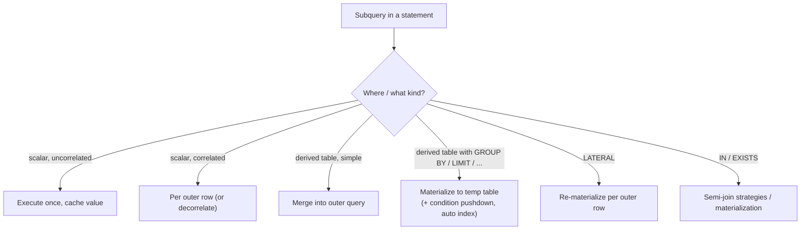

## Introduction

A **subquery** is a `SELECT` nested inside another statement. It lets you use the *result of one question* as an *input to another*:

- "Which products cost more than the **average** price?" — the average is itself a query.
- "Show every order with the customer's **total number of orders** next to it."
- "Revenue per customer, but only over each customer's **three most recent** orders."
- "Raise the price of every product whose price is below its **category average**."

Subqueries come in different shapes, and the shape is determined by **how many rows and columns** the inner query returns:

| Kind | Returns | Typical place |
|---|---|---|
| **Scalar** subquery | exactly one value (1 row × 1 column) — or no row, meaning NULL | anywhere an expression is allowed: SELECT list, WHERE, ORDER BY, SET |
| **Row** subquery | one row with several columns | comparisons `(a, b) = (SELECT x, y …)` |
| **Table** (column/multi-row) subquery | many rows | `IN`, `ANY`, `ALL`, `EXISTS` |
| **Derived table** | a whole table, used in `FROM` | `FROM (SELECT …) AS alias` |
| **LATERAL derived table** (8.0.14+) | a table computed **per row** of the preceding tables | `JOIN LATERAL (SELECT …) AS alias` |

This lesson covers all five, the errors that occur when a subquery returns the wrong shape (1242, 1241, 1248, 1093), and what the optimizer does with them — because a subquery is a *logical* nesting; MySQL frequently executes it as something else entirely. Subqueries that refer to the outer query (**correlated** subqueries) and `EXISTS`/`IN` get their own lessons next.

:::note[Dataset]
The **shop** dataset (30 products, 80 orders, 25 customers). All outputs are captured from a real MySQL server.
:::

## DBMS Theory

:::theory[Closure and composition]
The relational algebra is **closed**: every operator takes relations and returns a relation. Closure means expressions can be nested arbitrarily — the output of one query is a valid input of another. A subquery is SQL's syntax for that composition. A derived table in `FROM` is simply a relation-valued expression where a base relation could appear; a scalar subquery is a relation that the language **coerces** to a single value because it has exactly one attribute and at most one tuple.
:::

Three formal points determine how subqueries behave:

1. **Cardinality contracts.** Wherever SQL expects a value, a scalar subquery must return **at most one row and exactly one column**. Zero rows is allowed and yields **NULL** (the "empty scalar" rule of the SQL standard). More than one row is a run-time error, more than one column a compile-time error. A row subquery must return at most one row with the number of columns the comparison expects.
2. **Scope.** A subquery can reference columns of its *own* `FROM` clause and of any **enclosing** query (that makes it correlated). It cannot reference tables of sibling items in the same `FROM` clause — a derived table is evaluated as an independent relation — unless it is declared **LATERAL**, which is the standard SQL:1999 construct for "this table expression may depend on the tables to its left".
3. **Equivalences.** Many subqueries are equivalent to joins, semi-joins or aggregations over joins. Those equivalences are the basis of the optimizer's rewrites — and they hold only under precise conditions (e.g. uniqueness, NULL-freeness), which is why the optimizer sometimes cannot apply them.

:::standard[Standard SQL vs MySQL]
Scalar, row and table subqueries, derived tables, `IN`/`ANY`/`ALL`/`EXISTS` and `LATERAL` are standard SQL. MySQL specifics: `LATERAL` requires 8.0.14+; derived tables must have an alias (error 1248, also required by the standard); a subquery cannot read from the table being modified by the same `UPDATE`/`DELETE` (error 1093 — a MySQL restriction not present in PostgreSQL); `LIMIT` is not supported inside `IN`/`ALL`/`ANY`/`SOME` subqueries (error 1235).
:::

## Why It Exists

Before subqueries (SQL-86 had only limited forms), questions like "products above average price" required two round trips: compute the average, store it in the application, send a second query with the number pasted in. That has three problems:

- **Consistency.** Between the two statements other transactions can change the data; the second query then filters with a stale average. A single statement reads one consistent snapshot.
- **Performance and simplicity.** Two network round trips, and application code that glues SQL fragments together.
- **Expressiveness.** Some questions are naturally layered: "the average of per-customer totals" needs an aggregate *of* an aggregate, which cannot be written in one `SELECT … GROUP BY` level. A derived table provides the inner level.

Subqueries let you **build a query step by step**, the way you reason about the problem: first compute per-customer totals, then work with those totals as a table. The optimizer's job is to make that readable form run efficiently.

## Internal Working

:::internals[What MySQL does with each subquery]
MySQL resolves and transforms subqueries during optimization. Depending on the kind:

- **Uncorrelated scalar subquery** (e.g. `(SELECT AVG(price) FROM products)`): executed **once**, and its value cached. `EXPLAIN FORMAT=TREE` shows `Select #2 (subquery in condition; run only once)`; traditional `EXPLAIN` shows `select_type = SUBQUERY`.
- **Correlated scalar subquery**: evaluated per outer row (`dependent` in the tree, `DEPENDENT SUBQUERY` in traditional EXPLAIN) unless transformed — next lesson.
- **Derived table / view / CTE reference**: either **merged** into the outer query (the subquery disappears; its tables join the outer FROM — the default for simple derived tables, `derived_merge=on`), or **materialized** into an internal temporary table (required when the derived table contains GROUP BY, aggregates, DISTINCT, LIMIT, UNION, window functions…). A materialized derived table can get an automatic index (`<auto_key>`) for lookups.
- **Derived condition pushdown** (8.0.22+): a WHERE condition on a materialized derived table is pushed *into* it — into its WHERE, or into its HAVING when it refers to aggregates — so fewer rows are materialized.
- **LATERAL derived table**: materialized **again for each row** of the table it depends on (`Materialize (invalidate on row from c)` in the plan).
- **IN / EXISTS subqueries in WHERE**: candidates for **semi-join** transformation (FirstMatch, LooseScan, Materialization, DuplicateWeedout) or for subquery materialization — the topic of [EXISTS, NOT EXISTS, IN and NOT IN](/lessons/m04-exists-in).
:::



The important lesson from the internals: **the nesting you write is not the execution order**. A derived table may vanish into a join; a filter written outside may be executed inside. `EXPLAIN` is how you see what really happens.

## MySQL Implementation

### Scalar subquery in WHERE

```sql run
SELECT name, price
FROM products
WHERE price > (SELECT AVG(price) FROM products)
ORDER BY price DESC;
```

The inner query returns one value (the average price); the outer query compares every product with it.

### Scalar subquery in the SELECT list

A value from another table — or an aggregate over the same table — next to each row:

```sql run
SELECT p.name, p.price,
       ROUND(p.price - (SELECT AVG(price) FROM products), 2) AS diff_from_avg,
       (SELECT c.name FROM categories c WHERE c.category_id = p.category_id) AS category
FROM products AS p
WHERE p.product_id IN (1, 5, 29)
ORDER BY p.product_id;
```

The second subquery is **correlated** (it uses `p.category_id`) and returns NULL for the gift card, whose category is NULL: a scalar subquery that finds **no row** yields NULL rather than an error or a missing row — it behaves like a `LEFT JOIN` to a unique key.

### Row subquery

Compare several columns at once. "Orders with the same customer **and** status as order 2":

```sql run
SELECT order_id, customer_id, status, order_date
FROM orders
WHERE (customer_id, status) = (SELECT customer_id, status FROM orders WHERE order_id = 2)
ORDER BY order_id;
```

`(customer_id, status)` is a **row constructor**; it is compared with the single row the subquery returns. Row constructors also work with `IN` and a multi-row subquery: `WHERE (a, b) IN (SELECT x, y FROM …)`.

### Derived table in FROM

"What is the average number of orders **per customer who ordered**, and the maximum?" — an aggregate of an aggregate:

```sql run
SELECT COUNT(*)                AS customers_with_orders,
       ROUND(AVG(n_orders), 2) AS avg_orders_per_customer,
       MAX(n_orders)           AS max_orders
FROM (
  SELECT customer_id, COUNT(*) AS n_orders
  FROM orders
  GROUP BY customer_id
) AS per_customer;
```

The derived table `per_customer` is a relation with one row per customer; the outer query aggregates it again. The alias is mandatory.

### LATERAL derived table (8.0.14+)

"Each customer's **two most recent** orders" — a derived table that must be computed *per customer*. An ordinary derived table cannot see `c`; `LATERAL` makes that legal:

```sql run
SELECT c.customer_id, c.last_name, recent.order_id, recent.order_date
FROM customers AS c
LEFT JOIN LATERAL (
  SELECT o.order_id, o.order_date
  FROM orders AS o
  WHERE o.customer_id = c.customer_id
  ORDER BY o.order_date DESC, o.order_id DESC
  LIMIT 2
) AS recent ON TRUE
WHERE c.customer_id IN (1, 2, 3)
ORDER BY c.customer_id, recent.order_date DESC;
```

Customer 2 has no orders; because the lateral table is joined with `LEFT JOIN … ON TRUE`, the customer is kept with NULLs. With `JOIN LATERAL` (inner) or `CROSS JOIN LATERAL` the customer would disappear.

## Syntax Breakdown

| Form | Rules |
|---|---|
| `(SELECT expr FROM …)` as a value | Must return ≤ 1 row (else **error 1242**) and exactly 1 column (else **error 1241**). No row → NULL. |
| `(a, b) = (SELECT x, y …)` | Row subquery; column counts must match (error 1241); ≤ 1 row. Operators `=`, `<>`, `<`, `<=`, `>`, `>=`, `<=>` compare lexicographically. |
| `expr IN (SELECT col …)` | Table subquery returning one column (or a row constructor's width). `NOT IN` has NULL pitfalls — see [EXISTS and IN](/lessons/m04-exists-in). |
| `expr op ANY (SELECT …)` / `SOME` | True if the comparison holds for at least one row. `= ANY` ≡ `IN`. |
| `expr op ALL (SELECT …)` | True if it holds for every row; **true for an empty subquery**. `<> ALL` ≡ `NOT IN`. |
| `EXISTS (SELECT …)` | True if the subquery returns at least one row; the select list is ignored. |
| `FROM (SELECT …) AS t [(c1, c2…)]` | Derived table. Alias required (**error 1248**); optional column list renames columns. Cannot reference other FROM items unless LATERAL. |
| `[LEFT] JOIN LATERAL (SELECT …) AS t ON …` | Derived table that may reference columns of tables to its left. 8.0.14+. |
| `/*+ MERGE(t) */`, `/*+ NO_MERGE(t) */` | Hints forcing a derived table to be merged or materialized. |
| `ORDER BY`, `LIMIT` inside subqueries | Allowed in derived tables and scalar subqueries; `LIMIT` is **not supported** with `IN`/`ANY`/`ALL`/`SOME` (error 1235) — wrap it in a derived table. |

## Practical Examples

### 1. Comparison with an aggregate of a group

Products more expensive than the average of **their own category** — the subquery is correlated, which the next lesson explores in depth:

```sql run
SELECT p.name, p.price, p.category_id
FROM products AS p
WHERE p.price > (SELECT AVG(p2.price) FROM products p2 WHERE p2.category_id = p.category_id)
ORDER BY p.category_id, p.price DESC;
```

### 2. Derived table to pre-aggregate before joining

Customers with their total spend, filtered and joined to customer attributes. Aggregating in a derived table first keeps the join at one row per customer:

```sql run
SELECT c.customer_id, c.last_name, c.loyalty_tier, t.spend
FROM customers AS c
JOIN (
  SELECT o.customer_id, SUM(oi.quantity * oi.unit_price) AS spend
  FROM orders o
  JOIN order_items oi ON oi.order_id = o.order_id
  WHERE o.status IN ('paid', 'shipped', 'delivered')
  GROUP BY o.customer_id
) AS t ON t.customer_id = c.customer_id
WHERE t.spend > 5000
ORDER BY t.spend DESC;
```

### 3. ALL and ANY

"Products more expensive than **every** product in the Books category (category 8 and its child 9)":

```sql run
SELECT name, price
FROM products
WHERE price > ALL (SELECT price FROM products WHERE category_id IN (8, 9))
  AND price < 100
ORDER BY price;
```

`> ALL (…)` is equivalent to `> (SELECT MAX(price) …)` **when the subquery returns at least one row and no NULLs**. For an empty subquery, `> ALL` is **true** for every row while `> (SELECT MAX …)` compares with NULL and is never true. Such edge cases are why seemingly equivalent forms can return different results.

### 4. Subquery in an UPDATE (and the 1093 restriction)

Create a working copy of products and mark products priced below their category average:

```sql run
CREATE TABLE product_flags AS
SELECT product_id, category_id, price, 0 AS below_category_avg FROM products;
UPDATE product_flags AS pf
JOIN (SELECT category_id, AVG(price) AS avg_price
      FROM product_flags
      GROUP BY category_id) AS ca ON ca.category_id = pf.category_id
SET pf.below_category_avg = 1
WHERE pf.price < ca.avg_price;
SELECT SUM(below_category_avg) AS flagged, COUNT(*) AS products FROM product_flags;
```

The aggregate is computed in a derived table, which MySQL **materializes** before updating — that is what makes it legal to read `product_flags` while modifying it (see Common Mistakes for the error you get otherwise).

### 5. LATERAL for top-N per group with aggregation

Per customer, the value of their **largest** order. A lateral subquery can compute an aggregate per outer row and return several columns at once — something a scalar subquery (one column) cannot:

```sql run
SELECT c.customer_id, c.last_name, big.order_id, big.order_value
FROM customers AS c
JOIN LATERAL (
  SELECT oi.order_id, SUM(oi.quantity * oi.unit_price) AS order_value
  FROM orders o
  JOIN order_items oi ON oi.order_id = o.order_id
  WHERE o.customer_id = c.customer_id
  GROUP BY oi.order_id
  ORDER BY order_value DESC, oi.order_id
  LIMIT 1
) AS big ON TRUE
ORDER BY big.order_value DESC
LIMIT 5;
```

## Execution Walkthrough

Execution plans depend on **index statistics**. InnoDB computes them in the background after a table is loaded, so in a freshly reset lab they may not be settled yet and plans can vary from run to run. `ANALYZE TABLE` recomputes them now, which makes the plans below reproducible (statistics are covered in depth in Module 7):

```sql run
ANALYZE TABLE customers, orders, products, categories;
```

Trace a derived-table query layer by layer: "average and maximum orders per ordering customer".

```walkthrough
title: SELECT AVG(n_orders), MAX(n_orders) FROM (SELECT customer_id, COUNT(*) AS n_orders FROM orders GROUP BY customer_id) AS per_customer
steps:
  - title: "1. Inner query — FROM orders"
    explain: The derived table's own FROM clause reads the 80 orders (first rows shown).
    sql: SELECT order_id, customer_id FROM orders ORDER BY customer_id, order_id LIMIT 8;
  - title: "2. Inner query — GROUP BY customer_id"
    explain: >-
      Grouping produces one row per customer who has orders. This relation is the derived table per_customer.
      Customers without orders are not in it — they never appeared in orders.
    sql: |
      SELECT customer_id, COUNT(*) AS n_orders
      FROM orders GROUP BY customer_id ORDER BY customer_id;
  - title: "3. Materialization"
    explain: >-
      Because the derived table contains GROUP BY, it cannot be merged into the outer query; MySQL materializes it
      into an internal temporary table. The plan shows a Materialize node feeding a scan of per_customer.
    sql: |
      EXPLAIN FORMAT=TREE
      SELECT AVG(n_orders), MAX(n_orders)
      FROM (SELECT customer_id, COUNT(*) AS n_orders FROM orders GROUP BY customer_id) AS per_customer;
  - title: "4. Outer query — aggregate the derived table"
    explain: The outer query treats per_customer as an ordinary table and aggregates its n_orders column.
    sql: |
      SELECT COUNT(*) AS customers_with_orders, ROUND(AVG(n_orders), 2) AS avg_orders, MAX(n_orders) AS max_orders
      FROM (SELECT customer_id, COUNT(*) AS n_orders FROM orders GROUP BY customer_id) AS per_customer;
```

### Optimizer transformations you can see

**A scalar subquery is run once.** The uncorrelated average is computed once and cached:

```sql run
EXPLAIN FORMAT=TREE
SELECT name, price FROM products WHERE price > (SELECT AVG(price) FROM products);
```

`Select #2 (subquery in condition; run only once)` — the 30-row table scan inside it happens a single time, not once per product.

**A simple derived table is merged.** The derived table below has no aggregation, so MySQL merges it into the outer query — there is no `Materialize` node, and the outer filter on `customer_id` uses the index directly:

```sql run
EXPLAIN FORMAT=TREE
SELECT * FROM (SELECT * FROM orders WHERE status = 'delivered') AS d
WHERE d.customer_id = 18;
```

**Forcing materialization, and condition pushdown.** With the `NO_MERGE` hint the derived table must be materialized — yet the outer condition `customer_id = 18` still appears *inside* the `Materialize` node, as an index lookup. That is derived condition pushdown (8.0.22+): only the matching rows are materialized.

```sql run
EXPLAIN FORMAT=TREE
SELECT /*+ NO_MERGE(d) */ * FROM (SELECT * FROM orders WHERE status = 'delivered') AS d
WHERE d.customer_id = 18;
```

Pushdown also works into a grouped derived table when the condition is on a grouping column:

```sql run
EXPLAIN FORMAT=TREE
SELECT * FROM (SELECT customer_id, COUNT(*) AS n FROM orders GROUP BY customer_id) AS t
WHERE t.customer_id BETWEEN 18 AND 19;
```

The range condition is applied to `orders` **before** grouping (a covering index range scan), so only two customers' groups are built.

**LATERAL is re-materialized per outer row:**

```sql run
EXPLAIN FORMAT=TREE
SELECT c.customer_id, lo.order_id
FROM customers c
JOIN LATERAL (SELECT o.order_id FROM orders o WHERE o.customer_id = c.customer_id
              ORDER BY o.order_date DESC LIMIT 1) AS lo ON TRUE;
```

`Materialize (invalidate on row from c)` and `Invalidate materialized tables (row from c)`: each new customer row invalidates the previous materialization and the lateral subquery runs again, using the index on `orders.customer_id`.

## Output

The walkthrough ends with one row: the number of customers who have orders, their average number of orders, and the maximum. Read it with the derived table's grain in mind: **customers who ordered** — the five customers with no orders are not in the derived table, so they do not pull the average down (4.00 here, versus 3.20 below). If the business question is "average orders per customer, including those with zero", the derived table must start from `customers` with a `LEFT JOIN`:

```sql run
SELECT ROUND(AVG(n_orders), 2) AS avg_orders_all_customers
FROM (
  SELECT c.customer_id, COUNT(o.order_id) AS n_orders
  FROM customers c LEFT JOIN orders o ON o.customer_id = c.customer_id
  GROUP BY c.customer_id
) AS per_customer;
```

Same structure, different population, different number — the most common way a correct-looking derived-table query answers the wrong question.

## Alternative Approaches

| Task | Subquery form | Alternative | Choose by |
|---|---|---|---|
| Compare with a global aggregate | `WHERE price > (SELECT AVG(price) …)` | Window function: `AVG(price) OVER ()` in a derived table | Subquery is simplest; window form avoids a second scan when you also need the aggregate in the output |
| Value from a related table | Scalar subquery in SELECT | `LEFT JOIN` | Join returns many columns at once; scalar subquery guarantees one row or an error |
| Aggregate of aggregates | Derived table | CTE (`WITH per_customer AS (…)`) | Identical semantics; a CTE can be referenced twice and reads top-down — [Common Table Expressions](/lessons/m04-ctes) |
| Top-N per group | `LATERAL` with `ORDER BY … LIMIT n` | `ROW_NUMBER() OVER (PARTITION BY …)` in a derived table | LATERAL can use an index per group and stop early; window functions process all rows once — [Ranking Functions](/lessons/m04-ranking-functions) |
| Filter by existence | `IN (SELECT …)` / `EXISTS` | Join + `DISTINCT` | See [EXISTS and IN](/lessons/m04-exists-in) |

The global-aggregate comparison with a window function instead of a subquery:

```sql run
SELECT name, price, ROUND(avg_price, 2) AS avg_price
FROM (SELECT name, price, AVG(price) OVER () AS avg_price FROM products) AS w
WHERE price > avg_price
ORDER BY price DESC
LIMIT 5;
```

Neither form is "always faster". The scalar subquery is executed once and cached, so the main query and the subquery each scan `products` once; the window form scans once but must buffer rows to attach the average. Which wins depends on table size, indexes and memory — measure with `EXPLAIN ANALYZE`.

## Performance Analysis

| Construct | Usual execution | Cost to watch |
|---|---|---|
| Uncorrelated scalar subquery | Run once, cached | Negligible extra cost beyond one execution |
| Correlated scalar subquery | Per outer row (unless transformed) | outer rows × subquery cost — needs an index on the correlation column |
| Derived table, mergeable | Merged — no extra cost | None; the outer query is optimized as one join |
| Derived table with GROUP BY/LIMIT/… | Materialized to a temporary table (in memory, spilling to disk if large) | Rows materialized; pushdown and auto-indexes reduce it |
| LATERAL | Materialized per outer row | outer rows × subquery cost; each execution should be an index lookup with an early `LIMIT` |
| `IN (SELECT …)` | Semi-join or materialization | Strategy choice — next lessons |

:::performance[Theory vs measurement]
The plan shapes above are visible on any data size with `EXPLAIN FORMAT=TREE`. Their *cost* only becomes measurable on larger data: a correlated subquery that is fine for 30 products can dominate a query over 3 million. Before rewriting a subquery "for performance", look at the plan — the optimizer may already have merged, cached or pushed it down — and measure with `EXPLAIN ANALYZE` on realistic volumes ([Optimizing Subqueries](/lessons/m07-optimizing-subqueries)).
:::

The temporary tables used for materialization are internal in-memory tables (the `TempTable` engine by default in 8.0/8.4), limited per table by `tmp_table_size` and globally by `temptable_max_ram`; beyond that they overflow to disk. A derived table that materializes millions of rows only to be filtered afterwards is the classic symptom that pushdown could not be applied — for example because the outer condition uses a column computed by a window function.

## Best Practices

:::best-practice[Using subqueries well]
1. **Guarantee the cardinality of scalar subqueries.** Filter on a unique key, or aggregate (`MAX`, `SUM`), so the subquery provably returns at most one row; don't rely on "today it returns one row".
2. **Decide what an empty scalar subquery means.** It yields NULL; wrap it in `COALESCE(…, 0)` when zero is meant.
3. **Name derived tables and their columns meaningfully** (`per_customer.n_orders`), and prefer a CTE when the derived table is long or used twice.
4. **Aggregate in a derived table before joining** to keep grains aligned (see [Multi-Table Joins](/lessons/m04-multi-table-joins)).
5. **Use LATERAL for per-row top-N** where an index supports the inner `ORDER BY … LIMIT`.
6. **Check `EXPLAIN`** for `dependent` subqueries and large `Materialize` nodes; they are where subquery cost hides.
7. **Don't hand-optimize blindly.** "Rewrite every subquery as a join" is folklore from old MySQL versions; modern MySQL transforms many subqueries itself. Compare plans.
:::

## Common Mistakes

**Mistake 1 — a scalar subquery that returns several rows (error 1242).** Customer 18 has several orders:

```sql run error
SELECT c.last_name,
       (SELECT o.order_id FROM orders o WHERE o.customer_id = c.customer_id) AS order_id
FROM customers c
WHERE c.customer_id = 18;
```

The error is raised **at run time**, only when a row produces more than one value — so the query may work in testing (customers with one order) and fail in production. Fix by aggregating (`MAX(o.order_id)`, `COUNT(*)`) or by choosing one row deterministically (`ORDER BY … LIMIT 1`).

**Mistake 2 — too many columns (error 1241).**

```sql run error
SELECT name FROM products
WHERE price = (SELECT price, cost FROM products WHERE product_id = 1);
```

A scalar comparison needs one column. Use a row constructor on the left if you meant to compare two: `(price, cost) = (SELECT price, cost …)`.

**Mistake 3 — a derived table without an alias (error 1248).**

```sql run error
SELECT COUNT(*) FROM (SELECT customer_id FROM orders GROUP BY customer_id);
```

**Mistake 4 — reading the table you are updating (error 1093).**

```sql run error
UPDATE product_flags
SET below_category_avg = 1
WHERE price < (SELECT AVG(price) FROM product_flags);
```

MySQL does not allow a subquery to read the target table of an `UPDATE` or `DELETE` directly. The standard workaround is to compute the value in a derived table (which is materialized first), or with a join to a derived table as in Practical Example 4:

```sql run
UPDATE product_flags
SET below_category_avg = 1
WHERE price < (SELECT avg_price FROM (SELECT AVG(price) AS avg_price FROM product_flags) AS a);
SELECT SUM(below_category_avg) AS flagged FROM product_flags;
```

The workaround relies on the inner derived table being **materialized** into a temporary table before any row is modified, so the target table is no longer read *while* it is being changed. The aggregate here forces materialization anyway; for a derived table that would normally be merged, MySQL declines to merge it when merging would reintroduce the 1093 situation. The average is computed once, from the data as it was before the update — which is also the semantics you want.

**Mistake 5 — referencing an outer table from a non-LATERAL derived table.**

```sql run error
SELECT c.customer_id, x.order_id
FROM customers c
JOIN (SELECT o.order_id FROM orders o WHERE o.customer_id = c.customer_id LIMIT 1) AS x ON TRUE;
```

Error 1054: an ordinary derived table is evaluated independently and cannot see `c`. Add `LATERAL` (8.0.14+).

## Industry Application

- **Analytics SQL is layered.** Data analysts and analytics engineers write queries as stacks of derived tables or CTEs: clean → aggregate per entity → aggregate across entities → compare. Understanding that each layer has its own grain is the single most important skill in that work.
- **Threshold and outlier detection.** "Orders more than three standard deviations above the customer's mean", "products priced below cost" — scalar and correlated subqueries against aggregates are the everyday tool of data-quality and fraud checks.
- **Feeds and dashboards: latest N per entity.** "Last 3 messages per conversation", "latest status per shipment" are top-N-per-group problems; `LATERAL` with an index on `(entity_id, created_at)` gives a few index lookups per entity, which is how such feeds stay fast at scale.
- **Batch maintenance.** Ops scripts update or delete rows based on aggregates of the same table (archive orders older than a customer's latest 100). Error 1093 is a frequent stumbling block; the derived-table workaround or a temporary table of ids is the standard fix.
- **ORM-generated SQL.** ORMs emit subqueries for filters on related data (`WHERE id IN (SELECT …)`) and for pagination with counts; reading their `EXPLAIN` output is part of debugging slow endpoints.

## Practice Exercises

```exercise
id: ex1
title: Products above the average price
difficulty: easy
concepts: [scalar-subquery]
prompt: |
  Return `name` and `price` of every product whose price is greater than the average price of all products.
hints:
  - "Compute the average with (SELECT AVG(price) FROM products)."
  - "Use it on the right-hand side of a comparison in WHERE."
solution: |
  SELECT name, price
  FROM products
  WHERE price > (SELECT AVG(price) FROM products);
explanation: |
  The uncorrelated scalar subquery is executed once and cached. `WHERE price > AVG(price)` without a subquery is
  error 1111, because aggregates are computed after WHERE.
```

```exercise
id: ex2
title: Each order with the customer's order count
difficulty: medium
concepts: [scalar-subquery, subquery]
prompt: |
  For orders with status `refunded`, return `order_id`, `customer_id` and `customer_orders`: the total number of
  orders (any status) placed by that order's customer.
hints:
  - "A correlated scalar subquery in the SELECT list can count the orders of o.customer_id."
  - "Give the inner orders table a different alias (o2) so the correlation is unambiguous."
solution: |
  SELECT o.order_id, o.customer_id,
         (SELECT COUNT(*) FROM orders o2 WHERE o2.customer_id = o.customer_id) AS customer_orders
  FROM orders AS o
  WHERE o.status = 'refunded';
explanation: |
  `COUNT(*)` guarantees exactly one row, so error 1242 cannot occur. A join with a derived table
  `(SELECT customer_id, COUNT(*) … GROUP BY customer_id)` is an equivalent alternative.
```

```exercise
id: ex3
title: Average spend per ordering customer
difficulty: medium
concepts: [derived-table]
prompt: |
  Return one row with `customers` (number of customers with at least one order whose status is `paid`, `shipped`
  or `delivered`) and `avg_spend` — the average, over those customers, of their total item revenue
  (Σ quantity × unit_price over those orders), rounded to 2 decimals.
hints:
  - "First compute one row per customer with their total spend (a derived table with GROUP BY)."
  - "Then aggregate that derived table: COUNT(*) and ROUND(AVG(spend), 2)."
solution: |
  SELECT COUNT(*) AS customers, ROUND(AVG(spend), 2) AS avg_spend
  FROM (
    SELECT o.customer_id, SUM(oi.quantity * oi.unit_price) AS spend
    FROM orders o
    JOIN order_items oi ON oi.order_id = o.order_id
    WHERE o.status IN ('paid', 'shipped', 'delivered')
    GROUP BY o.customer_id
  ) AS per_customer;
explanation: |
  This is an aggregate of an aggregate, which needs two levels. `AVG(oi.quantity * oi.unit_price)` in a single
  level would average line items, not customers.
```

```exercise
id: ex4
title: Same city and tier as customer 6
difficulty: medium
concepts: [row-subquery]
prompt: |
  Return `customer_id`, `first_name` and `last_name` of all **other** customers who live in the same city **and**
  have the same loyalty tier as customer 6.
hints:
  - "Use a row constructor: (city, loyalty_tier) = (SELECT city, loyalty_tier FROM customers WHERE customer_id = 6)."
  - "Exclude customer 6 itself."
solution: |
  SELECT customer_id, first_name, last_name
  FROM customers
  WHERE (city, loyalty_tier) = (SELECT city, loyalty_tier FROM customers WHERE customer_id = 6)
    AND customer_id <> 6;
explanation: |
  The row subquery returns exactly one row because it filters on the primary key. If customer 6 had a NULL
  loyalty tier, the row comparison would be UNKNOWN for everyone and return nothing — `<=>` (NULL-safe equality)
  would be needed to treat NULLs as equal.
```

```exercise
id: ex5
title: Two most recent orders per customer (LATERAL)
difficulty: challenge
concepts: [lateral-derived-table]
prompt: |
  For customers 1 to 5, return `customer_id`, `order_id` and `order_date` of each customer's **two most recent**
  orders (latest `order_date` first; break ties by higher `order_id`). Customers without orders must appear once
  with NULL `order_id` and `order_date`.
hints:
  - "A derived table that depends on each customer row needs LATERAL."
  - "Inside: WHERE o.customer_id = c.customer_id ORDER BY o.order_date DESC, o.order_id DESC LIMIT 2."
  - "Use LEFT JOIN LATERAL (…) AS x ON TRUE to keep customers without orders."
solution: |
  SELECT c.customer_id, x.order_id, x.order_date
  FROM customers AS c
  LEFT JOIN LATERAL (
    SELECT o.order_id, o.order_date
    FROM orders o
    WHERE o.customer_id = c.customer_id
    ORDER BY o.order_date DESC, o.order_id DESC
    LIMIT 2
  ) AS x ON TRUE
  WHERE c.customer_id BETWEEN 1 AND 5;
explanation: |
  Without LATERAL the derived table cannot reference `c` (error 1054). `LIMIT` inside `IN (SELECT …)` would be
  error 1235, so the per-group limit must live in a derived table. `ROW_NUMBER() OVER (PARTITION BY customer_id
  ORDER BY order_date DESC, order_id DESC)` filtered to `<= 2` is the window-function alternative (plus a LEFT
  JOIN for customers without orders).
```

```exercise
id: ex6
title: Merge or materialize?
difficulty: hard
kind: open
concepts: [derived-table, subquery-optimization]
prompt: |
  Explain the difference between **merging** and **materializing** a derived table in MySQL, give one example of
  a derived table that can be merged and one that must be materialized, and explain what derived condition
  pushdown adds.
solution: |
  Merging rewrites the outer query so that the derived table's FROM tables and conditions become part of the
  outer query block; the derived table disappears and the optimizer plans one larger join (e.g.
  `SELECT * FROM (SELECT * FROM orders WHERE status = 'delivered') d WHERE d.customer_id = 18` becomes a single
  lookup on orders with both conditions). Materializing executes the derived table first into an internal
  temporary table, which the outer query then reads (optionally with an automatically created index). A derived
  table must be materialized when merging would change its meaning: it contains aggregation, GROUP BY,
  DISTINCT, LIMIT, UNION, window functions, or (among others) is referenced in a way that prevents merging.
  `SELECT customer_id, COUNT(*) FROM orders GROUP BY customer_id` is an example.

  Derived condition pushdown (8.0.22+) reduces the cost of materialization: outer WHERE conditions that refer
  only to the derived table's columns are copied into the derived table's WHERE (for grouping columns) or HAVING
  (for aggregated columns), so fewer rows are produced and stored. It can be seen in EXPLAIN as the condition
  appearing inside the Materialize node.
```

## Knowledge Assessment

```quiz
- id: q1
  question: "What does `SELECT (SELECT order_id FROM orders WHERE customer_id = 23) AS x;` return when customer 23 has no orders?"
  options: ["An empty result set", "One row with x = NULL", "Error 1242", "One row with x = 0"]
  answer: 1
  explanation: "A scalar subquery that returns no row yields NULL; the outer SELECT still returns its one row. Error 1242 is only for more than one row; 0 would require COALESCE or COUNT."
  concepts: [scalar-subquery]
- id: q2
  question: "Which statements cause an error? (Select all that apply.)"
  type: multi
  options:
    - "A scalar subquery in the SELECT list returning 2 rows for some outer row"
    - "FROM (SELECT customer_id FROM orders) without an alias"
    - "A scalar subquery returning 0 rows"
    - "WHERE (city, state) = (SELECT city, state FROM customers WHERE customer_id = 1)"
  answer: [0, 1]
  explanation: "More than one row in a scalar context is error 1242; a derived table without an alias is error 1248. Zero rows yields NULL. The row subquery with matching column counts and a primary-key filter is valid."
  concepts: [scalar-subquery, derived-table, row-subquery]
- id: q3
  question: "EXPLAIN FORMAT=TREE shows `Select #2 (subquery in condition; run only once)`. What does it tell you?"
  options:
    - "The subquery is correlated and runs per row"
    - "The subquery is uncorrelated; MySQL executes it once and reuses the result"
    - "The subquery was converted to a semi-join"
    - "The subquery returned one row"
  answer: 1
  explanation: "Uncorrelated subqueries in a condition are executed once and cached. A correlated subquery is shown as dependent; a semi-join would appear as a join iterator, not as a separate Select #2."
  concepts: [subquery-optimization]
- id: q4
  question: "Why can't an ordinary derived table in FROM reference a column of another table in the same FROM clause?"
  options:
    - "Because derived tables are always merged"
    - "Because a derived table is evaluated as an independent relation; only LATERAL derived tables may depend on tables to their left"
    - "Because MySQL does not support correlation"
    - "Because derived tables cannot have WHERE clauses"
  answer: 1
  explanation: "Scope rules make derived tables independent of their siblings; LATERAL (SQL:1999, MySQL 8.0.14+) lifts that restriction. Correlated subqueries are supported in WHERE/SELECT, and derived tables can have WHERE clauses."
  concepts: [lateral-derived-table, derived-table]
- id: q5
  question: "A derived table contains GROUP BY customer_id, and the outer query has WHERE t.customer_id = 18. In MySQL 8.0.22+ what typically happens?"
  options:
    - "The whole derived table is materialized, then filtered"
    - "The condition is pushed into the derived table, so only customer 18's rows are grouped and materialized"
    - "The derived table is merged and the GROUP BY is removed"
    - "Error: derived tables with GROUP BY cannot be filtered"
  answer: 1
  explanation: "Derived condition pushdown copies the condition into the derived table (into WHERE for a grouping column). Merging is impossible with GROUP BY, and filtering a derived table is of course legal."
  concepts: [subquery-optimization, derived-table]
- id: q6
  question: "`UPDATE t SET flag = 1 WHERE price < (SELECT AVG(price) FROM t)` fails with error 1093. Which rewrite works in MySQL?"
  options:
    - "Add LIMIT 1 to the subquery"
    - "WHERE price < (SELECT a FROM (SELECT AVG(price) AS a FROM t) AS x)"
    - "Use DELETE instead of UPDATE"
    - "Add the keyword LATERAL"
  answer: 1
  explanation: "Wrapping the aggregate in a derived table forces it to be materialized before the update, which MySQL allows. LIMIT does not lift the restriction, DELETE has the same restriction, and LATERAL is unrelated."
  concepts: [subquery]
- id: q7
  question: "`price > ALL (SELECT price FROM products WHERE category_id = 99)` where category 99 does not exist. Result for each product?"
  options: ["TRUE", "FALSE", "UNKNOWN (NULL)", "Error"]
  answer: 0
  explanation: "ALL over an empty set is vacuously true, so every product qualifies. By contrast `price > (SELECT MAX(price) … )` compares with NULL and is never true — the two forms are not equivalent for empty subqueries."
  concepts: [subquery]
- id: q8
  question: "A colleague says 'always rewrite subqueries as joins, they are faster in MySQL'. What is the most accurate response?"
  options:
    - "Correct — subqueries are always executed per row"
    - "Incorrect — joins are always slower"
    - "It depends: MySQL 8 caches uncorrelated subqueries, merges derived tables, pushes conditions down and converts IN/EXISTS to semi-joins; compare the actual plans"
    - "Correct, because subqueries cannot use indexes"
  answer: 2
  explanation: "The advice dates from MySQL 5.x, which executed many IN subqueries as dependent subqueries. Modern MySQL transforms many subqueries into join-like plans; performance depends on schema, indexes and the transformations applied. Subqueries can use indexes."
  concepts: [subquery-optimization]
```
