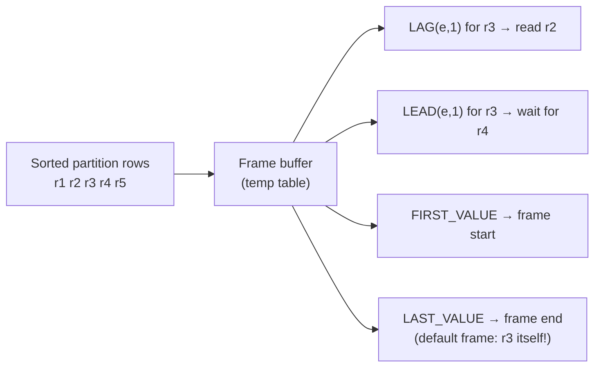

## Introduction

Ranking functions tell you *where* a row stands. **Value functions** (also called navigation or offset functions) fetch a value *from another row* of the same window and place it next to the current row:

- **`LAG(expr, n)`** — the value from *n* rows **before** the current row: "last month's revenue", "the customer's previous order date", "the employee's salary before this raise".
- **`LEAD(expr, n)`** — the value from *n* rows **after**: "the next status in the workflow", "when did the next session start".
- **`FIRST_VALUE(expr)`**, **`LAST_VALUE(expr)`**, **`NTH_VALUE(expr, n)`** — the value at the first, last or *n*-th row of the current **frame**: "the cheapest product in the category", "the customer's first order", "the second-highest price".

These functions turn questions that used to require self joins on "the previous row" — notoriously awkward in SQL, because relations have no inherent order — into one pass over a sorted window. They power period-over-period reporting (month-over-month, year-over-year), event-gap analysis, churn detection and **sessionization** (grouping a stream of events into sessions separated by inactivity).

There is one famous trap in this family: `LAST_VALUE` with the **default frame** returns the *current* row's value, not the last row of the partition. You will see exactly why, and how to fix it, using the frame rules from [Window Functions — OVER, PARTITION BY and Frames](/lessons/m04-window-functions).

:::note[Dataset]
The examples use the **shop** dataset: 80 orders placed during 2024 by 20 of the 25 customers, 182 line items and 30 products in 10 categories. A small `page_views` table is created later for sessionization. Every output shown was captured from a real MySQL server.
:::

## DBMS Theory

:::theory[Offset and positional functions]
Let partition P be ordered by key k, and let rows be numbered 1…|P| in that order; let *i* be the position of the current row.

- **LAG(e, n, d)** = e evaluated on row *i − n* if 1 ≤ i − n, otherwise **d** (default NULL).
- **LEAD(e, n, d)** = e evaluated on row *i + n* if i + n ≤ |P|, otherwise **d**.
- **FIRST_VALUE(e)** = e on the first row of the current row's **frame**.
- **LAST_VALUE(e)** = e on the last row of the frame.
- **NTH_VALUE(e, n)** = e on the *n*-th row of the frame, or NULL if the frame has fewer than *n* rows.

`LAG` and `LEAD` are defined on **partition positions** and ignore any frame clause. `FIRST_VALUE`, `LAST_VALUE` and `NTH_VALUE` are defined on the **frame** — and therefore depend on the frame unit (`ROWS`/`RANGE`), its bounds and, with `RANGE`, on peers.
:::

Two theoretical points cause most practical errors:

1. **"Previous" is only meaningful under a total order.** If two rows have the same `ORDER BY` key, which one is "previous" is implementation-dependent — exactly like `ROW_NUMBER` among ties. `LAG(amount) OVER (ORDER BY order_date)` is non-deterministic if two orders share a timestamp. Add a unique tie-breaker.
2. **The default frame ends at the current row (and its peers).** With `ORDER BY` and no frame clause, the frame is `RANGE BETWEEN UNBOUNDED PRECEDING AND CURRENT ROW`. Its *first* row is the partition's first row — so `FIRST_VALUE` works as expected — but its *last* row is the current row (or its last peer). `LAST_VALUE` over that frame is therefore just "the current value" in disguise.

| Function | Uses the frame? | Typical question |
|---|---|---|
| `LAG(e [, n [, default]])` | no | value n rows earlier (previous period, previous event) |
| `LEAD(e [, n [, default]])` | no | value n rows later (next event, time until next) |
| `FIRST_VALUE(e)` | yes | first value in the frame (baseline, first purchase) |
| `LAST_VALUE(e)` | yes | last value in the frame (latest state) — needs an explicit frame |
| `NTH_VALUE(e, n)` | yes | n-th value in the frame (runner-up, second purchase) |

:::standard[Standard SQL vs MySQL]
All five functions are standard SQL and available since MySQL 8.0.2. The standard's **null treatment** option `IGNORE NULLS` ("previous *non-null* value") is **not** supported by MySQL — error 1235; `RESPECT NULLS` (the default) is accepted. `NTH_VALUE … FROM LAST` is likewise unsupported (`FROM FIRST` is accepted). The offset *n* must be a non-negative integer constant for the query (a literal, a user variable or a prepared-statement parameter); a negative offset is a syntax error — use `LEAD` instead of `LAG(e, -1)`.
:::

## Why It Exists

Relations are unordered sets, so "the previous row" is not a relational concept. Before window functions, comparing a row with its predecessor required reconstructing the predecessor:

- **Self join on a computed predecessor.** Join each month to "month − 1" (works only for gap-free sequences of integer keys) or join each order to the latest earlier order of the same customer with a correlated `MAX(order_date) … WHERE order_date < o.order_date`, then join again to fetch that order's other columns. Two extra lookups per row, and broken by ties.
- **Correlated subqueries** in the select list — `(SELECT amount FROM orders x WHERE x.customer_id = o.customer_id AND x.order_date < o.order_date ORDER BY x.order_date DESC LIMIT 1)` — executed once per row.
- **User-variable carry-over** (`@prev := amount`) relying on undefined evaluation order — deprecated.

With `LAG`/`LEAD`, the engine sorts each partition once and reads the neighbour directly from its position in the sorted stream. A period-over-period report becomes a single scan; sessionization — impossible without procedural code before — becomes two window passes. The functions also make intent obvious: `LAG(revenue) OVER (ORDER BY month)` says "previous month's revenue" far more clearly than a self join on `m.month = cur.month - 1`.

## Internal Working

:::internals[How MySQL evaluates value functions]
Value functions run in the same window iterator as other window functions, after the partition has been sorted by `PARTITION BY` + `ORDER BY` keys:

- **`LAG(e, n)`** needs the rows *behind* the current one. MySQL keeps the last *n* rows of the partition available in the window's buffer and reads row *i − n*.
- **`LEAD(e, n)`** needs rows *ahead* of the current row, which have not been "produced" yet in a streaming pass. The iterator therefore **buffers** rows of the partition (in the frame buffer, an internal temporary table) until row *i + n* has been read, and only then emits row *i*. `EXPLAIN FORMAT=TREE` shows *"Window aggregate with buffering"*.
- **`FIRST_VALUE` / `LAST_VALUE` / `NTH_VALUE`** read the frame's first, last or n-th row from the buffer. A frame ending at `UNBOUNDED FOLLOWING` requires buffering the **whole partition** before the first row can be emitted.

So `LAG` is cheap; `LEAD` and look-ahead frames cost buffering proportional to the offset or, for whole-partition frames, the partition size. Partitions are processed independently, so memory use is bounded by the largest partition, not the table.
:::



**NULLs.** `LAG`/`LEAD` return the default (NULL unless specified) when the offset falls outside the partition. That is different from "the neighbouring row exists but its value is NULL" — if you must distinguish the two, compare `LAG(primary_key)` with NULL rather than the value itself.

## MySQL Implementation

```sql
LAG(expr [, n [, default]])  [RESPECT NULLS] OVER (window_spec)
LEAD(expr [, n [, default]]) [RESPECT NULLS] OVER (window_spec)
FIRST_VALUE(expr)            OVER (window_spec)
LAST_VALUE(expr)             OVER (window_spec)
NTH_VALUE(expr, n) [FROM FIRST] OVER (window_spec)
-- n defaults to 1 for LAG/LEAD; default defaults to NULL
```

**LAG and LEAD — each order with the customer's previous and next order dates.** Partition by customer, order by date with the order id as tie-breaker:

```sql run
SELECT customer_id, order_id, DATE(order_date) AS order_day,
       DATE(LAG(order_date)  OVER w) AS prev_order_day,
       DATE(LEAD(order_date) OVER w) AS next_order_day,
       DATEDIFF(order_date, LAG(order_date) OVER w) AS days_since_prev
FROM orders
WHERE customer_id IN (10, 18)
WINDOW w AS (PARTITION BY customer_id ORDER BY order_date, order_id)
ORDER BY customer_id, order_date, order_id;
```

Each customer's first order has no previous order (`LAG` returns NULL), and their last order has no next order (`LEAD` returns NULL). `DATEDIFF` over `LAG` gives the gap between consecutive purchases — the basis of churn and repurchase analysis.

**Offsets and defaults.** `LAG(expr, 2)` reaches two rows back; the third argument replaces NULL when there is no such row:

```sql run
SELECT order_id, DATE(order_date) AS order_day,
       LAG(order_id, 1)    OVER w AS prev_order,
       LAG(order_id, 2)    OVER w AS two_back,
       LAG(order_id, 1, 0) OVER w AS prev_or_zero
FROM orders
WHERE customer_id = 18
WINDOW w AS (ORDER BY order_date, order_id)
ORDER BY order_date, order_id;
```

**FIRST_VALUE — compare each product with the cheapest in its category.**

```sql run
SELECT category_id, name, price,
       FIRST_VALUE(name)  OVER w AS cheapest_in_category,
       price - FIRST_VALUE(price) OVER w AS above_cheapest
FROM products
WHERE category_id IN (5, 7)
WINDOW w AS (PARTITION BY category_id ORDER BY price, product_id)
ORDER BY category_id, price, product_id;
```

`FIRST_VALUE` works with the default frame because the default frame always *starts* at the partition's first row.

## Syntax Breakdown

| Element | Meaning and rules |
|---|---|
| `LAG(expr)` | Value of `expr` one row earlier in the partition's order. |
| `LAG(expr, n)` | n rows earlier; n ≥ 0 constant (literal, user variable, or `?`). `n = 0` is the current row. |
| `LAG(expr, n, default)` | Returns `default` instead of NULL when row i − n does not exist. The default can be an expression, e.g. the current value. |
| `LEAD(…)` | Same as `LAG`, looking forward. |
| `RESPECT NULLS` | Default and only supported null treatment; `IGNORE NULLS` → error 1235. |
| `FIRST_VALUE(expr)` | Value at the frame's first row. Correct with the default frame. |
| `LAST_VALUE(expr)` | Value at the frame's last row. Needs `ROWS BETWEEN UNBOUNDED PRECEDING AND UNBOUNDED FOLLOWING` (or `… CURRENT ROW AND UNBOUNDED FOLLOWING`) to mean "last in the partition". |
| `NTH_VALUE(expr, n)` | Value at the n-th row of the frame (n ≥ 1); NULL while the frame has fewer than n rows. `FROM FIRST` accepted, `FROM LAST` → error 1235. |
| Frame clause | Ignored by `LAG`/`LEAD`; essential for `FIRST_VALUE`/`LAST_VALUE`/`NTH_VALUE`. |
| `ORDER BY` in `OVER` | Required for meaningful results; must be unique (add a tie-breaker) for deterministic neighbours. |

## Practical Examples

**1. Month-over-month revenue.** Aggregate revenue per month (excluding cancelled and refunded orders), then compare each month with the previous one. The window runs *after* `GROUP BY`, so `LAG` can be applied to the aggregate directly:

```sql run
SELECT MONTH(o.order_date)                              AS month_no,
       SUM(oi.quantity * oi.unit_price)                 AS revenue,
       LAG(SUM(oi.quantity * oi.unit_price)) OVER (ORDER BY MONTH(o.order_date)) AS prev_revenue,
       ROUND(100 * (SUM(oi.quantity * oi.unit_price)
                    - LAG(SUM(oi.quantity * oi.unit_price)) OVER (ORDER BY MONTH(o.order_date)))
             / LAG(SUM(oi.quantity * oi.unit_price)) OVER (ORDER BY MONTH(o.order_date)), 1) AS pct_change
FROM orders o
JOIN order_items oi ON oi.order_id = o.order_id
WHERE o.status NOT IN ('cancelled', 'refunded')
GROUP BY MONTH(o.order_date)
ORDER BY month_no;
```

That works, but repeating the aggregate is unreadable. The professional form computes the monthly series in a CTE and applies `LAG` once:

```sql run
WITH monthly AS (
  SELECT MONTH(o.order_date) AS month_no,
         SUM(oi.quantity * oi.unit_price) AS revenue
  FROM orders o
  JOIN order_items oi ON oi.order_id = o.order_id
  WHERE o.status NOT IN ('cancelled', 'refunded')
  GROUP BY MONTH(o.order_date)
)
SELECT month_no, revenue,
       LAG(revenue) OVER (ORDER BY month_no) AS prev_revenue,
       ROUND(100 * (revenue / LAG(revenue) OVER (ORDER BY month_no) - 1), 1) AS pct_change
FROM monthly
ORDER BY month_no;
```

Both queries give the same series. `LAG` reads the previous **row**, which equals the previous **month** only because every month of 2024 has orders. With missing months, generate a calendar first (see [Recursive CTEs](/lessons/m04-recursive-ctes)) and `LEFT JOIN` the facts to it — otherwise "previous month" silently becomes "previous month that had sales".

**2. The `LAST_VALUE` trap.** Ask for the most expensive product per category with `LAST_VALUE` and the default frame, then with a full frame:

```sql run
SELECT category_id, name, price,
       LAST_VALUE(name) OVER (PARTITION BY category_id ORDER BY price, product_id) AS last_default_frame,
       LAST_VALUE(name) OVER (PARTITION BY category_id ORDER BY price, product_id
                              ROWS BETWEEN UNBOUNDED PRECEDING AND UNBOUNDED FOLLOWING) AS last_full_frame
FROM products
WHERE category_id IN (5, 7)
ORDER BY category_id, price, product_id;
```

`last_default_frame` simply repeats each row's own name: with the default frame `RANGE BETWEEN UNBOUNDED PRECEDING AND CURRENT ROW`, the last row of the frame **is** the current row (the order key is unique here, so there are no peers). `last_full_frame` extends the frame to the end of the partition and returns the most expensive product of the category on every row. An equally correct and often clearer alternative is `FIRST_VALUE(name) OVER (PARTITION BY category_id ORDER BY price DESC, product_id)` — reverse the order and take the first.

**3. NTH_VALUE — the runner-up.** The second-most-expensive product per category, on every row:

```sql run
SELECT category_id, name, price,
       NTH_VALUE(name, 2) OVER (PARTITION BY category_id ORDER BY price DESC, product_id
                                ROWS BETWEEN UNBOUNDED PRECEDING AND UNBOUNDED FOLLOWING) AS runner_up,
       NTH_VALUE(name, 2) OVER (PARTITION BY category_id ORDER BY price DESC, product_id) AS runner_up_default
FROM products
WHERE category_id IN (5, 7)
ORDER BY category_id, price DESC, product_id;
```

With the full frame every row sees the runner-up. With the default frame, the first row of each category gets NULL — its frame contains only one row, so there is no second row yet.

**4. First purchase and purchase sequence per customer.** Combine `FIRST_VALUE`, `ROW_NUMBER` and `LAG` to describe each order relative to the customer's history:

```sql run
SELECT customer_id, order_id, DATE(order_date) AS order_day,
       ROW_NUMBER() OVER w                       AS order_seq,
       DATE(FIRST_VALUE(order_date) OVER w)      AS first_order_day,
       DATEDIFF(order_date, FIRST_VALUE(order_date) OVER w) AS days_since_first,
       COALESCE(DATEDIFF(order_date, LAG(order_date) OVER w), 0) AS gap_days
FROM orders
WHERE customer_id IN (14, 19)
WINDOW w AS (PARTITION BY customer_id ORDER BY order_date, order_id)
ORDER BY customer_id, order_seq;
```

**5. State-change detection.** Comparing a value with its predecessor detects transitions — salary raises in an HR history (exercise 4 does that on the hr dataset), price changes, or status changes. Flag each order whose status differs from the same customer's previous order:

```sql run
SELECT customer_id, order_id, status,
       LAG(status) OVER w AS prev_status,
       CASE WHEN LAG(status) OVER w IS NULL THEN 'first order'
            WHEN LAG(status) OVER w <> status THEN 'changed'
            ELSE 'same' END AS vs_previous
FROM orders
WHERE customer_id = 19
WINDOW w AS (PARTITION BY customer_id ORDER BY order_date, order_id)
ORDER BY order_date, order_id;
```

**6. Sessionization.** Web analytics groups page views into **sessions**: a new session starts when a user has been inactive for more than 30 minutes. Create a small page-view log:

```sql run
CREATE TABLE page_views (
  view_id   INT PRIMARY KEY,
  user_id   INT NOT NULL,
  viewed_at DATETIME NOT NULL,
  page      VARCHAR(30) NOT NULL
);
INSERT INTO page_views VALUES
  (1, 7, '2024-11-05 09:00:00', '/home'),
  (2, 7, '2024-11-05 09:04:00', '/laptops'),
  (3, 7, '2024-11-05 09:20:00', '/laptops/1'),
  (4, 7, '2024-11-05 10:15:00', '/home'),
  (5, 7, '2024-11-05 10:16:00', '/cart'),
  (6, 7, '2024-11-05 18:40:00', '/home'),
  (7, 9, '2024-11-05 09:10:00', '/home'),
  (8, 9, '2024-11-05 09:55:00', '/coffee'),
  (9, 9, '2024-11-05 10:05:00', '/coffee/14');
```

Step 1: mark each view that **starts** a session — the user's first view, or a view more than 30 minutes after the previous one. Step 2: a running `SUM` of those markers numbers the sessions:

```sql run
WITH marked AS (
  SELECT view_id, user_id, viewed_at, page,
         CASE WHEN LAG(viewed_at) OVER w IS NULL
                OR TIMESTAMPDIFF(MINUTE, LAG(viewed_at) OVER w, viewed_at) > 30
              THEN 1 ELSE 0 END AS new_session
  FROM page_views
  WINDOW w AS (PARTITION BY user_id ORDER BY viewed_at, view_id)
)
SELECT user_id, view_id, viewed_at, page, new_session,
       SUM(new_session) OVER (PARTITION BY user_id ORDER BY viewed_at, view_id
                              ROWS UNBOUNDED PRECEDING) AS session_no
FROM marked
ORDER BY user_id, viewed_at, view_id;
```

From there, a `GROUP BY user_id, session_no` gives one row per session with its start, end, duration and number of pages:

```sql run
WITH marked AS (
  SELECT user_id, viewed_at,
         CASE WHEN LAG(viewed_at) OVER w IS NULL
                OR TIMESTAMPDIFF(MINUTE, LAG(viewed_at) OVER w, viewed_at) > 30
              THEN 1 ELSE 0 END AS new_session
  FROM page_views
  WINDOW w AS (PARTITION BY user_id ORDER BY viewed_at, view_id)
),
sessions AS (
  SELECT user_id, viewed_at,
         SUM(new_session) OVER (PARTITION BY user_id ORDER BY viewed_at
                                ROWS UNBOUNDED PRECEDING) AS session_no
  FROM marked
)
SELECT user_id, session_no,
       MIN(viewed_at) AS started, MAX(viewed_at) AS ended,
       TIMESTAMPDIFF(MINUTE, MIN(viewed_at), MAX(viewed_at)) AS minutes,
       COUNT(*) AS pages
FROM sessions
GROUP BY user_id, session_no
ORDER BY user_id, session_no;
```

The "flag the boundary with `LAG`, then running-sum the flags" technique is one of the most reusable ideas in analytical SQL; [Advanced Analytical Queries](/lessons/m04-analytical-queries) uses it again for gaps and islands.

## Execution Walkthrough

Trace the sessionization of user 7 one stage at a time.

```walkthrough
title: Sessionize page_views — LAG, boundary flag, running SUM, GROUP BY
steps:
  - title: "1. Input — one user's events in time order"
    explain: The window is PARTITION BY user_id ORDER BY viewed_at, view_id. For user 7 the partition is these six rows in this order.
    sql: SELECT view_id, user_id, viewed_at, page FROM page_views WHERE user_id = 7 ORDER BY viewed_at, view_id;
  - title: "2. LAG — the previous event's timestamp"
    explain: LAG reads the row one position earlier in the sorted partition. The first row has no predecessor, so LAG returns NULL.
    sql: |
      SELECT view_id, viewed_at,
             LAG(viewed_at) OVER (PARTITION BY user_id ORDER BY viewed_at, view_id) AS prev_view,
             TIMESTAMPDIFF(MINUTE, LAG(viewed_at) OVER (PARTITION BY user_id ORDER BY viewed_at, view_id), viewed_at) AS gap_min
      FROM page_views WHERE user_id = 7 ORDER BY viewed_at, view_id;
  - title: "3. Boundary flag"
    explain: A row starts a session when there is no previous row or the gap exceeds 30 minutes. Gaps of 55 minutes and of several hours start new sessions.
    sql: |
      SELECT view_id, viewed_at,
             CASE WHEN LAG(viewed_at) OVER w IS NULL
                    OR TIMESTAMPDIFF(MINUTE, LAG(viewed_at) OVER w, viewed_at) > 30
                  THEN 1 ELSE 0 END AS new_session
      FROM page_views WHERE user_id = 7
      WINDOW w AS (PARTITION BY user_id ORDER BY viewed_at, view_id)
      ORDER BY viewed_at, view_id;
  - title: "4. Running SUM of flags = session number"
    explain: Summing the flags from the start of the partition to the current row increments the session number exactly at each boundary. This needs a second window pass over the flagged rows, hence the CTE.
    sql: |
      WITH marked AS (
        SELECT view_id, user_id, viewed_at,
               CASE WHEN LAG(viewed_at) OVER w IS NULL
                      OR TIMESTAMPDIFF(MINUTE, LAG(viewed_at) OVER w, viewed_at) > 30
                    THEN 1 ELSE 0 END AS new_session
        FROM page_views WHERE user_id = 7
        WINDOW w AS (PARTITION BY user_id ORDER BY viewed_at, view_id))
      SELECT view_id, viewed_at, new_session,
             SUM(new_session) OVER (ORDER BY viewed_at, view_id ROWS UNBOUNDED PRECEDING) AS session_no
      FROM marked ORDER BY viewed_at, view_id;
  - title: "5. The plan"
    explain: Two window passes appear — the inner one computing LAG (inside the materialized CTE) and the outer one computing the running SUM — each with its own sort.
    sql: |
      EXPLAIN FORMAT=TREE
      WITH marked AS (
        SELECT view_id, user_id, viewed_at,
               CASE WHEN LAG(viewed_at) OVER w IS NULL
                      OR TIMESTAMPDIFF(MINUTE, LAG(viewed_at) OVER w, viewed_at) > 30
                    THEN 1 ELSE 0 END AS new_session
        FROM page_views
        WINDOW w AS (PARTITION BY user_id ORDER BY viewed_at, view_id))
      SELECT view_id, SUM(new_session) OVER (PARTITION BY user_id ORDER BY viewed_at, view_id ROWS UNBOUNDED PRECEDING) AS session_no
      FROM marked;
```

## Output

The sessionized output assigns each page view to a numbered session per user; the summary query turns that into one row per session. User 7's six views fall into three sessions (morning browsing, a short return about an hour later, an evening visit) and user 9's three views into two, because the 45-minute pause between 09:10 and 09:55 exceeds the 30-minute threshold. Changing the threshold changes the sessions — the threshold is a business definition, not a technical constant, and analytics teams document it (Google Analytics popularized 30 minutes).

## Alternative Approaches

"Each order with the customer's previous order date" — three ways:

```sql run
-- A: LAG
SELECT order_id, customer_id, order_date,
       LAG(order_date) OVER (PARTITION BY customer_id ORDER BY order_date, order_id) AS prev_order_date
FROM orders
WHERE customer_id = 11
ORDER BY order_date, order_id;
```

```sql run
-- B: correlated subquery with ORDER BY … LIMIT 1
SELECT o.order_id, o.customer_id, o.order_date,
       (SELECT p.order_date FROM orders p
        WHERE p.customer_id = o.customer_id
          AND (p.order_date < o.order_date
               OR (p.order_date = o.order_date AND p.order_id < o.order_id))
        ORDER BY p.order_date DESC, p.order_id DESC
        LIMIT 1) AS prev_order_date
FROM orders o
WHERE o.customer_id = 11
ORDER BY o.order_date, o.order_id;
```

```sql run
-- C: self join + GROUP BY (gets the date only; fetching other columns needs another join)
SELECT o.order_id, o.customer_id, o.order_date, MAX(p.order_date) AS prev_order_date
FROM orders o
LEFT JOIN orders p ON p.customer_id = o.customer_id AND p.order_date < o.order_date
WHERE o.customer_id = 11
GROUP BY o.order_id, o.customer_id, o.order_date
ORDER BY o.order_date, o.order_id;
```

| Approach | Per-row work | Ties | Fetch other columns of the previous row | Verdict |
|---|---|---|---|---|
| A — `LAG` | one sort, then O(1) | resolved by the window's tie-breaker | `LAG(col)` for each column, same sort | default choice |
| B — correlated `LIMIT 1` | one index probe per row (index on `customer_id`, ideally `(customer_id, order_date)`) | explicit in the predicate | one subquery per column, or a join on the found key | fine for a handful of rows; MySQL 5.7 compatible |
| C — self join + `MAX` | joins each row to *all* earlier rows of the customer (O(k²) per customer) | `<` skips same-timestamp orders | another join on `(customer_id, prev_date)` | avoid on large histories |

`IGNORE NULLS` deserves a special note because MySQL lacks it. "The last known non-NULL value" (forward-fill) can be emulated with a running count of non-NULL values used as a group id, then `FIRST_VALUE` (or `MAX`) within that group:

```sql run
WITH filled AS (
  SELECT customer_id, phone,
         COUNT(phone) OVER (ORDER BY customer_id ROWS UNBOUNDED PRECEDING) AS grp
  FROM customers
  WHERE customer_id BETWEEN 3 AND 11
)
SELECT customer_id, phone,
       FIRST_VALUE(phone) OVER (PARTITION BY grp ORDER BY customer_id) AS last_known_phone
FROM filled
ORDER BY customer_id;
```

`COUNT(phone)` only advances on non-NULL values, so every NULL row shares the group of the last non-NULL row before it; `FIRST_VALUE` within that group is the value to carry forward. (Customer 5 and 10 have NULL phones in the dataset; they inherit the previous customer's phone in `last_known_phone` — only sensible for genuinely sequential data such as sensor readings, not for phone numbers. The point is the technique.)

## Performance Analysis

Value functions share the window cost model: input rows + one sort per distinct window specification + one pass. The specific extra costs are **buffering**:

```sql run
EXPLAIN FORMAT=TREE
SELECT order_id,
       LAG(order_date)  OVER w AS prev_date,
       LEAD(order_date) OVER w AS next_date
FROM orders
WINDOW w AS (PARTITION BY customer_id ORDER BY order_date, order_id);
```

Both functions share one window, so there is **one sort**; the iterator is labelled *with buffering* because `LEAD` must look ahead. A whole-partition frame (needed for `LAST_VALUE` "last in partition") forces the entire partition into the frame buffer:

```sql run
EXPLAIN FORMAT=JSON
SELECT category_id, name,
       LAST_VALUE(name) OVER (PARTITION BY category_id ORDER BY price
                              ROWS BETWEEN UNBOUNDED PRECEDING AND UNBOUNDED FOLLOWING) AS priciest
FROM products;
```

The JSON shows `frame_buffer` with `using_temporary_table: true` under `windowing`.

:::performance[Theory vs measurement]
- `LAG(e, n)`: O(1) per row after the sort; memory for n rows.
- `LEAD(e, n)`: O(1) per row; buffers n rows ahead before emitting.
- `FIRST_VALUE` with the default frame: O(1) — the frame start is fixed.
- `LAST_VALUE`/`NTH_VALUE` with `UNBOUNDED FOLLOWING`: the whole partition is buffered before the first row of the partition is emitted; memory ∝ largest partition. On a partition of 10 million rows (e.g. `OVER ()` on a big table) that means a large temporary table, possibly on disk.
- Several value functions with **identical** window specifications share a sort; give them one named window.

On the shop data all of this is microseconds. On event tables with hundreds of millions of rows, the sort dominates: restrict the input with indexed `WHERE` conditions (date ranges) before windowing, and partition by a key that keeps partitions small (user, device).
:::

## Best Practices

:::best-practice[Value functions in production]
1. **Always use a unique `ORDER BY`** (timestamp + id). Otherwise "previous" and "next" are arbitrary among same-timestamp rows.
2. **Never use `LAST_VALUE` with the default frame.** Write `ROWS BETWEEN UNBOUNDED PRECEDING AND UNBOUNDED FOLLOWING`, or reverse the order and use `FIRST_VALUE`.
3. **Fill gaps before row-based period comparisons.** `LAG` compares with the previous *row*; generate a calendar (recursive CTE) and `LEFT JOIN` so the previous row is the previous *period*.
4. **Use the default argument** of `LAG`/`LEAD` deliberately: `LAG(x, 1, 0)` for "previous value or zero" in deltas, but keep NULL when "no previous period" must stay distinguishable from zero.
5. **Name the shared window** (`WINDOW w AS (PARTITION BY … ORDER BY …)`) so all neighbouring-row functions use the same order and one sort.
6. **Two-step patterns need a CTE**: you cannot nest window functions (`SUM(LAG(…) …) OVER …`), so compute the flag in one CTE and aggregate it in the next.
7. **Divide safely in period-over-period**: `NULLIF(LAG(x) OVER w, 0)` avoids division by zero when the previous period was zero.
:::

## Common Mistakes

**Mistake 1 — `LAST_VALUE` with the default frame.** Shown in Practical Example 2: the result is the current row's value. Fix the frame.

**Mistake 2 — `IGNORE NULLS`.**

```sql run error
SELECT customer_id,
       LAG(phone) IGNORE NULLS OVER (ORDER BY customer_id) AS prev_known_phone
FROM customers;
```

Error 1235 — not supported in MySQL. Use the running-count grouping technique from *Alternative Approaches*.

**Mistake 3 — a negative offset.**

```sql run error
SELECT order_id, LAG(order_id, -1) OVER (ORDER BY order_id) AS next_order
FROM orders;
```

The offset must be non-negative; use `LEAD(order_id, 1)`.

**Mistake 4 — nesting window functions.** Computing a running count of session boundaries in one step:

```sql run error
SELECT view_id,
       SUM(CASE WHEN TIMESTAMPDIFF(MINUTE, LAG(viewed_at) OVER (ORDER BY viewed_at), viewed_at) > 30
                THEN 1 ELSE 0 END) OVER (ORDER BY viewed_at) AS session_no
FROM page_views;
```

Window functions cannot be arguments of other window functions. Compute the flag in a CTE first (Practical Example 6).

**Mistake 5 — ties in the order key.** `LAG(status) OVER (PARTITION BY customer_id ORDER BY DATE(order_date))` treats all orders of the same day as peers in unspecified order; the "previous status" can flip between runs. Order by the full timestamp plus the id.

**Mistake 6 — dividing by the previous value without guarding.** `revenue / LAG(revenue) OVER w` raises a division-by-zero warning (and returns NULL) when the previous period was 0; in strict mode with `ERROR_FOR_DIVISION_BY_ZERO`, inside an `INSERT … SELECT` it becomes an error. Use `NULLIF(LAG(revenue) OVER w, 0)`.

## Industry Application

- **Financial and KPI reporting.** Month-over-month and year-over-year growth (`LAG(x, 12)` over a monthly series), variance against the previous quarter, and price change detection are standard `LAG` queries in BI tools; tools like Looker and Tableau generate exactly this SQL for "percent change from previous".
- **Customer analytics.** Days between purchases (`DATEDIFF(order_date, LAG(order_date))`) feeds repurchase-rate and churn models; `FIRST_VALUE(order_date)` defines a customer's acquisition date for cohort analysis (next lesson).
- **Web and product analytics.** Sessionization of clickstreams, time-on-page (`LEAD(viewed_at) - viewed_at`), funnel step ordering, and "next page" path analysis are built from `LAG`/`LEAD` over event tables partitioned by user.
- **IoT and monitoring.** Sensor deltas, rate of change and state-transition detection (`LAG(state) <> state`) identify anomalies; forward-filling missing readings uses the running-count technique because MySQL lacks `IGNORE NULLS`.
- **Slowly changing dimensions.** Data warehouses derive `valid_to` from `LEAD(valid_from)` when converting a change log into SCD Type 2 rows.
- **Audit trails.** Comparing each audit row with the previous version of the same entity (`LAG(col) OVER (PARTITION BY entity_id ORDER BY version)`) shows exactly which fields changed and when.

## Practice Exercises

```exercise
id: ex1
title: Days between a customer's orders
difficulty: easy
concepts: [lag-lead]
prompt: |
  For customer **22**, return every order with `order_id`, `order_date` and `days_since_prev` — the number of
  days since that customer's previous order (NULL for the first order). Order by date, ties by order id.
hints:
  - "LAG(order_date) OVER (ORDER BY order_date, order_id) gives the previous order's date."
  - "DATEDIFF(later, earlier) returns the number of days."
solution: |
  SELECT order_id, order_date,
         DATEDIFF(order_date, LAG(order_date) OVER (ORDER BY order_date, order_id)) AS days_since_prev
  FROM orders
  WHERE customer_id = 22;
explanation: |
  Because the WHERE clause already restricts the rows to one customer, no PARTITION BY is needed. For all
  customers at once, add `PARTITION BY customer_id`; forgetting it would compare the first order of one customer
  with the last order of another.
```

```exercise
id: ex2
title: Most expensive product per category on every row
difficulty: medium
concepts: [last-value, window-frames]
prompt: |
  For every product with a category, return `product_id`, `category_id`, `price` and `max_price_product` — the
  `name` of the most expensive product in the same category (ties broken by the lower `product_id`).
  Use `LAST_VALUE`.
hints:
  - "Order the window by price ascending, then product_id descending, so the desired product is the last row."
  - "The default frame ends at the current row — extend it: ROWS BETWEEN UNBOUNDED PRECEDING AND UNBOUNDED FOLLOWING."
solution: |
  SELECT product_id, category_id, price,
         LAST_VALUE(name) OVER (PARTITION BY category_id ORDER BY price, product_id DESC
                                ROWS BETWEEN UNBOUNDED PRECEDING AND UNBOUNDED FOLLOWING) AS max_price_product
  FROM products
  WHERE category_id IS NOT NULL;
explanation: |
  With the default frame, LAST_VALUE returns each row's own name. The full frame makes the last row of the frame
  the last row of the partition. `FIRST_VALUE(name) OVER (PARTITION BY category_id ORDER BY price DESC,
  product_id)` is an equivalent, frame-independent formulation.
```

```exercise
id: ex3
title: Month-over-month order growth
difficulty: medium
concepts: [period-over-period, lag-lead]
prompt: |
  Count orders per calendar month of 2024 (all statuses) and return `month_no`, `orders`, `prev_orders`
  (previous month's count, NULL for January) and `change` (orders − prev_orders). Every month of 2024 has orders.
hints:
  - "First GROUP BY MONTH(order_date) to get one row per month (a CTE helps)."
  - "LAG(orders) OVER (ORDER BY month_no) gives the previous month's count."
solution: |
  WITH monthly AS (
    SELECT MONTH(order_date) AS month_no, COUNT(*) AS orders
    FROM orders
    GROUP BY MONTH(order_date)
  )
  SELECT month_no, orders,
         LAG(orders) OVER (ORDER BY month_no) AS prev_orders,
         orders - LAG(orders) OVER (ORDER BY month_no) AS `change`
  FROM monthly;
explanation: |
  `CHANGE` is a reserved word in MySQL, so the alias must be quoted with backticks. The statement in the prompt
  that every month has orders is what makes "previous row" equal "previous month"; with gaps you would join to a
  generated calendar first.
```

```exercise
id: ex4
title: Salary raises from history
difficulty: hard
concepts: [lag-lead, period-over-period]
dataset: hr
prompt: |
  Using `salary_history`, list every salary **increase**: rows where the salary is higher than the same
  employee's previous history row. Return `employee_id`, `effective_date`, `old_salary`, `new_salary` and
  `raise_pct` (percentage increase rounded to 1 decimal), for employees 107 and 108 only.
hints:
  - "LAG(salary) OVER (PARTITION BY employee_id ORDER BY effective_date) is the previous salary."
  - "Compute it in a CTE and filter salary > old_salary in the outer query (window functions cannot be used in WHERE)."
solution: |
  WITH h AS (
    SELECT employee_id, effective_date, salary,
           LAG(salary) OVER (PARTITION BY employee_id ORDER BY effective_date) AS old_salary
    FROM salary_history
    WHERE employee_id IN (107, 108)
  )
  SELECT employee_id, effective_date, old_salary, salary AS new_salary,
         ROUND(100 * (salary - old_salary) / old_salary, 1) AS raise_pct
  FROM h
  WHERE salary > old_salary;
explanation: |
  The first history row of each employee has `old_salary` NULL, and `salary > NULL` is UNKNOWN, so it is
  filtered out automatically. Years without a change (both employees plateau at 150,000) are excluded by the
  strict `>`. `effective_date` is unique per employee (it is part of the primary key), so the order is total.
```

```exercise
id: ex5
title: Sessionize page views
difficulty: challenge
concepts: [sessionization, lag-lead, window-frames]
dataset: empty
setup: |
  CREATE TABLE page_views (view_id INT PRIMARY KEY, user_id INT NOT NULL, viewed_at DATETIME NOT NULL);
  INSERT INTO page_views VALUES
    (1, 1, '2024-11-05 08:00:00'), (2, 1, '2024-11-05 08:10:00'), (3, 1, '2024-11-05 08:50:00'),
    (4, 1, '2024-11-05 09:05:00'), (5, 1, '2024-11-05 13:00:00'), (6, 2, '2024-11-05 08:30:00'),
    (7, 2, '2024-11-05 08:45:00'), (8, 2, '2024-11-05 09:30:00'), (9, 2, '2024-11-05 09:31:00');
prompt: |
  A session ends after **more than 20 minutes** of inactivity. Return one row per session with `user_id`,
  `session_no` (1, 2, … per user in time order), `started`, `ended` and `views`.
hints:
  - "Flag a row as a session start when LAG(viewed_at) is NULL or more than 20 minutes earlier (TIMESTAMPDIFF(MINUTE, …))."
  - "A running SUM of the flags per user (ROWS UNBOUNDED PRECEDING) numbers the sessions."
  - "Then GROUP BY user_id, session_no with MIN, MAX and COUNT."
solution: |
  WITH marked AS (
    SELECT user_id, view_id, viewed_at,
           CASE WHEN LAG(viewed_at) OVER w IS NULL
                  OR TIMESTAMPDIFF(MINUTE, LAG(viewed_at) OVER w, viewed_at) > 20
                THEN 1 ELSE 0 END AS new_session
    FROM page_views
    WINDOW w AS (PARTITION BY user_id ORDER BY viewed_at, view_id)
  ),
  numbered AS (
    SELECT user_id, viewed_at,
           SUM(new_session) OVER (PARTITION BY user_id ORDER BY viewed_at, view_id
                                  ROWS UNBOUNDED PRECEDING) AS session_no
    FROM marked
  )
  SELECT user_id, session_no, MIN(viewed_at) AS started, MAX(viewed_at) AS ended, COUNT(*) AS views
  FROM numbered
  GROUP BY user_id, session_no;
explanation: |
  User 1 has three sessions (08:00–08:10, 08:50–09:05, 13:00) and user 2 has two (08:30–08:45, 09:30–09:31).
  The two-CTE structure is necessary because a window function cannot take another window function as its
  argument. Using RANGE instead of ROWS in the running sum would be wrong if two views shared a timestamp.
```

## Knowledge Assessment

```quiz
- id: q1
  question: "`LAST_VALUE(name) OVER (PARTITION BY category_id ORDER BY price, product_id)` returns, on each row:"
  options:
    - "The name of the most expensive product in the category"
    - "The current row's own name, because the default frame ends at the current row"
    - "NULL"
    - "The name of the cheapest product"
  answer: 1
  explanation: "With ORDER BY and no frame, the frame is RANGE UNBOUNDED PRECEDING to CURRENT ROW (plus peers). With a unique order key, its last row is the current row. Extend the frame to UNBOUNDED FOLLOWING, or use FIRST_VALUE with the reverse order."
  concepts: [last-value, window-frames]
- id: q2
  question: "Which value functions ignore the frame clause entirely?"
  type: multi
  options: ["LAG", "LEAD", "FIRST_VALUE", "NTH_VALUE", "LAST_VALUE"]
  answer: [0, 1]
  explanation: "LAG and LEAD work on positions within the partition. FIRST_VALUE, LAST_VALUE and NTH_VALUE read positions within the frame."
  concepts: [value-functions]
- id: q3
  question: "A monthly revenue table has no row for April (no sales). What does `LAG(revenue) OVER (ORDER BY month_no)` return for May?"
  options: ["April's revenue (0)", "NULL", "March's revenue", "An error"]
  answer: 2
  explanation: "LAG reads the previous row, which is March. To compare with the previous calendar month, generate all months and LEFT JOIN the facts so April exists as a row (with 0 or NULL)."
  concepts: [period-over-period, lag-lead]
- id: q4
  question: "How do you get 'the last non-NULL value so far' in MySQL, given that IGNORE NULLS is not supported?"
  options:
    - "LAG(x) IGNORE NULLS OVER (ORDER BY t)"
    - "A running COUNT(x) as a group id, then FIRST_VALUE(x) (or MAX(x)) partitioned by that group"
    - "LAST_VALUE(x) with the default frame"
    - "COALESCE(x, LAG(x))"
  answer: 1
  explanation: "COUNT(x) advances only on non-NULL rows, so NULL rows share the group of the preceding non-NULL row. COALESCE(x, LAG(x)) only fills a single NULL, not runs of NULLs; IGNORE NULLS raises error 1235."
  concepts: [lag-lead]
- id: q5
  question: "Why does sessionization need two window passes (a CTE) rather than one expression?"
  options:
    - "Because LAG cannot be used with PARTITION BY"
    - "Because the session number is a running SUM of a flag that itself is computed with LAG, and window functions cannot be nested"
    - "Because TIMESTAMPDIFF is not allowed in window functions"
    - "Because MySQL limits each query to one window"
  answer: 1
  explanation: "First compute the boundary flag with LAG; then a second window (running SUM) over the flagged rows numbers the sessions. Nesting window functions is not allowed, and a query may use many windows."
  concepts: [sessionization]
- id: q6
  question: "Orders 31 and 32 of the same customer share the exact same order_date. What is wrong with `LAG(order_id) OVER (PARTITION BY customer_id ORDER BY order_date)`?"
  options:
    - "Nothing — LAG resolves ties by primary key"
    - "Which of the two is 'previous' is unspecified, so results can differ between runs; add order_id to the ORDER BY"
    - "It raises an error for duplicate keys"
    - "Both rows get NULL"
  answer: 1
  explanation: "Peers have no defined order within the window. A unique tie-breaker makes the neighbour deterministic."
  concepts: [lag-lead]
- id: q7
  question: "`NTH_VALUE(name, 2) OVER (PARTITION BY category_id ORDER BY price DESC, product_id)` returns what on the first row of each category?"
  options:
    - "The second most expensive product's name"
    - "NULL, because with the default frame the first row's frame contains only one row"
    - "The first row's own name"
    - "An error — NTH_VALUE requires ROWS"
  answer: 1
  explanation: "The default frame grows from the partition start to the current row; on the first row there is no 2nd row yet. With ROWS BETWEEN UNBOUNDED PRECEDING AND UNBOUNDED FOLLOWING every row sees the runner-up."
  concepts: [nth-value, window-frames]
- id: q8
  question: "Which plan property distinguishes `LEAD(x) OVER w` from `LAG(x) OVER w` in EXPLAIN FORMAT=TREE?"
  options:
    - "LEAD needs a hash join"
    - "LEAD requires looking ahead, so the window iterator buffers rows ('Window aggregate with buffering')"
    - "LEAD cannot share a sort with LAG"
    - "There is never any difference"
  answer: 1
  explanation: "To emit row i, LEAD must have read row i+1, so the iterator buffers rows of the partition. LAG and LEAD over the same window share one sort."
  concepts: [lag-lead]
```
