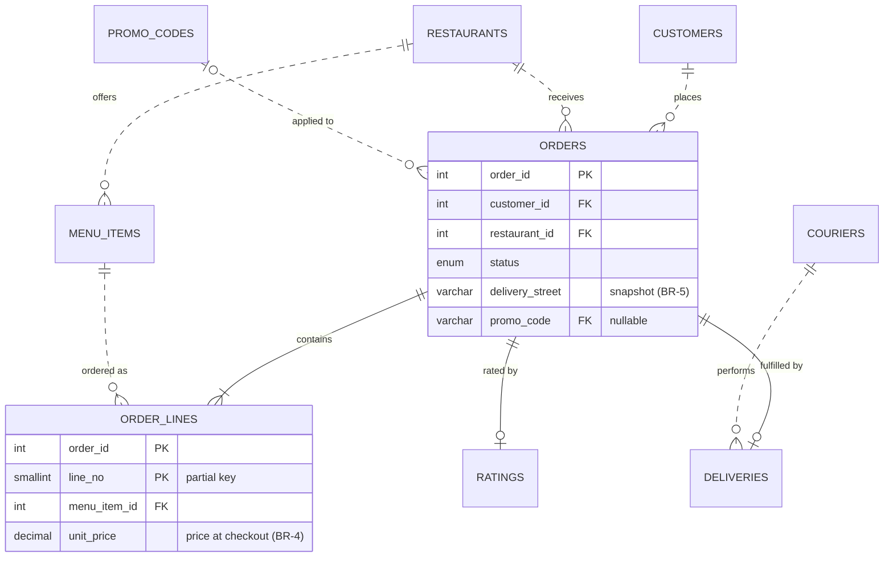

## Introduction

Every lesson in this module taught one step of database design in isolation. Real projects do not arrive in steps; they arrive as a vague request — *"we want an app where students order food from campus restaurants and other students deliver it"* — and a deadline. This case study runs the complete process on that request:

1. **Requirements** — interview notes turned into an entity catalogue, business rules with enforcement decisions, volumes and the top queries.
2. **Conceptual model** — an ER diagram with cardinality and participation for every relationship.
3. **Logical and physical schema** — the mapping algorithm applied, keys chosen, every constraint named after the rule it implements, indexes for the top queries.
4. **Sample data** and **constraint tests** — proving the database rejects what the business forbids.
5. **Production queries** — the queries the design was built to serve, with their plans.
6. **Design review** — an executable checklist of `information_schema` queries that any team can run in CI.

Along the way you will see one technique that is easy to miss in smaller examples: using **composite foreign keys** to enforce a cross-table rule declaratively ("an order line's menu item must belong to the order's restaurant"), which a `CHECK` constraint cannot do.

:::note[Dataset]
The case study starts from an **empty** schema and builds the whole system. Each block runs in order in your lab; every output shown was captured from a real MySQL server.
:::

## DBMS Theory

:::theory[The design process as a chain of refinements]
Database design proceeds through models of decreasing abstraction, each validated against the previous one ([The Database Design Process](/lessons/m01-design-process)):

| Stage | Artifact | Validated by |
|---|---|---|
| Requirements analysis | Requirements specification: entities, rules, transactions, volumes | Stakeholder review |
| Conceptual design | (E)ER diagram, DBMS-independent | Walk through every transaction on the diagram |
| Logical design | Relation schemas with keys and constraints (ER-to-relational mapping), normalized | Normalization (Module 6); mapping checklist |
| Physical design | DDL for MySQL/InnoDB: types, indexes, engines, referential actions | `EXPLAIN` of the top queries; volume estimates |
| Implementation and tuning | Running database, migrations, monitoring | Production metrics |

Two principles run through all stages: **one fact in one place** (redundancy only as a deliberate, documented denormalization) and **constraints as close to the data as possible** (declarative first, procedural second, application last).
:::

### Requirements specification (condensed)

**Scope.** "CampusEats": customers order from campus restaurants; student couriers deliver. Out of scope for v1: payments processing (handled by an external provider; we store only a payment reference), courier payroll.

**Interview notes → entity catalogue.**

| Entity | Meaning | Identifier | Volume (year 1) |
|---|---|---|---|
| Customer | A registered student or staff member who orders | surrogate id; email unique | 15,000 |
| Restaurant | A campus food outlet | surrogate id; slug unique | 40 |
| Menu item | Something a restaurant sells | surrogate id; (restaurant, name) unique | 2,000 |
| Order | One checkout from one restaurant | surrogate id | 1,500/day → ~550k/year |
| Order line | One menu item with quantity in an order | (order, line_no) — weak entity | ~2.5 per order |
| Courier | A student who delivers | surrogate id; student number unique | 300 |
| Delivery | The courier assignment and timestamps for an order | the order (1:1) | ≈ orders |
| Rating | Customer's rating of a delivered order | the order (1:1) | ~40% of orders |
| Promo code | A discount code with a validity window | natural key `code` | 100s |

**Business rules and enforcement decisions.**

| ID | Rule | Enforcement |
|---|---|---|
| BR-1 | Customer emails are unique (case-insensitive) | `UNIQUE` (column collation `_ci`) |
| BR-2 | An order is placed by exactly one customer at exactly one restaurant | `NOT NULL` FKs |
| BR-3 | An order line's item must be on **that order's restaurant's** menu | Composite FKs through a carried `restaurant_id` |
| BR-4 | The price charged is the price at checkout | `unit_price` stored on the line |
| BR-5 | The delivery address on a past order never changes | Address snapshot columns on `orders` |
| BR-6 | Quantity 1–20 per line; tip ≥ 0; promo discount 5–50% | `CHECK` |
| BR-7 | An order has at most one delivery and at most one rating | Shared primary key (1:1) |
| BR-8 | A delivery is completed after pickup | `CHECK (delivered_at >= picked_up_at)` |
| BR-9 | A customer may use each promo code once | `UNIQUE (customer_id, promo_code)` on orders (NULLs allowed repeatedly) |
| BR-10 | Ratings only for delivered orders | Cross-table, depends on status → application / trigger |
| BR-11 | Every order has at least one line | Parent-side minimum → placed in one transaction by the order service |
| BR-12 | A courier has at most one active delivery | Generated column + `UNIQUE` ("at most one current") |

**Top queries (with expected frequency).** Q1 customer order history (every app open, ~50/s at lunch peak); Q2 restaurant's incoming orders not yet picked up (each restaurant tablet polls every 10 s); Q3 daily revenue per restaurant (nightly); Q4 best-selling items per restaurant (dashboard, hourly); Q5 courier delivery times (weekly).

## Why It Exists

A case study exists because design decisions interact. Each rule above is simple on its own; together they force trade-offs you cannot see in isolated examples:

- BR-4 and BR-5 (history) deliberately **copy** data (price, address) that a naive normalization would remove — they are not redundancy, because the copied value is a *different fact* (the price *then*), as the requirements lesson argued.
- BR-3 cannot be a `CHECK` (it spans three tables) and would usually end up in application code. Carrying `restaurant_id` on the order line and using two composite foreign keys turns it into a declarative constraint at the cost of one extra 4-byte column.
- BR-7 and BR-12 both express "one", but at different levels: one delivery *per order* (structural, shared key) vs one *active* delivery per courier (conditional, generated column).
- The top queries determine indexes that the logical model knows nothing about.

Without working the whole example, these interactions — and the places where the design is genuinely a judgement call — stay invisible.

## Internal Working

:::internals[How the physical design maps onto InnoDB]
- **Clustered keys.** Entity tables use `INT UNSIGNED AUTO_INCREMENT` keys: compact (4 bytes in every secondary index and FK) and append-only inserts. Orders are the fastest-growing table at ~550k rows/year — `INT UNSIGNED` (4.29 billion values) is ample; `BIGINT` would be chosen if order volume were orders of magnitude higher.
- **Weak entity clustering.** `order_lines` is clustered by `(order_id, line_no)`, so all lines of an order are contiguous — the order-details screen reads one range.
- **1:1 tables with shared keys.** `deliveries` and `ratings` use `order_id` as their primary key, so each is clustered in order-id order like `orders`; joining them to `orders` is a primary-key lookup per row.
- **Composite FKs for BR-3** need **unique indexes on the referenced column pairs** — `(order_id, restaurant_id)` on `orders` and `(menu_item_id, restaurant_id)` on `menu_items`. They are technically redundant as uniqueness rules (the first column alone is already the primary key) but required as FK targets.
- **Generated column for BR-12.** `active_courier_id` is `STORED`, so the unique index on it is maintained on every insert and update of a delivery; NULLs (completed deliveries) do not collide.
- **Transactions.** Placing an order writes `orders` and several `order_lines` rows; InnoDB makes them atomic so that BR-11 ("at least one line") holds for every committed order, even though the database cannot check it.
:::

### The conceptual model



`ORDERS ||--|{ ORDER_LINES` shows the requirement BR-11 (one or more lines) — a constraint the schema cannot enforce; a diagram reverse-engineered from the finished database would show `o{` here. Solid lines mark the identifying relationships (the weak entity and the two shared-key 1:1 tables).

## MySQL Implementation

### Reference and entity tables

```sql run
CREATE TABLE customers (
  customer_id INT UNSIGNED NOT NULL AUTO_INCREMENT PRIMARY KEY,
  email       VARCHAR(255) NOT NULL,
  full_name   VARCHAR(100) NOT NULL,
  phone       VARCHAR(20)  NULL,
  created_at  DATETIME     NOT NULL,
  CONSTRAINT uq_customers_email UNIQUE (email)                         -- BR-1
);
CREATE TABLE restaurants (
  restaurant_id INT UNSIGNED NOT NULL AUTO_INCREMENT PRIMARY KEY,
  slug          VARCHAR(60)  NOT NULL,
  name          VARCHAR(100) NOT NULL,
  building      VARCHAR(60)  NOT NULL,
  is_open       BOOLEAN      NOT NULL DEFAULT TRUE,
  CONSTRAINT uq_restaurants_slug UNIQUE (slug)
);
CREATE TABLE menu_items (
  menu_item_id  INT UNSIGNED NOT NULL AUTO_INCREMENT PRIMARY KEY,
  restaurant_id INT UNSIGNED NOT NULL,
  name          VARCHAR(100) NOT NULL,
  price         DECIMAL(6,2) NOT NULL,
  is_available  BOOLEAN      NOT NULL DEFAULT TRUE,
  CONSTRAINT uq_menu_items_restaurant_name UNIQUE (restaurant_id, name),
  CONSTRAINT uq_menu_items_id_restaurant  UNIQUE (menu_item_id, restaurant_id),   -- FK target for BR-3
  CONSTRAINT chk_menu_items_price CHECK (price > 0),
  CONSTRAINT fk_menu_items_restaurant FOREIGN KEY (restaurant_id) REFERENCES restaurants (restaurant_id)
);
CREATE TABLE couriers (
  courier_id  INT UNSIGNED NOT NULL AUTO_INCREMENT PRIMARY KEY,
  student_no  CHAR(9)      NOT NULL,
  full_name   VARCHAR(100) NOT NULL,
  vehicle     ENUM('foot','bike','scooter') NOT NULL,
  CONSTRAINT uq_couriers_student_no UNIQUE (student_no)
);
CREATE TABLE promo_codes (
  code       VARCHAR(20)      NOT NULL PRIMARY KEY,                   -- natural key: public, stable
  pct_off    TINYINT UNSIGNED NOT NULL,
  valid_from DATE             NOT NULL,
  valid_to   DATE             NOT NULL,
  CONSTRAINT chk_promo_pct    CHECK (pct_off BETWEEN 5 AND 50),       -- BR-6
  CONSTRAINT chk_promo_window CHECK (valid_to >= valid_from)
);
```

### Orders, lines, deliveries, ratings

```sql run
CREATE TABLE orders (
  order_id        INT UNSIGNED NOT NULL AUTO_INCREMENT PRIMARY KEY,
  customer_id     INT UNSIGNED NOT NULL,                              -- BR-2
  restaurant_id   INT UNSIGNED NOT NULL,                              -- BR-2
  status          ENUM('placed','accepted','picked_up','delivered','cancelled') NOT NULL DEFAULT 'placed',
  placed_at       DATETIME     NOT NULL,
  delivery_street VARCHAR(120) NOT NULL,                              -- BR-5 snapshot
  delivery_note   VARCHAR(200) NULL,
  tip             DECIMAL(6,2) NOT NULL DEFAULT 0.00,
  promo_code      VARCHAR(20)  NULL,
  CONSTRAINT uq_orders_id_restaurant UNIQUE (order_id, restaurant_id),           -- FK target for BR-3
  CONSTRAINT uq_orders_customer_promo UNIQUE (customer_id, promo_code),          -- BR-9
  KEY idx_orders_customer_placed (customer_id, placed_at),                       -- Q1
  KEY idx_orders_restaurant_status (restaurant_id, status, placed_at),           -- Q2, Q3
  CONSTRAINT chk_orders_tip CHECK (tip >= 0),
  CONSTRAINT fk_orders_customer   FOREIGN KEY (customer_id)   REFERENCES customers (customer_id),
  CONSTRAINT fk_orders_restaurant FOREIGN KEY (restaurant_id) REFERENCES restaurants (restaurant_id),
  CONSTRAINT fk_orders_promo      FOREIGN KEY (promo_code)    REFERENCES promo_codes (code)
);
CREATE TABLE order_lines (
  order_id      INT UNSIGNED      NOT NULL,
  line_no       SMALLINT UNSIGNED NOT NULL,
  restaurant_id INT UNSIGNED      NOT NULL,                           -- carried for BR-3
  menu_item_id  INT UNSIGNED      NOT NULL,
  quantity      TINYINT UNSIGNED  NOT NULL,
  unit_price    DECIMAL(6,2)      NOT NULL,                           -- BR-4
  PRIMARY KEY (order_id, line_no),
  KEY idx_order_lines_item (menu_item_id, restaurant_id),
  CONSTRAINT chk_order_lines_qty CHECK (quantity BETWEEN 1 AND 20),  -- BR-6
  CONSTRAINT fk_order_lines_order FOREIGN KEY (order_id, restaurant_id)
    REFERENCES orders (order_id, restaurant_id) ON DELETE CASCADE,
  CONSTRAINT fk_order_lines_item  FOREIGN KEY (menu_item_id, restaurant_id)
    REFERENCES menu_items (menu_item_id, restaurant_id)
);
CREATE TABLE deliveries (
  order_id          INT UNSIGNED NOT NULL PRIMARY KEY,                -- BR-7: 1:1 with orders
  courier_id        INT UNSIGNED NOT NULL,
  assigned_at       DATETIME     NOT NULL,
  picked_up_at      DATETIME     NULL,
  delivered_at      DATETIME     NULL,
  active_courier_id INT UNSIGNED AS (IF(delivered_at IS NULL, courier_id, NULL)) STORED,
  CONSTRAINT uq_deliveries_one_active UNIQUE (active_courier_id),    -- BR-12
  KEY idx_deliveries_courier (courier_id),
  CONSTRAINT chk_deliveries_order CHECK (delivered_at IS NULL OR (picked_up_at IS NOT NULL AND delivered_at >= picked_up_at)),  -- BR-8
  CONSTRAINT fk_deliveries_order   FOREIGN KEY (order_id)   REFERENCES orders (order_id),
  CONSTRAINT fk_deliveries_courier FOREIGN KEY (courier_id) REFERENCES couriers (courier_id)
);
CREATE TABLE ratings (
  order_id      INT UNSIGNED     NOT NULL PRIMARY KEY,                -- BR-7
  food_stars    TINYINT UNSIGNED NOT NULL,
  courier_stars TINYINT UNSIGNED NULL,
  comment       VARCHAR(500)     NULL,
  rated_at      DATETIME         NOT NULL,
  CONSTRAINT chk_ratings_food    CHECK (food_stars BETWEEN 1 AND 5),
  CONSTRAINT chk_ratings_courier CHECK (courier_stars BETWEEN 1 AND 5),
  CONSTRAINT fk_ratings_order FOREIGN KEY (order_id) REFERENCES orders (order_id)
);
```

Notes on the decisions:

- `fk_order_lines_order` references `(order_id, restaurant_id)` and `fk_order_lines_item` references `(menu_item_id, restaurant_id)`. Because both foreign keys share the **same** `restaurant_id` column, a line can only reference an item of the order's own restaurant (BR-3).
- `chk_ratings_courier` on a NULL `courier_stars` evaluates to UNKNOWN, which a `CHECK` treats as satisfied — so "no courier rating" is allowed.
- `deliveries` and `ratings` use the default `RESTRICT`: orders are never physically deleted (cancellation is a status).

### Sample data

```sql run
INSERT INTO customers (email, full_name, phone, created_at) VALUES
  ('maya@campus.edu', 'Maya Patel',   '+1-408-555-0101', '2024-08-20 09:00:00'),
  ('leo@campus.edu',  'Leo Kim',      NULL,              '2024-08-22 12:30:00'),
  ('sara@campus.edu', 'Sara Haddad',  '+1-408-555-0103', '2024-09-01 18:00:00'),
  ('tom@campus.edu',  'Tom Becker',   NULL,              '2024-09-15 10:10:00');
INSERT INTO restaurants (slug, name, building) VALUES
  ('spartan-pizza', 'Spartan Pizza', 'Student Union'),
  ('pho-corner',    'Pho Corner',    'Engineering'),
  ('green-bowl',    'Green Bowl',    'Library');
INSERT INTO menu_items (restaurant_id, name, price) VALUES
  (1, 'Margherita', 11.50), (1, 'Pepperoni', 12.50), (1, 'Garlic knots', 5.00),
  (2, 'Pho bo', 13.00), (2, 'Spring rolls', 6.50), (2, 'Iced coffee', 4.50),
  (3, 'Quinoa bowl', 10.00), (3, 'Falafel wrap', 9.50), (3, 'Green smoothie', 6.00);
INSERT INTO couriers (student_no, full_name, vehicle) VALUES
  ('015000001', 'Ana Ruiz', 'bike'), ('015000002', 'Ben Cho', 'scooter'), ('015000003', 'Cara Diaz', 'foot');
INSERT INTO promo_codes VALUES ('WELCOME10', 10, '2024-09-01', '2024-12-31');

INSERT INTO orders (customer_id, restaurant_id, status, placed_at, delivery_street, tip, promo_code) VALUES
  (1, 1, 'delivered', '2024-11-04 12:05:00', 'Joe West Hall 412',  2.00, 'WELCOME10'),
  (2, 2, 'delivered', '2024-11-04 12:20:00', 'Campus Village B 210', 1.50, NULL),
  (1, 3, 'delivered', '2024-11-05 18:40:00', 'Joe West Hall 412',  0.00, NULL),
  (3, 1, 'delivered', '2024-11-05 19:10:00', 'MacQuarrie Hall 3rd floor', 3.00, 'WELCOME10'),
  (4, 2, 'cancelled', '2024-11-06 11:55:00', 'Duncan Hall lobby',  0.00, NULL),
  (2, 1, 'picked_up', '2024-11-06 12:15:00', 'Campus Village B 210', 2.50, 'WELCOME10'),
  (3, 3, 'accepted',  '2024-11-06 12:25:00', 'Engineering 285',    1.00, NULL),
  (1, 2, 'placed',    '2024-11-06 12:30:00', 'Joe West Hall 412',  2.00, NULL);

INSERT INTO order_lines (order_id, line_no, restaurant_id, menu_item_id, quantity, unit_price) VALUES
  (1, 1, 1, 1, 1, 11.50), (1, 2, 1, 3, 2, 5.00),
  (2, 1, 2, 4, 1, 13.00), (2, 2, 2, 6, 1, 4.50),
  (3, 1, 3, 7, 1, 10.00),
  (4, 1, 1, 2, 2, 12.00), (4, 2, 1, 3, 1, 5.00),
  (5, 1, 2, 5, 2, 6.50),
  (6, 1, 1, 1, 1, 11.50), (6, 2, 1, 2, 1, 12.50),
  (7, 1, 3, 8, 1, 9.50), (7, 2, 3, 9, 1, 6.00),
  (8, 1, 2, 4, 2, 13.00);

INSERT INTO deliveries (order_id, courier_id, assigned_at, picked_up_at, delivered_at) VALUES
  (1, 1, '2024-11-04 12:10:00', '2024-11-04 12:25:00', '2024-11-04 12:41:00'),
  (2, 2, '2024-11-04 12:24:00', '2024-11-04 12:38:00', '2024-11-04 12:50:00'),
  (3, 1, '2024-11-05 18:45:00', '2024-11-05 19:00:00', '2024-11-05 19:22:00'),
  (4, 3, '2024-11-05 19:15:00', '2024-11-05 19:35:00', '2024-11-05 20:05:00'),
  (6, 2, '2024-11-06 12:20:00', '2024-11-06 12:35:00', NULL);

INSERT INTO ratings (order_id, food_stars, courier_stars, comment, rated_at) VALUES
  (1, 5, 5, 'Hot and fast', '2024-11-04 13:00:00'),
  (2, 4, NULL, NULL,         '2024-11-04 13:30:00'),
  (4, 3, 2, 'Pizza was cold', '2024-11-05 20:30:00');

SELECT 'customers' AS tbl, COUNT(*) AS n FROM customers
UNION ALL SELECT 'orders', COUNT(*) FROM orders
UNION ALL SELECT 'order_lines', COUNT(*) FROM order_lines
UNION ALL SELECT 'deliveries', COUNT(*) FROM deliveries
UNION ALL SELECT 'ratings', COUNT(*) FROM ratings;
```

Order 4's pepperoni was charged 12.00 while the menu now says 12.50 — BR-4 in action (a price change after the order).

## Syntax Breakdown

How each business rule became syntax — the traceability table for the review:

| Rule | Constraint / object | Kind |
|---|---|---|
| BR-1 | `uq_customers_email` | UNIQUE |
| BR-2 | `orders.customer_id`, `orders.restaurant_id` NOT NULL + `fk_orders_customer`, `fk_orders_restaurant` | NOT NULL + FK |
| BR-3 | `uq_orders_id_restaurant`, `uq_menu_items_id_restaurant`, `fk_order_lines_order`, `fk_order_lines_item` | Composite UNIQUE + composite FKs sharing a column |
| BR-4 | `order_lines.unit_price` | Stored historical value |
| BR-5 | `orders.delivery_street`, `delivery_note` | Snapshot columns |
| BR-6 | `chk_order_lines_qty`, `chk_orders_tip`, `chk_promo_pct` | CHECK |
| BR-7 | `deliveries.order_id`, `ratings.order_id` as PK + FK | Shared primary key |
| BR-8 | `chk_deliveries_order` | CHECK across two columns |
| BR-9 | `uq_orders_customer_promo` | UNIQUE with NULL-able column |
| BR-10 | — | Application/trigger (cross-table, status-dependent) |
| BR-11 | — | Transaction in the order service + audit query |
| BR-12 | `active_courier_id` generated column + `uq_deliveries_one_active` | Conditional uniqueness |
| Q1 | `idx_orders_customer_placed (customer_id, placed_at)` | Composite index for filter + sort |
| Q2/Q3 | `idx_orders_restaurant_status (restaurant_id, status, placed_at)` | Composite index |

## Practical Examples

### Constraint tests — the database rejects what the business forbids

**BR-3** — an order line for order 1 (Spartan Pizza) referencing menu item 4 (*Pho bo*, Pho Corner), with the order's restaurant:

```sql run error
INSERT INTO order_lines (order_id, line_no, restaurant_id, menu_item_id, quantity, unit_price)
VALUES (1, 3, 1, 4, 1, 13.00);
```

…and the same line claiming Pho Corner as the restaurant, which then does not match the order:

```sql run error
INSERT INTO order_lines (order_id, line_no, restaurant_id, menu_item_id, quantity, unit_price)
VALUES (1, 3, 2, 4, 1, 13.00);
```

Whichever `restaurant_id` the line carries, one of the two composite foreign keys fails. The rule spans three tables and still needs no trigger.

**BR-9** — Maya used `WELCOME10` on order 1; a second use is rejected:

```sql run error
INSERT INTO orders (customer_id, restaurant_id, placed_at, delivery_street, promo_code)
VALUES (1, 3, '2024-11-07 12:00:00', 'Joe West Hall 412', 'WELCOME10');
```

**BR-12** — courier Ben (2) is still on order 6; assigning him order 7 too:

```sql run error
INSERT INTO deliveries (order_id, courier_id, assigned_at) VALUES (7, 2, '2024-11-06 12:40:00');
```

**BR-7** — a second rating for order 1:

```sql run error
INSERT INTO ratings (order_id, food_stars, rated_at) VALUES (1, 1, '2024-11-05 09:00:00');
```

**BR-10 is not enforced** — the database accepts a rating for order 8, which has not been delivered. The review must flag it (and the next block removes the bad row again):

```sql run
INSERT INTO ratings (order_id, food_stars, rated_at) VALUES (8, 1, '2024-11-06 12:31:00');
SELECT r.order_id, o.status FROM ratings AS r JOIN orders AS o ON o.order_id = r.order_id
WHERE o.status <> 'delivered';
DELETE FROM ratings WHERE order_id = 8;
```

### The production queries

**Q1 — customer order history** (newest first, with totals):

```sql run
SELECT o.order_id, o.placed_at, r.name AS restaurant, o.status,
       SUM(l.quantity * l.unit_price) AS items_total, o.tip
FROM orders AS o
JOIN restaurants AS r ON r.restaurant_id = o.restaurant_id
JOIN order_lines AS l ON l.order_id = o.order_id
WHERE o.customer_id = 1
GROUP BY o.order_id, o.placed_at, r.name, o.status, o.tip
ORDER BY o.placed_at DESC;
```

**Q2 — a restaurant's open orders without a courier pickup yet:**

```sql run
SELECT o.order_id, o.status, o.placed_at, d.courier_id
FROM orders AS o
LEFT JOIN deliveries AS d ON d.order_id = o.order_id
WHERE o.restaurant_id = 3 AND o.status IN ('placed', 'accepted')
ORDER BY o.placed_at;
```

**Q3 — revenue per restaurant for delivered orders**, with the promo discount applied (the discount is derived, not stored):

```sql run
SELECT r.name AS restaurant,
       COUNT(DISTINCT o.order_id) AS delivered_orders,
       SUM(l.quantity * l.unit_price) AS gross_items,
       ROUND(SUM(l.quantity * l.unit_price * COALESCE(p.pct_off, 0) / 100), 2) AS promo_discount,
       ROUND(SUM(l.quantity * l.unit_price * (1 - COALESCE(p.pct_off, 0) / 100)), 2) AS net_items
FROM orders AS o
JOIN restaurants AS r ON r.restaurant_id = o.restaurant_id
JOIN order_lines AS l ON l.order_id = o.order_id
LEFT JOIN promo_codes AS p ON p.code = o.promo_code
WHERE o.status = 'delivered'
GROUP BY r.restaurant_id, r.name
ORDER BY net_items DESC;
```

**Q4 — best-selling item per restaurant** (window function ranking):

```sql run
WITH sales AS (
  SELECT m.restaurant_id, m.name AS item, SUM(l.quantity) AS units
  FROM order_lines AS l
  JOIN orders AS o     ON o.order_id = l.order_id AND o.status <> 'cancelled'
  JOIN menu_items AS m ON m.menu_item_id = l.menu_item_id
  GROUP BY m.restaurant_id, m.menu_item_id, m.name
)
SELECT r.name AS restaurant, s.item, s.units
FROM (SELECT sales.*, RANK() OVER (PARTITION BY restaurant_id ORDER BY units DESC) AS rnk FROM sales) AS s
JOIN restaurants AS r ON r.restaurant_id = s.restaurant_id
WHERE s.rnk = 1
ORDER BY r.name, s.item;
```

**Q5 — courier performance** (pickup to drop-off):

```sql run
SELECT c.full_name, c.vehicle,
       COUNT(d.delivered_at) AS completed,
       ROUND(AVG(TIMESTAMPDIFF(MINUTE, d.picked_up_at, d.delivered_at)), 1) AS avg_minutes,
       ROUND(AVG(r.courier_stars), 2) AS avg_courier_stars
FROM couriers AS c
LEFT JOIN deliveries AS d ON d.courier_id = c.courier_id
LEFT JOIN ratings    AS r ON r.order_id = d.order_id
GROUP BY c.courier_id, c.full_name, c.vehicle
ORDER BY c.courier_id;
```

## Execution Walkthrough

Placing an order is the most important write transaction. It must insert the order and all its lines atomically (BR-11) and copy the current prices (BR-4).

```walkthrough
title: The "place order" transaction
steps:
  - title: "1. Begin and insert the order header"
    explain: >-
      Leo (2) orders from Green Bowl (3). The header copies the delivery address (BR-5). LAST_INSERT_ID() gives the
      new order's id within this session, safely under concurrency. It is 10, not 9: the rejected BR-9 insert
      above had already reserved value 9 — AUTO_INCREMENT values are unique, not gap-free.
    sql: |
      START TRANSACTION;
      INSERT INTO orders (customer_id, restaurant_id, placed_at, delivery_street, tip)
      VALUES (2, 3, '2024-11-07 12:10:00', 'Campus Village B 210', 1.00);
      SET @new_order = LAST_INSERT_ID();
      SELECT @new_order AS new_order_id;
  - title: "2. Insert the lines with prices copied from the menu"
    explain: >-
      INSERT … SELECT reads the current menu prices into unit_price (BR-4). The restaurant_id comes from the
      menu item, and the composite FKs verify it matches the order's restaurant (BR-3).
    sql: |
      INSERT INTO order_lines (order_id, line_no, restaurant_id, menu_item_id, quantity, unit_price)
      SELECT @new_order, ROW_NUMBER() OVER (ORDER BY m.menu_item_id), m.restaurant_id, m.menu_item_id, 1, m.price
      FROM menu_items AS m
      WHERE m.restaurant_id = 3 AND m.name IN ('Quinoa bowl', 'Green smoothie');
      SELECT order_id, line_no, menu_item_id, quantity, unit_price FROM order_lines WHERE order_id = @new_order ORDER BY line_no;
  - title: "3. Commit"
    explain: >-
      Only now do the order and its lines become visible to other sessions — together. If any line had failed a
      constraint, the service would ROLLBACK and no order without lines would ever be committed.
    sql: |
      COMMIT;
      SELECT o.order_id, o.status, COUNT(l.line_no) AS line_count, SUM(l.quantity * l.unit_price) AS items_total
      FROM orders AS o JOIN order_lines AS l ON l.order_id = o.order_id
      WHERE o.order_id = @new_order
      GROUP BY o.order_id, o.status;
  - title: "4. Later price change does not touch the order"
    explain: >-
      Green Bowl raises the quinoa bowl price. Order 9 still shows what Leo paid — the historical fact is
      preserved because it was stored, not joined.
    sql: |
      UPDATE menu_items SET price = 11.00 WHERE restaurant_id = 3 AND name = 'Quinoa bowl';
      SELECT l.line_no, m.name, l.unit_price AS charged, m.price AS current_price
      FROM order_lines AS l JOIN menu_items AS m ON m.menu_item_id = l.menu_item_id
      WHERE l.order_id = @new_order ORDER BY l.line_no;
```

## Output

The schema now holds a consistent miniature of the business: four customers, three restaurants, nine orders in every lifecycle state, thirteen plus two order lines, five deliveries (one still active) and three ratings. The query outputs read as business answers:

- **Q1** shows Maya's three orders newest first with their item totals — the history page.
- **Q2** lists Green Bowl's open order 7 (accepted, no courier yet) — the restaurant tablet.
- **Q3** shows Spartan Pizza with 50.50 gross and a 5.05 promo discount from its two `WELCOME10` orders.
- Q3 applies the promo discount only to orders that used a code; it is computed from `promo_codes.pct_off`, so a correction to a code's percentage would change historical revenue — an argument (for the review!) to also snapshot the discount on the order, like the price.
- **Q4** uses `RANK()`, so ties for best seller appear together rather than being broken arbitrarily — Green Bowl's three items tie at one unit each, and Spartan Pizza's garlic knots and pepperoni tie at three.
- **Q5** reports Ana at 19.0 minutes over two deliveries, Ben at 12.0 for his one completed delivery (his open delivery of order 6 is not counted), and a NULL star average for Ben because his only rated order has no courier rating.

The walkthrough's last step shows `charged` vs `current_price` differing for the quinoa bowl — the visible proof of BR-4.

## Alternative Approaches

Decisions a reviewer could reasonably challenge, with the alternatives:

| Decision | Chosen | Alternative | Trade-off |
|---|---|---|---|
| BR-3 enforcement | Carried `restaurant_id` + composite FKs | Trigger on `order_lines`; or application check | Declarative and race-free vs one extra column and two extra unique indexes |
| Order lines key | `(order_id, line_no)` weak entity | `(order_id, menu_item_id)` junction | Line numbers allow the same item twice (different options/notes); the junction key forbids it |
| Address history | Snapshot columns on `orders` | Immutable `addresses` table referenced by orders (edit = new row) | Snapshot is simplest; immutable addresses avoid duplication when many orders share one |
| Promo discount | Derived from `promo_codes` at query time | Snapshot `discount_pct` on the order | Derivation keeps one fact in one place, but history breaks if a code is edited — the snapshot is safer for money |
| Delivery | Separate 1:1 table | Columns on `orders` | Separate table keeps courier data out of the hot orders row and allows "no delivery yet" without NULL clusters |
| Courier one-active rule | Generated column + UNIQUE | Status column on couriers + conditional UPDATE | Generated column needs no extra write path; a status column is easier to query ("who is free?") |
| Keys | `INT UNSIGNED AUTO_INCREMENT` | UUID v7 / swapped v1 in `BINARY(16)` | INT is compact; UUIDs only if orders must be created offline or by several regions |

A different design philosophy — storing an order as a JSON document (`orders.lines JSON`) — would simplify writes but lose BR-3, BR-4 typing, per-line checks and the item-level analytics in Q4. For an OLTP marketplace whose core value is correct money and inventory facts, the relational design is the professional default.

## Performance Analysis

The indexes were derived from the top queries; verify the plans. Statistics first — these tables were just created and loaded in the lab:

```sql run
ANALYZE TABLE orders, order_lines, deliveries, menu_items, restaurants;
EXPLAIN FORMAT=TREE
SELECT order_id, placed_at, status FROM orders
WHERE customer_id = 1
ORDER BY placed_at DESC;
```

Q1's access path is the composite index `idx_orders_customer_placed`: an index lookup on `customer_id` read in **reverse**, so the rows come back already in descending `placed_at` order and the plan contains no sort step ([Composite Indexes](/lessons/m07-composite-indexes)).

```sql run
EXPLAIN FORMAT=TREE
SELECT order_id, placed_at FROM orders
WHERE restaurant_id = 3 AND status IN ('placed', 'accepted')
ORDER BY placed_at;
```

Q2 uses `idx_orders_restaurant_status` for the equality and the `IN` list. With an `IN` on the second column the index order no longer equals `placed_at` order overall, so the plan shows a covering range scan over the two `(restaurant_id, status)` ranges followed by a *Sort* on `placed_at` — acceptable for a restaurant's handful of open orders. Adding `placed_at` as the second column instead would remove the sort but make the status filter less selective; with this workload either is fine.

**Volume projection.** At ~550k orders and ~1.4M lines per year, with `order_lines` rows of roughly 4+2+4+4+1+3 = 18 bytes of data plus ~18 bytes of InnoDB row overhead, the line table grows by well under 100 MB per year before indexes — small for InnoDB. The design's scaling risks are not size but **hot spots**: the lunch peak writes, and the Q2 polling of 40 tablets every 10 seconds (≈ 4 queries/s — trivial with the index). Partitioning or archiving `orders` would only become relevant after several years (Module 12).

:::performance[Theory vs measurement]
The plans above are from a dozen rows; the optimizer's choices can change at production volume. Before launch, load a year of synthetic orders (a recursive CTE can generate them), run `ANALYZE TABLE`, and confirm the plans with `EXPLAIN ANALYZE` ([EXPLAIN ANALYZE](/lessons/m07-explain-analyze)).
:::

## Best Practices

The case study's design review, as an **executable checklist**. Each query should return nothing (or only rows you have consciously accepted). Run them in CI against a migrated test database.

**Check 1 — every table has a primary key.**

```sql run
SELECT t.TABLE_NAME AS table_without_pk
FROM information_schema.TABLES AS t
WHERE t.TABLE_SCHEMA = DATABASE() AND t.TABLE_TYPE = 'BASE TABLE'
  AND NOT EXISTS (SELECT 1 FROM information_schema.TABLE_CONSTRAINTS AS tc
                  WHERE tc.TABLE_SCHEMA = t.TABLE_SCHEMA AND tc.TABLE_NAME = t.TABLE_NAME
                    AND tc.CONSTRAINT_TYPE = 'PRIMARY KEY');
```

**Check 2 — no unnamed (generated-name) constraints.**

```sql run
SELECT TABLE_NAME, CONSTRAINT_NAME, CONSTRAINT_TYPE
FROM information_schema.TABLE_CONSTRAINTS
WHERE TABLE_SCHEMA = DATABASE()
  AND (CONSTRAINT_NAME LIKE '%\_ibfk\_%' OR CONSTRAINT_NAME LIKE '%\_chk\_%')
ORDER BY TABLE_NAME, CONSTRAINT_NAME;
```

**Check 3 — money columns are DECIMAL.**

```sql run
SELECT TABLE_NAME, COLUMN_NAME, COLUMN_TYPE
FROM information_schema.COLUMNS
WHERE TABLE_SCHEMA = DATABASE()
  AND (COLUMN_NAME LIKE '%price%' OR COLUMN_NAME LIKE '%amount%' OR COLUMN_NAME IN ('tip', 'total'))
  AND DATA_TYPE NOT IN ('decimal')
ORDER BY TABLE_NAME, COLUMN_NAME;
```

**Check 4 — columns that look like references but have no foreign key.**

```sql run
SELECT c.TABLE_NAME, c.COLUMN_NAME
FROM information_schema.COLUMNS AS c
WHERE c.TABLE_SCHEMA = DATABASE() AND c.COLUMN_NAME LIKE '%\_id'
  AND NOT EXISTS (SELECT 1 FROM information_schema.KEY_COLUMN_USAGE AS k
                  WHERE k.TABLE_SCHEMA = c.TABLE_SCHEMA AND k.TABLE_NAME = c.TABLE_NAME
                    AND k.COLUMN_NAME = c.COLUMN_NAME
                    AND (k.REFERENCED_TABLE_NAME IS NOT NULL OR k.CONSTRAINT_NAME = 'PRIMARY'))
ORDER BY c.TABLE_NAME, c.COLUMN_NAME;
```

`deliveries.active_courier_id` is reported — correctly accepted, because it is a generated helper column, not a relationship. The review records that decision.

**Check 5 — optional relationships (NULL-able FK columns), to confirm each one is intended.**

```sql run
SELECT k.TABLE_NAME, k.COLUMN_NAME, k.REFERENCED_TABLE_NAME
FROM information_schema.KEY_COLUMN_USAGE AS k
JOIN information_schema.COLUMNS AS c
  ON c.TABLE_SCHEMA = k.TABLE_SCHEMA AND c.TABLE_NAME = k.TABLE_NAME AND c.COLUMN_NAME = k.COLUMN_NAME
WHERE k.TABLE_SCHEMA = DATABASE() AND k.REFERENCED_TABLE_NAME IS NOT NULL AND c.IS_NULLABLE = 'YES'
ORDER BY k.TABLE_NAME, k.COLUMN_NAME;
```

Only `orders.promo_code` — matching the requirement "an order *may* use a promo code".

**Check 6 — the procedural rules (BR-10, BR-11) hold in the data** (audit queries; both should return no rows):

```sql run
SELECT 'rating for undelivered order' AS violation, r.order_id
FROM ratings AS r JOIN orders AS o ON o.order_id = r.order_id
WHERE o.status <> 'delivered'
UNION ALL
SELECT 'order without lines', o.order_id
FROM orders AS o
WHERE NOT EXISTS (SELECT 1 FROM order_lines AS l WHERE l.order_id = o.order_id);
```

:::best-practice[The design review checklist]
1. Every requirement and business rule maps to a named constraint, a stored snapshot, or a documented procedural owner (traceability table).
2. Every table has a compact primary key; every natural key is `UNIQUE`.
3. Every foreign key matches its parent's type exactly, has an index, and has a deliberate `ON DELETE` policy.
4. NULL-able columns are exactly the optional facts in the requirements; mandatory facts are `NOT NULL`.
5. Money is `DECIMAL`; dates are `DATE`/`DATETIME`; closed lists are `ENUM` or lookup tables.
6. Historical facts (prices, addresses, discounts) are stored, not joined.
7. The top queries have supporting indexes, verified with `EXPLAIN` after `ANALYZE TABLE`.
8. Cross-table rules are enforced declaratively where a pattern exists (composite FKs, generated columns) and by transactions/triggers plus audit queries otherwise.
9. The checklist queries run in CI on every migration.
:::

## Common Mistakes

Mistakes this design avoided — each is common in first drafts of exactly this system:

1. **Joining to the current menu price for invoices** (violates BR-4; invoices change after price updates).
2. **A foreign key from `orders` to `customer_addresses`** with editable addresses (violates BR-5; old orders "move" when the customer edits an address).
3. **Checking BR-3 only in the app** — a script or admin tool inserting lines directly bypasses it. The composite-FK pattern makes it impossible.
4. **`deliveries.order_id` without being the primary key or unique** — two couriers assigned to one order.
5. **Courier availability as a free-text status** with no uniqueness — a courier "on" three deliveries.
6. **Deleting cancelled orders** instead of a status — loses analytics and breaks referential history; `RESTRICT` on deliveries and ratings protects against it.
7. **A rating table with its own surrogate key and no `UNIQUE (order_id)`** — duplicate ratings inflating averages.

One mistake the design still contains, deliberately left for the exercises: the promo discount is derived from the current `promo_codes` row (see Output and Alternative Approaches).

```sql run error
INSERT INTO deliveries (order_id, courier_id, assigned_at, picked_up_at, delivered_at)
VALUES (7, 3, '2024-11-06 12:40:00', '2024-11-06 12:50:00', '2024-11-06 12:45:00');
```

The last statement shows BR-8 at work: a delivery cannot be completed before pickup.

## Industry Application

- **Food delivery, ride-hailing and logistics platforms** use this exact shape: orders with immutable line snapshots, a separate assignment/dispatch table, partial-unique "one active job per worker" constraints, and status lifecycles instead of deletes.
- **Design docs and RFCs.** Professional teams write the requirements tables, ER diagram and DDL into a design document, review it with product and data stakeholders, and only then write migrations — much like this lesson.
- **Schema linting in CI.** Tools and in-house scripts run checks like the six above (primary keys, naming, money types, FK coverage) on every migration; some organizations block merges on failures.
- **Analytics readiness.** Because prices, addresses and timestamps are snapshotted and statuses are kept, the data warehouse (Module 13) can compute revenue, delivery times and conversion without reconstructing history.
- **Evolution.** v2 features — group orders, scheduled orders, multiple payment methods — will arrive as migrations; the clear keys and named constraints are what make them safe ([Schema Evolution](/lessons/m12-schema-evolution)).

## Practice Exercises

````exercise
id: ex1
title: Menu items never ordered
difficulty: easy
setup: |
  CREATE TABLE restaurants (restaurant_id INT UNSIGNED PRIMARY KEY, name VARCHAR(100) NOT NULL);
  CREATE TABLE menu_items (menu_item_id INT UNSIGNED PRIMARY KEY, restaurant_id INT UNSIGNED NOT NULL,
    name VARCHAR(100) NOT NULL, price DECIMAL(6,2) NOT NULL,
    FOREIGN KEY (restaurant_id) REFERENCES restaurants (restaurant_id));
  CREATE TABLE orders (order_id INT UNSIGNED PRIMARY KEY, restaurant_id INT UNSIGNED NOT NULL,
    status ENUM('placed','accepted','picked_up','delivered','cancelled') NOT NULL);
  CREATE TABLE order_lines (order_id INT UNSIGNED NOT NULL, line_no SMALLINT UNSIGNED NOT NULL,
    menu_item_id INT UNSIGNED NOT NULL, quantity TINYINT UNSIGNED NOT NULL, unit_price DECIMAL(6,2) NOT NULL,
    PRIMARY KEY (order_id, line_no));
  INSERT INTO restaurants VALUES (1,'Spartan Pizza'),(2,'Pho Corner'),(3,'Green Bowl');
  INSERT INTO menu_items VALUES (1,1,'Margherita',11.50),(2,1,'Pepperoni',12.50),(3,1,'Garlic knots',5.00),
    (4,2,'Pho bo',13.00),(5,2,'Spring rolls',6.50),(6,2,'Iced coffee',4.50),
    (7,3,'Quinoa bowl',10.00),(8,3,'Falafel wrap',9.50),(9,3,'Green smoothie',6.00);
  INSERT INTO orders VALUES (1,1,'delivered'),(2,2,'delivered'),(3,3,'delivered'),(4,1,'delivered'),(5,2,'cancelled');
  INSERT INTO order_lines VALUES (1,1,1,1,11.50),(1,2,3,2,5.00),(2,1,4,1,13.00),(2,2,6,1,4.50),
    (3,1,7,1,10.00),(4,1,2,2,12.00),(5,1,5,2,6.50);
concepts: [design-review, anti-join]
prompt: |
  The restaurants want to know which menu items have **never appeared on any order line**. Return
  `restaurant`, `item`, ordered by `restaurant`, `item`.
hints:
  - "Anti-join: menu items with NOT EXISTS (an order line referencing them)."
  - "Join restaurants for the name."
solution: |
  SELECT r.name AS restaurant, m.name AS item
  FROM menu_items AS m
  JOIN restaurants AS r ON r.restaurant_id = m.restaurant_id
  WHERE NOT EXISTS (SELECT 1 FROM order_lines AS l WHERE l.menu_item_id = m.menu_item_id)
  ORDER BY restaurant, item;
orderMatters: true
explanation: |
  Falafel wrap and Green smoothie were never ordered. Spring rolls *were* ordered — on the cancelled order 5 —
  so they are not listed; if the business wanted "never sold", you would also exclude cancelled orders by
  joining `orders` in the subquery. A `LEFT JOIN … WHERE l.order_id IS NULL` is an equivalent formulation.
````

```exercise
id: ex2
title: Enforce one rating per order and the star ranges
difficulty: medium
kind: dml
setup: |
  CREATE TABLE orders (order_id INT UNSIGNED PRIMARY KEY, status VARCHAR(20) NOT NULL);
concepts: [one-to-one, check-constraints, foreign-key]
prompt: |
  Create **`ratings`** for the existing `orders` table: `order_id` (INT UNSIGNED), `food_stars`
  (TINYINT UNSIGNED, mandatory, 1–5), `courier_stars` (TINYINT UNSIGNED, optional, 1–5 when present),
  `rated_at` (DATETIME, mandatory). An order can be rated at most once, and only an existing order.

  The checker lists your constraints by type and your columns' nullability.
hints:
  - "Shared primary key: order_id is the PRIMARY KEY and a FOREIGN KEY to orders."
  - "CHECK (courier_stars BETWEEN 1 AND 5) already allows NULL, because a CHECK that evaluates to UNKNOWN passes."
solution: |
  CREATE TABLE ratings (
    order_id      INT UNSIGNED     NOT NULL PRIMARY KEY,
    food_stars    TINYINT UNSIGNED NOT NULL,
    courier_stars TINYINT UNSIGNED NULL,
    rated_at      DATETIME         NOT NULL,
    CONSTRAINT chk_ratings_food    CHECK (food_stars BETWEEN 1 AND 5),
    CONSTRAINT chk_ratings_courier CHECK (courier_stars BETWEEN 1 AND 5),
    CONSTRAINT fk_ratings_order FOREIGN KEY (order_id) REFERENCES orders (order_id)
  );
check: |
  SELECT 'constraint' AS kind, CONSTRAINT_TYPE AS detail, COUNT(*) AS n
  FROM information_schema.TABLE_CONSTRAINTS
  WHERE TABLE_SCHEMA = DATABASE() AND TABLE_NAME = 'ratings'
  GROUP BY CONSTRAINT_TYPE
  UNION ALL
  SELECT 'column', CONCAT(COLUMN_NAME, ':', IS_NULLABLE), 1
  FROM information_schema.COLUMNS
  WHERE TABLE_SCHEMA = DATABASE() AND TABLE_NAME = 'ratings'
  ORDER BY kind, detail;
explanation: |
  The shared primary key is the 1:1: at most one rating per order, and the FK guarantees the order exists.
  Writing `CHECK (courier_stars IS NULL OR courier_stars BETWEEN 1 AND 5)` is equivalent and more explicit.
  "Only delivered orders can be rated" still needs a trigger or the application — it depends on another
  table's current status.
```

````exercise
id: ex3
title: Average delivery time per courier
difficulty: medium
setup: |
  CREATE TABLE couriers (courier_id INT UNSIGNED PRIMARY KEY, full_name VARCHAR(100) NOT NULL);
  CREATE TABLE deliveries (order_id INT UNSIGNED PRIMARY KEY, courier_id INT UNSIGNED NOT NULL,
    picked_up_at DATETIME NULL, delivered_at DATETIME NULL);
  INSERT INTO couriers VALUES (1,'Ana Ruiz'),(2,'Ben Cho'),(3,'Cara Diaz'),(4,'Dev Rao');
  INSERT INTO deliveries VALUES
    (1,1,'2024-11-04 12:25:00','2024-11-04 12:41:00'),
    (2,2,'2024-11-04 12:38:00','2024-11-04 12:50:00'),
    (3,1,'2024-11-05 19:00:00','2024-11-05 19:22:00'),
    (4,3,'2024-11-05 19:35:00','2024-11-05 20:05:00'),
    (6,2,'2024-11-06 12:35:00',NULL);
concepts: [design-review, aggregate-functions]
prompt: |
  For every courier, return `full_name`, `completed` (number of completed deliveries) and `avg_minutes`
  (average minutes from pickup to delivery over completed deliveries, rounded to 1 decimal; NULL if none).
  Include couriers with no deliveries. Order by `full_name`.
hints:
  - "LEFT JOIN deliveries so Dev (no deliveries) appears."
  - "COUNT(d.delivered_at) counts only completed deliveries; TIMESTAMPDIFF(MINUTE, picked_up_at, delivered_at) is NULL for open ones and AVG ignores it."
solution: |
  SELECT c.full_name,
         COUNT(d.delivered_at) AS completed,
         ROUND(AVG(TIMESTAMPDIFF(MINUTE, d.picked_up_at, d.delivered_at)), 1) AS avg_minutes
  FROM couriers AS c
  LEFT JOIN deliveries AS d ON d.courier_id = c.courier_id
  GROUP BY c.courier_id, c.full_name
  ORDER BY c.full_name;
orderMatters: true
explanation: |
  The open delivery (order 6) has `delivered_at` NULL, so it contributes neither to `completed` nor to the
  average — NULL elimination does the right thing. `COUNT(*)` would count Ben's open delivery and give Dev a
  count of 1 (the NULL-extended row).
````

```exercise
id: ex4
title: Fix the promo-discount history problem
difficulty: hard
kind: dml
setup: |
  CREATE TABLE promo_codes (code VARCHAR(20) PRIMARY KEY, pct_off TINYINT UNSIGNED NOT NULL);
  CREATE TABLE orders (order_id INT UNSIGNED PRIMARY KEY, promo_code VARCHAR(20) NULL,
    FOREIGN KEY (promo_code) REFERENCES promo_codes (code));
  INSERT INTO promo_codes VALUES ('WELCOME10', 10), ('FALL20', 20);
  INSERT INTO orders VALUES (1, 'WELCOME10'), (2, NULL), (3, 'FALL20'), (4, 'WELCOME10');
concepts: [business-rules, design-review]
prompt: |
  The review found that revenue reports derive the discount from the *current* `promo_codes.pct_off`. Add a
  snapshot column **`discount_pct`** to `orders` (`TINYINT UNSIGNED NOT NULL DEFAULT 0`), backfill it from the
  promo code each existing order used (0 when none), and add a CHECK constraint
  `chk_orders_discount_with_code` ensuring that `discount_pct` is 0 **if and only if** `promo_code` is NULL.

  The checker shows `order_id`, `promo_code`, `discount_pct` and the number of CHECK constraints on `orders`.
hints:
  - "ALTER TABLE orders ADD COLUMN discount_pct TINYINT UNSIGNED NOT NULL DEFAULT 0;"
  - "UPDATE orders o JOIN promo_codes p ON p.code = o.promo_code SET o.discount_pct = p.pct_off;"
  - "CHECK ((promo_code IS NULL) = (discount_pct = 0)) — add it after the backfill, or the existing rows violate it."
solution: |
  ALTER TABLE orders ADD COLUMN discount_pct TINYINT UNSIGNED NOT NULL DEFAULT 0;
  UPDATE orders AS o JOIN promo_codes AS p ON p.code = o.promo_code SET o.discount_pct = p.pct_off;
  ALTER TABLE orders ADD CONSTRAINT chk_orders_discount_with_code
    CHECK ((promo_code IS NULL) = (discount_pct = 0));
check: |
  SELECT order_id, promo_code, discount_pct,
         (SELECT COUNT(*) FROM information_schema.TABLE_CONSTRAINTS
          WHERE TABLE_SCHEMA = DATABASE() AND TABLE_NAME = 'orders' AND CONSTRAINT_TYPE = 'CHECK') AS checks
  FROM orders ORDER BY order_id;
explanation: |
  The order of operations matters: adding the CHECK before the backfill fails with error 3819, because the
  existing coded orders still have 0. This is the standard expand → backfill → constrain migration pattern.
  The `promo_code` FK has no referential action, so a CHECK on that column is allowed (error 3823 would
  otherwise apply).
```

```exercise
id: ex5
title: Review the case-study design
difficulty: hard
kind: open
concepts: [design-review, business-rules, er-to-relational-mapping]
prompt: |
  Act as the reviewer. Identify at least five weaknesses or open questions in the CampusEats schema as built in
  this lesson (beyond the promo snapshot), and for each propose a concrete change (DDL fragment or process).
solution: |
  1. **Courier reassignment loses history.** `deliveries` is 1:1 with orders; if a courier drops an order and
  another takes it, the first assignment is overwritten. Fix: `delivery_assignments (order_id, attempt_no,
  courier_id, assigned_at, released_at, PRIMARY KEY (order_id, attempt_no))`, keeping `deliveries` (or a view)
  for the current one.
  2. **No status history.** Only the current status is stored; delivery-time analytics need when each status
  was reached. Fix: `order_status_events (order_id, status, at, PRIMARY KEY (order_id, status))` or timestamps
  per status on orders.
  3. **No payments/refunds.** Out of scope for v1, but at least store `payment_ref VARCHAR(64) UNIQUE` and an
  amount snapshot so reconciliation with the provider is possible.
  4. **Menu item lifecycle.** Items are hard-deletable only if never ordered (FK RESTRICT), so the menu needs
  `is_available` (exists) and probably `retired_at`; renames would change historical line names in
  reports — snapshot `item_name` on order_lines if receipts must show the original name.
  5. **BR-10 unenforced.** Add a `BEFORE INSERT` trigger on ratings checking `orders.status = 'delivered'`
  (with a locking read), or route rating creation through a procedure; keep the audit query.
  6. **Promo validity window** is not checked against `placed_at` (cross-table): enforce in the order service
  and audit.
  7. **Order totals** are always computed from lines; if the order list page (Q1) becomes hot, consider a
  maintained `items_total` column written in the place-order transaction (denormalization with a
  reconciliation audit).
  8. **Personal data.** `delivery_street` snapshots duplicate PII across orders; define a retention policy
  (anonymize addresses after N months).
```

```exercise
id: ex6
title: Extend the design for group orders
difficulty: challenge
kind: open
concepts: [database-design, er-to-relational-mapping, key-selection, business-rules]
prompt: |
  Product wants **group orders**: one customer creates a group cart at a restaurant and shares a link; other
  customers add their own items; each participant pays for their own items; the host submits the cart, which
  becomes a single order delivered to one address. Produce the requirements delta (new entities, rules,
  queries), the ER changes, and the DDL changes, keeping every existing rule (BR-1…BR-12) intact.
solution: |
  **New entities.** GROUP_CART (cart_id, host customer, restaurant, share_token unique, status open/submitted/
  expired, created_at); CART_PARTICIPANT (cart, customer, joined_at) — M:N Customer–Cart; CART_ITEM
  (cart_id, item_no partial key, participant customer, menu item, quantity, note).

  **Rules.** Cart items must be from the cart's restaurant (reuse the BR-3 pattern: carry restaurant_id with
  composite FKs to `group_carts (cart_id, restaurant_id)` and `menu_items (menu_item_id, restaurant_id)`);
  only participants add items (composite FK `(cart_id, customer_id)` → `cart_participants`); one open cart per
  host per restaurant (generated column + UNIQUE); submitting creates exactly one order (`orders.cart_id
  UNIQUE NULL` FK) and copies items into order_lines with prices (BR-4) — in one transaction.
  Order lines gain `participant_id` (FK customers, NULL for normal orders) so each person's share is
  computable; payment split is per participant (`order_payments (order_id, customer_id, amount, payment_ref,
  PRIMARY KEY (order_id, customer_id))`).

  **DDL sketch.**
  ~~~sql
  CREATE TABLE group_carts (
    cart_id INT UNSIGNED AUTO_INCREMENT PRIMARY KEY,
    host_customer_id INT UNSIGNED NOT NULL,
    restaurant_id INT UNSIGNED NOT NULL,
    share_token BINARY(16) NOT NULL DEFAULT (UUID_TO_BIN(UUID(), 1)),
    status ENUM('open','submitted','expired') NOT NULL DEFAULT 'open',
    created_at DATETIME NOT NULL,
    open_host_restaurant VARCHAR(30) AS (IF(status = 'open', CONCAT(host_customer_id, ':', restaurant_id), NULL)) STORED,
    UNIQUE (share_token), UNIQUE (cart_id, restaurant_id), UNIQUE (open_host_restaurant),
    FOREIGN KEY (host_customer_id) REFERENCES customers (customer_id),
    FOREIGN KEY (restaurant_id) REFERENCES restaurants (restaurant_id)
  );
  CREATE TABLE cart_participants (
    cart_id INT UNSIGNED NOT NULL, customer_id INT UNSIGNED NOT NULL, joined_at DATETIME NOT NULL,
    PRIMARY KEY (cart_id, customer_id),
    FOREIGN KEY (cart_id) REFERENCES group_carts (cart_id) ON DELETE CASCADE,
    FOREIGN KEY (customer_id) REFERENCES customers (customer_id)
  );
  CREATE TABLE cart_items (
    cart_id INT UNSIGNED NOT NULL, item_no SMALLINT UNSIGNED NOT NULL,
    restaurant_id INT UNSIGNED NOT NULL, customer_id INT UNSIGNED NOT NULL,
    menu_item_id INT UNSIGNED NOT NULL, quantity TINYINT UNSIGNED NOT NULL CHECK (quantity BETWEEN 1 AND 20),
    PRIMARY KEY (cart_id, item_no),
    FOREIGN KEY (cart_id, restaurant_id) REFERENCES group_carts (cart_id, restaurant_id) ON DELETE CASCADE,
    FOREIGN KEY (cart_id, customer_id) REFERENCES cart_participants (cart_id, customer_id) ON DELETE CASCADE,
    FOREIGN KEY (menu_item_id, restaurant_id) REFERENCES menu_items (menu_item_id, restaurant_id)
  );
  ALTER TABLE orders ADD COLUMN cart_id INT UNSIGNED NULL UNIQUE,
    ADD FOREIGN KEY (cart_id) REFERENCES group_carts (cart_id);
  ~~~
  (The host must also be inserted as a participant — a procedural rule in the create-cart transaction.)
  New queries: open cart by token (unique index), a participant's share of an order (group order lines by
  participant_id), expired-cart cleanup job (index on status, created_at). Re-run the design-review checklist
  after the migration.
```

## Knowledge Assessment

```quiz
- id: q1
  question: "How does the case study enforce \"an order line's menu item belongs to the order's restaurant\" without a trigger?"
  options:
    - "order_lines carries restaurant_id, used in two composite foreign keys: (order_id, restaurant_id) → orders and (menu_item_id, restaurant_id) → menu_items"
    - "A CHECK constraint comparing menu_items.restaurant_id with orders.restaurant_id"
    - "A UNIQUE index on order_lines.menu_item_id"
    - "ON DELETE CASCADE on menu_items"
  answer: 0
  explanation: "Because both FKs share the same restaurant_id column, the item and the order must have the same restaurant. CHECK cannot reference other tables; a UNIQUE on menu_item_id would allow each item on one line only; CASCADE is a delete policy."
  concepts: [composite-foreign-key, business-rules]
- id: q2
  question: "Why does order_lines store unit_price even though menu_items has a price?"
  options:
    - "The price charged at checkout is a different fact from the current menu price and must not change when the menu changes"
    - "To avoid a join for performance only"
    - "Because foreign keys cannot reference DECIMAL columns"
    - "It is an accidental redundancy that normalization would remove"
  answer: 0
  explanation: "It is a historical fact required by BR-4, not redundancy. Performance is a side benefit, FKs are not involved, and normalization only removes redundant copies of the same fact."
  concepts: [business-rules, database-design]
- id: q3
  question: "`UNIQUE (customer_id, promo_code)` on orders allows a customer to place many orders without a promo code. Why?"
  options:
    - "MySQL unique indexes allow multiple rows whose key contains NULL"
    - "UNIQUE only applies to the first column"
    - "The constraint is checked only at COMMIT"
    - "promo_code is a foreign key, which disables uniqueness"
  answer: 0
  explanation: "A NULL in any key column makes the entries non-equal for uniqueness, so many (customer, NULL) rows coexist while (customer, 'WELCOME10') can appear once. UNIQUE covers all columns, is checked immediately, and is independent of FKs."
  concepts: [business-rules, null-handling]
- id: q4
  question: "Which rule in the case study can NOT be enforced declaratively and is handled by a transaction plus an audit query?"
  options: ["Every order has at least one line", "One rating per order", "Quantity between 1 and 20", "A courier has at most one active delivery"]
  answer: 0
  explanation: "A parent-side minimum needs deferred checking, which MySQL lacks. One rating per order is a shared PK, quantity is a CHECK, and one active delivery is a generated column with UNIQUE."
  concepts: [business-rules, transactions]
- id: q5
  type: multi
  question: "Which checks belong in an automated design-review checklist run in CI? (Select all that apply.)"
  options:
    - "Every base table has a primary key"
    - "No constraints with generated names like _ibfk_1"
    - "Money columns use DECIMAL"
    - "Every table has fewer than 10 columns"
  answer: [0, 1, 2]
  explanation: "Missing PKs, unnamed constraints and non-DECIMAL money are objective defects detectable from information_schema. A column-count limit is not a design rule — width should follow the entity's attributes."
  concepts: [design-review, information-schema]
- id: q6
  question: "The plan for `WHERE customer_id = 1 ORDER BY placed_at DESC` on orders shows no separate sort. Why?"
  options:
    - "The composite index (customer_id, placed_at) returns matching rows already ordered by placed_at"
    - "The table is clustered by placed_at"
    - "MySQL caches sorted results"
    - "AUTO_INCREMENT order equals date order"
  answer: 0
  explanation: "With equality on the leading column, the index's second column provides the order (read backwards for DESC). The clustered index is by order_id, MySQL has no result cache since 8.0, and the optimizer does not assume ID order equals date order."
  concepts: [composite-indexes, design-review]
- id: q7
  question: "Placing an order inserts one orders row and several order_lines rows. What makes it impossible for another session to see the order without its lines?"
  options:
    - "Doing all inserts in one transaction; other sessions see the rows only after COMMIT"
    - "The foreign key from order_lines to orders"
    - "The CHECK on quantity"
    - "AUTO_INCREMENT locking"
  answer: 0
  explanation: "Atomicity and isolation of the transaction hide the uncommitted rows. The FK only ensures lines reference existing orders; CHECK and AUTO_INCREMENT locking are unrelated."
  concepts: [transactions]
- id: q8
  question: "A reviewer notes that Q3 derives promo discounts from promo_codes.pct_off. What is the risk?"
  options:
    - "Editing a promo code's percentage silently changes historical revenue — the discount should be snapshotted on the order"
    - "The query cannot use an index"
    - "LEFT JOIN to promo_codes returns duplicate orders"
    - "DECIMAL arithmetic is inexact"
  answer: 0
  explanation: "It is the same history problem as prices: the discount applied is a fact of the order. The LEFT JOIN on a primary key cannot duplicate rows, and DECIMAL arithmetic is exact; indexing is not the concern."
  concepts: [business-rules, design-review]
```
