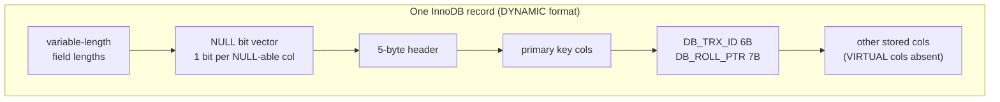

## Introduction

Requirements gathering gave you a list of nouns and facts. This lesson turns them into the two building blocks of every conceptual model: **entities** (the things the organization keeps track of) and **attributes** (the facts recorded about each thing). It sounds simple, and for half the attributes in any schema it is. The other half is where real designs go wrong:

- Is *address* one fact or five? Will anybody ever ask "how many customers live in Austin?"
- Is *phone* one value per customer, or several (mobile, work, home)?
- Should *age* be stored, or computed from a birth date? Should an order's *total* be stored?
- Which attribute(s) identify a customer — the email, an internal number, both?
- What does it mean when an attribute is *missing* — unknown, not applicable, or not yet known?

Each answer has a precise ER classification — **simple vs composite**, **single-valued vs multivalued**, **stored vs derived**, **key**, **NULL-able** — and each classification has a precise MySQL implementation: separate columns, a separate table, a generated column, a `PRIMARY KEY`/`UNIQUE` constraint, `NULL`/`NOT NULL`. By the end of the lesson you will classify any attribute you hear in an interview and know which `CREATE TABLE` fragment it produces and what it costs inside InnoDB.

:::note[Dataset]
The examples use the **shop** dataset and add a few small tables of our own (`suppliers`, `supplier_phones`). Every output below was captured from a real MySQL server.
:::

## DBMS Theory

:::theory[Entity types, entity sets and attributes]
- An **entity** is a thing in the real world with an independent existence — a particular customer, product or order. It may be physical (a bike) or conceptual (a course, a job).
- An **entity type** defines a collection of entities that have the same attributes — `Customer`. It is the *intension* (schema) of the concept.
- An **entity set** (or *extension*) is the collection of all entities of that type in the database at a point in time — the 25 customers stored today.
- An **attribute** is a property of an entity type. Each attribute has a **domain** (value set): the values it may take, e.g. integers 1–5 for a rating.

In the relational model the entity type becomes a **relation schema** (`CREATE TABLE`), the entity set becomes the **relation instance** (the rows), and each attribute becomes a **column** whose domain is approximated by a data type plus constraints.
:::

### The attribute taxonomy

Elmasri & Navathe's classification, which every ER textbook and tool uses, crosses several independent dimensions:

| Dimension | Kinds | Question to ask | Example |
|---|---|---|---|
| Structure | **Simple** (atomic) vs **composite** | Is it made of meaningful parts that anyone queries separately? | `email` is simple; `address` = street + city + state + postal code is composite |
| Multiplicity | **Single-valued** vs **multivalued** | Can one entity have several values at the same time? | `signup_date` single-valued; `phone` numbers often multivalued |
| Storage | **Stored** vs **derived** | Can it be computed from other data? | `birth_date` stored; `age` derived; `order_total` derived from lines |
| Identification | **Key** vs non-key | Does it (alone or with others) uniquely identify an entity? | `customer_id`, `email` |
| Optionality | **Mandatory** vs **NULL-able** | Can an entity exist without a value for it? | `email` mandatory; `phone` optional |

Two further ideas complete the picture:

- **Complex attributes** nest composite and multivalued structure — e.g. *several addresses, each composite*. In ER notation they are written `{Address(Street, City, Zip)}`.
- **Atomicity is relative to use.** First normal form (Module 6, [1NF](/lessons/m06-1nf)) requires atomic values, but "atomic" means *atomic for the queries the business runs*. A date is atomic for most systems even though it has a year, month and day; `full_name` is atomic for a mailing label but not for a system that sorts by family name.

### How each kind maps to MySQL

| ER construct | Relational mapping (general theory) | MySQL implementation |
|---|---|---|
| Simple, single-valued | One column | Column with a fitting type (`VARCHAR`, `INT`, `DATE`, `DECIMAL`…) |
| Composite | One column per *leaf* component; the composite itself disappears | `street`, `city`, `state`, `postal_code` columns |
| Multivalued | A new relation: owner's key + the value; key = both | `CREATE TABLE customer_phones (customer_id, phone, PRIMARY KEY (customer_id, phone), FOREIGN KEY …)` (or a JSON array, see Alternatives) |
| Derived | Usually not stored; computed in queries/views | Query expression, view, or a **generated column** (`VIRTUAL`/`STORED`) when the inputs are in the same row and the function is deterministic |
| Key | Primary key or alternate (candidate) key | `PRIMARY KEY (…)`, `UNIQUE (…)` |
| Optional | NULL allowed | `NULL` (the default for a column without `NOT NULL`) |
| Mandatory | NULL forbidden | `NOT NULL` |

## Why It Exists

The classification is not academic bookkeeping — each wrong choice causes a specific, recognizable production problem.

- **Composite stored as one string** → you cannot filter, group, or index by a part. "Customers per city" becomes string parsing that breaks on the first address with an extra comma.
- **Multivalued stored as one column** → comma-separated lists, `LIKE '%…%'` searches that match the wrong rows, no foreign keys for the values, no uniqueness. Or `phone1`, `phone2`, `phone3` columns: a hard limit, mostly-NULL columns, and three-way `OR` conditions in every search.
- **Derived stored without a plan** → values drift out of sync. A stored `age` is wrong a year later; a stored `order_total` is wrong as soon as a line is edited without updating it.
- **Missing key** → duplicate entities. Two rows for the same customer split their order history and double-count them in every report.
- **Wrong optionality** → either fake values (`''`, `'N/A'`, `1900-01-01`) to satisfy `NOT NULL`, or NULLs in attributes the business considers mandatory — which every report then has to special-case.

The classification forces the designer to ask the right question at the right time, before the column exists.

## Internal Working

How MySQL stores the result of each choice determines its cost.

:::internals[How InnoDB stores attributes]
- **Rows and the clustered index.** An InnoDB table *is* a B+ tree ordered by the primary key; leaf pages contain the whole row (all stored columns). So key attributes are not just constraints — the primary key decides the physical order of the entity set (see [Clustered and Secondary Indexes](/lessons/m07-clustered-secondary)).
- **NULL costs one bit.** In the COMPACT and DYNAMIC row formats (DYNAMIC is the default) the record header contains a NULL bit vector with one bit per NULL-able column, rounded up to whole bytes. A column that is NULL occupies no space beyond its bit. A `NOT NULL` column has no bit at all.
- **Variable-length columns** (`VARCHAR`, `VARBINARY`, `TEXT`, `BLOB`) are stored with a 1- or 2-byte length prefix in the record header. Under DYNAMIC, long values may be stored *off-page* with only a 20-byte pointer in the row.
- **Composite attributes** cost nothing special: they are ordinary columns. Splitting `address` into four columns adds a few bytes of length prefixes but allows each part to be indexed.
- **Multivalued attributes** become their own clustered B+ tree. With `PRIMARY KEY (customer_id, phone)`, all phones of a customer are adjacent in the same leaf page — fetching them is one short range scan.
- **Generated columns.** A `VIRTUAL` generated column is *not stored* in the clustered index; it is evaluated when rows are read (and its value is materialized in a secondary index if you index it). A `STORED` generated column is computed on `INSERT`/`UPDATE` and occupies space like a normal column. MySQL allows only deterministic built-in functions in generated column expressions.
:::



## MySQL Implementation

Start with the entity *type* and the entity *set*. The type is the table definition — readable from the data dictionary — and the set is its current rows.

```sql run
SELECT COLUMN_NAME, COLUMN_TYPE, IS_NULLABLE, COLUMN_KEY
FROM information_schema.COLUMNS
WHERE TABLE_SCHEMA = DATABASE() AND TABLE_NAME = 'customers'
ORDER BY ORDINAL_POSITION;
```

```sql run
SELECT COUNT(*) AS entity_set_size FROM customers;
```

Reading the type with the taxonomy in mind:

- `customer_id` — simple, single-valued, **key** (`PRI`), mandatory.
- `email` — simple, single-valued, **alternate key** (`UNI`), mandatory.
- `first_name` + `last_name` — the two leaf components of a **composite** attribute *name*.
- `city` + `state` — the stored parts of a composite *location*.
- `phone` and `loyalty_tier` — **NULL-able**: the business accepts customers without them.
- `phone` is single-valued in this design — a requirement decision ("we keep one contact number"). If the business needs mobile *and* work numbers, it becomes multivalued.

Now build a new entity type from scratch with every attribute kind. Interview notes: *"We buy from suppliers. Each supplier has a unique tax ID, a company name, a postal address, a contact person's first and last name, any number of phone numbers, and the date we started working with them. We also want to see how many years each has been a partner."*

```sql run
CREATE TABLE suppliers (
  supplier_id     INT UNSIGNED NOT NULL AUTO_INCREMENT,
  tax_id          VARCHAR(20)  NOT NULL,           -- key attribute (natural, alternate key)
  company_name    VARCHAR(120) NOT NULL,           -- simple
  street          VARCHAR(120) NOT NULL,           -- composite: address
  city            VARCHAR(60)  NOT NULL,
  state           CHAR(2)      NOT NULL,
  postal_code     VARCHAR(10)  NOT NULL,
  contact_first   VARCHAR(50)  NULL,               -- composite: contact name (optional)
  contact_last    VARCHAR(50)  NULL,
  partner_since   DATE         NOT NULL,           -- stored; "years as partner" is derived
  PRIMARY KEY (supplier_id),
  CONSTRAINT uq_suppliers_tax_id UNIQUE (tax_id)
);

CREATE TABLE supplier_phones (                     -- multivalued attribute
  supplier_id  INT UNSIGNED NOT NULL,
  phone        VARCHAR(20)  NOT NULL,
  phone_type   ENUM('main','sales','support','fax') NOT NULL,
  PRIMARY KEY (supplier_id, phone),
  CONSTRAINT fk_supplier_phones FOREIGN KEY (supplier_id)
    REFERENCES suppliers (supplier_id) ON DELETE CASCADE
);

INSERT INTO suppliers (tax_id, company_name, street, city, state, postal_code,
                       contact_first, contact_last, partner_since) VALUES
  ('94-1234567', 'Bayline Electronics', '100 Market St',   'San Jose', 'CA', '95113', 'Lena',  'Park',  '2019-03-01'),
  ('74-7654321', 'Lone Star Books',     '22 Congress Ave', 'Austin',   'TX', '78701', NULL,    NULL,    '2022-07-15'),
  ('13-5550001', 'Hudson Home Goods',   '9 Pier Rd',       'Albany',   'NY', '12207', 'Marco', 'Rossi', '2016-11-20');

INSERT INTO supplier_phones VALUES
  (1, '+1-408-555-0100', 'main'),
  (1, '+1-408-555-0111', 'sales'),
  (1, '+1-408-555-0122', 'support'),
  (3, '+1-518-555-0300', 'main');

SELECT s.supplier_id, s.company_name, s.city,
       COUNT(p.phone) AS phones,
       GROUP_CONCAT(CONCAT(p.phone_type, ': ', p.phone) ORDER BY p.phone SEPARATOR '; ') AS phone_list
FROM suppliers AS s
LEFT JOIN supplier_phones AS p ON p.supplier_id = s.supplier_id
GROUP BY s.supplier_id, s.company_name, s.city
ORDER BY s.supplier_id;
```

Supplier 2 has no phone — the multivalued attribute is simply an *empty set* of rows, and the `LEFT JOIN` keeps the supplier while `COUNT(p.phone)` reports 0. No NULL placeholder column was needed.

## Syntax Breakdown

| Element | Meaning for attribute design |
|---|---|
| `col type NOT NULL` | Mandatory attribute. The server rejects NULL (error 1048 for explicit NULL in strict mode). |
| `col type NULL` / no clause | Optional attribute. Default for columns not in a `PRIMARY KEY`. Document what NULL means. |
| `DEFAULT expr` | Value used when the `INSERT` omits the column. A default is not a substitute for "unknown" — a default of `''` for a missing phone is a fake value. Expression defaults in parentheses (e.g. `DEFAULT (CURRENT_DATE)`) are allowed since 8.0.13. |
| `PRIMARY KEY (cols)` | The chosen identifier. Implies `NOT NULL` for every column and creates the clustered index. |
| `UNIQUE (cols)` | Alternate key. Allows multiple NULLs (a NULL is not equal to another NULL). |
| `CHECK (expr)` | Restricts the domain beyond the data type (enforced since 8.0.16). |
| `ENUM('a','b')` | MySQL extension: a closed domain stored as a 1–2 byte index. |
| `col type AS (expr) VIRTUAL` | Derived attribute computed at read time; not stored. `VIRTUAL` is the default if neither keyword is given. |
| `col type AS (expr) STORED` | Derived attribute computed at write time and stored. |
| `GENERATED ALWAYS` | Optional noise words: `col INT GENERATED ALWAYS AS (expr)` equals `col INT AS (expr)`. |
| Separate table + FK | Multivalued attribute: `(owner_key, value)` with a composite primary key. |

:::standard[Standard SQL vs MySQL]
Generated columns are part of SQL:2003 (`GENERATED ALWAYS AS`); MySQL adds the `VIRTUAL`/`STORED` choice. Standard SQL also defines composite *row types* and *array/multiset* column types, which would store composite and multivalued attributes in one column; MySQL implements neither, but its `JSON` type can hold nested structures (a MySQL-specific approach discussed under Alternative Approaches).
:::

## Practical Examples

**1. Composite attributes are only useful if the parts are stored.** Because the address is stored as components, "suppliers per state" is a trivial, indexable query:

```sql run
SELECT state, COUNT(*) AS suppliers
FROM suppliers
GROUP BY state
ORDER BY state;
```

If the design had a single `address VARCHAR(255)` column, the same question requires parsing:

```sql run
SELECT CONCAT_WS(', ', street, city, CONCAT(state, ' ', postal_code)) AS full_address,
       SUBSTRING_INDEX(SUBSTRING_INDEX(CONCAT_WS(', ', street, city, CONCAT(state, ' ', postal_code)), ', ', -1), ' ', 1) AS parsed_state
FROM suppliers
ORDER BY supplier_id;
```

Building the full string from parts is easy and safe (`CONCAT_WS`); recovering parts from the string depends on every address following exactly the same punctuation. Store the parts; derive the string.

**2. Derived attribute with a generated column.** An order line's total is derived from two columns of the same row, using a deterministic expression — a perfect generated column:

```sql run
ALTER TABLE order_items
  ADD COLUMN line_total DECIMAL(12,2) AS (quantity * unit_price) VIRTUAL;

SELECT order_id, product_id, quantity, unit_price, line_total
FROM order_items
ORDER BY order_id, product_id
LIMIT 5;
```

The column is *declared* in the table but computed on read. You cannot write to it:

```sql run error
UPDATE order_items SET line_total = 0 WHERE order_id = 1;
```

**3. Not every derived attribute can be a generated column.** "Years as partner" depends on *today's* date. `CURDATE()` is non-deterministic, so MySQL refuses it in a generated column:

```sql run error
ALTER TABLE suppliers
  ADD COLUMN years_as_partner INT AS (TIMESTAMPDIFF(YEAR, partner_since, CURDATE())) VIRTUAL;
```

The derivation belongs in a query or a view instead — computed fresh every time, so it can never be stale:

```sql run
CREATE VIEW supplier_overview AS
SELECT supplier_id, company_name, partner_since,
       TIMESTAMPDIFF(YEAR, partner_since, CURDATE()) AS years_as_partner
FROM suppliers;

SELECT supplier_id, company_name, partner_since
FROM supplier_overview
ORDER BY partner_since;
```

(The `years_as_partner` value changes with the calendar, so it is left out of the captured output above; run the view yourself to see today's values.)

**4. Derived attributes over many rows.** An order's total is derived from *all its lines* — another table. A generated column cannot reference other rows, so the choice is: compute it in a query (always correct) or store it in `orders` and keep it in sync (faster to read, a denormalization — see [Denormalization](/lessons/m06-denormalization)).

```sql run
SELECT o.order_id, o.status, SUM(oi.line_total) AS order_total, COUNT(*) AS line_count
FROM orders AS o
JOIN order_items AS oi ON oi.order_id = o.order_id
GROUP BY o.order_id, o.status
ORDER BY o.order_id
LIMIT 5;
```

**5. Key attributes — and how the collation defines "the same value".** `email` is an alternate key of `customers`. Customer 1's email is `amara.sharma1@example.com`. Try to register the same address typed in capitals:

```sql run error
INSERT INTO customers (first_name, last_name, email, city, state, signup_date)
VALUES ('Amara', 'Sharma', 'AMARA.SHARMA1@EXAMPLE.COM', 'Austin', 'TX', '2024-12-01');
```

The insert is rejected as a duplicate, because the column's collation (`utf8mb4_0900_ai_ci`, case- and accent-insensitive) compares the two strings as equal — and the `UNIQUE` index uses the same comparison. For emails that is what the business wants. For a case-sensitive identifier (a product code where `ab-1` and `AB-1` are different products) you would declare a binary or `_cs` collation on that column. The key's *meaning* depends on its collation.

**6. Optional attributes — UNIQUE and NULL.** An alternate key that is optional (say, a supplier's DUNS number that only some suppliers have) can still be `UNIQUE`, because MySQL's unique indexes allow any number of NULLs:

```sql run
ALTER TABLE suppliers ADD COLUMN duns_number CHAR(9) NULL,
                      ADD CONSTRAINT uq_suppliers_duns UNIQUE (duns_number);
UPDATE suppliers SET duns_number = '123456789' WHERE supplier_id = 1;
SELECT supplier_id, company_name, duns_number FROM suppliers ORDER BY supplier_id;
```

Suppliers 2 and 3 both have NULL — no conflict. A second supplier with `123456789` would be rejected.

## Execution Walkthrough

Trace the life of one entity through its attribute structures: what is stored where, and how a query reassembles the full entity.

```walkthrough
title: Storing and reassembling one supplier entity
steps:
  - title: "1. The single-valued, stored attributes live in one row"
    explain: >-
      The suppliers row holds every simple and composite (decomposed) attribute. Supplier 1's composite
      address is four columns; the composite contact name is two.
    sql: |
      SELECT supplier_id, tax_id, company_name, street, city, state, postal_code, contact_first, contact_last
      FROM suppliers WHERE supplier_id = 1;
  - title: "2. The multivalued attribute lives in its own table"
    explain: >-
      The phones are three rows in supplier_phones. Because the primary key starts with supplier_id, they are
      adjacent in the clustered index and come back in key order (supplier_id, phone) with a single range scan.
    sql: |
      SELECT supplier_id, phone, phone_type FROM supplier_phones WHERE supplier_id = 1;
  - title: "3. The plan for reading the phones"
    explain: >-
      EXPLAIN confirms the access path: a lookup on the PRIMARY key prefix supplier_id = 1, not a table scan.
    sql: |
      EXPLAIN FORMAT=TREE SELECT phone, phone_type FROM supplier_phones WHERE supplier_id = 1;
  - title: "4. Derived attributes are computed on read"
    explain: >-
      The display address is derived by CONCAT_WS from stored parts. Nothing about it is stored, so it cannot
      become inconsistent with the parts.
    sql: |
      SELECT supplier_id,
             CONCAT_WS(', ', street, city, CONCAT(state, ' ', postal_code)) AS display_address,
             CONCAT_WS(' ', contact_first, contact_last) AS contact_name
      FROM suppliers ORDER BY supplier_id;
  - title: "5. Reassemble the full entity"
    explain: >-
      A LEFT JOIN plus GROUP_CONCAT folds the multivalued attribute back into one row per supplier for display.
      Note CONCAT_WS skips NULL arguments, so supplier 2's missing contact gives an empty string rather than NULL.
    sql: |
      SELECT s.supplier_id, s.company_name,
             CONCAT_WS(' ', s.contact_first, s.contact_last) AS contact_name,
             GROUP_CONCAT(p.phone ORDER BY p.phone SEPARATOR ', ') AS phones
      FROM suppliers AS s
      LEFT JOIN supplier_phones AS p ON p.supplier_id = s.supplier_id
      GROUP BY s.supplier_id, s.company_name, contact_name
      ORDER BY s.supplier_id;
```

## Output

The final query of the walkthrough is how an application sees the entity: one row per supplier, the composite parts merged for display, the multivalued phones folded into a list, and absent values shown as absent (supplier 2 has no contact and no phones). The *storage* underneath is normalized — one fact in one place — while the *presentation* is assembled on demand. That separation is the goal of good attribute design: the stored structure answers every query correctly, and presentation formats are derived.

Two details in the output are worth reading carefully:

- `contact_name` for supplier 2 is an empty string, not NULL, because `CONCAT_WS` ignores NULL arguments (whereas `CONCAT` returns NULL if any argument is NULL). Choose deliberately when deriving display values.
- `phones` for supplier 2 is NULL: `GROUP_CONCAT` over a group whose only joined row has `p.phone` NULL returns NULL.

## Alternative Approaches

### Multivalued attributes: table vs JSON array vs repeated columns

MySQL offers a document-style alternative for multivalued attributes: a `JSON` array column, which since 8.0.17 can be indexed with a **multi-valued index**.

```sql run
CREATE TABLE product_tags_json (
  product_id INT UNSIGNED PRIMARY KEY,
  tags       JSON NOT NULL,
  INDEX idx_tags ((CAST(tags AS CHAR(20) ARRAY)))
);
INSERT INTO product_tags_json VALUES
  (1, '["sale", "new"]'), (2, '["new"]'), (3, '["gift", "sale"]'), (4, '["newsletter"]');

SELECT product_id FROM product_tags_json
WHERE 'new' MEMBER OF (tags)
ORDER BY product_id;
```

Exact element matching (`MEMBER OF`) correctly ignores `newsletter`, and the multi-valued index can serve the lookup. Compare the options:

| Approach | Integrity | Querying | When it fits |
|---|---|---|---|
| **Child table** `(owner_id, value)` | PK prevents duplicates; FK can validate values against a lookup table; per-value attributes possible (`phone_type`) | Standard joins; any aggregation; portable | The default. Values have their own attributes, are queried, counted or validated |
| **JSON array + multi-valued index** | No FK; duplicates only prevented by application; validation via `JSON_SCHEMA_VALID` CHECK (8.0.17+) | `MEMBER OF`, `JSON_CONTAINS`, `JSON_OVERLAPS`; MySQL-specific | Free-form labels read mostly as a whole, few cross-entity queries |
| **Repeated columns** `phone1…phone3` | Fixed maximum; no uniqueness across columns | `WHERE phone1 = ? OR phone2 = ? OR phone3 = ?` | Almost never — only when the maximum is a genuine, permanent business rule (e.g. exactly two signatories) |

### Derived attributes: compute, generate, or store

| Option | Freshness | Read cost | Restrictions |
|---|---|---|---|
| Compute in each query | Always correct | Recomputed every time | None |
| View | Always correct | Recomputed every time; encapsulates the formula | None |
| `VIRTUAL` generated column | Always correct | Computed per row read; can be indexed | Same-row inputs; deterministic built-ins only |
| `STORED` generated column | Always correct | Stored; no compute on read | Same restrictions; costs space; updated on write |
| Stored column maintained by app/trigger | Correct only if every write path maintains it | Cheapest read | Risk of drift; justify with a measured performance need |

### Composite attributes: columns vs JSON object

A composite like an address could be a JSON object (`{"street": …, "city": …}`). It is flexible for international formats with varying parts, but loses `NOT NULL`/type checking per part (unless you add generated columns or a JSON schema CHECK) and makes indexing a part require a generated column. For attributes that are queried by part, separate columns remain the professional default.

## Performance Analysis

Attribute decisions have measurable storage and access-path consequences, even when the logical design is the same.

| Decision | Cost model |
|---|---|
| Separate columns for composite parts | A few bytes of length prefixes; each part indexable; no parsing at query time |
| NULL-able vs NOT NULL | One bit per NULL-able column in the record header; NULL values store no data |
| Child table for multivalued | Extra B+ tree; values of one owner clustered together when the PK starts with the owner key; a join or second lookup on read |
| JSON array | One column; whole document rewritten on update (partial in-place updates are possible for some `JSON_SET`/`JSON_REPLACE` cases); multi-valued index needed for searches |
| `VIRTUAL` generated column | No storage; CPU on every read that selects it; if indexed, values are stored in the secondary index |
| `STORED` generated column | Storage like a normal column; CPU on every insert/update |
| Stored derived value in another table | Fast reads; extra writes and the risk of inconsistency |

Indexing a derived attribute is where generated columns shine. To find order lines worth more than 500 efficiently, index the virtual column (remember to `ANALYZE TABLE` before reading a plan for an index you just created):

```sql run
CREATE INDEX idx_items_line_total ON order_items (line_total);
ANALYZE TABLE order_items;
EXPLAIN FORMAT=TREE
SELECT order_id, product_id, line_total FROM order_items WHERE line_total > 500;
```

The optimizer uses a range scan on the secondary index over the virtual column — and the plan even says *covering*: an InnoDB secondary index entry stores the indexed value **plus the primary key columns** (`order_id`, `product_id`), which is everything this query selects, so the clustered index is never visited and the virtual column is never recomputed. MySQL can also match the *expression* `quantity * unit_price > 500` to the indexed generated column when the expression matches the column definition exactly, which lets existing queries benefit without being rewritten (see [Covering, Prefix and Functional Indexes](/lessons/m07-covering-prefix-functional)).

:::performance[Theory vs measurement]
On the 182-row `order_items` table every access path takes microseconds; the plan *shape* is the lesson, not the timing. On a large table, measure the read and write cost of a `STORED` versus `VIRTUAL` column with `EXPLAIN ANALYZE` and a representative workload before choosing.
:::

## Best Practices

:::best-practice[Attribute design habits]
1. **Decompose composites to the level the business queries.** Store `city` and `state` separately if anyone filters or groups by them; derive display strings.
2. **Ask "can there be more than one?" for every attribute.** If yes, use a child table (or, for free-form labels, a JSON array with a multi-valued index).
3. **Don't store what you can derive — unless you can prove a need.** Prefer queries, views and generated columns; store derived values only with a maintenance mechanism and a measured performance reason.
4. **Declare optionality explicitly** — write `NULL` or `NOT NULL` on every column, and write down what NULL means (unknown, not applicable, not yet).
5. **Give every entity type a primary key and declare every alternate key** with `UNIQUE`. A natural identifier that is not declared unique will be duplicated.
6. **Choose collations deliberately for key attributes.** Case-insensitive uniqueness for emails and usernames, binary or `_cs` for case-sensitive codes.
7. **Model domains tightly:** the narrowest correct type plus `CHECK` constraints (`DECIMAL` for money, `DATE` for dates, never `VARCHAR` for numbers or dates).
:::

## Common Mistakes

**Mistake 1 — multivalued attribute as repeating columns.** Searching all phone columns needs `OR` across columns, and a fourth phone needs an `ALTER TABLE`:

```sql run
CREATE TABLE supplier_phones_bad (
  supplier_id INT UNSIGNED PRIMARY KEY,
  phone1 VARCHAR(20), phone2 VARCHAR(20), phone3 VARCHAR(20)
);
INSERT INTO supplier_phones_bad VALUES (1, '+1-408-555-0100', '+1-408-555-0111', '+1-408-555-0122'),
                                       (3, '+1-518-555-0300', NULL, NULL);
SELECT supplier_id FROM supplier_phones_bad
WHERE '+1-408-555-0111' IN (phone1, phone2, phone3);
```

Correct design: the `supplier_phones` child table, where the search is `WHERE phone = ?` and can use an index on `phone`.

**Mistake 2 — storing a time-dependent derived value.** A stored `age` or `years_as_partner` is correct only on the day it was written. Store the base fact (`birth_date`, `partner_since`) and derive the rest at query time — MySQL even refuses the non-deterministic generated column, as you saw.

**Mistake 3 — fake values for unknown data.** `phone VARCHAR(20) NOT NULL DEFAULT ''` makes "unknown" look like a value. `COUNT(phone)` then counts customers without phones as having one:

```sql run
SELECT COUNT(phone) AS counted_with_null,
       COUNT(NULLIF(phone, '')) AS same_on_this_data
FROM customers;
```

On the real `customers` table, phone is NULL when unknown, so both counts agree. Had the design used `''`, every report would need the `NULLIF` workaround — and somebody would forget.

**Mistake 4 — assuming UNIQUE prevents duplicate NULLs.** In MySQL (and the SQL standard), `UNIQUE` allows any number of NULLs. If an optional attribute must still be unique *and* present for some subset, add a `CHECK` or make it `NOT NULL` for that subtype.

**Mistake 5 — confusing an entity with an attribute.** If "department" has its own facts (budget, building, manager), it is an entity with a relationship, not a `department_name VARCHAR` attribute on employee. Rule of thumb: when a noun has attributes of its own, or is shared by many entities and must be consistent, promote it to an entity.

**Mistake 6 — writing to a generated column.** Generated columns are read-only; `INSERT` and `UPDATE` must omit them or use `DEFAULT` (error 3105, shown in Practical Example 2).

## Industry Application

- **Customer master data.** CRM and e-commerce systems separate composite name and address parts (often with country-specific formats), keep multiple addresses and phones as child rows with a `type` and `is_primary` flag, and treat email as a case-insensitive unique key.
- **Generated columns for search and integrity.** Teams index derived expressions — lower-cased emails, `JSON` fields extracted with `->>`, computed totals — using generated columns or functional indexes rather than duplicating data in application code.
- **Tags and labels.** Product catalogues and content platforms often store free-form labels as JSON arrays with multi-valued indexes, while controlled vocabularies (categories, regulated attributes) stay in child tables with foreign keys.
- **Data quality monitoring.** Pipelines track NULL rates per attribute over time; a sudden jump in NULL `phone` values after a release is a classic regression signal.
- **Privacy engineering.** Attribute-level classification (PII, sensitive, public) is recorded in the data catalogue, so composite attributes are split partly for privacy: `postal_code` might be retained for analytics while `street` is erased on request.

## Practice Exercises

```exercise
id: ex1
title: Classify the customers attributes from the dictionary
difficulty: easy
concepts: [attributes, null-handling, key-attributes]
prompt: |
  Using `information_schema.COLUMNS`, list the columns of the `customers` table that are **optional**
  (NULL-able). Return columns `COLUMN_NAME`, `COLUMN_TYPE`, ordered by `ORDINAL_POSITION`.
hints:
  - "Filter on TABLE_SCHEMA = DATABASE() AND TABLE_NAME = 'customers'."
  - "IS_NULLABLE = 'YES' marks optional attributes."
solution: |
  SELECT COLUMN_NAME, COLUMN_TYPE
  FROM information_schema.COLUMNS
  WHERE TABLE_SCHEMA = DATABASE() AND TABLE_NAME = 'customers' AND IS_NULLABLE = 'YES'
  ORDER BY ORDINAL_POSITION;
orderMatters: true
explanation: |
  `phone` and `loyalty_tier` are the optional attributes. `IS_NULLABLE` is the string `'YES'`/`'NO'`, not a
  boolean. Filtering by `TABLE_SCHEMA = DATABASE()` matters: without it you would also read columns of other
  schemas you can see.
```

```exercise
id: ex2
title: Model a multivalued attribute
difficulty: medium
kind: dml
dataset: shop
concepts: [multivalued-attributes, composite-key, foreign-key]
prompt: |
  Customers may have several **delivery instructions**, each a short text (up to 100 characters) with a
  `priority` (`TINYINT UNSIGNED`). The same instruction text must not be stored twice for the same customer.

  Create table **`customer_instructions`** with columns `customer_id` (`INT UNSIGNED`), `instruction`
  (`VARCHAR(100)`), `priority` (`TINYINT UNSIGNED`), all mandatory. Its primary key must be
  `(customer_id, instruction)` and `customer_id` must reference `customers`. Deleting a customer must delete
  their instructions.

  The checker reads your key columns and the delete rule of your foreign key.
hints:
  - "PRIMARY KEY (customer_id, instruction) prevents the same text twice for one customer."
  - "FOREIGN KEY (customer_id) REFERENCES customers (customer_id) ON DELETE CASCADE."
solution: |
  CREATE TABLE customer_instructions (
    customer_id INT UNSIGNED NOT NULL,
    instruction VARCHAR(100) NOT NULL,
    priority    TINYINT UNSIGNED NOT NULL,
    PRIMARY KEY (customer_id, instruction),
    CONSTRAINT fk_instr_customer FOREIGN KEY (customer_id)
      REFERENCES customers (customer_id) ON DELETE CASCADE
  );
check: |
  SELECT k.CONSTRAINT_NAME = 'PRIMARY' AS is_pk, k.COLUMN_NAME, k.ORDINAL_POSITION,
         k.REFERENCED_TABLE_NAME, r.DELETE_RULE
  FROM information_schema.KEY_COLUMN_USAGE AS k
  LEFT JOIN information_schema.REFERENTIAL_CONSTRAINTS AS r
         ON r.CONSTRAINT_SCHEMA = k.CONSTRAINT_SCHEMA AND r.CONSTRAINT_NAME = k.CONSTRAINT_NAME
  WHERE k.TABLE_SCHEMA = DATABASE() AND k.TABLE_NAME = 'customer_instructions'
  ORDER BY is_pk DESC, k.COLUMN_NAME, k.ORDINAL_POSITION;
explanation: |
  The multivalued attribute becomes a table keyed by *owner key + value*. `ON DELETE CASCADE` expresses that
  the values have no existence without the owner. A surrogate `instruction_id` primary key would also work
  only if you *additionally* declared `UNIQUE (customer_id, instruction)` — otherwise duplicates slip in.
  The column type must be `INT UNSIGNED` to match `customers.customer_id`.
```

```exercise
id: ex3
title: A derived attribute as a generated column
difficulty: medium
kind: dml
dataset: shop
concepts: [derived-attributes, generated-columns]
prompt: |
  Add a derived attribute **`margin`** to `products`: `price - cost`, type `DECIMAL(10,2)`, computed on read
  (not stored). Then the checker returns the five products with the highest margin: `product_id`, `margin`,
  ordered by margin descending, then product_id.
hints:
  - "ALTER TABLE products ADD COLUMN margin DECIMAL(10,2) AS (price - cost) VIRTUAL;"
solution: |
  ALTER TABLE products ADD COLUMN margin DECIMAL(10,2) AS (price - cost) VIRTUAL;
check: |
  SELECT product_id, margin
  FROM products
  ORDER BY margin DESC, product_id
  LIMIT 5;
orderMatters: true
explanation: |
  Margin depends only on two columns of the same row through a deterministic expression, so a generated
  column is ideal: it can never drift from price and cost. `VIRTUAL` (the default) computes it on read;
  `STORED` would materialize it. Adding a plain `margin` column and filling it with an `UPDATE` would produce
  the same numbers today — and wrong numbers after the next price change.
```

```exercise
id: ex4
title: Find the derived attribute that cannot be generated
difficulty: medium
kind: open
concepts: [derived-attributes, generated-columns]
prompt: |
  For each of these derived attributes, decide whether it can be a MySQL generated column, and if not, where
  it should be computed: (a) `full_name` from `first_name` and `last_name`; (b) `customer_age` from
  `birth_date`; (c) `order_total` from the order's lines; (d) `email_domain` from `email`;
  (e) `is_overdue` for a loan from `due_at` and `returned_at`.
solution: |
  (a) Yes — `CONCAT_WS(' ', first_name, last_name)` uses same-row columns and a deterministic function.
  (b) No — age depends on the current date; `CURDATE()` is non-deterministic and rejected in generated
  columns (error 3763). Compute it in queries or a view.
  (c) No — it aggregates other rows (in another table). Compute with `SUM` in a query/view, or store it in
  `orders` as a deliberate denormalization maintained in the same transaction (or by triggers).
  (d) Yes — `SUBSTRING_INDEX(email, '@', -1)`; a good candidate for an index (e.g. "customers per domain").
  (e) Partly — "returned late" (`returned_at > due_at`) is a same-row deterministic expression and can be
  generated; "currently overdue" (`returned_at IS NULL AND due_at < CURDATE()`) depends on today's date and
  must be computed at query time.
```

```exercise
id: ex5
title: Case-insensitive alternate key — find the would-be duplicates
difficulty: hard
concepts: [key-attributes, collation]
prompt: |
  A data migration will load these emails into `customers`: `'GRACE.SMITH5@example.com'`,
  `'new.person@example.com'`, `'Diego.Lopez4@Example.com'`. Without inserting anything, return the emails
  from this list that would be rejected as duplicates of an existing customer, together with the
  `customer_id` they collide with. Columns: `incoming_email`, `customer_id`, ordered by `customer_id`.
hints:
  - "Build the list as a derived table: SELECT 'a' AS e UNION ALL SELECT 'b' …"
  - "Join it to customers on email — the comparison uses the column's case-insensitive collation, exactly like the UNIQUE index."
solution: |
  SELECT i.incoming_email, c.customer_id
  FROM (SELECT 'GRACE.SMITH5@example.com' AS incoming_email
        UNION ALL SELECT 'new.person@example.com'
        UNION ALL SELECT 'Diego.Lopez4@Example.com') AS i
  JOIN customers AS c ON c.email = i.incoming_email
  ORDER BY c.customer_id;
orderMatters: true
explanation: |
  Equality on `email` uses the column collation `utf8mb4_0900_ai_ci`, so mixed-case variants match — the same
  rule the `UNIQUE` index applies on insert. A pre-flight join like this is how migrations detect conflicts
  before loading. Comparing with `BINARY` or `COLLATE utf8mb4_bin` would miss these collisions and the load
  would then fail with error 1062.
```

```exercise
id: ex6
title: Design an entity with every attribute kind
difficulty: challenge
kind: open
concepts: [entity-types, composite-attributes, multivalued-attributes, derived-attributes, key-attributes, null-handling]
prompt: |
  Model the entity **Employee** for an HR system from these notes, classifying every attribute
  (simple/composite, single/multivalued, stored/derived, key, optional) and writing the MySQL DDL:

  *"Each employee has an employee number and a national ID (both unique), a legal name (given, middle — not
  everyone has one — and family name), a preferred name, a date of birth, a home address, one or more
  emergency contacts (name, relationship, phone), any number of skills, a hire date, and we want to show
  tenure in years and age."*
solution: |
  **Classification.** employee_no — simple, key (primary or alternate). national_id — simple, alternate key,
  sensitive. legal name — composite (given NOT NULL, middle NULL-able, family NOT NULL). preferred_name —
  simple, optional. birth_date — simple, stored, mandatory. home address — composite (street, city, region,
  postal_code, country_code). emergency contacts — multivalued *and* composite (complex attribute) → child
  table. skills — multivalued → child table (or a link to a `skills` lookup entity if the vocabulary is
  controlled). hire_date — stored. tenure and age — derived from dates and today → computed in a view.

  ~~~sql
  CREATE TABLE employees (
    employee_id   INT UNSIGNED NOT NULL AUTO_INCREMENT PRIMARY KEY,
    employee_no   VARCHAR(10)  NOT NULL,
    national_id   VARCHAR(20)  NOT NULL,
    given_name    VARCHAR(50)  NOT NULL,
    middle_name   VARCHAR(50)  NULL,
    family_name   VARCHAR(50)  NOT NULL,
    preferred_name VARCHAR(50) NULL,
    birth_date    DATE NOT NULL,
    street        VARCHAR(120) NOT NULL,
    city          VARCHAR(60)  NOT NULL,
    region        VARCHAR(60)  NULL,
    postal_code   VARCHAR(12)  NOT NULL,
    country_code  CHAR(2)      NOT NULL,
    hire_date     DATE NOT NULL,
    UNIQUE (employee_no), UNIQUE (national_id),
    CHECK (hire_date > birth_date)
  );
  CREATE TABLE employee_emergency_contacts (
    employee_id  INT UNSIGNED NOT NULL,
    contact_no   TINYINT UNSIGNED NOT NULL,          -- 1, 2, 3 … per employee
    contact_name VARCHAR(100) NOT NULL,
    relationship VARCHAR(30)  NOT NULL,
    phone        VARCHAR(20)  NOT NULL,
    PRIMARY KEY (employee_id, contact_no),
    FOREIGN KEY (employee_id) REFERENCES employees (employee_id) ON DELETE CASCADE
  );
  CREATE TABLE employee_skills (
    employee_id INT UNSIGNED NOT NULL,
    skill       VARCHAR(40) NOT NULL,
    PRIMARY KEY (employee_id, skill),
    FOREIGN KEY (employee_id) REFERENCES employees (employee_id) ON DELETE CASCADE
  );
  CREATE VIEW employee_overview AS
  SELECT employee_id, COALESCE(preferred_name, given_name) AS display_name,
         TIMESTAMPDIFF(YEAR, hire_date, CURDATE())  AS tenure_years,
         TIMESTAMPDIFF(YEAR, birth_date, CURDATE()) AS age
  FROM employees;
  ~~~

  Notes: "one or more" emergency contacts is a minimum-cardinality rule the DDL cannot enforce (cross-table)
  — the application or a trigger must check it. A surrogate `employee_id` keeps the wide, sensitive
  `national_id` out of every foreign key and secondary index; `national_id` remains a declared alternate key.
```

## Knowledge Assessment

```quiz
- id: q1
  question: "What is the difference between an entity type and an entity set?"
  options:
    - "The type is the definition (attributes, schema); the set is the collection of entities of that type currently stored"
    - "The type is a row; the set is a column"
    - "They are synonyms"
    - "The set is the definition; the type is the data"
  answer: 0
  explanation: "Entity type = intension = CREATE TABLE definition. Entity set = extension = the rows at a point in time. Rows and columns correspond to entities and attributes, not to type and set."
  concepts: [entity-types]
- id: q2
  question: "A customer may have several shipping addresses, each with street, city and postal code. In ER terms this attribute is:"
  options:
    - "Composite and multivalued (a complex attribute) — it maps to a child table with one column per component"
    - "Simple and single-valued — one VARCHAR column"
    - "Derived — compute it from orders"
    - "A key attribute"
  answer: 0
  explanation: "Several values → multivalued; each value has parts → composite. The mapping is a child table keyed by the owner plus a discriminator, with a column per leaf component. A single VARCHAR loses both structure and multiplicity."
  concepts: [composite-attributes, multivalued-attributes]
- id: q3
  question: "Which column definition does MySQL reject?"
  options:
    - "line_total DECIMAL(12,2) AS (quantity * unit_price) VIRTUAL"
    - "email_domain VARCHAR(255) AS (SUBSTRING_INDEX(email, '@', -1)) STORED"
    - "age INT AS (TIMESTAMPDIFF(YEAR, birth_date, CURDATE())) VIRTUAL"
    - "full_name VARCHAR(101) AS (CONCAT_WS(' ', first_name, last_name))"
  answer: 2
  explanation: "Generated columns may only use deterministic built-in functions. CURDATE() changes over time, so the age definition is rejected. The other three use same-row columns with deterministic functions (the last one defaults to VIRTUAL)."
  concepts: [derived-attributes, generated-columns]
- id: q4
  question: "How much space does a NULL value take in an InnoDB row using the DYNAMIC row format?"
  options:
    - "Only its bit in the record header's NULL bit vector"
    - "The full declared width of the column"
    - "One byte per NULL value"
    - "A 20-byte off-page pointer"
  answer: 0
  explanation: "COMPACT/DYNAMIC keep one bit per NULL-able column in the record header; a NULL column stores no data. Fixed widths, bytes per NULL and off-page pointers are not how NULLs are represented (20-byte pointers are for long off-page values)."
  concepts: [null-handling]
- id: q5
  type: multi
  question: "Which statements about a UNIQUE constraint on an optional (NULL-able) column in MySQL are true? (Select all that apply.)"
  options:
    - "Multiple rows may have NULL in that column"
    - "Two rows with the same non-NULL value are rejected"
    - "Comparison of values follows the column's collation, so 'A@X.COM' and 'a@x.com' can collide under a _ci collation"
    - "MySQL converts the column to NOT NULL automatically"
  answer: [0, 1, 2]
  explanation: "UNIQUE allows any number of NULLs (NULL is not equal to NULL), rejects duplicate non-NULL values, and uses the column collation for equality. Only PRIMARY KEY forces NOT NULL."
  concepts: [key-attributes, null-handling, collation]
- id: q6
  question: "A designer stores tags as `tags VARCHAR(255)` with values like 'sale,new'. Which problem is NOT a consequence of this design?"
  options:
    - "LIKE '%new%' also matches 'newsletter'"
    - "Tag values cannot be validated with a foreign key"
    - "A B+ tree index on tags cannot answer 'products tagged new'"
    - "The table can no longer have a primary key"
  answer: 3
  explanation: "The table can still have a primary key — the problems are with the multivalued attribute: substring false matches, no FK validation, and no usable index for element lookups. The fix is a child table or a JSON array with a multi-valued index."
  concepts: [multivalued-attributes]
- id: q7
  question: "An order's total is derived from its order lines. Why can't it be a MySQL generated column on `orders`?"
  options:
    - "Generated columns can only reference columns of the same row"
    - "Generated columns cannot be DECIMAL"
    - "Generated columns cannot be indexed"
    - "SUM is non-deterministic"
  answer: 0
  explanation: "A generated column expression sees only the current row. Aggregating lines (other rows, another table) needs a query, a view, or a maintained denormalized column. Generated columns can be DECIMAL and can be indexed; SUM is deterministic but is an aggregate over rows."
  concepts: [derived-attributes, generated-columns]
- id: q8
  question: "When should a noun like *department* be modelled as an entity instead of an attribute of Employee?"
  options:
    - "When it has attributes of its own (budget, building) or must be shared consistently by many employees"
    - "Never — departments are always attributes"
    - "Only when there are more than 100 departments"
    - "Only if the department name is longer than 50 characters"
  answer: 0
  explanation: "A noun with its own facts, or a value that must be consistent across many entities, is an entity linked by a relationship. Counts and string lengths are irrelevant to the decision."
  concepts: [entity-types, attributes]
```
