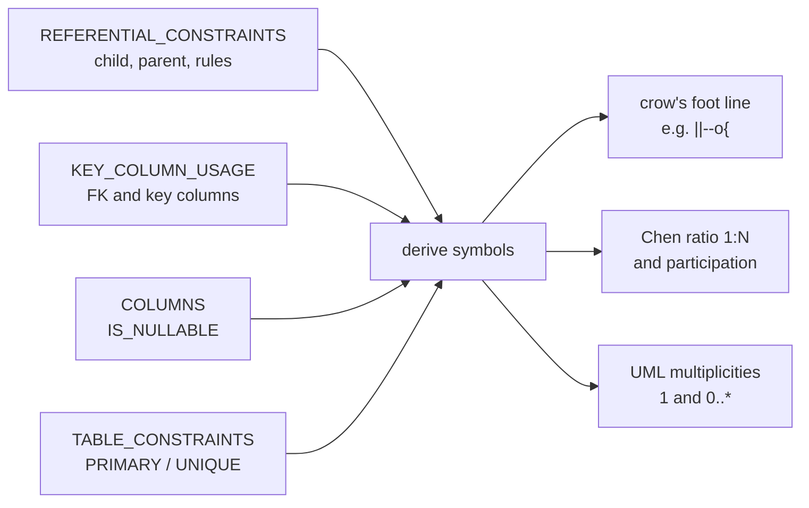
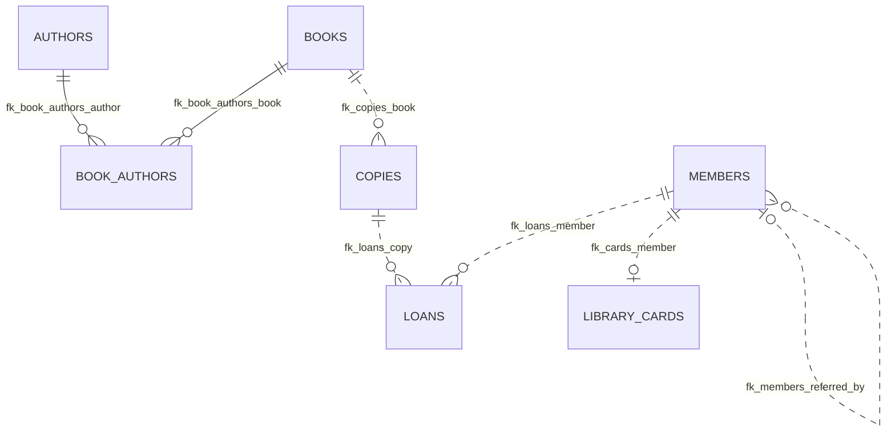
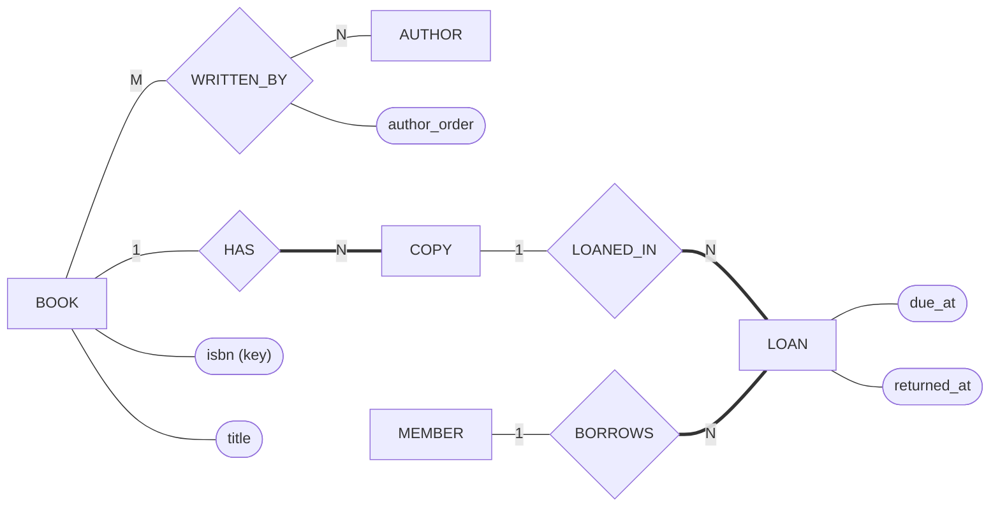
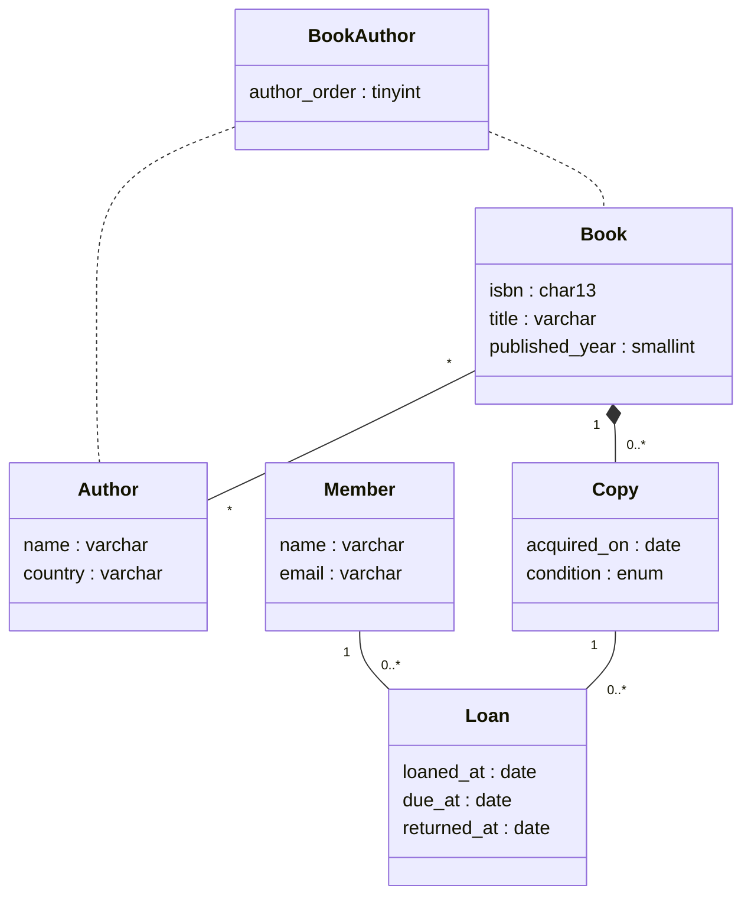
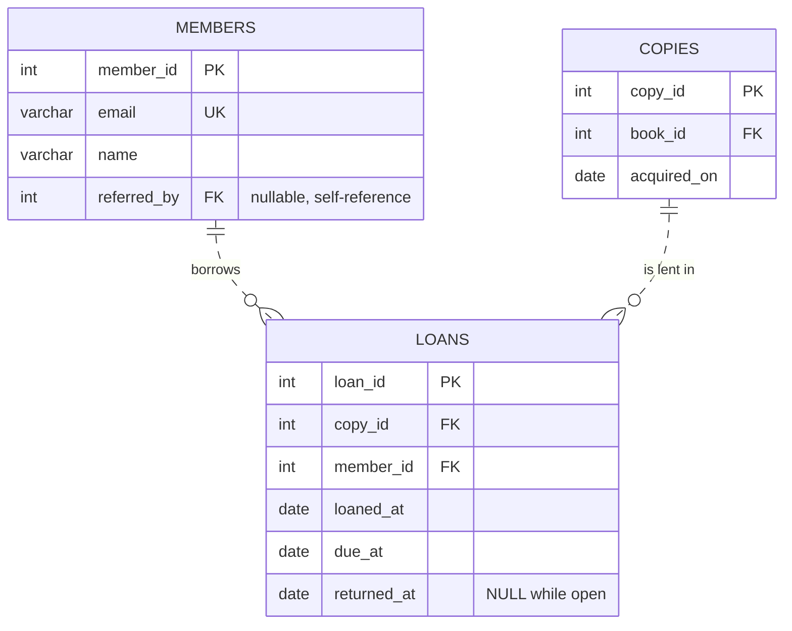

## Introduction

An ER diagram is a communication device. The same model can be drawn in several notations, and in your career you will read all of them: **Chen** diagrams in textbooks, exam questions and some academic papers; **crow's foot** diagrams in almost every database tool, design document and data catalogue; **UML class diagrams** in software-engineering teams that model the domain once for both code and data. Misreading a notation — confusing "look here" with "look across", or a ring with a bar — silently turns a one-to-many into a many-to-one, and the schema built from it is wrong.

This lesson teaches you to:

- read and draw the same model in **Chen**, **crow's foot** and **UML**, and translate between them;
- recognize the extensions you will meet in industry diagrams (identifying vs non-identifying relationships, IDEF1X-style keys, attribute lists inside entity boxes);
- **derive a diagram from a live MySQL schema** — the cardinality and optionality of every relationship are recoverable from `information_schema`, which is exactly what reverse-engineering tools do;
- use **MySQL Workbench** EER diagrams and **diagrams-as-code** tools (Mermaid, DBML, PlantUML) in a team workflow.

:::note[Dataset]
The examples use the **library** dataset (books, authors, the `book_authors` junction, copies, members, loans) and add two small structures — a 1:1 library card and an optional "referred by" relationship — so that every notation symbol appears in the reverse-engineered diagram.
:::

## DBMS Theory

:::theory[What every ER notation must encode]
Whatever the drawing style, an ER notation has to express the same information:

1. **Entity types** (and weak entity types), with their **attributes** and **keys**.
2. **Relationship types**, their **degree** and the **roles** of the participants.
3. **Structural constraints** of each relationship: the **maximum** (cardinality ratio 1 or N) and the **minimum** (participation 0 or ≥ 1) for each participant.
4. For EER: **specialization/generalization** with **disjointness** and **completeness**.

Notations differ in *where* they put the cardinality marks ("look here" vs "look across"), whether relationships are first-class shapes (Chen's diamonds) or just lines (crow's foot, UML), and whether attributes are separate shapes (Chen's ovals) or listed inside the entity box.
:::

### The three main notations

| Aspect | Chen (1976) | Crow's foot / Information Engineering | UML class diagram |
|---|---|---|---|
| Entity | Rectangle; weak entity = double rectangle | Box with name and attribute list | Class box (name, attributes) |
| Attribute | Oval connected to entity; key underlined; multivalued = double oval; derived = dashed oval; composite = oval with child ovals | Row inside the box, often marked PK / FK / UK | Attribute line `name : type`; derived prefixed with `/` |
| Relationship | Diamond; identifying relationship = double diamond | Line between boxes, labelled with a verb | Association line, labelled; association class for attributes |
| Relationship attributes | Ovals on the diamond | Only via an associative entity (junction box) | Association class (dashed line to a class) |
| Maximum cardinality | `1`, `N`, `M` near the line, written **across** (next to the *other* entity) | Bar `|` = one, crow's foot `<` = many, at the end next to the entity it counts — read **across** | Multiplicity `1`, `*`, `0..1`, `1..*` at the end next to the class it counts — read **across** |
| Minimum / participation | Double line = total, single = partial | Ring `o` = zero (optional), bar `|` = one (mandatory) | Lower bound of the multiplicity (`0..` vs `1..`) |
| (min,max) variant | `(min,max)` next to the entity it describes — **look here** | — | — |
| n-ary relationships | Natural (diamond with n lines) | Must be drawn as an associative entity | Association class or n-ary diamond |
| Specialization | Circle with `d`/`o`, double line = total | Subtype boxes inside or below the supertype (varies by tool) | Generalization arrow (hollow triangle), `{disjoint, complete}` constraints |

### Crow's foot symbols in detail

Each end of a crow's foot line carries **two** marks. The one nearer the entity is the **maximum**, the one farther away is the **minimum**:

| End symbol | Read as | Mermaid syntax (left end / right end) |
|---|---|---|
| ring + bar | zero or one | `|o` / `o|` |
| bar + bar | exactly one | `||` / `||` |
| ring + crow's foot | zero or many | `}o` / `o{` |
| bar + crow's foot | one or many | `}|` / `|{` |

So `MEMBERS ||--o{ LOANS` reads: *each loan belongs to exactly one member; each member has zero or many loans*. In Mermaid (and most tools) a **solid** line marks an *identifying* relationship and a **dashed** line (`..`) a *non-identifying* one.

### UML multiplicities

UML places a multiplicity at each association end: `1`, `0..1`, `*` (same as `0..*`), `1..*`, or a range like `2..5`. It reads like crow's foot — the multiplicity next to class B states how many B objects are associated with one A object. UML has no first-class "relationship with attributes"; an **association class** attached to the association plays that role (the junction table). UML also distinguishes **composition** (filled diamond: parts die with the whole — a weak entity) and **aggregation** (hollow diamond: a weaker "has-a"), which have no direct relational counterpart beyond `ON DELETE CASCADE`.

## Why It Exists

Different notations survive because they serve different audiences:

- **Chen** makes *relationships* first-class objects with their own attributes and supports n-ary relationships naturally — ideal for conceptual modelling and teaching, where you reason about the miniworld before any tables exist. It becomes unwieldy with more than a dozen entities because every attribute is a separate shape.
- **Crow's foot** is compact and close to the relational schema: one box per table, attributes listed inside, relationships as lines. That is why database tools (MySQL Workbench, ERwin, ER/Studio, DBeaver, dbdiagram.io, Lucidchart, draw.io) default to it, and why most industry diagrams you will read use it.
- **UML** unifies data modelling with object-oriented software design. Teams that already model their domain in UML (or generate code from models) use class diagrams for the database too, sometimes with a «table» stereotype.

Without a shared, precise notation, teams would argue about pictures instead of designs. And because many diagrams are *generated* from databases (reverse engineering) rather than drawn, knowing how a tool derives each symbol tells you what a diagram can and cannot prove.

## Internal Working

Diagrams are not stored in MySQL — but every symbol of a crow's foot diagram can be **derived** from the data dictionary. This is precisely what MySQL Workbench's *Reverse Engineer* wizard and similar tools do.

:::internals[From data dictionary to diagram symbols]
For each foreign key (`information_schema.REFERENTIAL_CONSTRAINTS` + `KEY_COLUMN_USAGE`):

- **Child-side maximum**: if the FK columns are exactly the columns of a `PRIMARY KEY` or `UNIQUE` constraint on the child, a parent has at most **one** child (1:1); otherwise **many** (1:N).
- **Parent-side minimum**: if any FK column is NULL-able (`COLUMNS.IS_NULLABLE = 'YES'`), a child may have **zero** parents (ring); otherwise **exactly one** (bar).
- **Child-side minimum**: always shown as **zero** (ring). No declarative MySQL constraint can require a parent to have at least one child, so the dictionary contains no evidence of it. A diagram showing "one or many" on a child side must come from documentation, not from the schema.
- **Identifying vs non-identifying**: if the FK columns are part of the child's primary key, the relationship is *identifying* (weak entity or junction table) — solid line; otherwise *non-identifying* — dashed line.
- **M:N relationships** do not exist in the dictionary; they appear as a junction table with two identifying 1:N relationships. Tools may offer to collapse them visually.
:::



## MySQL Implementation

First add two relationships so that the library schema exhibits every symbol: a **1:1** card (FK with `UNIQUE`) and an **optional recursive** "referred by" relationship (NULL-able FK on `members`):

```sql run
CREATE TABLE library_cards (
  card_no   CHAR(10)     NOT NULL PRIMARY KEY,
  member_id INT UNSIGNED NOT NULL,
  CONSTRAINT uq_cards_member UNIQUE (member_id),
  CONSTRAINT fk_cards_member FOREIGN KEY (member_id) REFERENCES members (member_id)
);
ALTER TABLE members
  ADD COLUMN referred_by INT UNSIGNED NULL,
  ADD CONSTRAINT fk_members_referred_by FOREIGN KEY (referred_by) REFERENCES members (member_id);
```

Now reverse-engineer a crow's foot diagram. The query below implements the derivation rules from *Internal Working* and prints one Mermaid `erDiagram` line per foreign key:

```sql run
WITH fk AS (
  SELECT k.CONSTRAINT_NAME, k.TABLE_NAME AS child, k.REFERENCED_TABLE_NAME AS parent,
         GROUP_CONCAT(k.COLUMN_NAME ORDER BY k.COLUMN_NAME) AS cols,
         MAX(c.IS_NULLABLE = 'YES') AS nullable_fk
  FROM information_schema.KEY_COLUMN_USAGE AS k
  JOIN information_schema.COLUMNS AS c
    ON c.TABLE_SCHEMA = k.TABLE_SCHEMA AND c.TABLE_NAME = k.TABLE_NAME AND c.COLUMN_NAME = k.COLUMN_NAME
  WHERE k.TABLE_SCHEMA = DATABASE() AND k.REFERENCED_TABLE_NAME IS NOT NULL
  GROUP BY k.CONSTRAINT_NAME, k.TABLE_NAME, k.REFERENCED_TABLE_NAME
),
uk AS (
  SELECT k.TABLE_NAME, k.CONSTRAINT_NAME,
         GROUP_CONCAT(k.COLUMN_NAME ORDER BY k.COLUMN_NAME) AS cols
  FROM information_schema.TABLE_CONSTRAINTS AS tc
  JOIN information_schema.KEY_COLUMN_USAGE AS k
    ON k.CONSTRAINT_SCHEMA = tc.CONSTRAINT_SCHEMA AND k.TABLE_NAME = tc.TABLE_NAME
   AND k.CONSTRAINT_NAME = tc.CONSTRAINT_NAME
  WHERE tc.TABLE_SCHEMA = DATABASE() AND tc.CONSTRAINT_TYPE IN ('PRIMARY KEY', 'UNIQUE')
  GROUP BY k.TABLE_NAME, k.CONSTRAINT_NAME
),
pkcols AS (
  SELECT TABLE_NAME, COLUMN_NAME FROM information_schema.KEY_COLUMN_USAGE
  WHERE TABLE_SCHEMA = DATABASE() AND CONSTRAINT_NAME = 'PRIMARY'
)
SELECT CONCAT('  ', UPPER(fk.parent), ' ',
              IF(fk.nullable_fk, '|o', '||'),
              IF(EXISTS (SELECT 1 FROM pkcols p WHERE p.TABLE_NAME = fk.child AND FIND_IN_SET(p.COLUMN_NAME, fk.cols)), '--', '..'),
              IF(EXISTS (SELECT 1 FROM uk WHERE uk.TABLE_NAME = fk.child AND uk.cols = fk.cols), 'o|', 'o{'),
              ' ', UPPER(fk.child), ' : ', fk.CONSTRAINT_NAME) AS mermaid_line
FROM fk
ORDER BY fk.parent, fk.child, fk.CONSTRAINT_NAME;
```

Pasting those lines under `erDiagram` renders the diagram:



Read it symbol by symbol:

- `BOOKS ||--o{ BOOK_AUTHORS` and `AUTHORS ||--o{ BOOK_AUTHORS` — **solid** (identifying) lines, because `book_id` and `author_id` are part of the junction's primary key. Together they are the M:N relationship between books and authors.
- `BOOKS ||..o{ COPIES` — **dashed** (non-identifying): `copies` has its own key `copy_id`. Each copy has exactly one book (`||`, NOT NULL FK); a book has zero or many copies.
- `MEMBERS ||..o| LIBRARY_CARDS` — the `o|` end shows **1:1**: the FK column is `UNIQUE`.
- `MEMBERS |o..o{ MEMBERS` — a **recursive**, optional relationship: `|o` because `referred_by` is NULL-able.

## Syntax Breakdown

The same relationships in each notation — use this as a translation table.

| Relationship (library) | Chen | (min,max) | Crow's foot | UML |
|---|---|---|---|---|
| Book has Copies | `BOOK —1— <HAS> —N— COPY`, double line on COPY's side (total) | `BOOK (0,N) — HAS — (1,1) COPY` | `BOOKS ||--o{ COPIES` | `Book "1" -- "0..*" Copy` |
| Member holds Card | `MEMBER —1— <HOLDS> —1— CARD`, double line on CARD | `MEMBER (0,1) — HOLDS — (1,1) CARD` | `MEMBERS ||--o| LIBRARY_CARDS` | `Member "1" -- "0..1" Card` |
| Book written by Authors | `BOOK —M— <WRITTEN_BY> —N— AUTHOR`, attribute `author_order` on the diamond | `BOOK (1,N) — WB — (0,N) AUTHOR` (if every book has an author) | `BOOKS ||--o{ BOOK_AUTHORS }o--|| AUTHORS` | `Book "*" -- "*" Author` + association class `BookAuthor {author_order}` |
| Member refers Member | Diamond `REFERS` with both lines to MEMBER, roles *referrer*/*referred* | `MEMBER (0,1) as referred; (0,N) as referrer` | `MEMBERS |o..o{ MEMBERS` | Self-association `"0..1" referrer -- "*" referred` |
| Loan of Copy by Member (as an entity) | LOAN entity with two 1:N relationships | `LOAN (1,1)` in both | `COPIES ||..o{ LOANS`, `MEMBERS ||..o{ LOANS` | `Loan "*" -- "1" Copy`, `Loan "*" -- "1" Member` |

Mermaid `erDiagram` syntax reference (used throughout this course):

| Element | Syntax |
|---|---|
| Relationship | `LEFT <left-end><line><right-end> RIGHT : label` |
| Line | `--` solid (identifying), `..` dashed (non-identifying) |
| Ends | `|o` / `o|` zero or one, `||` exactly one, `}o` / `o{` zero or more, `}|` / `|{` one or more |
| Attributes | `ENTITY { type name PK "comment" }` with key markers `PK`, `FK`, `UK` |

## Practical Examples

**1. The library in Chen notation.** Mermaid has no native Chen shapes, so the sketch uses a flowchart: rectangles for entities, diamonds for relationships, rounded shapes for attributes, thick lines for total participation, and the cardinality labels written across as Chen did.



Note the relationship attribute `author_order` attached to the `WRITTEN_BY` diamond — Chen notation shows directly that it belongs to the relationship, which crow's foot can only show by drawing the junction table as an entity.

**2. The same model as a UML class diagram.**



UML conventions visible here: multiplicities at both ends, the association class `BookAuthor` linked with dashed lines, and **composition** (filled diamond) from Book to Copy if the business says copies cannot outlive their book. Surrogate keys usually do not appear in a UML domain model — identity is implicit for objects — which is one reason UML diagrams must be supplemented with key decisions before they become DDL.

**3. Attributes inside crow's foot boxes.** Data-catalogue and design-document diagrams typically list columns with key markers:



**4. Verify a diagram against the database.** Diagrams drift. Someone draws `MEMBERS ||--|| LIBRARY_CARDS` (exactly one card per member) in a design document; the database says otherwise. Check the claims one by one:

```sql run
SELECT (SELECT COUNT(*) FROM members)                                   AS members,
       (SELECT COUNT(*) FROM library_cards)                             AS cards,
       (SELECT COUNT(*) FROM members m
        WHERE NOT EXISTS (SELECT 1 FROM library_cards c WHERE c.member_id = m.member_id)) AS members_without_card;
```

The query reports 20 members, 0 cards and 20 members without a card: with no cards issued yet, every member lacks one, so the member side is optional (`o|`), not mandatory (`||`). The *schema* allows zero cards per member; only an application rule could require one. Diagrams must say what the database actually guarantees — or label the rest as business rules enforced elsewhere.

## Execution Walkthrough

Translate one foreign key into every notation by reading the dictionary step by step.

```walkthrough
title: Deriving all notations for the FK loans.member_id → members
steps:
  - title: "1. Find the foreign key"
    explain: >-
      KEY_COLUMN_USAGE lists the child column, the parent table and column. This identifies the relationship and
      its direction — loans is the child (N side), members the parent.
    sql: |
      SELECT CONSTRAINT_NAME, TABLE_NAME, COLUMN_NAME, REFERENCED_TABLE_NAME, REFERENCED_COLUMN_NAME
      FROM information_schema.KEY_COLUMN_USAGE
      WHERE TABLE_SCHEMA = DATABASE() AND TABLE_NAME = 'loans' AND REFERENCED_TABLE_NAME = 'members';
  - title: "2. Parent-side minimum — is the FK column nullable?"
    explain: >-
      NOT NULL means every loan has a member: minimum 1 for the loan's participation. Crow's foot draws a bar
      next to MEMBERS (||); Chen draws a double line on the LOAN side; min-max writes (1,1) next to LOAN; UML
      writes multiplicity 1 at the Member end.
    sql: |
      SELECT COLUMN_NAME, IS_NULLABLE FROM information_schema.COLUMNS
      WHERE TABLE_SCHEMA = DATABASE() AND TABLE_NAME = 'loans' AND COLUMN_NAME = 'member_id';
  - title: "3. Child-side maximum — is the FK column unique?"
    explain: >-
      No PRIMARY KEY or UNIQUE constraint consists of exactly (member_id) on loans — the only index on it is the
      non-unique index created for the FK — so a member can have many loans: crow's foot o{, Chen N, UML 0..*,
      min-max (0,N) next to MEMBER.
    sql: |
      SELECT INDEX_NAME, NON_UNIQUE, SEQ_IN_INDEX, COLUMN_NAME
      FROM information_schema.STATISTICS
      WHERE TABLE_SCHEMA = DATABASE() AND TABLE_NAME = 'loans' AND COLUMN_NAME = 'member_id'
      ORDER BY INDEX_NAME;
  - title: "4. Identifying or not — is the FK part of the primary key?"
    explain: >-
      loans has its own key (loan_id); member_id is not part of it, so the relationship is non-identifying
      (dashed line in Workbench and Mermaid). LOAN is a strong entity.
    sql: |
      SELECT COLUMN_NAME FROM information_schema.KEY_COLUMN_USAGE
      WHERE TABLE_SCHEMA = DATABASE() AND TABLE_NAME = 'loans' AND CONSTRAINT_NAME = 'PRIMARY';
  - title: "5. Render"
    explain: >-
      Crow's foot "MEMBERS ||..o{ LOANS"; Chen "MEMBER —1— BORROWS —N— LOAN" with LOAN's line doubled;
      min-max "MEMBER (0,N) — BORROWS — (1,1) LOAN"; UML "Member 1 — 0..* Loan". Four drawings, one fact.
```

## Output

The reverse-engineering query produced seven Mermaid lines — one per foreign key — and the rendered diagram matches the schema exactly: two identifying relationships into the junction table (the M:N between books and authors), three mandatory non-identifying 1:N relationships (book–copies, copy–loans, member–loans), one 1:1 (member–card) and one optional recursive 1:N (referrals). Every symbol is backed by a dictionary fact:

| Symbol | Dictionary fact |
|---|---|
| `||` at the parent end | All FK columns `NOT NULL` |
| `|o` at the parent end | Some FK column NULL-able (`members.referred_by`) |
| `o{` at the child end | FK columns not covered by a PK/UNIQUE with exactly those columns |
| `o|` at the child end | FK columns equal a UNIQUE constraint (`library_cards.member_id`) |
| `--` solid | FK column is part of the child's PK (`book_authors`) |
| `..` dashed | FK column not in the child's PK |

What the diagram cannot show — because the dictionary does not contain it — is any child-side minimum of one ("every book has at least one author"). If your design requires it, the diagram drawn from requirements will show `|{`, and the difference between that and the reverse-engineered `o{` is exactly the list of rules you must enforce outside declarative constraints.

## Alternative Approaches

### Tooling options

| Tool | Notation | Strength | Typical use |
|---|---|---|---|
| **MySQL Workbench** (EER Diagram editor) | Crow's foot (IE) by default; also Classic, UML, IDEF1X relationship notations | Reverse engineer from a live server, forward engineer DDL, *synchronize* model and database | Designing and documenting MySQL schemas; generating migration DDL from a model |
| **Mermaid** `erDiagram` | Crow's foot | Diagrams as code in Markdown; renders in GitHub, GitLab, many wikis | Design docs and READMEs versioned with the code (this course) |
| **DBML / dbdiagram.io** | Crow's foot-like | Concise text format, exports DDL | Quick design sessions, early prototypes |
| **PlantUML** | UML / IE | Text-based, many diagram types | Teams already using PlantUML for architecture |
| **ERwin, ER/Studio, PowerDesigner** | IE, IDEF1X | Enterprise modelling: logical/physical models, naming standards, model comparison | Large organizations, regulated industries |
| **DBeaver, DataGrip** | Crow's foot | Auto-generated diagrams from connections | Exploring unfamiliar databases |
| **SchemaSpy** | Crow's foot | Generates browsable HTML documentation from the dictionary | Automated schema documentation in CI |
| **draw.io, Lucidchart** | Any (shape libraries) | Free-form, collaborative | Conceptual diagrams in workshops, Chen diagrams for teaching |

### MySQL Workbench EER diagrams

Workbench models live in `.mwb` files. Its workflow, documented in the Workbench manual:

- **Reverse Engineer** (`Database → Reverse Engineer…`) connects to a server, reads the schema and draws an EER diagram — the same derivation you performed with `information_schema` above.
- **Relationship tools** in the diagram palette distinguish *1:1 non-identifying*, *1:n non-identifying*, *1:1 identifying*, *1:n identifying* and *n:m identifying* relationships; the n:m tool creates the junction table for you. Identifying relationships are drawn with solid lines, non-identifying with dashed lines.
- **Notation** is switchable under the `Model` menu (object notation and relationship notation, including crow's foot, classic, UML and IDEF1X).
- **Forward Engineer** generates `CREATE` scripts from the model; **Synchronize Model** compares model and live database and generates `ALTER` statements for the differences.

Because Workbench is a GUI tool that connects to a server, it cannot run inside this course's sandbox; the information_schema queries in this lesson show what it reads.

### Conceptual vs physical diagrams

Professionals often keep two diagrams: a **conceptual** one (Chen or UML, no keys or junction tables, M:N drawn directly, business vocabulary) for stakeholders, and a **physical** one (crow's foot, every table and column, generated from the database) for engineers. Trying to make one diagram serve both audiences usually serves neither.

## Performance Analysis

Notation has no runtime cost — diagrams are documentation. The relevant performance considerations are about **reading** a diagram correctly, because notation errors become physical design errors:

- A misread `o{` vs `o|` decides whether the FK column gets a `UNIQUE` index — which changes both enforcement and access paths (a unique lookup stops at the first match).
- Identifying relationships (solid lines) mean the parent key is part of the child's primary key, so it is part of every **secondary index entry** of the child table in InnoDB. A diagram full of deep identifying chains predicts wide composite keys and large secondary indexes ([Clustered and Secondary Indexes](/lessons/m07-clustered-secondary)).
- The reverse-engineering query itself reads only data-dictionary views. On schemas with thousands of tables, `information_schema` queries that join several views can take noticeable time; tools cache the results, and you should filter by `TABLE_SCHEMA` (as every query here does) so that the dictionary lookups stay small.

```sql run
EXPLAIN FORMAT=TREE
SELECT TABLE_NAME, COLUMN_NAME, REFERENCED_TABLE_NAME
FROM information_schema.KEY_COLUMN_USAGE
WHERE TABLE_SCHEMA = DATABASE() AND REFERENCED_TABLE_NAME IS NOT NULL;
```

The plan shows that `information_schema` views in MySQL 8 are ordinary views over the data-dictionary tables — joins with filters on the schema name — rather than the file-scanning implementation of MySQL 5.7, which is why such queries are fast in 8.0+ when filtered by schema.

:::performance[Theory vs measurement]
The plan above is long because it exposes the internal data-dictionary joins; its cost on a small schema is negligible. If a documentation job runs dictionary queries across thousands of schemas, measure it rather than assuming.
:::

## Best Practices

:::best-practice[Diagram habits of professional teams]
1. **State the notation and legend** on every diagram — especially whether cardinalities read "here" or "across".
2. **Use Chen or UML for conceptual models with stakeholders; crow's foot for physical schemas.** Don't show junction tables to business users; don't hide them from engineers.
3. **Generate physical diagrams from the database** (Workbench reverse engineering, SchemaSpy, or a query like the one in this lesson) so they cannot drift. Hand-draw only conceptual models.
4. **Keep diagrams as code** (Mermaid, DBML, PlantUML) in the same repository as migrations, and review diagram changes with schema changes.
5. **Annotate what the schema does not enforce** — child-side minimums, numeric maximums, cross-table rules — as notes on the diagram.
6. **Name relationships with verbs** read in one direction ("member *borrows* loan") and roles for recursive relationships ("*referrer* / *referred*").
7. **Split large models** into subject-area diagrams (catalogue, circulation, membership) instead of one unreadable wall chart.
:::

## Common Mistakes

**Mistake 1 — reading (min,max) like crow's foot.** `MEMBER (0,N) — BORROWS — (1,1) LOAN` and `MEMBERS ||--o{ LOANS` say the same thing, but the numbers sit on *opposite* ends. Translating "(1,1) next to LOAN" into `||` next to LOANS reverses the relationship.

**Mistake 2 — confusing the ring with "optional on this side".** In crow's foot the ring at the LOANS end means *a member may have zero loans* — it describes the participation of MEMBER, read across. Ask: "for one entity at the far end, how many at this end?"

**Mistake 3 — trusting a hand-drawn diagram over the dictionary.** The design doc says 1:1; the column has no `UNIQUE` constraint. The database wins — verify with queries like:

```sql run
SELECT tc.CONSTRAINT_TYPE, k.COLUMN_NAME
FROM information_schema.TABLE_CONSTRAINTS AS tc
JOIN information_schema.KEY_COLUMN_USAGE AS k
  ON k.CONSTRAINT_SCHEMA = tc.CONSTRAINT_SCHEMA AND k.TABLE_NAME = tc.TABLE_NAME
 AND k.CONSTRAINT_NAME = tc.CONSTRAINT_NAME
WHERE tc.TABLE_SCHEMA = DATABASE() AND tc.TABLE_NAME = 'library_cards'
ORDER BY tc.CONSTRAINT_TYPE, k.COLUMN_NAME;
```

`member_id` appears under `UNIQUE` (and under `FOREIGN KEY`) — so the 1:1 is real here.

**Mistake 4 — drawing M:N as a single line in a physical diagram** and then forgetting the junction table in the DDL. Conceptual diagrams may show M:N directly; physical diagrams must show the associative entity.

**Mistake 5 — drawing a ternary relationship as three binary lines** in crow's foot. Crow's foot has no n-ary line; a ternary must be an associative entity with three relationships, otherwise the diagram suggests the (lossy) binary decomposition shown in the previous lesson.

**Mistake 6 — mixing notations in one diagram** (Chen diamonds with crow's foot ends, UML multiplicities on IE lines). Readers will apply one convention to all symbols.

## Industry Application

- **Design reviews.** Schema changes in mature teams are proposed with a before/after crow's foot diagram (often Mermaid in the pull request) plus the migration DDL; reviewers check cardinalities against the requirements.
- **Data catalogues and documentation.** Tools such as SchemaSpy, DataHub or dbt docs generate diagrams from metadata so analysts can see join paths and optionality (when to use `LEFT JOIN`).
- **Onboarding and legacy systems.** Reverse-engineering an undocumented MySQL database with Workbench or a dictionary query is usually the first day's task on a legacy project.
- **Model-driven development.** Some organizations maintain a UML domain model as the source of truth and generate both application classes and DDL; others keep a Workbench `.mwb` model and synchronize databases from it.
- **Interviews and exams.** Whiteboard design questions are answered in crow's foot (industry) or Chen (academic) — fluency in reading both is expected.

## Practice Exercises

```exercise
id: ex1
title: Classify every foreign key as 1:1 or 1:N
difficulty: easy
concepts: [reverse-engineering, information-schema, crows-foot]
setup: |
  CREATE TABLE library_cards (
    card_no CHAR(10) NOT NULL PRIMARY KEY,
    member_id INT UNSIGNED NOT NULL UNIQUE,
    FOREIGN KEY (member_id) REFERENCES members (member_id)
  );
prompt: |
  For every single-column foreign key in the schema, return `child_table`, `fk_column`, `parent_table` and
  `ratio` — `'1:1'` if a UNIQUE or PRIMARY KEY index exists **on exactly that one column** of the child table,
  otherwise `'1:N'`. Order by `child_table`, `fk_column`.
hints:
  - "KEY_COLUMN_USAGE rows with REFERENCED_TABLE_NAME IS NOT NULL are the FK columns."
  - "information_schema.STATISTICS lists indexes: NON_UNIQUE = 0 marks unique indexes; count the columns per index to find single-column ones."
  - "Use EXISTS on a derived table of unique indexes having exactly one column."
solution: |
  SELECT k.TABLE_NAME AS child_table, k.COLUMN_NAME AS fk_column, k.REFERENCED_TABLE_NAME AS parent_table,
         IF(EXISTS (SELECT 1
                    FROM information_schema.STATISTICS AS s
                    WHERE s.TABLE_SCHEMA = k.TABLE_SCHEMA AND s.TABLE_NAME = k.TABLE_NAME
                      AND s.NON_UNIQUE = 0 AND s.COLUMN_NAME = k.COLUMN_NAME
                      AND (SELECT COUNT(*) FROM information_schema.STATISTICS AS s2
                           WHERE s2.TABLE_SCHEMA = s.TABLE_SCHEMA AND s2.TABLE_NAME = s.TABLE_NAME
                             AND s2.INDEX_NAME = s.INDEX_NAME) = 1),
            '1:1', '1:N') AS ratio
  FROM information_schema.KEY_COLUMN_USAGE AS k
  WHERE k.TABLE_SCHEMA = DATABASE() AND k.REFERENCED_TABLE_NAME IS NOT NULL
  ORDER BY child_table, fk_column;
orderMatters: true
explanation: |
  Only `library_cards.member_id` is 1:1. `book_authors.book_id` is part of a *composite* primary key, so it
  is not unique on its own — a book appears in several junction rows. Checking "is the column in any unique
  index" without counting the index's columns is the classic mistake: it would misclassify both junction
  columns as 1:1.
```

```exercise
id: ex2
title: Build the schema from a crow's foot diagram
difficulty: medium
kind: dml
dataset: empty
concepts: [crows-foot, foreign-key, one-to-one]
prompt: |
  Implement this diagram exactly (all IDs `INT UNSIGNED`, names `VARCHAR(80) NOT NULL`):

  ~~~
  DEPARTMENTS ||..o{ EMPLOYEES : employs
  EMPLOYEES   |o..o| PARKING_SPOTS : "is assigned"
  ~~~

  Tables: `departments (dept_id PK, name)`, `employees (emp_id PK, name, dept_id)`,
  `parking_spots (spot_id PK, emp_id)`. Read each end carefully: which FK columns are NULL-able, and which
  need UNIQUE?

  The checker lists every FK column with its nullability and whether it has a unique index.
hints:
  - "DEPARTMENTS || means every employee has exactly one department → employees.dept_id NOT NULL."
  - "EMPLOYEES |o means a parking spot may have no employee → parking_spots.emp_id NULL. The o| at PARKING_SPOTS means an employee has at most one spot → UNIQUE (emp_id)."
solution: |
  CREATE TABLE departments (dept_id INT UNSIGNED PRIMARY KEY, name VARCHAR(80) NOT NULL);
  CREATE TABLE employees (
    emp_id INT UNSIGNED PRIMARY KEY, name VARCHAR(80) NOT NULL,
    dept_id INT UNSIGNED NOT NULL,
    FOREIGN KEY (dept_id) REFERENCES departments (dept_id)
  );
  CREATE TABLE parking_spots (
    spot_id INT UNSIGNED PRIMARY KEY,
    emp_id INT UNSIGNED NULL UNIQUE,
    FOREIGN KEY (emp_id) REFERENCES employees (emp_id)
  );
check: |
  SELECT k.TABLE_NAME, k.COLUMN_NAME, c.IS_NULLABLE,
         EXISTS (SELECT 1 FROM information_schema.STATISTICS s
                 WHERE s.TABLE_SCHEMA = k.TABLE_SCHEMA AND s.TABLE_NAME = k.TABLE_NAME
                   AND s.COLUMN_NAME = k.COLUMN_NAME AND s.NON_UNIQUE = 0) AS has_unique
  FROM information_schema.KEY_COLUMN_USAGE k
  JOIN information_schema.COLUMNS c
    ON c.TABLE_SCHEMA = k.TABLE_SCHEMA AND c.TABLE_NAME = k.TABLE_NAME AND c.COLUMN_NAME = k.COLUMN_NAME
  WHERE k.TABLE_SCHEMA = DATABASE() AND k.REFERENCED_TABLE_NAME IS NOT NULL
  ORDER BY k.TABLE_NAME, k.COLUMN_NAME;
explanation: |
  The mark nearest an entity is its maximum, the outer mark its minimum, and both describe how many of *that*
  entity relate to one entity at the other end. `||` next to DEPARTMENTS: an employee has exactly one
  department (NOT NULL FK). `|o` next to EMPLOYEES: a spot has zero or one employee (NULL-able FK). `o|` next
  to PARKING_SPOTS: an employee has at most one spot (UNIQUE). Placing the FK in `employees` (`spot_id`)
  would also be a valid 1:1 — the checker expects the FK on `parking_spots` as named in the prompt.
```

```exercise
id: ex3
title: Translate between notations
difficulty: medium
kind: open
concepts: [chen-notation, crows-foot, uml-class-diagrams, min-max-notation]
prompt: |
  A Chen diagram shows: `PROFESSOR —1— <ADVISES> —N— STUDENT` with a **double line** between ADVISES and
  STUDENT and a single line to PROFESSOR; the diamond has an attribute `since`. Write the same relationship
  (a) in (min,max) notation, (b) as a Mermaid crow's foot line, (c) as UML multiplicities, and (d) say where
  `since` goes in the relational schema.
solution: |
  Chen: each professor advises N students (N written next to STUDENT, read across); double line = total
  participation of STUDENT (every student has an advisor); single line = partial participation of
  PROFESSOR (some advise nobody).
  (a) `PROFESSOR (0,N) — ADVISES — (1,1) STUDENT`.
  (b) `PROFESSOR ||..o{ STUDENT : advises` (or a solid line if the tool marks it identifying; it is
  non-identifying because students have their own key).
  (c) `Professor "1" -- "0..*" Student`.
  (d) `since` is an attribute of a 1:N relationship, so it migrates to the N side:
  `students.advisor_id NOT NULL` + `students.advisor_since DATE NOT NULL`. A separate `advisings` table with
  `PRIMARY KEY (student_id)` would also be correct and is preferable if advising history must be kept.
```

```exercise
id: ex4
title: Find the optional relationships for analysts
difficulty: medium
concepts: [reverse-engineering, information-schema, min-max-notation]
setup: |
  ALTER TABLE members ADD COLUMN referred_by INT UNSIGNED NULL,
    ADD CONSTRAINT fk_members_referred_by FOREIGN KEY (referred_by) REFERENCES members (member_id);
prompt: |
  Analysts need to know which joins require `LEFT JOIN` because the child may have no parent. List every
  foreign-key column that is **NULL-able**: columns `child_table`, `fk_column`, `parent_table`, ordered by
  `child_table`, `fk_column`.
hints:
  - "Join KEY_COLUMN_USAGE (FK rows) with COLUMNS on schema, table and column."
  - "Filter on IS_NULLABLE = 'YES'."
solution: |
  SELECT k.TABLE_NAME AS child_table, k.COLUMN_NAME AS fk_column, k.REFERENCED_TABLE_NAME AS parent_table
  FROM information_schema.KEY_COLUMN_USAGE AS k
  JOIN information_schema.COLUMNS AS c
    ON c.TABLE_SCHEMA = k.TABLE_SCHEMA AND c.TABLE_NAME = k.TABLE_NAME AND c.COLUMN_NAME = k.COLUMN_NAME
  WHERE k.TABLE_SCHEMA = DATABASE() AND k.REFERENCED_TABLE_NAME IS NOT NULL AND c.IS_NULLABLE = 'YES'
  ORDER BY child_table, fk_column;
orderMatters: true
explanation: |
  A NULL-able FK is a `|o` parent end in crow's foot and a (0,1) participation of the child: joining from
  child to parent with an inner join drops the rows without a parent. In the library schema only the
  `referred_by` self-reference is optional — every other relationship is mandatory for the child.
```

```exercise
id: ex5
title: Review an industry diagram
difficulty: hard
kind: open
concepts: [crows-foot, er-notation, ternary-relationships]
prompt: |
  A design document for a clinic contains this crow's foot diagram. List every problem you can find —
  notation errors, modelling errors, and statements that the schema could not enforce — and propose fixes.

  ~~~
  PATIENTS ||--|| APPOINTMENTS : books
  DOCTORS }o--o{ PATIENTS : treats
  DOCTORS ||--o{ APPOINTMENTS : attends
  ROOMS ||--o{ DOCTORS : "works in"
  PRESCRIPTIONS }|--|{ DOCTORS : writes
  ~~~
solution: |
  1. `PATIENTS ||--|| APPOINTMENTS` says each patient has exactly one appointment ever and each appointment
  exactly one patient. Patients have many appointments: `PATIENTS ||..o{ APPOINTMENTS`. The solid line
  (identifying) is also doubtful: appointments normally have their own key → dashed.
  2. `DOCTORS }o--o{ PATIENTS` is an M:N drawn directly in what is otherwise a physical diagram; either it is
  conceptual (fine, but say so) or it needs an associative entity. Moreover it is probably *derived*
  from appointments (a doctor treats the patients they have appointments with) — storing it separately
  duplicates facts.
  3. `ROOMS ||--o{ DOCTORS` says each doctor works in exactly one room forever. Rooms are usually assigned
  per appointment or per shift: `ROOMS ||..o{ APPOINTMENTS` (or a schedule entity).
  4. `PRESCRIPTIONS }|--|{ DOCTORS` claims each prescription is written by one or more doctors and every
  doctor writes at least one prescription — the `|` minimums on both sides cannot be enforced
  declaratively and the many-to-many is wrong: a prescription is written by exactly one doctor, for one
  patient, usually in one appointment. Model `APPOINTMENTS ||..o{ PRESCRIPTIONS` (which gives doctor and
  patient), or a ternary-as-entity PRESCRIPTION with FKs to doctor, patient and drug.
  5. Missing: a legend; drug as an entity; verbs read consistently in one direction.
```

```exercise
id: ex6
title: Generate a UML-style multiplicity report
difficulty: challenge
concepts: [uml-class-diagrams, reverse-engineering, information-schema]
setup: |
  CREATE TABLE library_cards (
    card_no CHAR(10) NOT NULL PRIMARY KEY,
    member_id INT UNSIGNED NOT NULL UNIQUE,
    FOREIGN KEY (member_id) REFERENCES members (member_id)
  );
  ALTER TABLE members ADD COLUMN referred_by INT UNSIGNED NULL,
    ADD CONSTRAINT fk_members_referred_by FOREIGN KEY (referred_by) REFERENCES members (member_id);
prompt: |
  For every single-column foreign key produce one row describing it as a UML association:
  `association` in the form `Parent "<p>" -- "<c>" Child`, where table names are used as-is,
  `<p>` is `1` if the FK column is NOT NULL else `0..1`, and `<c>` is `0..1` if the FK column alone is
  covered by a unique index (exactly one column) else `*`.
  Example: `members "1" -- "*" loans`. Order by the `association` string.
hints:
  - "Start from KEY_COLUMN_USAGE (FK rows) joined to COLUMNS for nullability."
  - "Re-use the single-column unique index test from exercise 1 (STATISTICS with NON_UNIQUE = 0 and one column in the index)."
  - "Build the string with CONCAT(parent, ' \"', p, '\" -- \"', c, '\" ', child)."
solution: |
  SELECT CONCAT(k.REFERENCED_TABLE_NAME, ' "',
                IF(c.IS_NULLABLE = 'NO', '1', '0..1'), '" -- "',
                IF(EXISTS (SELECT 1
                           FROM information_schema.STATISTICS AS s
                           WHERE s.TABLE_SCHEMA = k.TABLE_SCHEMA AND s.TABLE_NAME = k.TABLE_NAME
                             AND s.NON_UNIQUE = 0 AND s.COLUMN_NAME = k.COLUMN_NAME
                             AND (SELECT COUNT(*) FROM information_schema.STATISTICS AS s2
                                  WHERE s2.TABLE_SCHEMA = s.TABLE_SCHEMA AND s2.TABLE_NAME = s.TABLE_NAME
                                    AND s2.INDEX_NAME = s.INDEX_NAME) = 1), '0..1', '*'),
                '" ', k.TABLE_NAME) AS association
  FROM information_schema.KEY_COLUMN_USAGE AS k
  JOIN information_schema.COLUMNS AS c
    ON c.TABLE_SCHEMA = k.TABLE_SCHEMA AND c.TABLE_NAME = k.TABLE_NAME AND c.COLUMN_NAME = k.COLUMN_NAME
  WHERE k.TABLE_SCHEMA = DATABASE() AND k.REFERENCED_TABLE_NAME IS NOT NULL
  ORDER BY association;
orderMatters: true
explanation: |
  UML multiplicities read across like crow's foot: the multiplicity next to the parent says how many parents
  one child has (1 or 0..1 from NOT NULL / NULL), the one next to the child how many children one parent has
  (0..1 if unique, otherwise *). The lower bound at the child end is always 0 because MySQL cannot declare a
  minimum number of children. `members "0..1" -- "*" members` is the optional recursive referral.
```

## Knowledge Assessment

```quiz
- id: q1
  question: "In the crow's foot line `CUSTOMERS ||--o{ ORDERS`, what does `o{` next to ORDERS mean?"
  options:
    - "A customer has zero or many orders"
    - "An order has zero or many customers"
    - "An order is optional for the customer table to exist"
    - "Orders must be deleted with customers"
  answer: 0
  explanation: "Crow's foot reads across: the marks next to ORDERS say how many orders relate to one customer — ring (min 0), crow's foot (max many). It says nothing about deletion policy, and the order's customer count is given by || next to CUSTOMERS."
  concepts: [crows-foot]
- id: q2
  question: "Which notation places the participation bounds next to the entity they describe (\"look here\")?"
  options: ["(min,max) notation", "Chen cardinality ratios (1, N)", "Crow's foot", "UML multiplicities"]
  answer: 0
  explanation: "(min,max) pairs describe the entity they are written next to. Chen ratios, crow's foot and UML multiplicities are all read across the relationship."
  concepts: [min-max-notation, er-notation]
- id: q3
  question: "A reverse-engineered diagram shows `MEMBERS ||..o| LIBRARY_CARDS`. Which dictionary facts produced it?"
  options:
    - "library_cards.member_id is NOT NULL, has a UNIQUE constraint, and is not part of library_cards' primary key"
    - "library_cards.member_id is NULL-able and part of the primary key"
    - "members has a column card_no"
    - "library_cards has a CHECK constraint"
  answer: 0
  explanation: "|| at MEMBERS = NOT NULL FK; o| at LIBRARY_CARDS = FK columns covered by a unique key (1:1); dashed line = FK not in the child's PK (non-identifying). A NULL-able FK would give |o; a PK column would give a solid line."
  concepts: [reverse-engineering, crows-foot]
- id: q4
  question: "Why can a reverse-engineered crow's foot diagram never show `|{` (one or many) at a child end?"
  options:
    - "MySQL has no declarative constraint requiring a parent to have at least one child, so the dictionary contains no such fact"
    - "Mermaid does not support |{"
    - "InnoDB does not store foreign keys"
    - "Because every relationship is optional in MySQL"
  answer: 0
  explanation: "Parent-side minimums need assertions or deferred constraints, which MySQL lacks. Mermaid supports |{; InnoDB stores FKs; child-to-parent relationships can be mandatory (NOT NULL FK)."
  concepts: [reverse-engineering, min-max-notation]
- id: q5
  type: multi
  question: "Which of these are represented natively in Chen notation but need workarounds in crow's foot? (Select all that apply.)"
  options:
    - "Attributes of a many-to-many relationship"
    - "Ternary relationships"
    - "Entity types"
    - "Multivalued attributes (double ovals)"
  answer: [0, 1, 3]
  explanation: "Chen attaches attributes to diamonds, draws n-ary diamonds and multivalued double ovals. Crow's foot needs an associative entity for the first two and a separate table for multivalued attributes. Entity types are native in both."
  concepts: [chen-notation, crows-foot]
- id: q6
  question: "In MySQL Workbench, a relationship drawn with a solid line between a parent and a child indicates:"
  options:
    - "An identifying relationship — the parent's key is part of the child's primary key"
    - "A mandatory relationship — the FK is NOT NULL"
    - "A one-to-one relationship"
    - "A relationship with ON DELETE CASCADE"
  answer: 0
  explanation: "Solid = identifying (weak entity or junction table), dashed = non-identifying. Optionality and maximums are shown by the end symbols; referential actions are not shown by the line style."
  concepts: [mysql-workbench, crows-foot]
- id: q7
  question: "UML `Book \"1\" *-- \"0..*\" Copy` (filled diamond at Book) is best implemented in MySQL as:"
  options:
    - "copies.book_id NOT NULL with a FOREIGN KEY … ON DELETE CASCADE"
    - "books.copy_id NOT NULL"
    - "A junction table book_copies with a composite key"
    - "copies.book_id NULL with ON DELETE SET NULL"
  answer: 0
  explanation: "Multiplicity 1 at Book = every copy has one book (NOT NULL FK on copies); 0..* at Copy = many copies per book; composition = parts die with the whole (CASCADE). A column on books cannot hold many copies; a junction implies M:N; SET NULL contradicts composition."
  concepts: [uml-class-diagrams]
- id: q8
  question: "Which practice best keeps physical schema diagrams accurate over time?"
  options:
    - "Generate them from the database (reverse engineering or dictionary queries) and keep diagram code in version control"
    - "Draw them once at project start in a slide deck"
    - "Use Chen notation for physical diagrams"
    - "Remove foreign keys so the diagram is simpler"
  answer: 0
  explanation: "Generated diagrams cannot drift from the schema; diagram code in the repo is reviewed with migrations. One-off drawings drift, Chen is meant for conceptual models, and removing FKs removes the information diagrams are derived from."
  concepts: [er-notation, reverse-engineering]
```
