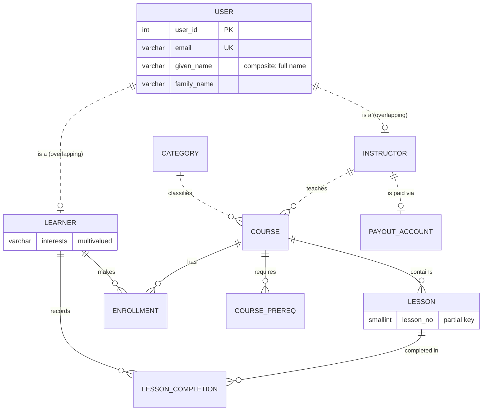

## Introduction

The previous lessons gave you a vocabulary — entities, attributes, relationships, cardinality, weak entities, specialization — and showed each construct implemented in isolation. This lesson puts them together into the procedure every designer runs (in their head, on a whiteboard, or with a tool) when turning a finished ER diagram into tables: the **ER-to-relational mapping algorithm**.

The algorithm is mechanical, and that is its value. Given a correct EER diagram, it produces a schema that:

- has one relation per entity type and per M:N/n-ary relationship, with correct primary keys;
- places every foreign key on the right side, with `NOT NULL` exactly where participation is total and `UNIQUE` exactly where the maximum is one;
- turns multivalued attributes into their own relations, so the schema is in first normal form ([First Normal Form](/lessons/m06-1nf));
- maps specializations with a deliberately chosen strategy;
- loses no information that the diagram contained — and makes explicit which diagram constraints *cannot* be expressed declaratively.

You will run the algorithm end to end on a small **online-learning platform** model, building each table in MySQL, verifying it in `information_schema`, computing a valid **load order** from the foreign-key graph, and comparing your DDL with what `SHOW CREATE TABLE` reports back (the "generated DDL" that tools and migrations depend on).

:::note[Dataset]
This lesson starts from an **empty** schema and builds the whole example. Every output below was captured from a real MySQL server.
:::

## DBMS Theory

:::theory[The ER/EER-to-relational mapping algorithm]
The standard formulation (Elmasri & Navathe, *Fundamentals of Database Systems*) has nine steps. Steps 1–7 map the ER model; steps 8–9 map EER extensions.

1. **Regular (strong) entity types** → a relation with all simple attributes; composite attributes contribute their *leaf* components; choose one key as the **primary key**, declare the other candidate keys as **unique**.
2. **Weak entity types** → a relation with the weak entity's attributes plus the **owner's primary key as a foreign key**; primary key = owner key + partial key; usually `ON DELETE CASCADE`.
3. **Binary 1:1 relationships** → (a) *foreign key approach*: add the key of one participant to the other, preferably to the side with **total participation**, declared unique; (b) *merged relation* if both participations are total; (c) *cross-reference* relation with two unique foreign keys.
4. **Binary 1:N relationships** → add the key of the "1" side as a foreign key to the "N" side; relationship attributes go to the N side. (Alternative: a cross-reference relation, useful when few N-side entities participate.)
5. **Binary M:N relationships** → a new relation with the two participants' keys as foreign keys; its primary key is their combination; relationship attributes become its columns.
6. **Multivalued attributes** → a new relation with the owner's key plus the attribute; primary key = both (plus a component, if the attribute is composite and only part of it identifies the value).
7. **n-ary relationships (n > 2)** → a new relation with the keys of all participants; its key is the combination of the foreign keys of the participants whose role has max > 1.
8. **Specialization / generalization** → one of: **8A** relations for the superclass and each subclass (class table); **8B** relations for each subclass only (concrete table; requires total specialization to avoid losing superclass-only entities); **8C** one relation with one type attribute (single table; disjoint); **8D** one relation with several boolean type flags (single table; overlapping).
9. **Union types (categories)** → a relation for the category with a new **surrogate key**, which each defining superclass references.
:::

### What the mapping preserves — and what it cannot

| ER/EER constraint | Relational counterpart | Declarative in MySQL? |
|---|---|---|
| Key attribute | `PRIMARY KEY` / `UNIQUE` | Yes |
| Entity existence for a relationship | `FOREIGN KEY` | Yes (InnoDB) |
| Total participation of the FK side | `NOT NULL` FK | Yes |
| Maximum 1 on the FK side (1:1) | `UNIQUE` on the FK | Yes |
| Weak entity identification | Composite PK including the owner FK | Yes |
| Total participation of the *referenced* side | — | No (trigger / application / audit) |
| Numeric (min, max) other than 0/1/N | — | No |
| Disjointness (8A) | Composite FK + generated discriminator | Yes, with the pattern from [Weak Entities and EER](/lessons/m05-weak-entities-eer) |
| Total specialization (8A) | — | No |
| Derived attributes | Generated column / view | Partly (same-row, deterministic only) |

## Why It Exists

Ad-hoc table design works for five tables and fails at fifty. Without a systematic mapping, teams produce schemas with characteristic defects: foreign keys on the wrong side of a 1:N, comma-separated multivalued attributes, M:N relationships squeezed into a single column, weak entities with globally unique "line numbers", specializations implemented as a pile of nullable columns with no rules, and — most often — constraints that existed in the diagram but never made it into the DDL.

The algorithm exists so that:

- **Every construct has exactly one correct default mapping**, and deviations are conscious decisions (merging a 1:1, choosing 8C over 8A) rather than accidents.
- **Design reviews can be mechanical:** for each diagram element, find its table, key or constraint.
- **Tools can automate it.** MySQL Workbench forward engineering, ORMs and the interactive builder below all implement (parts of) this algorithm.
- **Gaps become visible.** The constraints in the "No" rows above must be written down and enforced elsewhere; the mapping tells you exactly which ones.

## Internal Working

:::internals[What MySQL does with the DDL the algorithm produces]
- **Order matters for foreign keys.** A `FOREIGN KEY … REFERENCES parent` requires the parent table to exist when the child is created (unless `foreign_key_checks` is disabled for the session, which migration tools use for bulk loads). The FK graph therefore imposes a **topological creation and load order**: parents before children.
- **Index requirements.** For every foreign key, InnoDB needs an index on the child columns whose leftmost columns are the FK columns; if none exists, MySQL creates one automatically (named after the constraint). It also needs an index on the referenced parent columns — normally the primary key or a `UNIQUE` key.
- **Generated names.** Constraints you do not name get generated names: foreign keys `<table>_ibfk_<n>`, CHECK constraints `<table>_chk_<n>`. Primary keys are always named `PRIMARY`. These names appear in error messages and must be used in later `ALTER TABLE … DROP FOREIGN KEY` statements — a reason to name constraints yourself.
- **The data dictionary normalizes your DDL.** `SHOW CREATE TABLE` reconstructs the definition from the dictionary, not from the text you typed: it shows explicit `DEFAULT NULL`, quoted identifiers, implicit indexes, generated constraint names, the table's `ENGINE`, `CHARSET` and `COLLATE`. This *generated DDL* is what dump tools (`mysqldump`) and schema-diff tools compare.
- **Type matching.** Corresponding FK and referenced columns must have compatible types: same integer type and signedness, and for strings the same character set and collation (length may differ). A mismatch fails with error 3780.
:::

## MySQL Implementation

### The conceptual model

The online-learning platform, as agreed in requirements (crow's foot; the specialization and multivalued attribute are annotated):



Constructs to map: an overlapping, partial specialization (`USER` → `LEARNER`, `INSTRUCTOR`); a composite attribute (full name); a multivalued attribute (interests); strong entities (`CATEGORY`, `COURSE`); a weak entity (`LESSON`, partial key `lesson_no`); 1:N relationships (classifies, teaches); a 1:1 (payout account); M:N relationships with attributes (enrollment; lesson completion, which relates to a *weak* entity); and a recursive M:N (prerequisites).

You can experiment with the same rules interactively: the builder below lets you define entities and relationships, draws the diagram and generates the MySQL DDL using steps 1, 3, 4 and 5 of the algorithm.

```viz
type: er-builder
```

### Step 1 — strong entity types (and the superclass)

```sql run
CREATE TABLE users (
  user_id     INT UNSIGNED NOT NULL AUTO_INCREMENT,
  email       VARCHAR(255) NOT NULL,
  given_name  VARCHAR(60)  NOT NULL,      -- composite attribute "full name" → leaf components
  family_name VARCHAR(60)  NOT NULL,
  joined_on   DATE         NOT NULL,
  CONSTRAINT pk_users PRIMARY KEY (user_id),
  CONSTRAINT uq_users_email UNIQUE (email)
);
CREATE TABLE categories (
  category_id SMALLINT UNSIGNED NOT NULL AUTO_INCREMENT PRIMARY KEY,
  name        VARCHAR(60) NOT NULL,
  CONSTRAINT uq_categories_name UNIQUE (name)
);
```

(MySQL ignores the name `pk_users`: a primary key is always called `PRIMARY`.)

### Step 8A — subclasses of an overlapping specialization

`LEARNER` and `INSTRUCTOR` overlap (an instructor may also take courses) and the specialization is partial (some users are neither, e.g. administrators). Option 8A — one relation per subclass sharing the superclass key, without a discriminator — fits:

```sql run
CREATE TABLE learners (
  user_id    INT UNSIGNED NOT NULL PRIMARY KEY,
  country    CHAR(2)      NOT NULL,
  CONSTRAINT fk_learners_user FOREIGN KEY (user_id) REFERENCES users (user_id) ON DELETE CASCADE
);
CREATE TABLE instructors (
  user_id    INT UNSIGNED NOT NULL PRIMARY KEY,
  bio        VARCHAR(500) NOT NULL,
  CONSTRAINT fk_instructors_user FOREIGN KEY (user_id) REFERENCES users (user_id) ON DELETE CASCADE
);
```

### Step 6 — the multivalued attribute

```sql run
CREATE TABLE learner_interests (
  user_id   INT UNSIGNED NOT NULL,
  interest  VARCHAR(40)  NOT NULL,
  PRIMARY KEY (user_id, interest),
  CONSTRAINT fk_interests_learner FOREIGN KEY (user_id) REFERENCES learners (user_id) ON DELETE CASCADE
);
```

The interests belong to the *learner* subclass, so the foreign key references `learners`, not `users` — a user who is not a learner cannot have interests.

### Steps 1 + 4 — `COURSE` with its two 1:N relationships

`COURSE` is a strong entity. Both `classifies` (Category 1:N Course) and `teaches` (Instructor 1:N Course) put a foreign key on the N side, `courses`. Every course has a category and an instructor (total participation), so both are `NOT NULL`:

```sql run
CREATE TABLE courses (
  course_id     INT UNSIGNED NOT NULL AUTO_INCREMENT PRIMARY KEY,
  slug          VARCHAR(80)  NOT NULL,
  title         VARCHAR(150) NOT NULL,
  price         DECIMAL(8,2) NOT NULL,
  category_id   SMALLINT UNSIGNED NOT NULL,
  instructor_id INT UNSIGNED NOT NULL,
  CONSTRAINT uq_courses_slug UNIQUE (slug),
  CONSTRAINT chk_courses_price CHECK (price >= 0),
  CONSTRAINT fk_courses_category   FOREIGN KEY (category_id)   REFERENCES categories (category_id),
  CONSTRAINT fk_courses_instructor FOREIGN KEY (instructor_id) REFERENCES instructors (user_id)
);
```

### Step 2 — the weak entity `LESSON`

```sql run
CREATE TABLE lessons (
  course_id    INT UNSIGNED      NOT NULL,
  lesson_no    SMALLINT UNSIGNED NOT NULL,     -- partial key
  title        VARCHAR(150)      NOT NULL,
  duration_min SMALLINT UNSIGNED NOT NULL,
  PRIMARY KEY (course_id, lesson_no),
  CONSTRAINT fk_lessons_course FOREIGN KEY (course_id) REFERENCES courses (course_id) ON DELETE CASCADE
);
```

### Step 3 — the 1:1 `PAYOUT_ACCOUNT`

A payout account cannot exist without its instructor (total), while an instructor may not have one yet (partial). Foreign key on the total side, unique:

```sql run
CREATE TABLE payout_accounts (
  account_id    INT UNSIGNED NOT NULL AUTO_INCREMENT PRIMARY KEY,
  instructor_id INT UNSIGNED NOT NULL,
  iban          VARCHAR(34)  NOT NULL,
  CONSTRAINT uq_payout_instructor UNIQUE (instructor_id),
  CONSTRAINT fk_payout_instructor FOREIGN KEY (instructor_id) REFERENCES instructors (user_id)
);
```

### Step 5 — M:N relationships (including one to a weak entity and one recursive)

```sql run
CREATE TABLE enrollments (
  learner_id   INT UNSIGNED NOT NULL,
  course_id    INT UNSIGNED NOT NULL,
  enrolled_at  DATETIME     NOT NULL,
  progress_pct TINYINT UNSIGNED NOT NULL DEFAULT 0,
  PRIMARY KEY (learner_id, course_id),
  KEY idx_enrollments_course (course_id),
  CONSTRAINT chk_enrollments_progress CHECK (progress_pct <= 100),
  CONSTRAINT fk_enrollments_learner FOREIGN KEY (learner_id) REFERENCES learners (user_id),
  CONSTRAINT fk_enrollments_course  FOREIGN KEY (course_id)  REFERENCES courses (course_id)
);
CREATE TABLE lesson_completions (
  learner_id   INT UNSIGNED      NOT NULL,
  course_id    INT UNSIGNED      NOT NULL,
  lesson_no    SMALLINT UNSIGNED NOT NULL,
  completed_at DATETIME          NOT NULL,
  PRIMARY KEY (learner_id, course_id, lesson_no),
  KEY idx_completions_lesson (course_id, lesson_no),
  CONSTRAINT fk_completions_learner FOREIGN KEY (learner_id) REFERENCES learners (user_id),
  CONSTRAINT fk_completions_lesson  FOREIGN KEY (course_id, lesson_no)
    REFERENCES lessons (course_id, lesson_no) ON DELETE CASCADE
);
CREATE TABLE course_prereqs (
  course_id  INT UNSIGNED NOT NULL,
  prereq_id  INT UNSIGNED NOT NULL,
  PRIMARY KEY (course_id, prereq_id),
  KEY idx_prereqs_prereq (prereq_id),
  CONSTRAINT chk_prereqs_not_self CHECK (course_id <> prereq_id),
  CONSTRAINT fk_prereqs_course FOREIGN KEY (course_id) REFERENCES courses (course_id),
  CONSTRAINT fk_prereqs_prereq FOREIGN KEY (prereq_id) REFERENCES courses (course_id)
);
```

Note how mapping a relationship to a **weak** entity propagates the weak entity's *whole* key: `lesson_completions` references `lessons` with the composite `(course_id, lesson_no)`.

Verify the result: twelve relations, and every foreign key with its referenced table and delete rule.

```sql run
SELECT rc.TABLE_NAME AS child, rc.CONSTRAINT_NAME, rc.REFERENCED_TABLE_NAME AS parent, rc.DELETE_RULE,
       GROUP_CONCAT(k.COLUMN_NAME ORDER BY k.ORDINAL_POSITION) AS fk_columns
FROM information_schema.REFERENTIAL_CONSTRAINTS AS rc
JOIN information_schema.KEY_COLUMN_USAGE AS k
  ON k.CONSTRAINT_SCHEMA = rc.CONSTRAINT_SCHEMA AND k.TABLE_NAME = rc.TABLE_NAME
 AND k.CONSTRAINT_NAME = rc.CONSTRAINT_NAME
WHERE rc.CONSTRAINT_SCHEMA = DATABASE()
GROUP BY rc.TABLE_NAME, rc.CONSTRAINT_NAME, rc.REFERENCED_TABLE_NAME, rc.DELETE_RULE
ORDER BY child, rc.CONSTRAINT_NAME;
```

## Syntax Breakdown

The algorithm as a DDL cheat sheet:

| Step | ER construct | DDL produced |
|---|---|---|
| 1 | Strong entity `E(k, a, comp(c1, c2))` | `CREATE TABLE e (k … PRIMARY KEY, a …, c1 …, c2 …, UNIQUE (alt_key))` |
| 2 | Weak entity `W(p, b)` owned by `E` | `CREATE TABLE w (e_k …, p …, b …, PRIMARY KEY (e_k, p), FOREIGN KEY (e_k) REFERENCES e (k) ON DELETE CASCADE)` |
| 3 | 1:1 `S —R— T`, T total | `ALTER TABLE t ADD s_k … NOT NULL UNIQUE, ADD FOREIGN KEY (s_k) REFERENCES s (k)` |
| 4 | 1:N `S 1—R—N T`, attribute `x` | `ALTER TABLE t ADD s_k … [NOT] NULL, ADD x …, ADD FOREIGN KEY (s_k) REFERENCES s (k)` |
| 5 | M:N `S —R— T`, attribute `x` | `CREATE TABLE r (s_k …, t_k …, x …, PRIMARY KEY (s_k, t_k), KEY (t_k), FK s, FK t)` |
| 6 | Multivalued `E.{m}` | `CREATE TABLE e_m (e_k …, m …, PRIMARY KEY (e_k, m), FOREIGN KEY (e_k) REFERENCES e (k))` |
| 7 | n-ary `R(S, T, U)` | `CREATE TABLE r (s_k, t_k, u_k, …, PRIMARY KEY (FKs of "many" roles), FK × n)` |
| 8A | Superclass + subclass tables | Subclass `PRIMARY KEY` = FK to superclass; discriminator + composite FK for disjointness |
| 8B | Subclass tables only | Each subclass repeats superclass columns; cross-table unique IDs |
| 8C | One table + type attribute | `type ENUM(…) NOT NULL` + "iff" `CHECK`s per subclass |
| 8D | One table + boolean flags | `is_s1 BOOLEAN, is_s2 BOOLEAN` (+ `CHECK (is_s1 OR is_s2)` if total) |
| 9 | Union type `C ⊆ S ∪ T` | `CREATE TABLE c (c_id surrogate PK …)`; `s.c_id` and `t.c_id` reference it |

**Naming conventions** used in this course (and common in industry): tables plural snake_case; `<entity>_id` keys; constraints `pk_`, `uq_<table>_<cols>`, `fk_<child>_<parent or role>`, `chk_<table>_<rule>`, indexes `idx_<table>_<cols>`.

## Practical Examples

**1. Load data in dependency order.** Parents first, then children. A small, consistent data set:

```sql run
INSERT INTO users (email, given_name, family_name, joined_on) VALUES
  ('ada@learn.io',  'Ada',   'Okoye',  '2024-01-05'),
  ('ben@learn.io',  'Ben',   'Lindqvist', '2024-02-11'),
  ('chen@learn.io', 'Chen',  'Wu',     '2024-02-20'),
  ('dina@learn.io', 'Dina',  'Haddad', '2024-03-01'),
  ('eli@learn.io',  'Eli',   'Moreau', '2024-03-15');
INSERT INTO instructors VALUES (1, 'Database engineer, 12 years in fintech.'), (2, 'Data scientist and author.');
INSERT INTO learners    VALUES (2, 'SE'), (3, 'CN'), (4, 'JO'), (5, 'FR');      -- Ben is both
INSERT INTO learner_interests VALUES (3, 'databases'), (3, 'python'), (4, 'statistics'), (5, 'databases');
INSERT INTO categories (name) VALUES ('Databases'), ('Machine Learning');
INSERT INTO courses (slug, title, price, category_id, instructor_id) VALUES
  ('mysql-fundamentals', 'MySQL Fundamentals',         49.00, 1, 1),
  ('mysql-performance',  'MySQL Performance Tuning',   89.00, 1, 1),
  ('intro-ml',           'Introduction to ML',         59.00, 2, 2);
INSERT INTO lessons VALUES
  (1, 1, 'Relational model', 25), (1, 2, 'SELECT basics', 30), (1, 3, 'Joins', 40),
  (2, 1, 'Indexes', 35), (2, 2, 'EXPLAIN', 45),
  (3, 1, 'What is learning?', 20);
INSERT INTO course_prereqs VALUES (2, 1);
INSERT INTO payout_accounts (instructor_id, iban) VALUES (1, 'GB29NWBK60161331926819');
INSERT INTO enrollments VALUES
  (2, 1, '2024-03-02 10:00:00', 100), (3, 1, '2024-03-05 18:30:00', 66),
  (3, 2, '2024-04-01 09:00:00', 0),   (4, 3, '2024-03-20 12:00:00', 100), (5, 1, '2024-04-02 08:15:00', 33);
INSERT INTO lesson_completions VALUES
  (2, 1, 1, '2024-03-03 10:00:00'), (2, 1, 2, '2024-03-04 10:00:00'), (2, 1, 3, '2024-03-06 10:00:00'),
  (3, 1, 1, '2024-03-06 19:00:00'), (3, 1, 2, '2024-03-08 19:00:00'),
  (4, 3, 1, '2024-03-21 12:00:00'), (5, 1, 1, '2024-04-03 08:00:00');
SELECT (SELECT COUNT(*) FROM users) AS users, (SELECT COUNT(*) FROM courses) AS courses,
       (SELECT COUNT(*) FROM lessons) AS lessons, (SELECT COUNT(*) FROM enrollments) AS enrollments;
```

**2. Every diagram constraint that was mapped is now enforced.** An interest for a user who is not a learner (user 1 is only an instructor):

```sql run error
INSERT INTO learner_interests VALUES (1, 'sql');
```

A completion of a lesson that does not exist (course 1 has three lessons):

```sql run error
INSERT INTO lesson_completions VALUES (3, 1, 9, '2024-05-01 10:00:00');
```

A second payout account for the same instructor (1:1):

```sql run error
INSERT INTO payout_accounts (instructor_id, iban) VALUES (1, 'DE89370400440532013000');
```

**3. Queries follow the mapped relationships.** A learner progress report navigates the M:N `enrollments`, the 1:N `teaches`, and counts completions of the weak entity `lessons`:

```sql run
SELECT u.given_name AS learner, c.title AS course,
       CONCAT(iu.given_name, ' ', iu.family_name) AS instructor,
       COUNT(lc.lesson_no) AS lessons_done,
       (SELECT COUNT(*) FROM lessons l WHERE l.course_id = c.course_id) AS lessons_total
FROM enrollments AS e
JOIN users   AS u  ON u.user_id   = e.learner_id
JOIN courses AS c  ON c.course_id = e.course_id
JOIN users   AS iu ON iu.user_id  = c.instructor_id
LEFT JOIN lesson_completions AS lc
       ON lc.learner_id = e.learner_id AND lc.course_id = e.course_id
GROUP BY e.learner_id, e.course_id, u.given_name, c.title, iu.given_name, iu.family_name
ORDER BY learner, course;
```

**4. The overlapping specialization at work.** Ben is both an instructor and a learner — the 8A mapping without a discriminator allows it:

```sql run
SELECT u.user_id, u.given_name,
       EXISTS (SELECT 1 FROM learners    l WHERE l.user_id = u.user_id) AS is_learner,
       EXISTS (SELECT 1 FROM instructors i WHERE i.user_id = u.user_id) AS is_instructor
FROM users AS u
ORDER BY u.user_id;
```

**5. The generated DDL.** Compare what you wrote for `payout_accounts` with what MySQL reconstructs from its dictionary:

```sql run
SHOW CREATE TABLE payout_accounts;
```

The reconstructed definition adds the backtick-quoted identifiers, the table's engine, default character set and collation, and shows `AUTO_INCREMENT=` with the next value. Now create a table whose constraints are **not** named and see the generated names:

```sql run
CREATE TABLE course_reviews (
  learner_id INT UNSIGNED NOT NULL,
  course_id  INT UNSIGNED NOT NULL,
  rating     TINYINT UNSIGNED NOT NULL CHECK (rating BETWEEN 1 AND 5),
  PRIMARY KEY (learner_id, course_id),
  FOREIGN KEY (learner_id, course_id) REFERENCES enrollments (learner_id, course_id)
);
SELECT CONSTRAINT_NAME, CONSTRAINT_TYPE
FROM information_schema.TABLE_CONSTRAINTS
WHERE TABLE_SCHEMA = DATABASE() AND TABLE_NAME = 'course_reviews'
ORDER BY CONSTRAINT_TYPE, CONSTRAINT_NAME;
```

`course_reviews_ibfk_1` and `course_reviews_chk_1` are what a future migration must refer to — and what an error message will show a confused on-call engineer. Notice also the modelling decision: a review references the **enrollment** (only enrolled learners can review), a foreign key to an M:N relationship table — perfectly legal, because the junction's primary key is a key like any other.

## Execution Walkthrough

The foreign keys form a directed graph. A valid order for creating tables, loading data, or restoring a backup with checks enabled is a **topological order** of that graph. The data dictionary contains everything needed to compute it.

```walkthrough
title: Computing a load order from the foreign-key graph
steps:
  - title: "1. The edges: child → parent"
    explain: >-
      Each row of REFERENTIAL_CONSTRAINTS is an edge from a child table to the parent it references. Self-references
      (none in this schema) would be excluded because they impose no order between tables.
    sql: |
      SELECT DISTINCT TABLE_NAME AS child, REFERENCED_TABLE_NAME AS parent
      FROM information_schema.REFERENTIAL_CONSTRAINTS
      WHERE CONSTRAINT_SCHEMA = DATABASE() AND TABLE_NAME <> REFERENCED_TABLE_NAME
      ORDER BY child, parent;
  - title: "2. Tables with no parents can load first"
    explain: >-
      users and categories reference nothing: they are level 0. Everything else depends, directly or
      transitively, on them.
    sql: |
      SELECT t.TABLE_NAME
      FROM information_schema.TABLES AS t
      WHERE t.TABLE_SCHEMA = DATABASE() AND t.TABLE_TYPE = 'BASE TABLE'
        AND NOT EXISTS (SELECT 1 FROM information_schema.REFERENTIAL_CONSTRAINTS AS rc
                        WHERE rc.CONSTRAINT_SCHEMA = t.TABLE_SCHEMA AND rc.TABLE_NAME = t.TABLE_NAME
                          AND rc.REFERENCED_TABLE_NAME <> t.TABLE_NAME)
      ORDER BY t.TABLE_NAME;
  - title: "3. Level = length of the longest path to a root"
    explain: >-
      A recursive CTE walks the edges from every table down to its children, adding one level per edge; a
      table's load level is the maximum depth at which it is reached. Loading level by level guarantees every
      parent row exists before its children are inserted.
    sql: |
      WITH RECURSIVE edges AS (
        SELECT DISTINCT TABLE_NAME AS child, REFERENCED_TABLE_NAME AS parent
        FROM information_schema.REFERENTIAL_CONSTRAINTS
        WHERE CONSTRAINT_SCHEMA = DATABASE() AND TABLE_NAME <> REFERENCED_TABLE_NAME
      ),
      lvl (table_name, depth) AS (
        SELECT CAST(TABLE_NAME AS CHAR(64)), 0
        FROM information_schema.TABLES
        WHERE TABLE_SCHEMA = DATABASE() AND TABLE_TYPE = 'BASE TABLE'
        UNION ALL
        SELECT CAST(e.child AS CHAR(64)), l.depth + 1
        FROM lvl AS l JOIN edges AS e ON e.parent = l.table_name
      )
      SELECT table_name, MAX(depth) AS load_level
      FROM lvl
      GROUP BY table_name
      ORDER BY load_level, table_name;
  - title: "4. Read the result"
    explain: >-
      The deepest tables are those that reference relationship tables or weak entities: lesson_completions
      (learners → users, lessons → courses → instructors → users) and course_reviews (via enrollments). The
      INSERT order used in Practical Example 1 respects these levels, which is why every insert succeeded with
      foreign-key checks on.
```

## Output

Two outputs summarize the mapping:

1. **The foreign-key inventory** (end of *MySQL Implementation*): every relationship from the diagram appears as one foreign key with the correct direction, the composite foreign key to the weak entity, the cascading deletes on existence-dependent tables (subclasses, multivalued attribute, weak entity, completions) and `NO ACTION` everywhere else.
2. **The load-order levels** (walkthrough): a topological sort of the schema. Tools such as `mysqldump` avoid computing it by disabling `foreign_key_checks` while restoring; data-migration scripts and test-fixture loaders that keep checks on must follow such an order.

Together with `SHOW CREATE TABLE`, these are the three artifacts a reviewer reads to confirm that the relational schema faithfully implements the ER diagram.

## Alternative Approaches

**Different choices within the algorithm** — each is legitimate in the right circumstances:

| Decision point | Default | Alternative | Choose the alternative when |
|---|---|---|---|
| 1:1 (step 3) | FK + UNIQUE on the total side | Merge into one table | Both sides total, always read together, same lifecycle |
| 1:1 (step 3) | FK + UNIQUE | Cross-reference table | Relationship is managed separately or needs history |
| 1:N (step 4) | FK on the N side | Cross-reference table with `PRIMARY KEY (n_side_id)` | Few N-side entities participate, or the relationship has its own attributes/lifecycle |
| Weak entity (step 2) | Owner key + partial key | Surrogate key + `UNIQUE (owner, partial)` | Deep hierarchies, many child tables referencing it, ORM constraints |
| Multivalued (step 6) | Separate table | `JSON` array + multi-valued index | Free-form values, read as a whole, no per-value attributes or FKs |
| Specialization (step 8) | 8A class tables | 8C single table / 8D flags / 8B concrete | See the trade-off table in [Weak Entities and EER](/lessons/m05-weak-entities-eer) |
| Union type (step 9) | Surrogate category key | Two nullable FKs + `CHECK` exactly one is non-NULL | Only two or three alternatives, no shared attributes |

**Automating the mapping.** MySQL Workbench forward-engineers DDL from an EER model; ORMs (Django, Rails, Hibernate, SQLAlchemy) generate tables from classes and associations; schema-as-code tools (Atlas, Prisma, Liquibase, Flyway with handwritten migrations) apply DDL in order. All of them implement this algorithm, with defaults you should check — e.g. many ORMs default to surrogate keys on junction tables without a `UNIQUE` on the pair, silently turning a set into a bag.

**The union type with a check constraint** (step 9 alternative) in MySQL:

```sql run
CREATE TABLE companies (company_id INT UNSIGNED PRIMARY KEY, name VARCHAR(80) NOT NULL);
CREATE TABLE course_sponsorships (
  sponsorship_id INT UNSIGNED NOT NULL AUTO_INCREMENT PRIMARY KEY,
  course_id      INT UNSIGNED NOT NULL,
  sponsor_user_id    INT UNSIGNED NULL,
  sponsor_company_id INT UNSIGNED NULL,
  CONSTRAINT chk_sponsor_exactly_one CHECK ((sponsor_user_id IS NULL) <> (sponsor_company_id IS NULL)),
  FOREIGN KEY (course_id)          REFERENCES courses (course_id),
  FOREIGN KEY (sponsor_user_id)    REFERENCES users (user_id),
  FOREIGN KEY (sponsor_company_id) REFERENCES companies (company_id)
);
INSERT INTO companies VALUES (1, 'DataCorp');
INSERT INTO course_sponsorships (course_id, sponsor_company_id) VALUES (1, 1);
INSERT INTO course_sponsorships (course_id, sponsor_user_id) VALUES (3, 2);
SELECT sponsorship_id, course_id, sponsor_user_id, sponsor_company_id FROM course_sponsorships ORDER BY sponsorship_id;
```

```sql run error
INSERT INTO course_sponsorships (course_id, sponsor_user_id, sponsor_company_id) VALUES (2, 1, 1);
```

A sponsor is a user **or** a company, never both and never neither. (The foreign keys here have no referential actions, so the `CHECK` on the same columns is allowed.)

## Performance Analysis

The mapping produces a *logical* schema; performance comes from the physical decisions layered on top. Three follow directly from the mapping:

1. **Junction tables need the reverse index.** `enrollments` is clustered by `(learner_id, course_id)`; "learners of course 1" uses `idx_enrollments_course`:

```sql run
ANALYZE TABLE enrollments, lesson_completions, lessons;
EXPLAIN FORMAT=TREE SELECT learner_id FROM enrollments WHERE course_id = 1;
```

2. **Composite keys propagate.** `lesson_completions` carries a three-column primary key, and its secondary index `idx_completions_lesson (course_id, lesson_no)` stores those two columns *plus* the primary key columns. Weak entities referenced by many rows make keys wider everywhere downstream — the main argument for surrogate keys in deep hierarchies ([Choosing Primary and Foreign Keys](/lessons/m05-key-selection)).

3. **8A specializations cost a join** for subclass attributes — a primary-key lookup per row:

```sql run
EXPLAIN FORMAT=TREE
SELECT u.email, l.country
FROM users AS u JOIN learners AS l ON l.user_id = u.user_id;
```

The mapping algorithm is not concerned with access patterns; the physical design stage (Module 7) adds indexes for the queries in the requirements, and denormalizes only where measurements justify it ([Denormalization](/lessons/m06-denormalization)).

:::performance[Theory vs measurement]
With a dozen rows per table every plan is trivial; the plans above illustrate the *access paths* the mapping creates. Validate the physical design by loading production-scale data into a staging copy and running the top queries from the requirements with `EXPLAIN ANALYZE`.
:::

## Best Practices

:::best-practice[Mapping discipline]
1. **Map in algorithm order** (strong entities → weak → 1:1 → 1:N → M:N → multivalued → n-ary → specialization → unions) and tick off every diagram element; nothing in the diagram should be unmapped.
2. **Name every constraint** — generated names (`_ibfk_1`) are meaningless in errors and fragile in migrations.
3. **Let participation decide NULL-ability** and maximum-one decide `UNIQUE` — never the other way round.
4. **Reference the most specific entity**: interests reference `learners`, not `users`; reviews reference `enrollments`, not just `courses`.
5. **Add the reverse index on every junction table** and check that FK column types match the referenced columns exactly.
6. **List the unmappable constraints** (parent-side minimums, totality of specializations, numeric bounds) in the design document with their enforcement owner.
7. **Review the generated DDL** (`SHOW CREATE TABLE`) — that is what will be dumped, diffed and deployed.
:::

## Common Mistakes

**Mistake 1 — creating a child before its parent.**

```sql run error
CREATE TABLE certificates (
  learner_id INT UNSIGNED NOT NULL,
  course_id  INT UNSIGNED NOT NULL,
  issued_on  DATE NOT NULL,
  PRIMARY KEY (learner_id, course_id),
  FOREIGN KEY (learner_id, course_id) REFERENCES course_completions (learner_id, course_id)
);
```

The referenced table does not exist (error 1824). Create tables in topological order, or add foreign keys with `ALTER TABLE` after all tables exist.

**Mistake 2 — mismatched FK types.** `categories.category_id` is `SMALLINT UNSIGNED`; a child column declared `INT` cannot reference it:

```sql run error
CREATE TABLE featured_categories (
  category_id INT NOT NULL PRIMARY KEY,
  FOREIGN KEY (category_id) REFERENCES categories (category_id)
);
```

**Mistake 3 — referencing only part of a weak entity's key.** `FOREIGN KEY (lesson_no) REFERENCES lessons (lesson_no)` fails (no index on `lesson_no` alone in the parent) — and would be wrong anyway: lesson 1 exists in every course. The FK must carry the full composite key.

**Mistake 4 — mapping a relationship attribute to the wrong table.** `progress_pct` on `learners` cannot represent progress in several courses; on `courses` it cannot represent several learners. It belongs to the M:N relation `enrollments`.

**Mistake 5 — 8B (subclass tables only) for a partial specialization.** Superclass entities that belong to no subclass — administrators who are neither learners nor instructors — would have nowhere to live.

**Mistake 6 — forgetting the multivalued attribute** and adding `interests VARCHAR(255)` to `learners`. The algorithm's step 6 exists precisely to prevent it.

## Industry Application

- **Greenfield services.** Backend teams typically draw the domain model in a design doc, map it with these rules into migration files, and review the migrations together with the diagram.
- **ORM-generated schemas.** Senior engineers audit what the ORM produced against the algorithm: junction tables without unique pairs, missing `NOT NULL` on mandatory associations, polymorphic associations (`commentable_type`, `commentable_id`) that cannot have foreign keys — the union-type step done badly.
- **Data migrations and fixtures.** Test-data loaders and ETL jobs that insert into many tables compute or hard-code a topological order; restore tools disable FK checks instead and rely on the dump being consistent.
- **Schema documentation.** The foreign-key inventory query in this lesson, run in CI, is a cheap way to detect drift between environments or unintended `ON DELETE CASCADE` rules.
- **Modernization projects** go the other way: reverse-engineer tables into an ER model, fix it conceptually, and re-map it with the algorithm into the target schema.

## Practice Exercises

```exercise
id: ex1
title: Map a strong entity with composite and multivalued attributes
difficulty: easy
kind: dml
concepts: [er-to-relational-mapping, multivalued-attributes]
prompt: |
  Map this entity: **PATIENT** (key `patient_id` INT UNSIGNED AUTO_INCREMENT; `mrn` CHAR(10) unique; composite
  `name(given VARCHAR(60), family VARCHAR(60))`; multivalued `{allergy VARCHAR(60)}`), all attributes mandatory.

  Create tables **`patients`** (`patient_id`, `mrn`, `given_name`, `family_name`) and **`patient_allergies`**
  (`patient_id`, `allergy`) following steps 1 and 6. Deleting a patient deletes their allergies.

  The checker lists, for both tables, each column with its key flag (`COLUMN_KEY`) and nullability.
hints:
  - "Step 1: composite attribute → its leaf components as columns; mrn → UNIQUE."
  - "Step 6: patient_allergies with PRIMARY KEY (patient_id, allergy) and an FK with ON DELETE CASCADE."
solution: |
  CREATE TABLE patients (
    patient_id  INT UNSIGNED NOT NULL AUTO_INCREMENT PRIMARY KEY,
    mrn         CHAR(10)    NOT NULL UNIQUE,
    given_name  VARCHAR(60) NOT NULL,
    family_name VARCHAR(60) NOT NULL
  );
  CREATE TABLE patient_allergies (
    patient_id INT UNSIGNED NOT NULL,
    allergy    VARCHAR(60)  NOT NULL,
    PRIMARY KEY (patient_id, allergy),
    FOREIGN KEY (patient_id) REFERENCES patients (patient_id) ON DELETE CASCADE
  );
check: |
  SELECT TABLE_NAME, COLUMN_NAME, COLUMN_KEY, IS_NULLABLE
  FROM information_schema.COLUMNS
  WHERE TABLE_SCHEMA = DATABASE() AND TABLE_NAME IN ('patients', 'patient_allergies')
  ORDER BY TABLE_NAME, COLUMN_NAME;
explanation: |
  `COLUMN_KEY` shows `PRI` for primary-key columns and `UNI` for the unique `mrn`. In `patient_allergies`
  both columns are `PRI` (composite key). A `name` column holding "given family" would lose the composite
  structure; an `allergies` column with a list would violate 1NF.
```

```exercise
id: ex2
title: Map an M:N relationship that involves a weak entity
difficulty: medium
kind: dml
setup: |
  CREATE TABLE buildings (building_code CHAR(4) NOT NULL PRIMARY KEY);
  CREATE TABLE rooms (
    building_code CHAR(4) NOT NULL, room_no VARCHAR(6) NOT NULL, capacity SMALLINT UNSIGNED NOT NULL,
    PRIMARY KEY (building_code, room_no),
    FOREIGN KEY (building_code) REFERENCES buildings (building_code) ON DELETE CASCADE
  );
  CREATE TABLE equipment (equipment_id INT UNSIGNED NOT NULL PRIMARY KEY, name VARCHAR(60) NOT NULL);
concepts: [many-to-many, weak-entities, er-to-relational-mapping]
prompt: |
  ROOM (a weak entity of BUILDING, key `(building_code, room_no)`) and EQUIPMENT are related M:N by
  **INSTALLED_IN**, with relationship attribute `quantity` (TINYINT UNSIGNED, mandatory). Create table
  **`room_equipment`** with columns `building_code`, `room_no`, `equipment_id`, `quantity` (types matching the
  parents), the correct primary key, and foreign keys to both participants.

  The checker lists your primary key columns, then every FK column with the table it references.
hints:
  - "The weak entity's whole key (building_code, room_no) is propagated; the FK to rooms is composite."
  - "PRIMARY KEY (building_code, room_no, equipment_id)."
solution: |
  CREATE TABLE room_equipment (
    building_code CHAR(4)          NOT NULL,
    room_no       VARCHAR(6)       NOT NULL,
    equipment_id  INT UNSIGNED     NOT NULL,
    quantity      TINYINT UNSIGNED NOT NULL,
    PRIMARY KEY (building_code, room_no, equipment_id),
    KEY idx_room_equipment_equipment (equipment_id),
    FOREIGN KEY (building_code, room_no) REFERENCES rooms (building_code, room_no) ON DELETE CASCADE,
    FOREIGN KEY (equipment_id) REFERENCES equipment (equipment_id)
  );
check: |
  SELECT IF(CONSTRAINT_NAME = 'PRIMARY', 'pk', 'fk') AS kind, COLUMN_NAME,
         COALESCE(REFERENCED_TABLE_NAME, '') AS referenced_table, ORDINAL_POSITION
  FROM information_schema.KEY_COLUMN_USAGE
  WHERE TABLE_SCHEMA = DATABASE() AND TABLE_NAME = 'room_equipment'
  ORDER BY kind DESC, COLUMN_NAME;
explanation: |
  Step 5 takes the primary keys of both participants; ROOM's key is composite, so two columns come from it
  and the FK is composite. Referencing `room_no` alone would be impossible (no index on it alone) and
  meaningless (room 101 exists in every building). Whether `ON DELETE CASCADE` is right depends on the
  business; it is not checked here.
```

```exercise
id: ex3
title: Fan-in and fan-out of every table
difficulty: medium
setup: |
  CREATE TABLE a (id INT PRIMARY KEY);
  CREATE TABLE b (id INT PRIMARY KEY, a_id INT NOT NULL, FOREIGN KEY (a_id) REFERENCES a (id));
  CREATE TABLE c (id INT PRIMARY KEY, a_id INT, b_id INT,
                  FOREIGN KEY (a_id) REFERENCES a (id), FOREIGN KEY (b_id) REFERENCES b (id));
  CREATE TABLE d (c_id INT, b_id INT, PRIMARY KEY (c_id, b_id),
                  FOREIGN KEY (c_id) REFERENCES c (id), FOREIGN KEY (b_id) REFERENCES b (id));
concepts: [foreign-key, information-schema]
prompt: |
  For every base table, return `table_name`, `references_out` (number of foreign keys it declares) and
  `referenced_by` (number of foreign keys in other tables that reference it). Order by `table_name`.
hints:
  - "Start from information_schema.TABLES (TABLE_TYPE = 'BASE TABLE') so tables with no FKs appear."
  - "Two correlated subqueries over REFERENTIAL_CONSTRAINTS: one on TABLE_NAME, one on REFERENCED_TABLE_NAME."
solution: |
  SELECT t.TABLE_NAME AS table_name,
         (SELECT COUNT(*) FROM information_schema.REFERENTIAL_CONSTRAINTS rc
          WHERE rc.CONSTRAINT_SCHEMA = t.TABLE_SCHEMA AND rc.TABLE_NAME = t.TABLE_NAME) AS references_out,
         (SELECT COUNT(*) FROM information_schema.REFERENTIAL_CONSTRAINTS rc
          WHERE rc.CONSTRAINT_SCHEMA = t.TABLE_SCHEMA AND rc.REFERENCED_TABLE_NAME = t.TABLE_NAME) AS referenced_by
  FROM information_schema.TABLES AS t
  WHERE t.TABLE_SCHEMA = DATABASE() AND t.TABLE_TYPE = 'BASE TABLE'
  ORDER BY table_name;
orderMatters: true
explanation: |
  `references_out` = 0 marks root tables (load first); `referenced_by` = 0 marks leaves (safe to drop first).
  Counting rows of `KEY_COLUMN_USAGE` instead would count *columns*, so a composite FK would be counted
  twice — use `REFERENTIAL_CONSTRAINTS`, which has one row per constraint.
```

```exercise
id: ex4
title: Run the algorithm on paper
difficulty: medium
kind: open
concepts: [er-to-relational-mapping, inheritance-mapping, weak-entities]
prompt: |
  Map this EER model to relations (name each step you apply, give keys and foreign keys, and say which
  constraints remain unenforced):

  - HOTEL (hotel_id, name, address(street, city, country)); multivalued {amenity}.
  - ROOM weak entity of HOTEL, partial key room_no; attribute floor.
  - GUEST (guest_id, email unique, name).
  - BOOKING: GUEST books ROOM for a date range — a guest may book many rooms, a room has many bookings
    over time; attributes check_in, check_out, price. Every booking has exactly one guest and one room.
  - GUEST specialized into LOYALTY_MEMBER (tier, points) — partial, single subclass.
solution: |
  Step 1: `hotels(hotel_id PK, name, street, city, country)`; `guests(guest_id PK, email UNIQUE, name)`.
  Step 6: `hotel_amenities(hotel_id FK→hotels, amenity, PK(hotel_id, amenity))`.
  Step 2: `rooms(hotel_id FK→hotels ON DELETE CASCADE, room_no, floor, PK(hotel_id, room_no))`.
  BOOKING: because the same guest can book the same room several times, it is not a pure M:N *set* on
  (guest, room) — model it as an entity: `bookings(booking_id PK, guest_id NOT NULL FK→guests, hotel_id,
  room_no, check_in, check_out, price, FK (hotel_id, room_no)→rooms, CHECK (check_out > check_in))`
  (step 4 twice: two 1:N relationships into the booking entity). Alternatively step 5 with check_in added
  to the key: `PK(hotel_id, room_no, check_in)`.
  Step 8A: `loyalty_members(guest_id PK FK→guests ON DELETE CASCADE, tier, points)`.
  Unenforced: no overlapping bookings for the same room (cross-row temporal rule — trigger or application,
  with locking); every hotel has at least one room (parent-side minimum).
```

```exercise
id: ex5
title: Map a disjoint, total specialization with a single table (8C)
difficulty: hard
kind: dml
concepts: [inheritance-mapping, check-constraints, specialization]
prompt: |
  CONTENT_ITEM (item_id, title) is specialized **disjoint and total** into VIDEO (duration_sec) and
  ARTICLE (word_count). Map it with option 8C into one table **`content_items`**: `item_id` (INT UNSIGNED
  AUTO_INCREMENT PK), `title` (VARCHAR(150) NOT NULL), `item_type` (`ENUM('video','article')` NOT NULL),
  `duration_sec` (INT UNSIGNED NULL), `word_count` (INT UNSIGNED NULL), plus CHECK constraints making each
  subtype column present **iff** the row is of that subtype. Insert one video (title 'Intro', 300 s) and
  one article (title 'Guide', 1200 words).

  The checker shows the rows (`item_type`, `duration_sec`, `word_count`) and the number of CHECK constraints.
hints:
  - "CHECK ((item_type = 'video') = (duration_sec IS NOT NULL)), and similarly for article / word_count."
solution: |
  CREATE TABLE content_items (
    item_id      INT UNSIGNED NOT NULL AUTO_INCREMENT PRIMARY KEY,
    title        VARCHAR(150) NOT NULL,
    item_type    ENUM('video','article') NOT NULL,
    duration_sec INT UNSIGNED NULL,
    word_count   INT UNSIGNED NULL,
    CONSTRAINT chk_items_video   CHECK ((item_type = 'video')   = (duration_sec IS NOT NULL)),
    CONSTRAINT chk_items_article CHECK ((item_type = 'article') = (word_count IS NOT NULL))
  );
  INSERT INTO content_items (title, item_type, duration_sec) VALUES ('Intro', 'video', 300);
  INSERT INTO content_items (title, item_type, word_count)   VALUES ('Guide', 'article', 1200);
check: |
  SELECT item_type, duration_sec, word_count,
         (SELECT COUNT(*) FROM information_schema.TABLE_CONSTRAINTS
          WHERE TABLE_SCHEMA = DATABASE() AND TABLE_NAME = 'content_items' AND CONSTRAINT_TYPE = 'CHECK') AS checks
  FROM content_items
  ORDER BY item_type;
explanation: |
  `NOT NULL` on the ENUM discriminator makes the specialization total; one value per row makes it disjoint;
  the two "iff" CHECKs make the subtype attributes applicable exactly to their subtype. 8D (boolean flags)
  would be the choice for an overlapping specialization.
```

```exercise
id: ex6
title: Map a union type and justify the choice
difficulty: challenge
kind: open
concepts: [er-to-relational-mapping, inheritance-mapping, foreign-key]
prompt: |
  In a vehicle registry, an OWNER is a **union type** (category) of PERSON (person_id, name, license_no) and
  COMPANY (company_id, name, tax_id). A VEHICLE (vin, make, model) is owned by exactly one owner; an owner may
  own many vehicles. Give two MySQL mappings — (1) step 9 with a surrogate category key, (2) two nullable
  foreign keys with a CHECK — including DDL, and compare them on integrity, querying ("all vehicles of owner
  X", "owners with more than 5 vehicles") and extensibility (adding a GOVERNMENT_AGENCY owner).
solution: |
  **(1) Surrogate category key (step 9).**
  ~~~sql
  CREATE TABLE owners (owner_id INT UNSIGNED AUTO_INCREMENT PRIMARY KEY,
                       owner_type ENUM('person','company') NOT NULL);
  CREATE TABLE persons (person_id INT UNSIGNED PRIMARY KEY, name VARCHAR(80) NOT NULL,
                        license_no VARCHAR(20) NOT NULL UNIQUE,
                        owner_id INT UNSIGNED NOT NULL UNIQUE, FOREIGN KEY (owner_id) REFERENCES owners (owner_id));
  CREATE TABLE companies (company_id INT UNSIGNED PRIMARY KEY, name VARCHAR(80) NOT NULL,
                          tax_id VARCHAR(20) NOT NULL UNIQUE,
                          owner_id INT UNSIGNED NOT NULL UNIQUE, FOREIGN KEY (owner_id) REFERENCES owners (owner_id));
  CREATE TABLE vehicles (vin CHAR(17) PRIMARY KEY, make VARCHAR(40) NOT NULL, model VARCHAR(40) NOT NULL,
                         owner_id INT UNSIGNED NOT NULL, FOREIGN KEY (owner_id) REFERENCES owners (owner_id));
  ~~~
  Integrity: vehicles has one simple FK; "owned by exactly one owner" is NOT NULL + FK. Not enforced
  declaratively: an owners row used by both a person and a company (add the discriminator + composite FK
  pattern to fix) or by neither (audit). Querying: `GROUP BY owner_id` on vehicles answers "more than 5
  vehicles" without caring about the owner kind; names need a join to persons/companies (UNION or two LEFT
  JOINs). Extensibility: a new owner kind is a new table with an `owner_id` FK — vehicles is untouched.

  **(2) Two nullable FKs.**
  ~~~sql
  CREATE TABLE vehicles (vin CHAR(17) PRIMARY KEY, make VARCHAR(40) NOT NULL, model VARCHAR(40) NOT NULL,
    person_id INT UNSIGNED NULL, company_id INT UNSIGNED NULL,
    CHECK ((person_id IS NULL) <> (company_id IS NULL)),
    FOREIGN KEY (person_id) REFERENCES persons (person_id),
    FOREIGN KEY (company_id) REFERENCES companies (company_id));
  ~~~
  Integrity: fully declarative "exactly one owner" and both FKs enforced. Querying: "all vehicles of owner X"
  needs to know the kind; per-owner aggregation groups by two columns. Extensibility: every new owner kind
  adds a column and rewrites the CHECK — fine for two kinds, poor for many.

  Never use the "polymorphic" pair (`owner_type`, `owner_id`) without a category table: no foreign key can
  be declared on it, so orphans are inevitable.
```

## Knowledge Assessment

```quiz
- id: q1
  question: "In step 3 (binary 1:1), on which side should the foreign key normally be placed?"
  options:
    - "The side with total participation, declared UNIQUE"
    - "The side with partial participation, declared NOT NULL"
    - "Both sides"
    - "Always in a separate cross-reference table"
  answer: 0
  explanation: "On the total side the FK is never NULL and UNIQUE keeps it 1:1. On the partial side it would be NULL for non-participating rows (and NOT NULL would be wrong). FKs on both sides are redundant and circular. A cross-reference table is an alternative, not the default."
  concepts: [one-to-one, er-to-relational-mapping]
- id: q2
  question: "What is the primary key of the relation produced for a weak entity LESSON (partial key lesson_no) owned by COURSE (key course_id)?"
  options: ["(course_id, lesson_no)", "(lesson_no)", "(course_id)", "A new surrogate key only"]
  answer: 0
  explanation: "Step 2: owner key + partial key. lesson_no alone repeats across courses; course_id alone repeats across lessons. A surrogate is an optional alternative, which must then be paired with UNIQUE (course_id, lesson_no)."
  concepts: [weak-entities, er-to-relational-mapping]
- id: q3
  question: "A diagram has an M:N relationship ENROLLS between LEARNER and COURSE with attribute progress_pct. Where does progress_pct go?"
  options:
    - "In a new relation enrollments(learner_id, course_id, progress_pct) with PK (learner_id, course_id)"
    - "In learners"
    - "In courses"
    - "In a JSON column on learners"
  answer: 0
  explanation: "Step 5 creates a relation for the M:N relationship; its attributes become columns there. On either entity it would have to be multivalued."
  concepts: [many-to-many, er-to-relational-mapping]
- id: q4
  question: "Which specialization mapping option cannot represent superclass entities that belong to no subclass?"
  options: ["8B — subclass relations only", "8A — superclass and subclass relations", "8C — single relation with a type attribute", "8D — single relation with boolean flags"]
  answer: 0
  explanation: "With no superclass table, an entity that is in no subclass has nowhere to be stored, so 8B is only suitable for total specializations. 8A keeps it in the superclass table; 8C with a NULL-able type or 8D with all flags false can represent it."
  concepts: [inheritance-mapping]
- id: q5
  type: multi
  question: "Which of these diagram constraints can NOT be enforced declaratively in MySQL after mapping? (Select all that apply.)"
  options:
    - "Every course has at least one lesson"
    - "Every lesson belongs to exactly one existing course"
    - "In a class-table (8A) mapping, every superclass row has a subclass row"
    - "An instructor has at most one payout account"
  answer: [0, 2]
  explanation: "Parent-side minimums and total specialization in 8A need procedural enforcement. A lesson's single existing course is a NOT NULL FK in its PK; at most one payout account is a UNIQUE FK."
  concepts: [er-to-relational-mapping, inheritance-mapping]
- id: q6
  question: "You create a table with `FOREIGN KEY (learner_id) REFERENCES learners (user_id)` without naming the constraint. What name does MySQL give it?"
  options: ["<table>_ibfk_1 (or the next free number)", "PRIMARY", "fk_learner_id", "It remains unnamed"]
  answer: 0
  explanation: "InnoDB generates foreign-key names of the form <table>_ibfk_<n>. PRIMARY is reserved for primary keys; MySQL does not invent descriptive names; every constraint has a name."
  concepts: [foreign-key, show-create-table]
- id: q7
  question: "`CREATE TABLE child (... FOREIGN KEY (pid) REFERENCES parent (id))` fails with error 1824. The most likely cause:"
  options:
    - "The parent table does not exist yet — tables must be created in dependency (topological) order"
    - "The child table has no primary key"
    - "pid is NOT NULL"
    - "InnoDB does not support foreign keys"
  answer: 0
  explanation: "Error 1824 means the referenced table could not be opened, typically because it has not been created yet. A child without a PK, or a NOT NULL FK column, is allowed; InnoDB supports FKs."
  concepts: [foreign-key, er-to-relational-mapping]
- id: q8
  question: "Why does mapping a relationship to a weak entity produce a composite foreign key?"
  options:
    - "Because the weak entity's primary key is composite (owner key + partial key), and a foreign key must reference the whole key"
    - "Because MySQL requires all foreign keys to have two columns"
    - "Because weak entities cannot have single-column keys for performance reasons"
    - "Because the partial key is unique on its own"
  answer: 0
  explanation: "A foreign key references a primary/unique key in full; the weak entity's key includes the owner key. There is no two-column rule, and the partial key is precisely NOT unique on its own."
  concepts: [weak-entities, foreign-key]
```
