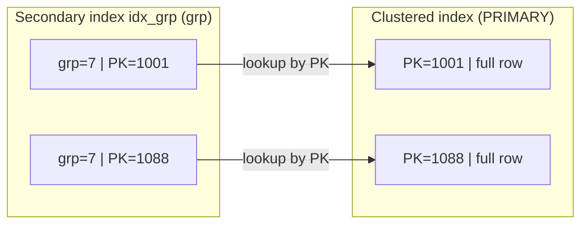

## Introduction

The relational model says a primary key is *any* candidate key you choose to designate. InnoDB says something much stronger: the primary key **is the physical order of the table**, and a copy of it is stored in **every secondary index entry**. The choice of primary key therefore decides insert performance, the size of every index, the cost of every foreign key, how easily the data can be merged across systems, and how painful it will be when the business changes an identifier it promised would never change.

This lesson answers the questions every schema review asks:

- **Natural or surrogate?** Should `products` be keyed by its SKU or by a meaningless `product_id`?
- **AUTO_INCREMENT or UUID?** And if UUID, why does MySQL's `UUID_TO_BIN(…, 1)` have a "swap" flag?
- **Composite keys** — when are they right, and what do they cost in InnoDB?
- **Foreign keys** — which index do they need, and which `ON DELETE` / `ON UPDATE` policy expresses the business rule?

The theory of keys (superkeys, candidate keys, primary and alternate keys) was covered in [Keys](/lessons/m01-keys) and the physical structure in [Clustered and Secondary Indexes](/lessons/m07-clustered-secondary). Here we turn both into design decisions, and **measure** their consequences.

:::note[Dataset]
The examples use the **shop** dataset (its tables use `INT UNSIGNED AUTO_INCREMENT` surrogate keys, a natural alternate key `sku`, and a composite key on `order_items`), plus generated tables of 60,000 rows to measure index sizes.
:::

## DBMS Theory

:::theory[Natural and surrogate keys]
- A **natural key** (business key) is a candidate key made of attributes that have meaning in the real world: a SKU, an ISBN, an email, a country code, `(flight_no, departure_date)`.
- A **surrogate key** is an attribute added solely to identify rows; it has no business meaning and is generated by the system (a sequence number or a UUID).
- Choosing a surrogate as the primary key does **not** remove the natural key: the natural candidate key must still be declared `UNIQUE`, otherwise the table can store the same real-world entity twice.

Desirable properties of a primary key, in rough order of importance:

1. **Unique and NOT NULL** — by definition.
2. **Stable (immutable)** — never changes for the life of the entity. Every change must be propagated to every referencing row.
3. **Minimal** — no attribute can be removed without losing uniqueness.
4. **Compact** — few bytes, cheap to compare; it is copied into every foreign key and (in InnoDB) every secondary index.
5. **Known at insert time** and **not sensitive** — it appears in URLs, logs and exports.
6. For InnoDB specifically: **monotonically increasing**, so inserts append at the right edge of the clustered B+ tree.
:::

Natural keys often fail property 2 or 5: emails change, SKUs get re-coded after a merger, national IDs are sensitive and sometimes reissued, and "natural" codes are frequently *assumed* unique by the business without actually being so. Surrogate keys satisfy 1–5 by construction; whether they satisfy 6 depends on how they are generated.

### Sequence numbers vs UUIDs

| Property | `AUTO_INCREMENT` (sequence) | UUID (RFC 9562) |
|---|---|---|
| Size | 4 bytes (`INT`) or 8 bytes (`BIGINT`) | 16 bytes as `BINARY(16)`; 36 characters as text |
| Generated by | The database, at insert time | Anyone, anywhere — application, client, another database — without coordination |
| Ordering | Monotonic within a server | Version 4: random. Version 1 (MySQL `UUID()`): time-based but with the fast-changing time bits first. Version 7: time-ordered |
| Uniqueness scope | One table on one server | Global (with overwhelming probability) |
| Guessability | Trivially enumerable (`/orders/1001`, `/orders/1002`) | Not enumerable (v4/v7) |
| Merging data from several sources | Collisions; needs offsets (`auto_increment_offset`) or remapping | No collisions |

### Composite keys

A **composite primary key** consists of several attributes. It is the natural key of junction tables (`(order_id, product_id)`) and weak entities (`(invoice_id, line_no)`). Its theoretical merits — it *is* the identity, no extra unique index is needed — come with a physical cost in InnoDB that you will measure below: every secondary index and every referencing foreign key carries all its columns.

## Why It Exists

Key selection exists as a design topic because a poor choice is extremely expensive to undo. Changing the primary key of a large table means rebuilding it and every secondary index, rewriting every referencing foreign-key column in every child table, and updating every external system that stored the old IDs (URLs, caches, data warehouses, partner integrations).

Typical failures:

| Choice | What goes wrong later |
|---|---|
| Email as primary key | Users change email → cascading updates through orders, reviews, logs; GDPR erasure must touch every table |
| Random UUID (v4) as InnoDB primary key | Inserts land on random pages → page splits, half-empty pages, buffer pool churn; secondary indexes grow by 12 bytes per entry vs `INT` |
| UUID stored as `CHAR(36)` | 36+ bytes per key (with utf8mb4, up to 144 bytes reserved in some contexts), slower comparisons, collation-aware comparisons |
| `INT` (signed, 2.1 billion) for a high-volume table | Runs out of values — error 1062 or 1467 at 2,147,483,647 |
| No primary key at all | InnoDB uses a hidden 6-byte row ID that cannot be used in queries or replication row lookups; tools like online schema change and group replication require a PK |
| Surrogate key without `UNIQUE` on the natural key | Duplicate entities that differ only in their surrogate |
| Wide composite key on a parent with many child tables | Every child table and index carries the wide key |

## Internal Working

:::internals[Why the primary key dominates InnoDB physical design]
- **Clustered index.** InnoDB stores each table as a B+ tree ordered by the primary key; the leaf pages contain the full rows. If you define no primary key, InnoDB uses the first `UNIQUE` index whose columns are all `NOT NULL`; failing that, it creates a hidden clustered index on a 6-byte `DB_ROW_ID` that is invisible to SQL.
- **Secondary indexes store the primary key.** A secondary index leaf entry contains the indexed columns **plus the primary key columns** (those not already in the index). That PK value is how InnoDB finds the row (a second B+ tree lookup). Consequently, a 16-byte primary key makes *every* secondary index entry 12 bytes larger than a 4-byte one.
- **Insert position.** With a monotonically increasing key, every insert goes to the right-most leaf page; when it fills, InnoDB starts a new page and the old one stays almost full (InnoDB leaves about 1/16 of each page free for future updates). With a random key, inserts land in arbitrary leaf pages; full pages are split in the middle, leaving two half-full pages, and the working set is the whole index instead of its right edge.
- **AUTO_INCREMENT.** InnoDB keeps an in-memory counter per table. Since MySQL 8.0 the current maximum is written to the redo log on change and persisted, so it survives restarts (before 8.0 it was recomputed as `MAX(id)+1` at startup, which could re-issue IDs of deleted rows). The default `innodb_autoinc_lock_mode = 2` ("interleaved") lets concurrent inserts allocate values without a table-level lock; values are unique and increasing per statement but **not gap-free**: rollbacks, failed inserts and bulk inserts leave gaps.
- **Foreign keys** require an index on the child's FK columns (InnoDB creates one if needed) and on the parent's referenced columns. The child index entry contains the FK columns plus the child's primary key; checks on parent delete are lookups in it.
:::



## MySQL Implementation

Start by auditing the shop's key choices from the dictionary:

```sql run
SELECT k.TABLE_NAME, GROUP_CONCAT(CONCAT(k.COLUMN_NAME, ' ', c.COLUMN_TYPE) ORDER BY k.ORDINAL_POSITION SEPARATOR ', ') AS primary_key,
       MAX(c.EXTRA) AS extra
FROM information_schema.KEY_COLUMN_USAGE AS k
JOIN information_schema.COLUMNS AS c
  ON c.TABLE_SCHEMA = k.TABLE_SCHEMA AND c.TABLE_NAME = k.TABLE_NAME AND c.COLUMN_NAME = k.COLUMN_NAME
WHERE k.TABLE_SCHEMA = DATABASE() AND k.CONSTRAINT_NAME = 'PRIMARY'
GROUP BY k.TABLE_NAME
ORDER BY k.TABLE_NAME;
```

Six tables use a single `INT UNSIGNED` surrogate key (most with `auto_increment`); `order_items` uses the composite key `(order_id, product_id)`. The natural keys are still declared — `customers.email`, `products.sku`, `categories.name` are `UNIQUE` (see the constraint list in [Requirements Gathering](/lessons/m05-requirements-gathering)).

### AUTO_INCREMENT behaviour

```sql run
CREATE TABLE tickets (
  ticket_id INT UNSIGNED NOT NULL AUTO_INCREMENT PRIMARY KEY,
  subject   VARCHAR(100) NOT NULL,
  CONSTRAINT uq_tickets_subject UNIQUE (subject)
);
INSERT INTO tickets (subject) VALUES ('Login fails'), ('Refund request');
SELECT LAST_INSERT_ID() AS first_id_of_last_insert, @@innodb_autoinc_lock_mode AS autoinc_lock_mode;
```

`LAST_INSERT_ID()` returns the **first** value generated by the most recent insert in *this session* — 1 for the two-row insert — and is unaffected by other sessions' inserts, which is why it is safe under concurrency. Now make an insert fail:

```sql run error
INSERT INTO tickets (subject) VALUES ('Login fails');
```

```sql run
INSERT INTO tickets (subject) VALUES ('Password reset');
SELECT ticket_id, subject FROM tickets ORDER BY ticket_id;
```

The failed duplicate consumed value 3, so the next ticket is 4. Gaps are normal; application logic must never assume consecutive IDs ("invoice numbers without gaps" is a business requirement that needs its own mechanism, not AUTO_INCREMENT).

### UUIDs in MySQL

MySQL's `UUID()` returns a version-1 (time-based) UUID as a 36-character string. Its value is different every time, so the next block's output is not shown — run it yourself:

```sql run volatile
SELECT UUID() AS uuid_text, HEX(UUID_TO_BIN(UUID(), 1)) AS swapped_hex;
```

What *is* deterministic are its properties:

```sql run
SELECT LENGTH(UUID())              AS text_chars,
       LENGTH(UUID_TO_BIN(UUID())) AS binary_bytes,
       IS_UUID(UUID())             AS is_valid_uuid;
```

Store UUIDs as `BINARY(16)`, not `CHAR(36)`: 16 bytes instead of 36 characters, byte comparison instead of collation-aware string comparison. `UUID_TO_BIN(uuid, swap_flag)` converts; with `swap_flag = 1` it also **rearranges the time fields**. Use a fixed UUID (the one from the MySQL manual) to see exactly what happens:

```sql run
SELECT HEX(UUID_TO_BIN('6ccd780c-baba-1026-9564-5b8c656024db'))     AS no_swap,
       HEX(UUID_TO_BIN('6ccd780c-baba-1026-9564-5b8c656024db', 1))  AS swapped,
       BIN_TO_UUID(UUID_TO_BIN('6ccd780c-baba-1026-9564-5b8c656024db', 1), 1) AS round_trip;
```

A version-1 UUID is laid out as `time_low-time_mid-time_high_and_version-clock_seq-node`. The *low* 32 bits of the timestamp come first — they change fastest and wrap around about every 7 minutes (2³² × 100 ns ≈ 429 s). Swapping moves `time_high` (here `1026`) and `time_mid` (`baba`) in front of `time_low` (`6ccd780c`), so the bytes are ordered from the most significant time bits to the least — making the binary values increase with time. `BIN_TO_UUID(…, 1)` reverses the swap.

## Syntax Breakdown

| Element | Meaning | Notes |
|---|---|---|
| `id INT UNSIGNED NOT NULL AUTO_INCREMENT PRIMARY KEY` | 4-byte surrogate, max 4,294,967,295 | Use `BIGINT UNSIGNED` (8 bytes) for tables that may exceed ~4 billion rows over their lifetime |
| `LAST_INSERT_ID()` | First auto-generated value of the session's last insert | Per session; 0 if nothing generated |
| `AUTO_INCREMENT = n` (table option) | Sets the next value | Cannot be set below the current maximum |
| `UUID()` | Version-1 UUID string (time + node) | Not deterministic; not replication-safe in statement-based logging |
| `UUID_TO_BIN(s [, swap])` | 36-char UUID → `BINARY(16)`; `swap = 1` reorders time fields | Since MySQL 8.0 |
| `BIN_TO_UUID(b [, swap])` | Inverse; use the same swap flag | |
| `IS_UUID(s)` | 1 if `s` is a valid UUID string | |
| `id BINARY(16) PRIMARY KEY DEFAULT (UUID_TO_BIN(UUID(), 1))` | Expression default (8.0.13+) generating a swapped UUID | Display with `BIN_TO_UUID(id, 1)` |
| `PRIMARY KEY (a, b)` | Composite key, clustered by `a` then `b` | Column order decides which prefix queries are cheap |
| `UNIQUE (natural_key)` | Keeps the natural key enforced when a surrogate is the PK | Essential |
| `FOREIGN KEY (c) REFERENCES p (k) ON DELETE … ON UPDATE …` | Actions: `RESTRICT`/`NO ACTION` (default), `CASCADE`, `SET NULL` | `SET DEFAULT` rejected by InnoDB |

:::version[MySQL 8.0.30+ / 8.4 — generated invisible primary keys (GIPK)]
When `sql_generate_invisible_primary_key = ON` (default `OFF`), creating an InnoDB table **without** a primary key makes MySQL add an invisible column `my_row_id BIGINT UNSIGNED NOT NULL AUTO_INCREMENT` as its primary key. It is visible in `SHOW CREATE TABLE` (unless `show_gipk_in_create_table_and_information_schema = OFF`) but not in `SELECT *`. It exists so that replication and HA tooling always have a primary key. It is a safety net, not a design: choose keys deliberately.

```sql
SET PERSIST sql_generate_invisible_primary_key = ON;   -- server-wide; requires admin privileges
CREATE TABLE audit_events (event_type VARCHAR(30), payload JSON);
SHOW CREATE TABLE audit_events;  -- shows `my_row_id` bigint unsigned NOT NULL AUTO_INCREMENT /*!80023 INVISIBLE */
```
:::

:::standard[Standard SQL vs MySQL]
Standard SQL generates surrogate keys with identity columns (`GENERATED ALWAYS AS IDENTITY`) or sequences (`CREATE SEQUENCE`). MySQL has **neither**; it uses the `AUTO_INCREMENT` column attribute (one per table, must be indexed). `UUID_TO_BIN`, `BIN_TO_UUID` and the swap flag are MySQL-specific; PostgreSQL has a native `uuid` type instead.
:::

## Practical Examples

**1. Natural key as primary key — and what changing it costs.** Build a small natural-keyed pair and change one SKU:

```sql run
CREATE TABLE products_nk (
  sku   VARCHAR(20)  NOT NULL PRIMARY KEY,
  name  VARCHAR(120) NOT NULL
);
CREATE TABLE order_lines_nk (
  order_id INT UNSIGNED NOT NULL,
  sku      VARCHAR(20)  NOT NULL,
  quantity INT UNSIGNED NOT NULL,
  PRIMARY KEY (order_id, sku),
  CONSTRAINT fk_lines_nk_sku FOREIGN KEY (sku) REFERENCES products_nk (sku) ON UPDATE CASCADE
);
INSERT INTO products_nk SELECT sku, name FROM products;
INSERT INTO order_lines_nk SELECT oi.order_id, p.sku, oi.quantity
FROM order_items AS oi JOIN products AS p ON p.product_id = oi.product_id;

SELECT p.sku, COUNT(*) AS lines_referencing
FROM order_lines_nk AS l JOIN products_nk AS p ON p.sku = l.sku
GROUP BY p.sku ORDER BY lines_referencing DESC, p.sku LIMIT 1;
```

SKU-1023 is referenced by 15 order lines. The business renames it. With `ON UPDATE CASCADE`, InnoDB rewrites every referencing line — and because `sku` is part of `order_lines_nk`'s primary key, each cascaded update *moves the row* within the clustered index (a delete plus insert internally):

```sql run
SET @old_sku = (SELECT sku FROM order_lines_nk GROUP BY sku ORDER BY COUNT(*) DESC, sku LIMIT 1);
UPDATE products_nk SET sku = CONCAT('NEW-', @old_sku) WHERE sku = @old_sku;
SELECT ROW_COUNT() AS parent_rows_updated,
       (SELECT COUNT(*) FROM order_lines_nk WHERE sku = CONCAT('NEW-', @old_sku)) AS child_rows_rewritten;
```

One parent row changed, 15 child rows were rewritten. With the surrogate design the shop actually uses, the same change is a one-row update of `products.sku`; no child row mentions the SKU. That stability is the main argument for surrogate keys on entities whose natural identifiers can change.

**2. Natural keys that are fine.** Some natural keys really are stable, compact and public: ISO country codes (`CHAR(2)`), currency codes (`CHAR(3)`), the university dataset's course codes (`'CS-157A'`). For small, slowly changing reference tables they are good primary keys — child tables become readable without joins (`WHERE country = 'DE'`).

**3. UUID ordering: why the swap flag exists.** Three time-based UUIDs created at increasing times, the second just after `time_low` wrapped around (crafted by hand so the result is deterministic):

```sql run
CREATE TABLE uuid_demo (created_seq TINYINT PRIMARY KEY, u CHAR(36) NOT NULL);
INSERT INTO uuid_demo VALUES
  (1, 'fffffff0-0a1b-11ef-8000-00000000000a'),   -- earliest
  (2, '00000010-0a1c-11ef-8000-00000000000a'),   -- later: time_low wrapped, time_mid advanced
  (3, '80000000-0a1c-11ef-8000-00000000000a');   -- latest
SELECT created_seq, u,
       RANK() OVER (ORDER BY UUID_TO_BIN(u))    AS position_unswapped,
       RANK() OVER (ORDER BY UUID_TO_BIN(u, 1)) AS position_swapped
FROM uuid_demo
ORDER BY created_seq;
```

Unswapped, the order of the binary values is 2, 3, 1 — not the creation order, because `time_low` comes first. Swapped, the order equals the creation order. Over hours of inserts, unswapped v1 UUIDs sweep through the whole key space every ~7 minutes; swapped ones always append at the right edge — as long as they come from one host, since the node and clock-sequence bits sit after the timestamp.

**4. A UUID primary key done right.**

```sql run
CREATE TABLE api_clients (
  client_id   BINARY(16)   NOT NULL DEFAULT (UUID_TO_BIN(UUID(), 1)) PRIMARY KEY,
  name        VARCHAR(80)  NOT NULL,
  created_at  DATETIME     NOT NULL DEFAULT CURRENT_TIMESTAMP,
  CONSTRAINT uq_api_clients_name UNIQUE (name)
);
INSERT INTO api_clients (name) VALUES ('mobile-app'), ('partner-portal');
SELECT name, LENGTH(client_id) AS key_bytes, IS_UUID(BIN_TO_UUID(client_id, 1)) AS decodes_to_uuid
FROM api_clients ORDER BY name;
```

The key is generated by the server, stored in 16 bytes and displayed with `BIN_TO_UUID(client_id, 1)`. (The actual values differ on every run, so only their properties are shown.)

## Execution Walkthrough

How the primary key choice shows up in the physical structures — measured, not assumed. Three tables with identical columns and a secondary index on `grp` differ only in their primary key: a 4-byte `AUTO_INCREMENT`, a 16-byte key inserted in **increasing** order, and a 16-byte key inserted in **random** order (`UNHEX(MD5(n))` simulates random version-4 UUIDs deterministically).

```walkthrough
title: The same 60,000 rows under three primary-key strategies
steps:
  - title: "1. Create the three tables"
    explain: Same columns, same secondary index; only the primary key type and insert order differ.
    sql: |
      CREATE TABLE k_int  (id INT UNSIGNED AUTO_INCREMENT PRIMARY KEY, grp INT NOT NULL, payload CHAR(40) NOT NULL, KEY idx_grp (grp));
      CREATE TABLE k_seq  (id BINARY(16) PRIMARY KEY, grp INT NOT NULL, payload CHAR(40) NOT NULL, KEY idx_grp (grp));
      CREATE TABLE k_rand (id BINARY(16) PRIMARY KEY, grp INT NOT NULL, payload CHAR(40) NOT NULL, KEY idx_grp (grp));
  - title: "2. Load 60,000 rows into each"
    explain: >-
      k_int gets 1, 2, 3 …; k_seq gets 16-byte values that increase with n; k_rand gets MD5-derived 16-byte
      values in effectively random order.
    sql: |
      SET SESSION cte_max_recursion_depth = 60000;
      INSERT INTO k_int (grp, payload)
        WITH RECURSIVE s(n) AS (SELECT 1 UNION ALL SELECT n + 1 FROM s WHERE n < 60000)
        SELECT n % 100, SHA1(n) FROM s;
      INSERT INTO k_seq
        WITH RECURSIVE s(n) AS (SELECT 1 UNION ALL SELECT n + 1 FROM s WHERE n < 60000)
        SELECT UNHEX(LPAD(HEX(n), 32, '0')), n % 100, SHA1(n) FROM s;
      INSERT INTO k_rand
        WITH RECURSIVE s(n) AS (SELECT 1 UNION ALL SELECT n + 1 FROM s WHERE n < 60000)
        SELECT UNHEX(MD5(n)), n % 100, SHA1(n) FROM s;
      SELECT (SELECT COUNT(*) FROM k_int) AS k_int, (SELECT COUNT(*) FROM k_seq) AS k_seq, (SELECT COUNT(*) FROM k_rand) AS k_rand;
  - title: "3. Refresh statistics"
    explain: >-
      ANALYZE TABLE recomputes the persistent statistics, and information_schema_stats_expiry = 0 makes
      information_schema.TABLES read them fresh instead of from its 24-hour cache. The sizes are shown in the
      measured block right after this walkthrough.
    sql: |
      ANALYZE TABLE k_int, k_seq, k_rand;
      SET SESSION information_schema_stats_expiry = 0;
```

```sql run measured
SELECT TABLE_NAME,
       ROUND(DATA_LENGTH  / 1024 / 1024, 2) AS clustered_mib,
       ROUND(INDEX_LENGTH / 1024 / 1024, 2) AS secondary_mib
FROM information_schema.TABLES
WHERE TABLE_SCHEMA = DATABASE() AND TABLE_NAME IN ('k_int', 'k_seq', 'k_rand')
ORDER BY TABLE_NAME;
```

## Output

Read the measured sizes in two directions.

**Down the `secondary_mib` column** — key *width*. `k_seq` and `k_rand` have secondary indexes of the same size (2.52 MiB), about two thirds larger than `k_int`'s (1.52 MiB), although the indexed column (`grp`) is the same `INT` in all three. The difference is the primary key copy in every entry: 16 bytes instead of 4. Every additional secondary index on a UUID-keyed table pays that again.

**Down the `clustered_mib` column** — insert *order*. `k_seq` is larger than `k_int` only by the wider key. `k_rand` holds exactly the same rows as `k_seq` with keys of the same width, yet its clustered index is much larger — 8.52 MiB against 5.52 MiB (and 4.52 MiB for `k_int`): random inserts split pages in the middle and leave them partly empty, whereas sequential inserts fill pages almost completely. On a production table that difference also means more pages to cache, more I/O and more redo for page splits.

These are measurements on the build machine; exact numbers on your server will differ slightly (page fill depends on insert pattern and version), but the shape — width costs every index, randomness costs the clustered index — is a direct consequence of InnoDB's structure.

## Alternative Approaches

| Strategy | Use when | Watch out for |
|---|---|---|
| `INT`/`BIGINT UNSIGNED AUTO_INCREMENT` | Default for OLTP tables on a single primary | Enumerable IDs in public URLs (expose a separate random token); merging data across shards |
| `BINARY(16)` swapped v1 UUID (`UUID_TO_BIN(UUID(), 1)`) | IDs must be generated without coordination across servers or before insert, with near-sequential InnoDB inserts | 16-byte width in every index; v1 embeds the MAC/node and timestamp (information leakage) |
| `BINARY(16)` UUID v7 generated by the application | Time-ordered, globally unique IDs across services | MySQL 8.4 has no built-in v7 generator; store as `BINARY(16)` without swapping (v7 is already time-first) |
| Random v4 UUID as PK | Avoid as InnoDB PK on large, write-heavy tables | Random inserts (measured above); use as a secondary `UNIQUE` "public id" instead |
| Surrogate PK + random public ID | Internal joins on compact `BIGINT`, external APIs on an unguessable token | Two unique indexes |
| Natural PK | Small, stable reference data (countries, currencies, course codes) | Changes cascade; sensitivity; uniqueness assumptions |
| Composite PK | Junction tables, weak entities, time-series `(device_id, ts)` | Width in secondary indexes and child FKs; column order fixes the cheap access path |
| Snowflake-style 64-bit IDs (timestamp + machine + sequence) | Very high write rates across many servers, wanting 8-byte ordered keys | Needs an ID service or library; clock skew handling |

**Composite vs surrogate on a junction table.** `order_items (order_id, product_id)` with a composite PK clusters the lines of an order together and needs no extra index for uniqueness. A surrogate `order_item_id` would require a separate `UNIQUE (order_id, product_id)` and would cluster lines by insertion order instead. Choose the surrogate only when other tables must reference individual lines (returns, shipments per line) *and* the composite key would be wide.

## Performance Analysis

**Secondary indexes contain the primary key — visible in plans.** `order_items` has `PRIMARY KEY (order_id, product_id)` and `idx_order_items_product (product_id)`. A query that needs only `order_id` for a product is answered from the secondary index alone, because each entry already contains the full primary key:

```sql run
EXPLAIN FORMAT=TREE
SELECT order_id FROM order_items WHERE product_id = 5;
```

**Foreign keys need indexes on both sides.** InnoDB creates the child-side index automatically when none exists, and refuses to drop it while the foreign key needs it:

```sql run
CREATE TABLE ticket_comments (
  comment_id INT UNSIGNED NOT NULL AUTO_INCREMENT PRIMARY KEY,
  ticket_id  INT UNSIGNED NOT NULL,
  body       VARCHAR(500) NOT NULL,
  CONSTRAINT fk_comments_ticket FOREIGN KEY (ticket_id) REFERENCES tickets (ticket_id) ON DELETE CASCADE
);
SELECT INDEX_NAME, COLUMN_NAME, NON_UNIQUE
FROM information_schema.STATISTICS
WHERE TABLE_SCHEMA = DATABASE() AND TABLE_NAME = 'ticket_comments'
ORDER BY INDEX_NAME, SEQ_IN_INDEX;
```

```sql run error
ALTER TABLE ticket_comments DROP INDEX fk_comments_ticket;
```

The automatically created index carries the constraint's name. Error 1553 protects it: without it, every delete of a ticket would have to scan `ticket_comments`. (Other database systems, notably PostgreSQL, do **not** create child-side FK indexes automatically — a frequent source of slow deletes when teams move between systems.)

**Sizing summary** (per entry, before row and page overheads):

| PK type | PK bytes | Added to each secondary index entry | Added to each referencing FK column |
|---|---|---|---|
| `INT UNSIGNED` | 4 | 4 | 4 |
| `BIGINT UNSIGNED` | 8 | 8 | 8 |
| `BINARY(16)` UUID | 16 | 16 | 16 |
| `CHAR(36)` UUID (ascii) | 36 | 36 | 36 |
| Composite `(INT, INT)` | 8 | 8 | 8 (composite FK) |

:::performance[Theory vs measurement]
The byte counts follow from the storage formats; the page-fill effect of random keys was *measured* above on 60,000 rows. On your production data, measure with a staging load and `information_schema.TABLES` (with `ANALYZE TABLE` first), and measure insert throughput under concurrency — the buffer-pool effect of random keys grows with table size relative to memory.
:::

## Best Practices

:::best-practice[Key selection checklist]
1. **Every InnoDB table gets an explicit primary key.** Never rely on the hidden row ID (or on GIPK as a design).
2. **Default to a compact, monotonically increasing surrogate** (`INT`/`BIGINT UNSIGNED AUTO_INCREMENT`) for entity tables; use `BIGINT` if the table could ever exceed ~4 billion rows.
3. **Always declare natural candidate keys `UNIQUE`** alongside a surrogate PK.
4. **Use natural keys as PK only when they are stable, compact, non-sensitive** — typically small reference tables.
5. **If you need UUIDs, store them as `BINARY(16)`**; use `UUID_TO_BIN(UUID(), 1)` (or application-generated v7) for primary keys, never random v4 as a clustered key on a large write-heavy table.
6. **Use composite PKs for junction tables and weak entities**, with column order matching the most frequent access path, and add the reverse index.
7. **Match FK column types exactly** to the referenced key (type, signedness, charset and collation).
8. **Choose referential actions from the business lifecycle:** `RESTRICT` for independent records (orders, payments), `CASCADE` for existence-dependent parts (lines, profile rows), `SET NULL` for optional links; avoid `ON UPDATE CASCADE` by not using mutable keys.
9. **Don't expose sequential IDs where enumeration is a risk**; add a random public identifier.
:::

## Common Mistakes

**Mistake 1 — a signed `INT` key that runs out.** A signed `INT` stops at 2,147,483,647:

```sql run
CREATE TABLE tiny_counter (id INT NOT NULL AUTO_INCREMENT PRIMARY KEY, v CHAR(1)) AUTO_INCREMENT = 2147483646;
INSERT INTO tiny_counter (v) VALUES ('a');
SELECT MAX(id) AS last_id FROM tiny_counter;
```

```sql run error
INSERT INTO tiny_counter (v) VALUES ('b'), ('c');
```

The multi-row insert needs two values but only one (2,147,483,647) is left; InnoDB cannot generate the second, so the statement fails with error 1467 (*Failed to read auto-increment value from storage engine*) and, being one statement, inserts neither row. Depending on version and statement shape, exhausting the range can also surface as a duplicate-key error (1062) on the maximum value — either way, the table can no longer accept rows. Use `UNSIGNED` (twice the range) and `BIGINT` for high-volume tables; monitor `AUTO_INCREMENT` headroom.

**Mistake 2 — UUIDs as `CHAR(36)`.** More than twice the bytes of `BINARY(16)`, compared with collation rules, and copied into every index.

**Mistake 3 — surrogate key without a unique natural key.** Two "Laptop Pro 14" products with the same SKU but different `product_id`s — the surrogate cannot detect duplicates.

**Mistake 4 — FK type mismatch.** Referencing `customers.customer_id INT UNSIGNED` from a signed `INT` column fails (error 3780) — or, in systems without enforced FKs, silently forces implicit conversions in joins.

**Mistake 5 — `ON DELETE CASCADE` on records with independent meaning.** Deleting a customer should not silently delete their orders and payments (financial records). Use `RESTRICT` and an explicit, audited process (anonymize the customer, keep the orders).

**Mistake 6 — relying on gap-free AUTO_INCREMENT** for invoice numbers. Failed inserts and rollbacks leave gaps (ticket 3 above). Gap-free numbering needs a separate counter row updated in the same transaction (serializing invoice creation).

## Industry Application

- **Public IDs vs internal IDs.** Many large platforms use `BIGINT` keys internally and expose an opaque, random identifier (or an encoded form) in URLs and APIs, preventing enumeration and decoupling external references from storage.
- **Distributed ID generation.** Systems with many writers use ordered 64-bit IDs (Twitter's Snowflake design and its descendants) or UUID v7 so that IDs can be generated without a central database while remaining roughly time-ordered for B+ tree inserts — exactly the property measured above.
- **Sharding.** A shard key is usually part of (or derivable from) the primary key — e.g. `(tenant_id, order_id)` — so that a row's location can be computed from its ID ([Sharding](/lessons/m12-sharding)).
- **Replication and online schema change.** MySQL Group Replication requires a primary key on every table; tools such as `gh-ost` and `pt-online-schema-change` need a primary or unique key to copy rows in chunks. Missing primary keys block these operations — the motivation for GIPK.
- **Data warehousing.** Warehouses use surrogate keys for dimensions (to track history with slowly changing dimensions) and keep the operational natural key as an attribute (Module 13).

## Practice Exercises

```exercise
id: ex1
title: Audit primary key types
difficulty: easy
concepts: [primary-key, information-schema]
prompt: |
  List every primary-key column in the schema with its data type. Columns: `TABLE_NAME`, `COLUMN_NAME`,
  `COLUMN_TYPE`, `ORDINAL_POSITION` (position within the key), ordered by `TABLE_NAME`, `ORDINAL_POSITION`.
hints:
  - "KEY_COLUMN_USAGE rows with CONSTRAINT_NAME = 'PRIMARY' are primary-key columns."
  - "Join COLUMNS on schema, table and column to get COLUMN_TYPE."
solution: |
  SELECT k.TABLE_NAME, k.COLUMN_NAME, c.COLUMN_TYPE, k.ORDINAL_POSITION
  FROM information_schema.KEY_COLUMN_USAGE AS k
  JOIN information_schema.COLUMNS AS c
    ON c.TABLE_SCHEMA = k.TABLE_SCHEMA AND c.TABLE_NAME = k.TABLE_NAME AND c.COLUMN_NAME = k.COLUMN_NAME
  WHERE k.TABLE_SCHEMA = DATABASE() AND k.CONSTRAINT_NAME = 'PRIMARY'
  ORDER BY k.TABLE_NAME, k.ORDINAL_POSITION;
orderMatters: true
explanation: |
  `order_items` shows two rows (positions 1 and 2) — its composite key. Every key column is `int unsigned`:
  compact, so the secondary indexes and foreign keys of this schema stay small.
```

```exercise
id: ex2
title: A UUID-keyed table with the right storage
difficulty: medium
kind: dml
concepts: [uuid, primary-key]
prompt: |
  Create table **`devices`** with `device_id` stored as **`BINARY(16)`**, primary key, defaulting to a
  **time-ordered (swapped)** UUID generated by MySQL; `serial_no` `VARCHAR(30)` NOT NULL and **unique**;
  `registered_at` `DATETIME` NOT NULL. Insert two devices with serial numbers `'SN-001'` and `'SN-002'`
  (letting the key default).

  The checker shows, per device, the serial number, the key length in bytes and whether the key decodes to a
  valid UUID with the swap flag.
hints:
  - "DEFAULT (UUID_TO_BIN(UUID(), 1)) — expression defaults need the parentheses."
  - "INSERT INTO devices (serial_no, registered_at) VALUES ('SN-001', '2024-12-01 10:00:00'), …"
solution: |
  CREATE TABLE devices (
    device_id     BINARY(16)  NOT NULL DEFAULT (UUID_TO_BIN(UUID(), 1)) PRIMARY KEY,
    serial_no     VARCHAR(30) NOT NULL UNIQUE,
    registered_at DATETIME    NOT NULL
  );
  INSERT INTO devices (serial_no, registered_at) VALUES
    ('SN-001', '2024-12-01 10:00:00'), ('SN-002', '2024-12-01 10:05:00');
check: |
  SELECT serial_no, LENGTH(device_id) AS key_bytes,
         IS_UUID(BIN_TO_UUID(device_id, 1)) AS valid_uuid
  FROM devices
  ORDER BY serial_no;
explanation: |
  The check compares properties, not values, because every run generates different UUIDs. `CHAR(36)` would
  fail the 16-byte check. Without the swap flag the keys would still be valid UUIDs, but their byte order
  would start with the fast-changing `time_low` field, scattering inserts over the clustered index as time
  passes. The `UNIQUE` serial number keeps the natural key enforced.
```

```exercise
id: ex3
title: Which values did AUTO_INCREMENT skip?
difficulty: medium
setup: |
  CREATE TABLE invoices (invoice_id INT UNSIGNED AUTO_INCREMENT PRIMARY KEY, ref VARCHAR(10) NOT NULL UNIQUE);
  INSERT INTO invoices (ref) VALUES ('A'), ('B'), ('C');
  INSERT IGNORE INTO invoices (ref) VALUES ('B');
  INSERT INTO invoices (ref) VALUES ('D');
  DELETE FROM invoices WHERE ref = 'B';
  INSERT INTO invoices (ref) VALUES ('E');
concepts: [auto-increment]
prompt: |
  Finance asks which invoice numbers between the smallest and largest existing `invoice_id` are **missing**.
  Return one column `missing_id`, ordered ascending.
hints:
  - "Generate every number from MIN(invoice_id) to MAX(invoice_id) with a recursive CTE."
  - "Keep the numbers that have no matching invoice (NOT EXISTS or LEFT JOIN … IS NULL)."
solution: |
  WITH RECURSIVE bounds AS (SELECT MIN(invoice_id) AS lo, MAX(invoice_id) AS hi FROM invoices),
  seq (n) AS (
    SELECT lo FROM bounds
    UNION ALL
    SELECT n + 1 FROM seq, bounds WHERE n < hi
  )
  SELECT n AS missing_id
  FROM seq
  WHERE NOT EXISTS (SELECT 1 FROM invoices AS i WHERE i.invoice_id = n)
  ORDER BY missing_id;
orderMatters: true
explanation: |
  Two kinds of gap appear: the value consumed by the ignored duplicate insert (never used) and the value of
  the deleted invoice 'B'. AUTO_INCREMENT guarantees uniqueness, not continuity — gap-free numbering is a
  separate business mechanism.
```

```exercise
id: ex4
title: Natural or surrogate?
difficulty: medium
kind: open
concepts: [natural-key, surrogate-key, primary-key]
prompt: |
  Choose the primary key for each table and justify it: (a) `countries` (ISO 3166 alpha-2 code, name);
  (b) `customers` (email, name, phone); (c) `flights` (airline code, flight number, departure date, aircraft);
  (d) `page_views` (500 million rows/day from 40 web servers, written without a round trip to a central
  database); (e) `book_authors` (book, author, author order).
solution: |
  (a) Natural `CHAR(2)` code: stable, compact, public, small table; children become readable.
  (b) Surrogate `INT/BIGINT UNSIGNED AUTO_INCREMENT`; email `UNIQUE` (case-insensitive collation) — emails
  change and are personal data.
  (c) Surrogate `flight_id` + `UNIQUE (airline_code, flight_no, departure_date)`: the natural key is a
  three-column composite referenced by bookings, crew assignments, etc.; a surrogate keeps child FKs narrow.
  The composite natural key would be acceptable if few tables reference flights.
  (d) An ordered ID generated without coordination: a 64-bit Snowflake-style ID or UUID v7 stored as
  `BINARY(16)` (or a composite such as `(server_id, local_seq)`), keeping inserts near-sequential;
  random v4 UUIDs would cause random inserts at this volume. Partitioning by time is likely as well.
  (e) Composite `(book_id, author_id)` — the relationship's identity, no extra unique index; plus an index
  on `author_id`.
```

```exercise
id: ex5
title: Choose referential actions
difficulty: hard
kind: dml
dataset: empty
concepts: [referential-actions, foreign-key]
prompt: |
  Create three tables with these rules:

  - **`accounts`** (`account_id` INT UNSIGNED PK, `owner` VARCHAR(80) NOT NULL).
  - **`account_settings`** (`account_id` INT UNSIGNED PK, `theme` VARCHAR(20) NOT NULL): one optional row per
    account that must disappear when the account is deleted.
  - **`invoices`** (`invoice_id` INT UNSIGNED PK, `account_id` INT UNSIGNED, `referrer_account_id` INT UNSIGNED
    NULL): an invoice belongs to exactly one account and must **prevent** the account's deletion; the optional
    referrer link must be **cleared** if the referrer account is deleted.

  The checker lists every foreign key as (table, column, delete rule).
hints:
  - "account_settings: shared primary key, FK … ON DELETE CASCADE."
  - "invoices.account_id NOT NULL with ON DELETE RESTRICT (or the default NO ACTION)."
  - "invoices.referrer_account_id NULL with ON DELETE SET NULL."
solution: |
  CREATE TABLE accounts (account_id INT UNSIGNED PRIMARY KEY, owner VARCHAR(80) NOT NULL);
  CREATE TABLE account_settings (
    account_id INT UNSIGNED PRIMARY KEY, theme VARCHAR(20) NOT NULL,
    FOREIGN KEY (account_id) REFERENCES accounts (account_id) ON DELETE CASCADE
  );
  CREATE TABLE invoices (
    invoice_id INT UNSIGNED PRIMARY KEY,
    account_id INT UNSIGNED NOT NULL,
    referrer_account_id INT UNSIGNED NULL,
    FOREIGN KEY (account_id) REFERENCES accounts (account_id) ON DELETE RESTRICT,
    FOREIGN KEY (referrer_account_id) REFERENCES accounts (account_id) ON DELETE SET NULL
  );
check: |
  SELECT k.TABLE_NAME, k.COLUMN_NAME,
         CASE r.DELETE_RULE WHEN 'NO ACTION' THEN 'RESTRICT' ELSE r.DELETE_RULE END AS delete_rule
  FROM information_schema.KEY_COLUMN_USAGE AS k
  JOIN information_schema.REFERENTIAL_CONSTRAINTS AS r
    ON r.CONSTRAINT_SCHEMA = k.CONSTRAINT_SCHEMA AND r.CONSTRAINT_NAME = k.CONSTRAINT_NAME
  WHERE k.TABLE_SCHEMA = DATABASE()
  ORDER BY k.TABLE_NAME, k.COLUMN_NAME;
explanation: |
  InnoDB treats `RESTRICT` and `NO ACTION` identically (checked immediately), so the checker normalizes them.
  `SET NULL` requires a NULL-able column — on `account_id` NOT NULL it would be rejected at CREATE time.
  Invoices are financial records with independent meaning, hence RESTRICT rather than CASCADE.
```

```exercise
id: ex6
title: Re-key a table for a multi-region launch
difficulty: challenge
kind: open
concepts: [uuid, auto-increment, clustered-index, composite-key, foreign-key]
prompt: |
  The shop's `orders` table (`order_id INT UNSIGNED AUTO_INCREMENT`) will be written by three regional MySQL
  primaries that later merge their data into one analytics database. `order_items`, `payments` and a
  `shipments` table reference orders. Propose a key strategy, compare at least three options on uniqueness
  across regions, InnoDB insert behaviour, index size and migration effort, and describe the migration steps
  for the existing 80 orders and their children.
solution: |
  **Options.**
  (1) Keep `AUTO_INCREMENT` with `auto_increment_increment = 3` and per-region `auto_increment_offset` —
  unique across regions, compact (switch to `BIGINT UNSIGNED` for headroom), still roughly sequential per
  server; fragile if a fourth region is added (re-plan increments) and IDs reveal volume.
  (2) Composite `(region_id TINYINT, order_id BIGINT AUTO_INCREMENT)` — explicit, sharding-friendly; every
  child FK and secondary index widens by one column; InnoDB requires the AUTO_INCREMENT column to be the
  first column of *some* index (add `KEY (order_id)`).
  (3) `BINARY(16)` swapped v1 UUID or app-generated UUID v7 — no coordination, globally unique, mostly
  sequential inserts; 16-byte keys in every index (measured: noticeably larger secondary indexes than INT);
  harder to read in support tools.
  (4) Snowflake-style `BIGINT` (timestamp | region | sequence) — 8 bytes, time-ordered, globally unique;
  requires an ID generator library and clock discipline.

  **Recommendation.** (4) or (1) for compactness; (3) if teams prefer standard UUIDs and accept the size.
  Keep a separate random public order token for URLs in any case.

  **Migration.** Add the new key column to orders (`new_id`), backfill (existing orders keep their numeric
  value mapped into the new scheme, e.g. region 0), add matching `new_order_id` columns to every child,
  backfill via join, add unique index and FKs on the new columns, switch the application to dual-write,
  then swap primary keys (rebuilding the tables — online DDL or gh-ost for large ones), drop old FKs and
  columns. Do it table by table in topological order (orders before children for adds; children before
  orders for drops).
```

## Knowledge Assessment

```quiz
- id: q1
  question: "Why does a 16-byte primary key make *every* secondary index of an InnoDB table larger?"
  options:
    - "Each secondary index entry stores the primary key value as its pointer to the row"
    - "InnoDB duplicates the whole row in every index"
    - "Secondary indexes are padded to the primary key's length"
    - "It doesn't — only the clustered index grows"
  answer: 0
  explanation: "InnoDB secondary indexes locate rows via the PK, so each entry contains the indexed columns plus the PK columns. Rows are not duplicated, there is no padding rule, and the measured secondary index sizes differ with key width."
  concepts: [clustered-index, primary-key]
- id: q2
  question: "What does the second argument of `UUID_TO_BIN(UUID(), 1)` do?"
  options:
    - "Moves the time-high and time-mid fields before time-low so the binary value increases with time"
    - "Generates a version-4 random UUID"
    - "Compresses the UUID to 8 bytes"
    - "Validates the UUID and returns NULL if invalid"
  answer: 0
  explanation: "The swap flag reorders the timestamp fields of a v1 UUID so byte order follows time, giving near-sequential inserts. It does not change the version, the size (always 16 bytes) or perform validation (IS_UUID does that)."
  concepts: [uuid]
- id: q3
  question: "A table uses a surrogate `product_id` primary key. Which additional constraint is essential?"
  options:
    - "UNIQUE on the natural key (e.g. sku)"
    - "A CHECK that product_id > 0"
    - "An index on product_id"
    - "ON UPDATE CASCADE on product_id"
  answer: 0
  explanation: "The surrogate cannot detect duplicate real-world entities; the natural candidate key must stay declared unique. The PK is already indexed; product_id > 0 is guaranteed by UNSIGNED AUTO_INCREMENT; surrogate keys never change, so ON UPDATE CASCADE is pointless."
  concepts: [surrogate-key, natural-key]
- id: q4
  question: "After `INSERT` of rows 1 and 2, a failed duplicate-key insert, and another successful insert, the new row's AUTO_INCREMENT value is most likely:"
  options: ["4", "3", "2", "It depends on MAX(id) at commit"]
  answer: 0
  explanation: "The failed insert consumed value 3 (as captured in this lesson), so the next row gets 4. AUTO_INCREMENT is unique and increasing, not gap-free; it is not recomputed from MAX(id) at commit."
  concepts: [auto-increment]
- id: q5
  type: multi
  question: "Which statements about foreign keys in InnoDB are true? (Select all that apply.)"
  options:
    - "InnoDB creates an index on the child's FK columns if no suitable index exists"
    - "You cannot drop the index a foreign key needs while the foreign key exists"
    - "RESTRICT and NO ACTION behave identically in InnoDB"
    - "ON DELETE SET DEFAULT is supported"
  answer: [0, 1, 2]
  explanation: "The child index is created automatically and protected (error 1553). InnoDB checks constraints immediately, so RESTRICT = NO ACTION. SET DEFAULT is parsed but rejected by InnoDB."
  concepts: [foreign-key, referential-actions]
- id: q6
  question: "Measured on identical rows, a table with random 16-byte keys had a much larger clustered index than the same table with sequential 16-byte keys. Why?"
  options:
    - "Random inserts split full pages in the middle, leaving partially empty pages; sequential inserts append and fill pages"
    - "Random keys are stored uncompressed"
    - "InnoDB stores random keys twice"
    - "ANALYZE TABLE counts random keys differently"
  answer: 0
  explanation: "Insert order determines page fill: right-edge appends leave pages nearly full, random positions cause mid-page splits. Key width was the same in both tables, so width is not the explanation."
  concepts: [uuid, clustered-index]
- id: q7
  question: "Which is the best primary key for an ISO currency reference table (code, name, minor_units)?"
  options:
    - "The natural CHAR(3) currency code"
    - "A random v4 UUID"
    - "A BIGINT AUTO_INCREMENT plus no unique constraint on the code"
    - "The currency name"
  answer: 0
  explanation: "ISO currency codes are stable, compact, public and naturally unique — ideal natural keys for small reference data. A UUID is wide and random; a surrogate without UNIQUE allows duplicates; names are longer and can change."
  concepts: [natural-key, primary-key]
- id: q8
  question: "A signed `INT AUTO_INCREMENT` key has used its last value, 2,147,483,647. What happens on the next insert that needs a generated value?"
  options:
    - "The insert fails (in this lesson's capture with error 1467) — the table cannot accept new generated keys"
    - "The counter wraps around to 1"
    - "MySQL automatically converts the column to BIGINT"
    - "The value becomes negative"
  answer: 0
  explanation: "InnoDB cannot generate a value beyond the type's maximum, so the insert fails (error 1467 in the captured example; a duplicate-key error on the maximum is the other common symptom). There is no wrap-around, no negative value and no automatic type change — use UNSIGNED/BIGINT and monitor headroom."
  concepts: [auto-increment]
```
