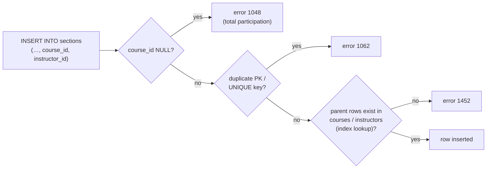
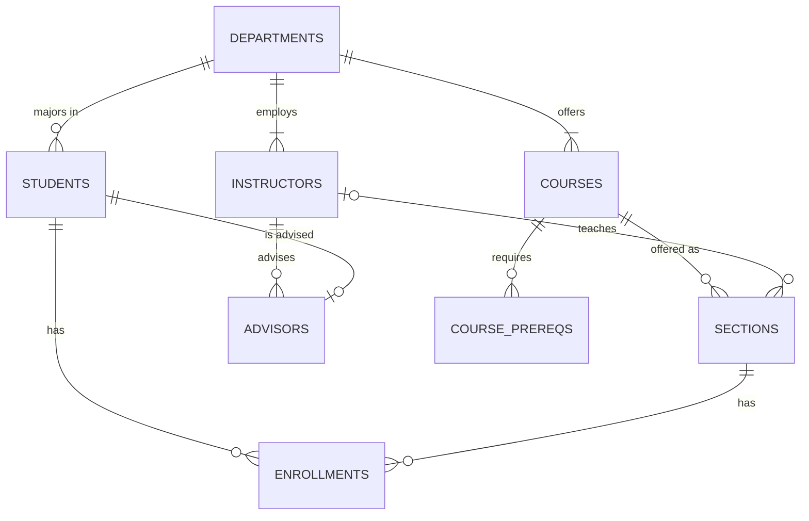

## Introduction

Entities on their own are a list of things. The value of a database comes from the **associations** between them: *which* student took *which* section, *who* teaches it, *which* department offers the course. In the ER model these associations are **relationships**, and the most consequential design decisions in a schema are the **constraints** on them:

- Can a section have more than one instructor? Can an instructor teach more than one section? (**cardinality**)
- Must every section have an instructor, or may one be "TBA"? Must every instructor teach something? (**participation**)
- At most how many students may enrol in a section? At least how many prerequisites does a course have? (**min–max** bounds)
- Where does a student's *grade* belong — on the student, on the section, or on the enrollment itself? (**relationship attributes**)

Each answer changes the tables: whether a foreign key is NULL-able, whether it has a `UNIQUE` constraint, whether a separate table is needed, and whether a rule can be declared at all or needs a trigger. This lesson defines the vocabulary precisely, shows how to **measure** these properties in existing data, and maps each one to its MySQL enforcement mechanism. The next lesson, [One-to-One, One-to-Many, Many-to-Many and Recursive Relationships](/lessons/m05-relationship-patterns), applies them to the standard design patterns.

:::note[Dataset]
The examples use the **university** dataset: 5 departments, 12 instructors, 40 students, 15 courses, 24 sections, 146 enrollments and 30 advisor assignments. Its foreign keys implement exactly the relationship constraints discussed here.
:::

## DBMS Theory

:::theory[Relationship types, sets and instances]
- A **relationship type** R among entity types E₁, E₂, …, Eₙ defines a set of associations among entities of those types — e.g. `TEACHES` between `Instructor` and `Section`.
- A **relationship instance** rᵢ is one association: (Instructor 1006, Section 1).
- The **relationship set** is the set of instances currently stored. Formally it is a subset of the Cartesian product E₁ × E₂ × … × Eₙ — which is why the *same combination* of entities cannot appear twice in a pure relationship set.
- Each participating entity type plays a **role**. Roles matter when the same entity type participates twice (a *recursive* relationship: in `PREREQUISITE`, a `Course` plays both the *course* and the *prerequisite* role).
- The **degree** of a relationship type is the number of participating entity types: **unary** (recursive, degree 1), **binary** (degree 2 — the vast majority), **ternary** (degree 3) and, rarely, n-ary.
:::

### Structural constraints

Two independent constraints restrict which relationship sets are allowed. Together they are called the **structural constraints** of a relationship.

**1. Cardinality ratio** — the *maximum* number of relationship instances an entity can participate in. For binary relationships: **1:1**, **1:N** (or N:1) and **M:N**.

| Ratio | Meaning (A–B) | University example |
|---|---|---|
| 1:1 | An A relates to at most one B, and a B to at most one A | Instructor 1 — 1 Department in a `CHAIRS` relationship (each department has one chair; an instructor chairs at most one department) |
| 1:N | An A relates to many Bs; a B relates to at most one A | Department 1 — N Instructor; Course 1 — N Section |
| M:N | An A relates to many Bs, and a B to many As | Student M — N Section (via enrollments) |

**2. Participation constraint** — the *minimum*: must every entity participate?

- **Total participation** (*existence dependency*): every entity of the type must be related to at least one entity through R. Every section is *of* some course — sections participate totally in `OFFERING`.
- **Partial participation**: some entities may not participate. Not every instructor teaches a section this year; not every student has an advisor.

### (min, max) notation

Cardinality ratio plus participation is a coarse description. The **(min, max) notation** states both bounds precisely for each role: entity E participates in relationship R in at least *min* and at most *max* instances, with 0 ≤ min ≤ max and max ≥ 1 (or N for "many").

- min = 0 → partial participation; min ≥ 1 → total participation.
- max = 1 → this side is a "one"; max = N → "many".
- It can express bounds no ratio can: a section has (0, *capacity*) enrollments; a team has (5, 11) players on the field.

:::warning[Placement conventions differ — "look here" vs "look across"]
In Chen's original notation, the cardinality ratio labels are written **across** the diamond: in `Department —1— <WORKS_FOR> —N— Instructor`, the **N** next to Instructor means "a department has *N* instructors". In **(min, max)** notation the pair is written **next to the entity it describes**: `Instructor (1,1) — WORKS_FOR` means "*each instructor* works for between 1 and 1 department". Crow's foot (next lesson on notations) also reads "across". Misreading the convention silently reverses a 1:N relationship — always check the legend of a diagram you did not draw.
:::

### Relationship attributes

Relationships can have attributes. A grade is not a property of a student (who has many grades) nor of a section (which gives many grades); it is a property of *the student's enrollment in the section*. Rules for where relationship attributes end up:

- **M:N** — the attribute stays on the relationship, which becomes its own table (`enrollments.grade`).
- **1:N** — the attribute can *migrate* to the N side, because each N-side entity participates in at most one instance (an instructor's `hired_on` date in a department could live on `instructors`).
- **1:1** — it can migrate to either side.

## Why It Exists

Without explicit structural constraints, every association would be modelled as "many-to-many, optional" — technically able to store anything, practically unable to guarantee anything. Precise constraints matter because:

- **They decide the table structure.** A 1:N relationship is a foreign key column; an M:N relationship needs its own table. Getting the ratio wrong means either an impossible migration later (turning a column into a table) or a needlessly complex schema now.
- **They are business rules.** "A section is taught by at most one instructor" and "a student may enrol in a section only once" are policies. If the schema does not enforce them, the data will eventually violate them — through a buggy script, a manual fix, or a race condition.
- **They make queries correct.** A join from section to instructor returns at most one row per section *only* if max = 1 is guaranteed. If someone later adds co-teaching without changing the reports, every `SUM` over that join double-counts.
- **They expose what the DBMS cannot enforce.** Minimums greater than zero on the "one" side, and maximums other than 1 or N, are *not* declarable in SQL. Knowing that tells you where to put triggers, application checks or audit queries.

## Internal Working

:::internals[How MySQL enforces structural constraints]
Every enforceable bound maps to a mechanism inside the server or InnoDB:

| Bound | Mechanism | Where it runs |
|---|---|---|
| max = 1 on the N side of 1:N | The FK is a *single column* in the N-side row — one value per row | Structure of the table itself |
| max = 1 on both sides (1:1) | FK column + `UNIQUE` index | InnoDB unique index check on insert/update (error 1062) |
| No duplicate pair in M:N | Composite `PRIMARY KEY` of the junction table | InnoDB unique (clustered) index |
| min = 1 on the N side (total participation of the child) | FK column `NOT NULL` | Server NOT NULL check (error 1048) |
| The related entity exists | `FOREIGN KEY` | InnoDB: lookup in the parent's index on insert/update of the child (error 1452); lookup in the child's FK index on delete/update of the parent (error 1451) |
| min ≥ 1 on the *parent* side ("every department has an instructor") | — not declarable — | Trigger, application, or deferred audit query |
| max = k (k > 1) ("at most 30 enrollments") | — not declarable — | Trigger with a locking read, or application logic |

InnoDB checks foreign keys **row by row, immediately** — it does not support the SQL standard's `DEFERRABLE INITIALLY DEFERRED` constraints that would postpone the check to `COMMIT`. That is the main reason "min ≥ 1 on the parent side" cannot be declared: you could never insert the first department (no instructor yet) or the first instructor (no department yet) without a deferred check.
:::



The diagram groups the checks by kind; it is not a claim about the exact internal order in which the server and InnoDB evaluate them for a given statement.

## MySQL Implementation

First, read the relationships that the schema declares. Every foreign key is one binary relationship (or one role of a higher-degree relationship), and its column's nullability gives the participation of the child side:

```sql run
SELECT k.TABLE_NAME            AS child_table,
       k.COLUMN_NAME           AS fk_column,
       k.REFERENCED_TABLE_NAME AS parent_table,
       c.IS_NULLABLE           AS child_may_not_participate
FROM information_schema.KEY_COLUMN_USAGE AS k
JOIN information_schema.COLUMNS AS c
  ON c.TABLE_SCHEMA = k.TABLE_SCHEMA AND c.TABLE_NAME = k.TABLE_NAME AND c.COLUMN_NAME = k.COLUMN_NAME
WHERE k.TABLE_SCHEMA = DATABASE() AND k.REFERENCED_TABLE_NAME IS NOT NULL
ORDER BY k.TABLE_NAME, k.COLUMN_NAME;
```

Read two rows closely:

- `sections.course_id` is `NO` (not nullable): every section belongs to a course — **total** participation of Section in `OFFERING`.
- `sections.instructor_id` is `YES`: a section may have no instructor yet — **partial** participation of Section in `TEACHES`.
- `students.dept_id` is `YES`: undeclared students exist.

The ER diagram of the dataset in crow's foot notation (read "across": the symbol next to an entity describes how many of *that* entity relate to one entity on the other side):



Now see each declared bound enforced. **Total participation** (min = 1 for a section's course):

```sql run error
INSERT INTO sections (section_id, course_id, term, year, instructor_id, room, capacity)
VALUES (100, NULL, 'Spring', 2025, 1001, 'MH-100', 30);
```

**Partial participation** — a section without an instructor is accepted:

```sql run
INSERT INTO sections (section_id, course_id, term, year, instructor_id, room, capacity)
VALUES (100, 'CS-160', 'Spring', 2025, NULL, 'MH-100', 30);
SELECT section_id, course_id, instructor_id FROM sections WHERE section_id = 100;
```

**Existence of the related entity** — instructor 9999 does not exist:

```sql run error
UPDATE sections SET instructor_id = 9999 WHERE section_id = 100;
```

**Max = 1** — `advisors` has `PRIMARY KEY (student_id)`, so a student has at most one advisor. Student 20230001 already has one:

```sql run error
INSERT INTO advisors (student_id, instructor_id) VALUES (20230001, 1012);
```

**No duplicate instance in M:N** — the enrollments key `(student_id, section_id)` makes the relationship set a *set*:

```sql run error
INSERT INTO enrollments (student_id, section_id, grade)
SELECT student_id, section_id, NULL FROM enrollments ORDER BY student_id, section_id LIMIT 1;
```

## Syntax Breakdown

| Relationship constraint | DDL fragment | Notes |
|---|---|---|
| 1:N, child total | `parent_id INT UNSIGNED NOT NULL, FOREIGN KEY (parent_id) REFERENCES parent (id)` | NOT NULL is the "min = 1" |
| 1:N, child partial | `parent_id INT UNSIGNED NULL, FOREIGN KEY (…)` | NULL = "not related"; the FK is not checked for NULL values |
| 1:1 | `… FOREIGN KEY (…)` + `UNIQUE (parent_id)` | NULLs do not collide in a UNIQUE index, so a partial 1:1 still works |
| M:N | `CREATE TABLE r (a_id …, b_id …, PRIMARY KEY (a_id, b_id), FOREIGN KEY (a_id) …, FOREIGN KEY (b_id) …)` | Relationship attributes become columns of `r` |
| Relationship attribute (M:N) | `grade CHAR(2) NULL` on the junction table | NULL-able if unknown for some instances (in-progress courses) |
| Existence dependency | `FOREIGN KEY … ON DELETE CASCADE` | Child instances disappear with the parent |
| Forbid deleting a referenced parent | `ON DELETE RESTRICT` / `NO ACTION` (default) | InnoDB treats both identically: checked immediately |
| max = k, min ≥ 1 on parent side | `CREATE TRIGGER … BEFORE INSERT … SIGNAL SQLSTATE '45000'` | Procedural; needs locking to be race-free |

:::standard[Standard SQL vs MySQL]
Foreign keys, `ON DELETE`/`ON UPDATE` actions and `UNIQUE` are standard. The standard also defines `DEFERRABLE` constraints and `CREATE ASSERTION` (arbitrary cross-table predicates); **MySQL implements neither**. MySQL parses `MATCH FULL`/`MATCH PARTIAL` and inline column-level `REFERENCES` clauses but ignores them — always use a table-level `FOREIGN KEY (…) REFERENCES …` clause. `ON DELETE SET DEFAULT` is parsed but rejected by InnoDB.
:::

## Practical Examples

**1. Measuring (min, max) from real data.** Before trusting a diagram, measure it. For `TEACHES` (Instructor — Section), count how many sections each instructor teaches and how many instructors each section has:

```sql run
SELECT 'instructor in TEACHES' AS role,
       MIN(n) AS observed_min, MAX(n) AS observed_max
FROM (SELECT i.instructor_id, COUNT(s.section_id) AS n
      FROM instructors AS i
      LEFT JOIN sections AS s ON s.instructor_id = i.instructor_id
      GROUP BY i.instructor_id) AS x
UNION ALL
SELECT 'section in TEACHES',
       MIN(n), MAX(n)
FROM (SELECT s.section_id, (s.instructor_id IS NOT NULL) AS n
      FROM sections AS s) AS y;
```

The observed bounds are evidence, not proof: the data shows what *has* happened, the requirements say what *may* happen. An instructor with zero sections shows that participation of Instructor is partial (min 0). A section has at most one instructor *by construction* — `instructor_id` is a single column — so the max of 1 is a structural guarantee, while the min of 0 reflects the NULL-able column.

**2. Relationship attributes.** The grade belongs to the enrollment. The query below shows that the same student has different grades in different sections, and the same section gives different grades to different students — so the attribute cannot live on either entity:

```sql run
SELECT e.student_id, e.section_id, sec.course_id, e.grade
FROM enrollments AS e
JOIN sections AS sec ON sec.section_id = e.section_id
WHERE e.student_id = 20230001
ORDER BY e.section_id;
```

**3. A relationship attribute on a 1:N relationship can migrate.** `advisors` is a separate table even though Student—Instructor advising is N:1 (each student at most one advisor). It could equally be an `advisor_id` column on `students`. A separate table is a valid design choice when the relationship is *sparse* or has its own attributes or lifecycle — compare the two shapes:

```sql run
SELECT COUNT(*)                              AS students,
       COUNT(a.student_id)                   AS with_advisor,
       COUNT(*) - COUNT(a.student_id)        AS without_advisor
FROM students AS st
LEFT JOIN advisors AS a ON a.student_id = st.student_id;
```

30 of the 40 students have an advisor. As a column on `students`, `advisor_id` would be NULL for the other 10. As a separate table those students simply have no row. Both enforce max = 1 (the column is single-valued; the table's PK is `student_id`).

**4. Parent-side minimum cardinality — an audit query.** "Every course must be offered at least once every two years" or simply "every course has at least one section" cannot be declared. You can, however, *detect* violations:

```sql run
SELECT c.course_id, c.title
FROM courses AS c
LEFT JOIN sections AS s ON s.course_id = c.course_id
WHERE s.section_id IS NULL
ORDER BY c.course_id;
```

Two courses — BUS-190 and DATA-200 — have never been offered. If the requirement were total participation of Course in `OFFERING`, they would be violations. In practice teams run such audit queries in scheduled data-quality jobs.

**5. Enforcing max = k with a trigger.** A section may have at most `capacity` enrollments. That is a (0, capacity) constraint — a number stored in another table — so it needs procedural enforcement:

```sql run
CREATE TRIGGER trg_enrollments_capacity
BEFORE INSERT ON enrollments
FOR EACH ROW
BEGIN
  DECLARE v_capacity INT;
  DECLARE v_enrolled INT;
  -- lock the section row so concurrent enrollments into the same section serialize
  SELECT capacity INTO v_capacity FROM sections WHERE section_id = NEW.section_id FOR UPDATE;
  SELECT COUNT(*) INTO v_enrolled FROM enrollments WHERE section_id = NEW.section_id;
  IF v_enrolled >= v_capacity THEN
    SIGNAL SQLSTATE '45000' SET MESSAGE_TEXT = 'Section is full';
  END IF;
END;

INSERT INTO sections (section_id, course_id, term, year, instructor_id, room, capacity)
VALUES (101, 'CS-160', 'Spring', 2025, 1001, 'SEM-1', 2);
INSERT INTO enrollments (student_id, section_id) VALUES (20230001, 101), (20230002, 101);
SELECT section_id, COUNT(*) AS enrolled FROM enrollments WHERE section_id = 101 GROUP BY section_id;
```

The third student is rejected:

```sql run error
INSERT INTO enrollments (student_id, section_id) VALUES (20230003, 101);
```

The `FOR UPDATE` on the section row matters. Without it, two transactions could each count one enrollment, both see room for one more, and both insert — exceeding the capacity. Locking the parent row makes them take turns ([Locking](/lessons/m08-locking)). Triggers are covered in depth in [Triggers](/lessons/m09-triggers).

## Execution Walkthrough

Trace how one M:N relationship with an attribute is stored and queried — from the two entity sets, through the relationship set, to an answer that needs all three.

```walkthrough
title: The ENROLLS relationship (Student M — N Section, attribute grade)
steps:
  - title: "1. The two entity sets"
    explain: >-
      Students and sections exist independently. Neither table has a column referring to the other — an M:N
      relationship cannot be represented by a single foreign key column on either side, because each side can
      relate to many on the other.
    sql: |
      SELECT (SELECT COUNT(*) FROM students) AS students,
             (SELECT COUNT(*) FROM sections) AS sections;
  - title: "2. The relationship set is a table of pairs"
    explain: >-
      Each enrollments row is one relationship instance (student, section) plus the relationship attribute grade.
      The composite primary key makes it a set: the same pair cannot occur twice. Grade is NULL for in-progress
      sections — here section 101, the capacity-trigger demo section created above for Spring 2025.
    sql: |
      SELECT student_id, section_id, grade
      FROM enrollments
      ORDER BY student_id, section_id
      LIMIT 6;
  - title: "3. Cardinality in both directions"
    explain: >-
      Counting instances per entity in each direction shows "many" on both sides — the definition of M:N.
    sql: |
      SELECT 'sections per student' AS direction, MIN(n) AS min_n, MAX(n) AS max_n
      FROM (SELECT s.student_id, COUNT(e.section_id) AS n
            FROM students AS s LEFT JOIN enrollments AS e ON e.student_id = s.student_id
            GROUP BY s.student_id) AS a
      UNION ALL
      SELECT 'students per section', MIN(n), MAX(n)
      FROM (SELECT sec.section_id, COUNT(e.student_id) AS n
            FROM sections AS sec LEFT JOIN enrollments AS e ON e.section_id = sec.section_id
            WHERE sec.section_id <= 24
            GROUP BY sec.section_id) AS b;
  - title: "4. Navigate the relationship"
    explain: >-
      To answer "which courses did student 20230001 complete, with which instructor and grade?" the query walks
      Student → ENROLLS → Section → OFFERING → Course and Section → TEACHES → Instructor. A LEFT JOIN is used for
      the instructor because TEACHES is partial on the section side.
    sql: |
      SELECT sec.term, sec.year, c.course_id, c.title, i.name AS instructor, e.grade
      FROM enrollments AS e
      JOIN sections    AS sec ON sec.section_id = e.section_id
      JOIN courses     AS c   ON c.course_id    = sec.course_id
      LEFT JOIN instructors AS i ON i.instructor_id = sec.instructor_id
      WHERE e.student_id = 20230001
      ORDER BY sec.year, FIELD(sec.term, 'Spring', 'Summer', 'Fall'), c.course_id;
```

## Output

The final walkthrough result is a student transcript: one row per relationship instance, enriched with attributes from three entity types and the relationship's own attribute (`grade`). Read it with the structural constraints in mind:

- Each row corresponds to exactly one `enrollments` row, because every join *away* from enrollments follows a max = 1 role (each enrollment has one section; each section one course; each section at most one instructor). Joins along max = 1 roles never multiply rows.
- The `LEFT JOIN` to `instructors` is a direct consequence of partial participation. With an inner join, an enrollment in a section without an instructor would silently vanish from the transcript.
- A NULL `grade` means "in progress" — a relationship attribute whose value is not yet known, not a missing enrollment. (The last row is the Spring 2025 CS-160 section that the capacity-trigger example created earlier in this session.)
- The `F` in CS-146 followed by CS-149 (which requires CS-146) is a reminder that the prerequisite relationship is *data*, not a constraint the schema enforces — checking prerequisites at enrollment time would be another procedural rule.

## Alternative Approaches

**Where to enforce a cardinality bound:**

| Approach | Strength | Weakness |
|---|---|---|
| Declarative (`NOT NULL`, `UNIQUE`, PK, FK) | Always enforced, for every client; race-free; zero code | Only covers min 0/1 on the child side, max 1/N, existence |
| Trigger | Enforced for every client; can express (min, max) with any numbers | Needs careful locking; hidden logic; harder to test and to migrate |
| Stored procedure as the only write path | Explicit, testable transaction logic | Only enforced if every client really uses the procedure (revoke direct `INSERT`) |
| Application/service layer | Easy to write, rich error messages | Bypassed by scripts, other services and manual fixes; race conditions |
| Audit query (detect, don't prevent) | Simple; no write-path cost | Violations exist until someone fixes them |

**Alternative encodings of the same relationship.** A 1:N relationship is normally a foreign key column on the N side, but it can also be a separate table with `PRIMARY KEY (child_id)` — exactly what the dataset does for `advisors`. Choose the separate table when the relationship is optional for most rows, has its own attributes or history, or is managed by a different team or process; choose the column for mandatory or very common relationships (one fewer join, one fewer table).

**Encoding a bounded maximum structurally.** If max = k is small and fixed (a course has at most 2 co-listed codes), some designs use a slot number in the key: `PRIMARY KEY (course_id, slot)` with `CHECK (slot BETWEEN 1 AND 2)`. This enforces the maximum declaratively, at the cost of managing slot numbers.

```sql run
CREATE TABLE course_crosslists (
  course_id   VARCHAR(10) NOT NULL,
  slot        TINYINT UNSIGNED NOT NULL,
  alias_code  VARCHAR(10) NOT NULL,
  PRIMARY KEY (course_id, slot),
  UNIQUE (alias_code),
  CONSTRAINT chk_crosslist_slot CHECK (slot BETWEEN 1 AND 2),
  FOREIGN KEY (course_id) REFERENCES courses (course_id)
);
INSERT INTO course_crosslists VALUES ('CS-157A', 1, 'DATA-157A'), ('CS-157A', 2, 'SE-157A');
SELECT * FROM course_crosslists ORDER BY course_id, slot;
```

```sql run error
INSERT INTO course_crosslists VALUES ('CS-157A', 3, 'BUS-157A');
```

## Performance Analysis

Relationship constraints have small but real costs, and some access paths depend on them.

- **Foreign key checks cost index lookups.** Each child insert does a lookup in the parent's primary/unique index; each parent delete or key update does a lookup in the child's FK index. With the indexes in place these are B+ tree probes of a few page reads, usually in the buffer pool. Without an index on the child FK column, deleting a parent would require scanning the child table — which is why InnoDB insists on (and auto-creates) that index.
- **The junction table's primary key order decides which direction is cheap.** `enrollments` has `PRIMARY KEY (student_id, section_id)`: "sections of a student" is a clustered range scan. "Students of a section" uses the secondary index `idx_enrollments_section`, whose entries contain `section_id` plus the primary key columns — so it is *covering* for queries that only need the IDs:

```sql run
EXPLAIN FORMAT=TREE
SELECT student_id FROM enrollments WHERE section_id = 9;
```

- **Triggers add per-row work.** The capacity trigger runs a locking read and a `COUNT(*)` for every enrolled row. With an index on `enrollments.section_id` the count is a short index range scan; without it, a full scan per insert. The lock serializes enrollments into the *same* section — acceptable for registration, a bottleneck for a very hot parent row (a "flash sale" product).
- **NULL-able foreign keys** are not checked when NULL, and an index on a NULL-able column stores the NULL entries too (useful for `WHERE instructor_id IS NULL`).

:::performance[Theory vs measurement]
The costs above follow from how InnoDB enforces each mechanism. Their actual size depends on data volume, buffer pool hit rate and concurrency; on this small dataset all of them are negligible. Measure trigger and FK overhead under a realistic write load (Module 7, [EXPLAIN ANALYZE](/lessons/m07-explain-analyze); Module 8 for lock waits) before deciding to move enforcement out of the database for "performance".
:::

## Best Practices

:::best-practice[Modelling relationships professionally]
1. **State every relationship in both directions with (min, max)** — "each section has (0,1) instructor; each instructor teaches (0,N) sections". One-directional statements hide half the constraint.
2. **Declare everything declarable:** `NOT NULL` for total participation of the child, `UNIQUE` for 1:1, composite PKs for M:N, foreign keys for existence.
3. **Record the non-declarable bounds** (parent-side minimums, numeric maximums) in the requirements register with their enforcement mechanism — trigger, procedure, application, or audit query.
4. **Put relationship attributes where they belong.** M:N attributes on the junction table; for 1:N, migrate only if the attribute truly describes the relationship instance and not the child entity.
5. **Name foreign keys after the relationship** (`fk_sections_instructor`) so error messages explain which rule failed.
6. **Use `LEFT JOIN` for partial participation** when navigating relationships in queries, and inner joins only along total participation.
7. **Lock the parent row** in procedural cardinality checks to make them race-free.
:::

## Common Mistakes

**Mistake 1 — using an inner join across a partial relationship.** Section 7 has no instructor. An inner join silently drops it:

```sql run
SELECT COUNT(*) AS sections_inner_join
FROM sections AS s JOIN instructors AS i ON i.instructor_id = s.instructor_id;
```

```sql run
SELECT COUNT(*) AS sections_left_join
FROM sections AS s LEFT JOIN instructors AS i ON i.instructor_id = s.instructor_id;
```

The difference is every section without an instructor (the original section 7, plus section 100 inserted earlier in this lesson). Reports of "sections offered" built on the inner join under-count.

**Mistake 2 — modelling an M:N relationship as a foreign key.** Putting `section_id` on `students` allows each student only one section. The fix is always a junction table.

**Mistake 3 — forgetting `UNIQUE` on a 1:1 foreign key.** A column `passport_id` with a foreign key but no `UNIQUE` is a 1:N relationship — several people could reference the same passport. The cardinality you *drew* is not the cardinality you *built*.

**Mistake 4 — reading min–max notation like Chen ratios.** `(1,1)` next to Instructor in `WORKS_FOR` means each instructor works for exactly one department — not that a department has one instructor. Always check whether a diagram reads "here" or "across".

**Mistake 5 — race-prone cardinality checks.** Counting rows in application code and then inserting is two statements with a gap in between. Two concurrent requests can both pass the check. Use a locking read on the parent (`SELECT … FOR UPDATE`), a trigger that does so, or a structural encoding (slots + `CHECK`).

**Mistake 6 — putting a relationship attribute on an entity.** `students.grade` cannot represent a student's many grades; `sections.grade` cannot represent a section's many students' grades. If you find yourself wanting `grade1`, `grade2`, you are missing a relationship table.

## Industry Application

- **Marketplace and booking systems** live and die by (min, max) constraints: a seat is booked by (0,1) tickets; an event has (0, capacity) attendees. Production systems combine a declarative `UNIQUE (event_id, seat_no)` (the structural max = 1) with locking or atomic counters for capacity.
- **Data contracts and documentation.** ER diagrams in design reviews annotate each relationship with min–max; data catalogues record which foreign keys are optional so analysts know when to use outer joins.
- **Analytics engineering.** dbt-style tests (`relationships`, `not_null`, `unique`, and custom "at least one child" tests) are executable statements of the same structural constraints, run against warehouses that often lack enforced foreign keys.
- **Microservices.** When related entities live in different services' databases, foreign keys disappear and cardinality becomes an application-level invariant enforced with sagas, outbox events and reconciliation jobs ([Integrity in Distributed Systems](/lessons/m12-distributed-integrity)). Teams that understand which constraints they lost design compensating checks.

## Practice Exercises

```exercise
id: ex1
title: Observed participation of departments in OFFERS
difficulty: easy
concepts: [participation, cardinality]
prompt: |
  For every department, return the number of courses it offers. Columns: `dept_id`, `name`, `courses`,
  ordered by `dept_id`. Include departments that offer no course (with 0).
hints:
  - "Start from departments and LEFT JOIN courses."
  - "COUNT(c.course_id) counts only matched courses, giving 0 for unmatched departments."
solution: |
  SELECT d.dept_id, d.name, COUNT(c.course_id) AS courses
  FROM departments AS d
  LEFT JOIN courses AS c ON c.dept_id = d.dept_id
  GROUP BY d.dept_id, d.name
  ORDER BY d.dept_id;
orderMatters: true
explanation: |
  The minimum of this column is the observed min of Department's participation in OFFERS. `COUNT(*)` would
  report 1 for a department with no courses, because the LEFT JOIN produces one NULL-extended row for it — the
  classic mistake when measuring participation.
```

```exercise
id: ex2
title: Min-max of the ADVISES relationship
difficulty: medium
concepts: [min-max-notation, cardinality]
prompt: |
  Measure the observed (min, max) of **Instructor** in `ADVISES` (how many students each instructor advises,
  including instructors who advise nobody). Return one row: `min_advisees`, `max_advisees`.
hints:
  - "Count advisees per instructor with instructors LEFT JOIN advisors, grouped by instructor."
  - "Then take MIN and MAX of that count in an outer query."
solution: |
  SELECT MIN(n) AS min_advisees, MAX(n) AS max_advisees
  FROM (SELECT i.instructor_id, COUNT(a.student_id) AS n
        FROM instructors AS i
        LEFT JOIN advisors AS a ON a.instructor_id = i.instructor_id
        GROUP BY i.instructor_id) AS per_instructor;
explanation: |
  Starting from `advisors` alone would miss instructors with zero advisees and report a minimum of 1 — the
  measured participation would look total when it is partial. The (min, max) for Instructor is written next
  to Instructor in min–max notation.
```

```exercise
id: ex3
title: Build an M:N relationship with an attribute
difficulty: medium
kind: dml
concepts: [relationships, participation, foreign-key, relationship-attributes]
prompt: |
  Model **teaching assistants**: a TA is an existing student; a student may assist in several sections and a
  section may have several TAs. Record `hours_per_week` (TINYINT UNSIGNED, mandatory) for each assignment.

  Create table **`section_tas`** with `student_id` (INT UNSIGNED), `section_id` (INT UNSIGNED),
  `hours_per_week`. Requirements: a student can be a TA in a given section only once (composite primary key
  `(student_id, section_id)`); both columns reference their parent tables; all columns NOT NULL.

  The checker lists your table's columns with nullability, then its foreign keys' referenced tables.
hints:
  - "PRIMARY KEY (student_id, section_id) makes each (student, section) pair unique."
  - "Two FOREIGN KEY clauses: to students (student_id) and sections (section_id)."
solution: |
  CREATE TABLE section_tas (
    student_id     INT UNSIGNED NOT NULL,
    section_id     INT UNSIGNED NOT NULL,
    hours_per_week TINYINT UNSIGNED NOT NULL,
    PRIMARY KEY (student_id, section_id),
    CONSTRAINT fk_tas_student FOREIGN KEY (student_id) REFERENCES students (student_id),
    CONSTRAINT fk_tas_section FOREIGN KEY (section_id) REFERENCES sections (section_id)
  );
check: |
  SELECT 'column' AS kind, COLUMN_NAME AS name, IS_NULLABLE AS detail
  FROM information_schema.COLUMNS
  WHERE TABLE_SCHEMA = DATABASE() AND TABLE_NAME = 'section_tas'
  UNION ALL
  SELECT 'fk', COLUMN_NAME, REFERENCED_TABLE_NAME
  FROM information_schema.KEY_COLUMN_USAGE
  WHERE TABLE_SCHEMA = DATABASE() AND TABLE_NAME = 'section_tas' AND REFERENCED_TABLE_NAME IS NOT NULL
  UNION ALL
  SELECT 'pk', COLUMN_NAME, CAST(ORDINAL_POSITION AS CHAR)
  FROM information_schema.KEY_COLUMN_USAGE
  WHERE TABLE_SCHEMA = DATABASE() AND TABLE_NAME = 'section_tas' AND CONSTRAINT_NAME = 'PRIMARY'
  ORDER BY kind, name;
explanation: |
  The relationship is M:N in general (a student can TA several sections over time, a section has several
  TAs), so it gets its own table with a composite key and the relationship attribute `hours_per_week`.
  A further rule such as "at most one TA section per student per term" would involve the section's term — a
  cross-table rule that a plain UNIQUE cannot express without copying the term into this table.
```

```exercise
id: ex4
title: Which constraints are declarable?
difficulty: medium
kind: open
concepts: [min-max-notation, participation, triggers]
prompt: |
  For each rule, give the (min, max) it expresses, say whether MySQL can enforce it declaratively, and name
  the construct (or the alternative): (a) every section belongs to one course; (b) a course has at most 3
  prerequisites; (c) every department employs at least one instructor; (d) a student has at most one advisor;
  (e) an instructor can advise at most 15 students; (f) a student cannot enrol twice in the same section.
solution: |
  (a) Section (1,1) in OFFERING — declarative: `course_id NOT NULL` + FK.
  (b) Course (0,3) in the *course* role of PREREQUISITE — not declarable as such (numeric max on a
  junction table); trigger with a locking read on the course row, or a slot column `slot BETWEEN 1 AND 3`
  in the primary key `(course_id, slot)` with `UNIQUE (course_id, prereq_id)`.
  (c) Department (1,N) in EMPLOYS — the parent-side minimum is not declarable (InnoDB has no deferred
  constraints); enforce with application/procedure logic (create department and first instructor in one
  transaction, forbid deleting the last instructor via trigger) or detect with an audit query.
  (d) Student (0,1) in ADVISES — declarative: `PRIMARY KEY (student_id)` on advisors (or a NULL-able
  `advisor_id` column on students).
  (e) Instructor (0,15) in ADVISES — numeric max: trigger with `SELECT … FOR UPDATE` on the instructor row.
  (f) The relationship set has no duplicate (student, section) pair — declarative: composite PK on
  enrollments.
```

```exercise
id: ex5
title: Detect violations of a non-declarable minimum
difficulty: hard
concepts: [participation, min-max-notation]
prompt: |
  A new policy says every instructor must, over 2023–2024, **teach at least one section and advise at least
  one student**. List the instructors who violate it, with columns `instructor_id`, `name`,
  `sections_taught`, `advisees`, ordered by `instructor_id`.
hints:
  - "Compute the two counts independently (correlated subqueries or two derived tables) to avoid multiplying rows."
  - "Joining sections and advisors in the same FROM clause would multiply counts (fan-out); count them separately."
  - "Filter with HAVING or an outer WHERE: sections_taught = 0 OR advisees = 0."
solution: |
  SELECT i.instructor_id, i.name,
         (SELECT COUNT(*) FROM sections s WHERE s.instructor_id = i.instructor_id AND s.year IN (2023, 2024)) AS sections_taught,
         (SELECT COUNT(*) FROM advisors a WHERE a.instructor_id = i.instructor_id) AS advisees
  FROM instructors AS i
  HAVING sections_taught = 0 OR advisees = 0
  ORDER BY i.instructor_id;
orderMatters: true
explanation: |
  Two independent 1:N relationships hang off Instructor. Joining both in one FROM clause produces
  sections × advisees rows per instructor, inflating `COUNT` — the "fan trap". Scalar subqueries (or
  pre-aggregated derived tables) count each relationship separately. MySQL allows `HAVING` on select-list
  aliases without `GROUP BY`; a derived table with an outer `WHERE` is the portable form.
```

```exercise
id: ex6
title: Capacity rule — design and failure analysis
difficulty: challenge
kind: open
concepts: [cardinality, triggers, locking, min-max-notation]
prompt: |
  The registrar wants "a section has at most `capacity` enrolled students" to be *guaranteed*. Compare three
  implementations — (1) application checks `COUNT(*)` then inserts; (2) the `BEFORE INSERT` trigger from
  this lesson with `SELECT … FOR UPDATE` on the section; (3) a counter column `enrolled` on `sections`
  updated with `UPDATE sections SET enrolled = enrolled + 1 WHERE section_id = ? AND enrolled < capacity`
  and the enrollment inserted only if one row was affected — on correctness under concurrency, what happens
  when capacity is *reduced*, and operational cost.
solution: |
  (1) Not safe: two transactions can both read COUNT = capacity − 1 and both insert (a check-then-act race),
  unless the application also takes a lock (e.g. `SELECT … FOR UPDATE` on the section row in the same
  transaction). It is also bypassed by any other writer (scripts, admin tools).

  (2) Safe for every writer that inserts into enrollments: the locking read on the section row serializes
  concurrent enrollments into that section; the count is then exact. Costs: a per-row COUNT (cheap with the
  `section_id` index), lock waits on popular sections, logic hidden in a trigger. Also needs an
  `UPDATE` trigger if enrollments can move between sections. Reducing capacity below current enrollments is
  not prevented — a separate rule/trigger on sections or an operational procedure must decide what happens.

  (3) Safe and cheap: the conditional UPDATE is atomic — InnoDB locks the section row, re-evaluates
  `enrolled < capacity` on the latest version, and affects 0 rows when full; enrollment inserted in the same
  transaction. Requires every writer to use the protocol (or triggers to maintain `enrolled`), a CHECK
  `enrolled <= capacity` can backstop it (and would make reducing capacity below `enrolled` fail loudly).
  The counter is denormalized data that must be reconciled if anything bypasses the protocol. The hot row
  is the same as in (2).

  Professional choice: (3) for high-throughput registration with a CHECK backstop, or (2) when many code
  paths write enrollments and you want enforcement independent of the application; never (1) alone.
```

## Knowledge Assessment

```quiz
- id: q1
  question: "In min–max notation, `Section (1,1) —— OFFERED_AS —— (0,N) Course` means:"
  options:
    - "Each section is offered as exactly one course; each course has zero or more sections"
    - "Each section has zero or more courses; each course has exactly one section"
    - "Sections and courses are related many-to-many"
    - "Exactly one section exists"
  answer: 0
  explanation: "(min,max) pairs are written next to the entity they describe (\"look here\"). Section participates in exactly one instance; Course in zero to many. Reading it like Chen's \"across\" labels reverses the relationship."
  concepts: [min-max-notation]
- id: q2
  question: "Which MySQL construct implements *total participation* of the child entity in a 1:N relationship?"
  options:
    - "Declaring the foreign key column NOT NULL"
    - "Adding ON DELETE CASCADE"
    - "Adding a UNIQUE index on the foreign key column"
    - "Making the foreign key column part of the parent's primary key"
  answer: 0
  explanation: "Total participation means min = 1: every child row must reference a parent, i.e. the FK column cannot be NULL. CASCADE is a delete policy; UNIQUE changes max to 1 on the parent side (1:1); the parent's PK is unrelated."
  concepts: [participation, foreign-key]
- id: q3
  question: "Why can't InnoDB declaratively enforce \"every department has at least one instructor\"?"
  options:
    - "Foreign keys are checked immediately per row; there are no deferred constraints or assertions, so the first department or instructor could never be inserted"
    - "InnoDB does not support foreign keys"
    - "The rule would need a UNIQUE index on dept_id"
    - "CHECK constraints cannot use integers"
  answer: 0
  explanation: "A parent-side minimum creates a chicken-and-egg insert problem that the standard solves with DEFERRABLE constraints or CREATE ASSERTION — neither exists in MySQL. InnoDB does support FKs; UNIQUE expresses a maximum, not a minimum; CHECK can use integers but cannot look at other rows."
  concepts: [participation, min-max-notation]
- id: q4
  question: "A grade is recorded per student per section. Where does it belong?"
  options:
    - "On the enrollment relationship (junction table), because it depends on both the student and the section"
    - "On students"
    - "On sections"
    - "In a separate grades table with only grade values"
  answer: 0
  explanation: "An attribute of an M:N relationship describes the pair. A student has many grades and a section gives many grades, so neither entity table can hold it as a single-valued attribute."
  concepts: [relationship-attributes]
- id: q5
  type: multi
  question: "Which of these bounds can MySQL 8.4 enforce declaratively? (Select all that apply.)"
  options:
    - "A section has at most one instructor"
    - "A person has at most one passport and a passport belongs to at most one person"
    - "A section has at most 30 enrollments"
    - "A student cannot enrol in the same section twice"
  answer: [0, 1, 3]
  explanation: "Single FK column (max 1), FK + UNIQUE (1:1) and a composite PK on the junction table are declarative. A numeric maximum such as 30 needs a trigger, a counter with a conditional UPDATE, or slot numbers."
  concepts: [cardinality, foreign-key]
- id: q6
  question: "A report counts sections with `FROM sections JOIN instructors ON …` and shows fewer sections than exist. The most likely cause:"
  options:
    - "TEACHES is partial on the section side — sections without an instructor are dropped by the inner join"
    - "The instructors table has duplicate rows"
    - "COUNT(*) ignores NULLs"
    - "The foreign key is disabled"
  answer: 0
  explanation: "Inner joins keep only matched rows. Partial participation (NULL instructor_id) requires a LEFT JOIN. Duplicates would increase the count; COUNT(*) counts rows including NULLs; FK state does not affect joins."
  concepts: [participation]
- id: q7
  question: "The degree of the relationship PREREQUISITE (Course requires Course) is:"
  options: ["1 (unary/recursive)", "2 (binary)", "3 (ternary)", "0"]
  answer: 0
  explanation: "Degree counts participating entity *types*. Only Course participates, in two roles (course and prerequisite), so it is a unary (recursive) relationship — even though each instance relates two course entities."
  concepts: [relationships]
- id: q8
  question: "Two concurrent transactions run a trigger that counts enrollments then allows the insert if count < capacity. What makes it race-free?"
  options:
    - "Locking the parent section row with SELECT … FOR UPDATE before counting"
    - "Running COUNT(*) twice"
    - "Using READ UNCOMMITTED"
    - "Adding ON DELETE CASCADE"
  answer: 0
  explanation: "The locking read serializes transactions enrolling into the same section, so the second one counts after the first commits. Repeating the count or lowering isolation does not prevent the check-then-act race; CASCADE is unrelated."
  concepts: [triggers, cardinality]
```
