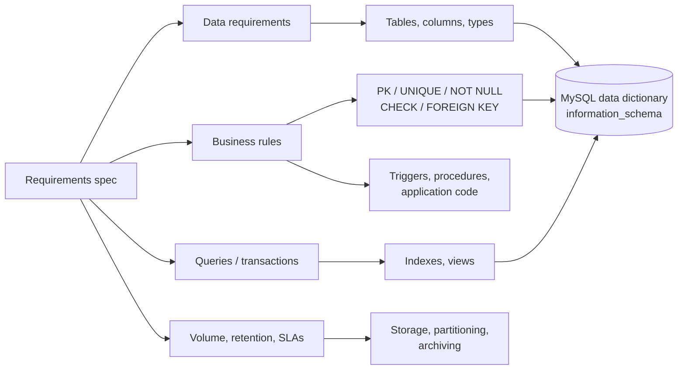

## Introduction

Every schema you will ever maintain is a frozen record of what somebody understood about a business at the moment they wrote `CREATE TABLE`. If they understood that "a customer has an address", you will find an `address` column. If the business later ships to several addresses per customer, splits billing from shipping, and must keep the address that was used for a 2022 invoice even after the customer moves — the schema is wrong, and fixing it means migrating live data. **Requirements gathering** is the stage of database design that tries to get that understanding right *before* the tables exist.

It answers questions that no amount of SQL skill can answer for you:

- **What things** does the organization need to remember? (customers, orders, products, refunds…)
- **What facts** about each thing, at what precision, and is each fact always known?
- **Which rules** must always hold? ("a review rating is between 1 and 5", "an order belongs to exactly one customer", "a customer reviews a product at most once")
- **How much** data will there be, how fast does it grow, how long must it be kept?
- **How will it be used?** Which queries run thousands of times per second, which run once a month, which must never be slow?

The deliverable is a **requirements specification**: a written, reviewable document listing data requirements, business rules, transactions/queries, volumes and non-functional constraints. In [The Database Design Process](/lessons/m01-design-process) you saw where this stage sits in the lifecycle (requirements → conceptual → logical → physical). This lesson goes inside the stage: the techniques professionals use, how to classify what you hear, and — because this is a MySQL course — how every requirement maps to something MySQL can **enforce** or **optimize** and how to verify that it did.

:::note[Dataset]
The examples use the **shop** dataset (25 customers, 30 products, 80 orders, 182 order lines, 76 payments, 45 reviews). We treat it as a finished design and work *backwards*: for each table and constraint, which requirement produced it? Reverse-engineering a live schema like this is exactly what you do when you join a team that has an existing database.
:::

## DBMS Theory

:::theory[Kinds of requirements]
Database textbooks (Elmasri & Navathe; Connolly & Begg) separate the requirements for a database into four groups:

1. **Data requirements** — the entity types, their attributes, the domains of those attributes and the relationships among entities. They become the **conceptual (ER) model**.
2. **Functional requirements** — the *transactions* and *queries* the users run: "place an order", "list a customer's orders newest first", "monthly revenue by category". They justify the design and drive the **physical** design (indexes, partitioning, denormalization).
3. **Business rules** — statements that constrain or define some aspect of the business. They become **integrity constraints** (keys, NOT NULL, CHECK, foreign keys), derived values, or application/trigger logic.
4. **Non-functional requirements** — volume, growth, retention, latency, availability, security and privacy, auditability.
:::

### Business rules — a classification

The Business Rules Group's classic taxonomy distinguishes three kinds of rule, and each lands in a different place in the database:

| Kind | Example from the shop | Typical implementation |
|---|---|---|
| **Structural assertion** (a term or a fact) | "An order is placed by a customer"; "a product has a SKU" | Entity/relationship/attribute in the ER model → table, column, foreign key |
| **Constraint** (an action assertion that restricts) | "Rating must be 1–5"; "SKU is unique"; "an order line quantity is positive" | `CHECK`, `UNIQUE`, `NOT NULL`, `PRIMARY KEY`, `FOREIGN KEY` |
| **Derivation** (a fact computed from others) | "Line total = quantity × unit price"; "a customer is *gold* after $5,000 of purchases" | Generated column, view, query, or a stored value maintained by the application/trigger |

A second, very practical classification is **where a rule can be enforced**:

- **Declaratively in the DBMS** — single-row, single-table conditions (`CHECK`, `NOT NULL`), uniqueness (`UNIQUE`/`PRIMARY KEY`) and referential integrity (`FOREIGN KEY`). The DBMS guarantees them for *every* writer.
- **Procedurally in the DBMS** — multi-row or cross-table conditions ("a department has at most 50 employees", "an order must have at least one line"), via triggers or stored procedures (Module 9). The standard SQL `CREATE ASSERTION` would express these declaratively, but almost no DBMS — MySQL included — implements it.
- **In the application** — rules that depend on external state, workflow, or time ("a refund must be approved by a manager within 14 days").

### Nouns and verbs analysis

Peter Chen, who invented the ER model, also proposed a heuristic for extracting it from English requirement statements (Chen, 1983). It is still the first pass most designers do on interview notes:

| English construct | Usually becomes | Example sentence → construct |
|---|---|---|
| Common noun | Entity type | "**Customers** place **orders**" → `Customer`, `Order` |
| Proper noun | An entity *instance* (a row), not a type | "**Acme Corp** is our biggest supplier" → a row in `supplier` |
| Transitive verb | Relationship type | "customers **place** orders" → `places` |
| Adjective / "of" phrase / possessive | Attribute | "the **customer's email**", "the **price of** a product" |
| Adverb | Attribute of a relationship | "a student **enrolls with** a grade" → `enrollment.grade` |
| Quantifier | Cardinality / participation | "**each** order has **exactly one** customer", "**a customer may** have **many** orders" |
| "is a / is a kind of" | Specialization (EER) | "a **gift card is a kind of** product" |
| "has / consists of / contains" | Relationship *or* composite attribute — must be resolved | "an order **contains** products" → M:N relationship with attributes |

The heuristic is a starting point, not an algorithm. "Address" is a noun, but whether it is an *attribute* of `customer` or an *entity* of its own depends on other requirements (multiple addresses? shared addresses? history?). Resolving those ambiguities is the actual skill — and it is done by asking stakeholders more questions, not by grammar.

## Why It Exists

Design errors get more expensive the later they are discovered. Changing a sentence in a requirements document costs minutes; changing an ER diagram costs hours; changing a production schema costs a migration plan, a backfill, application releases in lock-step, and sometimes downtime. On a large InnoDB table an `ALTER TABLE` that cannot run with `ALGORITHM=INSTANT` or `INPLACE` rebuilds the whole table (Module 12, *Schema Evolution*). A rule that was never captured is worse still: by the time anyone notices, the table already contains rows that violate it, and adding the constraint fails until somebody cleans the data.

The shop schema contains several decisions that only make sense because a requirement was captured:

- **"The price charged is the price at the time of purchase."** That is why `order_items` stores its own `unit_price` instead of joining to `products.price`. Without that requirement, a designer would normalise the price away — and every historical invoice would silently change when a product is re-priced.
- **"A customer may review a product at most once."** That became `UNIQUE (product_id, customer_id)` on `reviews`. Without it, review spam inflates averages.
- **"A product may have no category (gift cards)."** That is why `products.category_id` is NULL-able. A designer who assumed "every product has a category" would have written `NOT NULL` and the gift card could not be stored.

Typical failures when requirements are skipped or done superficially:

| Missed requirement | Symptom in production |
|---|---|
| History ("what was the value *then*?") | Overwritten values; reports that change retroactively |
| Multiplicity ("can there be more than one?") | Comma-separated lists in a column, `phone2`, `phone3` columns |
| Optionality ("is it always known?") | Fake values (`'N/A'`, `1900-01-01`) to satisfy `NOT NULL`, or NULLs where the business never allows them |
| Volume and growth | A design that works for 10,000 rows and collapses at 100 million |
| Access patterns | Missing indexes, or an entity split that forces a five-way join on the hottest page |
| Retention and privacy | Personal data that cannot be deleted on request because it is copied into ten tables |

## Internal Working

Requirements do not execute, but every requirement you capture becomes a *physical* object that MySQL stores and evaluates. Knowing where each one lives tells you what the DBMS can guarantee.

:::internals[Where captured requirements live in MySQL]
- **The data dictionary.** Since MySQL 8.0, table, column, index and constraint definitions are stored in a transactional data dictionary (InnoDB tables in the `mysql` schema that you cannot read directly). `information_schema` exposes views over it: `TABLES`, `COLUMNS`, `TABLE_CONSTRAINTS`, `KEY_COLUMN_USAGE`, `REFERENTIAL_CONSTRAINTS`, `CHECK_CONSTRAINTS`, `STATISTICS`. This is how you audit a schema against its requirements.
- **NOT NULL and CHECK** are evaluated by the server for each row written (`INSERT`, `UPDATE`, `REPLACE`, `LOAD DATA`). `CHECK` constraints are enforced since MySQL 8.0.16; in earlier versions the syntax was parsed and silently ignored — a famous trap for teams migrating old schemas.
- **PRIMARY KEY and UNIQUE** are enforced by InnoDB through a unique B+ tree index: inserting a duplicate key value is detected when the index entry is inserted (error 1062).
- **FOREIGN KEY** checks are performed by InnoDB: inserting a child row requires a lookup in an index on the parent's referenced columns; deleting a parent row requires a lookup in an index on the child's foreign-key columns. InnoDB therefore requires both indexes and creates the child-side index automatically if you did not.
- **Volume** becomes pages: InnoDB stores rows in 16 KB pages (default `innodb_page_size`), clustered by the primary key. Each row carries a record header (5 bytes in the COMPACT/DYNAMIC formats) and two hidden system columns, `DB_TRX_ID` (6 bytes) and `DB_ROLL_PTR` (7 bytes); a table without a primary key or a NOT NULL unique key also gets a hidden 6-byte `DB_ROW_ID`. InnoDB leaves about 1/16 of a page free on sequential inserts. These numbers are what you use to turn a row estimate into a storage estimate.
- **Access patterns** become indexes and, later, partitioning or summary tables. The optimizer can only choose among the access paths you created.
:::



## MySQL Implementation

Work backwards from the shop schema. First, the **entity inventory with real volumes** — the first table in any requirements document. `information_schema.TABLES.TABLE_ROWS` is only an *estimate* for InnoDB, so for the record count use `COUNT(*)`:

```sql run
SELECT 'customers'   AS entity, COUNT(*) AS row_count FROM customers
UNION ALL SELECT 'categories',  COUNT(*) FROM categories
UNION ALL SELECT 'products',    COUNT(*) FROM products
UNION ALL SELECT 'orders',      COUNT(*) FROM orders
UNION ALL SELECT 'order_items', COUNT(*) FROM order_items
UNION ALL SELECT 'payments',    COUNT(*) FROM payments
UNION ALL SELECT 'reviews',     COUNT(*) FROM reviews;
```

Next, the **business rules that the DBMS enforces**. Every declarative constraint is listed in `TABLE_CONSTRAINTS`:

```sql run
SELECT TABLE_NAME, CONSTRAINT_TYPE, CONSTRAINT_NAME
FROM information_schema.TABLE_CONSTRAINTS
WHERE TABLE_SCHEMA = DATABASE()
ORDER BY TABLE_NAME, CONSTRAINT_TYPE, CONSTRAINT_NAME;
```

Read this as a requirements document in reverse. Each `PRIMARY KEY` says "every *thing* of this type is identifiable"; the `UNIQUE` constraints say "no two customers share an email", "no two products share a SKU", "no two categories share a name" and "a customer reviews a product at most once"; each `FOREIGN KEY` says "this fact refers to a thing that exists"; the three `CHECK` constraints are domain rules. Their exact conditions are in `CHECK_CONSTRAINTS`:

```sql run
SELECT CONSTRAINT_NAME, CHECK_CLAUSE
FROM information_schema.CHECK_CONSTRAINTS
WHERE CONSTRAINT_SCHEMA = DATABASE()
ORDER BY CONSTRAINT_NAME;
```

A rule is only real if it is enforced. Test the review rule "ratings are between 1 and 5":

```sql run error
INSERT INTO reviews (product_id, customer_id, rating, comment, created_at)
VALUES (1, 2, 6, 'Best thing ever!!!', '2024-12-01 10:00:00');
```

Error 3819 names the violated constraint — a good reason to *name* constraints after the requirement they implement (`chk_reviews_rating`) rather than accept generated names.

## Syntax Breakdown

The requirements phase produces sentences; the design phases turn them into DDL. This table is the translation dictionary you will use for the rest of the module.

| Requirement phrasing | ER construct | MySQL implementation |
|---|---|---|
| "We need to keep track of *X*" | Entity type | `CREATE TABLE x (…)` |
| "Each *X* is identified by …" | Key attribute | `PRIMARY KEY (…)` or `UNIQUE (…)` (alternate key) |
| "No two *X* may have the same *Y*" | Key / uniqueness rule | `UNIQUE (y)` |
| "*X* always has a *Y*" | Mandatory attribute | `y … NOT NULL` |
| "*Y* is unknown / not applicable for some *X*" | Optional attribute | `y … NULL` (and document what NULL *means*) |
| "*Y* is one of: a, b, c" (closed, stable list) | Attribute domain | `ENUM('a','b','c')` or `CHECK (y IN (…))` |
| "*Y* is one of the values in our list of …" (open list) | Relationship to a lookup entity | Lookup table + `FOREIGN KEY` |
| "*Y* is between *a* and *b*" | Domain constraint | `CHECK (y BETWEEN a AND b)` |
| "Each *X* belongs to exactly one *Z*" | 1:N relationship, total participation | `z_id … NOT NULL` + `FOREIGN KEY … REFERENCES z` |
| "An *X* may belong to a *Z*" | 1:N, partial participation | `z_id … NULL` + `FOREIGN KEY` |
| "*X* and *Z* are related many-to-many" | M:N relationship | Junction table with composite key |
| "*Y* is computed from …" | Derived attribute | Generated column, view, or query |
| "When *X* is deleted, its *W*s go too" | Existence dependency | `FOREIGN KEY … ON DELETE CASCADE` |
| "There are at most / at least *n* …" (cross-row) | Cardinality constraint beyond 1/N | Trigger or application logic (no declarative support) |

:::standard[Standard SQL vs MySQL]
`PRIMARY KEY`, `UNIQUE`, `NOT NULL`, `CHECK` and `FOREIGN KEY` are standard SQL. `ENUM` is a MySQL extension (portable designs use a `CHECK` or a lookup table). Standard SQL's `CREATE ASSERTION` and `CREATE DOMAIN` are **not** implemented by MySQL. MySQL's `CHECK` constraints cannot contain subqueries, stored functions, or non-deterministic functions such as `NOW()`, so rules like "the order date is not in the future" cannot be a `CHECK`.
:::

## Practical Examples

**1. A structural rule — "every order belongs to an existing customer".** The requirement has two parts: *every* order has a customer (`NOT NULL`) and the customer *exists* (`FOREIGN KEY`). Customer 999 does not exist:

```sql run error
INSERT INTO orders (customer_id, order_date, status)
VALUES (999, '2024-12-01 09:00:00', 'pending');
```

And an order with no customer at all:

```sql run error
INSERT INTO orders (customer_id, order_date, status)
VALUES (NULL, '2024-12-01 09:00:00', 'pending');
```

Two different errors (1452 for the foreign key, 1048 for NOT NULL) for two different halves of one sentence. When you write requirements, ask both questions explicitly: *must it have one?* and *must the one it has exist?*

**2. A uniqueness rule — "a customer may review a product at most once".** Try to add a second review for a (product, customer) pair that already has one:

```sql run error
INSERT INTO reviews (product_id, customer_id, rating, comment, created_at)
SELECT product_id, customer_id, 5, 'Second review', '2024-12-01 10:00:00'
FROM reviews
ORDER BY review_id
LIMIT 1;
```

**3. A history requirement — "the price charged is the price at the time of purchase".** The shop keeps `unit_price` on each order line. How often does the historical price differ from today's catalogue price?

```sql run
SELECT COUNT(*)                                     AS order_lines,
       SUM(oi.unit_price <> p.price)                AS lines_with_old_price,
       ROUND(100 * AVG(oi.unit_price <> p.price), 1) AS pct_different
FROM order_items AS oi
JOIN products    AS p ON p.product_id = oi.product_id;
```

26 of the 182 order lines (14.3%) were sold at a price that differs from today's catalogue price. Every one of those lines would show the wrong amount if the designer had joined to `products.price` instead of storing the price. A single interview question — *"if we change a price tomorrow, what should last month's invoice show?"* — prevents that bug.

**4. A traceability register.** Mature teams keep requirements and the objects that implement them in one place. You can store the register in the database itself and join it to `information_schema` to find rules that are *not* enforced by any constraint:

```sql run
CREATE TABLE business_rules (
  rule_id      VARCHAR(8)   NOT NULL PRIMARY KEY,
  statement    VARCHAR(200) NOT NULL,
  rule_kind    ENUM('structural','constraint','derivation') NOT NULL,
  enforced_by  VARCHAR(64)  NULL      -- name of the constraint, or NULL if not declarative
);
INSERT INTO business_rules VALUES
  ('BR-01', 'Each order is placed by exactly one existing customer', 'structural', 'fk_orders_customer'),
  ('BR-02', 'A customer reviews a product at most once',              'constraint', 'uq_reviews_product_customer'),
  ('BR-03', 'Review rating is between 1 and 5',                       'constraint', 'chk_reviews_rating'),
  ('BR-04', 'Order line quantity is positive',                        'constraint', 'chk_items_qty'),
  ('BR-05', 'Customer email is unique',                               'constraint', 'uq_customers_email'),
  ('BR-06', 'Only customers with a delivered purchase may review it', 'constraint', NULL),
  ('BR-07', 'Line total = quantity x unit price',                     'derivation', NULL),
  ('BR-08', 'Every order has at least one order line',                'constraint', NULL);

SELECT r.rule_id, r.rule_kind, r.enforced_by,
       tc.TABLE_NAME, tc.CONSTRAINT_TYPE
FROM business_rules AS r
LEFT JOIN information_schema.TABLE_CONSTRAINTS AS tc
       ON tc.CONSTRAINT_SCHEMA = DATABASE()
      AND tc.CONSTRAINT_NAME   = r.enforced_by
ORDER BY r.rule_id;
```

Rules BR-06 and BR-08 are cross-table constraints: no `CHECK` can express them, so they must be enforced by triggers, stored procedures, or the application — and the register makes that gap visible to reviewers. BR-07 is a derivation; it is computed in queries rather than stored. (Notice that two different tables could both have a constraint called `PRIMARY`; constraint names other than `PRIMARY` are unique per schema for foreign keys and CHECK constraints, which is why the register can join on the name.)

## Execution Walkthrough

Follow one paragraph of interview notes from raw text to an enforced schema. The stakeholder, the shop's returns manager, said:

> *"Customers can ask to return an item from a delivered order. Each return request is for one order line, has a reason picked from a short list — damaged, wrong item, changed mind — and a quantity that can't exceed what they bought. We need to know when it was requested and, once we decide, whether we approved it."*

```walkthrough
title: From interview notes to an enforced table
steps:
  - title: "1. Nouns and verbs"
    explain: >-
      Nouns: customer, return (request), item / order line, order, reason, quantity, date, decision. Verbs: ask to
      return (customer → return request), is for (return request → order line). "Customer" and "order line" already
      exist as entities. "Return request" is a new entity because it has its own facts (reason, quantity, dates,
      decision) and its own lifecycle. "Reason" is an attribute with a closed list of values. "Decision" is an
      optional attribute — unknown until somebody decides.
  - title: "2. Classify the rules"
    explain: >-
      Structural: a return request is for exactly one existing order line (total participation → NOT NULL foreign
      key). Constraints: reason in a closed list (ENUM or CHECK); quantity is positive (CHECK); quantity does not
      exceed the purchased quantity (cross-table → not expressible as CHECK); only delivered orders qualify
      (cross-table, depends on order status). Optional fact: decision (NULL until decided).
  - title: "3. Write the DDL, naming each constraint after its rule"
    explain: >-
      The order line's key is the composite (order_id, product_id), so the foreign key is composite too. The two
      cross-table rules are recorded as comments; they need a trigger or the application.
    sql: |
      CREATE TABLE return_requests (
        return_id     INT UNSIGNED NOT NULL AUTO_INCREMENT PRIMARY KEY,
        order_id      INT UNSIGNED NOT NULL,
        product_id    INT UNSIGNED NOT NULL,
        quantity      INT UNSIGNED NOT NULL,
        reason        ENUM('damaged','wrong_item','changed_mind') NOT NULL,
        requested_at  DATETIME NOT NULL,
        approved      BOOLEAN NULL,            -- NULL = not decided yet
        CONSTRAINT chk_returns_qty  CHECK (quantity > 0),
        CONSTRAINT fk_returns_line  FOREIGN KEY (order_id, product_id)
                                    REFERENCES order_items (order_id, product_id)
        -- BR: quantity <= order_items.quantity  (cross-table: trigger/app)
        -- BR: order status must be 'delivered' (cross-table: trigger/app)
      );
  - title: "4. Verify against the dictionary"
    explain: The constraints exist and are named after the rules, so a reviewer can trace each back to the notes.
    sql: |
      SELECT CONSTRAINT_TYPE, CONSTRAINT_NAME
      FROM information_schema.TABLE_CONSTRAINTS
      WHERE TABLE_SCHEMA = DATABASE() AND TABLE_NAME = 'return_requests'
      ORDER BY CONSTRAINT_TYPE, CONSTRAINT_NAME;
  - title: "5. Test a valid request"
    explain: >-
      Pick a real delivered order line and file a return for one unit. The decision is left NULL because nobody has
      decided yet.
    sql: |
      INSERT INTO return_requests (order_id, product_id, quantity, reason, requested_at)
      SELECT oi.order_id, oi.product_id, 1, 'damaged', '2024-12-20 14:00:00'
      FROM order_items AS oi JOIN orders AS o ON o.order_id = oi.order_id
      WHERE o.status = 'delivered'
      ORDER BY oi.order_id, oi.product_id
      LIMIT 1;
      SELECT return_id, order_id, product_id, quantity, reason, approved FROM return_requests;
  - title: "6. Test the rules the DBMS enforces"
    explain: >-
      A reason outside the list is rejected (strict SQL mode turns an invalid ENUM value into error 1265), and so is
      a request for an order line that does not exist (error 1452). The cross-table rule "quantity <= purchased"
      is not enforced — a request for 99 units of a line would be accepted, which is exactly what step 2 predicted.
      The two failing statements are shown right below the walkthrough.
```

The two rules that slipped through declarative enforcement are not a failure of the walkthrough — they are its most valuable output. They go into the requirements document's *"enforcement"* column with an owner (a trigger in Module 9, or a service-layer check) so nobody assumes the database protects them.

```sql run error
INSERT INTO return_requests (order_id, product_id, quantity, reason, requested_at)
VALUES (1, 1, 1, 'too_expensive', '2024-12-20 14:00:00');
```

```sql run error
INSERT INTO return_requests (order_id, product_id, quantity, reason, requested_at)
VALUES (999, 1, 1, 'damaged', '2024-12-20 14:00:00');
```

## Output

The output of requirements gathering is a document, not a query result. A professional requirements specification for a database contains:

| Section | Content | Example (shop) |
|---|---|---|
| Scope and glossary | What is in/out of scope; one definition per term | "Order: a customer's confirmed purchase of one or more products" |
| Entity catalogue | Each entity, its meaning, identifier, estimated volume and growth | `orders` — 80 today; growth ~N/day; retained 7 years |
| Attribute catalogue | Name, meaning, domain/type, mandatory?, source, sensitivity | `customers.email` — mandatory, unique, PII |
| Relationships | Participants, cardinality, participation | Customer 1 — N Order; every order has one customer |
| Business rules | ID, statement, kind, enforcement (constraint name / trigger / app) | The `business_rules` register above |
| Transactions and queries | Name, frequency, latency target, tables touched | "Order history page — 50/s, < 50 ms, orders by customer newest first" |
| Non-functional | Volume, retention, privacy, availability, audit | "Delete PII on request within 30 days" |
| Open questions | Ambiguities waiting for a stakeholder answer | "Can a customer have more than one shipping address?" |

The traceability query from the Practical Examples is the "enforcement" column of that document, computed rather than typed — it cannot drift out of date as long as constraints are named consistently.

## Alternative Approaches

There is no single requirements technique; experienced designers combine several because each one misses something different.

| Technique | What it finds well | What it misses |
|---|---|---|
| **Stakeholder interviews** (one-on-one) | Vocabulary, rules, exceptions ("except for gift cards…") | Contradictions between departments; what people do but don't say |
| **Workshops / JAD sessions** | Conflicting definitions resolved in the room ("what *is* an active customer?") | Detail; dominated by the loudest voice |
| **Document and form analysis** | Every field on existing invoices, forms, spreadsheets and reports — a goldmine of attributes | Rules that are applied by people, not printed |
| **Observation** (watch the work) | Workarounds, "shadow" spreadsheets, real exception frequency | The rationale behind the work |
| **Reverse engineering a legacy database** | The rules actually enforced today (`information_schema`, data profiling) | Rules that *should* exist but don't; meaning of cryptic columns |
| **Data profiling** | Real cardinalities and NULL rates (`COUNT(DISTINCT …)`, `COUNT(*) - COUNT(col)`) | Future requirements |
| **User stories with acceptance criteria** | Functional requirements in agile teams | Data-wide rules that no single story owns |
| **Event storming / domain-driven design** | Business events, aggregates and boundaries between subdomains | Detailed attribute domains |
| **Prototyping** (a quick schema + sample queries) | Misunderstandings that only appear when people see data | Long-term volume and evolution |

**Data profiling** deserves a demonstration, because it turns vague answers ("customers usually have a phone") into numbers you can design for:

```sql run
SELECT COUNT(*)                         AS customers,
       COUNT(*) - COUNT(phone)          AS missing_phone,
       COUNT(*) - COUNT(loyalty_tier)   AS missing_tier,
       COUNT(DISTINCT state)            AS distinct_states,
       COUNT(DISTINCT city)             AS distinct_cities
FROM customers;
```

The answer — 5 of 25 customers (20%) have no phone and 4 have no loyalty tier — tells you `phone` must be NULL-able, and that any process that "texts every customer" needs a fallback.

## Performance Analysis

Requirements are where performance is won or lost cheaply. Two numbers matter most: **how much data** and **which queries dominate**.

### Access patterns

A *functional* requirement such as "the order-history page lists a customer's orders newest first" is an access pattern. Profile how the existing data is distributed, because averages hide skew:

```sql run
SELECT MIN(n) AS min_orders, ROUND(AVG(n), 2) AS avg_orders, MAX(n) AS max_orders
FROM (SELECT c.customer_id, COUNT(o.order_id) AS n
      FROM customers AS c
      LEFT JOIN orders AS o ON o.customer_id = c.customer_id
      GROUP BY c.customer_id) AS per_customer;
```

The minimum is 0 (some customers never ordered — so "customer has orders" is *partial* participation), the average is 3.20 and the maximum 8, two and a half times the average. Design for the maximum, and ask the stakeholders what the maximum will be in five years. Then verify that the physical design supports the pattern. `orders` has an index on `customer_id` (created for the foreign key), so the order-history query is an index lookup rather than a scan:

```sql run
EXPLAIN FORMAT=TREE
SELECT order_id, order_date, status
FROM orders
WHERE customer_id = 7
ORDER BY order_date DESC;
```

The plan is an *index lookup* on `idx_orders_customer` followed by a *sort* of the four estimated matching rows. If the requirements said "the busiest customers have 100,000 orders and the page shows the latest 20", the sort would matter and a composite index on `(customer_id, order_date)` would be the right physical design (Module 7, [Composite Indexes](/lessons/m07-composite-indexes)). That decision comes from a *requirement*, not from the data in front of you.

### Volume estimates

The second number is size. A useful back-of-the-envelope estimate multiplies **rows** by **bytes per row** and adds InnoDB overhead. `information_schema.TABLES.AVG_ROW_LENGTH` is tempting but useless on small tables:

```sql run
SELECT TABLE_NAME, TABLE_ROWS, AVG_ROW_LENGTH, DATA_LENGTH
FROM information_schema.TABLES
WHERE TABLE_SCHEMA = DATABASE() AND TABLE_NAME IN ('orders', 'order_items', 'customers')
ORDER BY TABLE_NAME;
```

Every one of these tables fits into a single 16 KB page, so `AVG_ROW_LENGTH` is simply 16,384 divided by the (estimated) row count — it reflects the page size, not the rows. Estimate from the column types instead. For `orders`: `order_id` INT (4) + `customer_id` INT (4) + `order_date` DATETIME (5) + `status` ENUM (1) + `shipped_at` DATETIME (5) + `discount_code` VARCHAR(20) (≈ 8 + 1 length byte) ≈ 28 bytes of data, plus 5 bytes of record header and 13 bytes of hidden system columns ≈ 46 bytes per row, before page fill overhead and secondary indexes. A projection is then plain arithmetic:

```sql run
SELECT 20000                                    AS orders_per_day,
       20000 * 365 * 7                          AS rows_after_7_years,
       ROUND(20000 * 365 * 7 * 46 * 16 / 15 / POW(1024, 3), 1) AS est_clustered_gib;
```

These numbers are *estimates from a model*, not measurements; the real size also depends on secondary indexes, page fragmentation and the actual length of variable-length columns. The model gives about 2.3 GiB for the clustered index alone. An estimate of "a few GiB" versus "a few TiB" changes the design conversation — partitioning, archiving and retention (Module 12) must be discussed *now*, while they are cheap.

:::performance[Theory vs measurement]
Use estimates during requirements, then **measure** on a realistic prototype: load a representative volume (a recursive CTE can generate millions of rows, see Module 7), run `ANALYZE TABLE`, and read `DATA_LENGTH`/`INDEX_LENGTH` and `EXPLAIN ANALYZE` output. Never present an estimate as a benchmark.
:::

## Best Practices

:::best-practice[Requirements habits of professional designers]
1. **Write rules as testable sentences** with a quantifier: "each", "exactly one", "at most one", "zero or more". Vague sentences ("orders have customers") hide cardinality.
2. **Ask the four questions for every attribute:** Is it always known? Can there be more than one? Does it change, and do we need the old value? Who may see it?
3. **Build a glossary first.** Most design disputes are definitional ("active customer" means "ordered in the last 12 months" to marketing and "not deleted" to support).
4. **Collect real artifacts** — forms, invoices, spreadsheets, report mock-ups, API payloads. Every printed field is an attribute candidate.
5. **Profile existing data** before trusting anyone's description of it.
6. **Give every rule an ID and an enforcement owner** (constraint name, trigger, service). Name constraints after rules (`chk_reviews_rating`).
7. **Capture volume, growth, retention and the top queries with frequency and latency targets.** These drive physical design.
8. **Record open questions explicitly** and get them answered by a named stakeholder; never silently pick an interpretation.
9. **Treat requirements as versioned artifacts** in the same repository as the migrations, so a schema change can cite the requirement change that caused it.
:::

## Common Mistakes

**Mistake 1 — modelling a multivalued fact as a list in one column.** The requirement "a product can have several tags" is often implemented as `tags VARCHAR(200)` holding `'sale,new,gift'`. It looks harmless until you query it:

```sql run
CREATE TABLE product_tags_bad (
  product_id INT UNSIGNED PRIMARY KEY,
  tags       VARCHAR(200)
);
INSERT INTO product_tags_bad VALUES (1, 'sale,new'), (2, 'new'), (3, 'gift,sale'), (4, 'newsletter');
SELECT product_id FROM product_tags_bad WHERE tags LIKE '%new%' ORDER BY product_id;
```

`LIKE '%new%'` also matched `newsletter`. `FIND_IN_SET('new', tags)` avoids that, but nothing can index it, validate tag names, or enforce "no duplicate tags". The requirement "*several* tags" is a multivalued attribute and becomes its own table — the next lesson shows the mapping.

**Mistake 2 — adding a rule that the existing data already violates.** A rule discovered late often fails to apply:

```sql run error
ALTER TABLE orders
  ADD CONSTRAINT chk_orders_has_discount CHECK (discount_code IS NOT NULL);
```

MySQL validates existing rows when you add a `CHECK` (error 3819). In production you must first find and repair the violating rows — or realize the "rule" was never true.

**Mistake 3 — trusting a CHECK constraint on old MySQL.** Before 8.0.16, `CHECK (rating BETWEEN 1 AND 5)` was parsed and ignored. A schema created on 5.7 and upgraded keeps no CHECK constraints, because none were ever stored. Always confirm rules in `information_schema.CHECK_CONSTRAINTS` rather than in the DDL file.

**Mistake 4 — confusing a report with an entity.** "We need a monthly sales report" does not mean `CREATE TABLE monthly_sales_report`. A report is a *query* over entities (or a derived summary table justified by performance requirements). Creating it as a base table duplicates data and invites inconsistency.

**Mistake 5 — fake values to satisfy NOT NULL.** If the business says "the phone may be unknown", `NOT NULL DEFAULT ''` is not a design; it is a lie that breaks `COUNT(phone)` and data-quality checks. Capture optionality honestly.

**Mistake 6 — skipping access patterns.** A logically perfect design can still put the hottest query behind a five-table join. Ask "what are the ten most frequent operations?" in every requirements interview.

## Industry Application

- **Product requirement documents (PRDs) and data contracts.** Product teams write a PRD; data/backend engineers add a *data design* section with entities, rules, volumes and the queries the feature needs. Data contracts formalize what a producing service guarantees about a table (schema, nullability, freshness) to downstream analytics consumers.
- **Privacy and compliance.** GDPR/CCPA-style regulations add requirements that shape the schema: classify personal data at the attribute level, minimize copies, support deletion or anonymization on request, and record retention periods per entity. These are much cheaper to design in than to retrofit.
- **Capacity planning.** Platform teams turn volume and growth requirements into instance sizing, storage forecasts and partitioning/archiving plans — the arithmetic you did above, with measured row sizes.
- **Analytics requirements.** Data teams ask early for event timestamps, immutable history and stable identifiers, because a warehouse (Module 13) can only report on what the operational system recorded.
- **Legacy modernization.** Migrations begin with reverse-engineering the old database (`information_schema`, data profiling, Workbench reverse engineering) to recover rules nobody documented.

## Practice Exercises

Work in your lab — query and DML exercises are checked by running your SQL and the reference solution on fresh copies of the data. The modelling exercises are open: write your answer, then compare it with the model answer.

```exercise
id: ex1
title: Profile optional attributes
difficulty: easy
concepts: [data-profiling, null-handling]
prompt: |
  Before deciding which `products` columns are mandatory, profile the data. Return **one row** with columns:

  1. `products` — number of products
  2. `no_category` — products whose `category_id` is NULL
  3. `out_of_stock` — products with `stock_qty = 0`
  4. `inactive` — products with `is_active = FALSE`
hints:
  - "COUNT(*) - COUNT(category_id) counts NULLs."
  - "SUM(condition) counts the rows where a condition is true."
solution: |
  SELECT COUNT(*)                     AS products,
         COUNT(*) - COUNT(category_id) AS no_category,
         SUM(stock_qty = 0)           AS out_of_stock,
         SUM(is_active = FALSE)       AS inactive
  FROM products;
explanation: |
  Profiling answers turn into design decisions: the gift card is the reason `category_id` must be NULL-able,
  and "out of stock" is a *state* (stock 0) rather than a separate entity. Writing `WHERE category_id = NULL`
  is a classic mistake — it matches no rows, because a comparison with NULL is UNKNOWN.
```

```exercise
id: ex2
title: Quantify an access pattern
difficulty: medium
concepts: [access-patterns, data-profiling]
prompt: |
  The "order details" page shows all lines of one order. To size it, return **one row** with:

  1. `orders_with_lines` — number of distinct orders that have at least one line
  2. `min_lines`, 3. `max_lines` — the fewest and most lines in any order
  4. `avg_lines` — average lines per order (among orders that have lines), rounded to 2 decimals
hints:
  - "First count lines per order in a derived table: SELECT order_id, COUNT(*) AS n FROM order_items GROUP BY order_id."
  - "Then aggregate the derived table: COUNT(*), MIN(n), MAX(n), ROUND(AVG(n), 2)."
solution: |
  SELECT COUNT(*) AS orders_with_lines,
         MIN(n)   AS min_lines,
         MAX(n)   AS max_lines,
         ROUND(AVG(n), 2) AS avg_lines
  FROM (SELECT order_id, COUNT(*) AS n
        FROM order_items
        GROUP BY order_id) AS per_order;
explanation: |
  The derived table turns line rows into one row per order, so the outer aggregates describe the distribution
  of the access pattern. The maximum matters more than the average for page design: the order-details page
  must perform well for the largest order, not the typical one.
```

```exercise
id: ex3
title: Turn a business rule paragraph into enforced constraints
difficulty: medium
kind: dml
concepts: [business-rules, check-constraints, foreign-key]
prompt: |
  Interview notes: *"We run promotions. Each promotion has a unique code of up to 20 characters, a percentage
  discount between 1 and 90, a start date and an end date, and the end date can't be before the start date.
  A promotion can optionally be limited to one product category."*

  Create a table **`promotions`** with columns `promo_id` (INT UNSIGNED AUTO_INCREMENT primary key), `code`
  (VARCHAR(20)), `pct_off` (TINYINT UNSIGNED), `starts_on` (DATE), `ends_on` (DATE), `category_id`
  (INT UNSIGNED, references `categories`). Mandatory facts must be NOT NULL; enforce every rule that MySQL can
  enforce declaratively. Name the constraints as you like.

  The checker lists your table's constraint types with how many of each, and which columns are NOT NULL.
hints:
  - "Rules: UNIQUE (code); CHECK (pct_off BETWEEN 1 AND 90); CHECK (ends_on >= starts_on); FOREIGN KEY (category_id) REFERENCES categories (category_id)."
  - "'Optionally limited to one category' means category_id is NULL-able. Everything else is mandatory."
solution: |
  CREATE TABLE promotions (
    promo_id    INT UNSIGNED NOT NULL AUTO_INCREMENT PRIMARY KEY,
    code        VARCHAR(20)  NOT NULL,
    pct_off     TINYINT UNSIGNED NOT NULL,
    starts_on   DATE NOT NULL,
    ends_on     DATE NOT NULL,
    category_id INT UNSIGNED NULL,
    CONSTRAINT uq_promotions_code UNIQUE (code),
    CONSTRAINT chk_promotions_pct CHECK (pct_off BETWEEN 1 AND 90),
    CONSTRAINT chk_promotions_dates CHECK (ends_on >= starts_on),
    CONSTRAINT fk_promotions_category FOREIGN KEY (category_id) REFERENCES categories (category_id)
  );
check: |
  SELECT 'constraint' AS item, CONSTRAINT_TYPE AS detail, COUNT(*) AS n
  FROM information_schema.TABLE_CONSTRAINTS
  WHERE TABLE_SCHEMA = DATABASE() AND TABLE_NAME = 'promotions'
  GROUP BY CONSTRAINT_TYPE
  UNION ALL
  SELECT 'not null', COLUMN_NAME, 1
  FROM information_schema.COLUMNS
  WHERE TABLE_SCHEMA = DATABASE() AND TABLE_NAME = 'promotions' AND IS_NULLABLE = 'NO'
  ORDER BY item, detail;
explanation: |
  Five sentences, five enforcement decisions: uniqueness → `UNIQUE`; range → `CHECK`; cross-column order of
  dates in the *same row* → `CHECK` (allowed, because it only references the row being written); optional
  category → NULL-able foreign key. The two CHECKs could also be combined into one, but separate named
  constraints produce clearer error messages. A rule like "promotions for the same category may not overlap
  in time" is cross-row and would need a trigger. `category_id` must be `INT UNSIGNED` to match
  `categories.category_id`, otherwise the foreign key cannot be created (error 3780).
```

```exercise
id: ex4
title: Nouns and verbs analysis
difficulty: medium
kind: open
concepts: [nouns-verbs-analysis, requirements-analysis]
prompt: |
  Analyse this requirement statement for a campus bike-share service. List the candidate **entity types**,
  **relationships** (with cardinality as stated), **attributes**, and **business rules**, and list at least
  three **open questions** you would ask the stakeholder.

  > *"Students and staff register as riders with their campus ID and email. Bikes are parked at docking
  > stations; each station has a name, a location and a number of docks. A rider unlocks a bike at one station
  > and returns it at a station, possibly a different one. A rider can have only one bike out at a time. We
  > charge per ride based on minutes used; staff ride free. Bikes that are reported broken are taken out of
  > service until repaired."*
solution: |
  **Entity types:** Rider (with subtypes Student, Staff — "is a" via the student/staff split), Bike,
  Station, Ride (the event of unlocking and returning — it has its own attributes, so it is an entity, not
  just a relationship), possibly RepairReport / ServiceEvent.

  **Relationships:** Rider *takes* Ride (1:N — a rider has many rides, a ride has one rider); Bike *used in*
  Ride (1:N); Ride *starts at* Station (N:1, mandatory); Ride *ends at* Station (N:1, optional until the
  ride ends — two separate relationships to the same entity); Bike *parked at* Station (N:1, optional — a
  bike out on a ride or in repair is at no station); Bike *has* RepairReport (1:N).

  **Attributes:** Rider: campus_id (key), email (unique), rider_type. Station: name (unique?), location
  (composite: building/lat/long?), dock_count. Bike: bike_id/serial, status (in service / out of service).
  Ride: unlocked_at, returned_at (NULL while in progress), minutes (derived from the two timestamps),
  charge (derived, but should be *stored* once billed because tariffs change).

  **Business rules:** campus_id and email unique (UNIQUE); a ride starts and ends at an existing station
  (FK; end station NULL-able); *a rider has at most one open ride* (cross-row rule — implementable in MySQL
  with a generated column that is non-NULL only for open rides plus a UNIQUE index on it, or by a
  trigger/application check); staff ride free (derivation rule depending on subtype); broken bikes cannot
  be unlocked (cross-table — application/trigger); docks in use at a station ≤ dock_count (cross-row
  aggregate — application).

  **Open questions:** Can a person be both student and staff? Do we need ride history after a rider leaves
  the university (retention, privacy)? Is the charge fixed at ride end even if prices change later? Is
  "location" a building name or GPS coordinates? How many rides per day at peak (volume)? Do we track which
  dock, or only which station?
```

```exercise
id: ex5
title: Volume projection for the order lines table
difficulty: hard
concepts: [data-volume, access-patterns]
prompt: |
  Product management expects **2,500 orders per day** and the same average number of lines per order as the
  current shop data. Lines must be retained for **5 years**. Return **one row** with:

  1. `avg_lines_per_order` — current lines ÷ current orders that have lines, rounded to 2 decimals
  2. `lines_per_day` — 2,500 × that unrounded average, rounded to the nearest integer
  3. `lines_after_5_years` — `lines_per_day` (rounded value) × 365 × 5
hints:
  - "Lines per order = COUNT(*) / COUNT(DISTINCT order_id) over order_items."
  - "Compute the unrounded ratio once in a derived table or CTE, then reuse it."
  - "ROUND(2500 * ratio) for lines_per_day; multiply that rounded value by 365 * 5."
solution: |
  WITH r AS (
    SELECT COUNT(*) / COUNT(DISTINCT order_id) AS ratio FROM order_items
  )
  SELECT ROUND(ratio, 2)               AS avg_lines_per_order,
         ROUND(2500 * ratio)           AS lines_per_day,
         ROUND(2500 * ratio) * 365 * 5 AS lines_after_5_years
  FROM r;
explanation: |
  The CTE computes the ratio once so the three outputs are consistent. Rounding the ratio *before*
  multiplying (2,500 × 2.28 instead of 2,500 × 2.2750…) would change the projection — round only for
  presentation. With a row-size estimate (≈ 30–40 bytes of data plus 18 bytes of InnoDB row overhead for
  `order_items`) this row count becomes a storage estimate, which then drives the retention and archiving
  discussion.
```

```exercise
id: ex6
title: Write the requirements specification for a feature
difficulty: challenge
kind: open
concepts: [requirements-analysis, business-rules, access-patterns, data-volume, traceability]
prompt: |
  The shop wants **wishlists**: a customer can keep several named wishlists (e.g. "Birthday", "Office"),
  each containing products, optionally with a desired quantity and a note; wishlists can be shared via a
  public link; the marketing team wants to email customers when a wishlisted product goes on sale.

  Write the requirements specification section for this feature: entity catalogue, attributes (with
  mandatory/optional), relationships with cardinality and participation, business rules with an enforcement
  decision for each, the top queries with expected frequency, a volume estimate with stated assumptions,
  and open questions.
solution: |
  **Entities.** `Wishlist` (customer's named list; key: surrogate id; alternate key: (customer, name)).
  `WishlistItem` (a product on a list — the M:N relationship Wishlist–Product with attributes; key:
  (wishlist_id, product_id)).

  **Attributes.** Wishlist: name (mandatory, ≤ 60 chars), created_at (mandatory), is_public (mandatory,
  default false), share_token (optional; unique when present; random, unguessable). WishlistItem:
  desired_qty (mandatory, default 1, > 0), note (optional, ≤ 200 chars), added_at (mandatory).

  **Relationships.** Customer 1 — N Wishlist (every wishlist has exactly one owner: total participation →
  NOT NULL FK; a customer may have none: partial). Wishlist M — N Product via WishlistItem (a list may be
  empty; a product may be on no list).

  **Business rules and enforcement.** BR-W1 list names unique per customer → `UNIQUE (customer_id, name)`.
  BR-W2 a product appears once per list → composite PK. BR-W3 desired_qty > 0 → `CHECK`. BR-W4 share_token
  unique → `UNIQUE` (NULLs allowed multiple times in MySQL UNIQUE indexes). BR-W5 deleting a wishlist deletes
  its items → `ON DELETE CASCADE`. BR-W6 a customer has at most 20 lists → cross-row → application/trigger.
  BR-W7 inactive products cannot be added → cross-table → application. BR-W8 deleting a customer (privacy
  request) deletes their wishlists → cascade or explicit deletion job.

  **Queries.** (1) Show my lists with item counts — on every account page view (~hundreds/s at peak) → index
  on wishlist(customer_id). (2) Show a list's items with product name/price — frequent → PK prefix on
  wishlist_id. (3) Open a shared list by token — moderate → unique index on share_token. (4) Nightly: find
  customers who wishlisted products now on sale — batch → index on wishlist_item(product_id) (needed for the FK
  anyway).

  **Volume (assumptions stated).** 1M customers, 20% create lists, avg 1.5 lists, 8 items per list → 300k
  lists, 2.4M items; item row ≈ 4+4+2+5+~30 bytes data + 18 bytes overhead ≈ 65 bytes → ~150 MB clustered
  plus the product_id secondary index — small; no partitioning needed. Growth: proportional to customers.

  **Open questions.** Should items keep the price at the time of adding (for "price dropped" emails)? Can
  shared lists be edited by others? Does marketing need opt-in consent per customer for sale emails (privacy
  requirement → a consent attribute or table)? Retention after account closure?
```

## Knowledge Assessment

```quiz
- id: q1
  question: "In nouns-and-verbs analysis, the sentence *\"Each instructor teaches several sections\"* most directly yields:"
  options:
    - "Two entity types (Instructor, Section) and a 1:N relationship *teaches*"
    - "One entity type Instructor with a multivalued attribute *sections*"
    - "A ternary relationship"
    - "Two attributes of a single Teaching entity"
  answer: 0
  explanation: "Common nouns become entity types, the transitive verb becomes a relationship, and the quantifiers *each … several* give the 1:N cardinality. Treating sections as a multivalued attribute ignores that sections have their own attributes (term, room). No third participant is mentioned, so it is not ternary."
  concepts: [nouns-verbs-analysis]
- id: q2
  question: "Which business rule can MySQL 8.4 enforce declaratively with a CHECK constraint?"
  options:
    - "An order's ship date is not earlier than its order date (both columns in the same row)"
    - "A department has at most 50 employees"
    - "The order date is not in the future"
    - "A customer can only review products they have bought"
  answer: 0
  explanation: "CHECK can compare columns of the row being written. Counting rows (at most 50) and looking up other tables (bought products) need triggers or application logic. NOW()/CURDATE() are non-deterministic and are not allowed in CHECK constraints."
  concepts: [business-rules, check-constraints]
- id: q3
  question: "A requirement says *\"the invoice must always show the price the customer actually paid\"*. Which design follows from it?"
  options:
    - "Store the unit price on the order line at purchase time"
    - "Join order lines to products.price when printing the invoice"
    - "Add an index on products.price"
    - "Make products.price NOT NULL"
  answer: 0
  explanation: "It is a history requirement: the price is a fact about the sale, not only about the product. Joining to the current catalogue price changes old invoices whenever a price changes. Indexes and NOT NULL do not preserve history."
  concepts: [requirements-analysis, business-rules]
- id: q4
  question: "Why is `information_schema.TABLES.AVG_ROW_LENGTH` a poor basis for a volume estimate on a small prototype table?"
  options:
    - "On a table that fits in one 16 KB page it is essentially page size ÷ estimated rows, not the real row size"
    - "It is measured in kilobytes, not bytes"
    - "It includes the size of every secondary index"
    - "It is only populated for MyISAM tables"
  answer: 0
  explanation: "AVG_ROW_LENGTH is DATA_LENGTH ÷ TABLE_ROWS. A tiny table still occupies at least one 16 KB page, so the value says more about page allocation than about rows. It is in bytes, excludes secondary indexes (INDEX_LENGTH), and is reported for InnoDB too."
  concepts: [data-volume]
- id: q5
  type: multi
  question: "Which items belong in a database requirements specification? (Select all that apply.)"
  options:
    - "Business rules with how each one will be enforced"
    - "The most frequent queries with frequency and latency targets"
    - "Expected volume, growth and retention per entity"
    - "The exact buffer pool size of the production server"
  answer: [0, 1, 2]
  explanation: "Rules, functional requirements (queries) and volume/retention are core requirements. Server tuning such as innodb_buffer_pool_size is an operational decision made much later (Module 10/12), informed by — but not part of — the requirements."
  concepts: [requirements-analysis, access-patterns, data-volume]
- id: q6
  question: "A legacy schema created on MySQL 5.7 contains `CHECK (qty > 0)` in its DDL file. After upgrading to 8.4, `information_schema.CHECK_CONSTRAINTS` shows nothing for that table. Why?"
  options:
    - "MySQL before 8.0.16 parsed CHECK clauses but neither stored nor enforced them"
    - "CHECK constraints are hidden from information_schema"
    - "The upgrade dropped all constraints"
    - "CHECK constraints only appear after ANALYZE TABLE"
  answer: 0
  explanation: "CHECK constraints are enforced from 8.0.16. Earlier versions accepted the syntax and discarded it, so there was nothing to upgrade. Always verify rules in the data dictionary, not in DDL files. Constraints are not hidden, not dropped by upgrades, and unrelated to ANALYZE."
  concepts: [check-constraints, traceability]
- id: q7
  question: "During interviews, the phrase *\"a product can have several tags\"* should lead to:"
  options:
    - "A separate table holding one row per (product, tag)"
    - "A VARCHAR column holding a comma-separated list"
    - "Columns tag1, tag2, tag3"
    - "An ENUM column listing every tag"
  answer: 0
  explanation: "*Several* signals a multivalued attribute, which maps to its own table. Comma lists cannot be indexed or validated and break with LIKE; repeating columns cap the number of tags; an ENUM holds one value per row and requires ALTER TABLE for every new tag."
  concepts: [requirements-analysis, nouns-verbs-analysis]
- id: q8
  question: "Which technique is best for discovering the *real* NULL rate and distinct values of an attribute in an existing system?"
  options: ["Data profiling with aggregate queries", "A stakeholder workshop", "Reading the original DDL", "Writing user stories"]
  answer: 0
  explanation: "Profiling measures the data: COUNT(*) − COUNT(col) for NULLs, COUNT(DISTINCT col) for cardinality. Workshops give opinions, DDL tells you what is allowed rather than what occurs, and user stories describe functionality."
  concepts: [data-profiling]
```
