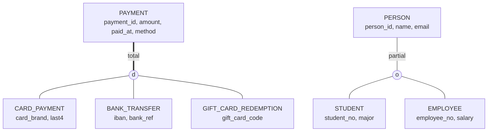

## Introduction

Two kinds of real-world structure do not fit the basic "entity + relationship" vocabulary well:

1. **Things that cannot be identified on their own.** Invoice line 3 means nothing without saying *which invoice*. Room 101 exists in many buildings. An employee's dependent "Alex" is identified only together with the employee. These are **weak entities**: they depend on an *owner* entity for their identity and usually for their existence.
2. **Things that are kinds of other things.** A payment is a card payment, a bank transfer or a gift-card redemption; all payments have an amount and a date, but only card payments have a card brand and the last four digits. A person on campus may be a student, an employee, or both. These are **specialization/generalization** hierarchies, the core of the **Enhanced ER (EER)** model.

Both appear in nearly every production schema — and both are places where the relational model has no single native construct, so the designer must choose an implementation. This lesson defines the concepts precisely and then implements each one in MySQL: composite primary keys and `ON DELETE CASCADE` for weak entities, and the three classic inheritance strategies — **single-table**, **class-table** and **concrete-table** — with the constraints that make each of them safe and the trade-offs that decide between them.

:::note[Dataset]
This lesson starts from an **empty** schema and builds every table it needs, so you can see each construct in isolation. All outputs below were captured from a real MySQL server.
:::

## DBMS Theory

:::theory[Weak entity types]
- A **strong (regular) entity type** has a key of its own.
- A **weak entity type** does not. Its entities are identified by being related to a specific entity of another type, the **identifying owner** (or *parent*), through an **identifying relationship**, in combination with some of their own attributes.
- The **partial key** (or *discriminator*) is the set of the weak entity's attributes that distinguishes weak entities *of the same owner*: `line_no` among the lines of one invoice, `room_no` among the rooms of one building.
- The full key of a weak entity is **owner key + partial key**.
- A weak entity always has **total participation** in its identifying relationship (it cannot exist without its owner), and the owner side of that relationship is typically 1:N.
- Chen notation draws weak entities as **double rectangles**, identifying relationships as **double diamonds**, and underlines the partial key with a **dashed** line.
:::

Weakness is about *identification*, not importance. A weak entity can have many attributes and its own relationships (an invoice line relates to a product). And existence dependency alone does not make an entity weak: a `member_profile` that cannot exist without a member but has the member's key as its own key is a 1:1 extension, not a weak entity with a partial key.

:::theory[Specialization, generalization and their constraints]
- **Specialization** is the top-down process of defining subclasses of an entity type based on a distinguishing characteristic: `Payment` → {`CardPayment`, `BankTransfer`, `GiftCardRedemption`}.
- **Generalization** is the bottom-up process of recognizing common features of several entity types and factoring them into a superclass: `Car` and `Truck` → `Vehicle`. The resulting structure is the same; only the design direction differs.
- Every subclass entity **is a** superclass entity: it **inherits** all superclass attributes and relationships and may add its own *specific* attributes and relationships.
- A **predicate-defined** (condition-defined) specialization uses an attribute value of the superclass, the **defining attribute** or *discriminator* (`method = 'card'`); a **user-defined** specialization does not.

Two independent constraints classify every specialization:

| Constraint | Options | Meaning |
|---|---|---|
| **Disjointness** | **Disjoint** (d) / **Overlapping** (o) | Can a superclass entity belong to *more than one* subclass? A payment is exactly one kind (disjoint); a person can be both student and employee (overlapping). |
| **Completeness** | **Total** (double line) / **Partial** (single line) | Must every superclass entity belong to *some* subclass? Every payment has a method (total); not every person is a student or employee — alumni, visitors (partial). |

The four combinations — disjoint/total, disjoint/partial, overlapping/total, overlapping/partial — all occur in practice. A **union type** (or *category*) is the reverse construct: a subclass of a *union* of different superclasses (an `Owner` that is either a `Person` or a `Company`).
:::



In EER diagrams, the circle holds **d** (disjoint) or **o** (overlapping); a **double** line from the superclass to the circle means total specialization (drawn here as a thick line), a single line means partial.

## Why It Exists

**Weak entities exist because identity is often contextual.** Without the concept, designers either invent global identifiers for things nobody refers to globally (a global "line id" that users never see), or — worse — forget that a line number is only unique *within* an invoice and declare `line_no` unique on its own, or not unique at all. Modelling the owner + partial key explicitly gives you the correct uniqueness rule, the right clustering (all lines of an invoice stored together), and the right lifecycle (lines disappear with their invoice).

**EER exists because real entities form type hierarchies** that plain ER can only express awkwardly:

- Without specialization, a single `payments` entity carries every attribute of every kind of payment, and the rule "only card payments have `last4`" lives nowhere.
- Without generalization, `card_payments` and `bank_transfers` are unrelated entities, and "all payments of order 17" or "total payments this month" needs a `UNION` of every kind — and a refund cannot reference "a payment" with a single foreign key.

The relational model has no inheritance, so the EER construct forces an explicit *mapping decision*. Making that decision consciously — and enforcing the disjointness/completeness constraints you chose — is what separates a robust design from a pile of nullable columns.

## Internal Working

:::internals[What the mappings mean physically in InnoDB]
- **Weak entity with a composite primary key `(invoice_id, line_no)`**: the InnoDB clustered index is ordered by `invoice_id` first, so all lines of an invoice are physically adjacent, usually in the same 16 KB page. Reading an invoice's lines is one short range scan. Inserting lines for a new invoice (with an increasing `invoice_id`) appends at the right edge of the tree.
- **Every secondary index on the weak entity table stores the full primary key** as its row pointer. A secondary index on `product_id` contains `(product_id, invoice_id, line_no)` per entry. With a narrow owner key (an `INT`) this is cheap; with a wide owner key (a composite of strings) every secondary index grows — one reason owner keys should be compact ([Clustered and Secondary Indexes](/lessons/m07-clustered-secondary)).
- **`ON DELETE CASCADE`** is executed by InnoDB in the same transaction: deleting an invoice locates its lines via the foreign key's index (here the leading columns of the primary key) and deletes them, writing undo and redo for each row. Cascades do not fire triggers on the child table.
- **Single-table inheritance**: one clustered index; subtype-specific columns that are NULL cost one bit each in the record header's NULL bitmap (DYNAMIC row format). Wide hierarchies with many subtype columns therefore cost less space than intuition suggests, but every row carries the bitmap and every subtype's indexes cover rows of all types.
- **Class-table inheritance**: one clustered index per class. Subtype tables use the *same* primary key values as the supertype, so a supertype–subtype join is a primary-key lookup per row (or a merge of two identically ordered trees).
- **Concrete-table inheritance**: completely separate B+ trees. A query over "all payments" is a `UNION ALL` of independent scans; there is no single index across subtypes.
:::

## MySQL Implementation

### Weak entity: invoice lines

```sql run
CREATE TABLE products (
  product_id INT UNSIGNED NOT NULL PRIMARY KEY,
  name       VARCHAR(80)  NOT NULL
);
CREATE TABLE invoices (
  invoice_id  INT UNSIGNED NOT NULL AUTO_INCREMENT PRIMARY KEY,
  customer    VARCHAR(80)  NOT NULL,
  issued_on   DATE         NOT NULL
);
CREATE TABLE invoice_lines (                         -- weak entity
  invoice_id  INT UNSIGNED      NOT NULL,           -- owner key (identifying relationship)
  line_no     SMALLINT UNSIGNED NOT NULL,           -- partial key
  product_id  INT UNSIGNED      NOT NULL,
  quantity    INT UNSIGNED      NOT NULL,
  unit_price  DECIMAL(10,2)     NOT NULL,
  PRIMARY KEY (invoice_id, line_no),
  KEY idx_invoice_lines_product (product_id),
  CONSTRAINT chk_invoice_lines_qty CHECK (quantity > 0),
  CONSTRAINT fk_invoice_lines_invoice FOREIGN KEY (invoice_id)
    REFERENCES invoices (invoice_id) ON DELETE CASCADE,
  CONSTRAINT fk_invoice_lines_product FOREIGN KEY (product_id)
    REFERENCES products (product_id)
);

INSERT INTO products VALUES (1, 'USB-C cable'), (2, 'Laptop stand'), (3, 'Webcam');
INSERT INTO invoices (customer, issued_on) VALUES ('Acme Ltd', '2024-11-02'), ('Globex', '2024-11-03');
INSERT INTO invoice_lines VALUES
  (1, 1, 1, 3, 9.99),
  (1, 2, 2, 1, 39.00),
  (2, 1, 3, 2, 54.50),     -- line 1 again, but of invoice 2: allowed
  (2, 2, 1, 1, 9.99);

SELECT invoice_id, line_no, product_id, quantity, unit_price
FROM invoice_lines
ORDER BY invoice_id, line_no;
```

Line number 1 occurs in both invoices — the partial key is unique only *within* an owner. Within one invoice it is enforced by the composite primary key:

```sql run error
INSERT INTO invoice_lines VALUES (1, 2, 3, 1, 54.50);
```

The identifying relationship has total participation (the owner key is part of the primary key, hence `NOT NULL`) and requires the owner to exist:

```sql run error
INSERT INTO invoice_lines VALUES (99, 1, 1, 1, 9.99);
```

Existence dependency — lines go with their invoice:

```sql run
DELETE FROM invoices WHERE invoice_id = 2;
SELECT invoice_id, COUNT(*) AS line_count FROM invoice_lines GROUP BY invoice_id ORDER BY invoice_id;
```

### Specialization: the three mapping strategies

The running example is the disjoint, total specialization of `Payment` into card payments, bank transfers and gift-card redemptions. Common attributes: `payment_id`, `amount`, `paid_at`. Specific attributes: `card_brand`, `last4` (card); `iban`, `bank_ref` (bank); `gift_card_code` (gift card).

**Strategy 1 — single table (one table for the whole hierarchy).** The discriminator column records the subtype; subtype columns are NULL-able; `CHECK` constraints restore the rules that NULL-able columns lose:

```sql run
CREATE TABLE payments_st (
  payment_id      INT UNSIGNED NOT NULL AUTO_INCREMENT PRIMARY KEY,
  amount          DECIMAL(10,2) NOT NULL,
  paid_at         DATETIME      NOT NULL,
  method          ENUM('card','bank','gift_card') NOT NULL,   -- discriminator: total + disjoint
  card_brand      VARCHAR(20)  NULL,
  last4           CHAR(4)      NULL,
  iban            VARCHAR(34)  NULL,
  bank_ref        VARCHAR(30)  NULL,
  gift_card_code  VARCHAR(16)  NULL,
  CONSTRAINT chk_pst_card CHECK (
    (method = 'card') = (card_brand IS NOT NULL AND last4 IS NOT NULL)),
  CONSTRAINT chk_pst_bank CHECK (
    (method = 'bank') = (iban IS NOT NULL AND bank_ref IS NOT NULL)),
  CONSTRAINT chk_pst_gift CHECK (
    (method = 'gift_card') = (gift_card_code IS NOT NULL)),
  CONSTRAINT chk_pst_no_mix CHECK (
    (card_brand IS NULL OR iban IS NULL) AND (card_brand IS NULL OR gift_card_code IS NULL)
    AND (iban IS NULL OR gift_card_code IS NULL))
);
INSERT INTO payments_st (amount, paid_at, method, card_brand, last4, iban, bank_ref, gift_card_code) VALUES
  (120.00, '2024-11-01 10:00:00', 'card', 'VISA', '4242', NULL, NULL, NULL),
  (980.50, '2024-11-01 11:30:00', 'bank', NULL, NULL, 'DE89370400440532013000', 'INV-2024-118', NULL),
  ( 25.00, '2024-11-02 09:15:00', 'gift_card', NULL, NULL, NULL, NULL, 'GIFT-7Q2K');
SELECT payment_id, method, amount, card_brand, last4, iban, gift_card_code
FROM payments_st ORDER BY payment_id;
```

The `CHECK` constraints say "a row has the card columns **if and only if** it is a card payment". A row labelled `'card'` that carries bank details instead of card details is rejected — the error names `chk_pst_bank`, because bank columns are present on a row whose method is not `'bank'` (it violates `chk_pst_card` too; MySQL reports one violated constraint):

```sql run error
INSERT INTO payments_st (amount, paid_at, method, iban, bank_ref)
VALUES (10.00, '2024-11-03 08:00:00', 'card', 'DE00', 'X1');
```

**Strategy 2 — class table (one table per class, sharing the primary key).** The supertype table holds common attributes and the discriminator; each subtype table holds its specific attributes and uses the supertype's key as both primary key and foreign key. To make the specialization **disjoint**, each subtype table repeats the discriminator as a *constant* stored generated column and references the supertype through the composite `(payment_id, method)`:

```sql run
CREATE TABLE payments_ct (
  payment_id INT UNSIGNED NOT NULL AUTO_INCREMENT PRIMARY KEY,
  amount     DECIMAL(10,2) NOT NULL,
  paid_at    DATETIME      NOT NULL,
  method     ENUM('card','bank','gift_card') NOT NULL,
  UNIQUE KEY uq_payments_ct_id_method (payment_id, method)   -- target for the subtype FKs
);
CREATE TABLE card_payments_ct (
  payment_id INT UNSIGNED NOT NULL PRIMARY KEY,
  method     ENUM('card','bank','gift_card') AS ('card') STORED,
  card_brand VARCHAR(20) NOT NULL,
  last4      CHAR(4)     NOT NULL,
  CONSTRAINT fk_card_ct FOREIGN KEY (payment_id, method)
    REFERENCES payments_ct (payment_id, method) ON DELETE CASCADE
);
CREATE TABLE bank_payments_ct (
  payment_id INT UNSIGNED NOT NULL PRIMARY KEY,
  method     ENUM('card','bank','gift_card') AS ('bank') STORED,
  iban       VARCHAR(34) NOT NULL,
  bank_ref   VARCHAR(30) NOT NULL,
  CONSTRAINT fk_bank_ct FOREIGN KEY (payment_id, method)
    REFERENCES payments_ct (payment_id, method) ON DELETE CASCADE
);
CREATE TABLE gift_payments_ct (
  payment_id     INT UNSIGNED NOT NULL PRIMARY KEY,
  method         ENUM('card','bank','gift_card') AS ('gift_card') STORED,
  gift_card_code VARCHAR(16) NOT NULL,
  CONSTRAINT fk_gift_ct FOREIGN KEY (payment_id, method)
    REFERENCES payments_ct (payment_id, method) ON DELETE CASCADE
);

INSERT INTO payments_ct (amount, paid_at, method) VALUES
  (120.00, '2024-11-01 10:00:00', 'card'),
  (980.50, '2024-11-01 11:30:00', 'bank'),
  ( 25.00, '2024-11-02 09:15:00', 'gift_card');
INSERT INTO card_payments_ct (payment_id, card_brand, last4) VALUES (1, 'VISA', '4242');
INSERT INTO bank_payments_ct (payment_id, iban, bank_ref)   VALUES (2, 'DE89370400440532013000', 'INV-2024-118');
INSERT INTO gift_payments_ct (payment_id, gift_card_code)   VALUES (3, 'GIFT-7Q2K');

SELECT p.payment_id, p.method, p.amount, c.card_brand, c.last4, b.iban, g.gift_card_code
FROM payments_ct AS p
LEFT JOIN card_payments_ct AS c ON c.payment_id = p.payment_id
LEFT JOIN bank_payments_ct AS b ON b.payment_id = p.payment_id
LEFT JOIN gift_payments_ct AS g ON g.payment_id = p.payment_id
ORDER BY p.payment_id;
```

Disjointness is now enforced by the database. Payment 2 is a bank transfer, so card details for it are rejected — the pair `(2, 'card')` does not exist in the supertype:

```sql run error
INSERT INTO card_payments_ct (payment_id, card_brand, last4) VALUES (2, 'AMEX', '0005');
```

**Strategy 3 — concrete table (one table per concrete subclass, no supertype table).** Each subtype table repeats the common attributes:

```sql run
CREATE TABLE card_payments_cc (
  payment_id INT UNSIGNED NOT NULL PRIMARY KEY,
  amount     DECIMAL(10,2) NOT NULL,
  paid_at    DATETIME      NOT NULL,
  card_brand VARCHAR(20)   NOT NULL,
  last4      CHAR(4)       NOT NULL
);
CREATE TABLE bank_payments_cc (
  payment_id INT UNSIGNED NOT NULL PRIMARY KEY,
  amount     DECIMAL(10,2) NOT NULL,
  paid_at    DATETIME      NOT NULL,
  iban       VARCHAR(34)   NOT NULL,
  bank_ref   VARCHAR(30)   NOT NULL
);
INSERT INTO card_payments_cc VALUES (1, 120.00, '2024-11-01 10:00:00', 'VISA', '4242');
INSERT INTO bank_payments_cc VALUES (2, 980.50, '2024-11-01 11:30:00', 'DE89370400440532013000', 'INV-2024-118');

CREATE VIEW all_payments_cc AS
SELECT payment_id, 'card' AS method, amount, paid_at FROM card_payments_cc
UNION ALL
SELECT payment_id, 'bank', amount, paid_at FROM bank_payments_cc;

SELECT * FROM all_payments_cc ORDER BY payment_id;
```

Every subtype table is fully typed with `NOT NULL` columns and no joins are needed within a subtype. But nothing prevents payment ID 1 from also existing as a bank payment — the two tables know nothing about each other:

```sql run
INSERT INTO bank_payments_cc VALUES (1, 5.00, '2024-11-04 12:00:00', 'FR7630006000011234567890189', 'DUP');
SELECT payment_id, method, amount FROM all_payments_cc WHERE payment_id = 1 ORDER BY method;
```

"Payment 1" now refers to two different payments. Concrete-table designs need IDs that are unique *across* tables (a shared sequence table or UUIDs — see [Choosing Primary and Foreign Keys](/lessons/m05-key-selection)), and no other table can declare a single foreign key to "a payment".

## Syntax Breakdown

| Construct | MySQL implementation | Enforces |
|---|---|---|
| Weak entity key | `PRIMARY KEY (owner_id, partial_key)` | Uniqueness of the partial key within the owner |
| Identifying relationship | `FOREIGN KEY (owner_id) REFERENCES owner (id)` on a PK column | Owner exists; total participation (PK columns are NOT NULL) |
| Existence dependency | `ON DELETE CASCADE` | Weak entities deleted with the owner |
| Discriminator (single table / class table) | `method ENUM(…) NOT NULL` | Total + disjoint (exactly one value per row) |
| Subtype columns present iff subtype (single table) | `CHECK ((method = 'x') = (col IS NOT NULL))` | Attribute applicability per subtype |
| Subtype row shares supertype key (class table) | `payment_id … PRIMARY KEY` + `FOREIGN KEY (payment_id) REFERENCES super (payment_id)` | Every subtype row is a supertype row; at most one row per subtype |
| Disjointness (class table) | Constant `STORED` generated discriminator in each subtype + FK `(id, method)` → `UNIQUE (id, method)` in supertype | A supertype row can have a row only in the subtype matching its discriminator |
| Overlapping (class table) | Shared-PK subtype tables *without* the discriminator trick | A supertype row may appear in several subtypes |
| Overlapping (single table) | Boolean flags `is_student`, `is_employee` instead of one discriminator | Multiple memberships |
| Total, overlapping (single table) | `CHECK (is_student OR is_employee)` | At least one subtype |
| Hierarchy view (concrete table) | `CREATE VIEW … UNION ALL …` | Nothing — presentation only |

:::warning[CHECK constraints and foreign-key actions]
MySQL prohibits a `CHECK` constraint on a column that is used in a foreign key's referential action (`ON DELETE CASCADE`, `SET NULL`, …) and vice versa (error 3823). That is why the class-table subtypes above use a constant **stored generated column** for the discriminator rather than an ordinary column with `CHECK (method = 'card')`: a stored generated column may be part of a foreign key with `ON DELETE CASCADE` (it may not use `CASCADE`, `SET NULL` or `SET DEFAULT` as an `ON UPDATE` action, and the discriminator never changes anyway). If you prefer an ordinary column with a `CHECK`, the foreign key must use the default `RESTRICT`/`NO ACTION`.
:::

:::standard[Standard SQL vs MySQL]
SQL:1999 defines structured user-defined types with inheritance (`CREATE TYPE … UNDER …`) and typed tables, and PostgreSQL offers table inheritance (`INHERITS`). MySQL implements neither: inheritance is always *mapped* onto ordinary tables with the strategies shown here. MySQL also lacks deferrable constraints, which some designs use to enforce total specialization in class-table mappings.
:::

## Practical Examples

**1. Querying a class-table hierarchy through a view.** Applications rarely want three left joins in every query. A view presents the hierarchy as one relation:

```sql run
CREATE VIEW payments_ct_v AS
SELECT p.payment_id, p.method, p.amount, p.paid_at,
       c.card_brand, c.last4, b.iban, b.bank_ref, g.gift_card_code
FROM payments_ct AS p
LEFT JOIN card_payments_ct AS c ON c.payment_id = p.payment_id
LEFT JOIN bank_payments_ct AS b ON b.payment_id = p.payment_id
LEFT JOIN gift_payments_ct AS g ON g.payment_id = p.payment_id;

SELECT method, COUNT(*) AS payments, SUM(amount) AS total
FROM payments_ct_v
GROUP BY method
ORDER BY method;
```

(The rows come out as card, bank, gift_card because `ORDER BY` on an `ENUM` column sorts by the members' declaration order, not alphabetically — a MySQL-specific behaviour.) Queries that touch only common attributes don't need the subtype tables at all — `SELECT SUM(amount) FROM payments_ct` reads one table. That is the main advantage of class-table over concrete-table mapping.

**2. Total specialization in a class-table mapping is not declarative.** Nothing stops a supertype row without any subtype row:

```sql run
INSERT INTO payments_ct (amount, paid_at, method) VALUES (15.00, '2024-11-05 16:00:00', 'card');

SELECT p.payment_id, p.method
FROM payments_ct AS p
WHERE NOT EXISTS (SELECT 1 FROM card_payments_ct AS c WHERE c.payment_id = p.payment_id)
  AND NOT EXISTS (SELECT 1 FROM bank_payments_ct AS b WHERE b.payment_id = p.payment_id)
  AND NOT EXISTS (SELECT 1 FROM gift_payments_ct AS g WHERE g.payment_id = p.payment_id);
```

Payment 4 claims to be a card payment but has no card details. Enforcing "every payment has its subtype row" would require a constraint checked at commit time; InnoDB checks constraints immediately, so the usual solutions are (a) inserting supertype and subtype rows in one transaction through a stored procedure or the data-access layer, plus (b) an audit query like the one above in a data-quality job.

**3. An overlapping, partial specialization.** People on campus may be students, employees, both, or neither (visitors):

```sql run
CREATE TABLE persons (
  person_id INT UNSIGNED NOT NULL AUTO_INCREMENT PRIMARY KEY,
  name      VARCHAR(80)  NOT NULL,
  email     VARCHAR(255) NOT NULL UNIQUE
);
CREATE TABLE students (
  person_id  INT UNSIGNED NOT NULL PRIMARY KEY,
  student_no CHAR(9)      NOT NULL UNIQUE,
  major      VARCHAR(40)  NOT NULL,
  FOREIGN KEY (person_id) REFERENCES persons (person_id) ON DELETE CASCADE
);
CREATE TABLE employees (
  person_id   INT UNSIGNED NOT NULL PRIMARY KEY,
  employee_no CHAR(6)      NOT NULL UNIQUE,
  salary      DECIMAL(10,2) NOT NULL,
  FOREIGN KEY (person_id) REFERENCES persons (person_id) ON DELETE CASCADE
);
INSERT INTO persons (name, email) VALUES
  ('Ana Ruiz', 'ana@uni.edu'), ('Ben Cho', 'ben@uni.edu'), ('Cara Diaz', 'cara@uni.edu'), ('Dev Rao', 'dev@uni.edu');
INSERT INTO students  VALUES (1, '015000001', 'Data Science'), (3, '015000003', 'Mathematics');
INSERT INTO employees VALUES (2, 'E10002', 72000.00), (3, 'E10003', 18000.00);

SELECT p.person_id, p.name,
       s.person_id IS NOT NULL AS is_student,
       e.person_id IS NOT NULL AS is_employee
FROM persons AS p
LEFT JOIN students  AS s ON s.person_id = p.person_id
LEFT JOIN employees AS e ON e.person_id = p.person_id
ORDER BY p.person_id;
```

Cara (3) is both a student and an employee (overlapping); Dev (4) is neither (partial). No discriminator column is used, because a single value could not describe Cara.

**4. Weak entity of a weak entity.** Weak entities can nest: a building has rooms (partial key `room_no`), and a room has seats (partial key `seat_no`). The key grows at each level:

```sql run
CREATE TABLE buildings (building_code CHAR(4) NOT NULL PRIMARY KEY, name VARCHAR(60) NOT NULL);
CREATE TABLE rooms (
  building_code CHAR(4) NOT NULL,
  room_no       VARCHAR(6) NOT NULL,
  capacity      SMALLINT UNSIGNED NOT NULL,
  PRIMARY KEY (building_code, room_no),
  FOREIGN KEY (building_code) REFERENCES buildings (building_code) ON DELETE CASCADE
);
CREATE TABLE seats (
  building_code CHAR(4) NOT NULL,
  room_no       VARCHAR(6) NOT NULL,
  seat_no       SMALLINT UNSIGNED NOT NULL,
  is_accessible BOOLEAN NOT NULL DEFAULT FALSE,
  PRIMARY KEY (building_code, room_no, seat_no),
  FOREIGN KEY (building_code, room_no) REFERENCES rooms (building_code, room_no) ON DELETE CASCADE
);
INSERT INTO buildings VALUES ('MH', 'MacQuarrie Hall'), ('DH', 'Duncan Hall');
INSERT INTO rooms VALUES ('MH', '225', 40), ('DH', '225', 30);
INSERT INTO seats VALUES ('MH', '225', 1, TRUE), ('MH', '225', 2, FALSE), ('DH', '225', 1, FALSE);
SELECT building_code, room_no, seat_no, is_accessible FROM seats ORDER BY building_code, room_no, seat_no;
```

Room 225 exists in both buildings, and seat 1 in both rooms 225. Note how the foreign key from `seats` to `rooms` is composite — every key column of the owner is propagated. Three levels deep, the key is three columns wide, and every secondary index on `seats` would carry all three. That is the point at which many teams introduce a surrogate key for the middle level (see Alternative Approaches).

## Execution Walkthrough

Trace a cascading delete through a weak-entity chain and observe each table's state.

```walkthrough
title: DELETE FROM buildings WHERE building_code = 'MH' — cascading through rooms to seats
steps:
  - title: "1. Before: the owner chain"
    explain: Building MH owns room MH-225, which owns two seats. Building DH owns its own room 225 with one seat.
    sql: |
      SELECT 'rooms' AS tbl, COUNT(*) AS n FROM rooms
      UNION ALL SELECT 'seats', COUNT(*) FROM seats;
  - title: "2. The delete"
    explain: >-
      InnoDB deletes the building row, then follows fk on rooms (ON DELETE CASCADE) using the leading column of
      rooms' primary key to find MH's rooms and deletes them; for each deleted room it follows the composite
      foreign key from seats and deletes those seats. All in one statement, one transaction.
    sql: DELETE FROM buildings WHERE building_code = 'MH';
  - title: "3. After: only DH's chain remains"
    explain: >-
      The partial keys made the same room number (225) and seat number (1) coexist under different owners; the
      cascade removed exactly the dependents of MH and nothing else.
    sql: |
      SELECT building_code, room_no, seat_no FROM seats ORDER BY building_code, room_no, seat_no;
  - title: "4. The identifying FK still guards inserts"
    explain: >-
      A seat for a room that no longer exists is rejected — weak entities cannot exist without their owner. The
      failing insert is shown right after the walkthrough.
```

```sql run error
INSERT INTO seats VALUES ('MH', '225', 3, FALSE);
```

## Output

The walkthrough's final state demonstrates the three guarantees of a correctly mapped weak entity:

1. **Identity within the owner** — `('DH','225',1)` coexists with what was `('MH','225',1)`; the partial key alone is not unique, owner + partial key is.
2. **Existence dependency** — deleting the owner removed its dependents at every level.
3. **Owner required** — the insert for a deleted room fails with error 1452.

For the inheritance strategies, the outputs above show the characteristic behaviour of each: the single-table rows with NULLs in non-applicable columns but CHECK-protected; the class-table join where each payment has exactly one subtype row (except payment 4, the audit query's catch); and the concrete-table view where the same ID appears twice.

## Alternative Approaches

### Choosing an inheritance mapping

| Criterion | Single table | Class table | Concrete table |
|---|---|---|---|
| Queries over all types (totals, lists) | One table — fastest | Supertype table only | `UNION ALL` of all tables |
| Queries over one subtype with its attributes | Filter on discriminator | Join supertype + subtype (PK lookups) | One table — fastest |
| `NOT NULL` on subtype attributes | Not directly — needs `CHECK` per subtype | Yes, in the subtype table | Yes |
| Disjointness | Automatic (one discriminator) | Composite FK + generated discriminator | Not enforceable across tables |
| Total specialization | Automatic (`NOT NULL` discriminator) | Not declarative (procedure + audit) | Automatic (no supertype rows exist) |
| FK from other tables to "any payment" | Yes | Yes (to supertype) | No — one FK per subtype table, or none |
| Adding a subtype | `ALTER TABLE` adding columns (often instant) + new CHECK | New table | New table + change the view |
| Sparse columns / wide rows | Many NULL columns | None | None |
| Unique ID across subtypes | Automatic | Automatic | Needs a shared sequence or UUIDs |

Rules of thumb used in industry:

- **Single table** when subtypes differ by a handful of attributes and most queries span all types (payment methods, notification channels). ORMs call this *single-table inheritance* (Rails STI, Hibernate `SINGLE_TABLE`).
- **Class table** when subtypes have many specific attributes or their own relationships, and other tables must reference the supertype (parties: persons/organizations; accounts: checking/savings). Hibernate `JOINED`.
- **Concrete table** when subtypes are almost never queried together and nothing references the supertype (archived data per year, sharded per-tenant tables). Hibernate `TABLE_PER_CLASS`.

### A fourth option: JSON for subtype attributes

A single table with the common columns plus a `JSON` column for subtype-specific attributes (`details JSON`) is popular for highly variable subtypes (product attributes per category). Integrity can be partly restored with `CHECK (JSON_SCHEMA_VALID(…))` (8.0.17+) and generated columns for indexed paths, but the attributes lose native types and foreign keys. See [JSON in MySQL](/lessons/m13-json).

### Weak entity: composite key vs surrogate key

| Design | Pros | Cons |
|---|---|---|
| `PRIMARY KEY (invoice_id, line_no)` (identifying) | Encodes the business identity; lines clustered by invoice; no extra index | Wide keys propagate to children and secondary indexes in deep hierarchies; renumbering lines changes keys |
| `line_id AUTO_INCREMENT PRIMARY KEY` + `UNIQUE (invoice_id, line_no)` | Narrow single-column key for child tables and ORMs | Extra unique index; lines of one invoice are *not* clustered together (unless the PK is chosen differently); the partial-key rule must be declared explicitly or it is lost |

For a two-level structure like invoice lines, the composite key is usually best. For deep hierarchies (building → room → seat → sensor), introduce a surrogate at a middle level and keep the natural identification as a `UNIQUE` constraint.

## Performance Analysis

Measure the plan difference between the strategies for the two most common queries. First, ensure statistics exist for the tables created in this lesson (they are not auto-analysed when created inside a lab):

```sql run
ANALYZE TABLE payments_st, payments_ct, card_payments_ct;
EXPLAIN FORMAT=TREE
SELECT p.payment_id, p.amount, c.card_brand, c.last4
FROM payments_ct AS p
JOIN card_payments_ct AS c ON c.payment_id = p.payment_id;
```

The class-table query is a nested loop: a scan of one table and a primary-key lookup (`eq_ref`-style single-row access) into the other for every row. The single-table equivalent is a filter on one table:

```sql run
EXPLAIN FORMAT=TREE
SELECT payment_id, amount, card_brand, last4 FROM payments_st WHERE method = 'card';
```

| Workload | Single table | Class table | Concrete table |
|---|---|---|---|
| Insert one payment | 1 row, 1 B+ tree (+ indexes) | 2 rows, 2 B+ trees, FK check | 1 row, 1 B+ tree |
| Read one payment with details | 1 PK lookup | 2 PK lookups (or 1 + N left joins via the view) | 1 PK lookup *if you know the subtype*; otherwise one per table |
| Sum over all payments | Scan 1 table (wider rows) | Scan supertype only (narrow rows) | Scan every subtype table |
| Index on a subtype attribute (`last4`) | Index contains entries for all rows (NULLs included) | Index only on card rows | Index only on card rows |

For weak entities, the composite primary key gives *locality*: the lines of one invoice are adjacent, so "all lines of invoice 1" is a single range scan:

```sql run
EXPLAIN FORMAT=TREE SELECT line_no, product_id, quantity FROM invoice_lines WHERE invoice_id = 1;
```

:::performance[Theory vs measurement]
The tables here hold a handful of rows; the plans show access *shapes*, not costs. The single- vs class-table decision on a large system should be measured with production-like volumes: the extra join of class-table is cheap when it is a PK lookup on hot pages, while single-table rows with dozens of NULL-able columns cost more per row in the buffer pool than intuition suggests. Use `EXPLAIN ANALYZE` on realistic data ([EXPLAIN ANALYZE](/lessons/m07-explain-analyze)).
:::

## Best Practices

:::best-practice[Weak entities and EER in production]
1. **Model a weak entity when identity is truly contextual** (lines, rooms, versions, installments) — owner key + partial key as the primary key, `ON DELETE CASCADE` if the business lifecycle really is "dies with the owner".
2. **Keep owner keys narrow.** Composite keys propagate to children and into every secondary index; surrogate keys at middle levels of deep hierarchies keep indexes small.
3. **Write down disjointness and completeness for every specialization** — they are business rules with different enforcement in each mapping.
4. **Single table:** `NOT NULL` discriminator and an "iff" `CHECK` per subtype; never leave subtype columns unconstrained.
5. **Class table:** shared primary keys; enforce disjointness with the composite-FK + generated-discriminator pattern; create supertype and subtype rows in one transaction; audit total specialization.
6. **Concrete table:** only when nothing references the supertype; generate IDs that are unique across tables.
7. **Hide the mapping behind views** (or the data-access layer) so applications are insulated from a later change of strategy.
:::

## Common Mistakes

**Mistake 1 — a partial key declared unique on its own.** `line_no SMALLINT UNIQUE` allows only one "line 1" in the whole table:

```sql run
CREATE TABLE invoice_lines_bad (
  invoice_id INT UNSIGNED NOT NULL,
  line_no    SMALLINT UNSIGNED NOT NULL UNIQUE,
  PRIMARY KEY (invoice_id, line_no)
);
INSERT INTO invoice_lines_bad VALUES (1, 1);
```

```sql run error
INSERT INTO invoice_lines_bad VALUES (3, 1);
```

The second invoice cannot have a line 1. The partial key is unique only in combination with the owner key.

**Mistake 2 — single-table inheritance without CHECK constraints.** Without them, a `'card'` row with `iban` filled and `last4` NULL is accepted, and every report has to guess which columns are meaningful.

**Mistake 3 — an ordinary discriminator column with CHECK in a class-table subtype plus `ON DELETE CASCADE`.** It fails with error 3823; use the constant stored generated column, or drop the cascade.

**Mistake 4 — assuming the class-table mapping enforces total specialization.** It does not (payment 4 above). Use transactions and audits.

**Mistake 5 — concrete tables with per-table AUTO_INCREMENT.** Each table starts at 1, so IDs collide across subtypes, as the duplicated payment 1 showed.

**Mistake 6 — confusing a weak entity with an M:N junction.** `order_items (order_id, product_id)` is identified by *two* owners and represents a relationship; `invoice_lines (invoice_id, line_no)` has a partial key of its own and can contain the same product twice (two lines with different prices or discounts). Choose based on whether the same product may appear on several lines.

## Industry Application

- **Billing and ERP systems** are built on weak entities: invoice lines, order lines, installments of a payment plan, versions of a document. The composite key with `ON DELETE CASCADE` (or, for legal records, `RESTRICT` plus soft deletion) is standard.
- **Party models** in CRM and banking use class-table inheritance: `party` (common identity, addresses, contact points) specialized into `person` and `organization`, so that accounts, contracts and addresses reference "a party" with one foreign key.
- **ORMs** expose exactly these three strategies (Rails STI; Hibernate/JPA `SINGLE_TABLE`, `JOINED`, `TABLE_PER_CLASS`; Django multi-table vs abstract base classes). Knowing the database consequences — NULL-heavy rows, join costs, missing cross-table uniqueness — lets you choose the ORM option deliberately rather than by default.
- **Event and notification systems** often use single-table + JSON payload for many event subtypes, with generated columns indexing the few attributes that are queried.
- **Data warehouses** flatten hierarchies into wide dimension tables (effectively single-table) for query simplicity (Module 13, [Data Warehousing](/lessons/m13-data-warehousing)).

## Practice Exercises

```exercise
id: ex1
title: Create a weak entity with a partial key
difficulty: easy
kind: dml
concepts: [weak-entities, partial-keys, composite-key]
setup: |
  CREATE TABLE courses (course_id VARCHAR(10) NOT NULL PRIMARY KEY, title VARCHAR(100) NOT NULL);
prompt: |
  A course has numbered **modules** (module 1, 2, 3 …); module numbers restart in every course. Create table
  **`course_modules`** with `course_id` (`VARCHAR(10)`), `module_no` (`TINYINT UNSIGNED`), `title`
  (`VARCHAR(100)`), all NOT NULL. The primary key must express the weak entity; `course_id` must reference
  `courses` and modules must be deleted with their course.

  The checker lists your primary key columns in order and the delete rule of the foreign key.
hints:
  - "The full key of a weak entity is owner key + partial key: PRIMARY KEY (course_id, module_no)."
  - "FOREIGN KEY (course_id) REFERENCES courses (course_id) ON DELETE CASCADE."
solution: |
  CREATE TABLE course_modules (
    course_id VARCHAR(10)      NOT NULL,
    module_no TINYINT UNSIGNED NOT NULL,
    title     VARCHAR(100)     NOT NULL,
    PRIMARY KEY (course_id, module_no),
    CONSTRAINT fk_modules_course FOREIGN KEY (course_id)
      REFERENCES courses (course_id) ON DELETE CASCADE
  );
check: |
  SELECT 'pk' AS item, COLUMN_NAME AS detail, ORDINAL_POSITION AS pos
  FROM information_schema.KEY_COLUMN_USAGE
  WHERE TABLE_SCHEMA = DATABASE() AND TABLE_NAME = 'course_modules' AND CONSTRAINT_NAME = 'PRIMARY'
  UNION ALL
  SELECT 'delete_rule', DELETE_RULE, 0
  FROM information_schema.REFERENTIAL_CONSTRAINTS
  WHERE CONSTRAINT_SCHEMA = DATABASE() AND TABLE_NAME = 'course_modules'
  ORDER BY item, pos;
explanation: |
  `module_no` alone is a partial key; only `(course_id, module_no)` identifies a module. The cascade encodes
  the existence dependency. Declaring `module_no` UNIQUE on its own — the classic mistake — would allow only
  one "module 1" in the entire table.
```

```exercise
id: ex2
title: Single-table inheritance with applicability checks
difficulty: medium
kind: dml
concepts: [specialization, inheritance-mapping, check-constraints]
prompt: |
  Notifications are sent by `email` (needs `email_address`) or `sms` (needs `phone_number`) — disjoint and
  total. Create table **`notifications`** with columns `notification_id` (INT UNSIGNED AUTO_INCREMENT primary
  key), `channel` (`ENUM('email','sms')` NOT NULL), `email_address` (`VARCHAR(255)` NULL), `phone_number`
  (`VARCHAR(20)` NULL), `body` (`VARCHAR(500)` NOT NULL). Add CHECK constraints so that `email_address` is
  present **if and only if** the channel is email, and `phone_number` **if and only if** the channel is sms.

  The checker counts your CHECK constraints and lists the nullability of each column. Test your table
  yourself with one valid and one invalid row of each channel.
hints:
  - "CHECK ((channel = 'email') = (email_address IS NOT NULL))"
  - "CHECK ((channel = 'sms') = (phone_number IS NOT NULL))"
solution: |
  CREATE TABLE notifications (
    notification_id INT UNSIGNED NOT NULL AUTO_INCREMENT PRIMARY KEY,
    channel         ENUM('email','sms') NOT NULL,
    email_address   VARCHAR(255) NULL,
    phone_number    VARCHAR(20)  NULL,
    body            VARCHAR(500) NOT NULL,
    CONSTRAINT chk_notif_email CHECK ((channel = 'email') = (email_address IS NOT NULL)),
    CONSTRAINT chk_notif_sms   CHECK ((channel = 'sms')   = (phone_number IS NOT NULL))
  );
  INSERT INTO notifications (channel, email_address, body) VALUES ('email', 'a@b.com', 'Hi');
  INSERT INTO notifications (channel, phone_number, body) VALUES ('sms', '+1-555-0100', 'Hi');
check: |
  SELECT 'checks' AS item, CAST(COUNT(*) AS CHAR) AS detail
  FROM information_schema.TABLE_CONSTRAINTS
  WHERE TABLE_SCHEMA = DATABASE() AND TABLE_NAME = 'notifications' AND CONSTRAINT_TYPE = 'CHECK'
  UNION ALL
  SELECT COLUMN_NAME, IS_NULLABLE
  FROM information_schema.COLUMNS
  WHERE TABLE_SCHEMA = DATABASE() AND TABLE_NAME = 'notifications'
  ORDER BY item;
explanation: |
  Comparing two boolean expressions with `=` expresses "if and only if": a row is valid when both sides are
  true (an email notification with an address) or both false (an sms notification without an address). A
  one-directional check such as `channel <> 'email' OR email_address IS NOT NULL` would still allow an sms
  row carrying a stray email address. The `NOT NULL` discriminator makes the specialization total, and a
  single ENUM value per row makes it disjoint. (Test inserts like those in the reference solution do not
  affect the check, which compares only the constraint count and column nullability.)
```

```exercise
id: ex3
title: Class-table inheritance with enforced disjointness
difficulty: hard
kind: dml
concepts: [inheritance-mapping, disjointness, generated-columns, foreign-key]
setup: |
  CREATE TABLE accounts (
    account_id INT UNSIGNED NOT NULL PRIMARY KEY,
    kind       ENUM('checking','savings') NOT NULL,
    opened_on  DATE NOT NULL,
    UNIQUE KEY uq_accounts_id_kind (account_id, kind)
  );
  INSERT INTO accounts VALUES (1, 'checking', '2024-01-01'), (2, 'savings', '2024-02-01');
prompt: |
  `accounts` is the supertype (with `UNIQUE (account_id, kind)` already in place). Create the subtype table
  **`savings_accounts`** with `account_id` (INT UNSIGNED, primary key), `interest_rate` (`DECIMAL(5,3)` NOT
  NULL) and a discriminator column **`kind`** that is a constant stored generated column with value
  `'savings'` (same ENUM type as the supertype). Reference the supertype with a composite foreign key
  `(account_id, kind)` that cascades deletes. Then insert the savings details for account 2 with rate 2.500.

  The checker shows the subtype rows and the generation expression of `kind`.
hints:
  - "kind ENUM('checking','savings') AS ('savings') STORED"
  - "FOREIGN KEY (account_id, kind) REFERENCES accounts (account_id, kind) ON DELETE CASCADE"
  - "INSERT INTO savings_accounts (account_id, interest_rate) VALUES (2, 2.500); — do not list the generated column."
solution: |
  CREATE TABLE savings_accounts (
    account_id    INT UNSIGNED NOT NULL PRIMARY KEY,
    kind          ENUM('checking','savings') AS ('savings') STORED,
    interest_rate DECIMAL(5,3) NOT NULL,
    CONSTRAINT fk_savings_account FOREIGN KEY (account_id, kind)
      REFERENCES accounts (account_id, kind) ON DELETE CASCADE
  );
  INSERT INTO savings_accounts (account_id, interest_rate) VALUES (2, 2.500);
check: |
  SELECT s.account_id, s.kind, s.interest_rate,
         (SELECT GENERATION_EXPRESSION FROM information_schema.COLUMNS
          WHERE TABLE_SCHEMA = DATABASE() AND TABLE_NAME = 'savings_accounts' AND COLUMN_NAME = 'kind') AS gen_expr
  FROM savings_accounts AS s
  ORDER BY s.account_id;
explanation: |
  Because every savings row has `kind = 'savings'`, the composite FK can only match a supertype row whose
  kind is `'savings'`: inserting savings details for checking account 1 fails with error 1452. Using an
  ordinary `kind` column with `CHECK (kind = 'savings')` together with `ON DELETE CASCADE` fails with error
  3823 in MySQL; the stored generated column avoids that restriction.
```

```exercise
id: ex4
title: Audit total specialization
difficulty: medium
dataset: empty
setup: |
  CREATE TABLE vehicles (vehicle_id INT PRIMARY KEY, kind ENUM('car','truck') NOT NULL, plate VARCHAR(10) NOT NULL);
  CREATE TABLE cars   (vehicle_id INT PRIMARY KEY, seats TINYINT NOT NULL, FOREIGN KEY (vehicle_id) REFERENCES vehicles (vehicle_id));
  CREATE TABLE trucks (vehicle_id INT PRIMARY KEY, payload_kg INT NOT NULL, FOREIGN KEY (vehicle_id) REFERENCES vehicles (vehicle_id));
  INSERT INTO vehicles VALUES (1,'car','7ABC123'),(2,'truck','8TRK001'),(3,'car','6XYZ999'),(4,'truck','9TRK777'),(5,'car','5CAR555');
  INSERT INTO cars VALUES (1,5),(5,7),(2,2);
  INSERT INTO trucks VALUES (2,12000);
concepts: [specialization, disjointness, inheritance-mapping]
prompt: |
  The vehicle hierarchy is meant to be **disjoint and total**, mapped as class tables (`vehicles`, `cars`,
  `trucks`) but without the composite-FK protection. Find every violation. Return columns `vehicle_id`,
  `problem` where `problem` is `'missing subtype row'` (no row in the subtype matching `kind`),
  `'wrong subtype row'` (a row in the subtype *not* matching `kind`). Order by `vehicle_id`, then `problem`.
hints:
  - "Missing: kind = 'car' AND NOT EXISTS in cars, or kind = 'truck' AND NOT EXISTS in trucks."
  - "Wrong: kind <> 'car' AND EXISTS in cars, or kind <> 'truck' AND EXISTS in trucks."
  - "Combine two SELECTs with UNION ALL."
solution: |
  SELECT v.vehicle_id, 'missing subtype row' AS problem
  FROM vehicles AS v
  WHERE (v.kind = 'car'   AND NOT EXISTS (SELECT 1 FROM cars   c WHERE c.vehicle_id = v.vehicle_id))
     OR (v.kind = 'truck' AND NOT EXISTS (SELECT 1 FROM trucks t WHERE t.vehicle_id = v.vehicle_id))
  UNION ALL
  SELECT v.vehicle_id, 'wrong subtype row'
  FROM vehicles AS v
  WHERE (v.kind <> 'car'   AND EXISTS (SELECT 1 FROM cars   c WHERE c.vehicle_id = v.vehicle_id))
     OR (v.kind <> 'truck' AND EXISTS (SELECT 1 FROM trucks t WHERE t.vehicle_id = v.vehicle_id))
  ORDER BY vehicle_id, problem;
orderMatters: true
explanation: |
  Vehicle 3 (a car) and 4 (a truck) have no subtype row — total specialization violated. Vehicle 2 is a truck
  but also has a car row — disjointness violated. The composite FK with a generated discriminator would have
  prevented the second kind of violation at insert time; the first kind can only be prevented procedurally
  and detected by audits like this one.
```

```exercise
id: ex5
title: Choose the mapping
difficulty: medium
kind: open
concepts: [inheritance-mapping, specialization, generalization]
prompt: |
  For each hierarchy, choose single-table, class-table or concrete-table mapping and justify in two or three
  sentences: (a) `Party` → `Person`, `Organization`, where contracts, addresses and invoices reference a
  party; (b) `Notification` → email, SMS, push, differing by 1–2 columns each, always listed together in a
  user's inbox; (c) `SensorReading` → yearly archive tables 2019…2024 that are never queried together;
  (d) `Product` → books, electronics, clothing, with 3–30 category-specific attributes and new categories
  added monthly.
solution: |
  (a) Class table: other entities must reference "a party" with one FK; persons and organizations have
  many distinct attributes (birth date vs. registration number) and their own relationships.
  (b) Single table: few specific columns, queries span all types, a `NOT NULL` discriminator gives total +
  disjoint for free; "iff" CHECKs keep the subtype columns honest.
  (c) Concrete table: no shared queries or references; each table can be archived or dropped independently
  (in practice, partitioning by year — Module 12 — is often better still).
  (d) Common columns in one table plus either class tables for the few big, stable categories or a JSON
  `attributes` column (validated with JSON_SCHEMA_VALID and indexed through generated columns) for the long,
  fast-changing tail — adding a column or table per new category monthly does not scale.
```

```exercise
id: ex6
title: Model a weak entity inside a specialization
difficulty: challenge
kind: open
concepts: [weak-entities, specialization, inheritance-mapping, composite-key]
prompt: |
  An insurance company sells **policies**. Each policy is either an **auto** policy (vehicle VIN, annual
  mileage) or a **home** policy (address, construction year) — disjoint and total. Each policy has numbered
  **coverage items** (item 1, 2, …, restarting per policy) with a limit and a deductible. Home policies also
  have numbered **inspections** (inspection 1, 2, …). Design the EER model (state keys, partial keys,
  constraints) and the MySQL DDL, choosing and justifying an inheritance mapping.
solution: |
  **EER.** POLICY (key policy_id; attributes start_date, premium, policy_type) specialized disjoint/total
  into AUTO_POLICY (vin, annual_mileage) and HOME_POLICY (street, city, postal_code, construction_year).
  COVERAGE_ITEM is a weak entity owned by POLICY (partial key item_no). INSPECTION is a weak entity owned by
  HOME_POLICY (partial key inspection_no) — its owner is the *subclass*, which matters for the mapping.

  **Mapping: class table**, because a weak entity must reference the HOME subtype specifically, and coverage
  items must reference any policy.

  ~~~sql
  CREATE TABLE policies (
    policy_id   INT UNSIGNED NOT NULL AUTO_INCREMENT PRIMARY KEY,
    policy_type ENUM('auto','home') NOT NULL,
    start_date  DATE NOT NULL,
    premium     DECIMAL(10,2) NOT NULL,
    UNIQUE KEY uq_policy_type (policy_id, policy_type)
  );
  CREATE TABLE auto_policies (
    policy_id      INT UNSIGNED NOT NULL PRIMARY KEY,
    policy_type    ENUM('auto','home') AS ('auto') STORED,
    vin            CHAR(17) NOT NULL UNIQUE,
    annual_mileage INT UNSIGNED NOT NULL,
    FOREIGN KEY (policy_id, policy_type) REFERENCES policies (policy_id, policy_type) ON DELETE CASCADE
  );
  CREATE TABLE home_policies (
    policy_id         INT UNSIGNED NOT NULL PRIMARY KEY,
    policy_type       ENUM('auto','home') AS ('home') STORED,
    street            VARCHAR(120) NOT NULL,
    city              VARCHAR(60)  NOT NULL,
    postal_code       VARCHAR(10)  NOT NULL,
    construction_year SMALLINT UNSIGNED NOT NULL,
    FOREIGN KEY (policy_id, policy_type) REFERENCES policies (policy_id, policy_type) ON DELETE CASCADE
  );
  CREATE TABLE coverage_items (
    policy_id   INT UNSIGNED NOT NULL,
    item_no     TINYINT UNSIGNED NOT NULL,
    coverage    VARCHAR(60) NOT NULL,
    limit_amt   DECIMAL(12,2) NOT NULL,
    deductible  DECIMAL(10,2) NOT NULL,
    PRIMARY KEY (policy_id, item_no),
    CHECK (deductible <= limit_amt),
    FOREIGN KEY (policy_id) REFERENCES policies (policy_id) ON DELETE CASCADE
  );
  CREATE TABLE inspections (
    policy_id     INT UNSIGNED NOT NULL,
    inspection_no TINYINT UNSIGNED NOT NULL,
    inspected_on  DATE NOT NULL,
    result        ENUM('pass','fail','conditional') NOT NULL,
    PRIMARY KEY (policy_id, inspection_no),
    FOREIGN KEY (policy_id) REFERENCES home_policies (policy_id) ON DELETE CASCADE
  );
  ~~~

  Notes: inspections reference `home_policies`, so an inspection of an auto policy is impossible. Total
  specialization (every policy has its subtype row) is enforced by creating policy and subtype rows in one
  transaction (procedure or data-access layer) and audited nightly. Cascades chain: deleting a policy
  removes its subtype row, coverage items and (through home_policies) inspections — appropriate only if
  policies are ever physically deleted; regulated insurers usually keep them and mark them cancelled.
```

## Knowledge Assessment

```quiz
- id: q1
  question: "What is the full primary key of a weak entity?"
  options:
    - "The owner's primary key plus the weak entity's partial key"
    - "The partial key alone"
    - "A surrogate AUTO_INCREMENT column"
    - "The owner's primary key alone"
  answer: 0
  explanation: "A weak entity is identified by its owner combined with its discriminator. The partial key alone is unique only within one owner; the owner key alone cannot distinguish several weak entities of the same owner. A surrogate is an implementation alternative, not the weak entity's key by definition."
  concepts: [weak-entities, partial-keys]
- id: q2
  question: "A person can be both a student and an employee, and some persons are neither. The specialization is:"
  options: ["Overlapping and partial", "Disjoint and total", "Disjoint and partial", "Overlapping and total"]
  answer: 0
  explanation: "Both at once → overlapping; some neither → partial. Disjoint would forbid being both; total would require every person to be at least one."
  concepts: [specialization, disjointness]
- id: q3
  question: "Which inheritance mapping makes \"every payment belongs to exactly one subtype\" automatic with just a NOT NULL ENUM column?"
  options: ["Single table", "Class table", "Concrete table", "None of them"]
  answer: 0
  explanation: "In single-table mapping, a NOT NULL discriminator gives each row exactly one subtype (total and disjoint). Class-table needs extra constraints for disjointness and cannot declare totality; concrete-table has no shared table to hold a discriminator."
  concepts: [inheritance-mapping]
- id: q4
  question: "A class-table subtype uses `kind ENUM(...) NOT NULL` with `CHECK (kind = 'savings')` and `FOREIGN KEY (account_id, kind) … ON DELETE CASCADE`. CREATE TABLE fails. Why?"
  options:
    - "MySQL forbids CHECK constraints on columns used in a foreign key referential action (error 3823)"
    - "Composite foreign keys are not supported"
    - "ENUM columns cannot be part of a foreign key"
    - "CASCADE requires the column to be NULL-able"
  answer: 0
  explanation: "The CHECK/FK-action restriction is MySQL-specific. Composite FKs and ENUM columns in FKs are allowed; CASCADE has no NULL-ability requirement (SET NULL does). Use a constant stored generated column instead of the CHECK."
  concepts: [inheritance-mapping, check-constraints, foreign-key]
- id: q5
  type: multi
  question: "Which are disadvantages of concrete-table (table-per-concrete-class) mapping? (Select all that apply.)"
  options:
    - "Other tables cannot reference \"any payment\" with a single foreign key"
    - "IDs are not automatically unique across subtype tables"
    - "Queries over all subtypes need UNION ALL"
    - "Subtype-specific attributes cannot be NOT NULL"
  answer: [0, 1, 2]
  explanation: "With no supertype table there is no common FK target, no shared ID space and no single table to scan. Subtype attributes CAN be NOT NULL — that is concrete-table's advantage over single-table."
  concepts: [inheritance-mapping]
- id: q6
  question: "In the class-table mapping, which rule cannot be enforced declaratively in MySQL?"
  options:
    - "Every supertype row has a matching subtype row (total specialization)"
    - "A subtype row's key exists in the supertype"
    - "A subtype row matches the supertype's discriminator (disjointness)"
    - "Each subtype table has at most one row per supertype row"
  answer: 0
  explanation: "Totality needs a check that sees both tables at commit time (deferred constraint or assertion), which MySQL lacks. Existence is an FK; disjointness is the composite FK + generated discriminator; at most one row is the shared primary key."
  concepts: [specialization, inheritance-mapping]
- id: q7
  question: "`invoice_lines` has PRIMARY KEY (invoice_id, line_no). What does InnoDB's clustered index give you for \"all lines of invoice 7\"?"
  options:
    - "One range scan over adjacent rows, because rows are ordered by invoice_id first"
    - "A full table scan, because line_no is not indexed alone"
    - "A secondary index lookup per line"
    - "A hash lookup"
  answer: 0
  explanation: "The clustered index is ordered by the full PK, leading with invoice_id, so an invoice's lines are contiguous. No secondary index or full scan is needed; InnoDB B+ trees are not hash indexes."
  concepts: [weak-entities, composite-key]
- id: q8
  question: "Which pair is a weak entity rather than an M:N junction?"
  options:
    - "invoice_lines (invoice_id, line_no) — the same product may appear on several lines"
    - "book_authors (book_id, author_id)"
    - "enrollments (student_id, section_id)"
    - "order_items (order_id, product_id) — each product at most once per order"
  answer: 0
  explanation: "A weak entity has its own partial key (line_no) and depends on one owner. The others are identified by two foreign keys and represent relationships between two strong entities."
  concepts: [weak-entities]
```
