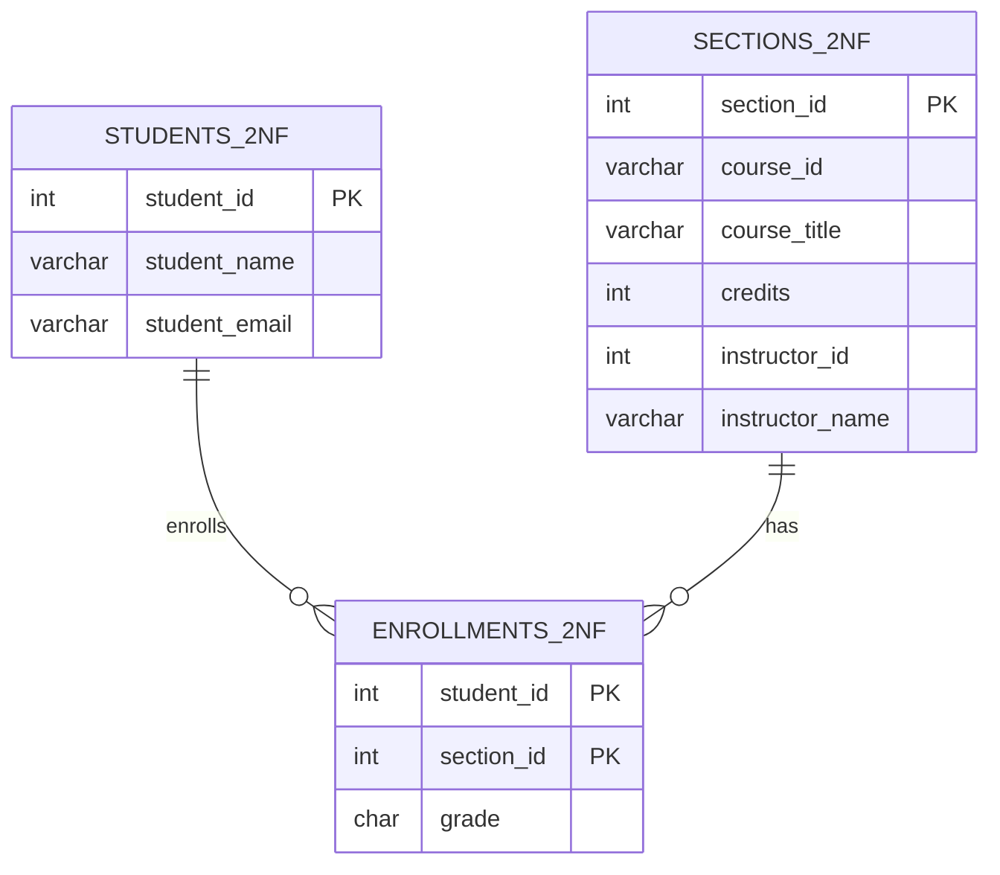

## Introduction

A registrar's office exports an **enrollment report**: one row per student per section, with the student's name and email, the section's course, term, year and instructor, the course title and credits, and the grade. Its key is obviously `(student_id, section_id)` — a student enrolls in a section once. Yet only **one** column in that row, `grade`, is actually a fact about *the enrollment*. Everything else is a fact about the student or about the section, repeated on every enrollment that mentions them.

That pattern — a non-key column that depends on **part** of a composite key — is a **partial dependency**, and **second normal form (2NF)** is the rule that forbids it. 2NF is where the abstract theory of the previous lessons first produces concrete tables:

1. find the candidate keys (closure, [Attribute Closure, Candidate Keys and Canonical Cover](/lessons/m06-closure-keys));
2. find the FDs whose left side is a proper subset of a key;
3. move each such left side and its dependents into a table of their own.

This lesson does all three on a realistic MySQL table, demonstrates the anomalies the partial dependencies cause, migrates the data into 2NF tables with primary and foreign keys, and proves with `EXCEPT` that the original report can be rebuilt exactly. It also shows what 2NF does **not** fix — the remaining problems that motivate [Third Normal Form](/lessons/m06-3nf).

:::note[Dataset]
The examples use the **university** dataset (40 students, 24 sections, 146 enrollments). We build the flat `enrollment_report` from it; the dataset tables are only read.
:::

## DBMS Theory

:::theory[Full dependency, partial dependency and 2NF]
Let R be a relation schema with FDs F.

- An FD X → A is **full** if no proper subset of X determines A: there is no X′ ⊊ X with X′ → A. Otherwise it is **partial**.
- **2NF (Codd 1971; general definition in Elmasri & Navathe):** R is in second normal form if it is in 1NF and **every non-prime attribute is fully functionally dependent on every candidate key of R** — equivalently, no non-prime attribute is partially dependent on any candidate key.

Recall that an attribute is **prime** if it belongs to some candidate key.
:::

Four consequences of the definition are worth stating explicitly, because they are frequent exam and interview traps:

1. **Only composite keys can cause 2NF violations.** If every candidate key is a single attribute, no proper non-empty subset exists, so the relation is automatically in 2NF.
2. **Every candidate key counts, not just the primary key.** The general definition looks at all keys. A relation can satisfy "no partial dependency on the primary key" and still violate 2NF through another composite key.
3. **Prime attributes are exempt.** A dependency of a prime attribute on part of a key (for example `student_email → student_id` when both are in keys) does not violate 2NF. Such dependencies are dealt with by BCNF ([Boyce-Codd Normal Form](/lessons/m06-bcnf)).
4. **2NF says nothing about dependencies between non-key attributes.** `section_id → instructor_id → instructor_name` is fine for 2NF if it does not start from *part* of a key; removing it is 3NF's job.

**Decomposition to 2NF.** For each partial dependency X → Y, where X ⊊ K for a candidate key K and Y is the set of non-prime attributes that depend on X:

- create **R₁(X ∪ Y)** with primary key X;
- remove Y from R, leaving **R₂(R − Y)**, which keeps X as a foreign key to R₁.

The decomposition is **lossless** because the shared attributes X are a key of R₁ (the lossless-join test proved in [Lossless Decomposition and Dependency Preservation](/lessons/m06-decomposition-properties)), and it preserves the dependencies because X → Y now lives entirely in R₁.

## Why It Exists

Partial dependencies are the most common normalization defect in real schemas, because composite keys arise naturally whenever a table records a **relationship** (enrollment, order line, assignment, membership) and designers then "enrich" the relationship row with attributes of the participants. The consequences are the three anomalies, now with a precise cause:

- **Update anomaly:** a student's email is repeated on every one of their enrollments (up to six in this dataset). Changing it requires updating all of them.
- **Insertion anomaly:** a new section cannot be scheduled until a student enrolls — `student_id` is part of the key and cannot be NULL.
- **Deletion anomaly:** when the last students drop a section, the section's course, term and instructor disappear with the enrollments.

There is also a quieter cost: **wide relationship tables**. Every enrollment row carries a dozen descriptive columns, so the table and its indexes are several times larger than needed, fewer rows fit in each 16 KB InnoDB page, and every scan reads more pages.

## Internal Working

:::internals[What changes physically when you decompose]
In InnoDB, each table is a clustered B+ tree on its primary key. The flat report stores, for each `(student_id, section_id)` key, the full set of student and section columns inside the leaf record. After decomposition:

- `enrollments` holds only `(student_id, section_id, grade)` — a few bytes per row — so many more rows fit per page;
- `students` and `sections` hold each entity once;
- the **foreign key** from `enrollments.section_id` to `sections` requires an index on `enrollments.section_id`; InnoDB creates one automatically if none exists (the composite primary key already serves `student_id`, because it is its leading column).

Reconstructing the report is then a join on primary keys: for each enrollment, one clustered-index lookup in `students` and one in `sections`. The FD guarantees that each lookup finds **exactly one** row — which is precisely why the join cannot create spurious rows.
:::

A foreign key also changes the **write path**: inserting an enrollment now performs a lookup in the parent table (taking a shared lock on the parent row until the transaction ends), and deleting a section is refused while enrollments reference it. Those checks are the database enforcing what the flat table could not express: an enrollment must refer to a real student and a real section.



## MySQL Implementation

Build the flat report by joining the dataset's tables — the shape a reporting export or a careless first design would have:

```sql run
CREATE TABLE enrollment_report (
  student_id      INT UNSIGNED     NOT NULL,
  section_id      INT UNSIGNED     NOT NULL,
  grade           CHAR(2)          NULL,
  student_name    VARCHAR(80)      NOT NULL,
  student_email   VARCHAR(255)     NOT NULL,
  course_id       VARCHAR(10)      NOT NULL,
  term            VARCHAR(6)       NOT NULL,
  year            SMALLINT         NOT NULL,
  course_title    VARCHAR(100)     NOT NULL,
  credits         TINYINT UNSIGNED NOT NULL,
  instructor_id   INT UNSIGNED     NULL,
  instructor_name VARCHAR(80)      NULL,
  PRIMARY KEY (student_id, section_id)
);
INSERT INTO enrollment_report
SELECT e.student_id, e.section_id, e.grade, st.name, st.email,
       s.course_id, s.term, s.year, c.title, c.credits, s.instructor_id, i.name
FROM enrollments e
JOIN students st    ON st.student_id = e.student_id
JOIN sections s     ON s.section_id  = e.section_id
JOIN courses c      ON c.course_id   = s.course_id
LEFT JOIN instructors i ON i.instructor_id = s.instructor_id;
SELECT COUNT(*) AS enrollment_rows FROM enrollment_report;
```

Write down the FDs from the registrar's rules:

| FD | Business rule |
|---|---|
| `student_id → student_name, student_email` | A student has one name and one email |
| `student_email → student_id` | Emails are unique per student |
| `section_id → course_id, term, year, instructor_id` | A section is one offering of one course with one instructor |
| `course_id → course_title, credits` | A course has one title and credit value |
| `instructor_id → instructor_name` | An instructor has one name |
| `student_id, section_id → grade` | The grade belongs to the enrollment |

Check against the data that none of them is refuted, using the technique from [Functional Dependencies](/lessons/m06-functional-dependencies):

```sql run
SELECT 'student_id -> name, email' AS fd,
       (SELECT COUNT(*) FROM (SELECT 1 FROM enrollment_report GROUP BY student_id
          HAVING COUNT(DISTINCT student_name, student_email) > 1) v) AS violations
UNION ALL SELECT 'section_id -> course, term, year',
       (SELECT COUNT(*) FROM (SELECT 1 FROM enrollment_report GROUP BY section_id
          HAVING COUNT(DISTINCT course_id, term, year) > 1) v)
UNION ALL SELECT 'course_id -> title, credits',
       (SELECT COUNT(*) FROM (SELECT 1 FROM enrollment_report GROUP BY course_id
          HAVING COUNT(DISTINCT course_title, credits) > 1) v)
UNION ALL SELECT 'student_id -> grade (should FAIL)',
       (SELECT COUNT(*) FROM (SELECT 1 FROM enrollment_report GROUP BY student_id
          HAVING COUNT(DISTINCT grade) > 1) v);
```

The first three hold. The last row confirms that `grade` is **not** determined by `student_id` alone — 35 students have different grades in different sections — so `grade` depends fully on the key.

## Syntax Breakdown

The decomposition uses ordinary DDL and DML; the table below maps each step of the 2NF algorithm to its MySQL statement.

| Algorithm step | MySQL statement | Notes |
|---|---|---|
| Create R₁(X ∪ Y) with key X | `CREATE TABLE students_2nf (student_id … PRIMARY KEY, …)` | Declare every additional candidate key too (`UNIQUE (student_email)`) |
| Populate R₁ | `INSERT INTO students_2nf SELECT DISTINCT student_id, student_name, student_email FROM enrollment_report` | `DISTINCT` collapses the copies; if the FD is violated in the data, the PK rejects the insert |
| Create R₂ = R − Y | `CREATE TABLE enrollments_2nf (student_id, section_id, grade, PRIMARY KEY (…))` | Keep X as a column |
| Link R₂ to R₁ | `CONSTRAINT fk_… FOREIGN KEY (student_id) REFERENCES students_2nf (student_id)` | Types must match exactly (`INT UNSIGNED` ↔ `INT UNSIGNED`) |
| Verify losslessness | `SELECT … FROM r2 JOIN r1 …` compared with `EXCEPT` both ways | Equal counts + empty differences |
| Retire the flat table | `DROP TABLE` or replace it with a `CREATE VIEW` of the join | A view keeps old report queries working |

:::standard[Standard SQL vs MySQL]
Everything here is standard SQL. Two MySQL specifics matter: InnoDB **requires an index** on foreign-key columns and creates one silently if you did not (named after the constraint), and `CHECK`/`FOREIGN KEY` constraints written inline after a column definition (`student_id INT REFERENCES students(student_id)`) are **parsed but ignored** for foreign keys — always use the table-level `CONSTRAINT … FOREIGN KEY` form.
:::

## Practical Examples

### 1. The anomalies, for real

**Update anomaly.** Student 20230002 has six enrollments. The student portal updates the email only on the enrollment being viewed:

```sql run
UPDATE enrollment_report SET student_email = 'samuel.o@alumni.example.edu'
WHERE student_id = 20230002 AND section_id = (SELECT MIN(section_id) FROM (SELECT section_id FROM enrollment_report WHERE student_id = 20230002) AS t);
SELECT student_email, COUNT(*) AS rows_with_value
FROM enrollment_report WHERE student_id = 20230002
GROUP BY student_email ORDER BY student_email;
```

**Insertion anomaly.** The department schedules section 25 — CS-157A in Spring 2025 — before registration opens:

```sql run error
INSERT INTO enrollment_report (student_id, section_id, grade, student_name, student_email,
  course_id, term, year, course_title, credits, instructor_id, instructor_name)
VALUES (NULL, 25, NULL, '', '', 'CS-157A', 'Spring', 2025, 'Introduction to Database Management Systems', 3, 1003, 'Omar Kim');
```

**Deletion anomaly.** Section 10 has only two students. Both drop the class:

```sql run
SELECT section_id, course_id, term, year, instructor_name, COUNT(*) AS students
FROM enrollment_report WHERE section_id = 10
GROUP BY section_id, course_id, term, year, instructor_name;
```

```sql run
DELETE FROM enrollment_report WHERE section_id = 10;
SELECT COUNT(*) AS rows_still_describing_section_10 FROM enrollment_report WHERE section_id = 10;
```

The section's course, term and instructor are gone. Restore the flat table for the decomposition (we rebuild it from the dataset, which was never touched):

```sql run
TRUNCATE TABLE enrollment_report;
INSERT INTO enrollment_report
SELECT e.student_id, e.section_id, e.grade, st.name, st.email,
       s.course_id, s.term, s.year, c.title, c.credits, s.instructor_id, i.name
FROM enrollments e
JOIN students st    ON st.student_id = e.student_id
JOIN sections s     ON s.section_id  = e.section_id
JOIN courses c      ON c.course_id   = s.course_id
LEFT JOIN instructors i ON i.instructor_id = s.instructor_id;
SELECT COUNT(*) AS rows_restored FROM enrollment_report;
```

### 2. Decompose into 2NF

The candidate keys are `(student_id, section_id)` and — because `student_email → student_id` — also `(student_email, section_id)`. So `student_id`, `student_email` and `section_id` are prime; all other attributes are non-prime. The partial dependencies are:

- `student_id → student_name` (and `student_email → student_name`) — part of a key determines a non-prime attribute;
- `section_id → course_id, term, year, course_title, credits, instructor_id, instructor_name` — directly or through `course_id` and `instructor_id`.

Apply the algorithm: one table per partial determinant, and the remainder keyed by the original key.

```sql run
CREATE TABLE students_2nf (
  student_id    INT UNSIGNED NOT NULL PRIMARY KEY,
  student_name  VARCHAR(80)  NOT NULL,
  student_email VARCHAR(255) NOT NULL,
  CONSTRAINT uq_students_2nf_email UNIQUE (student_email)
);
CREATE TABLE sections_2nf (
  section_id      INT UNSIGNED     NOT NULL PRIMARY KEY,
  course_id       VARCHAR(10)      NOT NULL,
  term            VARCHAR(6)       NOT NULL,
  year            SMALLINT         NOT NULL,
  course_title    VARCHAR(100)     NOT NULL,
  credits         TINYINT UNSIGNED NOT NULL,
  instructor_id   INT UNSIGNED     NULL,
  instructor_name VARCHAR(80)      NULL
);
CREATE TABLE enrollments_2nf (
  student_id INT UNSIGNED NOT NULL,
  section_id INT UNSIGNED NOT NULL,
  grade      CHAR(2)      NULL,
  PRIMARY KEY (student_id, section_id),
  CONSTRAINT fk_enr2_student FOREIGN KEY (student_id) REFERENCES students_2nf (student_id),
  CONSTRAINT fk_enr2_section FOREIGN KEY (section_id) REFERENCES sections_2nf (section_id)
);
INSERT INTO students_2nf
SELECT DISTINCT student_id, student_name, student_email FROM enrollment_report;
INSERT INTO sections_2nf
SELECT DISTINCT section_id, course_id, term, year, course_title, credits, instructor_id, instructor_name
FROM enrollment_report;
INSERT INTO enrollments_2nf
SELECT student_id, section_id, grade FROM enrollment_report;
SELECT (SELECT COUNT(*) FROM students_2nf)    AS students,
       (SELECT COUNT(*) FROM sections_2nf)    AS sections,
       (SELECT COUNT(*) FROM enrollments_2nf) AS enrollments;
```

Each table's primary key acted as a validator during migration: had any student appeared with two different names, `INSERT … SELECT DISTINCT` would have produced two rows for one `student_id` and failed with a duplicate-key error. That is the decomposition *forcing* you to resolve an update anomaly instead of carrying it forward.

### 3. The anomalies are gone

```sql run
-- Insertion: schedule a section with no students
INSERT INTO sections_2nf VALUES (25, 'CS-157A', 'Spring', 2025,
  'Introduction to Database Management Systems', 3, 1003, 'Omar Kim');
-- Update: one row per student
UPDATE students_2nf SET student_email = 'samuel.o@alumni.example.edu' WHERE student_id = 20230002;
-- Deletion: the two students of section 10 drop it; the section survives
DELETE FROM enrollments_2nf WHERE section_id = 10;
SELECT section_id, course_id, term, year, instructor_name FROM sections_2nf WHERE section_id IN (10, 25) ORDER BY section_id;
```

And the foreign keys now reject enrollments that point nowhere:

```sql run error
INSERT INTO enrollments_2nf VALUES (20239999, 1, NULL);
```

## Execution Walkthrough

The walkthrough proves the decomposition lossless on a fresh copy of the data (the previous example modified the 2NF tables), and shows how the join reconstructs one enrollment.

```walkthrough
title: Rebuilding the enrollment report from the 2NF tables
steps:
  - title: "1. Reload the 2NF tables from the flat report"
    explain: Undo the changes from Practical Example 3 so the comparison is against the original data. Child rows are deleted first because of the foreign keys.
    sql: |
      DELETE FROM enrollments_2nf;
      DELETE FROM sections_2nf;
      DELETE FROM students_2nf;
      INSERT INTO students_2nf SELECT DISTINCT student_id, student_name, student_email FROM enrollment_report;
      INSERT INTO sections_2nf SELECT DISTINCT section_id, course_id, term, year, course_title, credits, instructor_id, instructor_name FROM enrollment_report;
      INSERT INTO enrollments_2nf SELECT student_id, section_id, grade FROM enrollment_report;
      SELECT COUNT(*) AS enrollments FROM enrollments_2nf;
  - title: "2. One enrollment, three tables"
    explain: The enrollment row carries only the key and the grade; the student and section facts are looked up through the primary keys. Exactly one parent row matches each foreign key.
    sql: |
      SELECT e.student_id, e.section_id, e.grade, st.student_name, se.course_id, se.course_title, se.instructor_name
      FROM enrollments_2nf e
      JOIN students_2nf st ON st.student_id = e.student_id
      JOIN sections_2nf se ON se.section_id = e.section_id
      WHERE e.student_id = 20230002
      ORDER BY e.section_id;
  - title: "3. Join everything and compare in both directions"
    explain: Both EXCEPT differences are empty and the counts match, so the join returns exactly the original report — no lost and no spurious tuples. NULL grades and NULL instructors compare as equal in EXCEPT, as they do in DISTINCT.
    sql: |
      WITH rebuilt AS (
        SELECT e.student_id, e.section_id, e.grade, st.student_name, st.student_email,
               se.course_id, se.term, se.year, se.course_title, se.credits, se.instructor_id, se.instructor_name
        FROM enrollments_2nf e
        JOIN students_2nf st ON st.student_id = e.student_id
        JOIN sections_2nf se ON se.section_id = e.section_id)
      SELECT (SELECT COUNT(*) FROM rebuilt) AS rebuilt_rows,
             (SELECT COUNT(*) FROM enrollment_report) AS original_rows,
             (SELECT COUNT(*) FROM (SELECT * FROM enrollment_report EXCEPT SELECT * FROM rebuilt) d) AS lost,
             (SELECT COUNT(*) FROM (SELECT * FROM rebuilt EXCEPT SELECT * FROM enrollment_report) d) AS spurious;
  - title: "4. How much redundancy disappeared?"
    explain: Count stored copies of student and section facts before and after. Before, each fact was stored once per enrollment; after, once per entity.
    sql: |
      SELECT 'student facts' AS facts, (SELECT COUNT(*) FROM enrollment_report) AS copies_before,
             (SELECT COUNT(*) FROM students_2nf) AS copies_after
      UNION ALL
      SELECT 'section facts', (SELECT COUNT(*) FROM enrollment_report), (SELECT COUNT(*) FROM sections_2nf);
```

The analyzer below holds the report's FDs. It finds both candidate keys, labels the prime attributes, reports that the highest normal form is **1NF** (because of the partial dependencies), and offers a 3NF synthesis that already goes one step further than our 2NF decomposition.

```viz
type: fd
attributes: [student_id, section_id, grade, student_name, student_email, course_id, term, year, course_title, credits, instructor_id, instructor_name]
fds: ["student_id -> student_name, student_email", "student_email -> student_id", "section_id -> course_id, term, year, instructor_id", "course_id -> course_title, credits", "instructor_id -> instructor_name", "student_id, section_id -> grade"]
```

## Output

The 2NF schema stores 39 students, 24 sections and 146 enrollments in three tables, reproduces the original report exactly, and has removed every partial dependency. But look at `sections_2nf` — it is in 2NF (its key is a single attribute) and still redundant:

```sql run
SELECT course_id, course_title, credits, COUNT(*) AS sections_repeating_title
FROM sections_2nf
GROUP BY course_id, course_title, credits
HAVING COUNT(*) > 1
ORDER BY sections_repeating_title DESC, course_id
LIMIT 5;
```

Course titles and credits are repeated for every section of the course, and instructor names for every section they teach. These are **transitive** dependencies (`section_id → course_id → course_title`, `section_id → instructor_id → instructor_name`), and they produce the same three anomalies at the section level: renaming a course still means updating several rows. 2NF is a necessary step, not the destination — [Third Normal Form](/lessons/m06-3nf) continues with exactly this table.

## Alternative Approaches

**Go straight to 3NF.** In practice designers rarely stop at 2NF; the 3NF synthesis algorithm (next lesson) produces `students`, `sections`, `courses`, `instructors` and `enrollments` in one pass from the minimal cover. 2NF is taught separately because it isolates one specific defect — dependence on *part of a key* — that is easy to recognise in relationship tables.

**Surrogate key on the relationship table.** Some teams give `enrollments` an `enrollment_id AUTO_INCREMENT` primary key and keep `(student_id, section_id)` as a `UNIQUE` constraint. That does **not** change the normal-form analysis: `(student_id, section_id)` is still a candidate key, so `student_id → student_name` is still a partial dependency on a candidate key. A surrogate key never "fixes" 2NF; it only hides the composite key from a casual reader.

```sql run
-- Same partial dependency, hidden behind a surrogate key
CREATE TABLE enrollment_report_surrogate (
  enrollment_id INT UNSIGNED AUTO_INCREMENT PRIMARY KEY,
  student_id    INT UNSIGNED NOT NULL,
  section_id    INT UNSIGNED NOT NULL,
  student_name  VARCHAR(80)  NOT NULL,
  grade         CHAR(2)      NULL,
  CONSTRAINT uq_ers_enrollment UNIQUE (student_id, section_id)
);
INSERT INTO enrollment_report_surrogate (student_id, section_id, student_name, grade)
SELECT student_id, section_id, student_name, grade FROM enrollment_report;
SELECT student_id, COUNT(*) AS copies_of_student_name
FROM enrollment_report_surrogate GROUP BY student_id ORDER BY copies_of_student_name DESC, student_id LIMIT 3;
```

**A view for backward compatibility.** After decomposition, `CREATE VIEW enrollment_report_v AS SELECT … JOIN …` lets existing report queries keep working unchanged while all writes go to the normalized tables.

| Option | Removes partial dependencies? | When it fits |
|---|---|---|
| 2NF decomposition | Yes | Teaching, incremental refactoring of a legacy table |
| 3NF synthesis | Yes, plus transitive ones | New designs — the normal default |
| Surrogate key only | No | Never as a normalization step (fine as an addition) |
| Flat table rebuilt by ETL | Not needed (read-only copy) | Reporting/warehouse outputs |

## Performance Analysis

Decomposition changes the cost of each operation in predictable ways.

```sql run
ANALYZE TABLE students_2nf, sections_2nf, enrollments_2nf;
EXPLAIN FORMAT=TREE
SELECT e.student_id, e.section_id, e.grade, st.student_name, se.course_title
FROM enrollments_2nf e
JOIN students_2nf st ON st.student_id = e.student_id
JOIN sections_2nf se ON se.section_id = e.section_id
WHERE e.student_id = 20230002;
```

The plan (statistics refreshed with `ANALYZE TABLE` because the tables were just created) is worth reading line by line:

- `Index lookup on e using PRIMARY (student_id=20230002)` — the student's six enrollments are found through the leading column of the composite primary key; no secondary index is needed.
- `Single-row index lookup on se using PRIMARY` — for each enrollment, exactly one section row is fetched by primary key. "Single-row" is the optimizer stating the FD `section_id → …` in its own vocabulary.
- `students_2nf` does not appear at all. Because the `WHERE` clause fixes `student_id` to a constant and `student_id` is the primary key, the optimizer reads that one student row **during optimization** and treats its columns as constants (a `const` table in traditional `EXPLAIN`).

The cost of rebuilding a report row is therefore a few B+ tree descents per enrollment — usually in memory.

| Operation | Flat report | 2NF tables |
|---|---|---|
| Change a student's email | One row per enrollment (6 for student 20230002) | 1 row |
| Schedule a section | Impossible without a student | 1 row |
| Insert an enrollment | Copy ~12 columns | 3 columns + 2 FK parent lookups |
| Read one enrollment with details | 1 row | 1 row + 2 PK lookups |
| Full report scan | Scan 146 wide rows | Scan 146 narrow rows + joins |
| Table size | Every student/section column × enrollments | Each entity once |

:::performance[Measure, don't assume]
The trade-off is real but usually lopsided: writes and storage improve a lot, reads pay a small, constant number of index lookups. The dataset is far too small for timings to mean anything; on production-sized data use `EXPLAIN ANALYZE` ([EXPLAIN ANALYZE](/lessons/m07-explain-analyze)) and the denormalization techniques of [Normalization vs Denormalization](/lessons/m06-denormalization) only where a measured read path needs them.
:::

## Best Practices

:::best-practice[Applying 2NF]
1. **Whenever a table has a composite key, ask of every non-key column: "does it depend on the whole key?"** If it depends on one component, it belongs to that component's entity table.
2. **Find all candidate keys first.** Partial dependencies on secondary keys (for example `(student_email, section_id)`) count too, and prime attributes are exempt.
3. **Keep relationship tables thin:** the composite key plus attributes of the relationship itself (grade, quantity, role, joined_at).
4. **Migrate with `INSERT … SELECT DISTINCT` into tables with primary keys,** so inconsistent copies surface as duplicate-key errors you must resolve.
5. **Declare foreign keys with matching types** and the table-level syntax; let InnoDB index them.
6. **Prove the decomposition** with a join and `EXCEPT` in both directions before dropping the original table, and keep a compatibility view if other code reads it.
:::

## Common Mistakes

**Mistake 1 — believing a single-column surrogate key makes the table 2NF.** As shown above, `UNIQUE (student_id, section_id)` keeps the composite candidate key, and `student_name` still depends on part of it.

**Mistake 2 — only checking the primary key.** If `student_email` is unique, `(student_email, section_id)` is another candidate key; an attribute that depends on `student_email` alone is a partial dependency even if the primary key is `(student_id, section_id)`.

**Mistake 3 — migrating without `DISTINCT` (or with inconsistent data).** Without `DISTINCT`, the parent insert tries to write one row per enrollment and fails on the second copy:

```sql run error
CREATE TABLE students_bad (student_id INT UNSIGNED PRIMARY KEY, student_name VARCHAR(80) NOT NULL);
INSERT INTO students_bad SELECT student_id, student_name FROM enrollment_report;
```

With `DISTINCT` but inconsistent copies (an unresolved update anomaly) it fails the same way, which is the desired behaviour: clean the data, then migrate.

**Mistake 4 — moving a fully dependent attribute out of the relationship.** `grade` depends on `(student_id, section_id)` as a whole; putting it in `students` or `sections` would lose information. The check `GROUP BY student_id HAVING COUNT(DISTINCT grade) > 1` returned violations, proving it is not determined by the student alone.

**Mistake 5 — mismatched foreign-key types.** Referencing an `INT UNSIGNED` primary key from a signed `INT` column fails with error 3780 (*Referencing column … and referenced column … are incompatible*):

```sql run error
CREATE TABLE enrollments_bad (
  student_id INT NOT NULL,
  section_id INT UNSIGNED NOT NULL,
  PRIMARY KEY (student_id, section_id),
  CONSTRAINT fk_bad_student FOREIGN KEY (student_id) REFERENCES students_2nf (student_id)
);
```

## Industry Application

- **Order and invoice lines** (`order_items(order_id, product_id, …)`) are the textbook 2NF case in e-commerce: product names and list prices belong in `products`; only quantity and the price actually charged (a different fact) stay on the line.
- **Membership and assignment tables** — users in groups, employees on projects, actors in films — accumulate attributes of one participant over time ("let's add the project name here for the dashboard"). 2NF reviews catch this before it becomes an update anomaly.
- **Legacy reporting extracts** loaded into MySQL from CSV are typically flat enrollment- or transaction-style tables. Data engineers decompose them into dimension-like entity tables and a thin relationship table, using exactly the `INSERT … SELECT DISTINCT` and `EXCEPT` checks in this lesson.
- **ORMs** (Django, Rails, Hibernate) map many-to-many relationships with attributes as explicit "through" models; keeping those models thin is the ORM-level expression of 2NF.

## Practice Exercises

```exercise
id: ex1
title: Find the partial dependency in the data
difficulty: easy
setup: |
  CREATE TABLE assignment_report AS
  SELECT s.section_id, s.course_id, c.title AS course_title, s.term, s.year
  FROM sections s JOIN courses c ON c.course_id = s.course_id;
concepts: [partial-dependency, second-normal-form]
prompt: |
  `assignment_report(section_id, course_id, course_title, term, year)` is keyed by `section_id`.
  Return each `course_id` with `copies`, the number of rows that repeat its title, for courses whose title is
  stored more than once. Order by `copies` descending, then `course_id`.
hints:
  - "Group by course_id and count rows."
  - "Keep groups with HAVING COUNT(*) > 1."
solution: |
  SELECT course_id, COUNT(*) AS copies
  FROM assignment_report
  GROUP BY course_id
  HAVING COUNT(*) > 1
  ORDER BY copies DESC, course_id;
orderMatters: true
explanation: |
  This table is actually in 2NF — its key is the single attribute `section_id` — yet titles repeat. The
  redundancy comes from the **transitive** dependency `section_id → course_id → course_title`, which 3NF
  removes. The exercise is a reminder that 2NF only targets dependencies on *part of a composite key*.
```

```exercise
id: ex2
title: Is grade fully dependent?
difficulty: medium
concepts: [full-functional-dependency, fd-checking]
prompt: |
  Using `enrollments`, return one row with two columns: `students_with_varying_grades` — the number of
  students who have more than one distinct non-NULL grade — and `sections_with_varying_grades` — the number of
  sections with more than one distinct non-NULL grade.
hints:
  - "Each count is the number of groups returned by GROUP BY … HAVING COUNT(DISTINCT grade) > 1."
  - "Use two scalar subqueries over derived tables."
solution: |
  SELECT (SELECT COUNT(*) FROM (SELECT student_id FROM enrollments GROUP BY student_id
                                HAVING COUNT(DISTINCT grade) > 1) a) AS students_with_varying_grades,
         (SELECT COUNT(*) FROM (SELECT section_id FROM enrollments GROUP BY section_id
                                HAVING COUNT(DISTINCT grade) > 1) b) AS sections_with_varying_grades;
explanation: |
  Both counts are positive, so neither `student_id → grade` nor `section_id → grade` holds. The only determinant
  of `grade` is the whole key `(student_id, section_id)` — a full dependency, so `grade` correctly stays in the
  relationship table.
```

```exercise
id: ex3
title: Decompose an order-line report into 2NF
difficulty: hard
kind: dml
dataset: empty
setup: |
  CREATE TABLE line_report (
    order_id INT UNSIGNED NOT NULL, product_id INT UNSIGNED NOT NULL,
    product_name VARCHAR(60) NOT NULL, list_price DECIMAL(8,2) NOT NULL,
    quantity INT UNSIGNED NOT NULL, unit_price DECIMAL(8,2) NOT NULL,
    PRIMARY KEY (order_id, product_id));
  INSERT INTO line_report VALUES
    (1, 10, 'Mouse', 29.99, 2, 29.99), (1, 11, 'Keyboard', 89.99, 1, 79.99),
    (2, 10, 'Mouse', 29.99, 1, 25.00), (3, 12, 'Monitor', 379.00, 1, 379.00),
    (3, 11, 'Keyboard', 89.99, 2, 89.99);
concepts: [second-normal-form, decomposition, partial-dependency]
prompt: |
  `line_report` has key `(order_id, product_id)` and the partial dependency
  `product_id → product_name, list_price`. Decompose it into 2NF:

  1. `product (product_id INT UNSIGNED PRIMARY KEY, product_name VARCHAR(60) NOT NULL, list_price DECIMAL(8,2) NOT NULL)`
  2. `order_line (order_id INT UNSIGNED, product_id INT UNSIGNED, quantity INT UNSIGNED NOT NULL, unit_price DECIMAL(8,2) NOT NULL,
     PRIMARY KEY (order_id, product_id))` with a foreign key named `fk_order_line_product` to `product`.
  3. Migrate the data, then drop `line_report`.

  The checker lists the joined rows `order_id, product_id, product_name, quantity, unit_price` and the tables that exist.
hints:
  - "INSERT INTO product SELECT DISTINCT product_id, product_name, list_price FROM line_report;"
  - "unit_price is NOT partially dependent: product 10 was sold at 29.99 and 25.00. It stays in order_line."
solution: |
  CREATE TABLE product (
    product_id   INT UNSIGNED PRIMARY KEY,
    product_name VARCHAR(60)  NOT NULL,
    list_price   DECIMAL(8,2) NOT NULL
  );
  CREATE TABLE order_line (
    order_id   INT UNSIGNED NOT NULL,
    product_id INT UNSIGNED NOT NULL,
    quantity   INT UNSIGNED NOT NULL,
    unit_price DECIMAL(8,2) NOT NULL,
    PRIMARY KEY (order_id, product_id),
    CONSTRAINT fk_order_line_product FOREIGN KEY (product_id) REFERENCES product (product_id)
  );
  INSERT INTO product SELECT DISTINCT product_id, product_name, list_price FROM line_report;
  INSERT INTO order_line SELECT order_id, product_id, quantity, unit_price FROM line_report;
  DROP TABLE line_report;
check: |
  SELECT CAST(ol.order_id AS CHAR) AS c1, CAST(ol.product_id AS CHAR) AS c2, p.product_name AS c3,
         CAST(ol.quantity AS CHAR) AS c4, CAST(ol.unit_price AS CHAR) AS c5
  FROM order_line ol JOIN product p ON p.product_id = ol.product_id
  UNION ALL
  SELECT 'table', TABLE_NAME, '', '', '' FROM information_schema.TABLES WHERE TABLE_SCHEMA = DATABASE()
  ORDER BY c1, c2;
explanation: |
  Three products, five order lines, and the join reproduces the original rows. The classic mistake is moving
  `unit_price` into `product` because it "looks like a price": it depends on the whole key (the same product
  was sold at different prices), so moving it would make the `INSERT … SELECT DISTINCT` produce two rows for
  product 10 and fail on the primary key.
```

```exercise
id: ex4
title: Which normal form, and why?
difficulty: medium
kind: open
concepts: [second-normal-form, prime-attribute, candidate-key]
prompt: |
  R(student_id, email, course_id, grade) with
  F = {student_id → email, email → student_id, student_id, course_id → grade}.

  1. Find all candidate keys and the prime attributes.
  2. Is R in 2NF? Justify using the definition.
  3. Is R free of redundancy? If not, which normal form addresses the remaining problem?
solution: |
  1. (student_id, course_id)⁺ = {student_id, email, course_id, grade}: key. (email, course_id)⁺: email →
     student_id, then student_id, course_id → grade: key. No single attribute is a key. Candidate keys:
     **{student_id, course_id}** and **{email, course_id}**. Prime: student_id, email, course_id. Non-prime: grade.
  2. **Yes.** The only non-prime attribute, grade, depends fully on both keys (neither student_id, email nor
     course_id alone determines it). The dependencies student_id → email and email → student_id have prime
     right-hand sides, so 2NF (and even 3NF) does not forbid them.
  3. **No.** A student's email is repeated on every course row, so changing it is an update anomaly. The
     left sides student_id and email are not superkeys, which violates **BCNF**; decomposing into
     (student_id, email) and (student_id, course_id, grade) fixes it.
```

```exercise
id: ex5
title: Design review — project staffing
difficulty: challenge
kind: open
concepts: [second-normal-form, decomposition, lossless-join]
prompt: |
  `staffing(employee_id, project_id, employee_name, employee_dept, project_name, project_budget, role, hours_per_week)`
  has primary key `(employee_id, project_id)`. Each employee has one name and department; each project has one
  name and budget; role and hours are per assignment.

  Write the FDs, list every partial dependency, give the 2NF decomposition with keys and foreign keys as MySQL
  DDL (column types of your choice), and write the SQL that proves the decomposition is lossless.
solution: |
  **FDs:** employee_id → employee_name, employee_dept; project_id → project_name, project_budget;
  employee_id, project_id → role, hours_per_week. Only key: (employee_id, project_id).

  **Partial dependencies:** employee_name and employee_dept on employee_id; project_name and project_budget on project_id.

  ~~~sql
  CREATE TABLE employee (employee_id INT UNSIGNED PRIMARY KEY,
    employee_name VARCHAR(80) NOT NULL, employee_dept VARCHAR(40) NOT NULL);
  CREATE TABLE project (project_id INT UNSIGNED PRIMARY KEY,
    project_name VARCHAR(80) NOT NULL, project_budget DECIMAL(12,2) NOT NULL);
  CREATE TABLE assignment (employee_id INT UNSIGNED NOT NULL, project_id INT UNSIGNED NOT NULL,
    role VARCHAR(40) NOT NULL, hours_per_week TINYINT UNSIGNED NOT NULL,
    PRIMARY KEY (employee_id, project_id),
    CONSTRAINT fk_asg_employee FOREIGN KEY (employee_id) REFERENCES employee (employee_id),
    CONSTRAINT fk_asg_project  FOREIGN KEY (project_id)  REFERENCES project (project_id));
  ~~~

  Migrate with `INSERT INTO employee SELECT DISTINCT employee_id, employee_name, employee_dept FROM staffing;`
  (same for project), then `INSERT INTO assignment SELECT employee_id, project_id, role, hours_per_week FROM staffing;`.

  **Proof:**

  ~~~sql
  WITH rebuilt AS (
    SELECT a.employee_id, a.project_id, e.employee_name, e.employee_dept,
           p.project_name, p.project_budget, a.role, a.hours_per_week
    FROM assignment a JOIN employee e USING (employee_id) JOIN project p USING (project_id))
  SELECT (SELECT COUNT(*) FROM (SELECT * FROM staffing EXCEPT SELECT * FROM rebuilt) x) AS lost,
         (SELECT COUNT(*) FROM (SELECT * FROM rebuilt EXCEPT SELECT * FROM staffing) y) AS spurious,
         (SELECT COUNT(*) FROM staffing) = (SELECT COUNT(*) FROM rebuilt) AS same_count;
  ~~~

  Expected: 0, 0, 1. Remaining issue to check next: if employee_dept → dept_location existed, it would be a
  transitive dependency inside `employee` (a 3NF matter).
```

## Knowledge Assessment

```quiz
- id: q1
  question: "R(A, B, C, D) has key AB and F = {AB → C, B → D}. Which statement is correct?"
  options:
    - "R is in 2NF because AB is the primary key"
    - "R violates 2NF because the non-prime attribute D depends on B, a proper subset of the key"
    - "R violates 2NF because C depends on AB"
    - "R violates 1NF"
  answer: 1
  explanation: "B → D is a partial dependency of a non-prime attribute on a candidate key. AB → C is a full dependency, which 2NF requires. Nothing indicates non-atomic values."
  concepts: [partial-dependency, second-normal-form]
- id: q2
  question: "A relation's only candidate key is a single attribute. What can you say about 2NF?"
  options:
    - "It may still violate 2NF through transitive dependencies"
    - "It is automatically in 2NF (if it is in 1NF)"
    - "It cannot be in 2NF"
    - "It is automatically in BCNF"
  answer: 1
  explanation: "A partial dependency needs a proper non-empty subset of a key, which a single-attribute key does not have. Transitive dependencies are a 3NF matter, and BCNF is not implied."
  concepts: [second-normal-form, composite-key]
- id: q3
  question: "Which FDs in R(student_id, email, course_id, grade, name), keys {student_id, course_id} and {email, course_id}, violate 2NF? (Select all that apply.)"
  type: multi
  options:
    - "student_id → name"
    - "email → name"
    - "student_id → email"
    - "student_id, course_id → grade"
  answer: [0, 1]
  explanation: "name is non-prime and depends on part of a key (either key). email is prime, so student_id → email does not violate 2NF (it violates BCNF). The grade FD is a full dependency on a key."
  concepts: [second-normal-form, prime-attribute]
- id: q4
  question: "During migration `INSERT INTO students_2nf SELECT DISTINCT student_id, student_name FROM report` fails with a duplicate-key error. What does that tell you?"
  options:
    - "DISTINCT does not work with INSERT … SELECT"
    - "Some student_id appears with two different names — the FD student_id → student_name is violated in the data"
    - "The table needs an AUTO_INCREMENT column"
    - "The foreign key is missing"
  answer: 1
  explanation: "DISTINCT removed exact duplicates; the remaining duplicate keys must differ in student_name — an update anomaly in the source. Resolve it before migrating. No FK is involved in inserting into the parent table."
  concepts: [decomposition, fd-checking]
- id: q5
  question: "You add `enrollment_id AUTO_INCREMENT PRIMARY KEY` and `UNIQUE (student_id, section_id)` to the flat report. Is it now in 2NF?"
  options:
    - "Yes, because the primary key is a single column"
    - "No, because (student_id, section_id) is still a candidate key and student_name depends on part of it"
    - "Yes, because UNIQUE constraints are ignored by normalization theory"
    - "No, because AUTO_INCREMENT violates 1NF"
  answer: 1
  explanation: "2NF considers every candidate key. Adding a surrogate key does not remove the composite candidate key or the partial dependency; the redundancy is unchanged."
  concepts: [second-normal-form, candidate-key]
- id: q6
  question: "Why is the 2NF decomposition R₁(X ∪ Y), R₂(R − Y) lossless?"
  options:
    - "Because R₂ keeps all the rows of R"
    - "Because the shared attributes X are a key of R₁, so each R₂ row joins with exactly one R₁ row"
    - "Because foreign keys always make joins lossless"
    - "Because 2NF tables cannot contain NULLs"
  answer: 1
  explanation: "A binary decomposition is lossless when the common attributes determine one side (R₁ ∩ R₂ → R₁). Foreign keys enforce that matches exist but do not by themselves guarantee losslessness; NULLs are unrelated."
  concepts: [lossless-join, decomposition]
- id: q7
  question: "After 2NF decomposition, `sections_2nf(section_id, course_id, course_title, …)` still repeats course titles. Why?"
  options:
    - "The decomposition was lossy"
    - "section_id → course_id → course_title is a transitive dependency, which 2NF does not address"
    - "course_title depends on part of a composite key"
    - "MySQL duplicates VARCHAR values internally"
  answer: 1
  explanation: "sections_2nf has a single-attribute key, so it is in 2NF, but a non-key attribute depends on another non-key attribute. 3NF removes such transitive dependencies. The EXCEPT check showed the decomposition was lossless."
  concepts: [second-normal-form, partial-dependency]
- id: q8
  question: "Which column should stay in an order-line table keyed by (order_id, product_id)?"
  options:
    - "product_name"
    - "the product's current list_price"
    - "unit_price actually charged on this line"
    - "customer_email"
  answer: 2
  explanation: "unit_price can differ for the same product across orders, so it depends on the whole key. product_name and list_price depend on product_id (partial); customer_email depends on order_id via the customer (partial and transitive)."
  concepts: [full-functional-dependency, second-normal-form]
```
