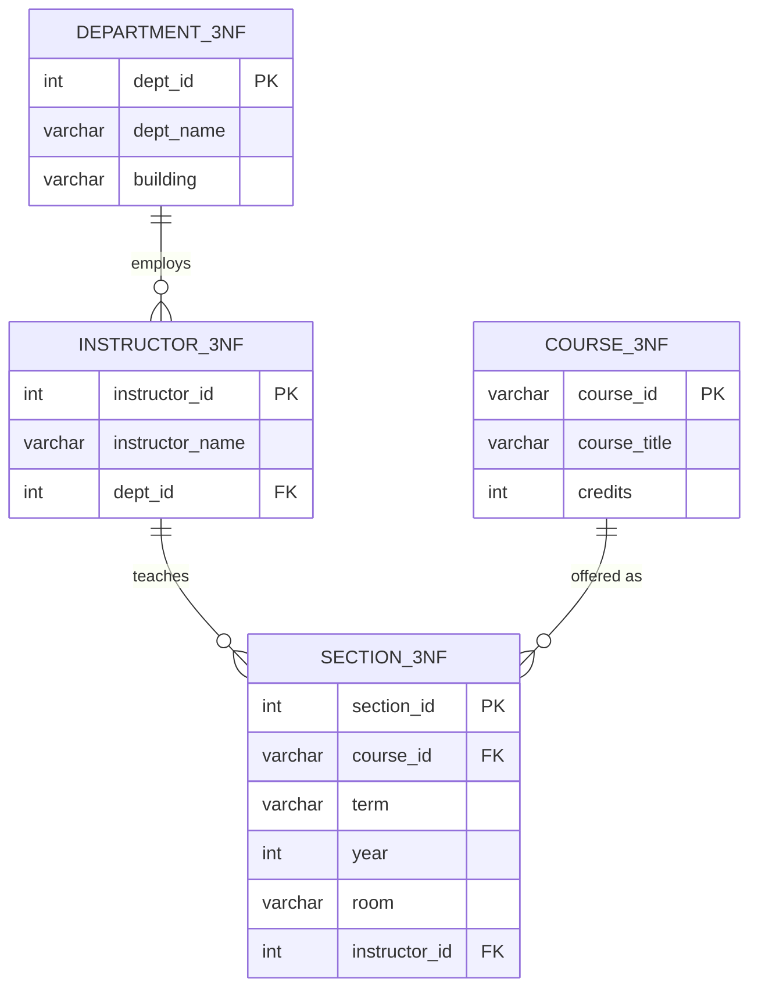

## Introduction

The previous lesson decomposed an enrollment report into 2NF and ended with a warning: the `sections_2nf` table still repeated course titles and instructor names. Its key is the single attribute `section_id`, so no partial dependency exists — yet some of its columns are not facts about the section at all. `course_title` is a fact about the **course**; `instructor_name` is a fact about the **instructor**. They reach the section only *through* another non-key column:

> section_id → instructor_id → instructor_name

That chain is a **transitive dependency**, and removing it is the job of **third normal form (3NF)**. 3NF is the normal form most production OLTP schemas aim for, for two reasons you will see in this lesson:

1. it removes every redundancy caused by non-key facts hiding inside a table, and
2. there is an algorithm — **3NF synthesis** — that *always* produces a 3NF schema that is both **lossless** and **dependency-preserving**, something BCNF cannot always offer.

We will apply the definitions and the algorithm to a realistic flat **section report** built from the university dataset, reproduce its anomalies in MySQL, synthesize the 3NF schema, migrate the data with `INSERT … SELECT DISTINCT`, enforce it with foreign keys, and prove that the original report can be rebuilt exactly.

:::note[Dataset]
The examples use the **university** dataset (24 sections, 15 courses, 12 instructors, 5 departments). The flat `section_report` is created in your lab; the dataset tables are only read.
:::

## DBMS Theory

:::theory[Third normal form — two equivalent definitions]
**Codd's formulation (1972), as stated by Elmasri & Navathe:** R is in 3NF if it is in 2NF and **no non-prime attribute is transitively dependent on a candidate key**. X → Z is transitive if there is a set Y with X → Y and Y → Z, where Y is not a superkey (and Z ⊄ Y, Y ↛ X).

**Zaniolo's formulation (1982), used by Silberschatz et al.:** R is in 3NF if for **every non-trivial FD X → A** that holds on R (in F⁺), at least one of the following is true:

1. **X is a superkey** of R, or
2. **A is a prime attribute** (A belongs to some candidate key).

The second form is easier to test mechanically and does not need 2NF as a prerequisite — a partial dependency of a non-prime attribute also fails both conditions.
:::

Why are the two definitions equivalent? A violating FD X → A has a non-superkey X and a non-prime A. Since every key K satisfies K → X (K determines everything), K → X → A is a transitive chain through X — exactly what Codd's definition forbids. Conversely, any transitive chain K → Y → A with non-superkey Y and non-prime A gives a violating FD Y → A.

It is enough to check the FDs of a **minimal cover** (with single-attribute right sides) rather than all of F⁺: if every FD of the cover satisfies one of the two conditions, so does every FD it implies (Silberschatz et al., §7.3).

**The "prime attribute" escape clause.** Condition 2 lets a non-key determinant point at a *prime* attribute. That clause is what makes dependency preservation always achievable — and what allows a 3NF relation to retain a small amount of redundancy. The relation that exploits it is the classic "3NF but not BCNF" case of the next lesson.

### The 3NF synthesis algorithm

Bernstein (1976) showed how to build a 3NF schema directly from the FDs. In the textbook form (Silberschatz et al., Fig. 7.x; Elmasri & Navathe, Algorithm 15.4):

```
1. Compute a minimal (canonical) cover Fc of F.
2. For each FD  X → Y  in Fc (after grouping FDs with the same left side):
       create a relation schema  Ri = X ∪ Y   (key: X)
3. If no Ri contains a candidate key of R:
       add one relation consisting of some candidate key of R
4. Remove any Ri that is a subset of another Rj.
```

Guarantees: every Ri is in 3NF; the decomposition is **dependency-preserving** (each FD of Fc lives inside some Ri, by construction); and it is **lossless** (step 3 ensures some relation contains a key of R, which is the condition for a lossless synthesis). Step 3 is the one students forget: for R(A, B, C, D) with F = {A → B, C → D}, steps 1–2 give (A, B) and (C, D), whose join is a Cartesian product — lossy — until step 3 adds (A, C).

## Why It Exists

Transitive dependencies are the redundancy that survives 2NF. They appear whenever a table carries a **reference** to another entity *and* copies some of that entity's attributes — "for convenience", "to save a join", or because the table was designed from a report layout:

- **Update anomaly:** a department moves to a new building. In the flat section report the building is stored on every section taught by every instructor of that department — nine rows for Computer Science in this dataset. Miss one and the department is in two buildings at once.
- **Insertion anomaly:** a newly hired instructor (Elena Lin, 1012, in the dataset) teaches no section yet, so her name and department cannot be recorded in a table keyed by `section_id`.
- **Deletion anomaly:** Chloe Lin (1004) teaches only section 20. Cancel the section and the database forgets she exists.

3NF exists so that every non-key column describes **the key, the whole key, and nothing but the key** — the well-known mnemonic attributed to Bill Kent's 1983 article *A Simple Guide to Five Normal Forms in Relational Database Theory*. 1NF gives you "the key" (a single value per key), 2NF "the whole key", 3NF "nothing but the key".

## Internal Working

:::internals[How the synthesized schema maps onto InnoDB]
Each synthesized relation Ri = X ∪ Y becomes an InnoDB table whose **clustered index is keyed on X** — so every FD X → Y of the minimal cover is enforced by a primary key: two rows with the same X are physically impossible. The references between relations (the attributes a relation shares with another relation's key) become **foreign keys**, each backed by a secondary index InnoDB creates if needed.

Rebuilding the flat report is then a chain of joins, each from a foreign-key column to a primary key. MySQL typically executes it as nested-loop joins with `eq_ref` (one-row) primary-key lookups. Because every lookup returns at most one row, the join cannot multiply rows — the physical counterpart of the lossless-join property. Where a reference column is nullable (a section without an instructor), the join must be a `LEFT JOIN`, or the reconstruction loses rows.
:::

Dependency preservation also has a concrete InnoDB meaning: every FD can be enforced **inside one table** by its primary key. If a decomposition lost an FD, enforcing it would need a check across tables — a trigger or a join on every write. 3NF synthesis guarantees you never need that; the next lesson shows what happens when BCNF forces it.



## MySQL Implementation

Build the flat section report: one row per section, with every course, instructor and department attribute copied in. `LEFT JOIN` keeps section 7, which has no instructor.

```sql run
CREATE TABLE section_report (
  section_id      INT UNSIGNED     NOT NULL PRIMARY KEY,
  course_id       VARCHAR(10)      NOT NULL,
  term            VARCHAR(6)       NOT NULL,
  year            SMALLINT         NOT NULL,
  room            VARCHAR(20)      NULL,
  course_title    VARCHAR(100)     NOT NULL,
  credits         TINYINT UNSIGNED NOT NULL,
  instructor_id   INT UNSIGNED     NULL,
  instructor_name VARCHAR(80)      NULL,
  dept_id         SMALLINT UNSIGNED NULL,
  dept_name       VARCHAR(60)      NULL,
  building        VARCHAR(60)      NULL
);
INSERT INTO section_report
SELECT s.section_id, s.course_id, s.term, s.year, s.room, c.title, c.credits,
       s.instructor_id, i.name, d.dept_id, d.name, d.building
FROM sections s
JOIN courses c          ON c.course_id = s.course_id
LEFT JOIN instructors i ON i.instructor_id = s.instructor_id
LEFT JOIN departments d ON d.dept_id = i.dept_id;
SELECT section_id, course_id, course_title, instructor_name, dept_name, building
FROM section_report ORDER BY section_id LIMIT 6;
```

The FDs, from the registrar's rules (here `dept_id` is the **instructor's** department):

| FD | Meaning |
|---|---|
| `section_id → course_id, term, year, room, instructor_id` | A section is one offering |
| `course_id → course_title, credits` | Course facts |
| `instructor_id → instructor_name, dept_id` | Instructor facts |
| `dept_id → dept_name, building` | Department facts |

The only candidate key is `section_id` (it is the only attribute on no right side, and its closure is everything), so every other attribute is non-prime. Apply Zaniolo's test FD by FD: the first FD has a superkey on the left; the other three have non-superkey left sides **and** non-prime right sides — three violations, each a transitive dependency from `section_id`. Verify that the data does not refute them:

```sql run
SELECT 'course_id -> course_title, credits' AS fd,
       (SELECT COUNT(*) FROM (SELECT 1 FROM section_report GROUP BY course_id
          HAVING COUNT(DISTINCT course_title, credits) > 1) v) AS violations,
       (SELECT COUNT(*) - COUNT(DISTINCT course_id) FROM section_report) AS redundant_copies
UNION ALL
SELECT 'instructor_id -> instructor_name, dept_id',
       (SELECT COUNT(*) FROM (SELECT 1 FROM section_report WHERE instructor_id IS NOT NULL GROUP BY instructor_id
          HAVING COUNT(DISTINCT instructor_name, dept_id) > 1) v),
       (SELECT COUNT(instructor_id) - COUNT(DISTINCT instructor_id) FROM section_report)
UNION ALL
SELECT 'dept_id -> dept_name, building',
       (SELECT COUNT(*) FROM (SELECT 1 FROM section_report WHERE dept_id IS NOT NULL GROUP BY dept_id
          HAVING COUNT(DISTINCT dept_name, building) > 1) v),
       (SELECT COUNT(dept_id) - COUNT(DISTINCT dept_id) FROM section_report);
```

No violations, and the last column counts how many stored copies are redundant — the raw material of the anomalies.

## Syntax Breakdown

The synthesis algorithm maps one-to-one onto MySQL DDL:

| Synthesis step | MySQL | Detail |
|---|---|---|
| Minimal cover FD X → Y | `CREATE TABLE r_i (X …, Y …, PRIMARY KEY (X))` | The primary key enforces X → Y |
| Attribute of Ri that is the key of Rj | `CONSTRAINT fk_… FOREIGN KEY (col) REFERENCES r_j (col)` | Turns the shared attribute into a checked reference |
| Additional candidate key in Ri | `CONSTRAINT uq_… UNIQUE (…)` | e.g. `UNIQUE (course_id, term, year, room)` if rooms were mandatory |
| Key relation added in step 3 | `CREATE TABLE … (K …, PRIMARY KEY (K))` with FKs | Often a pure relationship table |
| Populate | `INSERT INTO r_i SELECT DISTINCT X, Y FROM flat WHERE X IS NOT NULL` | Parents before children because of FKs |
| Reconstruct | `JOIN` / `LEFT JOIN` on the FKs | `LEFT JOIN` for nullable references |
| Compatibility | `CREATE VIEW flat_v AS SELECT … JOIN …` | Old report queries keep working |

:::standard[Theory vs SQL: NULLs]
Normalization theory assumes no NULLs; SQL schemas have them. A nullable reference column (`section.instructor_id`) means the FD `section_id → instructor_id` maps some sections to "no instructor". The decomposition is still correct, but reconstruction must use `LEFT JOIN`, and `SELECT DISTINCT` on the parent must exclude the NULL key (`WHERE instructor_id IS NOT NULL`), because a primary key cannot be NULL.
:::

## Practical Examples

### 1. The anomalies, for real

**Update anomaly.** Computer Science moves to the Engineering Building, but the scheduling tool updates only the sections of the current term:

```sql run
UPDATE section_report SET building = 'Engineering Building'
WHERE dept_id = 1 AND year = 2024 AND term = 'Fall';
SELECT dept_id, building, COUNT(*) AS sections
FROM section_report WHERE dept_id = 1
GROUP BY dept_id, building ORDER BY building;
```

**Insertion anomaly.** Elena Lin (1012) has been hired but has no section yet. The report has no row for her, and the department she joins has no way to record her:

```sql run
SELECT (SELECT COUNT(*) FROM instructors) AS instructors_employed,
       (SELECT COUNT(DISTINCT instructor_id) FROM section_report) AS instructors_in_report;
```

**Deletion anomaly.** Section 20 is cancelled. It was Chloe Lin's only section:

```sql run
DELETE FROM section_report WHERE section_id = 20;
SELECT COUNT(*) AS rows_that_know_chloe_lin FROM section_report WHERE instructor_id = 1004;
```

Rebuild the report from the untouched dataset before decomposing:

```sql run
TRUNCATE TABLE section_report;
INSERT INTO section_report
SELECT s.section_id, s.course_id, s.term, s.year, s.room, c.title, c.credits,
       s.instructor_id, i.name, d.dept_id, d.name, d.building
FROM sections s
JOIN courses c          ON c.course_id = s.course_id
LEFT JOIN instructors i ON i.instructor_id = s.instructor_id
LEFT JOIN departments d ON d.dept_id = i.dept_id;
SELECT COUNT(*) AS sections FROM section_report;
```

### 2. Synthesize and create the 3NF schema

The FD set above is already a canonical cover (no extraneous attributes, no redundant FDs — you can confirm with the `fd` analyzer in the walkthrough). Synthesis creates one relation per left side; `section_3nf` contains the key `section_id`, so step 3 adds nothing:

```sql run
CREATE TABLE department_3nf (
  dept_id   SMALLINT UNSIGNED NOT NULL PRIMARY KEY,
  dept_name VARCHAR(60) NOT NULL,
  building  VARCHAR(60) NOT NULL
);
CREATE TABLE instructor_3nf (
  instructor_id   INT UNSIGNED NOT NULL PRIMARY KEY,
  instructor_name VARCHAR(80)  NOT NULL,
  dept_id         SMALLINT UNSIGNED NOT NULL,
  CONSTRAINT fk_instr3_dept FOREIGN KEY (dept_id) REFERENCES department_3nf (dept_id)
);
CREATE TABLE course_3nf (
  course_id    VARCHAR(10) NOT NULL PRIMARY KEY,
  course_title VARCHAR(100) NOT NULL,
  credits      TINYINT UNSIGNED NOT NULL
);
CREATE TABLE section_3nf (
  section_id    INT UNSIGNED NOT NULL PRIMARY KEY,
  course_id     VARCHAR(10)  NOT NULL,
  term          VARCHAR(6)   NOT NULL,
  year          SMALLINT     NOT NULL,
  room          VARCHAR(20)  NULL,
  instructor_id INT UNSIGNED NULL,
  CONSTRAINT fk_sec3_course FOREIGN KEY (course_id)     REFERENCES course_3nf (course_id),
  CONSTRAINT fk_sec3_instr  FOREIGN KEY (instructor_id) REFERENCES instructor_3nf (instructor_id)
);
INSERT INTO department_3nf SELECT DISTINCT dept_id, dept_name, building FROM section_report WHERE dept_id IS NOT NULL;
INSERT INTO instructor_3nf SELECT DISTINCT instructor_id, instructor_name, dept_id FROM section_report WHERE instructor_id IS NOT NULL;
INSERT INTO course_3nf     SELECT DISTINCT course_id, course_title, credits FROM section_report;
INSERT INTO section_3nf    SELECT section_id, course_id, term, year, room, instructor_id FROM section_report;
SELECT (SELECT COUNT(*) FROM department_3nf) AS departments,
       (SELECT COUNT(*) FROM instructor_3nf) AS instructors,
       (SELECT COUNT(*) FROM course_3nf)     AS courses,
       (SELECT COUNT(*) FROM section_3nf)    AS sections;
```

The migrated counts are lower than the dataset's own tables (12 instructors, 15 courses): instructors and courses that never appear in a section were never in the flat report — the insertion anomaly's lasting damage. A real migration loads those entities from their original source.

### 3. The anomalies cannot happen any more

```sql run
INSERT INTO instructor_3nf VALUES (1012, 'Elena Lin', 1);                          -- hire without a section
UPDATE department_3nf SET building = 'Engineering Building' WHERE dept_id = 1;     -- one row, cannot be partial
DELETE FROM section_3nf WHERE section_id = 20;                                     -- Chloe Lin survives
SELECT i.instructor_id, i.instructor_name, d.dept_name, d.building
FROM instructor_3nf i JOIN department_3nf d ON d.dept_id = i.dept_id
WHERE i.instructor_id IN (1004, 1012) ORDER BY i.instructor_id;
```

Referential integrity is enforced in both directions — a department that still has instructors cannot be deleted:

```sql run error
DELETE FROM department_3nf WHERE dept_id = 1;
```

## Execution Walkthrough

First the synthesis algorithm, step by step on the report's FDs; then the proof that the migrated schema reproduces the report.

```walkthrough
title: 3NF synthesis for section_report
steps:
  - title: "1. Minimal cover"
    explain: "Split right sides, look for extraneous left-side attributes (every left side here is a single attribute, so there are none) and redundant FDs (none: removing any FD makes its right side underivable). Fc = { section_id → course_id, term, year, room, instructor_id ; course_id → course_title, credits ; instructor_id → instructor_name, dept_id ; dept_id → dept_name, building }, written with combined right sides as a canonical cover."
  - title: "2. One relation per left side"
    explain: "R1(section_id, course_id, term, year, room, instructor_id), R2(course_id, course_title, credits), R3(instructor_id, instructor_name, dept_id), R4(dept_id, dept_name, building). The left side of each FD becomes the relation's key."
  - title: "3. Does some relation contain a candidate key of R?"
    explain: "The only candidate key is {section_id}; R1 contains it. Nothing to add. (Had none contained it, we would add a relation consisting of a key, to make the join lossless.)"
  - title: "4. Remove relations contained in others"
    explain: "No Ri is a subset of another, so the result is four relations — the tables created above. Every FD of Fc lives inside one relation (dependency-preserving), and each relation's FDs have a superkey on the left, so all four are in 3NF (here even BCNF)."
  - title: "5. Reload from the original report"
    explain: "Practical Example 3 changed the 3NF tables. Reload them so the comparison is against unmodified data; children are emptied before parents because of the foreign keys."
    sql: |
      DELETE FROM section_3nf; DELETE FROM course_3nf; DELETE FROM instructor_3nf; DELETE FROM department_3nf;
      INSERT INTO department_3nf SELECT DISTINCT dept_id, dept_name, building FROM section_report WHERE dept_id IS NOT NULL;
      INSERT INTO instructor_3nf SELECT DISTINCT instructor_id, instructor_name, dept_id FROM section_report WHERE instructor_id IS NOT NULL;
      INSERT INTO course_3nf SELECT DISTINCT course_id, course_title, credits FROM section_report;
      INSERT INTO section_3nf SELECT section_id, course_id, term, year, room, instructor_id FROM section_report;
      SELECT COUNT(*) AS sections FROM section_3nf;
  - title: "6. Rebuild and compare"
    explain: "The reconstruction joins along the foreign keys; LEFT JOIN keeps section 7, whose instructor (and therefore department) is NULL. Equal counts and two empty differences prove the decomposition lossless on this data."
    sql: |
      WITH rebuilt AS (
        SELECT s.section_id, s.course_id, s.term, s.year, s.room, c.course_title, c.credits,
               s.instructor_id, i.instructor_name, d.dept_id, d.dept_name, d.building
        FROM section_3nf s
        JOIN course_3nf c          ON c.course_id = s.course_id
        LEFT JOIN instructor_3nf i ON i.instructor_id = s.instructor_id
        LEFT JOIN department_3nf d ON d.dept_id = i.dept_id)
      SELECT (SELECT COUNT(*) FROM rebuilt) AS rebuilt_rows,
             (SELECT COUNT(*) FROM (SELECT * FROM section_report EXCEPT SELECT * FROM rebuilt) a) AS lost,
             (SELECT COUNT(*) FROM (SELECT * FROM rebuilt EXCEPT SELECT * FROM section_report) b) AS spurious;
  - title: "7. What an inner join would have done"
    explain: "Replacing the LEFT JOINs with inner joins silently drops the section without an instructor — a lost tuple caused by the query, not by the schema. Nullable references need outer joins in the reconstruction."
    sql: |
      SELECT COUNT(*) AS rows_with_inner_joins
      FROM section_3nf s
      JOIN course_3nf c     ON c.course_id = s.course_id
      JOIN instructor_3nf i ON i.instructor_id = s.instructor_id
      JOIN department_3nf d ON d.dept_id = i.dept_id;
```

Explore the same FDs in the analyzer: it reports `section_id` as the only key, the highest normal form of the flat relation as 2NF (no composite key, so no partial dependency — but transitive dependencies), and its 3NF synthesis matches the four tables above.

```viz
type: fd
attributes: [section_id, course_id, term, year, room, course_title, credits, instructor_id, instructor_name, dept_id, dept_name, building]
fds: ["section_id -> course_id, term, year, room, instructor_id", "course_id -> course_title, credits", "instructor_id -> instructor_name, dept_id", "dept_id -> dept_name, building"]
```

## Output

The 3NF schema holds each fact once. A compatibility view gives existing report consumers the same shape they had before:

```sql run
CREATE VIEW section_report_v AS
SELECT s.section_id, s.course_id, s.term, s.year, s.room, c.course_title, c.credits,
       s.instructor_id, i.instructor_name, d.dept_id, d.dept_name, d.building
FROM section_3nf s
JOIN course_3nf c          ON c.course_id = s.course_id
LEFT JOIN instructor_3nf i ON i.instructor_id = s.instructor_id
LEFT JOIN department_3nf d ON d.dept_id = i.dept_id;
SELECT section_id, course_id, course_title, instructor_name, dept_name, building
FROM section_report_v ORDER BY section_id LIMIT 6;
```

The view's first rows match the flat report shown at the start of the lesson. The difference is invisible to readers and decisive for writers: a building change, a course rename or a new instructor is now a single-row statement that cannot be applied "partially", and the foreign keys reject references to instructors, courses or departments that do not exist.

## Alternative Approaches

**Decomposition instead of synthesis.** You can reach 3NF top-down: repeatedly split off a violating FD X → A into (X, A⁺-ish attributes) as in the 2NF lesson. That works but needs care to keep dependencies; synthesis gets lossless + dependency-preserving "for free" and is what tools implement.

**Stop at BCNF?** For this relation 3NF and BCNF coincide (every determinant in the result is a key). They differ only when a non-key attribute determines part of a key — the next lesson.

**Keep some redundancy on purpose.** A reporting table may legitimately store `course_title` next to each section, if it is a **derived copy** maintained automatically (trigger, generated column, materialized table rebuilt by a job). That is denormalization, discussed with measurements in [Normalization vs Denormalization](/lessons/m06-denormalization).

**The step-3 key relation in practice.** When the FDs say nothing about how two entities relate, synthesis adds a relation containing a key — typically a relationship table. For R(student_id, student_name, course_id, course_title) with F = {student_id → student_name, course_id → course_title}, the key is (student_id, course_id) and synthesis produces `student(student_id, student_name)`, `course(course_id, course_title)` and `takes(student_id, course_id)`:

```sql run
CREATE TABLE r_flat (student_id INT, student_name VARCHAR(40), course_id VARCHAR(10), course_title VARCHAR(60));
INSERT INTO r_flat VALUES (1, 'Ana', 'CS-146', 'Data Structures'), (1, 'Ana', 'CS-157A', 'Databases'),
                          (2, 'Ben', 'CS-157A', 'Databases');
-- Without the key relation: student ⋈ course has no common attribute → a Cartesian product
SELECT COUNT(*) AS rows_without_key_relation
FROM (SELECT DISTINCT student_id, student_name FROM r_flat) s
CROSS JOIN (SELECT DISTINCT course_id, course_title FROM r_flat) c;
```

Four rows instead of three: (Ben, CS-146) is spurious. The key relation `takes(student_id, course_id)` is what records which pairs actually exist.

## Performance Analysis

```sql run
ANALYZE TABLE section_3nf, course_3nf, instructor_3nf, department_3nf;
EXPLAIN SELECT section_id, course_title, instructor_name, building FROM section_report_v WHERE section_id = 9;
```

With statistics refreshed (the tables were just created), the plan for one section is a chain of **`const`** accesses: every table is reached through its primary key with a constant or with a value that is already fixed, so each returns at most one row. A full-report scan becomes a scan of `section_3nf` with `eq_ref` lookups into the parents.

| Concern | Flat report | 3NF schema |
|---|---|---|
| Rename a course / move a department | Many rows (9 for one department) | 1 row |
| Add an instructor with no section | Impossible | 1 row |
| Read one section with all details | 1 row | 4 single-row PK lookups |
| Insert a section | Copy 12 columns | 6 columns + FK checks on course and instructor |
| Storage | Titles, names, buildings repeated | Each once; small FK indexes added |
| Enforced rules | Primary key only | All four FDs by PKs + referential integrity |

:::performance[Joins on keys are cheap — but not free]
Four primary-key lookups on hot pages cost microseconds, and the work grows linearly with the number of rows returned, never with table size. The real costs of 3NF are elsewhere: more statements in application code, FD-checking foreign-key lookups on every insert, and wide analytical scans that must join large tables. Those are the cases where measured denormalization helps.
:::

## Best Practices

:::best-practice[Designing to 3NF]
1. **Use 3NF as the default target for OLTP schemas.** It removes redundancy from non-key facts and can always be reached without losing dependencies.
2. **Derive tables from a minimal cover**, one per determinant, and check that some table contains a candidate key of the original relation (synthesis step 3).
3. **Apply Zaniolo's test mechanically:** for every FD of the cover, is the left side a superkey, or the right side prime? If neither, it is a violation.
4. **Turn every shared attribute into a declared foreign key**, with matching types, and make reference columns `NOT NULL` unless "no reference" is a real business state.
5. **Use `LEFT JOIN` when reconstructing through nullable references**, and test reconstructions with `EXCEPT` in both directions.
6. **Provide compatibility views** when you normalize a table that reports or other services already read.
7. **Remember the mnemonic** — every non-key attribute must provide a fact about *the key, the whole key and nothing but the key*.
:::

## Common Mistakes

**Mistake 1 — thinking a single-column key means 3NF.** `section_report` has a single-attribute key and is in 2NF, yet violates 3NF three times. Transitive dependencies need no composite key.

**Mistake 2 — forgetting the key relation.** The `r_flat` example above shows that synthesizing only one relation per FD can produce a lossy join when the FDs do not connect the entities.

**Mistake 3 — `SELECT DISTINCT` of a nullable key into a parent table.** Without `WHERE instructor_id IS NOT NULL`, the NULL from section 7 is rejected by the primary key:

```sql run error
CREATE TABLE instructor_bad (instructor_id INT UNSIGNED NOT NULL PRIMARY KEY, instructor_name VARCHAR(80));
INSERT INTO instructor_bad SELECT DISTINCT instructor_id, instructor_name FROM section_report;
```

**Mistake 4 — treating every FD with a non-key left side as a 3NF violation.** If the right side is prime, 3NF allows it (Zaniolo's condition 2). Such FDs are BCNF violations, not 3NF violations.

**Mistake 5 — "normalizing" derived values that are not redundant.** `enrollments.grade` and `sections.capacity` are facts about their own key. Moving them out because they "look like lookup data" breaks the design. Ask what determines the value, not what it looks like.

## Industry Application

- **OLTP schemas** for banking, ERP, SaaS and e-commerce are designed to roughly 3NF: entity tables keyed by surrogate or natural keys, relationship tables for many-to-many links, and foreign keys everywhere. ORMs map those tables to classes almost one-to-one.
- **Data modelling tools** (ER/Studio, ERwin, open-source schema designers) include normalization checks that flag transitive dependencies once FDs or key metadata are entered.
- **Data vault and "3NF EDW" (Inmon-style) warehouses** keep an integration layer in (near-)3NF so that history is recorded once, then build denormalized marts for analysts.
- **Migration projects** follow this lesson's recipe: identify the FDs in a legacy flat table, synthesize the target tables, migrate parents first with `INSERT … SELECT DISTINCT`, then children, verify with `EXCEPT`, and leave a view behind for consumers that cannot change yet.
- **Interviews** frequently ask candidates to take a flat table to 3NF and explain each step; the expected answer names the transitive dependencies and the keys of the resulting tables.

## Practice Exercises

```exercise
id: ex1
title: Detect the transitive dependency in data
difficulty: easy
concepts: [transitive-dependency, fd-checking]
prompt: |
  Using `instructors` and `departments`, build (in your query) the flat relation instructor → department
  facts and return each `building` together with `instructors`, the number of instructors whose department is
  in that building, for buildings that would be stored more than once in a flat instructor table.
  Order by `instructors` descending, then `building`.
hints:
  - "Join instructors to departments on dept_id, then group by building."
  - "Keep only groups with more than one row."
solution: |
  SELECT d.building, COUNT(*) AS instructors
  FROM instructors i JOIN departments d ON d.dept_id = i.dept_id
  GROUP BY d.building
  HAVING COUNT(*) > 1
  ORDER BY instructors DESC, d.building;
orderMatters: true
explanation: |
  In a flat `instructor(instructor_id, name, dept_id, building)` table, `building` would be repeated once per
  instructor of the department — the transitive dependency `instructor_id → dept_id → building`. The dataset
  avoids it by storing `building` in `departments`.
```

```exercise
id: ex2
title: Synthesize a 3NF schema
difficulty: hard
kind: dml
dataset: empty
setup: |
  CREATE TABLE shipment_flat (
    shipment_id INT UNSIGNED NOT NULL PRIMARY KEY,
    order_id INT UNSIGNED NOT NULL, carrier_code CHAR(3) NOT NULL,
    carrier_name VARCHAR(40) NOT NULL, carrier_phone VARCHAR(20) NOT NULL,
    shipped_on DATE NOT NULL);
  INSERT INTO shipment_flat VALUES
    (1, 100, 'UPS', 'United Parcel Service', '800-742-5877', '2024-03-01'),
    (2, 101, 'FDX', 'FedEx', '800-463-3339', '2024-03-02'),
    (3, 102, 'UPS', 'United Parcel Service', '800-742-5877', '2024-03-02'),
    (4, 103, 'USP', 'USPS', '800-275-8777', '2024-03-05');
concepts: [third-normal-form, 3nf-synthesis, transitive-dependency]
prompt: |
  `shipment_flat` has FDs `shipment_id → order_id, carrier_code, shipped_on` and
  `carrier_code → carrier_name, carrier_phone`. Bring it to 3NF:

  1. `carrier (carrier_code CHAR(3) PRIMARY KEY, carrier_name VARCHAR(40) NOT NULL, carrier_phone VARCHAR(20) NOT NULL)`
  2. `shipment (shipment_id INT UNSIGNED PRIMARY KEY, order_id INT UNSIGNED NOT NULL, carrier_code CHAR(3) NOT NULL,
     shipped_on DATE NOT NULL)` with foreign key `fk_shipment_carrier` to `carrier`.
  3. Migrate the data and drop `shipment_flat`.

  The checker joins the two tables (ordered by `shipment_id`) and lists the tables in the schema.
hints:
  - "Create carrier first (the parent), then shipment with the foreign key."
  - "INSERT INTO carrier SELECT DISTINCT carrier_code, carrier_name, carrier_phone FROM shipment_flat;"
solution: |
  CREATE TABLE carrier (
    carrier_code  CHAR(3)     PRIMARY KEY,
    carrier_name  VARCHAR(40) NOT NULL,
    carrier_phone VARCHAR(20) NOT NULL
  );
  CREATE TABLE shipment (
    shipment_id  INT UNSIGNED PRIMARY KEY,
    order_id     INT UNSIGNED NOT NULL,
    carrier_code CHAR(3)      NOT NULL,
    shipped_on   DATE         NOT NULL,
    CONSTRAINT fk_shipment_carrier FOREIGN KEY (carrier_code) REFERENCES carrier (carrier_code)
  );
  INSERT INTO carrier SELECT DISTINCT carrier_code, carrier_name, carrier_phone FROM shipment_flat;
  INSERT INTO shipment SELECT shipment_id, order_id, carrier_code, shipped_on FROM shipment_flat;
  DROP TABLE shipment_flat;
check: |
  SELECT CAST(s.shipment_id AS CHAR) AS c1, c.carrier_code AS c2, c.carrier_name AS c3, CAST(s.shipped_on AS CHAR) AS c4
  FROM shipment s JOIN carrier c ON c.carrier_code = s.carrier_code
  UNION ALL
  SELECT 'table', TABLE_NAME, '', '' FROM information_schema.TABLES WHERE TABLE_SCHEMA = DATABASE()
  ORDER BY c1, c2;
explanation: |
  Synthesis gives one relation per determinant: `shipment` (key `shipment_id`, which is also the original key,
  so no extra key relation is needed) and `carrier` (key `carrier_code`). The UPS name and phone are now stored
  once. Creating `shipment` before `carrier` fails because the foreign key's parent must exist.
```

```exercise
id: ex3
title: Lossy without a key relation
difficulty: medium
dataset: empty
setup: |
  CREATE TABLE r_flat (student_id INT, student_name VARCHAR(40), course_id VARCHAR(10), course_title VARCHAR(60));
  INSERT INTO r_flat VALUES (1, 'Ana', 'CS-146', 'Data Structures'), (1, 'Ana', 'CS-157A', 'Databases'),
                            (2, 'Ben', 'CS-157A', 'Databases'), (3, 'Chen', 'MATH-042', 'Discrete Math');
concepts: [3nf-synthesis, lossless-join]
prompt: |
  `r_flat(student_id, student_name, course_id, course_title)` with FDs `student_id → student_name` and
  `course_id → course_title`. Synthesis without step 3 would produce only `(student_id, student_name)` and
  `(course_id, course_title)`. Return the **spurious** `(student_id, course_id)` pairs that joining those two
  projections would produce (pairs not present in `r_flat`), ordered by `student_id, course_id`.
hints:
  - "The two projections share no attribute, so their join is a CROSS JOIN."
  - "Use EXCEPT against SELECT student_id, course_id FROM r_flat."
solution: |
  SELECT s.student_id, c.course_id
  FROM (SELECT DISTINCT student_id FROM r_flat) s
  CROSS JOIN (SELECT DISTINCT course_id FROM r_flat) c
  EXCEPT
  SELECT student_id, course_id FROM r_flat
  ORDER BY student_id, course_id;
orderMatters: true
explanation: |
  3 students × 3 courses = 9 pairs, only 4 of which are real, so 5 are spurious. Step 3 of the synthesis
  algorithm adds a relation containing the candidate key `(student_id, course_id)` — the enrollment table —
  which records exactly which pairs exist and makes the decomposition lossless.
```

```exercise
id: ex4
title: Is it in 3NF?
difficulty: medium
kind: open
concepts: [third-normal-form, prime-attribute]
prompt: |
  For each relation decide whether it is in 3NF, using Zaniolo's definition. Show the keys you computed.

  a) R(A, B, C) with F = {A → B, B → C}
  b) R(A, B, C) with F = {AB → C, C → B}
  c) R(emp_id, project_id, hours, emp_name) with F = {emp_id, project_id → hours; emp_id → emp_name}
solution: |
  a) Key: A (A⁺ = ABC). B → C: B is not a superkey and C is not prime → **not 3NF** (transitive A → B → C).
     Synthesis: (A, B), (B, C).
  b) Keys: AB (AB⁺ = ABC) and AC (AC⁺ = ACB). Prime: A, B, C. C → B: C is not a superkey, but B is prime →
     allowed. AB → C: superkey. **3NF.** (Not BCNF, because C is not a superkey — the next lesson's classic case.)
  c) Key: (emp_id, project_id). emp_id → emp_name: emp_id not a superkey, emp_name not prime → **not 3NF**
     (it is a partial dependency, so not even 2NF). Synthesis: (emp_id, emp_name) and
     (emp_id, project_id, hours).
```

```exercise
id: ex5
title: Full synthesis with a minimal cover
difficulty: challenge
kind: open
concepts: [3nf-synthesis, minimal-cover, dependency-preservation]
prompt: |
  A clinic stores `appointment(patient_id, patient_name, doctor_id, doctor_name, specialty, appt_date, appt_time, room)`.
  Rules: a patient has one name; a doctor has one name and one specialty; a doctor sees one patient per date and
  time; a room hosts one appointment per date and time, and a doctor always uses the same room on a given date.
  Also, someone recorded the FD `doctor_id, appt_date, appt_time → specialty`.

  1. Write F, compute a minimal cover, and find the candidate keys.
  2. Synthesize a 3NF schema (relations with keys).
  3. Is every FD of the cover preserved? Is the result lossless?
solution: |
  **F:** patient_id → patient_name; doctor_id → doctor_name, specialty;
  doctor_id, appt_date, appt_time → patient_id; room, appt_date, appt_time → doctor_id;
  doctor_id, appt_date → room; doctor_id, appt_date, appt_time → specialty.

  **Minimal cover:** split right sides. `doctor_id, appt_date, appt_time → specialty` has extraneous
  attributes appt_date and appt_time (doctor_id⁺ already contains specialty), becoming doctor_id → specialty, a
  duplicate — removed. No other extraneous attributes (e.g. in room, appt_date, appt_time → doctor_id, dropping
  any attribute leaves a closure without doctor_id). No redundant FDs.
  Fc = {patient_id → patient_name; doctor_id → doctor_name, specialty; doctor_id, appt_date, appt_time → patient_id;
  room, appt_date, appt_time → doctor_id; doctor_id, appt_date → room}.

  **Keys:** appt_date and appt_time appear on no right side, so they are in every key.
  (doctor_id, appt_date, appt_time)⁺ = everything (room via doctor_id, appt_date). (room, appt_date, appt_time)⁺ =
  everything (doctor_id, then the rest). Candidate keys: **{doctor_id, appt_date, appt_time}** and
  **{room, appt_date, appt_time}**.

  **Synthesis:** patient(patient_id, patient_name); doctor(doctor_id, doctor_name, specialty);
  visit(doctor_id, appt_date, appt_time, patient_id); room_slot(room, appt_date, appt_time, doctor_id);
  doctor_room(doctor_id, appt_date, room). visit contains a candidate key, so no key relation is added; no
  relation is a subset of another.

  **Properties:** every FD of Fc is inside one relation → dependency-preserving; a relation contains a key →
  lossless. In MySQL each relation's key becomes a PRIMARY KEY, and doctor_id/patient_id become FKs. Note that
  room_slot and doctor_room overlap; the cross-relation rule that they agree is implied by the preserved FDs
  but must be checked with a join if you want to validate data that was loaded separately.
```

## Knowledge Assessment

```quiz
- id: q1
  question: "R(section_id, instructor_id, instructor_name) with key section_id and F = {section_id → instructor_id, instructor_id → instructor_name}. Which normal form does R violate first?"
  options: ["1NF", "2NF", "3NF", "None — it is in BCNF"]
  answer: 2
  explanation: "The key is a single attribute, so there is no partial dependency (2NF holds). instructor_id → instructor_name has a non-superkey left side and a non-prime right side: a transitive dependency, violating 3NF."
  concepts: [third-normal-form, transitive-dependency]
- id: q2
  question: "Under Zaniolo's definition, a non-trivial FD X → A is allowed in a 3NF relation if: (Select all that apply.)"
  type: multi
  options:
    - "X is a superkey"
    - "A is a prime attribute"
    - "X is a single attribute"
    - "A is NOT NULL"
  answer: [0, 1]
  explanation: "Those are exactly the two conditions. The size of X and nullability have nothing to do with the definition."
  concepts: [third-normal-form, prime-attribute]
- id: q3
  question: "R(A, B, C, D) with F = {A → B, C → D}. 3NF synthesis WITHOUT step 3 produces (A, B) and (C, D). What is wrong?"
  options:
    - "Nothing; both are in 3NF and the decomposition is fine"
    - "Neither relation contains the key AC, so joining them gives a Cartesian product with spurious tuples; step 3 adds (A, C)"
    - "The dependency A → B is lost"
    - "(A, B) is not in 3NF"
  answer: 1
  explanation: "The key of R is AC. Without a relation containing it, the join is lossy. Dependencies are preserved and both relations are in BCNF, but losslessness requires the key relation."
  concepts: [3nf-synthesis, lossless-join]
- id: q4
  question: "Which guarantee does 3NF synthesis provide that BCNF decomposition does not always provide?"
  options: ["Losslessness", "Dependency preservation", "Absence of NULLs", "Fewer tables"]
  answer: 1
  explanation: "Both algorithms are lossless. Only 3NF synthesis is guaranteed to preserve every FD; BCNF sometimes has to split an FD across relations. Neither says anything about NULLs or table count."
  concepts: [dependency-preservation, 3nf-synthesis]
- id: q5
  question: "A migration runs `INSERT INTO instructor_3nf SELECT DISTINCT instructor_id, instructor_name, dept_id FROM section_report` and fails with 'Column instructor_id cannot be null'. What is the fix?"
  options:
    - "Make instructor_3nf.instructor_id nullable"
    - "Add WHERE instructor_id IS NOT NULL — a section without an instructor is not an instructor"
    - "Use INSERT IGNORE"
    - "Drop the primary key"
  answer: 1
  explanation: "The NULL comes from a section with no instructor; it is not an instructor entity. Primary keys cannot be NULL, and INSERT IGNORE would hide real errors."
  concepts: [third-normal-form, decomposition]
- id: q6
  question: "After normalizing, a report rebuilt with INNER JOINs has one row fewer than the flat table. The EXCEPT check names section 7, which has no instructor. Where is the problem?"
  options:
    - "The decomposition is lossy"
    - "The reconstruction query: nullable references need LEFT JOIN"
    - "The foreign key should be dropped"
    - "MySQL's EXCEPT ignores NULL rows"
  answer: 1
  explanation: "The schema holds the section; the inner join discards it because instructor_id is NULL. LEFT JOIN restores the row. EXCEPT compares NULLs as equal, which is why it could identify the row."
  concepts: [lossless-join]
- id: q7
  question: "'Every non-key attribute must provide a fact about the key, the whole key, and nothing but the key.' Which part corresponds to 3NF?"
  options: ["'the key'", "'the whole key'", "'nothing but the key'", "None of them"]
  answer: 2
  explanation: "'The key' ~ 1NF (one value per key), 'the whole key' ~ 2NF (no partial dependencies), 'nothing but the key' ~ 3NF (no dependencies on non-key attributes)."
  concepts: [third-normal-form]
- id: q8
  question: "R(A, B, C) with F = {AB → C, C → B}. Is R in 3NF?"
  options:
    - "No, because C is not a superkey"
    - "Yes, because B is prime (AC is also a key)"
    - "No, because of a partial dependency"
    - "Yes, because R has only three attributes"
  answer: 1
  explanation: "Keys are AB and AC, so all attributes are prime. C → B has a prime right side, satisfying Zaniolo's condition 2. R is not in BCNF (C is not a superkey), which is the subject of the next lesson."
  concepts: [third-normal-form, prime-attribute]
```
