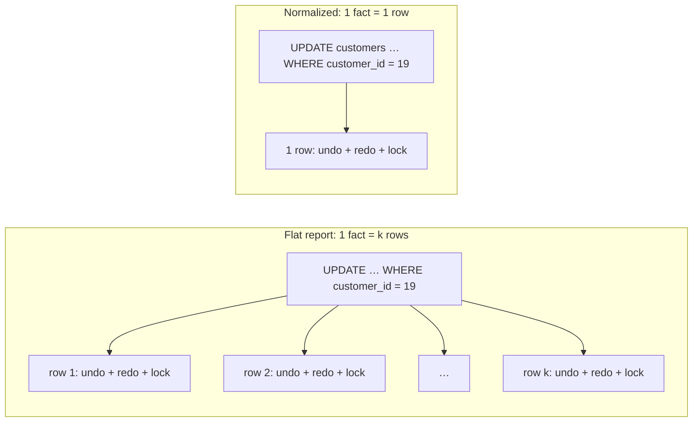

## Introduction

Spreadsheets teach a habit that databases punish: put everything you know about a sale on **one wide row**. Order number, date, customer name, customer email, city, product name, SKU, category, list price, quantity, price paid — one row per line item, ready to filter and pivot. It looks convenient, and for a one-off report it is. As the **storage design** of a system that is updated all day, it is a slow-motion disaster.

The reason is **redundancy**: the customer's email is not stored once, it is stored on *every line item the customer ever bought*. The product's name is stored on every line item that contains the product. Redundancy is not merely wasted bytes. It creates three precise, named failure modes that the relational design literature calls **anomalies**:

| Anomaly | What goes wrong | Typical symptom in production |
|---|---|---|
| **Update (modification) anomaly** | One real-world fact is stored in several rows; an update changes some copies but not all | "The customer changed their email but invoices still go to the old one" |
| **Insertion anomaly** | You cannot record a fact without also recording an unrelated fact | "We can't add the new product to the catalogue until somebody orders it" |
| **Deletion anomaly** | Deleting one fact silently destroys another | "We deleted a cancelled order and the product disappeared from the catalogue" |

This lesson builds such a flat table in MySQL from the shop dataset and **produces every anomaly for real** — with `UPDATE`, `INSERT` and `DELETE` statements and `SELECT`s that expose the resulting inconsistency. It then shows that the shop dataset's own tables (`customers`, `products`, `orders`, `order_items`, `categories`) are exactly the decomposition that eliminates them, and proves with `EXCEPT` that the flat report can be rebuilt from them without losing or inventing a single row.

The rest of Module 6 gives you the theory to do this systematically: *functional dependencies* name the facts, *normal forms* tell you when a table still mixes facts, and *decomposition algorithms* split it safely.

:::note[Dataset]
The examples use the **shop** dataset (25 customers, 30 products, 80 orders, 182 line items). The flat `order_report` table is created inside your lab; the dataset tables themselves are never modified. Every output below was captured from a real MySQL server.
:::

## DBMS Theory

:::theory[Redundancy and anomalies]
A relation schema **R** is a set of attributes; a relation instance **r(R)** is a set of tuples. A schema stores a fact **redundantly** when the same fact can be derived from more than one tuple of a legal instance. Codd's 1972 paper *Further Normalization of the Data Base Relational Model* introduced the second and third normal forms precisely to remove the "undesirable insertion, update and deletion dependencies" caused by such redundancy.

Elmasri and Navathe (*Fundamentals of Database Systems*, chapter "Basics of Functional Dependencies and Normalization") turn this into design guidelines. **Guideline 2:** design base relations so that no insertion, deletion or modification anomalies are present; if some are unavoidable (for performance), document them and make sure the programs that update the database handle them. **Guideline 4:** design relations so they can be joined on primary-key/foreign-key attributes without producing spurious tuples.
:::

The root cause of every anomaly is that **one relation describes more than one kind of thing**. Our flat report row describes four entities at once — an order, a customer, a product (with its category) — and one relationship, the line item. Each kind of thing has its own identifier:

- the **customer facts** (name, email, city) are determined by `customer_id`;
- the **product facts** (SKU, name, category, list price) are determined by `product_id`;
- the **order facts** (date, status, who placed it) are determined by `order_id`;
- only `quantity` and `unit_price` are facts about the **line item**, determined by `(order_id, product_id)`.

The primary key of the flat table is `(order_id, product_id)`, but most of its columns depend on only *part* of that key, or on a non-key column. Formally these are **functional dependencies** whose left side is not a key — the subject of the next lesson, [Functional Dependencies and Armstrong's Axioms](/lessons/m06-functional-dependencies). For now, the informal test is enough: *if a column's value is decided by something smaller than the whole key, that value will be repeated, and repetition invites anomalies.*

Three properties make the anomaly vocabulary precise:

1. **Update anomaly** — a single real-world change requires updating *k > 1* tuples. Any execution that updates fewer than *k* leaves the database in a state where two tuples assert contradictory facts.
2. **Insertion anomaly** — a fact about entity *E* can only be stored in a tuple whose key includes attributes of an unrelated entity *F*. Because key attributes cannot be NULL (entity integrity, see [Keys](/lessons/m01-keys)), the fact about *E* cannot be stored until an *F* exists.
3. **Deletion anomaly** — the last tuple carrying a fact about *E* is also a tuple about *F*; deleting the *F*-fact removes the *E*-fact as a side effect.

Note what these definitions do **not** say. They do not say redundancy is always wrong: a read-optimized reporting table can be deliberately redundant if it is rebuilt from a normalized source (see [Normalization vs Denormalization](/lessons/m06-denormalization)). The point is that a **system of record** — the place where truth is written — should not be.

## Why It Exists

Normalization theory exists because anomalies are not hypothetical. They are among the most common sources of silent data corruption in business systems, and they share a nasty property: **the database never reports an error**. Every individual statement succeeds; the inconsistency only shows up later, when two reports disagree or a customer complains.

What goes wrong without a normalized design:

- **Inconsistent answers.** If one customer has two different emails in the system of record, "what is this customer's email?" has no single answer. Different queries — `MIN(email)`, "the most recent order's email", "any row" — return different values, and every downstream system picks one arbitrarily.
- **Write amplification.** Renaming a category from "Coffee" to "Coffee & Tea" should be one row change. In the flat design it touches every line item of every product in that category, generating undo and redo log records, dirtying pages and taking row locks for each one.
- **Business rules leak into application code.** To avoid anomalies the application must remember to "update all rows of this customer", "never delete the last order of a product" and so on. Every code path, batch job and ad-hoc SQL session must follow those rules forever; one forgotten path is enough to corrupt the data.
- **Missing data.** Facts that have no partner (a product nobody has ordered yet, a customer who just signed up) simply cannot be stored, so the system either loses them or invents placeholder rows that pollute every aggregate.

A normalized design moves those rules **into the schema**: each fact is stored once, keys guarantee uniqueness, and foreign keys guarantee that references point at something that exists. The database engine — not every programmer — enforces consistency.

## Internal Working

:::internals[What an update to a redundant fact costs inside InnoDB]
In InnoDB every row lives in the **clustered index** (the primary-key B+ tree). An `UPDATE` that changes a column in *k* rows must, for each row:

1. locate it (via an index or by scanning the clustered index);
2. acquire an exclusive **record lock** on it (plus gap locks under `REPEATABLE READ` when the scan uses a non-unique index or no index);
3. write an **undo log record** with the old value (for rollback and for MVCC readers of older snapshots);
4. modify the record in its 16 KB page in the buffer pool and write a **redo log record** describing the change;
5. update every **secondary index** that contains the changed column (delete-mark the old entry, insert a new one).

Changing one customer's email in a normalized `customers` table does this once. Changing it in the flat report does it once *per line item the customer has*. The work, the log volume, the number of locks held until `COMMIT` and the replication traffic (the binary log records every changed row in row-based format) all scale with the redundancy.
:::

There is a second internal consequence: **without an index on the column used to find the copies, the update scans and locks the whole table**. The flat report's primary key is `(order_id, product_id)`; "all rows of customer 19" can only be found by scanning every row. Under InnoDB's default `REPEATABLE READ` isolation, a locking scan locks every record it examines (and the gaps between them), so a single customer's email change would block concurrent inserts of *other* customers' line items until it commits. Module 8 covers this in [Locking in InnoDB](/lessons/m08-locking).



The database engine has no concept of "these 18 values are copies of the same fact". To InnoDB they are 18 independent column values. That is why it cannot warn you when you update only some of them: the inconsistency is semantic, invisible to the storage layer. Only **schema design** — giving each fact one home — lets the engine help.

## MySQL Implementation

Build the flat table exactly as a well-meaning analyst might: one row per line item, primary key `(order_id, product_id)`, every descriptive column copied in.

```sql run
CREATE TABLE order_report (
  order_id       INT UNSIGNED  NOT NULL,
  order_date     DATETIME      NOT NULL,
  order_status   VARCHAR(12)   NOT NULL,
  customer_id    INT UNSIGNED  NOT NULL,
  customer_name  VARCHAR(101)  NOT NULL,
  customer_email VARCHAR(255)  NOT NULL,
  customer_city  VARCHAR(60)   NOT NULL,
  product_id     INT UNSIGNED  NOT NULL,
  sku            VARCHAR(20)   NOT NULL,
  product_name   VARCHAR(120)  NOT NULL,
  category_name  VARCHAR(60)   NULL,
  list_price     DECIMAL(10,2) NOT NULL,
  quantity       INT UNSIGNED  NOT NULL,
  unit_price     DECIMAL(10,2) NOT NULL,
  PRIMARY KEY (order_id, product_id)
);
INSERT INTO order_report
SELECT o.order_id, o.order_date, o.status,
       c.customer_id, CONCAT(c.first_name, ' ', c.last_name), c.email, c.city,
       p.product_id, p.sku, p.name, cat.name, p.price,
       oi.quantity, oi.unit_price
FROM order_items AS oi
JOIN orders      AS o   ON o.order_id = oi.order_id
JOIN customers   AS c   ON c.customer_id = o.customer_id
JOIN products    AS p   ON p.product_id = oi.product_id
LEFT JOIN categories AS cat ON cat.category_id = p.category_id;
SELECT COUNT(*) AS line_items FROM order_report;
```

Look at a few rows of one customer. The same name, email and city are repeated on every line:

```sql run
SELECT order_id, product_id, customer_id, customer_name, customer_email, customer_city, product_name
FROM order_report
WHERE customer_id = 19
ORDER BY order_id, product_id
LIMIT 8;
```

How much repetition is there? Count how many rows carry each customer's and each product's facts:

```sql run
SELECT 'customer facts' AS fact_kind,
       COUNT(DISTINCT customer_id) AS distinct_facts,
       COUNT(*)                    AS stored_copies,
       MAX(n)                      AS max_copies_of_one_fact
FROM (SELECT customer_id, COUNT(*) OVER (PARTITION BY customer_id) AS n FROM order_report) AS t
UNION ALL
SELECT 'product facts',
       COUNT(DISTINCT product_id), COUNT(*), MAX(n)
FROM (SELECT product_id, COUNT(*) OVER (PARTITION BY product_id) AS n FROM order_report) AS t;
```

Twenty customers' details are stored 182 times, the busiest customer's details 18 times. That redundancy is the raw material of every anomaly that follows.

## Syntax Breakdown

The lesson uses ordinary DML and DDL; what matters is *how* each statement interacts with redundancy.

| Statement / clause | Role in this lesson | What to watch |
|---|---|---|
| `CREATE TABLE … PRIMARY KEY (order_id, product_id)` | Declares the flat table's key | Every PK column is implicitly `NOT NULL` — the root of the insertion anomaly |
| `INSERT INTO … SELECT … JOIN …` | Copies facts from the normalized tables into the flat table | Each join multiplies the parent's facts onto every child row |
| `UPDATE … SET col = … WHERE …` | Changes stored values | The `WHERE` decides which **copies** change; MySQL reports `Rows matched` / `Changed` |
| `DELETE … WHERE …` | Removes rows | Removes **all** facts stored in those rows, not just the one you meant |
| `GROUP BY x HAVING COUNT(DISTINCT y) > 1` | Detects copies that disagree | The standard "does x still determine y?" check, formalized in the next lesson |
| `CREATE VIEW … AS SELECT … JOIN …` | Rebuilds the flat shape from normalized tables | A view stores no data, so it can never become inconsistent |
| `query EXCEPT query` | Rows in the first result but not the second | Available in MySQL since 8.0.31; used to prove two results are identical |
| `FOREIGN KEY … REFERENCES …` | Makes references point at existing parent rows | What lets the normalized design reject orphans |

:::standard[Standard SQL vs MySQL]
`EXCEPT` and `INTERSECT` are standard SQL set operators that MySQL added in **8.0.31**; before that you had to emulate them with `NOT EXISTS` or `LEFT JOIN … IS NULL`. `EXCEPT` without `ALL` behaves as `EXCEPT DISTINCT` (duplicates removed), which is what we want when comparing relations, because relations are sets. The `TABLE t` shorthand used occasionally below is also standard SQL, supported since MySQL 8.0.19.
:::

## Practical Examples

### 1. The update anomaly — a partial email change

Customer 19 tells support she has a new email address. The support tool edits "the order on screen" — order 48, her most recent — and updates the rows it can see:

```sql run
UPDATE order_report
SET    customer_email = 'lucia.m@newmail.example'
WHERE  order_id = 48;
```

The statement succeeded. Now ask the simple question "what is customer 19's email?":

```sql run
SELECT customer_email, COUNT(*) AS rows_with_this_value
FROM order_report
WHERE customer_id = 19
GROUP BY customer_email
ORDER BY customer_email;
```

There is no longer one answer. Order 48 had two line items, so two rows now carry the new address and the other 16 still carry the old one. Any query that picks "an" email for customer 19 now returns one of two contradictory values depending on which rows it happens to read. The general detection query asks, for every customer, whether more than one distinct email is stored:

```sql run
SELECT customer_id, COUNT(DISTINCT customer_email) AS distinct_emails
FROM order_report
GROUP BY customer_id
HAVING COUNT(DISTINCT customer_email) > 1;
```

This `GROUP BY … HAVING COUNT(DISTINCT …) > 1` pattern is how you test whether a **functional dependency** (here `customer_id → customer_email`) holds in the data — you will use it constantly in this module.

### 2. Write amplification — renaming a category

Even a *correct* update is expensive when the fact is repeated. Rename the "Coffee" category:

```sql run
UPDATE order_report
SET    category_name = 'Coffee & Tea'
WHERE  category_name = 'Coffee';
```

MySQL reports `Rows matched: 23  Changed: 23`: one renamed category cost 23 row changes. In the normalized `categories` table the same rename is a single-row update — and the shop dataset enforces `UNIQUE (name)` on it, something the flat table cannot express at all.

### 3. The insertion anomaly — a product nobody has ordered

The shop adds a new product, a smart watch. In the flat design the only place product facts live is a line item, and a line item needs an `order_id`:

```sql run error
INSERT INTO order_report (order_id, order_date, order_status, customer_id, customer_name,
                          customer_email, customer_city, product_id, sku, product_name,
                          category_name, list_price, quantity, unit_price)
VALUES (NULL, NOW(), 'none', 0, '', '', '', 31, 'SKU-1031', 'Smart Watch', 'Fitness', 199.00, 0, 0);
```

MySQL refuses: the primary key column `order_id` cannot be NULL (entity integrity). The flat table can only learn about a product once somebody buys it. The insertion anomaly is already visible in the data we loaded:

```sql run
SELECT (SELECT COUNT(*) FROM products)                AS products_in_catalogue,
       (SELECT COUNT(DISTINCT product_id) FROM order_report)  AS products_in_report,
       (SELECT COUNT(*) FROM customers)               AS customers_registered,
       (SELECT COUNT(DISTINCT customer_id) FROM order_report) AS customers_in_report;
```

The typical workaround is a **dummy row** — a fake order 0 with a fake customer. It satisfies the constraints and corrupts every aggregate:

The catalogue has 30 products and 25 customers, but the report knows only 28 products and 20 customers — the two never-ordered products and the five customers without orders simply do not exist as far as the flat design is concerned.

```sql run
INSERT INTO order_report VALUES
  (0, '2024-12-31 00:00:00', 'placeholder', 0, '(none)', '(none)', '(none)',
   31, 'SKU-1031', 'Smart Watch', 'Fitness', 199.00, 0, 0.00);
SELECT COUNT(DISTINCT order_id)    AS orders_counted,
       COUNT(DISTINCT customer_id) AS customers_counted,
       MIN(order_date)             AS first_order,
       MAX(order_date)             AS last_order
FROM order_report;
```

Now the report counts 81 orders and 21 customers — both wrong by one — and the "last order" is the placeholder's 2024-12-31. Every report must remember to exclude `order_id = 0` forever. Remove it before continuing:

```sql run
DELETE FROM order_report WHERE order_id = 0;
```

### 4. The deletion anomaly — cancelling an order

Customer 17 cancels pending order 29, and the application deletes its line items:

```sql run
SELECT order_id, product_id, product_name, sku, list_price
FROM order_report
WHERE order_id = 29
ORDER BY product_id;
```

```sql run
DELETE FROM order_report WHERE order_id = 29;
SELECT COUNT(*) AS rows_about_pour_over_kettle
FROM order_report
WHERE product_id = 16;
```

Order 29 had two line items, a coffee grinder and the Pour-Over Kettle, and it was the **only** order containing the kettle (product 16). Deleting the order also deleted the only record of the product's name, SKU, category and list price. Nobody intended to remove a product from the catalogue, yet it is gone.

### 5. The fix — one fact, one place

The shop dataset already stores these facts normalized. A **view** recreates the flat shape on demand by joining them:

```sql run
CREATE VIEW order_report_v AS
SELECT o.order_id, o.order_date, CAST(o.status AS CHAR(12)) AS order_status,
       c.customer_id, CONCAT(c.first_name, ' ', c.last_name) AS customer_name, c.email AS customer_email, c.city AS customer_city,
       p.product_id, p.sku, p.name AS product_name, cat.name AS category_name, p.price AS list_price,
       oi.quantity, oi.unit_price
FROM order_items AS oi
JOIN orders      AS o   ON o.order_id = oi.order_id
JOIN customers   AS c   ON c.customer_id = o.customer_id
JOIN products    AS p   ON p.product_id = oi.product_id
LEFT JOIN categories AS cat ON cat.category_id = p.category_id;
SELECT COUNT(*) AS rows_in_view FROM order_report_v;
```

In the normalized design each anomaly disappears structurally:

```sql run
SELECT (SELECT COUNT(*) FROM customers WHERE customer_id = 19) AS rows_holding_customer_19_email,
       (SELECT COUNT(*) FROM categories WHERE name = 'Coffee')  AS rows_holding_coffee_name,
       (SELECT COUNT(*) FROM products WHERE product_id = 4)     AS never_ordered_product_still_stored,
       (SELECT COUNT(*) FROM products WHERE product_id = 16)    AS kettle_survives_order_deletion;
```

The email lives in exactly one row, so it cannot disagree with itself; the category name lives in one row; product 4 (never ordered) exists independently of orders; and deleting an order's line items would not touch `products`.

## Execution Walkthrough

The walkthrough proves that the decomposition is **lossless**: joining the normalized tables reproduces the flat table exactly — no rows lost, none invented. We rebuild a fresh, unmodified copy of the flat table so the comparison is fair (our `order_report` was deliberately damaged above).

```walkthrough
title: Proving the normalized tables reproduce the flat report exactly
steps:
  - title: "1. Rebuild a clean flat copy from the original data"
    explain: CREATE TABLE … AS SELECT copies the view's result into a real table. This is what the flat report looked like before any anomaly.
    sql: |
      CREATE TABLE order_report_clean AS SELECT * FROM order_report_v;
      SELECT COUNT(*) AS clean_rows FROM order_report_clean;
  - title: "2. Count the facts in each normalized table"
    explain: The same information is held in far fewer stored values — 20 customers who ordered, 28 products that were ordered, 80 orders and 182 line items. Each fact is stored once.
    sql: |
      SELECT (SELECT COUNT(DISTINCT customer_id) FROM order_report_clean) AS customers_used,
             (SELECT COUNT(DISTINCT product_id)  FROM order_report_clean) AS products_used,
             (SELECT COUNT(DISTINCT order_id)    FROM order_report_clean) AS orders_used,
             (SELECT COUNT(*) FROM order_items)                         AS line_items;
  - title: "3. Rows in the flat copy but not in the join (lost information?)"
    explain: EXCEPT returns rows of the first query that are missing from the second. Zero means the join loses nothing.
    sql: |
      SELECT COUNT(*) AS missing_from_join
      FROM (SELECT * FROM order_report_clean EXCEPT SELECT * FROM order_report_v) AS d;
  - title: "4. Rows in the join but not in the flat copy (spurious tuples?)"
    explain: The reverse difference. Zero means the join invents nothing — no spurious tuples. Both directions empty plus equal counts means the two relations are identical.
    sql: |
      SELECT COUNT(*) AS spurious_in_join
      FROM (SELECT * FROM order_report_v EXCEPT SELECT * FROM order_report_clean) AS d;
  - title: "5. Compare with the damaged table"
    explain: >-
      The same test against the damaged order_report shows exactly what our anomalies did. 25 clean rows are missing from it:
      the 2 deleted line items of order 29 plus 23 rows whose values changed. Those 23 changed rows appear on the other side —
      2 rows with the new email and 21 surviving rows renamed to Coffee & Tea (2 of the 23 renamed rows belonged to order 29 and were later deleted).
    sql: |
      SELECT (SELECT COUNT(*) FROM (SELECT * FROM order_report_clean EXCEPT SELECT * FROM order_report) AS a) AS clean_rows_not_in_damaged,
             (SELECT COUNT(*) FROM (SELECT * FROM order_report EXCEPT SELECT * FROM order_report_clean) AS b) AS damaged_rows_not_in_clean;
```

Why is this join lossless? Each join connects a child to its parent through the parent's **primary key** (`order_items.order_id → orders.order_id`, `orders.customer_id → customers.customer_id`, …). Each child row matches *at most one* parent row, so joining cannot multiply rows, and the foreign keys guarantee it matches *at least one*. The formal version of this argument — a decomposition is lossless when the shared attributes form a key of one side — is proved in [Lossless Decomposition and Dependency Preservation](/lessons/m06-decomposition-properties).

## Output

The final picture combines the two halves of the lesson. The damaged flat table now disagrees with the truth in a way no constraint caught:

```sql run
SELECT 'order_report (flat, damaged)' AS source,
       COUNT(*)                     AS line_items,
       COUNT(DISTINCT customer_email) AS distinct_emails,
       COUNT(DISTINCT product_id)   AS products_known,
       SUM(category_name = 'Coffee') AS lines_in_coffee
FROM order_report
UNION ALL
SELECT 'order_report_v (normalized)',
       COUNT(*), COUNT(DISTINCT customer_email), COUNT(DISTINCT product_id),
       SUM(category_name = 'Coffee')
FROM order_report_v;
```

Read it row by row. The flat table has lost order 29's two line items (182 → 180 lines), knows 27 products instead of 28 (the kettle is gone), holds 21 distinct emails for 20 customers (customer 19 counts twice) and has no line in "Coffee" — 0 versus 23 — because we renamed the category there and only there. The normalized view, built from data where every fact has one home, still answers consistently.

## Alternative Approaches

Normalization is the principled fix, but it is not the only response teams use. Know the alternatives and why they are weaker for a system of record.

| Approach | How it handles anomalies | When it is acceptable |
|---|---|---|
| **Normalize** (decompose by entity, connect with FKs) | Eliminates them structurally; the engine enforces consistency | Default for OLTP systems of record |
| **Flat table + application discipline** ("always update all rows of a customer") | Relies on every code path being correct | Almost never; breaks with the first ad-hoc fix or batch job |
| **Flat table + triggers** that propagate changes to all copies | Automates the multi-row update | Only for deliberate, documented denormalization (see [Normalization vs Denormalization](/lessons/m06-denormalization)) |
| **Flat table rebuilt from a normalized source** (materialized report, ETL) | The flat table is never written directly, so anomalies cannot originate there | Reporting, analytics, data warehouses (Module 13) |
| **A view over normalized tables** | Stores no data; nothing to get out of sync | Whenever consumers want the flat shape and the join is cheap enough |
| **Document / JSON store with embedded copies** | Same anomalies, just inside documents | When the embedded data is genuinely immutable (a snapshot) |

That last row deserves emphasis because it is a real design choice in this very dataset: `order_items.unit_price` *looks* like a redundant copy of `products.price`, but it is not — it records **the price at the time of the sale**, a different fact that legitimately differs from today's list price. Snapshotting a value on purpose (an invoice address, a historical price) is correct modelling, not redundancy. The test is whether the two values are supposed to stay equal forever. The next lesson shows how to check that with SQL.

## Performance Analysis

Anomalies are a correctness topic first, but redundancy also has a measurable cost profile. The numbers below are counts from the captured statements, not timings, because on 182 rows every statement runs in well under a millisecond.

| Operation | Flat report | Normalized tables |
|---|---|---|
| Change a customer's email | One row per line item of that customer (18 for customer 19) | 1 row in `customers` |
| Rename a category | One row per line item in the category | 1 row in `categories` |
| Read "order 48 with customer and product details" | 1 table, no joins | 4–5 joins on primary keys |
| Storage | Every descriptive value repeated per line item | Each value stored once plus small FK columns |
| Indexes needed to update copies efficiently | Extra secondary indexes on `customer_id`, `product_id`, `category_name` — each one *also* updated on every write | Primary keys and FK indexes only |

:::performance[Joins are not the enemy]
The usual objection to normalization is "joins are slow". Joins on primary keys and indexed foreign keys are among the cheapest operations a relational engine performs: each lookup is a B+ tree descent of three or four page reads, usually from the buffer pool. Measure before you denormalize; [Multi-Table Joins](/lessons/m04-multi-table-joins) and [Optimizing Joins](/lessons/m07-optimizing-joins) show how MySQL executes them. Denormalization is justified by measurements on real workloads, not by the existence of joins.
:::

The flat design pays its costs on **writes** (amplification, locking, logging, replication volume) and on **correctness**. It wins on some **reads** — one table, no joins — which is exactly why reporting systems use flat tables built *from* a normalized source.

## Best Practices

:::best-practice[Designing away anomalies]
1. **One fact, one place.** For every non-key column ask "what identifies the thing this describes?" If the answer is not the table's whole key, the column belongs in another table.
2. **Separate the system of record from reporting shapes.** Write to normalized tables; serve flat shapes through views, summary tables or a warehouse that is rebuilt from them.
3. **Distinguish snapshots from copies.** A value deliberately frozen at a point in time (price paid, shipping address on an invoice) is a separate fact and should be named as such (`unit_price`, `ship_to_city`).
4. **Let keys and foreign keys enforce the design.** Entity integrity and referential integrity are what make anomalies impossible rather than merely unlikely.
5. **Audit existing tables with dependency checks.** `GROUP BY x HAVING COUNT(DISTINCT y) > 1` finds copies that already disagree; run it in data-quality jobs for any table you suspect is denormalized.
6. **If you denormalize, document it** (Elmasri & Navathe's Guideline 2) and automate consistency — never rely on "remember to update all the rows".
:::

## Common Mistakes

**Mistake 1 — updating "the row on screen" instead of the fact.** The update anomaly is usually caused by an innocent `WHERE` clause that targets one order rather than the customer:

```sql run
-- Wrong scope: updates the city only on the rows of one order
UPDATE order_report SET customer_city = 'Oakland' WHERE order_id = 75;
SELECT customer_city, COUNT(*) AS n
FROM order_report WHERE customer_id = 19
GROUP BY customer_city ORDER BY customer_city;
```

In the flat table the "correct" fix (`WHERE customer_id = 19`) still requires every developer to know that customer facts are duplicated. In a normalized design the only possible statement is `UPDATE customers SET city = … WHERE customer_id = 19`, and it cannot be partial.

**Mistake 2 — using a dummy parent row to work around an insertion anomaly.** Order 0 / customer 0 placeholders satisfy `NOT NULL` but make every count, average and date range wrong, as Practical Example 3 showed. Create the missing entity table instead.

**Mistake 3 — assuming the flat table and the source agree because "nobody updates it".** Someone always does. If a reporting table must exist, rebuild it from the source on a schedule or maintain it automatically, and test it with the `EXCEPT` comparison from the walkthrough.

**Mistake 4 — calling every repeated value redundancy.** `order_items.unit_price` repeats `products.price` for many rows, yet differs from it on purpose. Removing it in the name of normalization would *lose* information (the historical price). Check the semantics before decomposing.

**Mistake 5 — believing constraints on the flat table can prevent the update anomaly.** A `CHECK` constraint in MySQL can only reference columns of the same row, so no `CHECK` can say "all rows of customer 19 have the same email". `UNIQUE` cannot help either, because the repeated value is *supposed* to repeat. Only decomposition (or a trigger) can enforce it.

```sql run error
CREATE TABLE order_report_checked (
  order_id       INT UNSIGNED NOT NULL,
  customer_id    INT UNSIGNED NOT NULL,
  customer_email VARCHAR(255) NOT NULL,
  CONSTRAINT chk_one_email_per_customer
    CHECK (customer_email = (SELECT MIN(r2.customer_email) FROM order_report AS r2
                             WHERE r2.customer_id = customer_id))
);
```

MySQL rejects it with error 3815 (*contains disallowed function*): subqueries, stored functions and non-deterministic functions are not allowed in `CHECK` expressions, confirming that cross-row rules need a different tool.

## Industry Application

- **ERP and CRM migrations.** Legacy systems built on flat files or spreadsheets routinely contain the same customer under several spellings and addresses. Migration projects spend weeks de-duplicating them — the accumulated cost of years of update anomalies — before loading into a normalized schema.
- **E-commerce order systems** keep orders, customers and products separate but snapshot the values that must not change after purchase (unit price, tax rate, shipping address). This is the exact distinction between a redundant copy and a historical fact discussed above.
- **Data quality monitoring.** Data teams run dependency checks such as "one email per customer id" and "one category per product" as automated tests (for example in dbt or Great Expectations) on staging tables, because upstream sources often deliver denormalized extracts.
- **Analytics and BI.** Warehouses intentionally use wide, redundant tables (star-schema dimensions, one big table for dashboards). They avoid anomalies by never updating those tables in place: they are rebuilt or appended from normalized sources by ETL/ELT pipelines (Module 13).
- **Microservices.** When services keep local copies of another service's data (a customer name inside the order service), the update anomaly becomes a distributed problem, solved with events that propagate changes and an explicit owner for each fact ([Distributed Data Integrity](/lessons/m12-distributed-integrity)).

## Practice Exercises

Each exercise runs in a fresh lab with the shop dataset. Exercises that need the flat table create it in their `setup`.

```exercise
id: ex1
title: Spot the inconsistent customers
difficulty: easy
setup: |
  CREATE TABLE order_report AS
  SELECT o.order_id, o.customer_id, c.email AS customer_email, c.city AS customer_city, oi.product_id
  FROM order_items oi JOIN orders o ON o.order_id = oi.order_id JOIN customers c ON c.customer_id = o.customer_id;
  UPDATE order_report SET customer_email = 'changed@example.com' WHERE order_id IN (48, 3);
  UPDATE order_report SET customer_city = 'Oakland' WHERE order_id = 7;
concepts: [update-anomaly, redundancy]
prompt: |
  The table `order_report` (columns `order_id, customer_id, customer_email, customer_city, product_id`) has suffered
  partial updates. Return every `customer_id` that now has **more than one distinct email** stored, with a second
  column `distinct_emails` holding that number. Order by `customer_id`.
hints:
  - "Group the rows by the column that should determine the email."
  - "Use HAVING COUNT(DISTINCT customer_email) > 1."
solution: |
  SELECT customer_id, COUNT(DISTINCT customer_email) AS distinct_emails
  FROM order_report
  GROUP BY customer_id
  HAVING COUNT(DISTINCT customer_email) > 1
  ORDER BY customer_id;
orderMatters: true
explanation: |
  `customer_id` should determine `customer_email`; a group with more than one distinct email is a violated
  dependency — the footprint of an update anomaly. Using `COUNT(customer_email)` instead of
  `COUNT(DISTINCT customer_email)` would flag every customer with more than one line item, which is just
  redundancy, not inconsistency. Note that order 7's city change is not reported: this query only checks emails.
```

```exercise
id: ex2
title: Which products would a purge erase?
difficulty: medium
setup: |
  CREATE TABLE order_report AS
  SELECT o.order_id, o.status AS order_status, p.product_id, p.name AS product_name
  FROM order_items oi JOIN orders o ON o.order_id = oi.order_id JOIN products p ON p.product_id = oi.product_id;
concepts: [deletion-anomaly]
prompt: |
  The operations team wants to run `DELETE FROM order_report WHERE order_status IN ('cancelled', 'refunded')`.
  Before they do, list the products that would **disappear completely** from `order_report` — products whose
  every row belongs to a cancelled or refunded order. Return `product_id` and `product_name`, ordered by `product_id`.
  Return an empty result only if no product is affected.
hints:
  - "Group by product and compare the number of its rows with the number of its rows that would be deleted."
  - "SUM(order_status IN ('cancelled','refunded')) counts the rows that would be deleted."
solution: |
  SELECT product_id, MIN(product_name) AS product_name
  FROM order_report
  GROUP BY product_id
  HAVING SUM(order_status IN ('cancelled', 'refunded')) = COUNT(*)
  ORDER BY product_id;
allowEmpty: true
orderMatters: true
explanation: |
  A product disappears exactly when all of its rows are deleted. `HAVING SUM(condition) = COUNT(*)` expresses
  "every row satisfies the condition". `NOT EXISTS` with a correlated subquery for a surviving row is an
  equivalent formulation. This is the deletion anomaly made measurable: a purge of orders would also purge
  catalogue facts. On the shop data no product is affected, which is why the result may be empty — but the
  same check on another day could return rows.
```

```exercise
id: ex3
title: Extract the customer facts into their own table
difficulty: hard
kind: dml
setup: |
  CREATE TABLE order_report AS
  SELECT o.order_id, o.customer_id, c.first_name, c.last_name, c.email AS customer_email, oi.product_id, oi.quantity
  FROM order_items oi JOIN orders o ON o.order_id = oi.order_id JOIN customers c ON c.customer_id = o.customer_id;
concepts: [decomposition, redundancy]
prompt: |
  Remove the customer redundancy from `order_report`:

  1. Create `report_customers (customer_id INT UNSIGNED PRIMARY KEY, first_name VARCHAR(50) NOT NULL,
     last_name VARCHAR(50) NOT NULL, customer_email VARCHAR(255) NOT NULL UNIQUE)`.
  2. Fill it with one row per customer from `order_report` using `INSERT … SELECT DISTINCT`.
  3. Drop the columns `first_name`, `last_name` and `customer_email` from `order_report`.

  The checker lists the columns of both tables and the number of rows in `report_customers`.
hints:
  - "SELECT DISTINCT customer_id, first_name, last_name, customer_email FROM order_report gives one row per customer — if the data is consistent."
  - "ALTER TABLE order_report DROP COLUMN first_name, DROP COLUMN last_name, DROP COLUMN customer_email;"
solution: |
  CREATE TABLE report_customers (
    customer_id    INT UNSIGNED PRIMARY KEY,
    first_name     VARCHAR(50)  NOT NULL,
    last_name      VARCHAR(50)  NOT NULL,
    customer_email VARCHAR(255) NOT NULL UNIQUE
  );
  INSERT INTO report_customers (customer_id, first_name, last_name, customer_email)
  SELECT DISTINCT customer_id, first_name, last_name, customer_email FROM order_report;
  ALTER TABLE order_report DROP COLUMN first_name, DROP COLUMN last_name, DROP COLUMN customer_email;
check: |
  SELECT TABLE_NAME, COLUMN_NAME
  FROM information_schema.COLUMNS
  WHERE TABLE_SCHEMA = DATABASE() AND TABLE_NAME IN ('order_report', 'report_customers')
  UNION ALL
  SELECT 'report_customers rows', CAST(COUNT(*) AS CHAR) FROM report_customers
  ORDER BY 1, 2;
explanation: |
  `SELECT DISTINCT` collapses the 182 copies into 20 customer rows. The primary key doubles as a safety net:
  if the flat data had contained two different emails for one customer (an update anomaly), the `INSERT`
  would fail with a duplicate-key error instead of silently keeping both — decomposition forces you to resolve
  the inconsistency. Dropping the columns afterwards is what actually removes the redundancy.
```

```exercise
id: ex4
title: Is it redundancy or history?
difficulty: medium
kind: open
concepts: [redundancy, normalization]
prompt: |
  In the shop schema, `order_items.unit_price` frequently equals `products.price`. A colleague proposes dropping
  `unit_price` "to remove redundancy" and computing revenue as `quantity * products.price`.
  Explain whether `unit_price` is a redundant copy, what would go wrong if it were dropped, and state a general
  rule for telling redundant copies from legitimate snapshots.
solution: |
  `unit_price` is not a redundant copy of `products.price`. It records a **different fact**: the price agreed for
  this line item at the time of the order. `products.price` is the *current* list price, which changes over time
  (and the shop data already shows line items whose unit price differs from the list price — discounts, price
  changes). The functional dependency `product_id → unit_price` does **not** hold; `unit_price` depends on the
  whole key `(order_id, product_id)`.

  Dropping it would lose information: historical revenue, invoices and refunds would be recomputed with
  today's price, so last year's revenue would change every time a price changes — an accounting error.

  General rule: two stored values are redundant copies only if they are **required to be equal at all times**
  (the same fact). If they are allowed to diverge — because one is a point-in-time snapshot, an override or a
  value agreed in a contract — they are separate facts and both belong in the schema, ideally with names that
  make the difference explicit (`unit_price` vs `list_price`, `ship_to_address` vs `customer_address`).
```

```exercise
id: ex5
title: Design review — a flat course roster
difficulty: challenge
kind: open
concepts: [update-anomaly, insertion-anomaly, deletion-anomaly, decomposition]
prompt: |
  A department tracks enrollments in one table:

  `roster(student_id, student_name, student_email, course_id, course_title, credits, instructor_name, instructor_office, grade)`
  with primary key `(student_id, course_id)`; each course has exactly one instructor.

  Give one concrete example of **each** of the three anomalies, then propose a decomposition (tables, primary
  keys, foreign keys) that removes them. Finally, say which query would prove your decomposition reproduces the
  original roster.
solution: |
  **Update anomaly:** instructor Dr. Rao moves to office E-210. Her office is stored on every enrollment row of
  every course she teaches; updating only some rows leaves two offices for one instructor. Likewise a course
  title correction or a student email change.

  **Insertion anomaly:** a new course CS-299 with its title, credits and instructor cannot be recorded until a
  student enrolls, because `student_id` is part of the primary key and cannot be NULL. A newly hired instructor
  without a course cannot be recorded at all.

  **Deletion anomaly:** if the last student drops CS-299, deleting that enrollment removes the only record of
  the course's title, credits and instructor.

  **Decomposition:**
  - `students(student_id PK, student_name, student_email UNIQUE)`
  - `instructors(instructor_id PK, instructor_name, instructor_office)` (introduce a surrogate key; names are not reliable identifiers)
  - `courses(course_id PK, course_title, credits, instructor_id FK → instructors)`
  - `enrollments(student_id FK → students, course_id FK → courses, grade, PRIMARY KEY (student_id, course_id))`

  Each table describes one kind of thing, and each non-key column depends on its table's whole key.

  **Proof of losslessness:** join `enrollments ⋈ students ⋈ courses ⋈ instructors`, project the original
  columns, and compare with the original roster in both directions with `EXCEPT` (both differences must be
  empty) and compare `COUNT(*)`. Every join goes from a foreign key to a primary key, so no row can be
  duplicated or invented.
```

## Knowledge Assessment

```quiz
- id: q1
  question: "A flat table stores each customer's email on every line item. Support updates the email on the rows of one order only. Which anomaly is this?"
  options: ["Insertion anomaly", "Update (modification) anomaly", "Deletion anomaly", "Spurious-tuple anomaly"]
  answer: 1
  explanation: "One fact (the customer's email) is stored in several rows and only some copies changed — the definition of an update anomaly. An insertion anomaly is about being unable to record a fact; a deletion anomaly about losing one; spurious tuples arise from lossy joins, not updates."
  concepts: [update-anomaly]
- id: q2
  question: "Why can't the flat `order_report` table (primary key `(order_id, product_id)`) store a product nobody has ordered?"
  options:
    - "Because MySQL limits the number of columns in a table"
    - "Because order_id is part of the primary key, so it cannot be NULL, and there is no real order to put there"
    - "Because product_id has no index"
    - "Because INSERT … SELECT cannot insert a single row"
  answer: 1
  explanation: "Entity integrity requires every primary-key column to be non-NULL. The product fact can only be stored attached to an order — an insertion anomaly. Indexes and column limits are irrelevant; INSERT … VALUES can insert one row."
  concepts: [insertion-anomaly]
- id: q3
  question: "Deleting the only order that contains product 16 also removes the product's name and price from the flat table. What design property causes this?"
  options:
    - "The table has no secondary indexes"
    - "Facts about two different entities (an order line and a product) are stored in the same tuple"
    - "The DELETE statement did not use a transaction"
    - "Foreign keys were declared with ON DELETE CASCADE"
  answer: 1
  explanation: "A deletion anomaly happens when the last tuple carrying a fact about entity E is also a tuple about entity F. Transactions only make the delete atomic; they do not change what is deleted. The flat table has no foreign keys at all."
  concepts: [deletion-anomaly]
- id: q4
  question: "Which query detects that `customer_id → customer_email` has been violated in a flat table?"
  options:
    - "SELECT customer_id FROM t GROUP BY customer_id HAVING COUNT(*) > 1"
    - "SELECT customer_id FROM t GROUP BY customer_id HAVING COUNT(DISTINCT customer_email) > 1"
    - "SELECT customer_email FROM t WHERE customer_email IS NULL"
    - "SELECT DISTINCT customer_id, customer_email FROM t"
  answer: 1
  explanation: "A violation means one customer_id with more than one distinct email. COUNT(*) > 1 merely finds customers with several rows (redundancy, not inconsistency). SELECT DISTINCT lists pairs but does not single out the violations."
  concepts: [update-anomaly, redundancy]
- id: q5
  question: "Which of the following are legitimate reasons a value may appear in two tables without being redundancy? (Select all that apply.)"
  type: multi
  options:
    - "It is a point-in-time snapshot, such as the unit price paid on an order line"
    - "It is a foreign key referencing the other table's primary key"
    - "It is a copy of the customer's current email kept 'for convenience' in orders"
    - "It is the shipping address frozen on an invoice when the invoice was issued"
  answer: [0, 1, 3]
  explanation: "Snapshots record a different fact (the value at a moment in time) and foreign keys are the mechanism that connects tables. A convenience copy of the current email must always equal customers.email — that is redundancy and invites update anomalies."
  concepts: [redundancy, normalization]
- id: q6
  question: "A category name appears on 40 line items in a flat table. In InnoDB, what does renaming the category cost compared with a normalized `categories` table?"
  options:
    - "The same — InnoDB stores repeated strings only once"
    - "About 40 times the row changes: each affected row gets its own lock, undo record and redo record"
    - "Nothing extra, because the query cache absorbs repeated values"
    - "Less, because the flat table needs no join"
  answer: 1
  explanation: "InnoDB has no notion that values are copies; each row is updated independently with its own record lock, undo and redo. InnoDB does not deduplicate strings across rows, and the query cache was removed in MySQL 8.0."
  concepts: [redundancy, update-anomaly]
- id: q7
  question: "Two queries are run: `A EXCEPT B` and `B EXCEPT A` both return zero rows, and COUNT(*) is equal for A and B. What can you conclude about the decomposition that produced B by joining tables?"
  options:
    - "Nothing — EXCEPT ignores NULLs"
    - "The join reproduces A exactly: no tuple is lost and no spurious tuple is created"
    - "The decomposition is dependency-preserving"
    - "The decomposition is in BCNF"
  answer: 1
  explanation: "Empty differences in both directions mean the two results contain the same distinct rows; equal counts rule out duplicate rows. That is the empirical lossless-join check. It says nothing about dependency preservation or normal forms, which are properties of the schema and its FDs. (EXCEPT compares NULLs as not distinct, like DISTINCT does.)"
  concepts: [decomposition]
- id: q8
  question: "Why can't a MySQL CHECK constraint on the flat table enforce 'one email per customer'?"
  options:
    - "CHECK constraints are parsed but ignored in MySQL 8.4"
    - "A CHECK constraint may only reference the current row's columns; it cannot contain subqueries"
    - "CHECK constraints cannot reference VARCHAR columns"
    - "It can, if the constraint is declared NOT ENFORCED"
  answer: 1
  explanation: "Since 8.0.16 MySQL enforces CHECK constraints, but they are row-level predicates — subqueries and references to other rows are rejected. Cross-row rules need decomposition (plus keys) or triggers. NOT ENFORCED disables a check; it does not extend what it can express."
  concepts: [update-anomaly]
```
