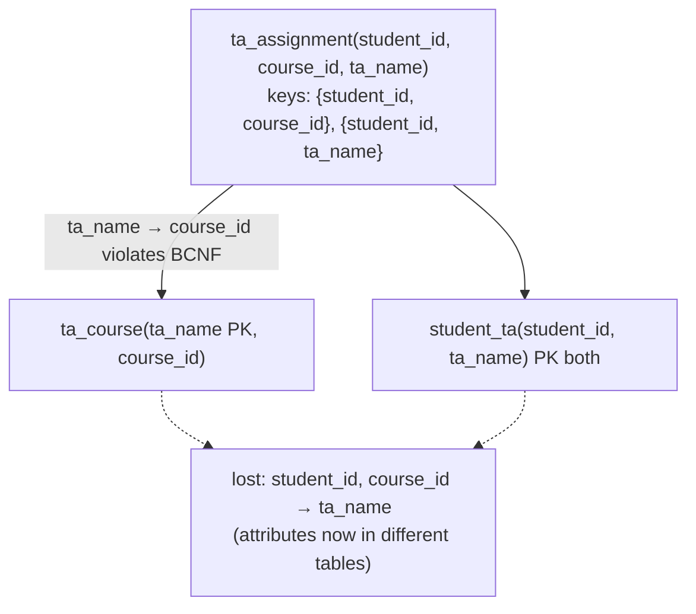

## Introduction

Third normal form lets one kind of dependency through: a non-key attribute may determine a **prime** attribute. That loophole is narrow, but real schemas hit it whenever a relation has **two overlapping composite keys**. The textbook illustration is a tutoring or teaching-assistant assignment:

- each student has **one TA per course** — `(student_id, course_id) → ta_name`;
- each TA works for **exactly one course** — `ta_name → course_id`.

A table `ta_assignment(student_id, course_id, ta_name)` is in 3NF — every attribute is prime — yet it is redundant: the fact "Maya Chen is a TA for CS-157A" is repeated for every student Maya tutors. Change Maya's course and you must update all of those rows.

**Boyce-Codd normal form (BCNF)** closes the loophole: *every determinant must be a superkey*, no exceptions for prime attributes. The price is that BCNF decomposition can **lose a functional dependency** — after splitting `ta_assignment`, no single table contains `student_id`, `course_id` and `ta_name`, so no primary key or `UNIQUE` constraint can enforce "one TA per student per course" any more.

This lesson demonstrates all of it in MySQL: the anomalies of the 3NF table, the BCNF decomposition algorithm, the lost dependency producing invalid data, and two ways to enforce the lost dependency — a **composite foreign key plus `UNIQUE`** and a **trigger** — with real two-session races that show which approaches hold up under concurrency and why.

:::note[Dataset]
The lesson runs on the **university** dataset; the TA assignment tables are created in your lab with real student ids. Every output, including the concurrent-session scenario, was captured on a real MySQL server.
:::

## DBMS Theory

:::theory[Boyce-Codd normal form]
A relation schema R with FD set F is in **BCNF** if for every non-trivial FD X → Y in F⁺ (equivalently, in F, when testing R itself), **X is a superkey of R**. (Codd 1974, building on a suggestion by Boyce; Silberschatz et al. §7.3; Elmasri & Navathe §14.5.)

Compare with 3NF (Zaniolo): X is a superkey **or every attribute of Y − X is prime**. BCNF drops the second option, so **BCNF ⇒ 3NF**, but not conversely.
:::

**When are 3NF and BCNF different?** Only when some FD has a non-superkey left side and a prime right side. One can show that this requires **overlapping composite candidate keys**: a 3NF relation in which no two candidate keys share an attribute is automatically in BCNF (Vincent & Srinivasan, 1993). In `ta_assignment` the keys `{student_id, course_id}` and `{student_id, ta_name}` overlap in `student_id`.

**Useful facts.**

- Every relation with exactly **two attributes** is in BCNF.
- To test a *decomposed* relation Rᵢ, it is not enough to look at the FDs of F that happen to mention only Rᵢ's attributes; dependencies **implied** by F may restrict Rᵢ too. The safe test: for every X ⊆ Rᵢ, (X⁺ under F) ∩ Rᵢ is either ⊆ X (trivial) or all of Rᵢ (X is a superkey of Rᵢ).

### The BCNF decomposition algorithm

```
result := { R }
while some Ri in result is not in BCNF:
    choose a non-trivial X → Y that holds on Ri with X not a superkey of Ri
    replace Ri by   R1 = X ∪ Y   and   R2 = Ri − (Y − X)
return result
```

Each split is **lossless**, because R1 ∩ R2 = X and X → Y means X is a key of R1. The algorithm terminates because each relation gets smaller. Taking Y = X⁺ ∩ Rᵢ (everything X determines) reduces the number of splits.

**What it does not guarantee:** dependency preservation. An FD whose attributes end up in different relations can no longer be checked inside one relation. For some schemas (including `ta_assignment`) **no** BCNF decomposition preserves all dependencies — a theorem, not a weakness of the algorithm. That is the fundamental 3NF-vs-BCNF trade-off:

| Goal | 3NF synthesis | BCNF decomposition |
|---|---|---|
| Lossless join | Always | Always |
| Dependency preservation | Always | Not always |
| Redundancy from FDs | Possible (only via prime attributes) | None |

## Why It Exists

BCNF exists because 3NF's exception is not harmless: the prime-attribute loophole still allows **redundancy and all three anomalies**, just in a narrower class of tables:

- **Update anomaly:** Maya Chen moves from CS-157A to CS-146. `ta_name → course_id` is stored once per student she tutors; updating one row leaves her in two courses.
- **Insertion anomaly:** a new TA is hired for DATA-245 but has no students yet. Both keys contain `student_id`, so the TA's course cannot be recorded.
- **Deletion anomaly:** the last student of a TA withdraws; the only record of which course that TA supports disappears.

BCNF is the strongest normal form defined purely in terms of FDs: a relation in BCNF has **no redundancy that FDs can detect** — every value that an FD would let you infer from another row is a key value, which is never repeated. Higher normal forms (4NF, 5NF, next lesson) need other kinds of dependencies.

## Internal Working

:::internals[What enforcing a lost dependency costs in InnoDB]
An FD is cheap to enforce when it is a **key of one table**: the primary key or a `UNIQUE` index makes duplicates physically impossible, and InnoDB checks it with a single index probe during the insert — under concurrency, too, because the probe takes locks on the index entry (a conflicting uncommitted insert makes the second session **wait**, then fail with a duplicate-key error).

A **lost** dependency has no such index. Enforcing it requires reading *other rows* — usually in another table — on every write:

- a **trigger** runs a `SELECT` inside the writing statement. In the captured scenario below, InnoDB executed that read as a **locking read** — it requested a shared lock on the other session's uncommitted row and waited — so the trigger serialised two concurrent writers. That protection is only as good as the rows the check happens to touch; a check that finds *nothing* to lock (an empty range under `READ COMMITTED`, which takes no gap locks) or a check that lives in another table can still race, and every statement that can break the rule needs its own trigger;
- an **application-side check** (`SELECT` in one statement, `INSERT` in the next) is a *consistent nonlocking read* under both `REPEATABLE READ` and `READ COMMITTED`: it does not see other sessions' uncommitted rows and takes no locks, so two concurrent writers can both pass it unless the code uses `SELECT … FOR UPDATE`;
- a **composite foreign key** to a table that holds the dependency, plus a `UNIQUE` index on the child, turns the lost FD back into index constraints — at the cost of storing the redundant attribute again (but in a form the engine keeps consistent).
:::

Foreign keys themselves are checked with index lookups in the parent table (taking a shared lock on the parent row), and `ON UPDATE CASCADE` propagates a parent key change to every child row inside the same statement — InnoDB's built-in way of keeping a deliberate copy consistent.



## MySQL Implementation

Create the 3NF table with **both** candidate keys declared, and load it:

```sql run
CREATE TABLE ta_assignment (
  student_id INT UNSIGNED NOT NULL,
  course_id  VARCHAR(10)  NOT NULL,
  ta_name    VARCHAR(40)  NOT NULL,
  PRIMARY KEY (student_id, course_id),
  CONSTRAINT uq_ta_assignment_student_ta UNIQUE (student_id, ta_name)
);
INSERT INTO ta_assignment VALUES
  (20230001, 'CS-157A', 'Maya Chen'),   (20230002, 'CS-157A', 'Maya Chen'),
  (20230003, 'CS-157A', 'Ravi Patel'),  (20230004, 'CS-157A', 'Ravi Patel'),
  (20230005, 'CS-157A', 'Maya Chen'),
  (20230001, 'CS-146',  'Lena Fischer'), (20230003, 'CS-146', 'Lena Fischer'),
  (20230006, 'CS-146',  'Lena Fischer'),
  (20230002, 'DATA-225', 'Omar Haddad');
SELECT ta_name, course_id, COUNT(*) AS rows_repeating_this_fact
FROM ta_assignment GROUP BY ta_name, course_id ORDER BY ta_name;
```

The FDs are F = { `student_id, course_id → ta_name`, `ta_name → course_id` }. Compute the keys by closure: `student_id` appears on no right side, so it is in every key; `{student_id}⁺ = {student_id}` is not enough; `{student_id, course_id}⁺` and `{student_id, ta_name}⁺` are both the full relation. Every attribute is prime, so:

- **3NF:** `ta_name → course_id` has a prime right side → allowed.
- **BCNF:** `ta_name` is not a superkey → **violation**.

The FD check from earlier lessons confirms both dependencies hold in the data:

```sql run
SELECT 'ta_name -> course_id' AS fd,
       (SELECT COUNT(*) FROM (SELECT 1 FROM ta_assignment GROUP BY ta_name
          HAVING COUNT(DISTINCT course_id) > 1) v) AS violations
UNION ALL
SELECT 'student_id, course_id -> ta_name',
       (SELECT COUNT(*) FROM (SELECT 1 FROM ta_assignment GROUP BY student_id, course_id
          HAVING COUNT(DISTINCT ta_name) > 1) v);
```

## Syntax Breakdown

| Construct | Purpose here | Notes |
|---|---|---|
| `PRIMARY KEY (student_id, course_id)` + `UNIQUE (student_id, ta_name)` | Declare both candidate keys of the 3NF table | Neither enforces `ta_name → course_id` |
| `CREATE TABLE ta_course (ta_name PRIMARY KEY, course_id …)` | BCNF relation for the violating FD | The PK enforces `ta_name → course_id` |
| `UNIQUE (ta_name, course_id)` on the parent | Makes the pair referenceable by a composite FK | A FK must reference an index whose leading columns match; a superkey of a key is still unique |
| `FOREIGN KEY (ta_name, course_id) REFERENCES ta_course (ta_name, course_id)` | Forces the child's (TA, course) pair to agree with the parent | Columns must match in number, order and type |
| `ON UPDATE CASCADE` | Propagates a TA's course change to child rows | Happens inside the same statement and transaction |
| `UNIQUE (student_id, course_id)` on the child | Re-enforces the lost FD with an index | Race-free under concurrency |
| `CREATE TRIGGER … BEFORE INSERT … FOR EACH ROW` | Procedural check for the lost FD | Must also cover every `UPDATE` path; concurrency safety depends on which rows its read locks |
| `SIGNAL SQLSTATE '45000' SET MESSAGE_TEXT = …` | Raises an error from a trigger | Aborts the statement; the transaction stays open |

:::standard[Standard SQL vs MySQL]
Standard SQL defines `CREATE ASSERTION` — a schema-level constraint over several tables, which would express the lost FD directly. **No mainstream DBMS implements assertions**, MySQL included, which is why lost dependencies end up as triggers, redundant columns with composite foreign keys, or application checks. MySQL also does not allow subqueries in `CHECK` constraints (error 3815), closing that route.
:::

## Practical Examples

### 1. The anomalies of the 3NF table

**Update anomaly.** Maya Chen is reassigned to CS-146; the admin tool updates only the row on screen:

```sql run
UPDATE ta_assignment SET course_id = 'CS-146' WHERE student_id = 20230005 AND ta_name = 'Maya Chen';
SELECT ta_name, COUNT(DISTINCT course_id) AS courses, GROUP_CONCAT(DISTINCT course_id ORDER BY course_id) AS course_list
FROM ta_assignment GROUP BY ta_name HAVING COUNT(DISTINCT course_id) > 1;
```

The FD `ta_name → course_id` is now violated, and neither declared key objected — they do not mention it. Undo the change:

```sql run
UPDATE ta_assignment SET course_id = 'CS-157A' WHERE student_id = 20230005 AND ta_name = 'Maya Chen';
```

**Insertion anomaly.** A new TA, Jonas Berg, is hired for DATA-245 before any student signs up:

```sql run error
INSERT INTO ta_assignment (student_id, course_id, ta_name) VALUES (NULL, 'DATA-245', 'Jonas Berg');
```

### 2. BCNF decomposition

The violating FD is `ta_name → course_id`. With X = `{ta_name}`, X⁺ ∩ R = `{ta_name, course_id}`, so the algorithm produces R1 = `(ta_name, course_id)` and R2 = R − `{course_id}` = `(student_id, ta_name)`. Both have two attributes, hence are in BCNF.

```sql run
CREATE TABLE ta_course (
  ta_name   VARCHAR(40) NOT NULL PRIMARY KEY,
  course_id VARCHAR(10) NOT NULL
);
CREATE TABLE student_ta (
  student_id INT UNSIGNED NOT NULL,
  ta_name    VARCHAR(40)  NOT NULL,
  PRIMARY KEY (student_id, ta_name),
  CONSTRAINT fk_student_ta_ta FOREIGN KEY (ta_name) REFERENCES ta_course (ta_name)
);
INSERT INTO ta_course  SELECT DISTINCT ta_name, course_id FROM ta_assignment;
INSERT INTO student_ta SELECT student_id, ta_name FROM ta_assignment;
INSERT INTO ta_course VALUES ('Jonas Berg', 'DATA-245');   -- the insertion anomaly is gone
SELECT (SELECT COUNT(*) FROM ta_course) AS tas, (SELECT COUNT(*) FROM student_ta) AS student_ta_links;
```

The decomposition is lossless — the shared attribute `ta_name` is the key of `ta_course`:

```sql run
SELECT (SELECT COUNT(*) FROM (SELECT student_id, course_id, ta_name FROM ta_assignment
          EXCEPT SELECT st.student_id, tc.course_id, st.ta_name FROM student_ta st JOIN ta_course tc USING (ta_name)) d) AS lost,
       (SELECT COUNT(*) FROM (SELECT st.student_id, tc.course_id, st.ta_name FROM student_ta st JOIN ta_course tc USING (ta_name)
          EXCEPT SELECT student_id, course_id, ta_name FROM ta_assignment) d) AS spurious;
```

### 3. The lost dependency, for real

`student_id, course_id → ta_name` involves attributes from both tables. Nothing stops student 20230001 — who already has Maya Chen for CS-157A — from also being assigned Ravi Patel, the other CS-157A TA:

```sql run
INSERT INTO student_ta VALUES (20230001, 'Ravi Patel');
SELECT st.student_id, tc.course_id, COUNT(*) AS tas_for_this_course,
       GROUP_CONCAT(st.ta_name ORDER BY st.ta_name) AS tas
FROM student_ta st JOIN ta_course tc USING (ta_name)
GROUP BY st.student_id, tc.course_id
HAVING COUNT(*) > 1;
```

Each table is perfectly valid on its own; only their join reveals the violation. Remove the bad row:

```sql run
DELETE FROM student_ta WHERE student_id = 20230001 AND ta_name = 'Ravi Patel';
```

### 4. Enforcement option A — composite foreign key + UNIQUE

Keep `course_id` in the child table, but make it impossible for it to disagree with `ta_course`: reference the **pair** `(ta_name, course_id)` and put the lost FD back as a `UNIQUE` index.

```sql run
ALTER TABLE ta_course ADD CONSTRAINT uq_ta_course_pair UNIQUE (ta_name, course_id);
CREATE TABLE student_ta_checked (
  student_id INT UNSIGNED NOT NULL,
  ta_name    VARCHAR(40)  NOT NULL,
  course_id  VARCHAR(10)  NOT NULL,
  PRIMARY KEY (student_id, ta_name),
  CONSTRAINT uq_stc_one_ta_per_course UNIQUE (student_id, course_id),
  CONSTRAINT fk_stc_ta_course FOREIGN KEY (ta_name, course_id)
    REFERENCES ta_course (ta_name, course_id) ON UPDATE CASCADE
);
INSERT INTO student_ta_checked
SELECT st.student_id, st.ta_name, tc.course_id FROM student_ta st JOIN ta_course tc USING (ta_name);
SELECT COUNT(*) AS rows_loaded FROM student_ta_checked;
```

Both rules are now enforced by indexes. A second TA for the same student and course hits the `UNIQUE` index:

```sql run error
INSERT INTO student_ta_checked VALUES (20230001, 'Ravi Patel', 'CS-157A');
```

A wrong course for a TA fails the composite foreign key:

```sql run error
INSERT INTO student_ta_checked VALUES (20230006, 'Maya Chen', 'DATA-225');
```

And when a TA genuinely changes course, `ON UPDATE CASCADE` updates every copy in the same statement — the update anomaly is handled by the engine:

```sql run
UPDATE ta_course SET course_id = 'DATA-245' WHERE ta_name = 'Omar Haddad';
SELECT student_id, ta_name, course_id FROM student_ta_checked WHERE ta_name = 'Omar Haddad';
```

**Honest assessment.** This schema is *not* in BCNF — `student_ta_checked` is the original 3NF relation again, with its redundancy — but every copy of `course_id` is guaranteed consistent by a foreign key, the lost FD is an index, and both are race-free. The cost is extra storage, a wider unique index, and cascades that can touch many rows (and fail if a cascade would create a duplicate `(student_id, course_id)`).

### 5. Enforcement option B — a trigger

Keep the BCNF tables and check the lost FD procedurally:

```sql run
DELIMITER //
CREATE TRIGGER trg_student_ta_one_per_course
BEFORE INSERT ON student_ta
FOR EACH ROW
BEGIN
  IF EXISTS (SELECT 1
             FROM student_ta st
             JOIN ta_course tc_old ON tc_old.ta_name = st.ta_name
             JOIN ta_course tc_new ON tc_new.ta_name = NEW.ta_name
             WHERE st.student_id = NEW.student_id
               AND tc_old.course_id = tc_new.course_id) THEN
    SIGNAL SQLSTATE '45000' SET MESSAGE_TEXT = 'student already has a TA for this course';
  END IF;
END//
DELIMITER ;
```

```sql run error
INSERT INTO student_ta VALUES (20230001, 'Ravi Patel');
```

It works for single sessions. But the trigger must also be written for `UPDATE` on `student_ta` **and** for `UPDATE` on `ta_course` (moving a TA to another course can create a violation) — and its behaviour under concurrency has to be tested, not assumed, as the next section does.

## Execution Walkthrough

First, the BCNF algorithm step by step; then three real two-session races: against the trigger, against an application-side check, and against the `UNIQUE`-based design.

```walkthrough
title: BCNF decomposition of ta_assignment(student_id, course_id, ta_name)
steps:
  - title: "1. Find the keys and test every FD"
    explain: "Keys: {student_id, course_id} and {student_id, ta_name}. student_id, course_id → ta_name has a superkey on the left: fine. ta_name → course_id: {ta_name}⁺ = {ta_name, course_id} ≠ R, so ta_name is not a superkey — BCNF violation."
  - title: "2. Split on the violating FD"
    explain: "R1 = X ∪ Y = (ta_name, course_id); R2 = R − (Y − X) = (student_id, ta_name). R1 ∩ R2 = {ta_name}, which is a key of R1, so the split is lossless."
    sql: |
      SELECT 'R1 ta_course' AS relation, COUNT(*) AS rows_ FROM ta_course
      UNION ALL SELECT 'R2 student_ta', COUNT(*) FROM student_ta;
  - title: "3. Test the new relations"
    explain: "Both have two attributes, so both are in BCNF. The algorithm stops."
  - title: "4. Check dependency preservation"
    explain: "R1 preserves ta_name → course_id. student_id, course_id → ta_name mentions course_id (only in R1) and student_id (only in R2): no relation contains all three attributes, and the FDs that hold on R1 and R2 do not imply it. The dependency is lost — which Practical Example 3 exploited. No other BCNF decomposition of this schema preserves it either."
```

```concurrency
title: The trigger under REPEATABLE READ (the default)
description: >-
  Session A and session B both assign a CS-157A TA to student 20230007, each inside a transaction, at InnoDB's
  default isolation level.
setup: |
  CREATE TABLE ta_course (ta_name VARCHAR(40) NOT NULL PRIMARY KEY, course_id VARCHAR(10) NOT NULL);
  CREATE TABLE student_ta (student_id INT UNSIGNED NOT NULL, ta_name VARCHAR(40) NOT NULL,
    PRIMARY KEY (student_id, ta_name),
    CONSTRAINT fk_student_ta_ta FOREIGN KEY (ta_name) REFERENCES ta_course (ta_name));
  INSERT INTO ta_course VALUES ('Maya Chen', 'CS-157A'), ('Ravi Patel', 'CS-157A'), ('Lena Fischer', 'CS-146');
  CREATE TRIGGER trg_student_ta_one_per_course BEFORE INSERT ON student_ta FOR EACH ROW
  BEGIN
    IF EXISTS (SELECT 1 FROM student_ta st
               JOIN ta_course tc_old ON tc_old.ta_name = st.ta_name
               JOIN ta_course tc_new ON tc_new.ta_name = NEW.ta_name
               WHERE st.student_id = NEW.student_id AND tc_old.course_id = tc_new.course_id) THEN
      SIGNAL SQLSTATE '45000' SET MESSAGE_TEXT = 'student already has a TA for this course';
    END IF;
  END;
steps:
  - session: A
    sql: START TRANSACTION; INSERT INTO student_ta VALUES (20230007, 'Maya Chen');
    note: The trigger finds no CS-157A TA for the student; the row is inserted but not committed.
  - session: B
    sql: START TRANSACTION;
  - session: B
    sql: INSERT INTO student_ta VALUES (20230007, 'Ravi Patel');
    expect: blocks
    note: >-
      B's trigger reads student 20230007's rows. Because the read is part of an INSERT statement, InnoDB performs it
      as a locking read under REPEATABLE READ, and A's uncommitted row is locked — so B waits.
  - observe: locks
  - session: A
    sql: COMMIT;
    note: Once A commits, B's trigger sees A's row, raises the SIGNAL, and B's INSERT fails.
  - session: B
    sql: ROLLBACK;
  - session: C
    sql: SELECT student_id, ta_name FROM student_ta;
    note: Only A's assignment exists — at this isolation level the trigger serialised the two writers.
```

```concurrency
title: The same rule checked in application code
description: >-
  Many teams enforce rules like this in the application: read first, then insert if the check passed. Here each
  session runs the check as a separate SELECT inside its transaction, at the default isolation level.
setup: |
  CREATE TABLE ta_course (ta_name VARCHAR(40) NOT NULL PRIMARY KEY, course_id VARCHAR(10) NOT NULL);
  CREATE TABLE student_ta (student_id INT UNSIGNED NOT NULL, ta_name VARCHAR(40) NOT NULL,
    PRIMARY KEY (student_id, ta_name),
    CONSTRAINT fk_student_ta_ta FOREIGN KEY (ta_name) REFERENCES ta_course (ta_name));
  INSERT INTO ta_course VALUES ('Maya Chen', 'CS-157A'), ('Ravi Patel', 'CS-157A'), ('Lena Fischer', 'CS-146');
steps:
  - session: A
    sql: |
      START TRANSACTION;
      SELECT COUNT(*) AS existing_cs157a_tas FROM student_ta st JOIN ta_course tc USING (ta_name)
      WHERE st.student_id = 20230007 AND tc.course_id = 'CS-157A';
    note: A's check finds no CS-157A TA for the student, so the application proceeds.
  - session: B
    sql: |
      START TRANSACTION;
      SELECT COUNT(*) AS existing_cs157a_tas FROM student_ta st JOIN ta_course tc USING (ta_name)
      WHERE st.student_id = 20230007 AND tc.course_id = 'CS-157A';
    note: B's check runs before A has inserted anything — it also finds nothing. Both checks are nonlocking snapshot reads.
  - session: A
    sql: INSERT INTO student_ta VALUES (20230007, 'Maya Chen');
  - session: B
    sql: INSERT INTO student_ta VALUES (20230007, 'Ravi Patel');
    note: Different primary keys, no trigger, no unique index on (student, course) — nothing makes B wait.
  - session: A
    sql: COMMIT;
  - session: B
    sql: COMMIT;
  - session: C
    sql: |
      SELECT st.student_id, tc.course_id, COUNT(*) AS tas_for_course
      FROM student_ta st JOIN ta_course tc USING (ta_name)
      GROUP BY st.student_id, tc.course_id;
    note: Both commits succeeded — student 20230007 now has two CS-157A TAs. Check-then-act in application code is a classic race.
```

```concurrency
title: The same race against the UNIQUE (student_id, course_id) design
description: >-
  With option A the lost FD is an index. InnoDB's duplicate check takes a lock on the conflicting index entry,
  so the second session must wait for the first to finish.
setup: |
  CREATE TABLE ta_course (ta_name VARCHAR(40) NOT NULL PRIMARY KEY, course_id VARCHAR(10) NOT NULL,
    CONSTRAINT uq_ta_course_pair UNIQUE (ta_name, course_id));
  INSERT INTO ta_course VALUES ('Maya Chen', 'CS-157A'), ('Ravi Patel', 'CS-157A'), ('Lena Fischer', 'CS-146');
  CREATE TABLE student_ta_checked (student_id INT UNSIGNED NOT NULL, ta_name VARCHAR(40) NOT NULL, course_id VARCHAR(10) NOT NULL,
    PRIMARY KEY (student_id, ta_name),
    CONSTRAINT uq_stc_one_ta_per_course UNIQUE (student_id, course_id),
    CONSTRAINT fk_stc_ta_course FOREIGN KEY (ta_name, course_id) REFERENCES ta_course (ta_name, course_id) ON UPDATE CASCADE);
steps:
  - session: A
    sql: START TRANSACTION; INSERT INTO student_ta_checked VALUES (20230007, 'Maya Chen', 'CS-157A');
    note: A's row holds the index entry (20230007, CS-157A) in uq_stc_one_ta_per_course, uncommitted.
  - session: B
    sql: INSERT INTO student_ta_checked VALUES (20230007, 'Ravi Patel', 'CS-157A');
    expect: blocks
    note: B finds a duplicate entry belonging to an active transaction and waits for A — it cannot know yet whether A will commit.
  - observe: locks
  - session: A
    sql: COMMIT;
    note: A's row is now permanent, so B's insert completes with a duplicate-key error (1062) instead of creating a second TA.
  - session: C
    sql: SELECT student_id, ta_name, course_id FROM student_ta_checked;
```

Compare the three outcomes. In the first scenario the lock snapshot shows B's trigger **waiting for a shared next-key lock (`S`) on A's uncommitted row** `(20230007, 'Maya Chen')`, and A itself holding shared gap and supremum locks left by *its own* trigger read: InnoDB performed the trigger's read as a locking read because it ran inside an `INSERT`, so B could only continue after A committed — and then the `SIGNAL` fired (error 1644, the code MySQL reports for an unhandled user `SIGNAL`). The trigger was safe *here*, because the conflicting row was in the range its query scanned. The application-side check had no such protection: its `SELECT` was a nonlocking snapshot read, and both writers committed. The `UNIQUE` index needs no reasoning at all: the duplicate probe on `uq_stc_one_ta_per_course` makes B wait and then fail with error 1062, for every statement and every access path.

The practical lesson: a trigger's or application's concurrency behaviour depends on exactly which rows its reads touch and lock, which changes with indexes, isolation level and query shape. Declarative constraints do not. If you rely on procedural checks, use explicit locking reads (`SELECT … FOR UPDATE`) and test them with concurrent sessions — see [Locking in InnoDB](/lessons/m08-locking).

The analyzer below holds F. It reports both keys, all three attributes as prime, the highest normal form as 3NF, and a BCNF decomposition that flags the lost dependency.

```viz
type: fd
attributes: [student_id, course_id, ta_name]
fds: ["student_id, course_id -> ta_name", "ta_name -> course_id"]
```

## Output

Three designs are now side by side in the lab. A final query summarises what each one enforces, using the original 3NF table, the BCNF pair, and the checked design:

```sql run
SELECT design, enforces_ta_to_course, enforces_one_ta_per_student_course, redundancy
FROM (
  SELECT 1 AS n, '3NF ta_assignment' AS design, 'no (prime loophole)' AS enforces_ta_to_course,
         'yes (primary key)' AS enforces_one_ta_per_student_course, 'TA course repeated per student' AS redundancy
  UNION ALL SELECT 2, 'BCNF ta_course + student_ta', 'yes (PK of ta_course)', 'no (lost dependency)', 'none'
  UNION ALL SELECT 3, 'BCNF + trigger', 'yes', 'yes for INSERTs it covers; concurrency must be tested', 'none'
  UNION ALL SELECT 4, 'ta_course + student_ta_checked', 'yes (composite FK)', 'yes (UNIQUE index)', 'course repeated, kept consistent by FK + CASCADE'
) AS t ORDER BY n;
```

There is no free lunch: the 3NF table leaks one FD; the BCNF pair loses another; the trigger restores it procedurally, only for the statements it is attached to and with concurrency behaviour you must verify; the composite-FK design restores both with indexes at the cost of controlled redundancy. Which one is right depends on how often each rule is threatened by writes — the subject of the trade-off discussion below.

## Alternative Approaches

| Approach | Lost FD enforced? | Concurrency-safe? | Redundancy | Typical use |
|---|---|---|---|---|
| Stay in 3NF (`ta_assignment`) | Not lost — but `ta_name → course_id` unenforced | Keys yes; TA FD no | Yes | When TA reassignments are rare and audited |
| BCNF, no extra enforcement | No | — | None | When the lost rule is not a real business rule (re-check the requirements!) |
| BCNF + trigger(s) | Yes, procedurally | Depends on which rows its reads lock — verify with concurrent tests | None | Small systems, low write concurrency |
| Composite FK + UNIQUE (option A) | Yes, declaratively | Yes | Controlled (FK + CASCADE) | The usual professional choice in MySQL |
| BCNF + application check | Yes, in code | Only with locking or serializable transactions | None | Microservice-owned rules; same race risks as triggers |
| BCNF + periodic audit query | Detects, does not prevent | — | None | Data warehouses, low-stakes rules |

**Question the FD.** Lost-dependency debates often end by discovering that the rule is not real: perhaps a student *may* have two TAs for one course (lab TA and grading TA). If so, `(student_id, course_id) → ta_name` was never an FD, and the BCNF design is simply correct.

## Performance Analysis

| Operation | 3NF table | BCNF pair | Option A | BCNF + trigger |
|---|---|---|---|---|
| Assign a TA to a student | 1 insert, 2 unique checks | 1 insert + FK lookup | 1 insert, 2 unique checks + composite FK lookup | 1 insert + FK lookup + trigger join query |
| Move a TA to another course | k rows (k = TA's students) | 1 row | 1 row + k cascaded rows | 1 row (+ trigger on ta_course to re-validate k students) |
| List a student's TAs with courses | 1 table | 1 join | 1 table | 1 join |
| Storage | course per row | minimal | course per row + extra index | minimal |

Triggers execute row by row inside the statement: a bulk `INSERT … SELECT` of 100,000 assignments runs the trigger's join 100,000 times. Index-based constraints are checked during the B+ tree insert itself, which is far cheaper. The cascade in option A is also row-by-row, but only on the (rare) parent update.

:::performance[What to measure]
For a real decision, measure the write mix: how many TA reassignments per day versus student assignments, and peak concurrency of assignment writes. Use `EXPLAIN ANALYZE` on the trigger's query shape and watch lock waits under load ([Transaction Lifecycle](/lessons/m08-transaction-lifecycle), [Locking](/lessons/m08-locking)).
:::

## Best Practices

:::best-practice[BCNF in practice]
1. **Aim for BCNF when it preserves dependencies** — it usually does. When it would lose an FD, stop at 3NF or use the composite-FK pattern; do not silently drop the rule.
2. **Check whether the "lost" FD is a real business rule** before engineering enforcement for it.
3. **Prefer declarative enforcement** (primary keys, `UNIQUE`, composite foreign keys with `ON UPDATE CASCADE`) over triggers; it is concurrency-safe and visible in the schema.
4. **If you use a trigger, cover every statement that can break the rule** (`INSERT` and `UPDATE` on every involved table), use locking reads, and test it with concurrent sessions, not just single statements.
5. **Test BCNF on decomposed relations with closures**, not just by inspecting the original FDs — implied dependencies count.
6. **Document lost dependencies** and how they are enforced; they are invisible in an ER diagram.
:::

## Common Mistakes

**Mistake 1 — "every attribute is prime, so it's fully normalized".** That only implies 3NF. `ta_assignment` is all-prime and still redundant.

**Mistake 2 — believing BCNF decomposition preserves all FDs.** It is always lossless, not always dependency-preserving. The join in Practical Example 3 found a student with two TAs for one course in tables that were each valid.

**Mistake 3 — check-then-insert in application code.** The second concurrency scenario shows two transactions that each checked "no TA yet", then both inserted and committed. A plain `SELECT` is a nonlocking snapshot read; use a unique index or `SELECT … FOR UPDATE`. Triggers are not automatically immune either: the first scenario serialised only because the trigger's read happened to scan — and lock — the competing row.

**Mistake 4 — referencing a pair that is not indexed as unique.** A composite FK needs an index on the referenced columns; MySQL 8.4 additionally rejects (by default) foreign keys that reference non-unique or partial keys:

```sql run error
CREATE TABLE ta_course_nouniq (ta_name VARCHAR(40) NOT NULL, course_id VARCHAR(10) NOT NULL);
CREATE TABLE child_bad (
  student_id INT UNSIGNED NOT NULL, ta_name VARCHAR(40) NOT NULL, course_id VARCHAR(10) NOT NULL,
  CONSTRAINT fk_child_bad FOREIGN KEY (ta_name, course_id) REFERENCES ta_course_nouniq (ta_name, course_id)
);
```

:::version[MySQL 8.4: foreign keys must reference unique keys]
MySQL 8.0 allowed (as an extension) a foreign key to reference any indexed column set, even a non-unique one. MySQL 8.4 adds the `restrict_fk_on_non_standard_key` system variable, **ON by default**, which rejects foreign keys that reference a non-unique key or only part of a key; set it OFF only for legacy schemas. On both versions a missing index on the referenced columns is an error, as shown above. Display-only on 8.4:

```sql
SELECT @@restrict_fk_on_non_standard_key;   -- 1 (ON) by default in 8.4
```
:::

**Mistake 5 — forgetting `ON UPDATE CASCADE` in option A.** Without it, moving a TA to another course fails with a foreign-key error as soon as any student row references the old pair — safe, but the update anomaly is back as an operational chore.

## Industry Application

- **Scheduling and assignment systems** (TAs, account managers per client and product line, nurses per ward and shift) are where overlapping composite keys appear. Teams typically use the composite-FK + `UNIQUE` pattern so the rules survive concurrent bookings.
- **Multi-tenant SaaS** schemas use a close cousin of option A: child tables carry `tenant_id` redundantly and reference `(tenant_id, parent_id)` with composite foreign keys, guaranteeing a row can never point at another tenant's parent — a lost dependency made declarative.
- **Code reviews of triggers and validation code** in mature organisations ask "what happens with two concurrent writers?" exactly because of check-then-act races like the one shown here; many teams prefer constraints over validation triggers.
- **Academic and interview settings** use the student–course–tutor relation as *the* example of 3NF ≠ BCNF; being able to explain the lost dependency and its enforcement options is a strong signal of real understanding.

## Practice Exercises

```exercise
id: ex1
title: Find the BCNF violation in data
difficulty: easy
setup: |
  CREATE TABLE advising (student_id INT UNSIGNED NOT NULL, major VARCHAR(20) NOT NULL, advisor VARCHAR(40) NOT NULL,
    PRIMARY KEY (student_id, major));
  INSERT INTO advising VALUES
    (1, 'Data Science', 'Dr. Rao'), (2, 'Data Science', 'Dr. Rao'), (3, 'Data Science', 'Dr. Ortiz'),
    (1, 'Mathematics', 'Dr. Kim'), (4, 'Mathematics', 'Dr. Kim'), (5, 'Physics', 'Dr. Ng');
concepts: [bcnf, fd-checking]
prompt: |
  In `advising(student_id, major, advisor)` each advisor advises for exactly one major (`advisor → major`).
  Return each `advisor` with `major` and `students` (number of rows repeating that advisor-major fact), ordered
  by `advisor`.
hints:
  - "Group by advisor and major."
solution: |
  SELECT advisor, major, COUNT(*) AS students
  FROM advising GROUP BY advisor, major ORDER BY advisor;
orderMatters: true
explanation: |
  Dr. Rao's and Dr. Kim's majors are each stored twice. Because `advisor` is not a superkey of `advising`, the
  FD `advisor → major` violates BCNF (it is allowed by 3NF because `major` is prime: `{student_id, advisor}` is
  also a key).
```

```exercise
id: ex2
title: Detect the lost dependency after decomposition
difficulty: medium
setup: |
  CREATE TABLE advisor_major (advisor VARCHAR(40) PRIMARY KEY, major VARCHAR(20) NOT NULL);
  CREATE TABLE student_advisor (student_id INT UNSIGNED NOT NULL, advisor VARCHAR(40) NOT NULL, PRIMARY KEY (student_id, advisor));
  INSERT INTO advisor_major VALUES ('Dr. Rao', 'Data Science'), ('Dr. Ortiz', 'Data Science'), ('Dr. Kim', 'Mathematics'), ('Dr. Ng', 'Physics');
  INSERT INTO student_advisor VALUES (1, 'Dr. Rao'), (1, 'Dr. Ortiz'), (1, 'Dr. Kim'), (2, 'Dr. Rao'), (3, 'Dr. Ortiz'), (4, 'Dr. Kim'), (4, 'Dr. Ng');
concepts: [dependency-preservation, bcnf-decomposition]
prompt: |
  After a BCNF decomposition into `advisor_major(advisor, major)` and `student_advisor(student_id, advisor)`, the
  rule "a student has one advisor per major" can no longer be enforced by a key. Return the violations:
  `student_id`, `major` and `advisors` (number of advisors), for every student who has more than one advisor
  in the same major, ordered by `student_id`, `major`.
hints:
  - "Join the two tables on advisor, then group by student_id and major."
solution: |
  SELECT sa.student_id, am.major, COUNT(*) AS advisors
  FROM student_advisor sa JOIN advisor_major am ON am.advisor = sa.advisor
  GROUP BY sa.student_id, am.major
  HAVING COUNT(*) > 1
  ORDER BY sa.student_id, am.major;
orderMatters: true
explanation: |
  Student 1 has two Data Science advisors. Each table is individually valid; only the join reveals the
  violation, which is what "the dependency is not preserved" means in practice. Running this query regularly
  detects violations; a composite FK + UNIQUE design would prevent them.
```

```exercise
id: ex3
title: Enforce the lost dependency declaratively
difficulty: hard
kind: dml
setup: |
  CREATE TABLE advisor_major (advisor VARCHAR(40) PRIMARY KEY, major VARCHAR(20) NOT NULL);
  INSERT INTO advisor_major VALUES ('Dr. Rao', 'Data Science'), ('Dr. Ortiz', 'Data Science'), ('Dr. Kim', 'Mathematics');
concepts: [composite-foreign-key, dependency-preservation]
prompt: |
  Build the race-free design for "one advisor per student per major":

  1. Add `UNIQUE (advisor, major)` named `uq_advisor_major_pair` to `advisor_major`.
  2. Create `student_advisor_checked (student_id INT UNSIGNED NOT NULL, advisor VARCHAR(40) NOT NULL, major VARCHAR(20) NOT NULL)`
     with `PRIMARY KEY (student_id, advisor)`, `UNIQUE (student_id, major)` named `uq_sac_one_per_major`, and a
     foreign key `fk_sac_pair` on `(advisor, major)` referencing `advisor_major (advisor, major)` with `ON UPDATE CASCADE`.
  3. Insert the assignments (1, Dr. Rao), (1, Dr. Kim) and (2, Dr. Ortiz) with their correct majors.

  The checker lists the table's constraints and its rows.
hints:
  - "ALTER TABLE advisor_major ADD CONSTRAINT uq_advisor_major_pair UNIQUE (advisor, major);"
  - "Insert with INSERT … SELECT student, advisor, major FROM advisor_major WHERE … or with literal majors."
solution: |
  ALTER TABLE advisor_major ADD CONSTRAINT uq_advisor_major_pair UNIQUE (advisor, major);
  CREATE TABLE student_advisor_checked (
    student_id INT UNSIGNED NOT NULL,
    advisor    VARCHAR(40)  NOT NULL,
    major      VARCHAR(20)  NOT NULL,
    PRIMARY KEY (student_id, advisor),
    CONSTRAINT uq_sac_one_per_major UNIQUE (student_id, major),
    CONSTRAINT fk_sac_pair FOREIGN KEY (advisor, major)
      REFERENCES advisor_major (advisor, major) ON UPDATE CASCADE
  );
  INSERT INTO student_advisor_checked VALUES
    (1, 'Dr. Rao', 'Data Science'), (1, 'Dr. Kim', 'Mathematics'), (2, 'Dr. Ortiz', 'Data Science');
check: |
  SELECT CONSTRAINT_NAME AS a, CONSTRAINT_TYPE AS b, '' AS c FROM information_schema.TABLE_CONSTRAINTS
  WHERE TABLE_SCHEMA = DATABASE() AND TABLE_NAME = 'student_advisor_checked'
  UNION ALL
  SELECT CAST(student_id AS CHAR), advisor, major FROM student_advisor_checked
  ORDER BY a, b;
explanation: |
  The composite foreign key guarantees every row's (advisor, major) pair matches `advisor_major`, so the copied
  `major` cannot be wrong; `uq_sac_one_per_major` restores the lost FD as an index, which InnoDB checks safely
  under concurrency. Without `uq_advisor_major_pair` the foreign key would have no unique index to reference.
```

```exercise
id: ex4
title: Decompose to BCNF
difficulty: medium
kind: open
concepts: [bcnf-decomposition, dependency-preservation]
prompt: |
  R(A, B, C, D) with F = {A → B, B → C}. Key: AD.

  1. Run the BCNF decomposition algorithm, showing each split.
  2. Is the result dependency-preserving? Lossless?
  3. Compare with the 3NF synthesis result.
solution: |
  1. A → B violates BCNF (A⁺ = ABC ≠ ABCD). Using Y = A⁺ − A = BC: R1 = (A, B, C), R2 = (A, D).
     R1 with A → B, B → C: B → C violates (B⁺ ∩ R1 = BC ≠ R1). Split R1 into (B, C) and (A, B).
     Result: **(B, C), (A, B), (A, D)**. All are two-attribute relations → BCNF.
  2. A → B lives in (A, B), B → C in (B, C): **dependency-preserving** here. Each split shared a key of one
     side ({A}, then {B}): **lossless**.
  3. Synthesis from the minimal cover {A → B, B → C}: (A, B), (B, C); no relation contains key AD, so add
     (A, D). Same schema. BCNF and 3NF coincide for this F; they differ only with overlapping keys like the
     TA example.
```

```exercise
id: ex5
title: Trigger or constraint? A design review
difficulty: challenge
kind: open
concepts: [triggers, composite-foreign-key, bcnf]
prompt: |
  A hospital rule: a patient sees **one physician per specialty**, and each physician has exactly one specialty.
  The team proposes BCNF tables `physician(physician_id PK, specialty)` and `patient_physician(patient_id, physician_id)`
  plus a BEFORE INSERT trigger enforcing the first rule.

  Review the proposal: name the lost dependency, describe two failure scenarios the trigger does not cover,
  propose a declarative alternative in MySQL, and state its costs.
solution: |
  **Lost dependency:** `patient_id, specialty → physician_id` — its attributes are split across the two tables.

  **Trigger gaps:**
  1. *Concurrency:* two front-desk clerks assign different cardiologists to the same patient at the same time.
     Whether the trigger serialises them depends on which rows its `EXISTS` query reads and locks (in this
     lesson's test it waited on the competing row; a check whose scan finds nothing to lock, or a validation done
     in application code with a plain `SELECT`, lets both commit). The team must prove safety with concurrent
     tests or explicit `SELECT … FOR UPDATE`.
  2. *Other statements:* an `UPDATE patient_physician SET physician_id = …`, or an `UPDATE physician SET specialty = …`
     (a physician changes specialty), can create a violation; a BEFORE INSERT trigger on one table covers neither.
     Bulk loads with triggers disabled in tooling, or replication filters, are further gaps.

  **Declarative alternative:** add `UNIQUE (physician_id, specialty)` to `physician`; create
  `patient_physician(patient_id, physician_id, specialty, PRIMARY KEY (patient_id, physician_id),
  UNIQUE (patient_id, specialty), FOREIGN KEY (physician_id, specialty) REFERENCES physician (physician_id, specialty)
  ON UPDATE CASCADE)`.

  **Costs:** the specialty is stored redundantly (controlled by the FK), an extra unique index on both tables,
  cascaded updates when a physician changes specialty (which may fail if it would give a patient two physicians
  in the new specialty — arguably the correct behaviour), and the schema is formally back in 3NF rather than
  BCNF. In return the rule is enforced by indexes, safely under concurrency and for every statement type.
```

## Knowledge Assessment

```quiz
- id: q1
  question: "R(student, course, tutor), F = {student, course → tutor; tutor → course}. Which statement is correct?"
  options:
    - "R is in BCNF"
    - "R is in 3NF but not BCNF"
    - "R violates 2NF"
    - "R violates 3NF because tutor is not a key"
  answer: 1
  explanation: "Keys are {student, course} and {student, tutor}, so all attributes are prime. tutor → course has a prime right side (3NF allows it) but tutor is not a superkey (BCNF forbids it). No partial dependency of a non-prime attribute exists, so 2NF holds."
  concepts: [bcnf, overlapping-keys]
- id: q2
  question: "Which properties does the BCNF decomposition algorithm always guarantee? (Select all that apply.)"
  type: multi
  options: ["Lossless join", "Dependency preservation", "Every resulting relation is in BCNF", "The minimum number of relations"]
  answer: [0, 2]
  explanation: "Each split shares a key of one side, so it is lossless, and the loop runs until every relation is in BCNF. Dependency preservation is not guaranteed (the TA example), nor is minimality."
  concepts: [bcnf-decomposition]
- id: q3
  question: "A 3NF relation is NOT in BCNF. What must be true?"
  options:
    - "It has a partial dependency"
    - "Some FD has a non-superkey determinant and a prime dependent; such relations have overlapping composite candidate keys"
    - "It contains NULLs"
    - "It has only one candidate key"
  answer: 1
  explanation: "3NF allows X → A only when X is a superkey or A is prime; failing BCNF means the prime case occurred. A relation in 3NF with no overlapping candidate keys is in BCNF (Vincent & Srinivasan)."
  concepts: [bcnf, overlapping-keys]
- id: q4
  question: "After BCNF decomposition into ta_course(ta_name, course_id) and student_ta(student_id, ta_name), how can you DETECT violations of 'one TA per student per course'?"
  options:
    - "SELECT … FROM student_ta GROUP BY student_id HAVING COUNT(*) > 1"
    - "Join student_ta with ta_course and GROUP BY student_id, course_id HAVING COUNT(*) > 1"
    - "Check ta_course for duplicate ta_name"
    - "It is impossible to detect"
  answer: 1
  explanation: "The attributes of the lost FD live in different tables, so only the join can see them. Grouping student_ta by student alone flags students with TAs in different courses, which is legal; ta_course's PK already prevents duplicate TAs."
  concepts: [dependency-preservation]
- id: q5
  question: "In the application-side scenario, two transactions each ran `SELECT COUNT(*) …` (result 0), then inserted different TAs for the same student and course, and both committed. Why?"
  options:
    - "Transactions are disabled for SELECT statements"
    - "A plain SELECT is a consistent nonlocking read: it neither saw nor locked the other session's work, and the two inserts had different primary keys"
    - "COUNT(*) is approximate in InnoDB"
    - "The foreign key check was skipped"
  answer: 1
  explanation: "Check-then-act with nonlocking reads is a race. COUNT(*) is exact for the transaction's snapshot, and the FK checks did run (both TAs exist). A UNIQUE index on (student_id, course_id) makes the second insert wait and fail with 1062; SELECT … FOR UPDATE is the procedural alternative."
  concepts: [triggers, dependency-preservation]
- id: q6
  question: "What makes the composite-FK design `FOREIGN KEY (ta_name, course_id) REFERENCES ta_course (ta_name, course_id)` safe against an update anomaly when a TA changes course?"
  options:
    - "The UNIQUE index on (student_id, course_id)"
    - "ON UPDATE CASCADE propagates the new course to every child row in the same statement"
    - "InnoDB stores the course only once internally"
    - "The trigger on ta_course"
  answer: 1
  explanation: "The cascade keeps every redundant copy equal to the parent. The UNIQUE index enforces the lost FD, not consistency of the copies; InnoDB does not deduplicate values across tables."
  concepts: [composite-foreign-key]
- id: q7
  question: "Standard SQL has a feature that could express a cross-table FD directly. Which one, and does MySQL support it?"
  options:
    - "CHECK constraints with subqueries — supported since 8.0.16"
    - "CREATE ASSERTION — not supported by MySQL (or other mainstream DBMSs)"
    - "Materialized views — supported"
    - "DOMAIN constraints — supported"
  answer: 1
  explanation: "Assertions are in the standard but unimplemented in practice. MySQL's CHECK constraints (enforced since 8.0.16) reject subqueries with error 3815; MySQL has no materialized views or domains."
  concepts: [dependency-preservation]
- id: q8
  question: "Every relation with exactly two attributes is in BCNF. Why?"
  options:
    - "Because two-attribute relations cannot have FDs"
    - "Any non-trivial FD has the form A → B, which makes A a key of the relation"
    - "Because both attributes must be the primary key"
    - "It is not true"
  answer: 1
  explanation: "With attributes {A, B}, a non-trivial FD A → B means A determines everything, so A is a superkey; the same for B → A. Such relations can have FDs, and the key need not be both attributes."
  concepts: [bcnf]
```
