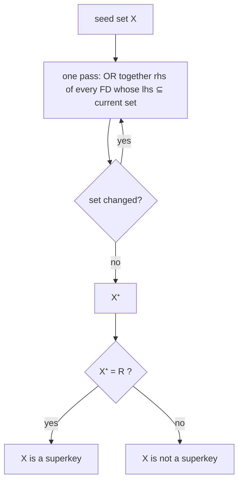

## Introduction

[Functional Dependencies and Armstrong's Axioms](/lessons/m06-functional-dependencies) gave us a language for facts (`X → Y`) and three rules for deriving new facts. Applying the axioms by hand is a proof search: you must guess which rule to apply next. Database theory replaces that search with one small, mechanical algorithm — **attribute closure** — and almost every design question in this module reduces to it:

| Question | Answered by |
|---|---|
| Does F imply `X → Y`? | Is Y ⊆ X⁺? |
| Is X a superkey of R? | Is X⁺ = R? |
| What are **all** candidate keys of R? | Search for minimal X with X⁺ = R |
| Which attributes are prime? | Union of all candidate keys |
| Is an FD in F redundant, or an attribute extraneous? | Closure with the FD removed or the attribute dropped |
| Are two FD sets equivalent? | Each FD of one is implied by the other |
| Is a relation in 2NF / 3NF / BCNF? | Keys and prime attributes, i.e. closures |

This lesson teaches each algorithm in the textbook form you will see in exams and interviews, then **implements it in MySQL**: FDs are stored as rows, attribute sets as bit masks, and closure becomes a stored function you can call from SQL. Running the theory as code is the best way to be sure you understand it, and the same representation is what data-profiling and schema-design tools use internally. Finally we connect the theory to MySQL's real constraints: a declared `PRIMARY KEY` or `UNIQUE` index is a candidate key only under conditions you can check in `information_schema`.

:::note[Dataset]
The examples use the **university** dataset (sections, courses, instructors, enrollments). The FD-analysis tables and functions are created inside your lab. Every output below was captured on a real MySQL server.
:::

## DBMS Theory

:::theory[Attribute closure]
Let F be a set of FDs over schema R and X ⊆ R. The **closure of X under F**, written **X⁺** (or X⁺_F), is the set of all attributes A such that F ⊨ X → A — every attribute functionally determined by X.

**Algorithm** (Silberschatz et al., *Database System Concepts*, §7.4; Elmasri & Navathe, Algorithm 15.1):

```
result := X
repeat
    for each FD  Y → Z  in F:
        if Y ⊆ result then result := result ∪ Z
until result does not change
return result
```

**Correctness:** every attribute added is implied (by reflexivity, transitivity and union), and when the loop stops, `result` is closed under F — no FD can add anything — so nothing else is implied. **Cost:** each pass adds at least one attribute or stops, so there are at most |R| passes over F; a cleverer bookkeeping version (Beeri & Bernstein, 1979) runs in time linear in the size of F.
:::

**Using the closure.** X → Y ∈ F⁺ **iff** Y ⊆ X⁺. This is the membership test: instead of searching for a proof with Armstrong's axioms, compute one closure and compare.

### Superkeys, candidate keys and prime attributes

- X is a **superkey** of R iff X⁺ = R.
- X is a **candidate key** iff X is a superkey and no proper subset of X is a superkey (minimality). It suffices to check the subsets obtained by removing one attribute at a time.
- An attribute is **prime** if it belongs to *some* candidate key, **non-prime** otherwise. 2NF and 3NF are defined in terms of non-prime attributes, so you must find **all** candidate keys, not just the one you plan to make the primary key.

**Finding all keys.** Classify each attribute by where it appears in F (after splitting right sides):

| Class | Appears in | Consequence |
|---|---|---|
| **L** | only left sides | Cannot be derived from anything else → in **every** key |
| **R** | only right sides | Always derivable → in **no** key |
| **B** | both sides | May or may not be in a key — must search |
| **N** | neither side | Determined by nothing → in **every** key |

Start from the **core** L ∪ N. If core⁺ = R, the core is the *only* candidate key. Otherwise add subsets of B in increasing size, skipping any superset of a key already found. A relation can have exponentially many candidate keys (Lucchesi & Osborn, 1978), so no algorithm can list them all in polynomial time in general — but real schemas are small enough for this search.

### Minimal (canonical) cover

Different FD sets can say the same thing. Two sets F and G are **equivalent** (F ≡ G) iff F⁺ = G⁺, which is tested without computing F⁺: **every FD of F is implied by G and every FD of G is implied by F** (one closure per FD).

A **minimal cover** of F is an equivalent set that has no redundancy:

1. every right side is a **single attribute** (split with the decomposition rule);
2. no FD has an **extraneous left-side attribute**: for `XA → B`, A is extraneous if F ⊨ X → B, i.e. B ∈ X⁺;
3. no FD is **redundant**: `X → A` is redundant if A ∈ X⁺ computed under F − {X → A}.

Elmasri and Navathe call this the *minimal cover*. Silberschatz et al. define the **canonical cover** with the same "no extraneous attribute" conditions but with FDs that share a left side *combined* (`A → BC` instead of `A → B, A → C`). The two differ only in that presentation choice. Neither is unique: the order in which you remove extraneous attributes and redundant FDs can produce different, equally minimal results — the lesson demonstrates this. Minimal covers are the input of the 3NF synthesis algorithm in [Third Normal Form](/lessons/m06-3nf).

## Why It Exists

Normal forms are defined in terms of keys and implied dependencies, and both are infinite-looking objects: F⁺ can contain exponentially many FDs, and a relation with 10 attributes has 1,023 non-empty attribute subsets that might be keys. Closure exists because it makes these questions **cheap and mechanical**:

- **Designers miss keys.** A table of class bookings has a "natural" key `(course, section, term)`, but scheduling rules also make `(instructor, term, slot)` and `(room, term, slot)` keys. Missing the extra keys means missing `UNIQUE` constraints — the database then happily double-books a room. Closure finds them.
- **Normal-form tests need prime attributes.** Whether `room → building` violates 3NF depends on whether `building` is prime — only knowable after finding *every* candidate key.
- **Requirements produce messy FD sets.** Ten stakeholders describe overlapping rules; the minimal cover distils them into the smallest equivalent set, which in turn produces the fewest tables in 3NF synthesis.
- **Changing requirements must be compared.** "Is the new rule set equivalent to the old one?" is an equivalence test between FD sets.

Without these algorithms, normalization degenerates into opinion, and decomposition mistakes (lost dependencies, lossy joins) go unnoticed until production data is wrong.

## Internal Working

:::internals[Representing attribute sets as bit masks]
Every algorithm in this lesson manipulates **sets of attributes**: subset tests, unions, differences. A compact representation makes them trivial — the same trick used in FD-discovery software and in the platform's interactive `fd` analyzer. Number the attributes 0, 1, 2, …; a set is the integer whose bit *i* is 1 when attribute *i* is in the set. Then, with MySQL's 64-bit integer bit operators:

| Set operation | Bit expression |
|---|---|
| Y ∪ Z | `y | z` |
| Y ∩ Z | `y & z` |
| Y − Z | `y & ~z` |
| Y ⊆ Z | `(y & z) = y` |
| \|Y\| | `BIT_COUNT(y)` |
| Union of many sets | `BIT_OR(col)` (an aggregate) |

The closure loop becomes: `c := c | BIT_OR(rhs) over all FDs with (lhs & c) = lhs`, repeated until `c` stops changing. Each pass applies every applicable FD at once — the same fixpoint as the one-FD-at-a-time textbook loop, reached in fewer passes.
:::

MySQL itself performs closure-style reasoning in exactly one place you have already met: the `ONLY_FULL_GROUP_BY` check computes the set of columns functionally determined by the `GROUP BY` list from keys and equalities, which is a closure computation over the FDs the optimizer can see. Outside the optimizer, MySQL has no FD catalogue — which is why we build one as tables here.



## MySQL Implementation

Create the FD catalogue: one table of attribute names with bit positions, one table of FDs (several named FD sets can coexist), and three helper functions. The functions are declared `READS SQL DATA`, which MySQL requires for stored functions when binary logging is enabled.

```sql run
CREATE TABLE fd_attr (
  bit  TINYINT UNSIGNED PRIMARY KEY,
  name VARCHAR(20) NOT NULL UNIQUE
);
CREATE TABLE fd (
  fd_set VARCHAR(10)  NOT NULL,
  fd_id  INT          NOT NULL,
  lhs    INT UNSIGNED NOT NULL,
  rhs    INT UNSIGNED NOT NULL,
  PRIMARY KEY (fd_set, fd_id)
);
INSERT INTO fd_attr VALUES
  (0, 'course'), (1, 'section'), (2, 'term'), (3, 'instructor'), (4, 'room'), (5, 'slot'),
  (6, 'product'), (7, 'category'), (8, 'tax_class');
CREATE FUNCTION mask_of(p_list VARCHAR(255)) RETURNS INT UNSIGNED READS SQL DATA
BEGIN
  RETURN (SELECT COALESCE(SUM(1 << bit), 0) FROM fd_attr
          WHERE FIND_IN_SET(name, REPLACE(p_list, ' ', '')) > 0);
END;
CREATE FUNCTION attr_names(p_mask INT UNSIGNED) RETURNS VARCHAR(255) READS SQL DATA
BEGIN
  RETURN (SELECT COALESCE(GROUP_CONCAT(name ORDER BY bit SEPARATOR ', '), '∅')
          FROM fd_attr WHERE p_mask & (1 << bit));
END;
CREATE FUNCTION closure_of(p_set VARCHAR(10), p_seed INT UNSIGNED, p_skip INT) RETURNS INT UNSIGNED READS SQL DATA
BEGIN
  DECLARE c   INT UNSIGNED DEFAULT p_seed;
  DECLARE nxt INT UNSIGNED;
  LOOP
    SELECT c | COALESCE(BIT_OR(rhs), 0) INTO nxt
    FROM fd WHERE fd_set = p_set AND fd_id <> p_skip AND (lhs & c) = lhs;
    IF nxt = c THEN RETURN c; END IF;
    SET c = nxt;
  END LOOP;
END;
SELECT mask_of('course, term') AS mask, attr_names(mask_of('course, term')) AS attributes;
```

`course` is bit 0 (value 1) and `term` bit 2 (value 4), so the set {course, term} is the integer 5. `closure_of(set, seed, skip)` computes the closure of `seed` under FD set `set`, optionally ignoring FD number `skip` (needed later for the redundancy test; pass 0 to use every FD).

Now the running example: a **class booking** relation from a scheduling system,
`class_booking(course, section, term, instructor, room, slot)`, with three business rules:

1. a section (course, section, term) has one instructor, one room and one time slot;
2. an instructor teaches at most one class per term and slot;
3. a room hosts at most one class per term and slot.

```sql run
INSERT INTO fd VALUES
  ('F', 1, mask_of('course,section,term'),  mask_of('instructor,room,slot')),
  ('F', 2, mask_of('instructor,term,slot'), mask_of('course,section')),
  ('F', 3, mask_of('room,term,slot'),       mask_of('course,section'));
SELECT fd_id, attr_names(lhs) AS lhs, '→' AS arrow, attr_names(rhs) AS rhs
FROM fd WHERE fd_set = 'F' ORDER BY fd_id;
```

Is `{instructor, term, slot}` a superkey? Compute its closure:

```sql run
SELECT attr_names(closure_of('F', mask_of('instructor,term,slot'), 0)) AS closure,
       closure_of('F', mask_of('instructor,term,slot'), 0)
         = mask_of('course,section,term,instructor,room,slot') AS is_superkey;
```

Its closure is all six attributes, so it is a superkey — and therefore the database must enforce it with a `UNIQUE` constraint, or the same instructor can be double-booked.

## Syntax Breakdown

| Element | Role | Notes |
|---|---|---|
| `1 << bit` | The singleton set {attribute} | Bit shift; `INT UNSIGNED` holds 32 attributes, `BIGINT UNSIGNED` 64 |
| `a | b`, `a & b`, `a & ~b` | Union, intersection, difference | MySQL bit operators on integers |
| `(lhs & c) = lhs` | Subset test lhs ⊆ c | The "does this FD fire?" condition |
| `BIT_OR(rhs)` | Aggregate union of the right sides | Returns 0 for no rows, but we wrap it in `COALESCE` for clarity |
| `BIT_COUNT(x)` | Set size \|x\| | Used to search keys by increasing size |
| `CREATE FUNCTION … READS SQL DATA` | Stored function that queries tables | The characteristic is required when binary logging is on and the creator lacks SUPER |
| `LOOP … END LOOP` with `RETURN` | Fixpoint iteration | `RETURN` exits the function from inside the loop |
| `WITH RECURSIVE` | Generates all subsets 1 … 2ⁿ − 1, or traces passes | Default depth limit `cte_max_recursion_depth` = 1000 |
| `FIND_IN_SET(name, list)` | Parses a comma-separated attribute list | Used only for convenient input — storing lists like this is a 1NF violation (next chapter) |

:::standard[Theory notation vs SQL]
Textbooks write sets as strings of letters (AB → C). The SQL here uses readable names and integers; the integer is an *implementation* of a set, not something to store in a production schema. In the platform's `fd` visualization you can type either notation.
:::

## Practical Examples

### 1. All candidate keys by exhaustive search

With 6 attributes there are 63 non-empty subsets. A recursive CTE enumerates them, `closure_of` keeps the superkeys, and `NOT EXISTS` keeps only the minimal ones:

```sql run
WITH RECURSIVE subset(x) AS (
  SELECT 1 UNION ALL SELECT x + 1 FROM subset WHERE x < 63
),
superkey AS (
  SELECT x FROM subset WHERE closure_of('F', x, 0) = 63
)
SELECT attr_names(s.x) AS candidate_key, BIT_COUNT(s.x) AS size
FROM superkey s
WHERE NOT EXISTS (SELECT 1 FROM superkey t WHERE t.x <> s.x AND (t.x & s.x) = t.x)
ORDER BY size, s.x;
```

Three candidate keys, each of size three. The designer who declared only `PRIMARY KEY (course, section, term)` left two keys unenforced.

```sql run
WITH RECURSIVE subset(x) AS (SELECT 1 UNION ALL SELECT x + 1 FROM subset WHERE x < 63),
superkey AS (SELECT x FROM subset WHERE closure_of('F', x, 0) = 63)
SELECT COUNT(*) AS superkeys FROM superkey;
```

Superkeys are far more numerous than candidate keys; listing them is pointless, but the count shows why minimality matters.

### 2. The L / R / B / N shortcut

The exhaustive search is exponential. The classification from the theory section prunes it:

```sql run
SELECT a.name,
       EXISTS (SELECT 1 FROM fd WHERE fd_set = 'F' AND lhs & (1 << a.bit)) AS on_left,
       EXISTS (SELECT 1 FROM fd WHERE fd_set = 'F' AND rhs & (1 << a.bit)) AS on_right,
       CASE
         WHEN EXISTS (SELECT 1 FROM fd WHERE fd_set='F' AND lhs & (1 << a.bit))
          AND EXISTS (SELECT 1 FROM fd WHERE fd_set='F' AND rhs & (1 << a.bit)) THEN 'B: search'
         WHEN EXISTS (SELECT 1 FROM fd WHERE fd_set='F' AND lhs & (1 << a.bit)) THEN 'L: in every key'
         WHEN EXISTS (SELECT 1 FROM fd WHERE fd_set='F' AND rhs & (1 << a.bit)) THEN 'R: in no key'
         ELSE 'N: in every key'
       END AS class
FROM fd_attr a
WHERE a.bit <= 5
ORDER BY a.bit;
```

`term` is the only L attribute, so it is in every key; everything else is B. The search therefore starts from the core {term} and only tries supersets of it — 32 candidates instead of 63. Here `{term}⁺ = {term}`, so the core alone is not a key and we must search.

### 3. Prime attributes

The prime attributes are the union of all candidate keys:

```sql run
WITH RECURSIVE subset(x) AS (SELECT 1 UNION ALL SELECT x + 1 FROM subset WHERE x < 63),
superkey AS (SELECT x FROM subset WHERE closure_of('F', x, 0) = 63),
ckey AS (SELECT s.x FROM superkey s
         WHERE NOT EXISTS (SELECT 1 FROM superkey t WHERE t.x <> s.x AND (t.x & s.x) = t.x))
SELECT attr_names(BIT_OR(x))          AS prime_attributes,
       attr_names(63 & ~BIT_OR(x))    AS non_prime_attributes
FROM ckey;
```

Every attribute is prime — a fact with a big consequence: because 2NF and 3NF only restrict dependencies of *non-prime* attributes, this relation satisfies 3NF automatically. (It is in fact in BCNF, because every FD's left side is a key.)

### 4. Minimal cover of a messy FD set

Requirements interviews about products produced this set G:
`product → category, tax_class`; `category → tax_class`; `product → category`; `product, category → tax_class`.

```sql run
INSERT INTO fd VALUES
  ('G', 1, mask_of('product'),          mask_of('category,tax_class')),
  ('G', 2, mask_of('category'),         mask_of('tax_class')),
  ('G', 3, mask_of('product'),          mask_of('category')),
  ('G', 4, mask_of('product,category'), mask_of('tax_class'));
SELECT fd_id, attr_names(lhs) AS lhs, attr_names(rhs) AS rhs FROM fd WHERE fd_set = 'G' ORDER BY fd_id;
```

The walkthrough below reduces it step by step to a minimal cover and proves the result equivalent to G.

## Execution Walkthrough

First, the closure algorithm itself, pass by pass, for X = {room, term, slot}. A recursive CTE records the set after each pass; the step-by-step view shows which FDs fire.

```walkthrough
title: "Computing {room, term, slot}⁺ under F"
steps:
  - title: "Pass 0 — start with X itself"
    explain: "result = {room, term, slot}. Check each FD's left side against result: FD 3 (room, term, slot → course, section) fires; FD 1 needs course and section, FD 2 needs instructor — neither fires yet."
    sql: |
      SELECT fd_id, attr_names(lhs) AS lhs, attr_names(rhs) AS rhs,
             (lhs & mask_of('room,term,slot')) = lhs AS fires,
             attr_names(rhs & ~mask_of('room,term,slot')) AS would_add
      FROM fd WHERE fd_set = 'F' ORDER BY fd_id;
  - title: "Pass 1 — FD 3 adds course and section"
    explain: "result = {course, section, term, room, slot}. Now FD 1 (course, section, term → …) fires and would add instructor; FD 3 fires again but adds nothing new."
    sql: |
      SELECT fd_id, attr_names(lhs) AS lhs, attr_names(rhs) AS rhs,
             (lhs & mask_of('course,section,room,term,slot')) = lhs AS fires,
             attr_names(rhs & ~mask_of('course,section,room,term,slot')) AS would_add
      FROM fd WHERE fd_set = 'F' ORDER BY fd_id;
  - title: "Pass 2 — FD 1 adds instructor; nothing changes afterwards"
    explain: "result = all six attributes. Another pass adds nothing, so the loop stops. Because the closure is all of class_booking, {room, term, slot} is a superkey; removing any one attribute breaks it (next step), so it is a candidate key."
    sql: |
      WITH RECURSIVE trace(pass, c) AS (
        SELECT 0, mask_of('room,term,slot')
        UNION ALL
        SELECT pass + 1, c | (SELECT COALESCE(BIT_OR(rhs), 0) FROM fd WHERE fd_set = 'F' AND (lhs & c) = lhs)
        FROM trace
        WHERE pass < 10
          AND (c | (SELECT COALESCE(BIT_OR(rhs), 0) FROM fd WHERE fd_set = 'F' AND (lhs & c) = lhs)) <> c
      )
      SELECT pass, attr_names(c) AS result_after_pass FROM trace ORDER BY pass;
  - title: "Minimality check — drop one attribute at a time"
    explain: "None of the three two-attribute subsets is a superkey: their closures stay small because no FD's left side is contained in them. {room, term, slot} is therefore minimal — a candidate key."
    sql: |
      SELECT attr_names(m) AS subset, attr_names(closure_of('F', m, 0)) AS closure,
             closure_of('F', m, 0) = 63 AS superkey
      FROM (SELECT mask_of('term,slot') AS m UNION ALL SELECT mask_of('room,slot') UNION ALL SELECT mask_of('room,term')) AS t;
```

Now the minimal-cover algorithm on G, with each test computed by `closure_of`:

```walkthrough
title: Minimal cover of G
steps:
  - title: "1. Split right sides into single attributes"
    explain: "The decomposition rule allows replacing product → category, tax_class by two FDs. We write the singleton FDs into a new set G1, keeping only distinct (lhs, rhs) pairs — the duplicate product → category from FD 3 disappears."
    sql: |
      INSERT INTO fd (fd_set, fd_id, lhs, rhs)
      SELECT 'G1', ROW_NUMBER() OVER (ORDER BY lhs, rhs), lhs, rhs
      FROM (SELECT DISTINCT f.lhs, 1 << a.bit AS rhs
            FROM fd f JOIN fd_attr a ON f.rhs & (1 << a.bit)
            WHERE f.fd_set = 'G') AS s;
      SELECT fd_id, attr_names(lhs) AS lhs, attr_names(rhs) AS rhs FROM fd WHERE fd_set = 'G1' ORDER BY fd_id;
  - title: "2. Test left-side attributes for extraneousness"
    explain: "For an FD with a composite left side, attribute A is extraneous if the rhs is already in (lhs − A)⁺. In product, category → tax_class BOTH attributes are extraneous on their own: product⁺ and category⁺ each contain tax_class. We may drop only one at a time — the choice is where minimal covers stop being unique."
    sql: |
      SELECT f.fd_id, attr_names(f.lhs) AS lhs, attr_names(f.rhs) AS rhs, a.name AS candidate,
             (closure_of('G1', f.lhs & ~(1 << a.bit), 0) & f.rhs) = f.rhs AS extraneous
      FROM fd f JOIN fd_attr a ON f.lhs & (1 << a.bit)
      WHERE f.fd_set = 'G1' AND BIT_COUNT(f.lhs) > 1
      ORDER BY f.fd_id, a.bit;
  - title: "3. Drop product from product, category → tax_class"
    explain: "The FD becomes category → tax_class, which is already in the set, so the duplicate is deleted."
    sql: |
      UPDATE fd SET lhs = mask_of('category')
      WHERE fd_set = 'G1' AND lhs = mask_of('product,category') AND rhs = mask_of('tax_class');
      DELETE f1 FROM fd f1 JOIN fd f2
        ON f2.fd_set = f1.fd_set AND f2.lhs = f1.lhs AND f2.rhs = f1.rhs AND f2.fd_id < f1.fd_id
      WHERE f1.fd_set = 'G1';
      SELECT fd_id, attr_names(lhs) AS lhs, attr_names(rhs) AS rhs FROM fd WHERE fd_set = 'G1' ORDER BY fd_id;
  - title: "4. Test each FD for redundancy"
    explain: "X → A is redundant if A ∈ X⁺ computed WITHOUT that FD (the p_skip argument). product → tax_class is redundant: product → category and category → tax_class still derive it."
    sql: |
      SELECT fd_id, attr_names(lhs) AS lhs, attr_names(rhs) AS rhs,
             (closure_of('G1', lhs, fd_id) & rhs) = rhs AS redundant
      FROM fd WHERE fd_set = 'G1' ORDER BY fd_id;
  - title: "5. Remove the redundant FD and re-test"
    explain: "After deleting it, no remaining FD is redundant (removing either one makes tax_class or category underivable), so this is a minimal cover. Remove redundant FDs one at a time and re-test: two FDs can each be redundant while the other is present, yet not both removable."
    sql: |
      DELETE FROM fd WHERE fd_set = 'G1' AND lhs = mask_of('product') AND rhs = mask_of('tax_class');
      SELECT fd_id, attr_names(lhs) AS lhs, attr_names(rhs) AS rhs,
             (closure_of('G1', lhs, fd_id) & rhs) = rhs AS redundant
      FROM fd WHERE fd_set = 'G1' ORDER BY fd_id;
  - title: "6. Prove G1 ≡ G"
    explain: "Equivalence holds iff every FD of G is implied by G1 and every FD of G1 is implied by G. Each row is one closure test; all must be 1."
    sql: |
      SELECT 'G implied by G1' AS direction, MIN((closure_of('G1', lhs, 0) & rhs) = rhs) AS all_implied
      FROM fd WHERE fd_set = 'G'
      UNION ALL
      SELECT 'G1 implied by G', MIN((closure_of('G', lhs, 0) & rhs) = rhs)
      FROM fd WHERE fd_set = 'G1';
```

The interactive analyzer below holds the class-booking FDs. Click attributes to watch the closure grow, and compare its candidate keys, prime attributes and minimal cover with the SQL results above.

```viz
type: fd
attributes: [course, section, term, instructor, room, slot]
fds: ["course, section, term -> instructor, room, slot", "instructor, term, slot -> course, section", "room, term, slot -> course, section"]
```

## Output

The final outputs of the lesson's algorithms are: three candidate keys for `class_booking` — `{course, section, term}`, `{term, instructor, slot}` and `{term, room, slot}` — all six attributes prime, and the minimal cover `{product → category, category → tax_class}` for G, proven equivalent in both directions.

What should a designer *do* with those outputs? Every candidate key becomes a constraint. In MySQL that means one `PRIMARY KEY` and a `UNIQUE` constraint per additional key, with `NOT NULL` on every key column:

```sql run
CREATE TABLE class_booking (
  course     VARCHAR(10) NOT NULL,
  section    TINYINT UNSIGNED NOT NULL,
  term       VARCHAR(12) NOT NULL,
  instructor INT UNSIGNED NOT NULL,
  room       VARCHAR(20) NOT NULL,
  slot       VARCHAR(12) NOT NULL,
  PRIMARY KEY (course, section, term),
  CONSTRAINT uq_booking_instructor UNIQUE (instructor, term, slot),
  CONSTRAINT uq_booking_room       UNIQUE (room, term, slot)
);
INSERT INTO class_booking VALUES ('CS-157A', 1, 'Fall-2024', 1003, 'MH-339', 'MW-0900');
```

```sql run error
-- Same room, same term, same slot: the second candidate key rejects the double booking
INSERT INTO class_booking VALUES ('CS-149', 1, 'Fall-2024', 1002, 'MH-339', 'MW-0900');
```

The duplicate-entry error names `uq_booking_room`: the FD `room, term, slot → course, section` is now enforced by an index.

## Alternative Approaches

**By hand.** For small schemas, closures on paper are quick and expected in exams; the walkthrough format above (one line per FD firing) is the standard way to present them.

**The interactive analyzer.** The `fd` visualization in this module computes closures, keys, prime attributes, the minimal cover, the highest normal form and both decomposition algorithms in the browser — useful for checking homework and exploring "what if I add this FD?".

**From data instead of requirements.** You can test whether a set of columns is a key *in the current data* without any FD catalogue: compare `COUNT(*)` with `COUNT(DISTINCT cols)`. In the university `sections` table:

```sql run
SELECT COUNT(*)                                    AS sections,
       COUNT(DISTINCT course_id, term, year)       AS distinct_course_term_year,
       COUNT(DISTINCT course_id, term, year, room) AS distinct_offering_with_room,
       COUNT(DISTINCT instructor_id, term, year)   AS distinct_instructor_term_year
FROM sections;
```

Read carefully: `COUNT(DISTINCT a, b, …)` skips rows where any listed column is NULL, so a lower count can mean duplicates **or** NULLs. `(course_id, term, year, room)` counts 23 of 24 only because one section has a NULL room; `(instructor_id, term, year)` is lower because one section has no instructor and at least one instructor teaches two sections in the same term — so it is not a key of `sections`. As in the previous lesson, data can refute a key, never prove it.

**From the catalogue.** What MySQL *enforces* is visible in `information_schema`:

```sql run
SELECT s.INDEX_NAME, s.NON_UNIQUE,
       GROUP_CONCAT(s.COLUMN_NAME ORDER BY s.SEQ_IN_INDEX) AS columns,
       GROUP_CONCAT(c.IS_NULLABLE ORDER BY s.SEQ_IN_INDEX) AS nullable
FROM information_schema.STATISTICS s
JOIN information_schema.COLUMNS c
  ON c.TABLE_SCHEMA = s.TABLE_SCHEMA AND c.TABLE_NAME = s.TABLE_NAME AND c.COLUMN_NAME = s.COLUMN_NAME
WHERE s.TABLE_SCHEMA = DATABASE() AND s.TABLE_NAME = 'sections'
GROUP BY s.INDEX_NAME, s.NON_UNIQUE
ORDER BY s.INDEX_NAME;
```

`uq_sections_offering` is unique, but `room` is nullable. In MySQL a `UNIQUE` index permits **any number of rows with NULL** in an indexed column, so this index does not make `(course_id, term, year, room)` a candidate key in the theoretical sense — only `NOT NULL` unique column sets do. This is the gap between theory and SQL that the next exercise set probes.

## Performance Analysis

| Algorithm | Cost | Practical limit |
|---|---|---|
| One closure X⁺ | O(\|R\| · \|F\|) passes naïvely; linear with Beeri–Bernstein bookkeeping | Instant for any real schema |
| Membership X → Y ∈ F⁺ | One closure | Instant |
| Superkey test | One closure | Instant |
| All candidate keys | Up to 2^\|B\| closures (B = attributes on both sides) | Fine below ~20 B-attributes; the output itself can be exponential |
| Minimal cover | O(\|F\|·\|R\|) closures | Instant |
| Equivalence of F and G | \|F\| + \|G\| closures | Instant |
| Computing F⁺ explicitly | Exponential | Never do this; test membership instead |

The SQL implementation inherits these costs plus per-call overhead: `closure_of` is a stored function that runs one aggregate query per pass, and the key search calls it once per subset (63 times above). That is negligible here, and the analyzer caps its input at 14 attributes for the same exponential reason. The real lesson is algorithmic: **use the L/R/B/N core to shrink the search, and test membership with a closure rather than enumerating F⁺.**

:::performance[Why this is not a query-tuning topic]
None of these computations touch your business data — they run over a handful of FDs. Performance matters only for FD *discovery* over large datasets, where the cost is dominated by `COUNT(DISTINCT …)` scans of the data (see the previous lesson), not by closure.
:::

## Best Practices

:::best-practice[Keys and covers in real design work]
1. **Find all candidate keys before choosing the primary key.** Then declare the others as `UNIQUE` constraints. An unenforced candidate key is a business rule the database ignores.
2. **Make every key column `NOT NULL`.** MySQL's `UNIQUE` allows multiple NULLs, so a nullable column silently weakens a key.
3. **Compute the minimal cover of requirements FDs before decomposing.** Redundant or extraneous FDs produce redundant tables in 3NF synthesis.
4. **Record FDs explicitly** (in design documents or a catalogue like this one) alongside the schema; they explain *why* each table and constraint exists and make later changes reviewable.
5. **Verify keys against data during migrations** with `COUNT(*) = COUNT(DISTINCT …)` and `IS NULL` checks before adding a `UNIQUE` constraint — the `ALTER TABLE` fails on duplicates anyway, but knowing in advance lets you clean the data first.
6. **Prefer closure tests over intuition** for "is this attribute prime?" questions; they decide whether a dependency violates 3NF.
:::

## Common Mistakes

**Mistake 1 — stopping after the first key.** Declaring `PRIMARY KEY (course, section, term)` and nothing else lets the room be double-booked; the error above only appears because both extra keys were declared. Without `uq_booking_room`, the same insert succeeds:

```sql run
CREATE TABLE class_booking_pk_only LIKE class_booking;
ALTER TABLE class_booking_pk_only DROP INDEX uq_booking_room, DROP INDEX uq_booking_instructor;
INSERT INTO class_booking_pk_only VALUES
  ('CS-157A', 1, 'Fall-2024', 1003, 'MH-339', 'MW-0900'),
  ('CS-149',  1, 'Fall-2024', 1002, 'MH-339', 'MW-0900');
SELECT room, term, slot, COUNT(*) AS classes_in_room_at_once
FROM class_booking_pk_only GROUP BY room, term, slot;
```

**Mistake 2 — confusing superkey and candidate key.** `{course, section, term, room}` is a superkey (its closure is everything) but not a candidate key, because it contains `{course, section, term}`:

```sql run
SELECT closure_of('F', mask_of('course,section,term,room'), 0) = 63 AS is_superkey,
       closure_of('F', mask_of('course,section,term'), 0) = 63      AS proper_subset_is_superkey;
```

**Mistake 3 — treating a nullable UNIQUE index as a key.** Two rows with the same `(course_id, term, year)` and NULL room are both accepted by `uq_sections_offering`:

```sql run
INSERT INTO sections (section_id, course_id, term, year, instructor_id, room, capacity)
VALUES (101, 'CS-149', 'Fall', 2024, 1002, NULL, 30),
       (102, 'CS-149', 'Fall', 2024, 1002, NULL, 30);
SELECT section_id, course_id, term, year, room FROM sections
WHERE course_id = 'CS-149' AND year = 2024 ORDER BY section_id;
```

**Mistake 4 — removing several "redundant" FDs at once.** Redundancy is relative to the *current* set. In {A → B, B → A, A → C, B → C}, each of A → C and B → C is redundant while the other is present; removing both loses C. Remove one, recompute, repeat — as walkthrough step 5 did.

**Mistake 5 — thinking the minimal cover is unique.** In step 2 both `product` and `category` were extraneous; dropping `category` instead would yield a different minimal cover with the same closure. Exams accept any correct minimal cover.

## Industry Application

- **Schema design reviews** use candidate-key analysis to make sure every natural uniqueness rule (one booking per room and slot, one active subscription per user and plan, one SKU per supplier part number) is declared as a `UNIQUE` constraint, not left to application code that races under concurrency.
- **Data-profiling and catalogue tools** (open-source profilers, commercial data catalogues) discover unique column combinations and FDs in large tables to suggest primary keys and joins for undocumented data; internally they represent column sets as bitsets, exactly as here.
- **Data warehouse modelling** relies on identifying the business key (natural candidate key) of each dimension separately from its surrogate key, so slowly changing dimensions can be matched across loads.
- **Migration from spreadsheets or NoSQL** starts by finding candidate keys in the data, then validating them with domain experts, before designing normalized tables.
- **Interviews and certification exams** routinely ask for X⁺, all candidate keys and a minimal cover; the step-by-step closure trace is the expected answer format.

## Practice Exercises

The query exercises below run on the university dataset; the FD-catalogue exercise creates its own tables in `setup`.

```exercise
id: ex1
title: Is it a key in the data?
difficulty: easy
concepts: [superkey, candidate-key]
prompt: |
  For the `enrollments` table, return one row with three columns: `enrollment_rows` (number of rows),
  `distinct_student_section` (number of distinct `(student_id, section_id)` pairs) and
  `distinct_student` (number of distinct `student_id` values).
hints:
  - "COUNT(*) counts rows; COUNT(DISTINCT a, b) counts distinct non-NULL pairs."
solution: |
  SELECT COUNT(*)                             AS enrollment_rows,
         COUNT(DISTINCT student_id, section_id) AS distinct_student_section,
         COUNT(DISTINCT student_id)           AS distinct_student
  FROM enrollments;
explanation: |
  The first two numbers are equal — consistent with `(student_id, section_id)` being a key (it is the primary
  key). The third is much smaller, so `student_id` alone is refuted as a key: students take several sections.
  Equal counts never *prove* a key; the business rule (a student enrolls in a section once) does.
```

```exercise
id: ex2
title: Compute a closure with the catalogue
difficulty: medium
setup: |
  CREATE TABLE fd_attr (bit TINYINT UNSIGNED PRIMARY KEY, name VARCHAR(20) NOT NULL UNIQUE);
  CREATE TABLE fd (fd_set VARCHAR(10) NOT NULL, fd_id INT NOT NULL, lhs INT UNSIGNED NOT NULL, rhs INT UNSIGNED NOT NULL, PRIMARY KEY (fd_set, fd_id));
  INSERT INTO fd_attr VALUES (0,'A'),(1,'B'),(2,'C'),(3,'G'),(4,'H'),(5,'I');
  -- F = { A -> B, A -> C, CG -> H, CG -> I, B -> H }
  INSERT INTO fd VALUES ('F',1,1,2),('F',2,1,4),('F',3,12,16),('F',4,12,32),('F',5,2,16);
concepts: [attribute-closure]
prompt: |
  The tables `fd_attr(bit, name)` and `fd(fd_set, fd_id, lhs, rhs)` hold the textbook FD set
  F = {A → B, A → C, CG → H, CG → I, B → H}, with attribute sets stored as bit masks
  (A = 1, B = 2, C = 4, G = 8, H = 16, I = 32). No helper functions exist in this lab.

  Compute (AG)⁺ by running **three passes** of the closure algorithm in one query with nested derived tables
  or CTEs, and return one row with one column `closure_mask`: the integer mask of the result after the third pass.
hints:
  - "One pass: c | COALESCE((SELECT BIT_OR(rhs) FROM fd WHERE (lhs & c) = lhs), 0)."
  - "Chain three CTEs: p0 AS (SELECT 9 AS c), p1 AS (SELECT c | … FROM p0), p2 …, p3 …"
solution: |
  WITH p0 AS (SELECT 9 AS c),
       p1 AS (SELECT c | COALESCE((SELECT BIT_OR(rhs) FROM fd WHERE (lhs & p0.c) = lhs), 0) AS c FROM p0),
       p2 AS (SELECT c | COALESCE((SELECT BIT_OR(rhs) FROM fd WHERE (lhs & p1.c) = lhs), 0) AS c FROM p1),
       p3 AS (SELECT c | COALESCE((SELECT BIT_OR(rhs) FROM fd WHERE (lhs & p2.c) = lhs), 0) AS c FROM p2)
  SELECT c AS closure_mask FROM p3;
explanation: |
  AG = 1 + 8 = 9. Pass 1 fires A → B and A → C: {A, B, C, G} = 15. Pass 2 fires CG → H, CG → I and B → H:
  15 + 16 + 32 = 63, i.e. {A, B, C, G, H, I}. Pass 3 changes nothing, so the answer is 63 — AG is a superkey
  of R(A, B, C, G, H, I). A recursive CTE or a loop in a stored function generalizes this to any number of passes.
```

```exercise
id: ex3
title: A nullable "key"
difficulty: hard
concepts: [candidate-key, superkey]
prompt: |
  `uq_sections_offering` is a UNIQUE index on `sections(course_id, term, year, room)`. List every section
  whose `room` is NULL, i.e. the rows on which this index does **not** enforce uniqueness. Return
  `section_id, course_id, term, year` ordered by `section_id`, with `term` as text.
hints:
  - "MySQL UNIQUE indexes allow any number of rows that have NULL in an indexed column."
  - "Filter with WHERE room IS NULL — not room = NULL."
solution: |
  SELECT section_id, course_id, CAST(term AS CHAR) AS term, year
  FROM sections
  WHERE room IS NULL
  ORDER BY section_id;
orderMatters: true
explanation: |
  Any number of rows like this could share course, term and year without violating the index, so a nullable
  UNIQUE index is not a candidate key. Writing `WHERE room = NULL` returns nothing, because comparing with NULL
  is UNKNOWN. To make the index a real key, make the column NOT NULL (perhaps with a value such as 'ONLINE').
```

```exercise
id: ex4
title: All candidate keys by hand
difficulty: medium
kind: open
concepts: [candidate-key, prime-attribute, attribute-closure]
prompt: |
  R(A, B, C, D, E) with F = {A → B, BC → E, ED → A}.

  1. Classify every attribute as L, R, B or N.
  2. Find all candidate keys, showing the closures you computed.
  3. List the prime and non-prime attributes.
solution: |
  1. A: left (A → B) and right (ED → A) → **B**. B: left (BC → E) and right (A → B) → **B**.
     C: only left → **L**. D: only left → **L**. E: left (ED → A) and right (BC → E) → **B**.
  2. Core = {C, D}. (CD)⁺ = {C, D} — no FD fires — so we must add attributes from {A, B, E}.
     - (ACD)⁺: A → B gives ABCD; BC → E gives ABCDE. **Key.**
     - (BCD)⁺: BC → E gives BCDE; ED → A gives ABCDE. **Key.**
     - (CDE)⁺: ED → A gives ACDE; A → B gives ABCDE. **Key.**
     Every 3-attribute superset of the core is a key; larger sets contain one of them, so the candidate keys are
     **ACD, BCD and CDE**.
  3. Prime: A, B, C, D, E (all of them). Non-prime: none — so R is automatically in 3NF. It is **not** in BCNF,
     because A → B has a left side that is not a superkey.
```

```exercise
id: ex5
title: Minimal cover and equivalence
difficulty: challenge
kind: open
concepts: [minimal-cover, canonical-cover, fd-equivalence]
prompt: |
  F = {A → BC, B → C, A → B, AB → C} over R(A, B, C).

  1. Compute a minimal cover of F, naming each step (split, extraneous attribute, redundant FD).
  2. Compute its canonical cover in Silberschatz's sense.
  3. Is G = {A → B, A → C, B → C} equivalent to F? Prove it with closures. Is G minimal?
solution: |
  1. **Split:** A → B, A → C, B → C, A → B, AB → C → remove the duplicate: {A → B, A → C, B → C, AB → C}.
     **Extraneous attributes:** in AB → C, A is extraneous because B⁺ = {B, C} ∋ C (and B is extraneous
     because A⁺ ∋ C). Dropping A gives B → C, a duplicate, removed: {A → B, A → C, B → C}.
     **Redundant FDs:** A → C is redundant — without it A⁺ = {A, B, C} via A → B, B → C. Remove it.
     A → B is not redundant (without it A⁺ = {A, C}); B → C is not (without it B⁺ = {B}).
     Minimal cover: **{A → B, B → C}**.
  2. Canonical cover: combine equal left sides — none to combine — so also **{A → B, B → C}**.
  3. Every FD of G is implied by F: A⁺_F = {A, B, C} ⊇ {B} and {C}; B⁺_F ∋ C. Every FD of F is implied by G:
     A⁺_G = {A, B, C} covers A → BC and A → B; (AB)⁺_G ∋ C; B⁺_G ∋ C. So **G ≡ F**. G is not minimal, because
     A → C is redundant in G.
```

## Knowledge Assessment

```quiz
- id: q1
  question: "F = {A → B, B → C, CD → E}. What is (AD)⁺?"
  options: ["{A, D}", "{A, B, C, D}", "{A, B, C, D, E}", "{A, B, D, E}"]
  answer: 2
  explanation: "Start with AD; A → B adds B; B → C adds C; now CD ⊆ result so CD → E adds E. {A, B, D} misses the chain; {A, B, D, E} skips C, which E requires."
  concepts: [attribute-closure]
- id: q2
  question: "How do you test whether F implies X → Y using closure?"
  options: ["Check whether X ⊆ Y⁺", "Check whether Y ⊆ X⁺", "Check whether X⁺ = Y⁺", "Compute F⁺ and search it"]
  answer: 1
  explanation: "X → Y ∈ F⁺ iff every attribute of Y is determined by X, i.e. Y ⊆ X⁺. X ⊆ Y⁺ tests the reverse FD; computing F⁺ is exponential and unnecessary."
  concepts: [attribute-closure]
- id: q3
  question: "R(A, B, C, D) with F = {A → B, B → C}. Attribute D appears in no FD. Which statement is true?"
  options:
    - "D is in no candidate key"
    - "D is in every candidate key"
    - "D is a candidate key by itself"
    - "R has no candidate key"
  answer: 1
  explanation: "An attribute that appears on no right side cannot be derived from others, so every key must contain it. The only key here is AD: (AD)⁺ = ABCD. D alone has closure {D}."
  concepts: [candidate-key]
- id: q4
  question: "R(A, B, C) with F = {A → B, B → A, A → C}. Which attributes are prime? (Select all that apply.)"
  type: multi
  options: ["A", "B", "C"]
  answer: [0, 1]
  explanation: "A⁺ = {A, B, C} and B⁺ = {B, A, C}, so A and B are both candidate keys; C is in no key (C⁺ = {C}). Prime = members of some candidate key."
  concepts: [prime-attribute, candidate-key]
- id: q5
  question: "In AB → C, when is B extraneous?"
  options:
    - "When B → C holds"
    - "When C ∈ A⁺ computed under F"
    - "When B does not appear on any right side"
    - "When AB is not a key"
  answer: 1
  explanation: "B is extraneous on the left if A alone already determines C under F. B → C would make A extraneous, not B. Appearing on right sides and being a key are unrelated to extraneousness."
  concepts: [minimal-cover]
- id: q6
  question: "A MySQL table has UNIQUE (email) where email is nullable. Is {email} a candidate key in the relational sense?"
  options:
    - "Yes — UNIQUE always defines a candidate key"
    - "No — MySQL allows many rows with NULL email, so email does not determine the row for those rows"
    - "Yes, but only for InnoDB tables"
    - "No — UNIQUE indexes are not enforced in MySQL"
  answer: 1
  explanation: "A candidate key must identify every tuple; MySQL's UNIQUE permits multiple NULLs. Make the column NOT NULL to make the index a real key. UNIQUE is enforced for non-NULL values in all engines that support it."
  concepts: [candidate-key, superkey]
- id: q7
  question: "F = {A → B, B → C} and G = {A → B, B → C, A → C}. Which statement is correct?"
  options:
    - "F and G are not equivalent because G has more FDs"
    - "F ≡ G, and F is a minimal cover of G"
    - "F ≡ G, and G is a minimal cover of F"
    - "They are equivalent only if A is a key"
  answer: 1
  explanation: "A → C is implied by F (transitivity), so the closures agree and the sets are equivalent. G contains the redundant A → C, so G is not minimal; F is. Equivalence never depends on keys."
  concepts: [fd-equivalence, minimal-cover]
- id: q8
  question: "Why is it wrong to remove all FDs that are individually redundant in one step?"
  options:
    - "Because MySQL cannot delete several rows at once"
    - "Because redundancy is relative to the current set: two FDs can each be derivable from the other, and removing both loses information"
    - "Because redundant FDs are required for 3NF"
    - "Because a minimal cover must keep the same number of FDs"
  answer: 1
  explanation: "Each redundancy test assumes all other FDs remain. Remove one, recompute, and repeat. Minimal covers usually have fewer FDs than the original."
  concepts: [minimal-cover]
```
