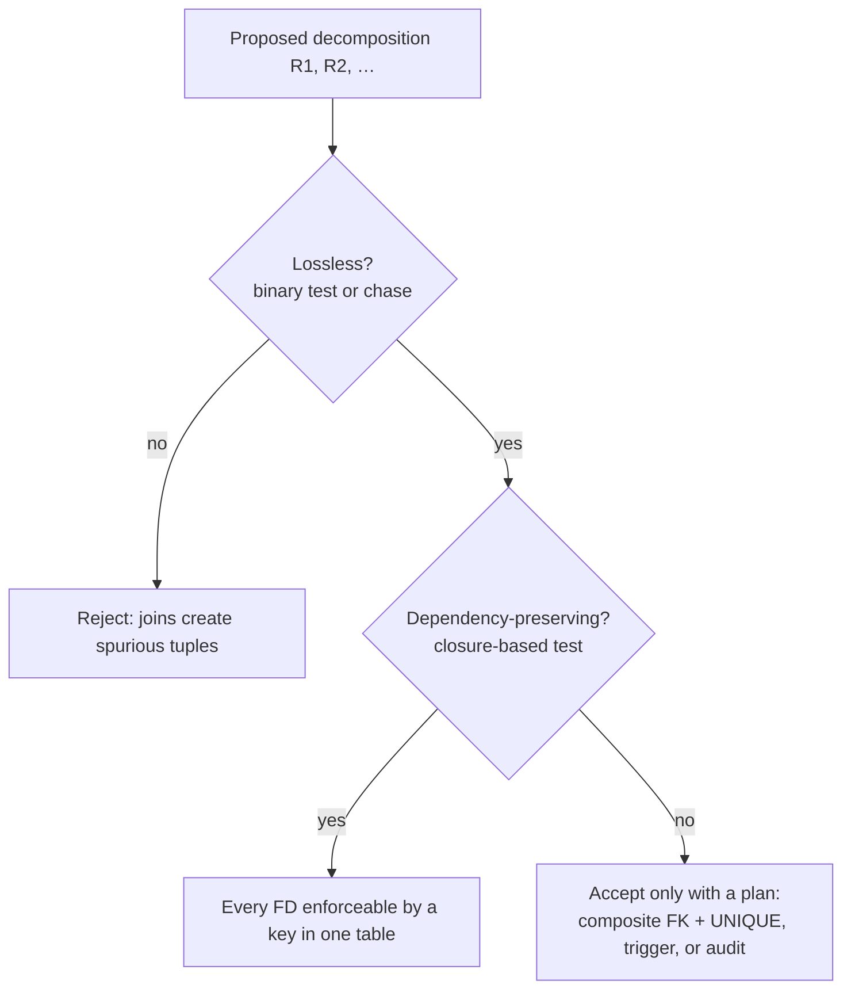

## Introduction

Every normalization step in this module **decomposes** a relation into smaller ones. A decomposition is only useful if two questions have the answer "yes":

1. **Is it lossless?** Can the original relation always be rebuilt *exactly* by joining the pieces — no rows lost, and, more importantly, **no rows invented**?
2. **Is it dependency-preserving?** Can every functional dependency still be enforced by checking each piece on its own — with keys and unique constraints — without joining?

A decomposition that fails the first test is a data-corruption machine: every report that joins the tables back together contains **spurious tuples** — rows that look perfectly plausible and are false. One that fails the second is merely expensive: some business rule now needs a cross-table check (a trigger, a composite foreign key, an audit job), as [Boyce-Codd Normal Form](/lessons/m06-bcnf) showed.

This lesson makes both properties precise and testable. You will produce spurious tuples from a realistic but wrong split of shop order data, apply the **binary lossless-join test**, run the **chase** — the general losslessness algorithm — as a sequence of MySQL `UPDATE` statements, test **dependency preservation** with the closure-based algorithm, and see the lost dependency let inconsistent data in. Throughout, the empirical check is the one you have used all module: join the pieces and compare with `EXCEPT` in both directions.

:::note[Dataset]
The examples use the **shop** dataset (80 orders, 182 line items, 30 products, 10 categories). All decomposed tables are created inside your lab.
:::

## DBMS Theory

:::theory[Lossless-join decomposition]
A decomposition of R into R₁, …, Rₙ (with R₁ ∪ … ∪ Rₙ = R) is **lossless** (a *lossless-join* or *non-additive* decomposition) with respect to a set of dependencies F if for **every legal instance** r of R:

> π_R₁(r) ⋈ π_R₂(r) ⋈ … ⋈ π_Rₙ(r) = r

The join always **contains** r (every original tuple agrees with its own projections), so a lossy decomposition never loses tuples — it **adds spurious tuples**. "Lossless" means losing no *information*: with spurious tuples you can no longer tell which rows are true.

**Binary test** (Silberschatz et al. §7.2; Elmasri & Navathe, Property NJB): a decomposition of R into R₁ and R₂ is lossless w.r.t. F **iff** F⁺ contains **R₁ ∩ R₂ → R₁** or **R₁ ∩ R₂ → R₂** — the shared attributes are a superkey of at least one of the two pieces.
:::

Why the binary test works: suppose R₁ ∩ R₂ → R₂. Take any tuple of the join; it combines some t₁ ∈ π_R₁(r) with some t₂ ∈ π_R₂(r) that agree on R₁ ∩ R₂. The original tuple that produced t₁ agrees with t₂ on R₁ ∩ R₂, and since those attributes determine all of R₂, it agrees with t₂ everywhere on R₂ — so the joined tuple *is* that original tuple. Nothing is invented. When neither direction holds, a relation instance with two tuples that share R₁ ∩ R₂ but differ elsewhere produces spurious mixtures.

For **more than two pieces** the pairwise test is insufficient (the 5NF example in [Fourth and Fifth Normal Forms](/lessons/m06-4nf-5nf) is lossless as a three-way join but lossy for every pair). The general test is the **chase**.

:::theory[The chase (tableau test)]
Build a tableau with one column per attribute of R and one row per piece Rᵢ. In row i put a **distinguished symbol** `a` in each column of Rᵢ and a unique **non-distinguished symbol** `bᵢⱼ` elsewhere. Then repeatedly apply each FD X → Y: whenever two rows agree on X, make them agree on Y — if one of them has `a`, both get `a`; otherwise both get the same `b`. Stop when nothing changes.

The decomposition is **lossless iff some row becomes all `a`**. (Aho, Beeri & Ullman 1979; Elmasri & Navathe, Algorithm 15.3.) The intuition: the all-`a` row is a tuple of the join that the FDs *force* to be an original tuple.
:::

:::theory[Dependency preservation]
Let Fᵢ be the **restriction** of F⁺ to Rᵢ — all implied FDs that use only attributes of Rᵢ. The decomposition is **dependency-preserving** if (F₁ ∪ … ∪ Fₙ)⁺ = F⁺.

**Test without computing F⁺** (Silberschatz et al. §7.4): for each X → Y in F,

```
result := X
repeat
    for each Ri:
        t := ((result ∩ Ri)⁺ under F) ∩ Ri
        result := result ∪ t
until result does not change
X → Y is preserved  iff  Y ⊆ result
```

Each step asks "what can Ri, on its own, infer from what we know so far?"
:::

The two properties are independent: a decomposition can be lossless and not dependency-preserving (BCNF's TA example), dependency-preserving and lossy (synthesis without the key relation, see [Third Normal Form](/lessons/m06-3nf)), both, or neither.

## Why It Exists

Decomposition is the only tool normalization has, and both failure modes are common in practice:

- **Lossy decompositions** happen when a table is split on an attribute that is not a key of either piece — typically "split the wide table by topic" without thinking about which column links the halves. Every join that reassembles them then fabricates combinations. The rows look legitimate (real customers, real products, real dates), so the error is rarely noticed until totals stop reconciling.
- **Lost dependencies** happen when a rule's attributes end up in different tables. Each table passes its own constraints, but the combination violates a business rule, and nothing in the schema says so.

Formal tests exist so that you can decide *before migrating production data* whether a proposed schema is safe, and verify *after migrating* that it actually is.

## Internal Working

:::internals[What a lossy join does inside MySQL]
A join on R₁ ∩ R₂ matches every R₁ row with **every** R₂ row that has the same value of the shared columns. If the shared columns are a key of R₂, each R₁ row finds at most one partner (an `eq_ref` lookup in EXPLAIN — "single-row"), and the result cannot grow. If they are a key of neither side, a value shared by *m* rows on the left and *n* rows on the right yields **m × n** output rows — the join *fans out*, and every combination except the original pairings is spurious.

The optimizer has no idea which combinations are "real"; it computes exactly the relational join you asked for. Losslessness is therefore a property of the **schema and its dependencies**, never of the query plan. The only practical signals are row counts (fan-out) and `EXCEPT` comparisons with a trusted source.
:::

Dependency preservation has an equally concrete meaning: a preserved FD X → Y can be enforced by a **`PRIMARY KEY` or `UNIQUE` index on X in a single table** containing X ∪ Y. InnoDB checks it during each insert with an index probe — concurrency-safe and cheap. A non-preserved FD has no single table in which such an index could exist.



## MySQL Implementation

Start from a flat line-item relation with its FDs:

```sql run
CREATE TABLE line_flat AS
SELECT oi.order_id, o.customer_id, o.order_date, oi.product_id, oi.quantity
FROM order_items oi JOIN orders o ON o.order_id = oi.order_id;
ALTER TABLE line_flat ADD PRIMARY KEY (order_id, product_id);
SELECT COUNT(*) AS line_items FROM line_flat;
```

F = { `order_id → customer_id, order_date`; `order_id, product_id → quantity` }. The key is `(order_id, product_id)`.

### A lossy split, for real

A developer splits the table "by topic": order header facts in one table, "what customers bought" in the other — linked by `customer_id`:

```sql run
CREATE TABLE order_header_bad AS SELECT DISTINCT order_id, customer_id, order_date FROM line_flat;
CREATE TABLE customer_purchase_bad AS SELECT DISTINCT customer_id, product_id, quantity FROM line_flat;
SELECT (SELECT COUNT(*) FROM order_header_bad)      AS header_rows,
       (SELECT COUNT(*) FROM customer_purchase_bad) AS purchase_rows;
```

Apply the binary test: R₁ ∩ R₂ = {`customer_id`}. Is `customer_id` a superkey of `order_header_bad`? No — customers have several orders. Of `customer_purchase_bad`? No — customers buy several products. The test fails, so the decomposition is lossy. See it:

```sql run
SELECT COUNT(*) AS rows_after_join
FROM order_header_bad h JOIN customer_purchase_bad p ON p.customer_id = h.customer_id;
```

```sql run
SELECT COUNT(*) AS spurious_tuples
FROM (SELECT h.order_id, h.customer_id, h.order_date, p.product_id, p.quantity
      FROM order_header_bad h JOIN customer_purchase_bad p ON p.customer_id = h.customer_id
      EXCEPT
      SELECT order_id, customer_id, order_date, product_id, quantity FROM line_flat) AS d;
```

Every purchase of a customer is attached to **every** order of that customer. Look at a few of the invented rows — they are indistinguishable from real ones:

```sql run
SELECT h.order_id, h.customer_id, p.product_id, p.quantity
FROM order_header_bad h JOIN customer_purchase_bad p ON p.customer_id = h.customer_id
WHERE h.customer_id = 19
  AND NOT EXISTS (SELECT 1 FROM line_flat f WHERE f.order_id = h.order_id AND f.product_id = p.product_id
                  AND f.quantity = p.quantity)
ORDER BY h.order_id, p.product_id
LIMIT 6;
```

### The lossless split

Split on `order_id` instead. R₁ ∩ R₂ = {`order_id`}, and `order_id → customer_id, order_date`, so the shared attribute is a key of the header table — the test passes:

```sql run
CREATE TABLE order_header AS SELECT DISTINCT order_id, customer_id, order_date FROM line_flat;
ALTER TABLE order_header ADD PRIMARY KEY (order_id);
CREATE TABLE order_line AS SELECT order_id, product_id, quantity FROM line_flat;
ALTER TABLE order_line ADD PRIMARY KEY (order_id, product_id);
SELECT (SELECT COUNT(*) FROM order_header h JOIN order_line l ON l.order_id = h.order_id) AS rows_after_join,
       (SELECT COUNT(*) FROM (SELECT h.order_id, h.customer_id, h.order_date, l.product_id, l.quantity
                              FROM order_header h JOIN order_line l ON l.order_id = h.order_id
                              EXCEPT SELECT * FROM line_flat) d) AS spurious,
       (SELECT COUNT(*) FROM (SELECT * FROM line_flat
                              EXCEPT SELECT h.order_id, h.customer_id, h.order_date, l.product_id, l.quantity
                              FROM order_header h JOIN order_line l ON l.order_id = h.order_id) d) AS lost;
```

## Syntax Breakdown

| Tool | SQL | What it proves |
|---|---|---|
| Fan-out check | `SELECT COUNT(*) FROM r1 JOIN r2 ON …` vs `SELECT COUNT(*) FROM r` | More rows than the original ⇒ lossy (on this instance) |
| Spurious tuples | `(join) EXCEPT (original)` | Non-empty ⇒ lossy; shows the invented rows |
| Lost tuples | `(original) EXCEPT (join)` | Should always be empty for projections; non-empty means NULL join keys or a buggy migration |
| Shared attributes are a key | `GROUP BY shared HAVING COUNT(DISTINCT other_cols) > 1` on one piece | No violations on a piece ⇒ binary test satisfied by the data |
| Declare the key | `ALTER TABLE r2 ADD PRIMARY KEY (shared)` | Makes the lossless condition an enforced constraint |
| Chase step | `UPDATE t JOIN (SELECT X, MIN(Y) AS sym FROM t GROUP BY X) g ON g.X = t.X SET t.Y = g.sym WHERE t.Y > g.sym` | One application of an FD to the tableau; the grouped derived table is materialized first |
| Lost-FD audit | `JOIN` pieces, `GROUP BY X HAVING COUNT(DISTINCT Y) > 1` | Finds violations that no single table can see |

:::standard[Standard SQL vs MySQL]
`EXCEPT` is standard and available in MySQL since 8.0.31. Multi-table `UPDATE … JOIN …` is a **MySQL extension**; standard SQL would use a correlated subquery, which MySQL rejects when a subquery in the `SET` or `WHERE` clause reads the table being updated (error 1093). Joining to a *materialized* derived table, as the chase walkthrough does, avoids that restriction. (A plain self-join `UPDATE t t1 JOIN t t2 …` also works, but updates each target row at most once per statement — with several matching partners the result depends on the order they are read, which is why the walkthrough groups first.)
:::

## Practical Examples

### 1. Data-level evidence for the binary test

The binary test is about F, but you can check the relevant FD against the data of each piece — exactly the FD-checking query from [Functional Dependencies](/lessons/m06-functional-dependencies):

```sql run
SELECT 'order_id -> customer_id, order_date in order_header' AS shared_attrs_are_key,
       (SELECT COUNT(*) FROM (SELECT order_id FROM order_header_bad GROUP BY order_id
          HAVING COUNT(DISTINCT customer_id, order_date) > 1) v) AS violations
UNION ALL
SELECT 'customer_id -> order_id, order_date in order_header_bad',
       (SELECT COUNT(*) FROM (SELECT customer_id FROM order_header_bad GROUP BY customer_id
          HAVING COUNT(DISTINCT order_id, order_date) > 1) v)
UNION ALL
SELECT 'customer_id -> product_id, quantity in customer_purchase_bad',
       (SELECT COUNT(*) FROM (SELECT customer_id FROM customer_purchase_bad GROUP BY customer_id
          HAVING COUNT(DISTINCT product_id, quantity) > 1) v);
```

The good split's shared attribute determines its piece; for the bad split, `customer_id` determines neither piece — 19 of the 20 customers have several orders and all 20 have several purchases, so both candidate FDs are refuted.

### 2. A dependency that is not preserved

Products and categories: F = { `product_id → category_id`; `category_id → category_name` }. Decompose `R(product_id, category_id, category_name)` into `R₁(product_id, category_id)` and `R₂(product_id, category_name)`. It is **lossless** (`product_id` is a key of both pieces) — but `category_id → category_name` has its attributes in different pieces:

```sql run
CREATE TABLE prod_cat AS
SELECT p.product_id, p.category_id FROM products p WHERE p.category_id IS NOT NULL;
ALTER TABLE prod_cat ADD PRIMARY KEY (product_id);
CREATE TABLE prod_catname AS
SELECT p.product_id, c.name AS category_name FROM products p JOIN categories c ON c.category_id = p.category_id;
ALTER TABLE prod_catname ADD PRIMARY KEY (product_id);
-- A new tea product is filed under category 7 (Coffee) but its category name is typed as 'Tea'
INSERT INTO prod_cat VALUES (31, 7);
INSERT INTO prod_catname VALUES (31, 'Tea');
SELECT pc.category_id, COUNT(DISTINCT pn.category_name) AS names,
       GROUP_CONCAT(DISTINCT pn.category_name ORDER BY pn.category_name) AS names_seen
FROM prod_cat pc JOIN prod_catname pn ON pn.product_id = pc.product_id
GROUP BY pc.category_id
HAVING COUNT(DISTINCT pn.category_name) > 1;
```

Each table accepted its row (each primary key is satisfied), and only the join reveals that category 7 now has two names. The dependency-preserving alternative is `R₁(product_id, category_id)` + `R₂(category_id, category_name)` — the shop's actual design — where `category_id → category_name` is the primary key of `categories`.

### 3. NULL join keys: "lost" tuples that are a query problem

The theory assumes no NULLs. In SQL, a NULL in a join column never matches, so an inner join silently drops rows — the gift card in the shop has no category:

```sql run
SELECT (SELECT COUNT(*) FROM products)                                                   AS products,
       (SELECT COUNT(*) FROM products p JOIN categories c ON c.category_id = p.category_id)      AS inner_join_rows,
       (SELECT COUNT(*) FROM products p LEFT JOIN categories c ON c.category_id = p.category_id) AS left_join_rows;
```

The decomposition `products` / `categories` is lossless; the inner-join *query* is not. Reconstructions through nullable foreign keys need `LEFT JOIN`.

## Execution Walkthrough

The chase, executed in MySQL. R = (order_id, customer_id, email, product_id, quantity), abbreviated to columns `o, c, e, p, q`, with F = { o → c; c → e; o, p → q } and the decomposition R₁(o, c), R₂(c, e), R₃(o, p, q). The tableau stores `a` for distinguished symbols and `b<row><col>` for the others. Applying an FD X → Y means: within every group of rows that agree on X, give Y one common symbol — `a` if any row in the group has `a`. Because `'a'` sorts before every `'b…'` string, the group's `MIN(Y)` is exactly that symbol, so each FD application is one `UPDATE` joined to a grouped derived table.

```walkthrough
title: The chase test for R1(o, c), R2(c, e), R3(o, p, q)
steps:
  - title: "1. Build the initial tableau"
    explain: "One row per piece: a in the piece's own columns, a unique b symbol elsewhere."
    sql: |
      CREATE TABLE tableau (row_id INT PRIMARY KEY, o VARCHAR(4), c VARCHAR(4), e VARCHAR(4), p VARCHAR(4), q VARCHAR(4));
      INSERT INTO tableau VALUES
        (1, 'a',   'a',   'b13', 'b14', 'b15'),
        (2, 'b21', 'a',   'a',   'b24', 'b25'),
        (3, 'a',   'b32', 'b33', 'a',   'a');
      SELECT * FROM tableau ORDER BY row_id;
  - title: "2. Apply o → c"
    explain: "Rows 1 and 3 agree on o (both a). Their c values are a and b32, so both become a. MySQL's info line reports how many cells changed. (The derived table is grouped, so MySQL materializes it before updating — which is why reading the target table here is allowed.)"
    sql: |
      UPDATE tableau t JOIN (SELECT o, MIN(c) AS sym FROM tableau GROUP BY o) g ON g.o = t.o
      SET t.c = g.sym WHERE t.c > g.sym;
      SELECT * FROM tableau ORDER BY row_id;
  - title: "3. Apply c → e"
    explain: "Now rows 1, 2 and 3 all agree on c (a). Row 2 has e = a, so every row's e becomes a."
    sql: |
      UPDATE tableau t JOIN (SELECT c, MIN(e) AS sym FROM tableau GROUP BY c) g ON g.c = t.c
      SET t.e = g.sym WHERE t.e > g.sym;
      SELECT * FROM tableau ORDER BY row_id;
  - title: "4. Apply o, p → q and repeat until nothing changes"
    explain: "Rows 1 and 3 agree on o but not on p (b14 vs a), so o, p → q changes nothing; re-applying the other FDs also changes nothing. The chase has reached its fixpoint."
    sql: |
      UPDATE tableau t JOIN (SELECT o, p, MIN(q) AS sym FROM tableau GROUP BY o, p) g ON g.o = t.o AND g.p = t.p
      SET t.q = g.sym WHERE t.q > g.sym;
      SELECT row_id, o, c, e, p, q, (o = 'a' AND c = 'a' AND e = 'a' AND p = 'a' AND q = 'a') AS all_distinguished
      FROM tableau ORDER BY row_id;
  - title: "5. Verdict"
    explain: "Row 3 is all a, so the decomposition is lossless. Intuitively, row 3 says: take a tuple of R3 (o, p, q); the FDs force its c (from R1, via o) and its e (from R2, via c) to be the ones of a real tuple. Had no row become all a, the final tableau itself would be a counterexample instance whose join contains a spurious tuple."
```

Now the dependency-preservation test for the product/category decomposition of Practical Example 2, R₁(product_id, category_id), R₂(product_id, category_name):

```walkthrough
title: Is category_id → category_name preserved by R1(product_id, category_id), R2(product_id, category_name)?
steps:
  - title: "1. Start with result = {category_id}"
    explain: "We want to know whether, using only the two pieces' own FDs, category_id determines category_name."
  - title: "2. Process R1"
    explain: "result ∩ R1 = {category_id}. Its closure under F is {category_id, category_name}; intersect with R1 = {category_id}. Nothing new: R1 cannot infer anything from category_id alone, because category_id is not a key of R1."
  - title: "3. Process R2"
    explain: "result ∩ R2 = ∅ (category_id is not in R2). The closure of ∅ is ∅. Nothing new."
  - title: "4. Fixpoint — not preserved"
    explain: "result = {category_id} does not contain category_name, so the FD is NOT preserved. product_id → category_id is preserved (inside R1), and product_id → category_name is preserved (inside R2), but the FD that defines the category's name lives nowhere — which Practical Example 2 exploited with a 'Tea' row."
  - title: "5. The preserving alternative"
    explain: "With R2' = (category_id, category_name), processing R2' gives (result ∩ R2')⁺ ∩ R2' = {category_id, category_name}: preserved. It is also lossless (category_id is a key of R2'), which is why the shop schema stores categories in their own table."
```

## Output

The decisive outputs of the lesson, side by side:

```sql run
SELECT 'split on customer_id' AS decomposition,
       (SELECT COUNT(*) FROM line_flat) AS original_rows,
       (SELECT COUNT(*) FROM order_header_bad h JOIN customer_purchase_bad p ON p.customer_id = h.customer_id) AS joined_rows,
       'lossy' AS verdict
UNION ALL
SELECT 'split on order_id',
       (SELECT COUNT(*) FROM line_flat),
       (SELECT COUNT(*) FROM order_header h JOIN order_line l ON l.order_id = h.order_id),
       'lossless';
```

The wrong split turned 182 true line items into a join of 845 rows, 663 of them fabricated (the `EXCEPT` count in the implementation section); the right split reproduces the 182 rows exactly. Both "decompositions" contain the same columns and look equally normalized at a glance — only the choice of shared attribute differs. That is why the lossless test is the first thing to check in any schema review.

## Alternative Approaches

| Method | Proves | Strength | Limitation |
|---|---|---|---|
| **Binary test** (R₁ ∩ R₂ → R₁ or R₂) | Losslessness of a two-way split, for all instances | One closure; the everyday tool | Only for binary splits (apply repeatedly for a sequence of binary splits) |
| **Chase / tableau** | Losslessness of an n-way decomposition, for all instances | General, mechanical | Tedious by hand for wide schemas |
| **Join + EXCEPT on real data** | That *this instance* is reproduced | Catches migration bugs, NULL issues, wrong DDL | Cannot prove the schema is lossless for future data |
| **Closure-based preservation test** | Dependency preservation, without computing F⁺ | Polynomial | Needs the FD set to be correct |
| **Join + GROUP BY audit** | That no lost FD is currently violated | Finds real bad data | Detects, does not prevent |
| **Design by synthesis** | Both properties by construction | 3NF synthesis guarantees both | May leave the small redundancy 3NF allows |

Professional practice combines them: prove the schema with the binary test or the chase during design, then verify each migration run with `EXCEPT` on the actual data, and schedule audits for any FD the design could not preserve.

## Performance Analysis

Spurious tuples are not only wrong, they are **expensive**: a lossy join's output size is the sum over shared values of m × n, which can explode quadratically.

```sql run
ANALYZE TABLE order_header, order_line;
EXPLAIN FORMAT=TREE
SELECT h.order_id, h.customer_id, l.product_id, l.quantity
FROM order_line l JOIN order_header h ON h.order_id = l.order_id;
```

```sql run
EXPLAIN FORMAT=TREE
SELECT h.order_id, h.customer_id, p.product_id, p.quantity
FROM order_header_bad h JOIN customer_purchase_bad p ON p.customer_id = h.customer_id;
```

(`ANALYZE TABLE` refreshes statistics for the tables created in this lesson; the two `_bad` tables have no indexes at all.) The lossless plan scans the 80 orders and fetches each order's lines with an index lookup on the leading column of `order_line`'s primary key — every line belongs to exactly one order, so the estimate is 182 rows, the size of the original. The lossy plan is a hash join on `customer_id` with an estimate of 1,408 rows (the real result was 845): neither side has a key on the join column, so the optimizer itself expects the output to be far larger than either input — the fan-out fingerprint of a lossy decomposition.

| Property | Cost if missing | How it shows up in production |
|---|---|---|
| Lossless join | Wrong results + inflated join sizes | Revenue totals that exceed the ledger, duplicate rows in exports, slow reports |
| Dependency preservation | Extra enforcement work per write (trigger/composite FK) or periodic audits | Cross-table inconsistencies discovered late; triggers on hot write paths |

:::performance[What to measure]
For a suspected lossy join, compare `COUNT(*)` of the join with the expected cardinality (usually the child table's row count) — a ratio above 1 is the fingerprint. For lost dependencies, measure the write-path overhead of whichever enforcement you choose with `EXPLAIN ANALYZE` on the check query.
:::

## Best Practices

:::best-practice[Judging decompositions]
1. **Always split on a key.** In every binary split the shared attributes must be the primary key (or a candidate key) of one side; declare that key in MySQL.
2. **Run the binary test or the chase before migrating**, and the `EXCEPT` round trip after.
3. **Check dependency preservation for every FD of the minimal cover.** For each non-preserved FD, decide explicitly: re-arrange the decomposition, use a composite FK + `UNIQUE`, a trigger, or a scheduled audit.
4. **Watch for fan-out in reports.** A join returning more rows than the child table is a red flag for a lossy schema or a missing join condition.
5. **Use `LEFT JOIN` through nullable foreign keys** when reconstructing, and count rows with NULL join keys separately.
6. **Prefer 3NF synthesis for new designs** — it guarantees both properties; move to BCNF only where it remains dependency-preserving.
:::

## Common Mistakes

**Mistake 1 — splitting on a non-key attribute.** The `customer_id` split above is the canonical example; it looked "normalized" and fabricated most of its joined rows.

**Mistake 2 — thinking a lossy decomposition loses rows.** It *adds* them. The `EXCEPT` from the original side was empty for the bad split too:

```sql run
SELECT COUNT(*) AS original_rows_missing_from_bad_join
FROM (SELECT * FROM line_flat
      EXCEPT
      SELECT h.order_id, h.customer_id, h.order_date, p.product_id, p.quantity
      FROM order_header_bad h JOIN customer_purchase_bad p ON p.customer_id = h.customer_id) AS d;
```

Checking only "did we keep every row?" would have passed the lossy design.

**Mistake 3 — applying the binary test to a three-way decomposition pair by pair.** Pairwise losslessness is neither necessary nor sufficient for an n-way decomposition; use the chase.

**Mistake 4 — confusing the two properties.** "It's lossless, so all rules are enforced" is false (Practical Example 2); "every FD lives in some table, so the join is fine" is also false (synthesis without a key relation).

**Mistake 5 — relying on `DISTINCT` to clean a lossy join.** `SELECT DISTINCT` removes duplicate rows, not spurious ones — the invented rows are distinct, plausible tuples.

## Industry Application

- **Schema reviews and migrations.** Before splitting a production table, teams write down the shared columns of each proposed split and check that they are a declared key of one side — the binary test in practice — then run row-count and `EXCEPT`/checksum comparisons after the backfill.
- **Analytics engineering.** "Fan-out" bugs — joining two child tables through a parent, or joining on a non-unique column — are the most common source of inflated metrics in dashboards. dbt and similar tools encourage `unique` tests on join keys precisely to guarantee lossless joins.
- **Data integration.** When merging datasets from two systems on a "natural" column (email, product name), engineers verify that the column is unique on at least one side; otherwise the merge fabricates matches.
- **Database design tooling and teaching.** Design tools and textbooks use the chase to validate decompositions mechanically; it is also the basis of query-containment and data-exchange theory used in modern data-integration systems.

## Practice Exercises

```exercise
id: ex1
title: Measure the fan-out
difficulty: easy
concepts: [spurious-tuples, lossless-join]
prompt: |
  Using the shop tables, someone joins `orders` and `reviews` on `customer_id` to "attach reviews to orders".
  Return one row with `orders_rows` (rows in `orders`), `joined_rows` (rows produced by
  `orders JOIN reviews ON reviews.customer_id = orders.customer_id`) and `max_reviews_per_order_row`
  (the largest number of review rows attached to a single order).
hints:
  - "Use scalar subqueries for the first two counts."
  - "For the maximum, group the join by order_id and take MAX(COUNT(*)) via a derived table."
solution: |
  SELECT (SELECT COUNT(*) FROM orders) AS orders_rows,
         (SELECT COUNT(*) FROM orders o JOIN reviews r ON r.customer_id = o.customer_id) AS joined_rows,
         (SELECT MAX(n) FROM (SELECT o.order_id, COUNT(*) AS n
                              FROM orders o JOIN reviews r ON r.customer_id = o.customer_id
                              GROUP BY o.order_id) t) AS max_reviews_per_order_row;
explanation: |
  `customer_id` is a key of neither `orders` nor `reviews`, so each order is paired with every review its
  customer ever wrote — most pairings are spurious (the review is not about that order). The correct link is
  through the products of the order, or a review should reference the order line it reviews.
```

```exercise
id: ex2
title: List the spurious tuples
difficulty: medium
setup: |
  CREATE TABLE enrolment (student VARCHAR(10), course VARCHAR(10), instructor VARCHAR(10), PRIMARY KEY (student, course));
  INSERT INTO enrolment VALUES ('ana', 'db', 'kim'), ('ben', 'db', 'rossi'), ('ana', 'os', 'wang'), ('chen', 'os', 'wang');
concepts: [spurious-tuples, lossless-join]
prompt: |
  `enrolment(student, course, instructor)` is split into `(student, course)` and `(course, instructor)`.
  Because a course can have several instructors, the split is lossy. Return the spurious
  `(student, course, instructor)` rows the join produces, ordered by `student, course, instructor`.
hints:
  - "Build both projections with SELECT DISTINCT and join on course."
  - "Subtract the original with EXCEPT."
solution: |
  WITH sc AS (SELECT DISTINCT student, course FROM enrolment),
       ci AS (SELECT DISTINCT course, instructor FROM enrolment)
  SELECT sc.student, sc.course, ci.instructor
  FROM sc JOIN ci ON ci.course = sc.course
  EXCEPT
  SELECT student, course, instructor FROM enrolment
  ORDER BY student, course, instructor;
orderMatters: true
explanation: |
  The db course has two instructors, so ana is paired with rossi and ben with kim — two spurious rows.
  The binary test explains it: the shared attribute `course` determines neither `student` nor `instructor`.
  The os course has one instructor, so its rows rejoin correctly — a lossy schema can look fine on part of the data.
```

```exercise
id: ex3
title: Audit a lost dependency
difficulty: hard
setup: |
  CREATE TABLE emp_dept (emp_id INT PRIMARY KEY, dept_id INT NOT NULL);
  CREATE TABLE emp_deptname (emp_id INT PRIMARY KEY, dept_name VARCHAR(30) NOT NULL);
  INSERT INTO emp_dept VALUES (1, 10), (2, 10), (3, 20), (4, 20), (5, 30);
  INSERT INTO emp_deptname VALUES (1, 'Sales'), (2, 'Sales'), (3, 'Research'), (4, 'R&D'), (5, 'Support');
concepts: [dependency-preservation]
prompt: |
  The schema stores `emp_dept(emp_id, dept_id)` and `emp_deptname(emp_id, dept_name)` — lossless, but
  `dept_id → dept_name` is not preserved. Return every `dept_id` whose employees disagree on the department
  name, with `names` (number of distinct names), ordered by `dept_id`.
hints:
  - "Join on emp_id (the shared key), then group by dept_id."
solution: |
  SELECT d.dept_id, COUNT(DISTINCT n.dept_name) AS names
  FROM emp_dept d JOIN emp_deptname n ON n.emp_id = d.emp_id
  GROUP BY d.dept_id
  HAVING COUNT(DISTINCT n.dept_name) > 1
  ORDER BY d.dept_id;
orderMatters: true
explanation: |
  Department 20 is called both "Research" and "R&D". Neither table can detect this alone because the FD's
  attributes are split between them. The dependency-preserving design is `emp(emp_id, dept_id)` +
  `dept(dept_id PRIMARY KEY, dept_name)`.
```

```exercise
id: ex4
title: Binary test by hand
difficulty: medium
kind: open
concepts: [lossless-join, dependency-preservation]
prompt: |
  R(A, B, C, D) with F = {A → B, B → C}. For each decomposition decide whether it is lossless and whether it is
  dependency-preserving, with a one-line justification each.

  a) R1(A, B), R2(A, C, D)
  b) R1(A, B), R2(B, C), R3(A, D)
  c) R1(A, B, C), R2(C, D)
solution: |
  a) R1 ∩ R2 = {A}, A → B = R1 − A: **lossless**. B → C: B is only in R1, C only in R2; the preservation test
     from {B}: R1 gives (B⁺ ∩ R1) = {B}; R2 gives nothing (B ∉ R2) → **not preserved** (A → C is derivable in R2,
     but B → C is lost).
  b) Chase or two binary steps: split R into (A, B, C)/(A, D) is lossless (A → BC), then (A, B, C) into
     (A, B)/(B, C) is lossless (B → C): **lossless**. A → B in R1, B → C in R2: **preserved**.
  c) R1 ∩ R2 = {C}; C determines neither ABC nor CD (C⁺ = {C}): **lossy**. Both FDs live in R1: **preserved** —
     a reminder that the two properties are independent.
```

```exercise
id: ex5
title: Run the chase
difficulty: challenge
kind: open
concepts: [chase-algorithm, lossless-join]
prompt: |
  R(A, B, C, D, E) with F = {A → C, B → C, C → D, DE → C, CE → A}. Decomposition:
  R1(A, D), R2(A, B), R3(B, E), R4(C, D, E), R5(A, E).

  Use the chase to decide whether the decomposition is lossless. Show the initial tableau, each FD application,
  and the final verdict. (This is a classic exercise from Ullman's textbooks.)
solution: |
  **Initial tableau** (a = distinguished):

  | row | A | B | C | D | E |
  |---|---|---|---|---|---|
  | R1 | a | b12 | b13 | a | b15 |
  | R2 | a | a | b23 | b24 | b25 |
  | R3 | b31 | a | b33 | b34 | a |
  | R4 | b41 | b42 | a | a | a |
  | R5 | a | b52 | b53 | b54 | a |

  1. **A → C:** rows R1, R2, R5 agree on A → set their C to one symbol, b13.
  2. **B → C:** rows R2, R3 agree on B → R3's C becomes b13 too.
  3. **C → D:** rows R1, R2, R3, R5 now share C = b13; R1 has D = a → all four get D = a.
  4. **DE → C:** rows R3, R4, R5 agree on D = a and E = a; R4 has C = a → R3 and R5 get C = a; since R1 and R2
     shared R3's symbol b13 through the earlier equalities, they become a as well (equating symbols is global).
  5. **CE → A:** rows R3, R4, R5 agree on C = a and E = a; R5 has A = a → R3 and R4 get A = a.

  Row R3 is now (a, a, a, a, a): **lossless**. (Equating symbols is global: when b23 is replaced by b13,
  every occurrence of b23 in that column changes. The walkthrough's grouped `MIN` updates are a simplification
  that suffices for its example; a general SQL chase would also rewrite every other occurrence of the replaced symbol.)
```

## Knowledge Assessment

```quiz
- id: q1
  question: "R(A, B, C) with F = {A → B}. Which binary decomposition is lossless?"
  options: ["(A, B) and (B, C)", "(A, B) and (A, C)", "(A, C) and (B, C)", "(A) and (B, C)"]
  answer: 1
  explanation: "The shared attribute must determine one side. (A, B) ∩ (A, C) = {A}, and A → B makes A a key of (A, B). In the other options the shared attribute is B, C or nothing, none of which determines a side."
  concepts: [lossless-join]
- id: q2
  question: "A lossy decomposition is joined back. What happens to the rows of the original relation?"
  options:
    - "Some are lost"
    - "All are present, plus spurious tuples"
    - "Exactly the original rows return, but duplicated"
    - "The join returns no rows"
  answer: 1
  explanation: "π_R1(r) ⋈ π_R2(r) always contains r; a lossy decomposition adds tuples that were not in r. Lost rows in practice come from NULL join keys or migration errors, not from projection-join."
  concepts: [lossless-join, spurious-tuples]
- id: q3
  question: "In the chase, when do you conclude that a decomposition is lossless?"
  options:
    - "When every column contains at least one 'a'"
    - "When some row consists entirely of distinguished symbols 'a'"
    - "When no FD can be applied at the start"
    - "When the number of rows equals the number of FDs"
  answer: 1
  explanation: "An all-a row means the FDs force a joined tuple to coincide with an original tuple. Every column has an 'a' from the start (the pieces cover R); that alone proves nothing."
  concepts: [chase-algorithm]
- id: q4
  question: "R(product, category_id, category_name) is split into (product, category_id) and (product, category_name). Which statements are true? (Select all that apply.)"
  type: multi
  options:
    - "The decomposition is lossless"
    - "category_id → category_name is preserved"
    - "Two products of the same category can be stored with different category names without violating any key"
    - "The decomposition is in BCNF but lossy"
  answer: [0, 2]
  explanation: "product is a key of both pieces, so the join is lossless. The FD category_id → category_name has attributes in different pieces, so it is not preserved — and each table's key is satisfied even when names disagree."
  concepts: [dependency-preservation, lossless-join]
- id: q5
  question: "Why is checking `original EXCEPT join` = ∅ not enough to show that a decomposition is lossless?"
  options:
    - "EXCEPT ignores NULLs"
    - "A lossy decomposition never loses original rows; spurious tuples only appear in `join EXCEPT original`"
    - "EXCEPT is not supported in MySQL"
    - "Because the counts may differ due to DISTINCT"
  answer: 1
  explanation: "The original is always contained in the join of its projections. The spurious direction is the informative one. EXCEPT is supported since 8.0.31 and treats NULLs as equal for comparison."
  concepts: [except, spurious-tuples]
- id: q6
  question: "Which decomposition algorithm guarantees BOTH losslessness and dependency preservation?"
  options: ["BCNF decomposition", "3NF synthesis (with the key relation step)", "Any decomposition into two-attribute relations", "4NF decomposition"]
  answer: 1
  explanation: "3NF synthesis preserves dependencies by construction and adds a key relation for losslessness. BCNF and 4NF decompositions are lossless but may lose FDs; splitting into pairs is often lossy."
  concepts: [dependency-preservation, decomposition]
- id: q7
  question: "An analytics query joins orders to reviews on customer_id and reports 3× more rows than orders. What is the most likely diagnosis?"
  options:
    - "Duplicate rows in orders"
    - "customer_id is a key of neither table, so the join fans out into spurious order–review combinations"
    - "MySQL's hash join duplicates rows"
    - "The reviews table needs ANALYZE TABLE"
  answer: 1
  explanation: "Joining on a column that is not unique on either side multiplies rows per shared value. The join algorithm computes the same result regardless of strategy, and statistics do not change results."
  concepts: [spurious-tuples]
- id: q8
  question: "Dependency-preservation test for X → Y: you repeatedly add ((result ∩ Ri)⁺ ∩ Ri) for each piece. What does the closure here range over?"
  options:
    - "Only the FDs whose attributes lie in Ri"
    - "The full FD set F, then the result is restricted to Ri"
    - "Only X"
    - "The union of all pieces' primary keys"
  answer: 1
  explanation: "The closure is computed under F (so implied FDs count), then intersected with Ri — modelling what Ri's restricted dependencies can infer. Using only FDs that literally mention Ri's attributes would miss implied ones."
  concepts: [dependency-preservation]
```
