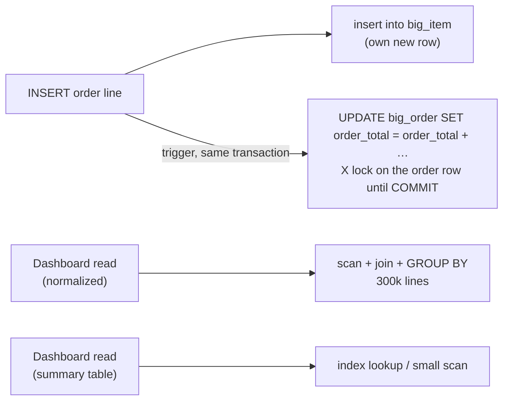

## Introduction

Module 6 has argued, lesson by lesson, that every fact should be stored once. This lesson argues the other side — carefully. **Denormalization** is the deliberate introduction of redundancy into a schema to make specific reads cheaper: storing an order's total on the order row, keeping a per-customer revenue table, copying a product name into a search table, or adding a column computed from other columns.

Denormalization is not the absence of normalization. A professional denormalized design starts from a normalized one and adds **derived data with an owner and a consistency mechanism**:

| Technique | Redundant data | Kept consistent by |
|---|---|---|
| **Summary (aggregate) table** | Pre-computed `SUM`/`COUNT` per group | Batch refresh, triggers, or application code |
| **Redundant column in another table** | A copy or aggregate of child/parent data (e.g. `orders.order_total`) | Triggers or application code, in the same transaction |
| **Generated column** | A value computed from other columns *of the same row* | MySQL itself, on every write |
| **Wide reporting table** | A join flattened into one table | Rebuilt from the normalized source (ETL) |

Each technique buys faster or simpler reads and pays with **write cost, storage and the risk of drift** — the redundant copy disagreeing with its source, which is exactly the update anomaly from [Update, Insertion and Deletion Anomalies](/lessons/m06-anomalies), now introduced on purpose.

This lesson measures both sides on a generated dataset of 300,000 order lines: how much faster the reads get, what the writes cost, how a summary row becomes a lock hot spot under concurrency, and how to detect drift. It closes with the OLTP vs OLAP perspective that decides where denormalization belongs.

:::note[Dataset and timings]
The lesson runs on the **shop** dataset and generates larger `big_*` tables inside your lab. Blocks marked as **measured** show timings from the build machine — your timings will differ; compare the *ratios*, not the absolute numbers.
:::

## DBMS Theory

:::theory[Denormalization]
**Denormalization** is a design decision that stores data redundantly — violating a normal form or adding derived attributes — to optimise particular queries. Elmasri & Navathe describe it as the process of storing the join of higher-normal-form relations as a base relation in a lower normal form, accepting the resulting anomalies in exchange for performance; their Guideline 2 requires that any such anomalies be **documented and handled by the programs that update the database**.
:::

Three distinctions keep the topic precise:

1. **Derived data vs independent data.** A denormalized value must be *computable* from the normalized data (a sum, a copy, a join). If it is not computable — a price agreed at order time, a historical address — it is an independent fact, and storing it is normalization, not denormalization.
2. **Within-row vs cross-row derivation.** `line_total = quantity × unit_price` depends only on columns of the same row; MySQL can maintain it automatically and it can never drift (a generated column). `order_total = Σ line totals of the order` depends on other rows; something must re-compute it whenever any of those rows change.
3. **Synchronous vs asynchronous maintenance.** Updating the derived data **in the same transaction** keeps it exactly consistent but adds work and locks to every write. Refreshing it **later** (a nightly job, a change stream) keeps writes cheap but makes reads *stale* by up to the refresh interval.

The core trade-off can be stated as a cost model. If a derived value is read *r* times and its sources are written *w* times per period:

- normalized: every read pays the derivation cost *C_derive*; writes pay nothing extra;
- denormalized synchronously: reads pay a lookup *C_lookup ≪ C_derive*; each write pays a maintenance cost *C_maintain* (plus contention).

Denormalization wins when *r · (C_derive − C_lookup) > w · C_maintain* — read-heavy workloads with expensive derivations. That inequality, measured rather than guessed, is the whole decision.

## Why It Exists

Normalized schemas are optimal for **writes and integrity**, not for every read:

- **Aggregations over large child tables** ("revenue per customer", "orders this month") must scan and group many rows on every request. A dashboard refreshing every few seconds for many users repeats that work constantly.
- **Deep join chains** for a hot page (product page with category, brand, rating summary, stock) cost several index lookups per row; at very high request rates even cheap joins add up.
- **Sorting or filtering by a derived value** ("top customers by lifetime value", "orders over $1,000") cannot use an index unless the value is stored somewhere an index can see it.
- **Analytical workloads** (OLAP) scan millions of rows and join star-schema dimensions; flattening and pre-aggregating is standard practice there.

What goes wrong *without* discipline is equally concrete: derived values that silently drift from their sources, triggers that make bulk loads ten times slower, and summary rows that serialize all writers. The rest of the lesson shows each effect for real.

## Internal Working

:::internals[Where the costs go in InnoDB]
- **Summary table read:** a primary-key or index lookup — a B+ tree descent of a few pages, independent of the size of the base tables.
- **Base aggregation read:** a scan of all qualifying child rows, a join to the parent (index lookups or a hash join), and a grouping structure (temporary table or sort). Cost grows with the data.
- **Synchronous maintenance by trigger:** every inserted child row fires the trigger, which runs an `UPDATE` of the parent/summary row — locate it, take an **exclusive row lock** held until commit, write undo and redo records, modify the page. A bulk insert of *n* rows performs *n* extra updates.
- **Contention:** all writers that touch children of the same parent need the **same** summary row lock, so they serialize. The normalized design, where each insert touches only its own new row, has no such hot spot.
- **Generated columns:** a `VIRTUAL` column is computed when read and stored only in secondary indexes defined on it; a `STORED` column is computed on every insert/update and written into the row. Both are maintained by the server inside the same statement, so they cannot drift.
:::



## MySQL Implementation

Generate a realistic workload: 2,000 customers, 100,000 orders and 300,000 order lines. The statements use recursive CTEs (raising `cte_max_recursion_depth` for this session), and `ANALYZE TABLE` refreshes statistics afterwards so the plans below are meaningful.

```sql run
SET SESSION cte_max_recursion_depth = 400000;
CREATE TABLE big_customer (
  customer_id INT UNSIGNED PRIMARY KEY,
  name        VARCHAR(40) NOT NULL,
  region      CHAR(2)     NOT NULL
);
INSERT INTO big_customer
WITH RECURSIVE s(n) AS (SELECT 1 UNION ALL SELECT n + 1 FROM s WHERE n < 2000)
SELECT n, CONCAT('Customer ', n), ELT(1 + n % 4, 'NE', 'SE', 'MW', 'W') FROM s;
CREATE TABLE big_order (
  order_id    INT UNSIGNED PRIMARY KEY,
  customer_id INT UNSIGNED NOT NULL,
  order_date  DATE NOT NULL,
  KEY idx_big_order_customer (customer_id),
  CONSTRAINT fk_big_order_customer FOREIGN KEY (customer_id) REFERENCES big_customer (customer_id)
);
INSERT INTO big_order
WITH RECURSIVE s(n) AS (SELECT 1 UNION ALL SELECT n + 1 FROM s WHERE n < 100000)
SELECT n, 1 + (n * 7919) % 2000, DATE '2024-01-01' + INTERVAL (n % 366) DAY FROM s;
CREATE TABLE big_item (
  order_id   INT UNSIGNED NOT NULL,
  line_no    TINYINT UNSIGNED NOT NULL,
  product_id INT UNSIGNED NOT NULL,
  quantity   SMALLINT UNSIGNED NOT NULL,
  unit_price DECIMAL(10,2) NOT NULL,
  PRIMARY KEY (order_id, line_no),
  CONSTRAINT fk_big_item_order FOREIGN KEY (order_id) REFERENCES big_order (order_id)
);
INSERT INTO big_item
WITH RECURSIVE s(n) AS (SELECT 0 UNION ALL SELECT n + 1 FROM s WHERE n < 299999)
SELECT 1 + n DIV 3, 1 + n % 3, 1 + (n * 31) % 30, 1 + n % 4, 10 + (n * 37) % 490 FROM s;
ANALYZE TABLE big_customer, big_order, big_item;
SELECT (SELECT COUNT(*) FROM big_customer) AS customers,
       (SELECT COUNT(*) FROM big_order)    AS orders,
       (SELECT COUNT(*) FROM big_item)     AS order_lines;
```

The normalized question "top customers by revenue" joins and aggregates every line:

```sql run measured
SELECT o.customer_id, SUM(i.quantity * i.unit_price) AS revenue
FROM big_order o JOIN big_item i ON i.order_id = o.order_id
GROUP BY o.customer_id
ORDER BY revenue DESC, o.customer_id
LIMIT 5;
```

### A summary table

Pre-aggregate once into a table keyed by customer, with an index on the value we sort by:

```sql run
CREATE TABLE customer_revenue (
  customer_id INT UNSIGNED PRIMARY KEY,
  orders      INT UNSIGNED  NOT NULL,
  revenue     DECIMAL(14,2) NOT NULL,
  refreshed_at DATETIME NOT NULL,
  KEY idx_customer_revenue_revenue (revenue)
);
INSERT INTO customer_revenue (customer_id, orders, revenue, refreshed_at)
SELECT o.customer_id, COUNT(DISTINCT o.order_id), SUM(i.quantity * i.unit_price), '2025-01-01 00:00:00'
FROM big_order o JOIN big_item i ON i.order_id = o.order_id
GROUP BY o.customer_id;
ANALYZE TABLE customer_revenue;
SELECT COUNT(*) AS summary_rows FROM customer_revenue;
```

```sql run measured
SELECT customer_id, revenue
FROM customer_revenue
ORDER BY revenue DESC, customer_id
LIMIT 5;
```

Same answer, from 2,000 summary rows instead of 300,000 lines. (`refreshed_at` is set to a fixed value here so the captured output is deterministic; in production it would be `NOW()`.)

## Syntax Breakdown

| Construct | Purpose | Notes |
|---|---|---|
| `CREATE TABLE summary … PRIMARY KEY (group_cols)` | Summary table keyed by the grouping | Add indexes for the sort/filter columns of the dashboards |
| `INSERT INTO summary SELECT … GROUP BY …` | Full (re)build | Wrap a rebuild in a transaction or build into a new table and `RENAME TABLE` atomically |
| `INSERT … ON DUPLICATE KEY UPDATE col = col + VALUES(…)` / row alias | Incremental upsert of a summary row | 8.0.19+ prefers the row-alias form `INSERT … AS new ON DUPLICATE KEY UPDATE col = col + new.col`; `VALUES()` there is deprecated |
| `CREATE TRIGGER … AFTER INSERT ON child FOR EACH ROW UPDATE parent …` | Synchronous maintenance of a redundant column | Needs triggers for INSERT, UPDATE and DELETE; runs per row |
| `col type AS (expr) VIRTUAL` | Generated column computed on read | Can be indexed (the index stores the value) |
| `col type AS (expr) STORED` | Generated column computed on write, stored in the row | Required for some uses (e.g. as part of a primary key); costs storage |
| `CREATE EVENT … ON SCHEDULE EVERY 1 HOUR DO …` | Scheduled refresh inside MySQL | Requires the event scheduler (OFF in the sandbox) |
| `EXPLAIN ANALYZE` | Measure the real cost of a query | Runs the query; shows actual time and rows per iterator |

:::standard[Materialized views]
Standard SQL does not define materialized views, but PostgreSQL, Oracle and SQL Server offer them (with refresh commands or automatic maintenance). **MySQL has no materialized views**: a summary table plus a refresh mechanism (event, trigger, application job) is the MySQL equivalent. MySQL's ordinary views (`CREATE VIEW`) store no data and are expanded into the query at execution time.
:::

## Practical Examples

### 1. A redundant column maintained by triggers

Store each order's total on the order row so that "orders over $1,000" can be answered from `big_order` alone:

```sql run
ALTER TABLE big_order ADD COLUMN order_total DECIMAL(12,2) NOT NULL DEFAULT 0;
UPDATE big_order o
JOIN (SELECT order_id, SUM(quantity * unit_price) AS t FROM big_item GROUP BY order_id) x ON x.order_id = o.order_id
SET o.order_total = x.t;
CREATE INDEX idx_big_order_total ON big_order (order_total);
ANALYZE TABLE big_order;
SELECT COUNT(*) AS orders_over_1500 FROM big_order WHERE order_total > 1500;
```

Keeping it correct requires **three** triggers — insert, update and delete of lines:

```sql run
CREATE TRIGGER trg_big_item_ai AFTER INSERT ON big_item FOR EACH ROW
  UPDATE big_order SET order_total = order_total + NEW.quantity * NEW.unit_price WHERE order_id = NEW.order_id;
CREATE TRIGGER trg_big_item_au AFTER UPDATE ON big_item FOR EACH ROW
  UPDATE big_order SET order_total = order_total - OLD.quantity * OLD.unit_price + NEW.quantity * NEW.unit_price
  WHERE order_id = NEW.order_id;
CREATE TRIGGER trg_big_item_ad AFTER DELETE ON big_item FOR EACH ROW
  UPDATE big_order SET order_total = order_total - OLD.quantity * OLD.unit_price WHERE order_id = OLD.order_id;
INSERT INTO big_item VALUES (1, 4, 7, 2, 100.00);
UPDATE big_item SET quantity = 3 WHERE order_id = 1 AND line_no = 4;
SELECT o.order_id, o.order_total, (SELECT SUM(quantity * unit_price) FROM big_item WHERE order_id = 1) AS recomputed
FROM big_order o WHERE o.order_id = 1;
```

The `AFTER UPDATE` trigger assumes an update never moves a line to a *different* order (`OLD.order_id = NEW.order_id`). A complete implementation must handle that case too — one of many details that make trigger maintenance harder than it looks.

### 2. Measuring the read benefit

```sql run measured
-- Normalized: compute totals on the fly, then filter
SELECT COUNT(*) AS orders_over_1500
FROM (SELECT order_id FROM big_item GROUP BY order_id HAVING SUM(quantity * unit_price) > 1500) t;
```

```sql run measured
-- Denormalized: an index range scan on the stored total
SELECT COUNT(*) AS orders_over_1500 FROM big_order WHERE order_total > 1500;
```

```sql run measured
EXPLAIN ANALYZE SELECT COUNT(*) FROM big_order WHERE order_total > 1500;
```

The plan shows a covering index range scan on `idx_big_order_total`: only the qualifying index entries are read. The normalized version must aggregate all 300,000 lines before it can filter.

### 3. Measuring the write cost

Insert 30,000 new lines into existing orders — once with the triggers in place, then the same number of lines into a copy of the table without triggers:

```sql run measured
INSERT INTO big_item (order_id, line_no, product_id, quantity, unit_price)
WITH RECURSIVE s(n) AS (SELECT 0 UNION ALL SELECT n + 1 FROM s WHERE n < 29999)
SELECT 1 + n, 5, 1 + n % 30, 1, 20.00 FROM s;
```

```sql run
CREATE TABLE big_item_plain LIKE big_item;
```

```sql run measured
INSERT INTO big_item_plain (order_id, line_no, product_id, quantity, unit_price)
WITH RECURSIVE s(n) AS (SELECT 0 UNION ALL SELECT n + 1 FROM s WHERE n < 29999)
SELECT 1 + n, 5, 1 + n % 30, 1, 20.00 FROM s;
```

`CREATE TABLE … LIKE` copies columns and indexes but **not** foreign keys or triggers, so the second insert does neither the foreign-key lookups nor the 30,000 trigger updates. The measured difference is the price of synchronous denormalization on bulk writes — compare the two elapsed times on the build machine.

### 4. Generated columns — denormalization MySQL keeps consistent

A value derived from the same row can be a generated column. Add the line total as a `VIRTUAL` column with an index, and the order month as a `STORED` column for monthly reports:

```sql run
ALTER TABLE big_item ADD COLUMN line_total DECIMAL(12,2) AS (quantity * unit_price) VIRTUAL,
                     ADD INDEX idx_big_item_line_total (line_total);
ALTER TABLE big_order ADD COLUMN order_month CHAR(7) AS (DATE_FORMAT(order_date, '%Y-%m')) STORED,
                      ADD INDEX idx_big_order_month (order_month);
ANALYZE TABLE big_item, big_order;
SELECT order_month, COUNT(*) AS orders FROM big_order
WHERE order_month IN ('2024-02', '2024-03') GROUP BY order_month ORDER BY order_month;
```

You cannot write to a generated column, so it cannot drift:

```sql run error
UPDATE big_item SET line_total = 0 WHERE order_id = 1 AND line_no = 1;
```

Generated columns only derive from **the same row**; an expression referring to another table or to other rows is rejected. Cross-row derivations (order totals, customer revenue) need triggers, application code or batch refresh.

## Execution Walkthrough

Drift: what happens when a write path bypasses the maintenance mechanism, and how to detect and repair it.

```walkthrough
title: Detecting and repairing drift in a denormalized column
steps:
  - title: "1. Everything consistent?"
    explain: "The audit query compares the stored order_total with a fresh aggregation, for every order. At this point the triggers have handled every change, so no order disagrees."
    sql: |
      SELECT COUNT(*) AS drifted_orders
      FROM big_order o
      LEFT JOIN (SELECT order_id, SUM(quantity * unit_price) AS t FROM big_item GROUP BY order_id) x
             ON x.order_id = o.order_id
      WHERE o.order_total <> COALESCE(x.t, 0);
  - title: "2. A maintenance script bypasses the trigger"
    explain: "An engineer fixes prices with a direct edit of big_order totals — or, equally common, drops and re-creates the triggers during a migration and loads data in between. Here we simulate the bypass by editing the redundant column directly."
    sql: |
      UPDATE big_order SET order_total = order_total + 5 WHERE order_id BETWEEN 100 AND 104;
  - title: "3. The audit finds the drift"
    explain: "Five orders now disagree with their lines. Nothing in the schema prevented it — a redundant column is an update anomaly by design, and its correctness depends on every write path."
    sql: |
      SELECT o.order_id, o.order_total AS stored_total, x.t AS recomputed
      FROM big_order o
      JOIN (SELECT order_id, SUM(quantity * unit_price) AS t FROM big_item GROUP BY order_id) x
        ON x.order_id = o.order_id
      WHERE o.order_total <> x.t
      ORDER BY o.order_id;
  - title: "4. Repair from the source of truth"
    explain: "The normalized data (big_item) is authoritative; the redundant column is rebuilt from it. Repairs should always flow from source to copy, never the other way."
    sql: |
      UPDATE big_order o
      JOIN (SELECT order_id, SUM(quantity * unit_price) AS t FROM big_item WHERE order_id BETWEEN 100 AND 104 GROUP BY order_id) x
        ON x.order_id = o.order_id
      SET o.order_total = x.t;
      SELECT COUNT(*) AS drifted_orders
      FROM big_order o
      JOIN (SELECT order_id, SUM(quantity * unit_price) AS t FROM big_item GROUP BY order_id) x ON x.order_id = o.order_id
      WHERE o.order_total <> x.t;
```

Contention: the summary row as a hot spot. Two checkout sessions add lines to the **same** order (think: a shared cart, or a per-merchant daily-total row that every sale updates).

```concurrency
title: Two writers, one summary row
description: >-
  With a trigger maintaining orders.order_total, every line insert also updates the parent order row. Two
  transactions adding lines to the same order therefore contend for the same row lock — in the normalized design
  they would insert independent rows and never wait for each other.
setup: |
  CREATE TABLE ord (order_id INT PRIMARY KEY, order_total DECIMAL(12,2) NOT NULL DEFAULT 0);
  CREATE TABLE ord_line (order_id INT NOT NULL, line_no INT NOT NULL, amount DECIMAL(10,2) NOT NULL,
    PRIMARY KEY (order_id, line_no), CONSTRAINT fk_ord_line FOREIGN KEY (order_id) REFERENCES ord (order_id));
  INSERT INTO ord VALUES (1, 0), (2, 0);
  CREATE TRIGGER trg_ord_line_ai AFTER INSERT ON ord_line FOR EACH ROW
    UPDATE ord SET order_total = order_total + NEW.amount WHERE order_id = NEW.order_id;
steps:
  - session: A
    sql: START TRANSACTION; INSERT INTO ord_line VALUES (1, 1, 25.00);
    note: The trigger updated ord row 1, so A now holds an exclusive lock on it until COMMIT.
  - session: B
    sql: START TRANSACTION;
  - session: B
    sql: INSERT INTO ord_line VALUES (1, 2, 40.00);
    expect: blocks
    note: >-
      B's line is a different row, but B must touch ord row 1 too — first for the foreign-key check (a shared lock
      on the parent row), then in its trigger's UPDATE (an exclusive lock). A's trigger already holds the exclusive
      lock, so B waits.
  - observe: locks
  - session: A
    sql: COMMIT;
    note: A's lock is released and B's insert (and trigger update) completes.
  - session: B
    sql: COMMIT;
  - session: C
    sql: SELECT order_id, order_total FROM ord ORDER BY order_id;
```

The lock snapshot shows A holding `X,REC_NOT_GAP` on the `PRIMARY` record of `ord` for order 1 (taken by its trigger's `UPDATE`) and B **waiting for `S,REC_NOT_GAP`** on the same record — B's foreign-key check could not even read-lock the parent row. Without the trigger, A would hold only a shared lock on the parent (from its own FK check), shared locks are compatible, and the two inserts would not wait for each other. With many concurrent writers per summary row (a global counter, a per-day total), this serializes throughput. Common mitigations: split the counter into N slot rows and sum them on read, aggregate asynchronously, or keep the hot path normalized and refresh the summary in batches.

## Output

The measured blocks above give the trade-off for this workload on the build machine. Summarise the read side with the plans — no timings needed to see the difference in work:

```sql run
EXPLAIN FORMAT=TREE
SELECT customer_id, revenue FROM customer_revenue ORDER BY revenue DESC, customer_id LIMIT 5;
```

```sql run
EXPLAIN FORMAT=TREE
SELECT o.customer_id, SUM(i.quantity * i.unit_price) AS revenue
FROM big_order o JOIN big_item i ON i.order_id = o.order_id
GROUP BY o.customer_id ORDER BY revenue DESC, o.customer_id LIMIT 5;
```

The summary-table plan scans the 2,000-entry revenue index and keeps the top 5 in a bounded sort; the normalized plan joins every order with its lines (an estimated ~319,000 joined rows) and aggregates them before it can sort. On the build machine the two measured queries took a few hundred milliseconds and about one millisecond respectively; the "orders over $1,500" filter took tens of milliseconds computed from the lines and single-digit milliseconds from the indexed `order_total` column. (Exact values vary from run to run — read them in the measured blocks above.) The write side is the opposite: the insert of 30,000 lines into the trigger-maintained, foreign-key-checked `big_item` took several hundred milliseconds on the build machine, several times as long (the ratio varied between runs — roughly 5× to 8× in ours) as the same rows into `big_item_plain` (no trigger, no foreign key) — and concurrent writers to the same order serialized on its row lock. Neither design is "faster" in general — each is faster for the operation it was built for.

## Alternative Approaches

| Approach | Read speed | Write cost | Freshness | Drift risk | Fits |
|---|---|---|---|---|---|
| Stay normalized + good indexes | Good for selective queries | None extra | Exact | None | Default; measure first |
| Covering / composite index | Often enough for "denormalization-like" speed | Index maintenance | Exact | None | Filters and sorts on base columns ([Covering Indexes](/lessons/m07-covering-prefix-functional)) |
| Generated column (+ index) | Fast for derived filters/sorts | Small (same row) | Exact | **None** | Within-row derivations |
| Redundant column + triggers | Fast | Per-row trigger work, lock on parent | Exact (if every path is covered) | Medium — bypassed paths, migrations | Low/medium write rates |
| Redundant column + application code | Fast | Extra statement per write | Exact within the transaction | Medium–high — every code path must comply | When logic must live in the app |
| Summary table, batch refresh | Very fast | None on the write path | Stale by the refresh interval | Low (rebuilt from source) | Dashboards, reports |
| Summary table, incremental upserts | Very fast | Extra upsert per write; hot rows | Exact or near-exact | Medium | Counters with low contention |
| Read replica / cache | Fast, offloads primary | None on primary | Replica lag / TTL | Low | Read scaling ([Read Replicas](/lessons/m12-read-replicas), [Caching](/lessons/m12-caching)) |
| Warehouse / OLAP store | Excellent for scans | ETL pipeline | Minutes–hours | Low | Analytics ([Data Warehousing](/lessons/m13-data-warehousing)) |

A scheduled refresh inside MySQL would use an event. The sandbox runs with the event scheduler **off**, so the statement below is display-only here; on a server with `event_scheduler=ON` it would rebuild the summary hourly:

```sql
CREATE EVENT ev_refresh_customer_revenue
ON SCHEDULE EVERY 1 HOUR
DO
  REPLACE INTO customer_revenue (customer_id, orders, revenue, refreshed_at)
  SELECT o.customer_id, COUNT(DISTINCT o.order_id), SUM(i.quantity * i.unit_price), NOW()
  FROM big_order o JOIN big_item i ON i.order_id = o.order_id
  GROUP BY o.customer_id;
```

## Performance Analysis

Theory first, then the measurements.

| Operation | Normalized cost | Denormalized cost |
|---|---|---|
| "Top 5 customers by revenue" | O(lines) scan + join + group + sort | O(5) index read on the summary (or O(customers) scan) |
| "Orders over $1,500" | O(lines) aggregate, then filter | O(matching orders) index range |
| Insert one order line | 1 row + FK check | 1 row + FK check + 1 parent `UPDATE` (trigger) + parent row lock until commit |
| Bulk insert of n lines | n rows | n rows + n trigger updates |
| Change a line's quantity | 1 row | 1 row + 1 parent update |
| Storage | Base tables | + summary rows, + redundant columns, + their indexes |

The measured blocks confirm the shape: on the build machine the summary-table read was two orders of magnitude faster than the base aggregation (about a millisecond versus a few hundred milliseconds) and the indexed-column filter several times faster, while the bulk insert with triggers and foreign-key checks took several times as long (the ratio varied between runs — roughly 5× to 8× in ours) as the plain insert of the same 30,000 rows (part of that difference is the foreign-key lookups, which the `LIKE` copy does not have). Three cautions when reading such measurements:

:::performance[Reading the measurements honestly]
- **Timings are from the build machine** and include caching effects: the base tables fit in the buffer pool here; on a production table far larger than memory, the normalized aggregation would be I/O-bound and the gap larger.
- **The comparison is per query.** A dashboard that runs the aggregation once per minute may not justify any denormalization; one that runs it 1,000 times per minute likely does. Multiply by frequency — the cost model in the theory section — before deciding.
- `EXPLAIN ANALYZE` executes the query; use it on a replica or a copy for expensive statements ([EXPLAIN ANALYZE](/lessons/m07-explain-analyze)).
- **Isolate the variable.** The bulk-insert comparison changes two things at once (triggers and foreign keys); a rigorous benchmark would add the foreign key to the plain copy, repeat each run several times and report the spread.
:::

## Best Practices

:::best-practice[Denormalizing responsibly]
1. **Normalize first, denormalize by measurement.** Start from a 3NF/BCNF design; add redundancy only for a measured, frequent, expensive read, and record the measurement.
2. **Exhaust cheaper options first:** better indexes, covering indexes, query rewrites, generated columns, caching or a replica.
3. **Give every redundant value an owner and a mechanism** — trigger, application service, or batch job — and cover *every* write path (inserts, updates, deletes, bulk loads, migrations).
4. **Keep the source of truth normalized** and always repair copies from it.
5. **Audit for drift** with a scheduled comparison query; alert when it finds differences.
6. **Watch for hot rows.** If many transactions update the same summary row, split it, aggregate asynchronously or accept staleness.
7. **Prefer generated columns for within-row derivations** — they cannot drift and can be indexed.
8. **Document the denormalization** (Elmasri & Navathe's Guideline 2): which columns are derived, from what, how they are maintained, and how stale they may be.
:::

## Common Mistakes

**Mistake 1 — denormalizing before measuring.** "Joins are slow" is not a measurement. On the shop-sized tables every join in this module runs in microseconds; denormalization adds permanent maintenance cost for no benefit.

**Mistake 2 — maintaining a redundant column on insert only.** Without the `AFTER UPDATE` and `AFTER DELETE` triggers, every quantity change or deleted line makes `order_total` wrong — the drift walkthrough showed how silently that happens.

**Mistake 3 — trying to derive across rows with a generated column.** MySQL rejects it:

```sql run error
ALTER TABLE big_order ADD COLUMN items_total DECIMAL(12,2)
  AS ((SELECT SUM(quantity * unit_price) FROM big_item WHERE big_item.order_id = big_order.order_id)) STORED;
```

Generated-column expressions may not contain subqueries, stored functions or non-deterministic functions.

**Mistake 4 — a global counter row on the hot path.** A single `site_stats` row updated by every order serializes all checkouts on one lock, as the concurrency scenario demonstrated for one order. Use slotted counters or asynchronous aggregation.

**Mistake 5 — "fixing" the source from the copy.** When a summary disagrees with the base tables, the base tables win. Updating line items to match a stale total destroys real data.

## Industry Application

- **OLTP systems** (orders, payments, bookings) stay close to 3NF for integrity, with a handful of targeted redundant columns: an order's total, a product's average rating and review count, a user's follower count. These are maintained in the same transaction or by an asynchronous worker, and periodically reconciled.
- **OLAP and BI** use denormalization systematically: **star schemas** with wide, redundant dimension tables (Kimball), pre-aggregated cubes and summary tables, rebuilt or appended by ETL/ELT pipelines from the normalized sources ([OLTP vs OLAP](/lessons/m12-oltp-olap), [ETL and ELT Pipelines](/lessons/m13-etl-elt)). Because they are never updated in place by users, they avoid update anomalies by construction.
- **Search and caching layers** (Elasticsearch documents, Redis hashes, CDN-cached pages) are denormalized copies kept in sync through change data capture from the MySQL binary log — the same consistency problem, solved asynchronously.
- **Social and e-commerce counters** (likes, stock, views) are the classic hot-row problem; large sites shard counters or aggregate them in streams instead of updating one row per event.
- **Microservices** frequently replicate another service's data (a customer name inside the order service) — denormalization across service boundaries, with events as the maintenance mechanism and an explicit owner for each fact.

## Practice Exercises

```exercise
id: ex1
title: Build a summary table
difficulty: easy
kind: dml
concepts: [summary-tables, denormalization]
prompt: |
  Create `product_sales (product_id INT UNSIGNED PRIMARY KEY, units INT UNSIGNED NOT NULL, revenue DECIMAL(12,2) NOT NULL)`
  and fill it from `order_items` with one row per product that has been sold: total `quantity` and total
  `quantity * unit_price`. The checker lists the five products with the highest revenue.
hints:
  - "INSERT INTO product_sales SELECT product_id, SUM(quantity), SUM(quantity * unit_price) FROM order_items GROUP BY product_id;"
solution: |
  CREATE TABLE product_sales (
    product_id INT UNSIGNED PRIMARY KEY,
    units      INT UNSIGNED  NOT NULL,
    revenue    DECIMAL(12,2) NOT NULL
  );
  INSERT INTO product_sales (product_id, units, revenue)
  SELECT product_id, SUM(quantity), SUM(quantity * unit_price) FROM order_items GROUP BY product_id;
check: |
  SELECT product_id, units, revenue FROM product_sales ORDER BY revenue DESC, product_id LIMIT 5;
explanation: |
  The summary table answers "best sellers" without scanning `order_items`. It is a copy: from now on every new
  line item makes it stale unless a mechanism (trigger, job, application code) refreshes it.
```

```exercise
id: ex2
title: Audit a redundant total
difficulty: medium
setup: |
  CREATE TABLE order_totals AS
  SELECT order_id, SUM(quantity * unit_price) AS stored_total FROM order_items GROUP BY order_id;
  UPDATE order_totals SET stored_total = stored_total + 10 WHERE order_id IN (5, 17);
  DELETE FROM order_items WHERE order_id = 40 AND product_id = (SELECT MIN(product_id) FROM (SELECT product_id FROM order_items WHERE order_id = 40) t);
concepts: [denormalization, derived-columns]
prompt: |
  `order_totals(order_id, stored_total)` is supposed to equal `SUM(quantity * unit_price)` of each order's
  `order_items`. Return the drifted orders with columns `order_id`, `stored_total`, `actual_total`, ordered by `order_id`.
hints:
  - "Aggregate order_items per order in a derived table and join it to order_totals."
  - "Compare with <> and list the mismatches."
solution: |
  SELECT t.order_id, t.stored_total, a.actual_total
  FROM order_totals t
  JOIN (SELECT order_id, SUM(quantity * unit_price) AS actual_total FROM order_items GROUP BY order_id) a
    ON a.order_id = t.order_id
  WHERE t.stored_total <> a.actual_total
  ORDER BY t.order_id;
orderMatters: true
explanation: |
  Orders 5 and 17 were edited directly (a bypassed write path) and order 40 lost a line without the total being
  maintained. A production audit would also use a LEFT JOIN to catch orders whose lines were all deleted.
```

```exercise
id: ex3
title: Maintain a counter with a trigger
difficulty: hard
kind: dml
dataset: empty
setup: |
  CREATE TABLE post (post_id INT PRIMARY KEY, comment_count INT NOT NULL DEFAULT 0);
  CREATE TABLE post_comment (comment_id INT PRIMARY KEY, post_id INT NOT NULL, body VARCHAR(100) NOT NULL,
    CONSTRAINT fk_comment_post FOREIGN KEY (post_id) REFERENCES post (post_id));
  INSERT INTO post VALUES (1, 0), (2, 0);
concepts: [triggers, derived-columns]
prompt: |
  Keep `post.comment_count` consistent with `post_comment`:

  1. Create trigger `trg_comment_ai` (AFTER INSERT) that increments the post's count, and `trg_comment_ad`
     (AFTER DELETE) that decrements it.
  2. Then insert comments (1, 1, 'first'), (2, 1, 'second'), (3, 2, 'hello') and delete comment 2.

  The checker lists the posts with their stored and actual counts, and the trigger names.
hints:
  - "CREATE TRIGGER trg_comment_ai AFTER INSERT ON post_comment FOR EACH ROW UPDATE post SET comment_count = comment_count + 1 WHERE post_id = NEW.post_id;"
  - "The delete trigger uses OLD.post_id."
solution: |
  CREATE TRIGGER trg_comment_ai AFTER INSERT ON post_comment FOR EACH ROW
    UPDATE post SET comment_count = comment_count + 1 WHERE post_id = NEW.post_id;
  CREATE TRIGGER trg_comment_ad AFTER DELETE ON post_comment FOR EACH ROW
    UPDATE post SET comment_count = comment_count - 1 WHERE post_id = OLD.post_id;
  INSERT INTO post_comment VALUES (1, 1, 'first'), (2, 1, 'second'), (3, 2, 'hello');
  DELETE FROM post_comment WHERE comment_id = 2;
check: |
  SELECT CAST(p.post_id AS CHAR) AS a, CAST(p.comment_count AS CHAR) AS b,
         CAST((SELECT COUNT(*) FROM post_comment c WHERE c.post_id = p.post_id) AS CHAR) AS c
  FROM post p
  UNION ALL
  SELECT 'trigger', TRIGGER_NAME, EVENT_MANIPULATION FROM information_schema.TRIGGERS
  WHERE TRIGGER_SCHEMA = DATABASE()
  ORDER BY a, b;
explanation: |
  Both posts end with stored = actual (1 and 1). Forgetting the delete trigger leaves post 1 at 2. A real
  implementation would also need an UPDATE trigger if comments can move between posts, and would consider the
  hot-row effect on very popular posts.
```

```exercise
id: ex4
title: A generated column for a derived filter
difficulty: medium
kind: dml
concepts: [generated-columns]
prompt: |
  Reports often filter `order_items` by line value. Add a **virtual** generated column
  `line_total DECIMAL(12,2) AS (quantity * unit_price)` to `order_items` and an index `idx_order_items_line_total`
  on it. The checker reads the column definition from `information_schema.COLUMNS` and counts lines with
  `line_total > 1000`.
hints:
  - "ALTER TABLE order_items ADD COLUMN line_total DECIMAL(12,2) AS (quantity * unit_price) VIRTUAL, ADD INDEX idx_order_items_line_total (line_total);"
solution: |
  ALTER TABLE order_items
    ADD COLUMN line_total DECIMAL(12,2) AS (quantity * unit_price) VIRTUAL,
    ADD INDEX idx_order_items_line_total (line_total);
check: |
  SELECT COLUMN_NAME, EXTRA, GENERATION_EXPRESSION FROM information_schema.COLUMNS
  WHERE TABLE_SCHEMA = DATABASE() AND TABLE_NAME = 'order_items' AND COLUMN_NAME = 'line_total'
  UNION ALL
  SELECT 'lines over 1000', CAST(COUNT(*) AS CHAR), '' FROM order_items WHERE line_total > 1000;
explanation: |
  `EXTRA` shows `VIRTUAL GENERATED`. The value is computed from the same row, so it can never disagree with
  `quantity` and `unit_price`, and the index lets `WHERE line_total > 1000` use a range scan. This is the safest
  form of denormalization MySQL offers.
```

```exercise
id: ex5
title: Should we denormalize?
difficulty: challenge
kind: open
concepts: [denormalization, read-write-tradeoff, oltp-olap, summary-tables]
prompt: |
  A marketplace shows, on every product page, the product's average rating and review count. Today the page
  runs `SELECT AVG(rating), COUNT(*) FROM reviews WHERE product_id = ?` (index on `product_id`). Traffic: 5,000
  product page views per second, 20 new reviews per second, a few very popular products receive most reviews.
  Reviews can be edited and deleted by moderators.

  Decide whether to denormalize, choose a mechanism, and address: consistency on insert/update/delete, hot-row
  contention, staleness tolerance, drift detection, and what you would measure before and after.
solution: |
  **Decision:** the read is frequent (5,000/s) while writes are rare (20/s), so the cost model favours storing
  `rating_sum` and `review_count` on `products` (or in a `product_rating_summary` table) and computing the
  average as `rating_sum / review_count` on read. With an index on `reviews(product_id)` the current query is
  cheap per call, so first measure: per-call latency with `EXPLAIN ANALYZE`, and total CPU spent on this query.
  For popular products with tens of thousands of reviews the per-call aggregate is no longer cheap.

  **Mechanism:** a separate summary table (keeps the hot `products` row free for other updates), maintained either
  (a) synchronously in the same transaction as the review write (application code or AFTER INSERT/UPDATE/DELETE
  triggers adjusting sum and count — update must handle rating changes and product changes), or (b)
  asynchronously by a worker consuming review events. Product pages usually tolerate a few seconds of
  staleness, so (b) avoids adding latency and locks to the write path.

  **Hot rows:** synchronous updates of one summary row per popular product serialize review writes for that
  product; at 20 writes/s total this is acceptable, but if it grows, use asynchronous aggregation or slotted
  counters (N rows per product, summed on read).

  **Drift:** a nightly (or hourly) reconciliation query compares summary values with a fresh aggregation of
  `reviews`, alerts on differences and repairs from the source. Moderator bulk deletes must go through the same
  maintenance path or trigger a targeted recompute.

  **Measure before/after:** p50/p99 latency and CPU of the product-page query, write latency and lock waits on
  review inserts (performance_schema / slow log on a real server), and the drift rate found by reconciliation.
  Also consider the alternative of caching the rating in the application cache with a short TTL, which may make
  denormalization unnecessary.
```

## Knowledge Assessment

```quiz
- id: q1
  question: "Which of these is denormalization in the strict sense?"
  options:
    - "Storing order_items.unit_price, the price agreed when the order was placed"
    - "Storing orders.order_total computed from the order's line items"
    - "Splitting customers' addresses into their own table"
    - "Adding a foreign key from orders to customers"
  answer: 1
  explanation: "order_total is derivable from other data, so storing it is redundant on purpose. The historical unit_price is an independent fact (it cannot be recomputed), so storing it is correct normalization. Splitting tables and adding FKs are normalization steps."
  concepts: [denormalization, derived-columns]
- id: q2
  question: "Which denormalization technique can never drift from its source in MySQL?"
  options: ["A summary table refreshed hourly", "A redundant column maintained by triggers", "A generated column", "A column maintained by application code"]
  answer: 2
  explanation: "Generated columns are computed by the server from the same row on every read (VIRTUAL) or write (STORED) and cannot be written directly. All other mechanisms can be bypassed or lag behind."
  concepts: [generated-columns]
- id: q3
  question: "Two transactions insert different line items into the same order. A trigger maintains orders.order_total. What happens?"
  options:
    - "Both proceed in parallel because they insert different rows"
    - "The second waits: both triggers update the same order row, which the first transaction has locked exclusively until it commits"
    - "The second fails with a deadlock immediately"
    - "MySQL merges the two updates automatically"
  answer: 1
  explanation: "The child inserts do not conflict, but the trigger's UPDATE of the shared parent row does, so writers serialize on that row. That is the hot-row cost of synchronous denormalization."
  concepts: [triggers, read-write-tradeoff]
- id: q4
  question: "When does the cost model favour storing a derived value synchronously? (Select all that apply.)"
  type: multi
  options:
    - "Reads of the value are much more frequent than writes to its sources"
    - "Deriving the value on read is expensive (large aggregation)"
    - "Many concurrent transactions update the sources of the same derived row"
    - "The value is needed exactly up to date"
  answer: [0, 1, 3]
  explanation: "High read frequency, expensive derivation and a need for exactness favour synchronous maintenance. High write contention on the same derived row argues against it (prefer asynchronous or slotted counters)."
  concepts: [read-write-tradeoff, denormalization]
- id: q5
  question: "What is the MySQL equivalent of a materialized view?"
  options:
    - "CREATE MATERIALIZED VIEW"
    - "A regular view with ALGORITHM=TEMPTABLE"
    - "A summary table plus a refresh mechanism (event, trigger or application job)"
    - "The query cache"
  answer: 2
  explanation: "MySQL has no materialized views. A TEMPTABLE view still recomputes its result on every query, and the query cache was removed in MySQL 8.0."
  concepts: [summary-tables]
- id: q6
  question: "An audit finds that 5 orders' stored totals disagree with their line items. What is the correct repair?"
  options:
    - "Update the line items so they add up to the stored totals"
    - "Recompute the stored totals from the line items"
    - "Delete the 5 orders"
    - "Drop the triggers"
  answer: 1
  explanation: "The normalized data is the source of truth; the redundant copy is rebuilt from it. Changing the source to match a copy destroys real data."
  concepts: [denormalization, derived-columns]
- id: q7
  question: "Why is `ALTER TABLE orders ADD COLUMN items_total … AS ((SELECT SUM(…) FROM order_items …)) STORED` rejected?"
  options:
    - "STORED columns cannot be DECIMAL"
    - "Generated-column expressions cannot contain subqueries; they may only use the row's own columns and deterministic built-in functions"
    - "Generated columns need the event scheduler"
    - "Only VIRTUAL columns can reference other tables"
  answer: 1
  explanation: "Generated columns are within-row derivations. Cross-row totals need triggers, application code or batch refresh; neither VIRTUAL nor STORED can reference other tables."
  concepts: [generated-columns]
- id: q8
  question: "From the OLTP vs OLAP perspective, which statement is most accurate?"
  options:
    - "OLTP systems should be fully denormalized for speed"
    - "OLAP systems use denormalized star schemas and summary tables that are rebuilt or appended from normalized sources, so in-place update anomalies do not arise"
    - "Denormalization is only used in NoSQL systems"
    - "OLAP systems must be in BCNF"
  answer: 1
  explanation: "OLTP schemas stay near 3NF with targeted redundancy; analytical stores denormalize systematically but are loaded by pipelines rather than updated in place. Denormalization is common in relational systems."
  concepts: [oltp-olap]
```
