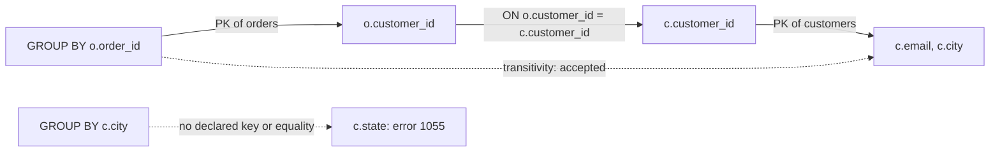

## Introduction

The previous lesson, [Update, Insertion and Deletion Anomalies](/lessons/m06-anomalies), ended with an informal rule: *if a column's value is decided by something smaller than the whole key, it will be repeated, and repetition invites anomalies.* "Is decided by" needs a precise definition before we can build a theory — and a test — on top of it. That definition is the **functional dependency (FD)**.

An FD `X → Y` ("X functionally determines Y", "Y is functionally dependent on X") says: **whenever two rows agree on X, they must agree on Y.** In the shop:

- `customer_id → email` — one customer has one email;
- `product_id → name, price` — one product has one name and one list price;
- `(order_id, product_id) → quantity, unit_price` — one line item has one quantity and one price paid;
- but **not** `product_id → unit_price` — the same product was sold at different prices on different orders.

FDs answer the questions every schema designer and data engineer eventually faces:

1. *What are the facts in this table, and what identifies each one?* (Each FD with a non-key left side is a fact stored in the wrong place.)
2. *What is a key?* (A key is a set of attributes that determines all others — an FD statement.)
3. *Given the dependencies I know, what other dependencies follow?* (Armstrong's axioms.)
4. *Does this dependency actually hold in my data?* (A `GROUP BY … HAVING COUNT(DISTINCT …) > 1` query.)

This lesson covers all four, and shows a part of MySQL that most developers use without realising it reasons about FDs: the `ONLY_FULL_GROUP_BY` check.

:::note[Dataset]
The examples use the **shop** dataset and a flat `order_report` table built inside your lab. All outputs were captured from a real MySQL server.
:::

## DBMS Theory

:::theory[Functional dependency — definition]
Let **R** be a relation schema and **X, Y ⊆ R** sets of attributes. The functional dependency **X → Y** *holds on R* if, for **every legal instance** r of R and every pair of tuples t₁, t₂ ∈ r:

> t₁[X] = t₂[X] ⟹ t₁[Y] = t₂[Y]

X is the **determinant** (left-hand side, LHS); Y the **dependent** (right-hand side, RHS). An instance r *satisfies* X → Y if the implication holds for its tuples. (Silberschatz, Korth & Sudarshan, *Database System Concepts*, ch. 7; Elmasri & Navathe, *Fundamentals of Database Systems*, ch. 14.)
:::

The words **every legal instance** carry the whole meaning. An FD is a statement about the *real world the schema models* — a business rule — not about the rows that happen to be stored today. Consequently:

- **Data can refute an FD but never prove one.** One pair of rows that agrees on X and disagrees on Y shows that X → Y does not hold. Zero such pairs only shows that the *current instance* satisfies it.
- **FDs are discovered by understanding the domain** (requirements, business rules, domain experts) and only *checked* against data.

**Classification.**

| Kind | Definition | Example |
|---|---|---|
| **Trivial** | Y ⊆ X — holds in every relation, says nothing | `customer_id, email → email` |
| **Non-trivial** | Y ⊄ X | `customer_id, email → city` |
| **Completely non-trivial** | X ∩ Y = ∅ | `customer_id → city` |
| **Full** (w.r.t. a key) | X → Y and no proper subset of X determines Y | `(order_id, product_id) → quantity` |
| **Partial** | Some proper subset of X already determines Y | `(order_id, product_id) → order_date` (because `order_id → order_date`) |
| **Transitive** | X → Z derived from X → Y and Y → Z, with Y not a key | `order_id → email` via `order_id → customer_id → email` |

Partial dependencies define **2NF**, transitive dependencies **3NF** — the vocabulary returns in [Second Normal Form](/lessons/m06-2nf) and [Third Normal Form](/lessons/m06-3nf).

**Keys as FDs.** A set K is a **superkey** of R iff K → R (K determines every attribute). A **candidate key** is a minimal superkey. Every `PRIMARY KEY` and `UNIQUE NOT NULL` constraint you declare in MySQL is therefore an FD declaration: `K → every column`. [Keys](/lessons/m01-keys) introduced these terms; FDs make them computable.

### Armstrong's axioms

Given a set F of FDs, other FDs follow logically. We write **F ⊨ X → Y** if every instance satisfying F also satisfies X → Y. The set of all FDs implied by F is its **closure F⁺**. Armstrong (1974) gave three inference rules:

| Axiom | Rule | Intuition |
|---|---|---|
| **A1 Reflexivity** | If Y ⊆ X then X → Y | Trivial FDs |
| **A2 Augmentation** | If X → Y then XZ → YZ | Adding the same attributes to both sides keeps it true |
| **A3 Transitivity** | If X → Y and Y → Z then X → Z | Determination chains |

(XZ means X ∪ Z.) The axioms are **sound** — they derive only FDs that really are implied — and **complete** — every implied FD can be derived with them. Completeness is what makes FD reasoning mechanical: anything true can be proved by applying three rules.

Useful **derived rules**, each provable from A1–A3:

| Rule | Statement | Proof from the axioms |
|---|---|---|
| **Union** | X → Y and X → Z ⟹ X → YZ | X → Y gives (A2 with X) X → XY; X → Z gives (A2 with Y) XY → YZ; transitivity: X → YZ |
| **Decomposition** | X → YZ ⟹ X → Y and X → Z | YZ → Y by reflexivity; transitivity with X → YZ |
| **Pseudotransitivity** | X → Y and WY → Z ⟹ WX → Z | Augment X → Y with W: WX → WY; transitivity with WY → Z |
| **Composition** | X → Y and W → Z ⟹ XW → YZ | Augment each, then union |

Decomposition is why we may always rewrite an FD with a multi-attribute right side as several single-attribute FDs — the starting point of the minimal cover algorithm in the next lesson. Note that the **left side cannot be split**: `(order_id, product_id) → quantity` does *not* imply `order_id → quantity`.

## Why It Exists

Before FDs, schema design was judgment and folklore: "put customer things in the customer table". That works for obvious cases and fails for subtle ones — a table of course offerings, a scheduling system, a pricing table with overlapping rules. FDs exist to make design **checkable**:

- **They define keys mathematically**, so "is (student, course) a key?" has a provable answer instead of an opinion.
- **They define the normal forms.** 2NF, 3NF and BCNF are each a condition on the FDs of a relation. Without FDs there is no algorithm to decide whether a table is well designed or to decompose it.
- **They predict anomalies.** Every non-trivial FD whose LHS is not a superkey is a fact stored redundantly — a guaranteed source of update anomalies.
- **They let tools reason.** Query optimizers use FDs to remove redundant `GROUP BY` and `ORDER BY` columns and to validate queries (MySQL's `ONLY_FULL_GROUP_BY`, below); data-profiling tools discover FDs to suggest keys and detect quality problems.

What goes wrong without explicit FD thinking: designers decompose on the wrong attribute and produce **lossy** joins (spurious rows), declare keys that are not actually unique, or "normalize away" columns like `unit_price` that encode a different fact. All three are FD mistakes.

## Internal Working

MySQL has **no syntax for declaring an arbitrary FD** such as `city → state`. The engine knows only the FDs implied by constraints it can enforce: `PRIMARY KEY` and `UNIQUE` indexes on `NOT NULL` columns (K → all columns of the table). But the optimizer does perform genuine FD inference, in one well-documented place.

:::internals[Functional dependence detection in GROUP BY]
With the `ONLY_FULL_GROUP_BY` SQL mode (on by default since MySQL 5.7.5), a query is rejected if the SELECT list, HAVING or ORDER BY refers to a non-aggregated column that is not **functionally dependent** on the GROUP BY columns. MySQL derives these dependencies from:

1. **Keys:** if the GROUP BY columns include a primary key or a unique key whose columns are all `NOT NULL`, every column of that table depends on them.
2. **Equalities** in `WHERE` and in inner-join `ON` conditions: `col = constant` makes col depend on anything (∅ → col); `a = b` gives a → b and b → a.
3. **Propagation through joins** (with special rules for outer joins) and through views and derived tables.

It then applies transitivity, exactly like Armstrong's A3, to decide whether each selected column is determined. If it cannot derive the dependency, error **1055** is raised — even if the dependency happens to hold in the data. (MySQL 8.4 Reference Manual, *Detection of Functional Dependence*.)
:::

The consequence is educational: MySQL treats FDs exactly as the theory says — **as schema-level facts derived from declared constraints**, never inferred from the current rows. The examples below show a query accepted because of a key-based FD, one accepted because of transitive reasoning through a join, and one rejected although the FD holds in every stored row.



## MySQL Implementation

First, the flat table from the previous lesson, extended with the customer's state:

```sql run
CREATE TABLE order_report (
  order_id       INT UNSIGNED  NOT NULL,
  order_date     DATETIME      NOT NULL,
  customer_id    INT UNSIGNED  NOT NULL,
  customer_email VARCHAR(255)  NOT NULL,
  customer_city  VARCHAR(60)   NOT NULL,
  customer_state CHAR(2)       NOT NULL,
  product_id     INT UNSIGNED  NOT NULL,
  product_name   VARCHAR(120)  NOT NULL,
  list_price     DECIMAL(10,2) NOT NULL,
  quantity       INT UNSIGNED  NOT NULL,
  unit_price     DECIMAL(10,2) NOT NULL,
  PRIMARY KEY (order_id, product_id)
);
INSERT INTO order_report
SELECT o.order_id, o.order_date, c.customer_id, c.email, c.city, c.state,
       p.product_id, p.name, p.price, oi.quantity, oi.unit_price
FROM order_items oi
JOIN orders o    ON o.order_id = oi.order_id
JOIN customers c ON c.customer_id = o.customer_id
JOIN products p  ON p.product_id = oi.product_id;
SELECT COUNT(*) AS rows_loaded FROM order_report;
```

### Checking whether an FD holds in data

The definition says: rows that agree on X must agree on Y. Group the rows by X; within each group, Y must take exactly one value. A violating group has **more than one distinct Y**:

```sql
-- Does X -> Y hold in this instance?  (no rows = satisfied)
SELECT X, COUNT(DISTINCT Y) AS distinct_y
FROM   t
GROUP  BY X
HAVING COUNT(DISTINCT Y) > 1;
```

Test `product_id → list_price` (expected to hold) and `product_id → unit_price` (expected to fail, because prices paid vary):

```sql run
SELECT 'product_id -> list_price' AS fd, COUNT(*) AS violating_groups
FROM (SELECT product_id FROM order_report GROUP BY product_id
      HAVING COUNT(DISTINCT list_price) > 1) AS v
UNION ALL
SELECT 'product_id -> unit_price', COUNT(*)
FROM (SELECT product_id FROM order_report GROUP BY product_id
      HAVING COUNT(DISTINCT unit_price) > 1) AS v;
```

`product_id → unit_price` is violated by 15 products. Look at a few violations — the evidence a reviewer needs:

```sql run
SELECT product_id,
       COUNT(DISTINCT unit_price)                                AS distinct_prices,
       GROUP_CONCAT(DISTINCT unit_price ORDER BY unit_price SEPARATOR ' | ') AS prices_seen
FROM order_report
GROUP BY product_id
HAVING COUNT(DISTINCT unit_price) > 1
ORDER BY product_id
LIMIT 5;
```

Composite left or right sides work the same way. MySQL's `COUNT(DISTINCT a, b)` (a MySQL extension) counts distinct combinations:

```sql run
SELECT 'order_id, product_id -> quantity, unit_price' AS fd, COUNT(*) AS violating_groups
FROM (SELECT order_id, product_id FROM order_report GROUP BY order_id, product_id
      HAVING COUNT(DISTINCT quantity, unit_price) > 1) AS v
UNION ALL
SELECT 'order_id -> customer_id, order_date', COUNT(*)
FROM (SELECT order_id FROM order_report GROUP BY order_id
      HAVING COUNT(DISTINCT customer_id, order_date) > 1) AS v;
```

The first FD holds trivially in this table because `(order_id, product_id)` is its primary key — every group has exactly one row. The second holds because the flat table was built from `orders`, where `order_id` is the key.

## Syntax Breakdown

| Element | Meaning in an FD check | Notes |
|---|---|---|
| `GROUP BY X` | Partitions rows into groups that agree on the determinant | For composite X list every attribute: `GROUP BY a, b` |
| `COUNT(DISTINCT Y)` | Number of different dependent values in a group | Ignores NULLs — see the NULL caveat below |
| `COUNT(DISTINCT y1, y2)` | Distinct non-NULL **combinations** (MySQL extension) | Rows where *any* listed column is NULL are skipped |
| `HAVING … > 1` | Keeps only violating groups | No rows returned = instance satisfies the FD |
| `GROUP_CONCAT(DISTINCT Y …)` | Shows the conflicting values for review | Truncated at `group_concat_max_len` (default 1024 bytes) |
| `SUM(Y IS NULL)` | Counts NULLs in a group | Needed when NULL should count as a distinct value |
| `ONLY_FULL_GROUP_BY` | SQL mode that makes MySQL verify FDs from GROUP BY to SELECT columns | Default on; never disable it to "fix" error 1055 |
| `ANY_VALUE(col)` | Tells MySQL "I assert col is determined; pick any value" | Suppresses the check — use only when the FD truly holds |

:::warning[COUNT(DISTINCT) ignores NULL]
Under SQL semantics `COUNT(DISTINCT y)` skips NULLs, so a group with values `{'VIP20', NULL}` reports 1 distinct value and **passes** the check, although the two rows disagree. Whether NULL "disagrees" depends on what NULL means in your domain (unknown vs not applicable). To treat NULL as a value of its own, use `COUNT(DISTINCT y) + MAX(y IS NULL) > 1`.
:::

## Practical Examples

### 1. Several FDs in one profile

Data teams usually test a batch of candidate FDs at once. Each branch below is one FD; the result is a profile of the table:

```sql run
SELECT 'customer_id -> customer_email' AS candidate_fd,
       (SELECT COUNT(*) FROM (SELECT 1 FROM order_report GROUP BY customer_id
                              HAVING COUNT(DISTINCT customer_email) > 1) v) AS violating_groups
UNION ALL SELECT 'customer_email -> customer_id',
       (SELECT COUNT(*) FROM (SELECT 1 FROM order_report GROUP BY customer_email
                              HAVING COUNT(DISTINCT customer_id) > 1) v)
UNION ALL SELECT 'customer_city -> customer_state',
       (SELECT COUNT(*) FROM (SELECT 1 FROM order_report GROUP BY customer_city
                              HAVING COUNT(DISTINCT customer_state) > 1) v)
UNION ALL SELECT 'customer_city -> customer_id',
       (SELECT COUNT(*) FROM (SELECT 1 FROM order_report GROUP BY customer_city
                              HAVING COUNT(DISTINCT customer_id) > 1) v)
UNION ALL SELECT 'order_date -> order_id',
       (SELECT COUNT(*) FROM (SELECT 1 FROM order_report GROUP BY order_date
                              HAVING COUNT(DISTINCT order_id) > 1) v);
```

Read the profile carefully, because it mixes three kinds of result:

- `customer_id → customer_email` and `customer_email → customer_id` hold — and both are **real FDs**, guaranteed by `customers.customer_id` (primary key) and `uq_customers_email` (unique).
- `customer_city → customer_id` fails in 6 city groups — many customers live in one city — so it is definitely **not** an FD.
- `customer_city → customer_state` and `order_date → order_id` hold **in this instance**. Are they FDs? That is a domain question, not a data question.

### 2. Satisfied by the data, but not an FD

`customer_city → customer_state` holds for all 25 customers because the shop happens to have no two same-named cities in different states. The real world disagrees — there is a Portland in Oregon and one in Maine. One legitimate new customer breaks the "dependency":

```sql run
CREATE TABLE city_check AS SELECT DISTINCT customer_city, customer_state FROM order_report;
INSERT INTO city_check VALUES ('Portland', 'OR'), ('Portland', 'ME');
SELECT customer_city, COUNT(DISTINCT customer_state) AS states
FROM city_check
GROUP BY customer_city
HAVING COUNT(DISTINCT customer_state) > 1;
```

If you had designed the schema around `city → state` (for example, a `cities(city PK, state)` table), the Maine customer could not be stored. **Data suggests candidate FDs; only the domain confirms them.** The same goes for `order_date → order_id`: two orders placed in the same minute are perfectly possible; the instance just does not contain any yet.

### 3. The NULL caveat for real

Discount codes are NULL on about half the orders. Build a small table where one promotion row has a code and another has NULL, then compare the naive check with the NULL-aware one:

```sql run
CREATE TABLE promo_usage (
  campaign VARCHAR(20) NOT NULL,
  order_id INT NOT NULL PRIMARY KEY,
  code     VARCHAR(20) NULL
);
INSERT INTO promo_usage VALUES
  ('spring', 1, 'SPRING15'), ('spring', 2, NULL), ('spring', 3, 'SPRING15'),
  ('vip',    4, 'VIP20'),    ('vip',    5, 'VIP20');
SELECT campaign,
       COUNT(DISTINCT code)                      AS naive_distinct,
       COUNT(DISTINCT code) + MAX(code IS NULL)  AS null_aware_distinct
FROM promo_usage
GROUP BY campaign
ORDER BY campaign;
```

The naive check reports one code for `spring` and would declare `campaign → code` satisfied; the NULL-aware variant shows the disagreement. Decide explicitly which semantics you need before trusting a data-quality check.

### 4. MySQL's own FD reasoning in GROUP BY

Grouping by the customers' primary key lets you select any customer column — the FD `customer_id → email, city` is derived from the key:

```sql run
SELECT c.customer_id, c.email, c.city, COUNT(*) AS orders_placed
FROM customers c
JOIN orders o ON o.customer_id = c.customer_id
GROUP BY c.customer_id
ORDER BY orders_placed DESC, c.customer_id
LIMIT 5;
```

Grouping by `o.order_id` and selecting **customer** columns also works. MySQL chains three FDs: `order_id → o.customer_id` (key of orders), `o.customer_id → c.customer_id` (the join equality), `c.customer_id → c.email` (key of customers) — transitivity, applied by the optimizer:

```sql run
SELECT o.order_id, c.email, COUNT(*) AS line_items
FROM orders o
JOIN customers c   ON c.customer_id = o.customer_id
JOIN order_items i ON i.order_id = o.order_id
GROUP BY o.order_id
ORDER BY line_items DESC, o.order_id
LIMIT 3;
```

But grouping by `city` and selecting `state` is rejected — although we just showed that city → state holds in every stored row. MySQL refuses to infer FDs from data:

```sql run error
SELECT c.city, c.state, COUNT(*) AS customers
FROM customers c
GROUP BY c.city;
```

The honest fixes are to group by both columns (`GROUP BY c.city, c.state`) — which is correct whether or not the FD holds — or, if you *know* the dependency is true, `ANY_VALUE(c.state)`.

## Execution Walkthrough

Two traces. First, how the SQL check decides `product_id → unit_price`, step by step. Second, an Armstrong-axiom derivation that the theory does on paper.

```walkthrough
title: Testing product_id -> unit_price on order_report
steps:
  - title: "1. The input rows for two products"
    explain: Restrict to products 1 and 5 so every row is visible. Rows that agree on product_id are the pairs the definition talks about.
    sql: |
      SELECT product_id, order_id, unit_price
      FROM order_report
      WHERE product_id IN (1, 5)
      ORDER BY product_id, order_id;
  - title: "2. GROUP BY product_id — one group per determinant value"
    explain: Grouping collects all rows that agree on the LHS. Inside a group, the FD requires a single RHS value.
    sql: |
      SELECT product_id, COUNT(*) AS rows_in_group,
             GROUP_CONCAT(unit_price ORDER BY order_id) AS rhs_values
      FROM order_report
      WHERE product_id IN (1, 5)
      GROUP BY product_id
      ORDER BY product_id;
  - title: "3. COUNT(DISTINCT unit_price) per group"
    explain: Duplicates of the same value are fine (that is mere redundancy) — product 5 has seven rows but one price. Product 1 has two distinct prices, 1299.00 and the discounted 1169.10, so two of its rows agree on product_id but disagree on unit_price.
    sql: |
      SELECT product_id, COUNT(DISTINCT unit_price) AS distinct_rhs
      FROM order_report
      WHERE product_id IN (1, 5)
      GROUP BY product_id
      ORDER BY product_id;
  - title: "4. HAVING keeps only violations"
    explain: Product 1 survives — a counterexample, so the FD does not hold. A single counterexample is enough to refute an FD; an empty result would only show that this instance satisfies it.
    sql: |
      SELECT product_id
      FROM order_report
      WHERE product_id IN (1, 5)
      GROUP BY product_id
      HAVING COUNT(DISTINCT unit_price) > 1
      ORDER BY product_id;
```

```walkthrough
title: "Derive order_id, product_id -> customer_email from F with Armstrong's axioms"
steps:
  - title: "Given F"
    explain: "F = { order_id → customer_id, order_date ;  customer_id → customer_email, customer_city ;  product_id → product_name, list_price ;  order_id, product_id → quantity, unit_price }."
  - title: "1. Decomposition"
    explain: "From order_id → customer_id, order_date derive order_id → customer_id, and from customer_id → customer_email, customer_city derive customer_id → customer_email. (Decomposition is itself derived: reflexivity gives customer_id, order_date → customer_id, then transitivity.)"
  - title: "2. Transitivity (A3)"
    explain: "order_id → customer_id and customer_id → customer_email give order_id → customer_email. This is a transitive dependency through the non-key attribute customer_id — the pattern that 3NF forbids."
  - title: "3. Augmentation (A2)"
    explain: "Augment with product_id: order_id, product_id → customer_email, product_id."
  - title: "4. Decomposition"
    explain: "Drop product_id from the right side: order_id, product_id → customer_email. The key determines the email, as every key must — but only through order_id, a proper subset of the key. That is a partial dependency, the pattern 2NF forbids."
```

The `fd` analyzer below holds the same F. Pick attributes to watch their closure grow, and see which candidate keys and normal form the dependencies imply (the next lesson explains the algorithms behind it).

```viz
type: fd
attributes: [order_id, order_date, customer_id, customer_email, customer_city, product_id, product_name, list_price, quantity, unit_price]
fds: ["order_id -> customer_id, order_date", "customer_id -> customer_email, customer_city", "customer_email -> customer_id", "product_id -> product_name, list_price", "order_id, product_id -> quantity, unit_price"]
```

## Output

The final deliverable of an FD analysis is a **dependency profile**: for each candidate FD, whether the data refutes it, and whether the domain confirms it. Here is the profile of `order_report` for the FDs we care about, computed in one query:

```sql run
SELECT fd, violating_groups,
       CASE WHEN violating_groups > 0 THEN 'refuted by data'
            ELSE 'satisfied by this instance' END AS verdict
FROM (
  SELECT 'order_id -> order_date' AS fd,
         (SELECT COUNT(*) FROM (SELECT 1 FROM order_report GROUP BY order_id HAVING COUNT(DISTINCT order_date) > 1) v) AS violating_groups
  UNION ALL SELECT 'customer_id -> customer_city',
         (SELECT COUNT(*) FROM (SELECT 1 FROM order_report GROUP BY customer_id HAVING COUNT(DISTINCT customer_city) > 1) v)
  UNION ALL SELECT 'product_id -> list_price',
         (SELECT COUNT(*) FROM (SELECT 1 FROM order_report GROUP BY product_id HAVING COUNT(DISTINCT list_price) > 1) v)
  UNION ALL SELECT 'product_id -> unit_price',
         (SELECT COUNT(*) FROM (SELECT 1 FROM order_report GROUP BY product_id HAVING COUNT(DISTINCT unit_price) > 1) v)
  UNION ALL SELECT 'order_id -> product_id',
         (SELECT COUNT(*) FROM (SELECT 1 FROM order_report GROUP BY order_id HAVING COUNT(DISTINCT product_id) > 1) v)
) AS profile
ORDER BY fd;
```

Read it as follows. `order_id → product_id` is refuted by 59 orders that contain several products, and `product_id → unit_price` is refuted (prices paid differ). The other three are satisfied by the data **and** confirmed by the domain: they are exactly the dependencies that tell us `order_report` mixes order, customer and product facts. Every one of them has a left side smaller than the key `(order_id, product_id)` — the formal reason the anomalies of the previous lesson occur.

## Alternative Approaches

There are several ways to test `X → Y` in SQL. All are correct; they differ in what they return and how they treat NULLs.

```sql run
-- B: self-join — returns the actual conflicting row pairs (good for investigation)
SELECT a.product_id, a.order_id AS order_a, a.unit_price AS price_a,
       b.order_id AS order_b, b.unit_price AS price_b
FROM order_report a
JOIN order_report b
  ON b.product_id = a.product_id AND b.unit_price <> a.unit_price AND a.order_id < b.order_id
ORDER BY a.product_id, a.order_id, b.order_id
LIMIT 5;
```

```sql run
-- C: window function — flags every row that belongs to a violating group
SELECT product_id, order_id, unit_price
FROM (SELECT product_id, order_id, unit_price,
             MIN(unit_price) OVER (PARTITION BY product_id) AS lo,
             MAX(unit_price) OVER (PARTITION BY product_id) AS hi
      FROM order_report) AS t
WHERE lo <> hi
ORDER BY product_id, order_id
LIMIT 5;
```

| Approach | Returns | NULL handling | Cost profile |
|---|---|---|---|
| A — `GROUP BY X HAVING COUNT(DISTINCT Y) > 1` | Violating groups | NULLs ignored | One grouping pass; best default |
| B — self-join on X with `a.Y <> b.Y` | Conflicting row **pairs** | `<>` with NULL is UNKNOWN, so NULLs ignored (use `NOT (a.Y <=> b.Y)` to include them) | Quadratic within large groups — use on samples |
| C — `MIN/MAX … OVER (PARTITION BY X)` | Every row in a violating group | MIN/MAX ignore NULLs | One sort per partition; good for cleanup jobs that must touch the rows |
| D — `COUNT(DISTINCT X) = COUNT(DISTINCT X, Y)` | One yes/no | Rows with NULL in X or Y are skipped | Cheapest summary, no detail |

Beyond SQL, **FD discovery** tools (for example the TANE algorithm by Huhtala et al., 1999, and its successors used in data-profiling software) search the lattice of attribute sets for all FDs that a dataset satisfies. They are invaluable for reverse-engineering legacy data — with the same caveat: discovered dependencies are *candidates* to be validated with domain experts.

## Performance Analysis

An FD check is a grouping query, so its cost is the cost of `GROUP BY` (covered in [Optimizing Aggregation and Sorting](/lessons/m07-optimizing-aggregation-sorting)):

- **Without a suitable index**, MySQL must read every row and bring equal X values together — by sorting the rows (as in the plan below) or with an internal temporary table — so the cost is a full scan plus a sort or grouping structure. For an audit job that runs nightly this is usually fine.
- **With an index on `(X, Y)`**, the index already delivers rows in X order with Y sorted inside each group, so MySQL can group by streaming the index — no sort, no temporary table, and no access to the table rows at all if the index covers the query.

```sql run
EXPLAIN FORMAT=TREE
SELECT product_id FROM order_report GROUP BY product_id HAVING COUNT(DISTINCT unit_price) > 1;
```

```sql run
CREATE INDEX idx_fdcheck ON order_report (product_id, unit_price);
ANALYZE TABLE order_report;
EXPLAIN FORMAT=TREE
SELECT product_id FROM order_report GROUP BY product_id HAVING COUNT(DISTINCT unit_price) > 1;
```

We ran `ANALYZE TABLE` because the table was created inside the lesson and has no statistics yet; plans on fresh tables can otherwise be misleading. Compare the two plans. Without the index the iterator tree is *Table scan → Sort on product_id → Group aggregate*. With the index on `(product_id, unit_price)` the sort disappears: MySQL reads the index itself (*Covering index skip scan for deduplication*), which already yields each product's distinct prices in order, and the estimated cost drops from 36.6 to 15.7. On 182 rows both run in microseconds — the point is the plan shape, which is what matters at millions of rows.

:::performance[Profiling many FDs]
Testing every candidate FD of a wide table is exponential in the number of attributes (there are 2ⁿ possible left sides). Practical profiling therefore samples rows, limits LHS size to one or two attributes, and prunes using already-found keys. In a warehouse with columnar storage, `COUNT(DISTINCT)` over a few columns is cheap; in an OLTP MySQL server, run profiles on a replica, not on the primary.
:::

## Best Practices

:::best-practice[Working with functional dependencies]
1. **Elicit FDs from the domain, verify them in data.** Write each business rule as an FD ("one email per customer", "one instructor per section") and test it with the `GROUP BY … HAVING` check. A refuted rule means either the rule or the data is wrong — find out which.
2. **Declare every key FD.** If X → R is a real FD, declare `PRIMARY KEY` or `UNIQUE` on X (with `NOT NULL`). It enforces the FD and lets the optimizer use it.
3. **Treat non-key FDs as design defects** in tables that are written to. If X → Y holds and X is not a key, move X and Y to their own table (the normal forms formalize this).
4. **Decide your NULL semantics** before checking an FD on nullable columns, and use the NULL-aware variant where appropriate.
5. **Keep `ONLY_FULL_GROUP_BY` on.** Error 1055 means MySQL cannot derive an FD you are relying on. Fix the query (group by more columns, join on the key) instead of disabling the mode; use `ANY_VALUE()` only when the FD truly holds.
6. **Write FD checks into data-quality pipelines** for denormalized or imported tables, so violations are caught when they appear rather than when a report disagrees.
:::

## Common Mistakes

**Mistake 1 — concluding an FD from the data.** "City determines state in our table, so let's make a `cities` table keyed by city." Practical Example 2 showed why that design rejects legitimate data. Use data only to *refute* candidate FDs.

**Mistake 2 — splitting the left side.** `(order_id, product_id) → quantity` holds, but `order_id → quantity` does not — an order has different quantities for different products:

```sql run
SELECT COUNT(*) AS orders_violating_order_id_to_quantity
FROM (SELECT order_id FROM order_report GROUP BY order_id
      HAVING COUNT(DISTINCT quantity) > 1) AS v;
```

46 orders contain different quantities for different products. Armstrong's decomposition rule splits the **right** side only.

**Mistake 3 — using `COUNT(*)` instead of `COUNT(DISTINCT …)`.** `HAVING COUNT(*) > 1` finds determinant values that appear in several rows — that is redundancy, which every non-key FD produces, not a violation:

```sql run
SELECT COUNT(*) AS customers_with_several_rows
FROM (SELECT customer_id FROM order_report GROUP BY customer_id HAVING COUNT(*) > 1) AS v;
```

All 20 customers are flagged, yet every one of them satisfies `customer_id → customer_email`; they simply appear on several line items.

**Mistake 4 — disabling `ONLY_FULL_GROUP_BY` to silence error 1055.** Without the check, `SELECT city, state … GROUP BY city` returns an arbitrary state per city. It looks fine today and silently becomes wrong the day a second Portland arrives.

**Mistake 5 — confusing an FD with a foreign key.** `orders.customer_id` referencing `customers` is an **inclusion dependency** (every value must appear in the parent), not an FD. The FD involved is `customers.customer_id → email, …` on the parent table.

## Industry Application

- **Schema reviews.** Senior engineers reviewing a new table ask "what determines each column?" — an FD question. Answers such as "the SKU determines the product name" immediately reveal that the product name does not belong in the order table.
- **Data quality and contracts.** Tools such as dbt tests, Great Expectations or Soda express FD-like expectations ("each `account_id` maps to exactly one `country`") and run them on every pipeline execution. The SQL they generate is the `GROUP BY … HAVING COUNT(DISTINCT …) > 1` pattern from this lesson.
- **Master data management and entity resolution.** When merging customer records from several systems, FD violations ("one tax ID, two legal names") are the signal that records need human review.
- **Reverse engineering legacy databases.** Migration teams run FD discovery on undocumented tables to recover candidate keys and hidden entities before redesigning the schema.
- **Query optimization.** Optimizers in MySQL, PostgreSQL and commercial systems use FDs from keys and equalities to accept grouped queries, eliminate redundant `GROUP BY`/`ORDER BY` columns and simplify joins. Declaring keys is therefore also a performance practice.

## Practice Exercises

```exercise
id: ex1
title: Does a product have one name?
difficulty: easy
setup: |
  CREATE TABLE line_report AS
  SELECT oi.order_id, oi.product_id, p.name AS product_name, oi.unit_price
  FROM order_items oi JOIN products p ON p.product_id = oi.product_id;
  UPDATE line_report SET product_name = 'Wireless Mouse (black)' WHERE product_id = 5 AND order_id = 26;
concepts: [fd-checking, functional-dependency]
prompt: |
  The table `line_report(order_id, product_id, product_name, unit_price)` should satisfy
  `product_id → product_name`. Return the violating `product_id` values with a second column `names`
  holding the number of distinct names, ordered by `product_id`.
hints:
  - "Group by the determinant, count distinct values of the dependent attribute."
  - "Keep only groups with HAVING COUNT(DISTINCT product_name) > 1."
solution: |
  SELECT product_id, COUNT(DISTINCT product_name) AS names
  FROM line_report
  GROUP BY product_id
  HAVING COUNT(DISTINCT product_name) > 1
  ORDER BY product_id;
orderMatters: true
explanation: |
  Product 5 has two names because one row was edited — an update anomaly that refutes the FD in this
  instance. `HAVING COUNT(*) > 1` would be wrong: it returns every product sold more than once.
```

```exercise
id: ex2
title: Test a composite determinant
difficulty: medium
concepts: [fd-checking, functional-dependency]
prompt: |
  In `orders`, test the candidate FD
  `customer_id, order_date → order_id` ("a customer never places two orders at the same moment").
  Return **one row** with one column `violating_groups`: the number of `(customer_id, order_date)` groups that
  contain more than one distinct `order_id`.
hints:
  - "GROUP BY customer_id, order_date."
  - "Wrap the grouped query in a derived table and count its rows."
solution: |
  SELECT COUNT(*) AS violating_groups
  FROM (SELECT customer_id, order_date
        FROM orders
        GROUP BY customer_id, order_date
        HAVING COUNT(DISTINCT order_id) > 1) AS v;
explanation: |
  The result is 0: the instance satisfies the candidate FD. That does **not** make it a real FD — nothing in the
  business prevents two orders from the same customer in the same minute (for example from two devices).
  Declaring `UNIQUE (customer_id, order_date)` on the strength of this check would eventually reject a valid order.
```

```exercise
id: ex3
title: A NULL-aware dependency check
difficulty: hard
concepts: [fd-checking, null-handling]
prompt: |
  In `orders`, a business analyst claims that within a given `status`, `discount_code` is always the same.
  Return one row per `status` with columns `status`, `naive_distinct` (`COUNT(DISTINCT discount_code)`) and
  `null_aware_distinct` (distinct codes, counting NULL as one additional value if any row has NULL), ordered by
  `status`. Use the textual status (`CAST(status AS CHAR)`) for ordering so the order is alphabetical.
hints:
  - "COUNT(DISTINCT discount_code) ignores NULL."
  - "MAX(discount_code IS NULL) is 1 if the group contains at least one NULL, else 0."
solution: |
  SELECT CAST(status AS CHAR) AS status,
         COUNT(DISTINCT discount_code)                               AS naive_distinct,
         COUNT(DISTINCT discount_code) + MAX(discount_code IS NULL)  AS null_aware_distinct
  FROM orders
  GROUP BY status
  ORDER BY CAST(status AS CHAR);
orderMatters: true
explanation: |
  The claimed FD `status → discount_code` is refuted for every status that has more than one distinct value.
  The NULL-aware column is never smaller than the naive one; the difference shows groups where NULL hides an
  extra disagreement. `ORDER BY status` without the cast would sort by the ENUM's internal index (declaration
  order), not alphabetically.
```

```exercise
id: ex4
title: Prove the union rule
difficulty: medium
kind: open
concepts: [armstrongs-axioms, fd-inference]
prompt: |
  Using only Armstrong's three axioms (reflexivity, augmentation, transitivity), prove the **union rule**:
  if X → Y and X → Z then X → YZ. Then use it, together with the axioms, to show that from
  `F = { A → B, A → C, CG → H, CG → I, B → H }` one can derive `AG → I` and `A → BC`.
solution: |
  **Union.**
  1. X → Y (given). Augment with X (A2): XX → XY, i.e. X → XY.
  2. X → Z (given). Augment with Y (A2): XY → YZ.
  3. Transitivity (A3) on 1 and 2: X → YZ. ∎

  **A → BC:** union of A → B and A → C.

  **AG → I:**
  1. A → C (given). Augment with G: AG → CG.
  2. CG → I (given).
  3. Transitivity: AG → I.
  (Equivalently, pseudotransitivity: A → C and CG → I give AG → I.)

  This F is the classic textbook example from Silberschatz et al.; you can also verify the result mechanically
  by computing the closure (AG)⁺ = {A, B, C, G, H, I}, which contains I — the subject of the next lesson.
```

```exercise
id: ex5
title: From business rules to FDs
difficulty: challenge
kind: open
concepts: [functional-dependency, trivial-fd]
prompt: |
  A conference system stores `talk(talk_id, title, speaker_email, speaker_name, room, slot_start, track, track_chair)`.
  Business rules:
  - each talk has one title, one speaker, one room and one slot;
  - a speaker is identified by email and has one name;
  - a room can host only one talk per slot;
  - each track has one chair; a talk belongs to one track.

  1. Write the FDs implied by these rules.
  2. Name every candidate key of `talk`.
  3. Identify one partial or transitive dependency and the anomaly it causes.
  4. Give one candidate FD that a data check might *satisfy* but that is not implied by the rules.
solution: |
  1. FDs:
     - `talk_id → title, speaker_email, room, slot_start, track`
     - `speaker_email → speaker_name`
     - `room, slot_start → talk_id` (one talk per room and slot)
     - `track → track_chair`
  2. Candidate keys: `talk_id`, and `(room, slot_start)` — because room, slot_start → talk_id → everything.
     Both are minimal.
  3. `talk_id → speaker_email → speaker_name` is a transitive dependency through a non-key attribute; so is
     `talk_id → track → track_chair`. Anomaly: changing a track chair requires updating every talk in the track;
     a new track with no talks cannot record its chair (insertion anomaly).
     There is no partial dependency: `talk_id` is a single attribute, and no non-key attribute depends on
     `room` alone or on `slot_start` alone.
  4. Example: `speaker_name → speaker_email` may hold in the data (no two speakers share a name yet), but the
     rules do not imply it — two different people can be called "Wei Chen". Similarly `title → talk_id`.
```

## Knowledge Assessment

```quiz
- id: q1
  question: "Which statement is the correct definition of the FD X → Y on schema R?"
  options:
    - "Every value of X appears exactly once in every instance of R"
    - "In every legal instance of R, any two tuples that agree on X also agree on Y"
    - "In the current instance, every value of Y is unique"
    - "Y can be computed from X with a SQL expression"
  answer: 1
  explanation: "An FD constrains all legal instances: equal X implies equal Y. The first option describes X being a key of the instance; the third confuses Y's uniqueness with determination; derivable expressions are a different concept (generated columns)."
  concepts: [functional-dependency]
- id: q2
  question: "A check query `GROUP BY city HAVING COUNT(DISTINCT state) > 1` returns no rows. What can you conclude?"
  options:
    - "city → state is a functional dependency of the schema"
    - "The current instance satisfies city → state; whether it is an FD of the schema depends on the domain"
    - "state → city holds"
    - "city is a candidate key"
  answer: 1
  explanation: "Data can refute but never prove an FD. Real-world cities share names across states. Nothing follows about the reverse direction, and city cannot be a key since several customers share a city."
  concepts: [fd-checking]
- id: q3
  question: "Which FDs are trivial? (Select all that apply.)"
  type: multi
  options: ["A, B → A", "A → A", "A → B", "A, B → A, B", "A, B → C"]
  answer: [0, 1, 3]
  explanation: "An FD is trivial when its right side is a subset of its left side. A → B and A, B → C state real constraints."
  concepts: [trivial-fd]
- id: q4
  question: "Given F = {A → B, B → C}, which derivation of A → C is correct?"
  options:
    - "Reflexivity, because C ⊆ A"
    - "Transitivity: A → B and B → C"
    - "Augmentation of B → C with A"
    - "It cannot be derived; A → C must be given"
  answer: 1
  explanation: "Transitivity (A3) directly yields A → C. C is not a subset of A, so reflexivity does not apply; augmentation would give AB → AC, which is true but a different FD."
  concepts: [armstrongs-axioms]
- id: q5
  question: "From (order_id, product_id) → quantity, which FD can you derive?"
  options:
    - "order_id → quantity"
    - "product_id → quantity"
    - "(order_id, product_id, customer_id) → quantity"
    - "quantity → order_id"
  answer: 2
  explanation: "Adding attributes to the left side preserves an FD (augmentation then decomposition). The left side cannot be split, and FDs are not symmetric."
  concepts: [armstrongs-axioms, fd-inference]
- id: q6
  question: "`SELECT city, state, COUNT(*) FROM customers GROUP BY city` fails with error 1055 even though city → state holds in every row. Why?"
  options:
    - "MySQL only allows aggregated columns in the SELECT list"
    - "MySQL derives FDs from declared keys and equalities, not from data, and no declared constraint implies city → state"
    - "state is a CHAR column"
    - "The query cache is out of date"
  answer: 1
  explanation: "ONLY_FULL_GROUP_BY uses functional dependence detection based on primary/unique keys and equalities. Grouping by customer_id would make state selectable. Non-aggregated columns are allowed when they are functionally dependent; the query cache no longer exists."
  concepts: [only-full-group-by, functional-dependency]
- id: q7
  question: "Group 'spring' has codes {'SPRING15', NULL, 'SPRING15'}. What does `COUNT(DISTINCT code)` return, and what does that mean for the check campaign → code?"
  options:
    - "2 — the FD is violated"
    - "1 — the naive check passes although the rows disagree if NULL is treated as a value"
    - "3 — every row is distinct"
    - "0 — NULL makes the whole count NULL"
  answer: 1
  explanation: "COUNT(DISTINCT) ignores NULLs, so it returns 1. Add MAX(code IS NULL) to count NULL as a distinct value when your semantics require it."
  concepts: [fd-checking, null-handling]
- id: q8
  question: "Armstrong's axioms are 'complete'. What does that mean?"
  options:
    - "They derive every FD that holds in the current instance"
    - "Every FD logically implied by F can be derived from F using the axioms"
    - "They never derive an FD that is not implied by F"
    - "They can derive multivalued dependencies too"
  answer: 1
  explanation: "Completeness: everything implied is derivable. The third option describes soundness. The axioms reason about implication by F, not about what an instance happens to satisfy, and MVDs need additional rules."
  concepts: [armstrongs-axioms]
```
