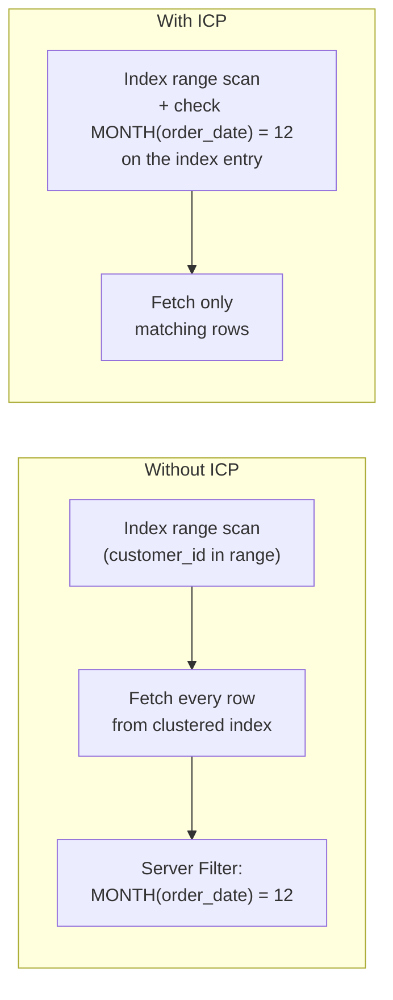

## Introduction

For every table in a query, the optimizer must decide **how to read it**. That decision — the **access path** — is the single most important factor in a query's cost. You have already met most access paths in passing; this lesson puts them in one place, explains precisely what each does inside InnoDB, and adds three refinements that MySQL applies on top of them:

| Access path | EXPLAIN `type` | TREE iterator (examples) | In one sentence |
|---|---|---|---|
| Full table scan | `ALL` | *Table scan* | Read every row of the clustered index |
| Full index scan | `index` | *Index scan* / *Covering index scan* | Read every entry of a secondary index, in order |
| Range scan | `range` | *Index range scan* | Read one or more contiguous intervals of an index |
| Non-unique lookup | `ref` | *Index lookup* | All entries with one key value |
| Unique lookup in a join | `eq_ref` | *Single-row index lookup* | Exactly one row per outer row, via PK/UNIQUE NOT NULL |
| Constant lookup | `const` | *Constant row* / resolved at optimization | At most one row, read once during optimization |
| **Index condition pushdown** | `Extra: Using index condition` | *… with index condition* | Check index columns *before* fetching the row |
| **Multi-Range Read** | `Extra: Using MRR` | (shown in traditional EXPLAIN) | Sort row lookups by primary key to make them sequential |
| **Skip scan** (8.0.13+) | `range` + `Using index for skip scan` | *Covering index skip scan* | Use a composite index even when its first column is not constrained |

For each, you will see when the optimizer chooses it, what it costs, and how to recognize it in `EXPLAIN` and `EXPLAIN ANALYZE`. Most of the refinements can be switched off per session with `optimizer_switch`, which lets you measure their effect directly.

:::note[Lab data]
The lab builds the module's `orders_big` (200,000 rows) and `customers_big` (19,997 rows). Plans and measurements are captured on a real server; the optimizer's choices depend on statistics, so **your plan may differ**, and all timings are **measured on the build machine**.
:::

## DBMS Theory

:::theory[Access paths and their cost]
An **access path** is a method of retrieving the tuples of a relation that satisfy some selection condition: a file scan, or an index together with a matching condition (Selinger et al., 1979). An index *matches* a condition when the condition can be turned into one or more contiguous search intervals on the index key — for a tree index on (A, B, C), conditions on a leftmost prefix with equality on all but the last column.

With B pages, N tuples, a predicate of selectivity s and a tree index of height h, standard textbook cost estimates (in page I/Os) are:

| Access path | Cost (I/O) |
|---|---|
| File scan | B |
| Clustered index, matching condition | h + s·B |
| Unclustered index, matching condition | h + s·(index leaf pages) + **s·N** (one record fetch per match) |
| Index-only (covering) scan | h + s·(index leaf pages) |
| Unique equality on a key | h + 1 |

The **s·N** term is why unclustered indexes lose to scans for unselective predicates: each matching entry may cost a separate random page access. Refinements such as sorting the record IDs before fetching (MRR) reduce that term; evaluating more of the predicate on index entries before fetching (ICP) reduces s for the fetch step.
:::

Two general principles:

1. **The optimizer chooses among access paths by estimated cost**, not by rules like "always use an index". A full scan is the right answer when most rows are needed.
2. **Access paths compose with conditions.** Part of a `WHERE` clause may be used to *locate* rows (the matching part), part may be checked *on the index entries* (pushed down), and the rest is checked *on the rows* (residual filter). Knowing which part goes where is the key to reading plans.

## Why It Exists

A DBMS needs multiple access paths because no single one is best for all queries:

- **Point lookups** (`WHERE id = ?`) need `const`/`eq_ref`/`ref` — a few page reads regardless of table size.
- **Short ranges** (`BETWEEN`, recent dates, prefixes) need `range` — cost proportional to the range.
- **Most of a table** (reports, aggregates over everything) needs a scan — sequential I/O beats millions of random lookups.
- **Narrow questions over a big table** (`COUNT(*)`, a few indexed columns) benefit from a full *index* scan, which reads a much smaller structure than the table.

The refinements exist because the boundary cases are common: conditions that cannot locate rows but *can* filter on the index (ICP); range scans whose row lookups land on random pages (MRR); composite indexes whose first column the query does not constrain (skip scan). Each one converts work that would happen *after* fetching rows into cheaper work *before* fetching them — or makes the fetching cheaper.

## Internal Working

:::internals[How each access path runs in MySQL/InnoDB]
- **Full table scan (`ALL`)**: the server asks InnoDB for rows in clustered-index order; InnoDB walks the leaf pages left to right using the page links, with read-ahead prefetching extents. Every row is returned to the server, which evaluates the `WHERE` condition (*Filter* iterator).
- **Full index scan (`index`)**: the same walk over a secondary index's leaves. If the query is covered (`Using index`), only the index is read. If not, every entry triggers a clustered-index lookup — usually chosen only to deliver rows in index order (avoiding a sort) or when a `LIMIT` stops it early.
- **Range scan (`range`)**: the range optimizer converts the matching conditions into intervals (e.g. `[1000, 1999]`, or several intervals for `IN (…)`); InnoDB descends to the start of each interval and scans to its end.
- **`ref`**: a range scan with a single equality interval on a non-unique index (or prefix of one), used both with constants and with values from previous tables in a join.
- **`eq_ref`**: a unique-key lookup per outer row in a join — at most one row, so the scan stops immediately.
- **`const`**: the optimizer reads the single matching row *during optimization* and substitutes its column values as constants into the rest of the query.
- **Index condition pushdown (ICP)**: the server pushes the part of the `WHERE` condition that refers only to index columns down to InnoDB. While scanning index entries, InnoDB evaluates it on the entry and fetches the full row from the clustered index **only for entries that pass**. Without ICP, InnoDB would fetch every row in the range and the server would filter afterwards. ICP applies to `range`, `ref`, `eq_ref` and `ref_or_null` on secondary indexes (for InnoDB clustered indexes the full row is already in the leaf, so there is nothing to save).
- **Multi-Range Read (MRR)**: for a secondary-index range scan that needs row lookups, InnoDB first collects a batch of primary keys from the index into a buffer (`read_rnd_buffer_size`), **sorts them**, and then fetches the rows in primary-key order — turning random clustered-index accesses into a more sequential pattern. Its benefit is largest when the data is not in memory; MySQL's cost model often prefers not to use it (`mrr_cost_based=on`).
- **Skip scan**: for an index (A, B) and a condition on B only, the optimizer enumerates the distinct values of A and, for each, performs a range scan on (a, B-condition) — effectively `UNION` of small ranges. It requires, among other conditions, a single-table query whose selected columns are all in the index (covered), no `GROUP BY`/`DISTINCT`, and pays off when A has few distinct values.
:::



## MySQL Implementation

Build the lab tables:

```sql run
SET SESSION cte_max_recursion_depth = 300000;
CREATE TABLE customers_big (
  customer_id INT UNSIGNED NOT NULL PRIMARY KEY,
  email       VARCHAR(100) NOT NULL,
  segment     VARCHAR(10)  NOT NULL,
  UNIQUE KEY uq_customers_email (email)
) ENGINE=InnoDB;
INSERT INTO customers_big
WITH RECURSIVE s(n) AS (SELECT 1 UNION ALL SELECT n + 1 FROM s WHERE n < 19997)
SELECT n, CONCAT('user', n, '@example.com'), ELT(1 + n % 3, 'consumer', 'business', 'student') FROM s;
CREATE TABLE orders_big (
  order_id    INT UNSIGNED  NOT NULL PRIMARY KEY,
  customer_id INT UNSIGNED  NOT NULL,
  status      VARCHAR(10)   NOT NULL,
  order_date  DATE          NOT NULL,
  amount      DECIMAL(10,2) NOT NULL,
  country     CHAR(2)       NOT NULL,
  INDEX idx_cust_date (customer_id, order_date),
  INDEX idx_status_date (status, order_date)
) ENGINE=InnoDB;
INSERT INTO orders_big
WITH RECURSIVE seq(n) AS (SELECT 1 UNION ALL SELECT n + 1 FROM seq WHERE n < 200000)
SELECT n,
       1 + (n * 7919) % 19997,
       ELT(1 + (n % 20 > 0) + (n % 20 > 2) + (n % 20 > 15), 'cancelled', 'pending', 'shipped', 'delivered'),
       DATE '2023-01-01' + INTERVAL (n * 37) % 731 DAY,
       ROUND(5 + (n * 104729 % 99500) / 100, 2),
       ELT(1 + n % 7, 'US', 'IN', 'DE', 'BR', 'JP', 'FR', 'MX')
FROM seq;
ANALYZE TABLE customers_big, orders_big;
```

Now walk the catalogue, from the cheapest lookups to the scans:

```sql run
EXPLAIN SELECT * FROM orders_big WHERE order_id = 77;
EXPLAIN SELECT * FROM customers_big WHERE email = 'user77@example.com';
```

Both are **`const`**: a primary-key or unique-NOT-NULL equality with a constant. MySQL reads the row while optimizing, which is why such tables cost essentially nothing in the rest of the plan.

```sql run
EXPLAIN SELECT o.order_id, c.segment
FROM orders_big o JOIN customers_big c ON c.customer_id = o.customer_id
WHERE o.customer_id = 77;
```

Here `o` is accessed by **`ref`** (all orders of customer 77 through `idx_cust_date`), and `c` would be **`eq_ref`** in a general join — but because the join condition plus `o.customer_id = 77` implies `c.customer_id = 77`, the optimizer propagates the constant and reads `c` as `const`. To see `eq_ref`, join on a set of outer rows:

```sql run
EXPLAIN SELECT o.order_id, c.segment
FROM orders_big o JOIN customers_big c ON c.customer_id = o.customer_id
WHERE o.status = 'cancelled' AND o.order_date = '2024-03-01';
```

`o` is read by `ref` on `idx_status_date` with two key parts (`key_len = 45`, `ref = const,const`), and for each of its rows `c` is read by **`eq_ref`** on `PRIMARY` (`ref` names the column `o.customer_id`).

```sql run
EXPLAIN SELECT * FROM orders_big WHERE customer_id BETWEEN 100 AND 199;
EXPLAIN SELECT COUNT(*) FROM orders_big;
EXPLAIN SELECT * FROM orders_big WHERE amount > 900;
```

**`range`** for the interval of customers; **`index`** (a full scan of the narrowest index, covering) for `COUNT(*)`; **`ALL`** for a predicate on the unindexed `amount`.

## Syntax Breakdown

Access paths are chosen by the optimizer, not written in SQL. What you control is (1) the indexes, (2) the predicates' form, and (3) for experiments, the optimizer switches and hints.

| Control | Example | Effect |
|---|---|---|
| `optimizer_switch` (session) | `SET SESSION optimizer_switch = 'index_condition_pushdown=off';` | Disable/enable ICP |
| | `'mrr=on,mrr_cost_based=off'` | Use MRR whenever possible (for experiments) |
| | `'skip_scan=off'` | Disable skip scan |
| | `'index_merge=off'` | Disable index merge (and `index_merge_union`, `_intersection`, `_sort_union` individually) |
| | `SET SESSION optimizer_switch = 'default';` | Restore defaults |
| Optimizer hints (per query) | `SELECT /*+ NO_ICP(t idx) */ …`, `/*+ MRR(t) */`, `/*+ NO_SKIP_SCAN(t) */`, `/*+ SKIP_SCAN(t idx) */` | Same switches scoped to one statement and table |
| Index hints | `FORCE INDEX (idx)`, `USE INDEX`, `IGNORE INDEX` | Restrict the indexes considered (covered in [optimizer decisions](/lessons/m07-optimizer-decisions)) |
| `read_rnd_buffer_size` | session variable | Buffer for MRR's primary-key batches |

```sql run
SELECT @@optimizer_switch LIKE '%index_condition_pushdown=on%' AS icp_on,
       @@optimizer_switch LIKE '%mrr=on%'                      AS mrr_on,
       @@optimizer_switch LIKE '%mrr_cost_based=on%'           AS mrr_cost_based,
       @@optimizer_switch LIKE '%skip_scan=on%'                AS skip_scan_on;
```

:::standard[Standard SQL vs MySQL]
Access paths, ICP, MRR and skip scan are implementation techniques, not SQL features. Other systems have equivalents under different names: PostgreSQL's *bitmap heap scan* plays a role similar to MRR (sort row locations before fetching), Oracle has *index skip scan*, and "index filter" predicates resemble ICP. Optimizer hints syntax (`/*+ … */`) is MySQL-specific.
:::

## Practical Examples

### 1. Index condition pushdown

Orders of customers 1000–1999 placed in December of any year. `customer_id` locates the range; `MONTH(order_date) = 12` cannot locate anything (a function on the column), but `order_date` **is** in `idx_cust_date`, so the condition can be evaluated on each index entry:

```sql run
EXPLAIN SELECT * FROM orders_big WHERE customer_id BETWEEN 1000 AND 1999 AND MONTH(order_date) = 12;
```

`Using index condition`: ICP is active. Measure with and without it:

```sql run measured
EXPLAIN ANALYZE SELECT * FROM orders_big WHERE customer_id BETWEEN 1000 AND 1999 AND MONTH(order_date) = 12;
```

```sql run
SET SESSION optimizer_switch = 'index_condition_pushdown=off';
```

```sql run measured
EXPLAIN ANALYZE SELECT * FROM orders_big WHERE customer_id BETWEEN 1000 AND 1999 AND MONTH(order_date) = 12;
```

```sql run
SET SESSION optimizer_switch = 'default';
```

With ICP, the single *Index range scan … with index condition* iterator returns only the matching rows (about 850): InnoDB checked the month on each of the ~10,000 index entries and fetched only those that passed. Without ICP, the *Index range scan* returns all ~10,000 rows — each one fetched from the clustered index — and a *Filter* iterator above it discards most of them. Same result, about twelve times fewer row fetches with ICP.

### 2. Multi-Range Read

MRR is cost-based and often not chosen when data is cached. Force it for a demonstration:

```sql run
SET SESSION optimizer_switch = 'mrr=on,mrr_cost_based=off';
EXPLAIN SELECT * FROM orders_big WHERE customer_id BETWEEN 1000 AND 1199;
SET SESSION optimizer_switch = 'default';
EXPLAIN SELECT * FROM orders_big WHERE customer_id BETWEEN 1000 AND 1199;
```

With the switch, `Extra` shows `Using index condition; Using MRR`: InnoDB collects the primary keys of the ~2,000 matching index entries, sorts them, and fetches rows in `order_id` order. Because a customer's orders are spread across the whole table, the unsorted fetch order would jump randomly between clustered-index pages; sorted, consecutive fetches often hit the same or adjacent pages. With default settings the optimizer judged MRR not worth it for this (fully cached) table and the plan has no `Using MRR`. Note that the TREE format does not display MRR; use traditional or JSON EXPLAIN to see it.

### 3. Skip scan

A query on `order_date` alone, selecting only columns in `idx_status_date (status, order_date)`:

```sql run
EXPLAIN SELECT status, order_date FROM orders_big WHERE order_date = '2024-03-01';
```

`range` with `Using index for skip scan`: the first key part (`status`) has only four distinct values, so MySQL performs four small range scans — `('cancelled', 2024-03-01)`, `('delivered', 2024-03-01)`, … — instead of scanning the whole index. Compare:

```sql run measured
EXPLAIN ANALYZE SELECT status, order_date FROM orders_big WHERE order_date = '2024-03-01';
```

```sql run
SET SESSION optimizer_switch = 'skip_scan=off';
```

```sql run measured
EXPLAIN ANALYZE SELECT status, order_date FROM orders_big WHERE order_date = '2024-03-01';
```

```sql run
SET SESSION optimizer_switch = 'default';
```

With skip scan, *Covering index skip scan* reads just the entries for that date (a few hundred). Without it, *Covering index scan* reads all 200,000 entries and filters. Skip scan has strict preconditions — select only indexed columns, a single table, no `GROUP BY`/`DISTINCT` — so `SELECT *` does not qualify:

```sql run
EXPLAIN SELECT * FROM orders_big WHERE order_date = '2024-03-01';
```

### 4. When a full index scan is chosen to avoid a sort

```sql run
EXPLAIN SELECT order_id, customer_id, order_date FROM orders_big ORDER BY customer_id, order_date LIMIT 20;
EXPLAIN SELECT * FROM orders_big ORDER BY customer_id, order_date LIMIT 20;
```

Both use `type = index` on `idx_cust_date`: reading the index in order returns rows already sorted and the `LIMIT` stops after 20 entries. The first is covered (`Using index`); the second fetches 20 rows by primary key — cheap because of the `LIMIT`. Remove the `LIMIT` from the second query and the optimizer would rather scan the table and sort, because 200,000 lookups would be far more expensive.

## Execution Walkthrough

Trace the ICP query `SELECT * FROM orders_big WHERE customer_id BETWEEN 1000 AND 1999 AND MONTH(order_date) = 12` through the storage engine, with intermediate results.

```walkthrough
title: Index condition pushdown, step by step
steps:
  - title: "1. Split the WHERE clause"
    explain: >-
      The optimizer classifies each condition: customer_id BETWEEN 1000 AND 1999 matches the first key part of
      idx_cust_date (it builds the range); MONTH(order_date) = 12 refers only to an index column, so it is pushed down as
      the index condition. Nothing remains for a server-side filter.
    sql: EXPLAIN FORMAT=TREE SELECT * FROM orders_big WHERE customer_id BETWEEN 1000 AND 1999 AND MONTH(order_date) = 12;
  - title: "2. Range scan over index entries"
    explain: >-
      InnoDB descends to (1000, …) and reads entries (customer_id, order_date, order_id) until customer_id exceeds 1999.
      This covered query counts the entries in the range — the number of index entries examined.
    sql: SELECT COUNT(*) AS index_entries_in_range FROM orders_big WHERE customer_id BETWEEN 1000 AND 1999;
  - title: "3. Evaluate the pushed condition on each entry"
    explain: >-
      For each entry InnoDB evaluates MONTH(order_date) = 12 using the order_date value stored in the entry itself.
      Entries that fail are skipped without touching the clustered index.
    sql: |
      SELECT MONTH(order_date) = 12 AS passes, COUNT(*) AS entries
      FROM orders_big WHERE customer_id BETWEEN 1000 AND 1999
      GROUP BY passes ORDER BY passes;
  - title: "4. Fetch only the passing rows"
    explain: >-
      For each passing entry, InnoDB follows order_id into the clustered index and returns the full row. The number of
      clustered-index lookups equals the number of passing entries, not the size of the range.
    sql: |
      SELECT order_id, customer_id, order_date, amount
      FROM orders_big
      WHERE customer_id BETWEEN 1000 AND 1999 AND MONTH(order_date) = 12
      ORDER BY customer_id, order_date
      LIMIT 8;
```

## Output

The captured plans and measurements of this lesson, summarized:

| Access path / refinement | Evidence in EXPLAIN | Evidence in EXPLAIN ANALYZE |
|---|---|---|
| `const` | `type = const`, `rows = 1` | — (resolved during optimization) |
| `eq_ref` | inner table `type = eq_ref`, `ref = o.customer_id` | *Single-row index lookup* with `loops` = outer rows |
| `ref` | `type = ref`, `ref = const` | *Index lookup* |
| `range` | `type = range` | *Index range scan … over (…)* |
| `index` | `type = index` (+ `Using index` if covered) | *Index scan* / *Covering index scan* |
| `ALL` | `type = ALL` | *Table scan* + *Filter* |
| ICP | `Using index condition` | *… with index condition*; the range returns only matching rows |
| MRR | `Using MRR` | not shown in TREE |
| Skip scan | `Using index for skip scan` | *Covering index skip scan* reads a few hundred entries instead of 200,000 |

## Alternative Approaches

Each refinement has an alternative that achieves the same effect more robustly — usually by changing the index or the query:

| Refinement | Alternative | Trade-off |
|---|---|---|
| ICP for `MONTH(order_date) = 12` | Composite index whose columns can *locate* the rows (e.g. a functional key part on `MONTH(order_date)` after `customer_id`), or a covering index so no fetch is needed | More/wider indexes; ICP is free |
| MRR | A covering index (no fetches at all); clustering the table by the access key | Space and write cost; MRR is automatic |
| Skip scan | An index whose first column is the constrained one, e.g. `(order_date)` or `(order_date, status)` | Another index to maintain; skip scan only helps when the skipped prefix has few distinct values |
| Index merge | One composite index matching the combined predicate | Serves only that combination; index merge combines existing single-column indexes |
| Full index scan to avoid a sort | Accept a filesort on a filtered set; keyset pagination | Depends on result size and LIMIT |

The refinements are best understood as **safety nets**: they make imperfect index designs less costly. For the hottest queries, design the index so that the matching part of the predicate locates exactly the rows needed — and ideally covers the query.

## Performance Analysis

Cost intuition per access path (N = table rows, m = matching rows, h = tree height):

| Access path | Rows/entries examined | Clustered lookups | I/O pattern |
|---|---|---|---|
| `ALL` | N | 0 | Sequential (read-ahead) |
| `index`, covered | N index entries | 0 | Sequential over a smaller structure |
| `index`, not covered | N entries | N | Random — rarely chosen without LIMIT |
| `range` / `ref`, covered | m entries | 0 | Sequential within the range |
| `range` / `ref`, not covered | m entries | m (fewer with ICP) | Random (more sequential with MRR) |
| `eq_ref` | 1 per outer row | 0 or 1 per outer row | h page visits per outer row |
| `const` | 1, once | — | h page visits at optimization |
| Skip scan | ≈ (distinct prefix values) × (entries per sub-range) | 0 (covered) | Several short ranges |

The measurements captured in this lesson illustrate three of these rows directly:

- **ICP**: the same range examined ~10,000 index entries either way, but fetched about 850 rows with ICP and about 10,000 without.
- **Skip scan**: a few hundred entries examined versus 200,000 for the full covering index scan.
- **Scans with LIMIT**: an `index` scan is only cheap because the `LIMIT` stops it after 20 entries.

The timings in the measured blocks are from the build machine with all data in the buffer pool. On a table larger than memory, the clustered lookups saved by ICP and the more sequential order produced by MRR translate into avoided disk reads, and the differences grow accordingly.

:::performance[Plans depend on data]
Whether MySQL uses ICP, MRR or skip scan depends on cost estimates — on statistics, on how many distinct values the skipped prefix has, on how much data is cached. Re-check plans after data growth, and use `optimizer_switch` in a test session (never globally on a whim) to measure what a refinement is worth for your query.
:::

## Best Practices

:::best-practice[Working with access paths]
1. **Know the hierarchy, but judge by cost**: `const`/`eq_ref`/`ref` are ideal for selective lookups; `range` for intervals; `ALL` is right for most-of-the-table queries.
2. **Put filterable columns into the index even if they cannot locate rows.** With ICP, a column after a skipped or range key part still saves row fetches when it appears in the index.
3. **Don't design for skip scan.** It is a fallback for low-cardinality leading columns; give important queries an index that starts with their constrained column.
4. **Measure refinements with session switches** (`optimizer_switch`) or per-query hints — then decide whether an index change is worth it.
5. **Watch `index` without `Using index`.** A non-covered full index scan without a small LIMIT is usually a sign of a bad plan or a missing index.
6. **Prefer covering indexes for hot range queries**: no fetches makes ICP and MRR irrelevant.
7. **Reset experimental switches** (`SET SESSION optimizer_switch = 'default'`) — and never change global optimizer switches without a measured reason.
:::

## Common Mistakes

**Mistake 1 — believing `Using index condition` means the query is covered.** It means the condition is checked on index entries; rows are still fetched for entries that pass. Covered is `Using index`. The ICP plan in Practical Example 1 fetched about 850 full rows.

**Mistake 2 — expecting skip scan for `SELECT *`.** Skip scan requires a covered query on a single table. The captured `SELECT *` on `order_date` was a full table scan:

```sql run
EXPLAIN SELECT order_id, amount FROM orders_big WHERE order_date = '2024-03-01';
```

`amount` is not in `idx_status_date`, so skip scan does not apply and the plan is `ALL`. Either select only indexed columns or create an index that starts with `order_date`.

**Mistake 3 — treating `type = index` as an index lookup.** It is a *full* scan of the index. For `COUNT(*)` that is good (small structure); for `SELECT *` without `LIMIT` it would mean one lookup per row.

**Mistake 4 — disabling optimizations globally after one bad plan.** Turning off ICP or MRR server-wide because of one query affects every query. Use a per-query hint (`/*+ NO_ICP(t) */`, `/*+ NO_MRR(t) */`) or fix the index.

**Mistake 5 — forgetting that the clustered index needs no ICP.** For a range on the primary key, the leaf already holds the full row; conditions are evaluated on it directly, and EXPLAIN does not show `Using index condition` for such scans.

## Industry Application

- **Plan reviews** describe queries by their access paths: "range on `idx_cust_date` with ICP, eq_ref into customers" is precise shorthand for what the database does, used in tickets and design documents.
- **Composite index design** in OLTP schemas deliberately includes trailing columns that can't be range-searched but can be filtered by ICP (e.g. a status after a date range), cutting row fetches without another index.
- **Analytics on OLTP replicas** rely on covering full index scans (`index` + `Using index`) for counts and narrow aggregates over large tables, since they read much less than a table scan.
- **Legacy schemas** with indexes starting on low-cardinality columns (tenant type, region) get unexpected help from skip scan after upgrading to 8.0; teams still add proper indexes for hot queries because skip scan's preconditions are fragile.
- **Large I/O-bound reports** benefit from MRR (and Batched Key Access for joins, which builds on it — see [Optimizing Joins](/lessons/m07-optimizing-joins)); DBAs enable it per query with hints after measuring.

## Practice Exercises

```exercise
id: ex1
title: Make the lookup const
difficulty: easy
kind: dml
concepts: [ref-eq-ref-const]
setup: |
  CREATE TABLE api_keys (
    id INT UNSIGNED PRIMARY KEY, api_key CHAR(32) NOT NULL, owner VARCHAR(40) NOT NULL,
    INDEX idx_api_key (api_key)
  );
  INSERT INTO api_keys VALUES (1, MD5('a'), 'ana'), (2, MD5('b'), 'ben'), (3, MD5('c'), 'carla');
prompt: |
  Authentication runs `SELECT owner FROM api_keys WHERE api_key = ?`. The index on `api_key` is non-unique, so the
  lookup is `ref`. API keys are unique by business rule. Replace `idx_api_key` with a **unique** index named
  `uq_api_key` so the lookup becomes `const`. End with exactly one secondary index.
hints:
  - "const requires a PRIMARY KEY or a UNIQUE index on NOT NULL columns compared with constants."
  - "ALTER TABLE api_keys DROP INDEX idx_api_key, ADD UNIQUE KEY uq_api_key (api_key);"
solution: |
  ALTER TABLE api_keys DROP INDEX idx_api_key, ADD UNIQUE KEY uq_api_key (api_key);
check: |
  SELECT INDEX_NAME, COLUMN_NAME, NON_UNIQUE
  FROM information_schema.STATISTICS
  WHERE TABLE_SCHEMA = DATABASE() AND TABLE_NAME = 'api_keys' AND INDEX_NAME <> 'PRIMARY';
explanation: |
  With a unique index on a NOT NULL column, the optimizer knows at most one row matches and reads it during
  optimization (`const`). The unique index also enforces the business rule — two customers can never share a key.
```

```exercise
id: ex2
title: Count what ICP saves
difficulty: medium
concepts: [index-condition-pushdown]
setup: |
  SET SESSION cte_max_recursion_depth = 100000;
  CREATE TABLE deliveries (
    id INT UNSIGNED PRIMARY KEY, depot_id SMALLINT UNSIGNED NOT NULL, delivered_on DATE NOT NULL, kg INT NOT NULL,
    INDEX idx_depot_day (depot_id, delivered_on)
  );
  INSERT INTO deliveries
  WITH RECURSIVE s(n) AS (SELECT 1 UNION ALL SELECT n + 1 FROM s WHERE n < 50000)
  SELECT n, n % 100, DATE '2024-01-01' + INTERVAL (n * 13) % 366 DAY, n % 900 FROM s;
prompt: |
  For `SELECT * FROM deliveries WHERE depot_id BETWEEN 10 AND 19 AND DAYOFWEEK(delivered_on) = 1`, the range on
  `depot_id` locates index entries and ICP checks `DAYOFWEEK(delivered_on) = 1` on each entry. Return one row with
  `entries_in_range` (index entries the range scan examines) and `rows_fetched_with_icp` (rows that pass the pushed
  condition and are fetched).
hints:
  - "entries_in_range: count rows with depot_id BETWEEN 10 AND 19."
  - "Use conditional aggregation: SUM(DAYOFWEEK(delivered_on) = 1) over the same range."
solution: |
  SELECT COUNT(*) AS entries_in_range,
         SUM(DAYOFWEEK(delivered_on) = 1) AS rows_fetched_with_icp
  FROM deliveries
  WHERE depot_id BETWEEN 10 AND 19;
explanation: |
  Without ICP every entry in the range (5,000) would cause a clustered-index lookup; with ICP only those passing the
  day-of-week check do (roughly one in seven). EXPLAIN ANALYZE of the original query shows the range iterator returning
  the smaller number when ICP is on, and a Filter above a 5,000-row range when it is off.
```

```exercise
id: ex3
title: An index for the skipped column
difficulty: medium
kind: dml
concepts: [skip-scan, range-scan]
setup: |
  SET SESSION cte_max_recursion_depth = 100000;
  CREATE TABLE logins_s (
    id INT UNSIGNED PRIMARY KEY, region CHAR(2) NOT NULL, login_day DATE NOT NULL, user_id INT UNSIGNED NOT NULL,
    INDEX idx_region_day (region, login_day)
  );
  INSERT INTO logins_s
  WITH RECURSIVE s(n) AS (SELECT 1 UNION ALL SELECT n + 1 FROM s WHERE n < 60000)
  SELECT n, ELT(1 + n % 4, 'NA', 'EU', 'AP', 'LA'), DATE '2024-01-01' + INTERVAL n % 300 DAY, n % 7000 FROM s;
prompt: |
  The security team runs `SELECT user_id FROM logins_s WHERE login_day = ?` many times a day. Because `user_id` is not
  in `idx_region_day`, skip scan cannot be used and the query scans the table. Add **one** index named
  `idx_day_user` that lets this query use a `ref` lookup and be covered.
hints:
  - "The constrained column must come first."
  - "Including user_id makes the index covering: (login_day, user_id)."
solution: |
  CREATE INDEX idx_day_user ON logins_s (login_day, user_id);
check: |
  SELECT INDEX_NAME, SEQ_IN_INDEX, COLUMN_NAME
  FROM information_schema.STATISTICS
  WHERE TABLE_SCHEMA = DATABASE() AND TABLE_NAME = 'logins_s' AND INDEX_NAME = 'idx_day_user'
  ORDER BY SEQ_IN_INDEX;
explanation: |
  Skip scan is a fallback with strict conditions; a hot query deserves an index whose leftmost column it constrains.
  `(login_day, user_id)` gives `ref` + `Using index`. Adding `user_id` to the existing index instead
  (`region, login_day, user_id`) would make skip scan possible again but still perform four sub-range scans per query.
```

```exercise
id: ex4
title: Classify the access paths
difficulty: hard
kind: open
concepts: [access-paths, full-index-scan, ref-eq-ref-const, mrr]
prompt: |
  For the lab tables (`orders_big` with `idx_cust_date (customer_id, order_date)` and `idx_status_date (status, order_date)`;
  `customers_big` with PK `customer_id` and UNIQUE `email`), predict the access type (and notable Extra values) for:

  1. `SELECT * FROM customers_big WHERE customer_id = 5`
  2. `SELECT COUNT(*) FROM orders_big WHERE status = 'pending'`
  3. `SELECT * FROM orders_big WHERE customer_id = 5 AND order_date > '2024-06-01'`
  4. `SELECT o.*, c.email FROM orders_big o JOIN customers_big c ON c.customer_id = o.customer_id WHERE o.status = 'cancelled' AND o.order_date = '2024-01-15'` (both tables)
  5. `SELECT customer_id FROM orders_big WHERE order_date = '2024-01-15'`
  6. `SELECT * FROM orders_big ORDER BY status, order_date LIMIT 10`

  Then verify your predictions with EXPLAIN in your lab.
solution: |
  1. `const` (PK equality).
  2. `ref` on idx_status_date with `Using index` (covered: only the index is needed to count).
  3. `range` on idx_cust_date using both key parts (customer_id equality + order_date range), key_len 7; `Using index condition`
     may appear.
  4. o: `ref` on idx_status_date (key_len 45, ref const,const); c: `eq_ref` on PRIMARY.
  5. Not a skip scan: `customer_id` is not in idx_status_date, so that index cannot cover the query; idx_cust_date
     (customer_id, order_date) does cover it, but skipping ~20,000 distinct customer values is too expensive. Expect a
     full covering index scan of idx_cust_date (`index`, `Using where; Using index`, key_len 7) — on the author's test
     server that is what EXPLAIN showed. An index starting with order_date is what this query needs.
  6. `index` on idx_status_date (reads the first 10 entries in order, then 10 PK lookups), no filesort.
explanation: |
  Predicting before verifying builds intuition. Item 5 is deliberately tricky: skip scan needs a covered query and a
  low-cardinality skipped prefix — both conditions matter.
```

```exercise
id: ex5
title: Choosing between refinement and redesign
difficulty: challenge
kind: open
concepts: [index-condition-pushdown, mrr, skip-scan, access-paths]
prompt: |
  A 400 GB `events(event_id PK, account_id, created_at, type, payload JSON)` table has an index
  `(account_id, created_at)`. Three slow queries:

  - Q1 `WHERE account_id = ? AND created_at >= ? AND type = 'error'` (type has 30 values; errors are 0.5%)
  - Q2 `WHERE created_at >= NOW() - INTERVAL 10 MINUTE` (all accounts; dashboards every 10 s)
  - Q3 `SELECT account_id, created_at WHERE created_at = ?` (rare, ad-hoc)

  For each query, say which access path and refinements (ICP, MRR, skip scan) MySQL could use with the current index,
  why it is or is not sufficient, and whether you would change the indexes. Consider the table size versus memory.
solution: |
  - **Q1**: `range` on (account_id, created_at) — equality then range, good — but `type` is not in the index, so every
    entry in the account's time range is fetched (no ICP possible on `type`). With 400 GB mostly on disk, those
    fetches are random reads; MRR could make them more sequential. Better: extend the index to
    `(account_id, type, created_at)` (equality, equality, range) — only error rows are read; or `(account_id,
    created_at, type)` to allow ICP filtering on type without changing the range.
  - **Q2**: no index starts with created_at → skip scan over (account_id, created_at) would need one sub-range per
    account (huge number of distinct accounts → not chosen) and the query is not covered anyway → full scan of 400 GB
    every 10 seconds. Needs an index on `(created_at)` (range on the last 10 minutes, a tiny right-edge slice that is
    always hot in memory) — or a separate recent-events table / stream.
  - **Q3**: covered by the existing index (account_id, created_at): skip scan is technically possible but impractical
    with many accounts; a full covering index scan would be chosen. Being rare and ad-hoc, it may be acceptable, or
    served by the new `(created_at)` index from Q2 (which contains account_id? no — add it: `(created_at, account_id)`
    makes Q3 covered and still serves Q2).

  Refinements help at the margins (MRR for Q1's fetches, ICP if type is added after created_at); the decisive fixes
  are index designs matching the predicates: `(account_id, type, created_at)` and `(created_at, account_id)`, weighed
  against the write cost on a large, insert-heavy table.
explanation: |
  Refinements reduce the cost of imperfect indexes; on very large tables, matching the index to the predicate is what
  changes the order of magnitude.
```

## Knowledge Assessment

```quiz
- id: q1
  question: "Which access type does MySQL use when it reads at most one row by PRIMARY KEY with a constant, during optimization?"
  options: ["eq_ref", "ref", "const", "range"]
  answer: 2
  explanation: "const reads the single row during optimization and treats its values as constants. eq_ref is the per-outer-row unique lookup in a join; ref may return several rows; range scans intervals."
  concepts: [ref-eq-ref-const]
- id: q2
  question: "EXPLAIN shows `type = index` and `Extra = Using index` for `SELECT COUNT(*) FROM orders_big`. What is MySQL doing?"
  options:
    - "Looking up one entry in an index"
    - "Scanning every entry of a (narrow) secondary index instead of the whole table"
    - "Using the query cache"
    - "Reading the table's stored row count"
  answer: 1
  explanation: "type = index is a full index scan; for COUNT(*) InnoDB picks a small index because it has no stored exact row count. The query cache no longer exists in MySQL 8."
  concepts: [full-index-scan]
- id: q3
  question: "What does Index Condition Pushdown change for `WHERE customer_id BETWEEN 1000 AND 1999 AND MONTH(order_date) = 12` with an index on (customer_id, order_date)?"
  options:
    - "It makes MONTH(order_date) usable for locating the range"
    - "InnoDB evaluates MONTH(order_date) = 12 on each index entry and fetches full rows only for entries that pass"
    - "It makes the query covered"
    - "It replaces the range scan with a full scan"
  answer: 1
  explanation: "ICP filters on index entries before row fetches. It does not turn the function into a searchable range and does not make the query covered (rows are still fetched for passing entries). The lab measured ~850 fetches with ICP vs ~10,000 without."
  concepts: [index-condition-pushdown]
- id: q4
  question: "Which conditions are required for MySQL's skip scan? (Select all that apply.)"
  type: multi
  options:
    - "The query references only columns contained in the index (covered)"
    - "The query is on a single table"
    - "The skipped first key part has a UNIQUE constraint"
    - "No GROUP BY or DISTINCT"
  answer: [0, 1, 3]
  explanation: "Skip scan works best when the skipped prefix has FEW distinct values — a unique prefix would be the worst case. The documented preconditions include a single table, covered columns and no GROUP BY/DISTINCT."
  concepts: [skip-scan]
- id: q5
  question: "What is the purpose of Multi-Range Read?"
  options:
    - "To read several tables in parallel"
    - "To sort the primary keys collected from a secondary-index range before fetching rows, making clustered-index access more sequential"
    - "To combine several indexes for an OR condition"
    - "To cache query results"
  answer: 1
  explanation: "MRR batches and sorts row IDs before fetching. Combining indexes for OR is index merge; MySQL has no result cache."
  concepts: [mrr]
- id: q6
  question: "A plan shows `type = index` WITHOUT `Using index` and no LIMIT on a 50-million-row table. Why is this worrying?"
  options:
    - "Because the index is invisible"
    - "Because every index entry triggers a clustered-index lookup — potentially 50 million random accesses"
    - "Because index scans cannot use the buffer pool"
    - "It is not worrying; index is always better than ALL"
  answer: 1
  explanation: "A non-covered full index scan reads the whole index and fetches every row. Without a small LIMIT, a table scan is usually cheaper."
  concepts: [full-index-scan]
- id: q7
  question: "In the lab, `EXPLAIN ANALYZE` with ICP showed the range iterator returning ~850 rows; with ICP disabled it returned ~10,000 rows and a Filter kept ~850. What explains the difference?"
  options:
    - "Different results"
    - "With ICP the condition is applied inside the storage engine before fetching; without it InnoDB fetches every row in the range and the server filters"
    - "Statistics changed between runs"
    - "The second run used a different index"
  answer: 1
  explanation: "Same index, same range, same result — the difference is where the MONTH() condition is evaluated and therefore how many rows are fetched."
  concepts: [index-condition-pushdown]
- id: q8
  question: "For a join, the inner table shows `type = eq_ref`, `rows = 1`, and the outer table produces 5,000 rows. How many lookups does the inner table perform?"
  options: ["1", "5,000", "5,001", "It depends on the buffer pool"]
  answer: 1
  explanation: "eq_ref performs one unique-key lookup per outer row: 5,000 lookups, each returning at most one row."
  concepts: [ref-eq-ref-const]
```
