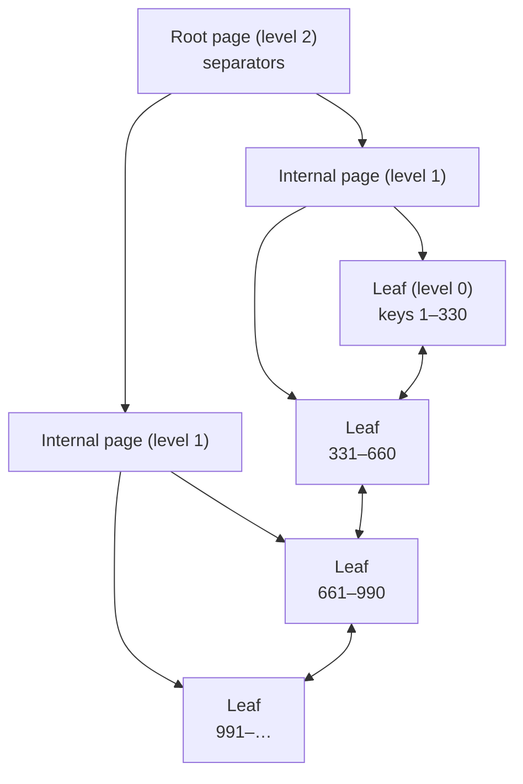

## Introduction

The previous lesson showed that an index turns a 200,000-row scan into a 10-row lookup. This lesson explains the data structure that makes that possible — the **B+ tree** — and why it, rather than a binary search tree, a sorted array or a hash table, is the default index structure of virtually every relational database: MySQL/InnoDB, PostgreSQL, SQL Server, Oracle and SQLite all use B-tree variants.

You will answer these questions:

- Why is a binary search tree, the structure you learned in a data-structures course, a poor fit for data on disk?
- What makes a B+ tree different from a B-tree, and why does that difference matter for range queries?
- What is **fan-out**, and why are trees indexing a billion rows only about four levels deep?
- What exactly happens on **insert** (node splits, growing the root), on **delete** (borrowing and merging), and during a **range scan** (walking leaf links)?
- How does InnoDB implement all this with 16 KB pages, and what can you observe from SQL — for example, why random-order inserts make a table larger than sequential ones?

The interactive visualizations let you insert keys and watch nodes split; the lab blocks measure the real consequences in InnoDB.

:::note[Lab data]
This lesson uses the **empty** dataset and builds its own tables. Page counts come from InnoDB statistics captured on a real server. Exact numbers depend on server version and settings, so **your figures may differ slightly** — the relationships between them will not.
:::

## DBMS Theory

:::theory[From binary search trees to B+ trees]
A **binary search tree (BST)** stores one key per node, with smaller keys to the left and larger to the right. Search follows one root-to-leaf path: O(height). A *balanced* BST (AVL, red-black) has height ≈ log₂ N; an unbalanced one can degrade to a linked list (height N) when keys arrive in sorted order.

A **B-tree of order *m*** (Bayer & McCreight, 1972) generalizes the BST to *m*-way branching:

1. Every node holds at most *m − 1* keys and *m* child pointers.
2. Every node except the root holds at least ⌈*m*/2⌉ − 1 keys (it is at least about half full).
3. All leaves are at the same depth — the tree is **perfectly height-balanced** by construction.
4. Keys inside a node are sorted; the subtree between keys *kᵢ* and *kᵢ₊₁* contains exactly the keys in that interval.

A **B+ tree** adds two rules:

5. **Records (or record pointers) live only in the leaves.** Internal nodes contain only *separator keys* that route searches; a separator may be a copy of a leaf key.
6. **Leaves are linked** in key order (often doubly), so a range can be read by finding its start and then walking sideways.
:::

Why these rules matter for storage:

| Property | BST | B-tree | B+ tree |
|---|---|---|---|
| Keys per node | 1 | up to *m − 1* | internal: up to *m − 1* separators; leaves: as many records as fit |
| Height for N keys | ≈ log₂ N (if balanced) | ≈ log_m N | ≈ log_F N, with **F larger** than in a B-tree |
| Node ↔ page | one node per page wastes 99% of each page | one node = one page | one node = one page |
| Balance | needs rotations (AVL/RB) or degrades | always balanced (grows at the root) | always balanced |
| Range scan | in-order traversal, jumps up and down the tree | same | find first key, then **follow leaf links** |
| Where data is | every node | every node | leaves only |

**Fan-out** *F* is the number of children an internal node actually has. Because B+ tree internal nodes hold no row data, many more separators fit in a page, so *F* is larger than in a B-tree with the same page size. The height of a B+ tree over N leaf entries is approximately:

> height ≈ ⌈ log_F (N / L) ⌉ + 1, where *L* is the number of entries per leaf page.

With realistic numbers — *F* ≈ 1,000 for a small integer key in a 16 KB page, *L* ≈ 100–500 rows per leaf — a billion rows need about **4 levels**. And because the root and second level together are only a few hundred pages, they stay permanently in the buffer pool: a lookup typically costs one or two actual page reads.

:::standard[Theory vs MySQL terminology]
MySQL's documentation and syntax say "B-tree" (`USING BTREE`, `Index_type = BTREE`), but InnoDB indexes are structurally **B+ trees**: records only in leaf pages, and pages on each level linked to their neighbours. Textbooks also disagree on whether "order" means maximum children or minimum keys; in this lesson (and in the visualization) *order* = **maximum number of children per node**.
:::

## Why It Exists

A database index has to satisfy several requirements at once, and each simpler structure fails at least one of them:

- **Sorted array / sorted file.** Binary search is fast, but inserting into the middle means shifting half the data — impossible for a table receiving thousands of inserts per second.
- **Binary search tree.** Insertion is cheap, but each node is one key; mapped to storage, every level is a page read. A balanced BST over a billion keys is about 30 levels deep — 30 random I/Os per lookup — and it needs rebalancing rotations that touch many nodes.
- **Hash table.** O(1) equality lookups, but the order of keys is destroyed: no range predicates (`BETWEEN`, `<`, `LIKE 'abc%'`), no ordered reads (`ORDER BY`), no `MIN/MAX` shortcut. Growth requires rehashing.
- **B-tree.** Solves depth and balance, but storing records in internal nodes reduces fan-out, and range scans must climb up and down the tree.

The B+ tree solves all of these: wide nodes sized to the storage page give a very shallow tree; keeping data in leaves maximizes fan-out; leaf links make ranges and ordered scans sequential; splits and merges keep the tree balanced locally, touching only a few pages per change. It is a structure designed **for the memory hierarchy** — that is why it has survived for fifty years.

## Internal Working

### Search

To find key *k*: start at the root; binary-search the node's separators to choose the child whose interval contains *k*; repeat until a leaf; binary-search the leaf. Cost: one node visit per level. Try it — the visualization highlights the search path for key 12:

```viz
type: bptree
order: 4
keys: [10, 20, 5, 6, 12, 30, 7, 17, 3, 25, 14, 8]
search: 12
```

### Insert and split

1. Search for the leaf where *k* belongs and insert it in sorted position.
2. If the leaf now holds too many entries (overflow), **split** it: create a new leaf, move the upper half of the entries into it, and **copy** the first key of the new leaf up into the parent as a separator. Link the new leaf into the leaf chain.
3. If the parent overflows, split it too — but for an internal node the middle separator is **moved** (pushed) up, not copied.
4. If the root splits, create a new root with two children. **This is the only way the tree gets taller**, which is why all leaves always stay at the same depth.

Insert keys one by one into an order-3 tree and watch splits propagate up to the root:

```viz
type: bptree
order: 3
keys: [1, 2, 3, 4, 5, 6, 7, 8, 9, 10]
```

Sorted inserts always land in the right-most leaf. In a textbook B+ tree, each split leaves the old leaf half full forever (no later key will ever go there). Real engines optimize for this, as you will see below.

### Delete and merge

1. Find the leaf and remove the entry.
2. If the leaf is still at least half full, stop (a separator in an internal node may now name a deleted key — that is harmless; separators only route).
3. If it **underflows**, try to **redistribute (borrow)** entries from an adjacent sibling, updating the separator in the parent.
4. If the sibling cannot spare entries, **merge** the two nodes and delete the separator from the parent; the parent may underflow in turn, cascading upward. If the root is left with a single child, that child becomes the new root and the tree **shrinks** by one level.

### Range scans via leaf links

For `WHERE k BETWEEN 12 AND 25`, search for 12 (one root-to-leaf descent), then read entries in order, following the right-sibling link from leaf to leaf until a key exceeds 25. The cost is *height + number of leaves in the range* — no revisiting internal nodes.

:::internals[InnoDB's B+ trees]
- **One node = one page.** Every index (clustered and secondary) is a B+ tree of 16 KB pages (by default). Each page has a header with its *level* (0 = leaf) and **pointers to the previous and next page on the same level** — the leaf links, which are doubly linked so InnoDB can scan in both directions (*Backward index scan* in EXPLAIN).
- **Inside a page** records are stored in a singly linked list in key order, plus a small *page directory* of slots that allows binary search within the page.
- **Internal ("node pointer") records** hold a separator key and the child page number (4 bytes) plus a record header. For the clustered index the leaf records are the full rows; for secondary indexes they are (indexed columns, primary key).
- **Split point heuristics.** When InnoDB detects that inserts are arriving in ascending order at the end of a page, it splits by starting a new page for the new records instead of moving half of the old page — so sequentially loaded pages end up nearly full. Random-order inserts cause classic middle splits that leave pages about half full until later inserts fill them.
- **Free space.** InnoDB tries to leave 1/16 of a clustered-index page free for future updates of the same rows; sorted index builds (`CREATE INDEX` on existing data) fill pages up to `innodb_fill_factor` percent.
- **Deletes are two-phase.** `DELETE` only *delete-marks* the record (other transactions may still need it for MVCC); the background **purge** threads remove it later. When a page's fill drops below **MERGE_THRESHOLD** (default 50% of the page) InnoDB tries to merge it with a neighbour. Pages freed by merges return to the tablespace's free list for reuse, but **the file does not shrink** — only a rebuild (`OPTIMIZE TABLE`, `ALTER TABLE … FORCE`) compacts it.
:::



## MySQL Implementation

You do not create a B+ tree explicitly: every `PRIMARY KEY`, `UNIQUE` and `INDEX` on an InnoDB table *is* one. What you can do is reason about its geometry and observe its effects. Start with the theory formula. How tall must a tree be for various table sizes and fan-outs?

```sql run
WITH RECURSIVE sizes(n) AS (
  SELECT 1000 UNION ALL SELECT n * 1000 FROM sizes WHERE n < 1000000000000
)
SELECT n                                   AS leaf_entries,
       CEIL(LOG(2, n))                     AS balanced_bst_levels,
       CEIL(LOG(100, n))                   AS levels_fanout_100,
       CEIL(LOG(1000, n))                  AS levels_fanout_1000
FROM sizes
ORDER BY n;
```

A balanced binary tree over a trillion keys is 40 levels deep; with fan-out 1,000 the same keys fit in four levels. (This simplified calculation treats every level, including the leaves, as having the same fan-out; the formula in DBMS Theory divides by leaf capacity first, which makes real trees even a little shallower.)

Where does a fan-out of ~1,000 come from? A node-pointer record in InnoDB stores the separator key, a 4-byte child page number and a 5-byte record header (plus per-record directory overhead). Estimate it for a few key types:

```sql run
SELECT key_type, key_bytes,
       key_bytes + 4 + 5                         AS approx_bytes_per_node_pointer,
       FLOOR(16384 * 15 / 16 / (key_bytes + 4 + 5)) AS approx_fanout
FROM (
  SELECT 'INT'           AS key_type, 4  AS key_bytes UNION ALL
  SELECT 'BIGINT',                    8              UNION ALL
  SELECT 'BINARY(16) UUID',           16             UNION ALL
  SELECT 'CHAR(36) UUID (ascii)',     36             UNION ALL
  SELECT 'VARCHAR(255) utf8mb4 (avg 40 chars, ascii)', 42
) k
ORDER BY key_bytes;
```

These are back-of-the-envelope figures (they ignore the page header and directory slots), but they show the principle: **the smaller the key, the higher the fan-out**, the shallower and smaller the tree. A 4-byte integer key gives a fan-out above 1,000; a 36-character string key cuts it by a factor of about 3.5.

Now build a table and look at its real leaf level. A primary-key range scan is a descent followed by a walk along the leaves:

```sql run
SET SESSION cte_max_recursion_depth = 300000;
CREATE TABLE seq_keys (
  id      INT UNSIGNED NOT NULL,
  payload CHAR(60)     NOT NULL,
  PRIMARY KEY (id)
) ENGINE=InnoDB;
INSERT INTO seq_keys
WITH RECURSIVE s(n) AS (SELECT 1 UNION ALL SELECT n + 1 FROM s WHERE n < 200000)
SELECT n, CONCAT('row-', n) FROM s;
ANALYZE TABLE seq_keys;
```

```sql run measured
EXPLAIN ANALYZE SELECT COUNT(*), MIN(payload) FROM seq_keys WHERE id BETWEEN 50001 AND 52000;
```

The iterator *Index range scan on seq_keys using PRIMARY over (50001 <= id <= 52000)* read exactly the 2,000 rows of the range — not one more. That is the leaf-link walk: one descent to `id = 50001`, then sideways through consecutive leaf pages. (Notice also that the optimizer *estimated* 3,634 rows for the range and actually read 2,000 — estimates are approximations; [EXPLAIN ANALYZE](/lessons/m07-explain-analyze) is built around comparing the two.)

## Syntax Breakdown

B+ tree behaviour surfaces in a handful of places in MySQL syntax and metadata:

| Item | Where | Meaning |
|---|---|---|
| `USING BTREE` | `CREATE INDEX … USING BTREE` | Request a B-tree index (the only type InnoDB supports for ordinary indexes). |
| `Index_type` | `SHOW INDEX`, `information_schema.STATISTICS.INDEX_TYPE` | Shows `BTREE` for InnoDB indexes (also `FULLTEXT`, `SPATIAL`). |
| `COMMENT 'MERGE_THRESHOLD=n'` | table or index comment | Per-table or per-index page-merge threshold, 1–50 (% of page). Default 50. |
| `innodb_page_size` | system variable (read-only, set at initialization) | Node size: 4K, 8K, 16K (default), 32K, 64K. |
| `innodb_fill_factor` | system variable | Percentage of each page filled by *sorted index builds* (default 100, which still leaves 1/16 free in clustered-index pages). |
| `DATA_LENGTH`, `INDEX_LENGTH` | `information_schema.TABLES` | Allocated size of the clustered index and of all secondary indexes, from statistics. |
| `OPTIMIZE TABLE t` / `ALTER TABLE t FORCE` | statements | Rebuild the table and its indexes compactly (InnoDB maps OPTIMIZE to a rebuild + analyze). |

```sql run
SELECT @@innodb_page_size AS page_size,
       @@innodb_fill_factor AS fill_factor_pct;
```

Setting a merge threshold uses a comment — a MySQL-specific convention:

```sql run
CREATE TABLE merge_demo (
  id  INT UNSIGNED NOT NULL PRIMARY KEY,
  v   INT NOT NULL,
  INDEX idx_v (v) COMMENT 'MERGE_THRESHOLD=40'
) COMMENT = 'MERGE_THRESHOLD=45';
SELECT INDEX_NAME, INDEX_TYPE, INDEX_COMMENT
FROM information_schema.STATISTICS
WHERE TABLE_SCHEMA = DATABASE() AND TABLE_NAME = 'merge_demo'
ORDER BY INDEX_NAME;
```

:::mysql[Seeing the tree's real size and height]
On a server where you have access to the `mysql` schema, persistent statistics expose the number of leaf pages and total pages of every index:

```sql
SELECT index_name, stat_name, stat_value
FROM mysql.innodb_index_stats
WHERE database_name = 'shop' AND table_name = 'orders'
  AND stat_name IN ('n_leaf_pages', 'size');
```

`size − n_leaf_pages` is the number of internal pages. The sandbox forbids reading `mysql.*`, so this lab uses `information_schema.TABLES` instead. The tree's *height* is not exposed directly; tools such as `innodb_ruby` read it from the `.ibd` file.
:::

## Practical Examples

**1. Page splits made visible: sequential vs random insertion order.** Insert the same 200,000 keys into a second table, but in a scrambled order. `(n * 104729) % 200003` visits every key in a pseudo-random sequence (200,003 is prime, so no key repeats):

```sql run
CREATE TABLE rnd_keys LIKE seq_keys;
INSERT INTO rnd_keys
WITH RECURSIVE s(n) AS (SELECT 1 UNION ALL SELECT n + 1 FROM s WHERE n < 200000)
SELECT (n * 104729) % 200003, CONCAT('row-', n) FROM s;
ANALYZE TABLE rnd_keys;
SELECT TABLE_NAME,
       TABLE_ROWS                                  AS est_rows,
       DATA_LENGTH / @@innodb_page_size            AS pages,
       ROUND(200000 / (DATA_LENGTH / @@innodb_page_size)) AS rows_per_page
FROM information_schema.TABLES
WHERE TABLE_SCHEMA = DATABASE() AND TABLE_NAME IN ('seq_keys', 'rnd_keys')
ORDER BY TABLE_NAME;
```

Same rows, same row size, same final key set — yet in the capture the randomly loaded table occupies 1,891 pages (≈ 106 rows per page) against 1,121 pages (≈ 178 rows per page) for the sequential load: about 70% more space. (`TABLE_ROWS` is a sampled estimate, which is why it is not exactly 200,000.) Sequential inserts let InnoDB start fresh pages and leave the old ones nearly full; random inserts split pages in the middle, leaving many leaves partly empty. This is the B+ tree split mechanism observed directly, and the reason random primary keys (UUID v4) bloat tables (next lesson).

**2. A rebuild restores density.** `OPTIMIZE TABLE` on InnoDB rebuilds the table with a sorted bulk load:

```sql run
OPTIMIZE TABLE rnd_keys;
ANALYZE TABLE rnd_keys;
SELECT DATA_LENGTH / @@innodb_page_size AS pages_after_rebuild
FROM information_schema.TABLES
WHERE TABLE_SCHEMA = DATABASE() AND TABLE_NAME = 'rnd_keys';
```

The note *"Table does not support optimize, doing recreate + analyze instead"* is normal for InnoDB: OPTIMIZE is implemented as a rebuild. In the capture the page count dropped from 1,891 to 1,313 — far more compact, though not quite as tight as the sequential load (1,121 pages), because a sorted rebuild applies its own fill policy (`innodb_fill_factor` plus the free space InnoDB reserves in clustered-index pages).

**3. Deletes do not shrink the file.** Delete 90% of the rows from `seq_keys`:

```sql run
DELETE FROM seq_keys WHERE id % 10 <> 0;
ANALYZE TABLE seq_keys;
SELECT COUNT(*) AS remaining_rows FROM seq_keys;
SELECT DATA_LENGTH / @@innodb_page_size AS pages_still_allocated
FROM information_schema.TABLES
WHERE TABLE_SCHEMA = DATABASE() AND TABLE_NAME = 'seq_keys';
```

The rows are gone (after purge, pages merge and are freed for reuse inside the tablespace), but the allocated size of the clustered index stays the same: freed pages stay with the table for future inserts. Rebuild to reclaim it:

```sql run
OPTIMIZE TABLE seq_keys;
ANALYZE TABLE seq_keys;
SELECT DATA_LENGTH / @@innodb_page_size AS pages_after_rebuild
FROM information_schema.TABLES
WHERE TABLE_SCHEMA = DATABASE() AND TABLE_NAME = 'seq_keys';
```

**4. Ordered reads in both directions.** Because leaves are doubly linked, `ORDER BY id DESC LIMIT 3` reads the right end of the tree backwards, with no sort. The tree format calls this *Index scan … (reverse)*; traditional EXPLAIN shows *Backward index scan* in `Extra`:

```sql run
EXPLAIN FORMAT=TREE SELECT id FROM seq_keys ORDER BY id DESC LIMIT 3;
```

**5. Range scans in the visualization.** Use the range control on this tree to find all keys between 15 and 40: the highlighted path descends once, then moves along the leaf chain.

```viz
type: bptree
order: 5
keys: [5, 10, 15, 20, 25, 30, 35, 40, 45, 50, 55, 60, 65, 70, 75, 80]
search: 15
```

## Execution Walkthrough

Trace `SELECT * FROM rnd_keys WHERE id BETWEEN 1000 AND 1004` through the B+ tree of the (now rebuilt) clustered index.

```walkthrough
title: SELECT * FROM rnd_keys WHERE id BETWEEN 1000 AND 1004
steps:
  - title: "1. Plan — a range on the clustered index"
    explain: >-
      The predicate is a range on the primary key, so the optimizer chooses a range scan of PRIMARY. The tree output
      states the interval it will read.
    sql: EXPLAIN FORMAT=TREE SELECT * FROM rnd_keys WHERE id BETWEEN 1000 AND 1004;
  - title: "2. Descend from the root"
    explain: >-
      InnoDB reads the root page (almost certainly already in the buffer pool), binary-searches its node-pointer
      records for the last separator ≤ 1000, and follows that child page number. It repeats on the next level until it
      reaches a leaf (level 0). With about 1,300 leaf pages and a fan-out of roughly a thousand per internal page, this tree has only two or three levels.
  - title: "3. Position inside the leaf"
    explain: >-
      In the leaf page, the page directory allows a binary search to the first record with id ≥ 1000.
      From here no more tree navigation is needed.
  - title: "4. Walk the records (and leaf links)"
    explain: >-
      The scan returns records in key order, following each record's next pointer. If the range crossed a page
      boundary it would follow the page's next-page link to the neighbouring leaf. It stops at the first record with
      id > 1004.
    sql: SELECT * FROM rnd_keys WHERE id BETWEEN 1000 AND 1004 ORDER BY id;
  - title: "5. Measure it"
    explain: >-
      EXPLAIN ANALYZE confirms that the range scan produced exactly five rows — the leaf walk touched only the
      requested interval.
    sql: EXPLAIN ANALYZE SELECT * FROM rnd_keys WHERE id BETWEEN 1000 AND 1004;
```

The timings in step 5 vary from run to run; the point is the iterator (*Index range scan … over (1000 <= id <= 1004)*) and `rows=5`.

## Output

The key outputs of this lab, and how to read them:

- **Height table.** For every size up to a trillion entries, fan-out 1,000 needs at most four levels versus up to 40 for a binary tree. Height — the number of page visits per lookup — grows *very* slowly with table size.
- **Fan-out estimates.** Integer keys give a fan-out above 1,000; long string keys give a few hundred. Key width is a design decision with physical consequences.
- **Sequential vs random load.** The random-order table needed noticeably more pages for identical data — the measurable footprint of middle splits. `OPTIMIZE TABLE` brought it back to a compact layout.
- **Deletes.** Removing 90% of rows left the allocation unchanged until a rebuild.
- **Range scans.** `EXPLAIN ANALYZE` showed range scans reading exactly the requested interval.

## Alternative Approaches

B+ trees are the default, not the only option. Other index structures exist for workloads where B+ tree trade-offs are wrong:

| Structure | Strength | Weakness | Where you meet it |
|---|---|---|---|
| **B+ tree** | Balanced, shallow, ordered, good for reads and moderate writes | Random inserts cause splits and random I/O | InnoDB, PostgreSQL, SQL Server, Oracle |
| **Hash index** | O(1) equality | No ranges or ordering | MySQL `MEMORY` engine; InnoDB adaptive hash index (internal, OFF by default in 8.4) |
| **LSM tree** (log-structured merge) | Very high write throughput: writes go to memory and are flushed as sorted runs, merged in the background | Reads may check several runs; compaction cost | MyRocks (RocksDB engine for MySQL), Cassandra, RocksDB |
| **R-tree** | Multi-dimensional (spatial) ranges | Not for scalar keys | InnoDB `SPATIAL` indexes |
| **Inverted index** | Word → documents | Text only | InnoDB `FULLTEXT` indexes |
| **Bitmap index** | Very compact for low-cardinality columns in analytics | Expensive updates | Oracle, column stores (not MySQL) |
| **Columnar storage + zone maps** | Scans of few columns over many rows | Point lookups and updates | Data warehouses (not InnoDB) |

The **LSM tree** deserves special mention: it trades read cost for write cost, the opposite emphasis of a B+ tree. Write-heavy MySQL deployments at very large scale have used MyRocks for exactly this reason. For general OLTP, InnoDB's B+ trees remain the right default.

## Performance Analysis

**Lookup cost** = tree height page visits. Upper levels are hot and cached, so a point lookup usually costs one or two *physical* reads at most (often zero, if the leaf is cached too). Height grows by one level only when the number of entries grows by a factor of the fan-out — from 1 million to roughly 1 billion entries adds about one level for an integer key.

**Range cost** = height + number of leaf pages covering the range. Dense leaves (sequential load, rebuilt tables) mean fewer pages per range.

**Insert cost** depends on key order:

| Insert pattern | Splits | Page fill | Buffer-pool behaviour |
|---|---|---|---|
| Ascending keys (AUTO_INCREMENT, time-ordered) | At the right edge only; InnoDB starts a new page | Nearly full | Only the right-most leaf path is hot — excellent locality, but a contention point under very high concurrency |
| Random keys (UUID v4, hashes) | Anywhere, middle splits | Average well below full | Every insert may touch a different leaf: the whole index must be cached or writes become random I/O |

**Delete cost** is low per row (delete-mark, then purge), but massive deletes leave sparse pages and do not return space to the operating system.

:::performance[Theory vs measurement]
The fan-out numbers above are estimates from record formats; real fan-out depends on row format, key lengths, variable-length data and fill. The page counts in Practical Examples are real measurements from InnoDB statistics on the capture server. Use the theory to reason about *direction and order of magnitude*; use `information_schema.TABLES` (or `mysql.innodb_index_stats` when you have access) to measure your own tables.
:::

## Best Practices

:::best-practice[Designing for the B+ tree]
1. **Keep keys short.** Narrow keys mean higher fan-out, fewer levels, smaller indexes and more of the index in memory. Prefer `INT`/`BIGINT` over long strings for keys that are indexed heavily.
2. **Prefer monotonically increasing primary keys** (AUTO_INCREMENT, time-ordered IDs such as UUIDv7 or `UUID_TO_BIN(uuid, 1)` for version-1 UUIDs) so inserts append to the right edge and pages stay full.
3. **Rebuild only with evidence.** `OPTIMIZE TABLE` after large deletes or random-load bloat can reclaim space and densify pages, but it rewrites the whole table (online on InnoDB for most cases, still I/O-heavy). Measure `DATA_LENGTH`/`DATA_FREE` first.
4. **Leave MERGE_THRESHOLD at the default** unless you have measured merge/split "thrashing" on a specific index (pages repeatedly merging and splitting); then lower it cautiously.
5. **Use ranges and ordering deliberately.** A B+ tree gives you sorted order for free; design indexes so that frequent `ORDER BY` and range predicates follow index order (composite index lessons).
6. **Bulk-load in primary-key order** when you control the load (sort the input file); it produces compact pages and far fewer splits.
:::

## Common Mistakes

**Mistake 1 — "an index lookup costs log₂ N".** That is binary-search thinking. A B+ tree costs log_F N page visits, with F in the hundreds; most of those pages are cached. The consequence of the mistake is overestimating lookup cost and underestimating the cost of *many* lookups (each a separate descent).

**Mistake 2 — expecting `DELETE` to free disk space.** Run the comparison yourself: after deleting 90% of `seq_keys` above, the allocated pages did not change until the rebuild. Teams who delete old data to "free space" are surprised when the `.ibd` file stays the same size. Reclaim with `OPTIMIZE TABLE` (or design retention with partitions you can drop — Module 12).

**Mistake 3 — random primary keys for write-heavy tables.** As the sequential-vs-random experiment showed, random-order inserts produce many more pages for the same data. With a UUID v4 `CHAR(36)` primary key you pay twice: lower fan-out from the wide key *and* half-empty pages from random splits.

**Mistake 4 — confusing B-tree "order" definitions.** Some texts define order as the *minimum* number of keys (Knuth's convention differs from Bayer–McCreight's). Always check the definition before computing capacities in an exam or design document.

**Mistake 5 — thinking hash indexes are always faster.** For pure equality lookups a hash can be marginally faster, but you lose ranges, ordering and prefix matching. Asking InnoDB for `USING HASH` silently gives a B-tree anyway:

```sql run
CREATE TABLE hash_request (k INT NOT NULL, INDEX idx_k (k) USING HASH) ENGINE=InnoDB;
SELECT INDEX_NAME, INDEX_TYPE
FROM information_schema.STATISTICS
WHERE TABLE_SCHEMA = DATABASE() AND TABLE_NAME = 'hash_request';
```

## Industry Application

- **Primary-key strategy reviews.** Choosing between AUTO_INCREMENT integers, UUIDs and time-ordered IDs (Snowflake-style, UUIDv7) is fundamentally a B+ tree decision: insert locality, page fill, and key width. Large companies standardize this in schema guidelines.
- **Capacity planning.** Engineers estimate index sizes from row counts and key widths to decide buffer-pool size; "will the hot indexes fit in memory?" determines whether latency is microseconds or milliseconds.
- **Bulk loads and migrations.** Data engineers sort input by primary key before loading, drop and recreate secondary indexes around huge loads (sorted index builds are faster and denser than incremental inserts), and run `OPTIMIZE`/rebuilds after large purges.
- **Write-heavy engines.** Teams with extreme ingest rates evaluate LSM-based engines (MyRocks) precisely because B+ tree random writes become the bottleneck.
- **Interviews.** "Why do databases use B+ trees rather than hash tables or binary trees?" is a standard backend and data-engineering interview question; the answer is fan-out, height, balance and range scans.

## Practice Exercises

```exercise
id: ex1
title: Levels needed
difficulty: easy
concepts: [fan-out, tree-height]
setup: |
  CREATE TABLE index_designs (design VARCHAR(20) PRIMARY KEY, entries BIGINT NOT NULL, fanout INT NOT NULL);
  INSERT INTO index_designs VALUES ('int_key', 500000000, 1200), ('uuid_char36', 500000000, 350), ('tiny', 50000, 1200);
prompt: |
  Using the simplified model *levels = ⌈log_fanout(entries)⌉*, return for every row of `index_designs` the columns
  `design` and `levels`, ordered by `design`.
hints:
  - "MySQL's LOG(b, x) returns the logarithm of x to base b."
  - "Wrap it in CEIL(...)."
solution: |
  SELECT design, CEIL(LOG(fanout, entries)) AS levels
  FROM index_designs
  ORDER BY design;
orderMatters: true
explanation: |
  Note the argument order: `LOG(base, x)`. Half a billion entries need 3 levels with fan-out 1,200 but 4 with
  fan-out 350 — key width changes the height. The 50,000-entry index needs only 2 levels. Real InnoDB heights are
  similar because the root and upper levels are tiny.
```

```exercise
id: ex2
title: Measure split bloat
difficulty: medium
concepts: [page-split]
setup: |
  SET SESSION cte_max_recursion_depth = 100000;
  CREATE TABLE ordered_load (id INT UNSIGNED PRIMARY KEY, pad CHAR(80) NOT NULL);
  CREATE TABLE random_load  (id INT UNSIGNED PRIMARY KEY, pad CHAR(80) NOT NULL);
  INSERT INTO ordered_load WITH RECURSIVE s(n) AS (SELECT 1 UNION ALL SELECT n + 1 FROM s WHERE n < 60000) SELECT n, 'x' FROM s;
  INSERT INTO random_load  WITH RECURSIVE s(n) AS (SELECT 1 UNION ALL SELECT n + 1 FROM s WHERE n < 60000) SELECT (n * 7919) % 60013, 'x' FROM s;
  ANALYZE TABLE ordered_load, random_load;
prompt: |
  Both tables hold 60,000 rows with identical structure; `random_load` was filled in scrambled key order.
  Return one row with the column `random_to_ordered_page_ratio`: the number of clustered-index pages of
  `random_load` divided by that of `ordered_load`, rounded to 2 decimals.
hints:
  - "information_schema.TABLES.DATA_LENGTH holds each table's clustered-index size."
  - "Use two scalar subqueries, or conditional aggregation: SUM(CASE WHEN TABLE_NAME = 'random_load' THEN DATA_LENGTH END)."
solution: |
  SELECT ROUND(
           SUM(CASE WHEN TABLE_NAME = 'random_load'  THEN DATA_LENGTH END) /
           SUM(CASE WHEN TABLE_NAME = 'ordered_load' THEN DATA_LENGTH END), 2) AS random_to_ordered_page_ratio
  FROM information_schema.TABLES
  WHERE TABLE_SCHEMA = DATABASE() AND TABLE_NAME IN ('random_load', 'ordered_load');
explanation: |
  The ratio is clearly above 1: middle splits leave pages partly empty, while ascending inserts let InnoDB keep
  pages nearly full. Dividing byte counts gives the same ratio as dividing page counts.
```

```exercise
id: ex3
title: Trace an insert by hand
difficulty: medium
kind: open
concepts: [bplus-tree, page-split]
prompt: |
  A B+ tree of order 3 (at most 3 children and 2 keys per node; leaves hold at most 2 keys) is empty.
  Insert the keys 10, 20, 30, 40, 50 in this order. Describe the tree after each insert that causes a split,
  stating which key is **copied** up (leaf split) and which is **moved** up (internal split). What is the final height?
  (Check yourself with the visualization in the lesson, using order 3.)
solution: |
  Convention: when a leaf with 3 keys overflows it splits into a left leaf with 1 key and a right leaf with 2,
  and the first key of the right leaf is copied up. (Some texts split 2/1; the shape is equivalent.)

  - Insert 10, 20 → one leaf [10 20].
  - Insert 30 → leaf overflows [10 20 30] → split into [10] and [20 30]; **20 copied up** into a new root [20]. Height 2.
  - Insert 40 → goes right: [20 30 40] overflows → [20] and [30 40]; **30 copied up**: root [20 30]. Still height 2.
  - Insert 50 → right leaf [30 40 50] overflows → [30] and [40 50]; **40 copied up**: root would be [20 30 40] —
    overflow in an internal node → split into [20] and [40], **30 moved up** into a new root [30]. Height 3.

  Final: root [30]; internal nodes [20] and [40]; leaves [10] → [20] → [30] → [40 50] linked left to right.
  Sorted inserts leave every left leaf with a single key — exactly the waste that InnoDB's right-edge split
  heuristic avoids.
explanation: |
  The distinction between copying (leaf split: the key must remain in a leaf because leaves hold all data) and
  moving (internal split: separators exist only once) is the defining mechanic of B+ trees.
```

```exercise
id: ex4
title: Reclaim space after a purge
difficulty: hard
kind: dml
concepts: [page-merge]
setup: |
  SET SESSION cte_max_recursion_depth = 100000;
  CREATE TABLE audit_log (id INT UNSIGNED PRIMARY KEY, msg CHAR(100) NOT NULL);
  INSERT INTO audit_log WITH RECURSIVE s(n) AS (SELECT 1 UNION ALL SELECT n + 1 FROM s WHERE n < 50000) SELECT n, 'event' FROM s;
prompt: |
  Retention policy: keep only rows with `id > 45000`. Delete the old rows **and** make sure the table's allocated
  clustered-index space reflects the smaller data set (the checker compares the remaining row count and whether the
  allocation dropped below 100 pages, after refreshing statistics).
hints:
  - "DELETE alone delete-marks rows; the allocation stays."
  - "OPTIMIZE TABLE (a rebuild on InnoDB) compacts the table. ANALYZE TABLE is run by the checker anyway."
solution: |
  DELETE FROM audit_log WHERE id <= 45000;
  OPTIMIZE TABLE audit_log;
check: |
  ANALYZE TABLE audit_log;
  SELECT (SELECT COUNT(*) FROM audit_log) AS remaining_rows,
         DATA_LENGTH / @@innodb_page_size < 100 AS compacted
  FROM information_schema.TABLES
  WHERE TABLE_SCHEMA = DATABASE() AND TABLE_NAME = 'audit_log';
explanation: |
  After the DELETE, 5,000 rows remain but the clustered index keeps its pages (InnoDB reuses them for later inserts).
  `OPTIMIZE TABLE` rebuilds the table, writing the remaining rows densely. `ALTER TABLE audit_log FORCE` and
  `ALTER TABLE audit_log ENGINE=InnoDB` are equivalent rebuilds. In production, prefer range-partitioning by time
  and `ALTER TABLE … DROP PARTITION` for retention — it frees space instantly without a rebuild.
```

```exercise
id: ex5
title: Choose a key for a write-heavy table
difficulty: challenge
kind: open
concepts: [fan-out, page-split, bplus-tree]
prompt: |
  A payments service creates 5,000 rows/s in `payment_events`. The team proposes `id CHAR(36)` holding UUID v4 text as
  the primary key so that IDs can be generated by any service without coordination. The table has three secondary
  indexes. Using B+ tree reasoning (fan-out, height, splits, buffer pool), explain the costs of this choice, and
  propose two alternatives that keep decentralized ID generation.
solution: |
  **Costs of CHAR(36) UUID v4:**
  - Key width ~36 bytes (utf8mb4 CHAR(36) may reserve up to 144 bytes in some row formats; with an ascii column, 36):
    lower fan-out than an 8-byte BIGINT, so larger internal levels and possibly an extra level.
  - Random order: every insert hits a random leaf; middle splits leave pages around half to two-thirds full, so
    the clustered index is much larger for the same data (as measured in the lab).
  - The working set becomes the *entire* index: to avoid random reads on insert, all leaves must be in the buffer
    pool. As the table grows beyond memory, inserts turn into random I/O and throughput collapses.
  - Every secondary index stores the PK in each entry, so all three secondary indexes also grow by ~36 bytes per row.

  **Alternatives:**
  1. Store UUIDs as `BINARY(16)` and use a **time-ordered** variant: UUIDv7, or MySQL's
     `UUID_TO_BIN(UUID(), 1)` which swaps the time fields of a version-1 UUID so values ascend. 16 bytes,
     near-sequential inserts.
  2. Keep a compact `BIGINT AUTO_INCREMENT` (or Snowflake-style 64-bit time-ordered ID) as the clustered key and
     store the external UUID in a secondary `UNIQUE` column for lookups by public ID.
explanation: |
  Both alternatives restore right-edge inserts (dense pages, small hot set) and shrink the key carried by every
  secondary index.
```

## Knowledge Assessment

```quiz
- id: q1
  question: "Why is a balanced binary search tree a poor on-disk index for a billion keys?"
  options:
    - "It cannot store duplicate keys"
    - "Its height is about log₂(10⁹) ≈ 30, and with one key per node each level is a separate page read"
    - "It does not keep keys sorted"
    - "It only supports range queries"
  answer: 1
  explanation: "A BST stores keys in sorted order and can handle duplicates; the problem is depth and wasted page space. A B+ tree with fan-out ~1,000 needs about 3–4 levels for the same keys."
  concepts: [b-tree, tree-height]
- id: q2
  question: "What is the defining difference between a B-tree and a B+ tree?"
  options:
    - "B+ trees are unbalanced"
    - "In a B+ tree all records live in the leaves, internal nodes hold only separator keys, and leaves are linked"
    - "B+ trees allow only two children per node"
    - "B-trees cannot be stored on disk"
  answer: 1
  explanation: "Keeping data out of internal nodes raises fan-out; leaf links make range scans sequential. Both are balanced, multi-way and disk-oriented."
  concepts: [bplus-tree]
- id: q3
  question: "A leaf split in a B+ tree ___ the separator key into the parent, while an internal-node split ___ the middle key up."
  options: ["moves / copies", "copies / moves", "copies / copies", "moves / moves"]
  answer: 1
  explanation: "The leaf key must stay in a leaf (leaves hold all entries), so it is copied. Separators exist only once among internal nodes, so the middle separator is moved."
  concepts: [page-split]
- id: q4
  question: "When does a B+ tree become one level taller?"
  options:
    - "Whenever any leaf splits"
    - "When the root splits"
    - "When a range scan crosses a leaf boundary"
    - "After every N inserts, where N is the order"
  answer: 1
  explanation: "Growth happens only at the root, which is why all leaves remain at the same depth. Ordinary leaf splits just add a sibling and a separator."
  concepts: [tree-height, page-split]
- id: q5
  question: "Two tables hold the same 200,000 rows. One was loaded in key order, the other in random key order. Which statements are true for InnoDB? (Select all that apply.)"
  type: multi
  options:
    - "The randomly loaded table typically uses more pages"
    - "Both tables necessarily have identical DATA_LENGTH because they hold the same rows"
    - "OPTIMIZE TABLE can make the randomly loaded table compact again"
    - "Random-order inserts produce middle page splits that leave pages partly empty"
  answer: [0, 2, 3]
  explanation: "The lab measured clearly more pages for the random load; a rebuild (OPTIMIZE) restored a compact layout. Same rows do not imply same allocation — the insertion history determines page fill."
  concepts: [page-split, page-merge]
- id: q6
  question: "You delete 90% of a table's rows. What happens to its DATA_LENGTH in information_schema.TABLES (after ANALYZE TABLE)?"
  options:
    - "It drops by about 90% immediately"
    - "It stays essentially unchanged: freed pages remain allocated to the tablespace for reuse until the table is rebuilt"
    - "It becomes zero"
    - "It doubles because of undo logs"
  answer: 1
  explanation: "Deleted records are delete-marked and purged; pages may merge and be freed for reuse, but the allocation is not returned. OPTIMIZE TABLE / ALTER TABLE … FORCE rebuild the table compactly. Undo is stored elsewhere and does not affect DATA_LENGTH this way."
  concepts: [page-merge]
- id: q7
  question: "Why does a narrower key (INT instead of CHAR(36)) make an index lookup cheaper?"
  options:
    - "Integers are compared in hardware, which is the dominant cost"
    - "More node-pointer records fit in a page, so fan-out is higher, the tree is shallower and smaller, and more of it stays cached"
    - "InnoDB only uses B+ trees for integer keys"
    - "CHAR columns cannot be indexed"
  answer: 1
  explanation: "Comparison cost is minor compared with page accesses. Fan-out is the lever: key width determines how many separators fit in 16 KB."
  concepts: [fan-out]
- id: q8
  question: "`EXPLAIN ANALYZE` of `WHERE id BETWEEN 50001 AND 52000` on the primary key shows an index range scan with rows=2000. What did InnoDB do?"
  options:
    - "Read the whole table and filtered 2,000 rows"
    - "Descended the tree once to id 50001 and then walked consecutive records and leaf pages until id exceeded 52000"
    - "Performed 2,000 separate root-to-leaf searches"
    - "Used a hash lookup for each id"
  answer: 1
  explanation: "A B+ tree range scan costs one descent plus the leaves covering the range, thanks to the sibling links. No filter over the whole table and no repeated descents."
  concepts: [range-scan]
```
