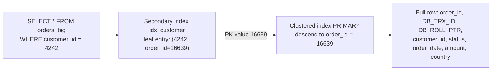

## Introduction

In the last two lessons you treated "the table" and "the index" as separate things: a table of rows, and B+ trees that point into it. That picture is right for many databases (PostgreSQL's heap tables, MyISAM, SQL Server heaps), but it is **not** how InnoDB works. In InnoDB:

- **The table is an index.** Rows are stored in the leaf pages of a B+ tree ordered by the primary key — the **clustered index**.
- **Every other index is a secondary index** whose leaf entries contain the indexed columns **plus the primary-key value**, which acts as the pointer to the row.

This one design decision explains a surprising number of everyday observations: why primary-key lookups are the fastest access path in MySQL, why `SELECT id FROM t WHERE indexed_col = ?` never touches the table, why a query that matches 15% of a table may ignore a perfectly good index, why a `CHAR(36)` UUID primary key makes *every* index larger, and what InnoDB does when you forget to declare a primary key at all.

By the end of the lesson you will be able to predict, for a given query and schema, how many B+ trees InnoDB must visit and how many lookups it must perform — and choose primary keys accordingly.

:::note[Lab data]
This lesson uses the **empty** dataset and generates a 200,000-row `orders_big` table. All outputs were captured on a real MySQL server; row estimates and plan choices depend on statistics, so **your plan may differ** in details.
:::

## DBMS Theory

:::theory[Clustering, primary and secondary indexes]
An index is **clustered** (or *clustering*) if the data records are physically stored in the order of the index's search key; otherwise it is **unclustered**. Because records can be physically ordered only one way, a table has **at most one** clustered index.

Textbooks (e.g. Ramakrishnan & Gehrke) distinguish three ways an index's data entries can relate to records:

1. **Alternative 1** — the index *contains the records themselves* (the leaves are the data). This is an *index-organized table*.
2. **Alternative 2** — entries are ⟨key, rid⟩ pairs, where *rid* points to the record.
3. **Alternative 3** — entries are ⟨key, list of rids⟩.

The *rid* (record identifier) is usually a **physical** address (page number + slot). An alternative is a **logical** pointer: the record's primary-key value, resolved by searching the clustered index.
:::

InnoDB uses **Alternative 1** for the primary key (the clustered index *is* the table, an index-organized table in Oracle terminology) and **Alternative 2 with logical pointers** for secondary indexes: each secondary entry is ⟨indexed columns, primary key⟩.

| | Physical rid (heap tables: PostgreSQL, MyISAM) | Logical pointer = PK (InnoDB secondary indexes) |
|---|---|---|
| Secondary lookup cost | 1 index descent + 1 direct page access | 1 secondary descent + **1 clustered descent** |
| When a row moves (page split, update that grows the row) | every index pointing to it must be updated (or a forwarding pointer left) | nothing — the PK did not change |
| Secondary entry size | key + small rid | key + **full PK value** |
| Range scan on the PK | needs an index plus heap accesses | reads contiguous leaf pages of the table itself |

The logical-pointer design makes page splits cheap (rows move between pages all the time in a B+ tree, and secondary indexes do not care) at the price of a second tree descent on every secondary lookup and a primary key copied into every secondary entry. Both consequences drive the design rules in this lesson.

## Why It Exists

Clustering by primary key solves real problems:

- **Primary-key access is the most common access path in OLTP.** `WHERE id = ?` is a single descent that ends at the row itself — no second lookup.
- **Ranges on the PK are sequential.** If the PK is time-ordered (AUTO_INCREMENT), "the last 1,000 orders" are physically adjacent; reading them touches a few consecutive pages.
- **Related rows can be stored together.** A composite PK such as `(customer_id, order_id)` stores each customer's orders on the same pages — a design used heavily in multi-tenant systems.
- **Row movement is free for secondary indexes**, as explained above.

What goes wrong if you ignore it:

- A **random** PK (UUID v4) scatters inserts across the whole tree (page splits, half-empty pages — measured in the previous lesson) and destroys locality for "recent rows" queries.
- A **wide** PK is copied into every secondary index entry, inflating every index.
- A table with **no** PK gets an invisible 6-byte row ID that you cannot use in queries, cannot replicate meaningfully, and that is generated from a counter shared by all such tables in the instance.

## Internal Working

:::internals[What lives in each leaf]
**Clustered index (`PRIMARY`)** — leaf records contain: the primary-key columns, two hidden system columns — `DB_TRX_ID` (6 bytes, the last transaction that modified the row) and `DB_ROLL_PTR` (7 bytes, pointer to the undo log record used by MVCC) — and then all remaining columns. Large variable-length values may be stored off-page (row formats are covered in Module 10).

**Secondary index** — leaf records contain: the indexed columns, then **the primary-key columns that are not already part of the index**. There is no transaction id per secondary record; visibility checks may require visiting the clustered record. Internal (non-leaf) records of a secondary index also include the PK columns, which makes every entry unique even for non-unique indexes.

**Choice of clustered index:**
1. If the table has a `PRIMARY KEY`, that is the clustered index.
2. Otherwise, the **first `UNIQUE` index whose columns are all `NOT NULL`** becomes the clustered index (InnoDB treats it as the primary key).
3. Otherwise, InnoDB generates a hidden clustered index named **`GEN_CLUST_INDEX`** on a hidden 6-byte column **`DB_ROW_ID`**, filled from a monotonically increasing counter shared by all tables without a key in the instance.
:::



A **bookmark lookup** (also called a *key lookup* or *back-to-table lookup*) is that arrow from the secondary entry to the clustered index. Its cost is a full root-to-leaf descent of the clustered tree per matching entry. For 10 matches that is negligible; for 30,000 matches spread across the table it means tens of thousands of random page visits — more expensive than reading the table sequentially. The optimizer estimates this and may prefer a full scan.

When a query needs **only** columns present in the secondary entry — the indexed columns and the PK — no bookmark lookup is needed. EXPLAIN shows `Using index`, and the index is said to **cover** the query. Because the PK is in every secondary entry, an index on `customer_id` silently covers `SELECT order_id … WHERE customer_id = ?`.

## MySQL Implementation

Generate the lab table — the same shape as in the first lesson of this module — with a secondary index on `customer_id`:

```sql run
SET SESSION cte_max_recursion_depth = 300000;
CREATE TABLE orders_big (
  order_id    INT UNSIGNED  NOT NULL,
  customer_id INT UNSIGNED  NOT NULL,
  status      VARCHAR(10)   NOT NULL,
  order_date  DATE          NOT NULL,
  amount      DECIMAL(10,2) NOT NULL,
  country     CHAR(2)       NOT NULL,
  PRIMARY KEY (order_id),
  INDEX idx_customer (customer_id)
) ENGINE=InnoDB;
INSERT INTO orders_big
WITH RECURSIVE seq(n) AS (SELECT 1 UNION ALL SELECT n + 1 FROM seq WHERE n < 200000)
SELECT n,
       1 + (n * 7919) % 20000,
       ELT(1 + (n % 20 > 0) + (n % 20 > 2) + (n % 20 > 15), 'cancelled', 'pending', 'shipped', 'delivered'),
       DATE '2023-01-01' + INTERVAL (n * 37) % 730 DAY,
       ROUND(5 + (n * 104729 % 99500) / 100, 2),
       ELT(1 + n % 5, 'US', 'IN', 'DE', 'BR', 'JP')
FROM seq;
ANALYZE TABLE orders_big;
```

**Primary-key lookup — one tree.** `type = const` means the optimizer knows at most one row can match and reads it once:

```sql run
EXPLAIN SELECT * FROM orders_big WHERE order_id = 16639;
```

**Secondary lookup with bookmark lookups — two trees.** The plan shows `ref` on `idx_customer`; there is nothing in `Extra`, because every matching entry must be followed into the clustered index to fetch `status`, `amount` and the other columns:

```sql run
EXPLAIN SELECT * FROM orders_big WHERE customer_id = 4242;
```

**Secondary lookup that is covered — one tree.** Ask only for columns that live in the secondary leaf: the indexed column and the primary key.

```sql run
EXPLAIN SELECT customer_id, order_id FROM orders_big WHERE customer_id = 4242;
```

`Using index` confirms the query was answered from `idx_customer` alone — even though the index was declared on `customer_id` only. The primary key rides along in every secondary entry. Now compare the iterator trees of the two lookups:

```sql run measured
EXPLAIN ANALYZE SELECT * FROM orders_big WHERE customer_id = 4242;
EXPLAIN ANALYZE SELECT customer_id, order_id FROM orders_big WHERE customer_id = 4242;
```

The covered version reads *Covering index lookup on orders_big using idx_customer*; the other one reads *Index lookup*. Both return 10 rows; the difference is the 10 clustered-index descents that the first one performs and the second avoids. On 10 rows the timing difference is noise — it becomes decisive when a lookup matches thousands of rows.

## Syntax Breakdown

| Syntax / object | Meaning in InnoDB |
|---|---|
| `PRIMARY KEY (cols)` | Declares the clustered index. Columns become `NOT NULL` implicitly. Changing it later (`ALTER TABLE … DROP PRIMARY KEY, ADD PRIMARY KEY (…)`) **rebuilds the whole table and every secondary index**. |
| `UNIQUE KEY (cols)` with all columns `NOT NULL`, no PK | Promoted to clustered index. `DESCRIBE` shows `PRI` in the `Key` column. |
| No PK and no such unique key | Hidden `GEN_CLUST_INDEX` on hidden `DB_ROW_ID` (6 bytes). Not visible in `SHOW INDEX`. |
| `INDEX` / `KEY (cols)` | A secondary index: leaf entries = (cols, PK columns not already in cols). |
| `_rowid` | A MySQL alias that refers to the PK column when the PK (or promoted unique key) is a **single integer column**. Error 1054 if there is none. |
| `sql_generate_invisible_primary_key` (8.0.30+) | When ON, `CREATE TABLE` without a PK adds an invisible `my_row_id BIGINT UNSIGNED AUTO_INCREMENT` primary key (GIPK). |
| `UUID_TO_BIN(uuid, 1)` / `BIN_TO_UUID(b, 1)` | Store a UUID in `BINARY(16)`; the swap flag `1` reorders the time fields of a version-1 UUID so values increase over time — clustered-index friendly. |

:::version[Generated invisible primary keys (8.0.30+, also in 8.4)]
A DBA can make InnoDB add a real, *usable* primary key to key-less tables. Setting the variable requires administrative privileges, so this is display-only here:

```sql
SET SESSION sql_generate_invisible_primary_key = ON;   -- needs SESSION_VARIABLES_ADMIN or SYSTEM_VARIABLES_ADMIN
CREATE TABLE gipk_demo (note VARCHAR(20));
SHOW CREATE TABLE gipk_demo;
-- `my_row_id` bigint unsigned NOT NULL AUTO_INCREMENT /*!80023 INVISIBLE */,
-- PRIMARY KEY (`my_row_id`)
```

Unlike the hidden `DB_ROW_ID`, a GIPK is a normal column you can select explicitly, is replicated as data, and is per-table rather than drawn from a global counter. Many managed MySQL services enable it by default or require explicit primary keys (for example for Group Replication).
:::

## Practical Examples

**1. When bookmark lookups become too expensive.** A range of 200 customers matches roughly 2,000 rows (1% of the table). A range of 3,000 customers matches 30,000 rows (15%):

```sql run
EXPLAIN SELECT * FROM orders_big WHERE customer_id BETWEEN 1 AND 200;
EXPLAIN SELECT * FROM orders_big WHERE customer_id BETWEEN 1 AND 3000;
```

For the narrow range the optimizer uses `idx_customer` (`range`). For the wider one it chooses `ALL` even though `possible_keys` lists the index: it estimates that tens of thousands of random clustered-index lookups cost more than one sequential pass over ~600 pages. Note that its row estimate is an approximation: `filtered` ≈ 30% of ~200,000 rows means it expects about 59,000 matches, roughly twice the real 30,000. The decision is based on estimates, which is why statistics matter ([Selectivity, Cardinality and Index Statistics](/lessons/m07-selectivity-statistics)). Now ask the wide range for covered columns only:

```sql run
EXPLAIN SELECT COUNT(*), MIN(order_id) FROM orders_big WHERE customer_id BETWEEN 1 AND 3000;
```

With no bookmark lookups needed, reading a slice of the narrow secondary index is cheap, and the optimizer happily uses it (`range`, `Using index`) — even with the same inflated estimate of about 59,000 entries. **The same index, the same predicate — the plan flips depending on which columns the query needs.**

**2. Choosing a different clustering key.** If the application almost always reads orders *by customer*, cluster the table by customer:

```sql run
CREATE TABLE orders_by_customer (
  customer_id INT UNSIGNED  NOT NULL,
  order_id    INT UNSIGNED  NOT NULL,
  status      VARCHAR(10)   NOT NULL,
  order_date  DATE          NOT NULL,
  amount      DECIMAL(10,2) NOT NULL,
  country     CHAR(2)       NOT NULL,
  PRIMARY KEY (customer_id, order_id),
  UNIQUE KEY uq_order_id (order_id)
) ENGINE=InnoDB;
INSERT INTO orders_by_customer
SELECT customer_id, order_id, status, order_date, amount, country FROM orders_big ORDER BY customer_id, order_id;
ANALYZE TABLE orders_by_customer;
EXPLAIN SELECT * FROM orders_by_customer WHERE customer_id BETWEEN 1 AND 3000;
```

Now the wide range is a range scan of `PRIMARY` — the 30,000 rows are physically contiguous, so no lookups are needed and no scan of the rest of the table. The price: inserts of new orders are no longer appended at the right edge (a new order for customer 17 goes into the middle of the tree), and `uq_order_id`, needed to keep order IDs unique and to look orders up by ID, stores the 8-byte composite PK in every entry.

**3. Primary-key width multiplies into every secondary index.** Build two tables with identical columns and two secondary indexes; one uses a 4-byte integer PK, the other a 36-character UUID-style string (generated deterministically from `MD5` for reproducibility — random order, like UUID v4):

```sql run
CREATE TABLE pk_int (
  id INT UNSIGNED NOT NULL PRIMARY KEY,
  customer_id INT UNSIGNED NOT NULL, order_date DATE NOT NULL,
  INDEX idx_c (customer_id), INDEX idx_d (order_date)
);
CREATE TABLE pk_uuid (
  id CHAR(36) CHARACTER SET ascii NOT NULL PRIMARY KEY,
  customer_id INT UNSIGNED NOT NULL, order_date DATE NOT NULL,
  INDEX idx_c (customer_id), INDEX idx_d (order_date)
);
INSERT INTO pk_int  SELECT order_id, customer_id, order_date FROM orders_big WHERE order_id <= 100000;
INSERT INTO pk_uuid
SELECT CONCAT_WS('-', SUBSTR(h, 1, 8), SUBSTR(h, 9, 4), SUBSTR(h, 13, 4), SUBSTR(h, 17, 4), SUBSTR(h, 21, 12)),
       customer_id, order_date
FROM (SELECT MD5(order_id) AS h, customer_id, order_date FROM orders_big WHERE order_id <= 100000) src;
ANALYZE TABLE pk_int, pk_uuid;
SELECT TABLE_NAME,
       DATA_LENGTH  / @@innodb_page_size AS clustered_pages,
       INDEX_LENGTH / @@innodb_page_size AS secondary_pages
FROM information_schema.TABLES
WHERE TABLE_SCHEMA = DATABASE() AND TABLE_NAME IN ('pk_int', 'pk_uuid')
ORDER BY TABLE_NAME;
```

Both the clustered index *and* the secondary indexes are several times larger with the UUID key: the secondary entries carry 36 bytes of PK instead of 4, and random insertion order leaves pages partly empty. In production this means more memory needed to keep the working set cached, more I/O, and slower inserts.

**4. A table without a primary key.** `DESCRIBE` reveals which index InnoDB promoted:

```sql run
CREATE TABLE promoted (code INT NOT NULL, note VARCHAR(20), UNIQUE KEY uq_code (code));
DESCRIBE promoted;
```

The `Key` column says `PRI` for `code`, although no `PRIMARY KEY` was declared: the first unique index on non-NULL columns became the clustered index. `_rowid` resolves to it:

```sql run
INSERT INTO promoted VALUES (7, 'seven'), (3, 'three');
SELECT _rowid, code, note FROM promoted ORDER BY _rowid;
```

Without any eligible key, InnoDB uses the hidden `GEN_CLUST_INDEX`, and `_rowid` does not exist:

```sql run
CREATE TABLE keyless (code INT NULL, note VARCHAR(20));
INSERT INTO keyless VALUES (7, 'seven'), (7, 'seven again');
SHOW INDEX FROM keyless;
```

```sql run error
SELECT _rowid FROM keyless;
```

`SHOW INDEX` returns nothing — the hidden index is invisible to SQL. With the `PROCESS` privilege (not available in the sandbox) you can see it in the InnoDB dictionary:

```sql
SELECT i.NAME AS index_name, i.TYPE
FROM information_schema.INNODB_INDEXES i
JOIN information_schema.INNODB_TABLES t ON t.TABLE_ID = i.TABLE_ID
WHERE t.NAME = 'mydb/keyless';
-- index_name = GEN_CLUST_INDEX, TYPE = 1 (clustered)
```

## Execution Walkthrough

Follow one secondary-index query through both trees, comparing the covered and uncovered variants.

```walkthrough
title: SELECT order_id, amount FROM orders_big WHERE customer_id = 777
steps:
  - title: "1. The plan"
    explain: >-
      A ref lookup on idx_customer; Extra is empty because amount is not in the secondary index, so bookmark lookups
      will be needed.
    sql: EXPLAIN SELECT order_id, amount FROM orders_big WHERE customer_id = 777;
  - title: "2. Secondary index range: the entries"
    explain: >-
      InnoDB descends idx_customer to the first entry with customer_id = 777 and reads the consecutive entries.
      Each entry is (customer_id, order_id). This query returns exactly what the leaf contains — and is covered.
    sql: SELECT customer_id, order_id FROM orders_big WHERE customer_id = 777 ORDER BY order_id;
  - title: "3. Bookmark lookups"
    explain: >-
      For each order_id, InnoDB descends PRIMARY (root → internal → leaf) to fetch the row and read amount.
      Ten entries, ten descents. Because order_ids of one customer are 20,000 apart, each descent ends in a different
      leaf page.
  - title: "4. Result"
    explain: >-
      The rows are returned in index order (customer_id, then order_id), which is why they appear sorted by order_id
      here even without the ORDER BY — but do not rely on that; the plan could change.
    sql: SELECT order_id, amount FROM orders_big WHERE customer_id = 777 ORDER BY order_id;
  - title: "5. Make it covered"
    explain: >-
      Adding amount to the index — (customer_id, amount) — would make the query covered. The plan would show
      Using index and the ten clustered descents would disappear. Covering indexes are the subject of a later lesson;
      here we just confirm the principle with EXPLAIN on a temporary index.
    sql: |
      CREATE INDEX idx_customer_amount ON orders_big (customer_id, amount);
      EXPLAIN SELECT order_id, amount FROM orders_big WHERE customer_id = 777;
```

## Output

Summarizing the captured evidence:

| Query shape | Trees visited | Lookups | Plan evidence |
|---|---|---|---|
| `WHERE order_id = ?` | clustered only | 0 | `type = const`, key `PRIMARY` |
| `SELECT * … WHERE customer_id = ?` | secondary + clustered | 1 per match | `ref`, empty `Extra`; *Index lookup* |
| `SELECT order_id … WHERE customer_id = ?` | secondary only | 0 | `Using index`; *Covering index lookup* |
| `SELECT * … customer_id BETWEEN 1 AND 3000` | clustered (full scan) | 0 | `ALL` despite `possible_keys = idx_customer` |
| Same range, clustered by `(customer_id, order_id)` | clustered range | 0 | `range` on `PRIMARY` |

The last walkthrough step showed the covered plan after adding `idx_customer_amount`; note that the optimizer now has two candidate indexes and picks the one that avoids lookups.

## Alternative Approaches

| Design | Pros | Cons | Typical use |
|---|---|---|---|
| `BIGINT AUTO_INCREMENT` PK | 8 bytes, ascending inserts, compact secondaries | Reveals counts/ordering if exposed; needs central generation | Default for most OLTP tables |
| Natural key PK (e.g. `country_code`, `isbn`) | No extra column; meaningful | Often wide; may change (cascading updates of every secondary) | Small, stable lookup tables |
| Composite PK clustering related rows (`(tenant_id, id)`) | Locality for the dominant access pattern | Non-sequential inserts; wider secondaries | Multi-tenant SaaS, time series per device |
| UUID v4 as `CHAR(36)` | Decentralized generation | Widest, random: bloated, poor locality | Avoid as clustered key |
| UUID as `BINARY(16)` time-ordered (`UUID_TO_BIN(UUID(), 1)`, UUIDv7) | Decentralized, mostly ascending, 16 bytes | Twice an INT's width; less readable | Distributed systems needing global IDs |
| Surrogate `BIGINT` PK + `UNIQUE` public UUID | Compact clustering, public IDs not guessable | One more index | Public APIs |

Other engines make other choices: PostgreSQL stores rows in a heap and *all* indexes point to physical tuple IDs (and offers `CLUSTER` as a one-time reorder that is not maintained); SQL Server lets you choose any index as clustered or have a heap. InnoDB's "always clustered by PK" is a strong default you design around rather than opt out of.

## Performance Analysis

Model the costs, using *h_c* for the height of the clustered index and *h_s* for a secondary index:

| Access | Page visits (logical) |
|---|---|
| PK point lookup | *h_c* |
| PK range of *r* rows | *h_c* + ⌈r / rows-per-leaf⌉ |
| Secondary lookup, *m* matches, covered | *h_s* + ⌈m / entries-per-leaf⌉ |
| Secondary lookup, *m* matches, not covered | *h_s* + ⌈m / entries-per-leaf⌉ + **m × h_c** |
| Full scan | all clustered leaf pages (sequential, with read-ahead) |

The *m × h_c* term dominates once *m* is large, and its page visits are **random**. That is why the optimizer flipped to a full scan for the 3,000-customer range. The exact tipping point is not a fixed percentage — it depends on row width, how much is cached, the cost constants, and the accuracy of the estimates — but in practice uncovered secondary access tends to lose to a scan once it touches more than a modest fraction of the table.

**Primary-key width** enters every secondary index: secondary entry size ≈ indexed columns + PK + record overhead. The lab measured it — the UUID table's secondary indexes were several times larger than the integer table's. Larger indexes mean lower fan-out, more pages to cache, more I/O per range.

**Updating the PK** is expensive: it is a delete + insert in the clustered index (the row moves) plus a delete + insert in *every* secondary index. Updating a non-indexed column touches only the clustered record. Updating an indexed column touches the clustered record and that index.

:::performance[Theory vs measurement]
The page counts in Practical Example 3 are real measurements; the cost formulas are a model. EXPLAIN shows the optimizer's estimates; `EXPLAIN ANALYZE` (later in this module) shows real row counts per iterator, which is how you verify how many lookups actually happened.
:::

## Best Practices

:::best-practice[Primary and secondary index design in InnoDB]
1. **Always declare an explicit primary key.** Never rely on `GEN_CLUST_INDEX`. If you have no natural key, use `BIGINT UNSIGNED AUTO_INCREMENT`.
2. **Keep the primary key short and immutable.** It is copied into every secondary index and every change to it rewrites all of them.
3. **Prefer ascending primary keys** for write-heavy tables; if you need globally unique IDs, use time-ordered ones in `BINARY(16)` or a 64-bit time-based ID.
4. **Cluster for the dominant access pattern** only when it is truly dominant (e.g. `(tenant_id, id)`); remember the insert-locality cost.
5. **Exploit the hidden PK in secondary indexes.** An index on `(a)` already covers `SELECT pk … WHERE a = ?`, and an index on `(a)` is effectively `(a, pk)` for ordering — `WHERE a = ? ORDER BY pk` needs no sort.
6. **Do not append the PK to secondary index definitions** "for covering" — InnoDB already stores it (adding it explicitly is redundant, although it can be meaningful when you need the PK in a specific position of a composite index).
7. **Select only the columns you need.** `SELECT *` forces bookmark lookups that a narrower select list might avoid.
:::

## Common Mistakes

**Mistake 1 — tables without a primary key.** Besides losing a usable row identifier, the hidden `DB_ROW_ID` counter is shared by all key-less tables in the instance, and row-based replication of `UPDATE`/`DELETE` on a key-less table may have to scan the whole table on the replica for each changed row. Check for such tables with `information_schema`:

```sql run
SELECT t.TABLE_NAME
FROM information_schema.TABLES t
LEFT JOIN information_schema.TABLE_CONSTRAINTS c
       ON c.TABLE_SCHEMA = t.TABLE_SCHEMA AND c.TABLE_NAME = t.TABLE_NAME
      AND c.CONSTRAINT_TYPE = 'PRIMARY KEY'
WHERE t.TABLE_SCHEMA = DATABASE() AND t.TABLE_TYPE = 'BASE TABLE' AND c.CONSTRAINT_NAME IS NULL
ORDER BY t.TABLE_NAME;
```

Both `promoted` (clustered by its unique key, but no declared PK) and `keyless` are listed. Fix them with `ALTER TABLE … ADD PRIMARY KEY` (or add a surrogate `id BIGINT UNSIGNED AUTO_INCREMENT PRIMARY KEY`), which rebuilds the table.

**Mistake 2 — believing "an index on X means queries on X are fast".** Practical Example 1 showed an index on `customer_id` ignored for a 15%-of-the-table range, because of bookmark lookups. An index helps a query only if the number of lookups it implies is small, or if it covers the query.

**Mistake 3 — redundant PK columns in secondary indexes.** `INDEX (customer_id, order_id)` on a table whose PK is `order_id` stores the same entries as `INDEX (customer_id)` (InnoDB appends the PK anyway). It is harmless but redundant; tools such as `pt-duplicate-key-checker` flag it.

**Mistake 4 — random UUID text as the clustered key.** As measured, `CHAR(36)` UUID PKs inflate the clustered index *and* every secondary index. Use `BINARY(16)` with a time-ordered UUID, or a surrogate integer PK.

**Mistake 5 — changing primary keys casually.** `UPDATE customers SET customer_id = …` (or a natural-key change such as a renamed SKU used as PK) physically moves the row and rewrites every secondary index entry — and cascades to child tables through foreign keys.

## Industry Application

- **Schema guidelines** in most companies running MySQL at scale mandate an explicit, compact primary key on every table; managed services and Group Replication *require* primary keys (MySQL's `sql_require_primary_key` variable enforces it).
- **Multi-tenant SaaS** platforms cluster large tables by `(tenant_id, …)` so that one tenant's data is contiguous: tenant exports, deletes and per-tenant queries become range scans.
- **Distributed ID generation**: systems that cannot use a central AUTO_INCREMENT use time-ordered 64-bit IDs (Twitter's Snowflake pattern) or UUIDv7 in `BINARY(16)` precisely to keep InnoDB inserts sequential.
- **Query reviews** look for `SELECT *` on hot paths: trimming the select list to indexed columns often turns a lookup-heavy plan into a covering one with no schema change.
- **Data-warehouse offloading**: InnoDB's clustered design is excellent for OLTP access by key and poor for scanning a few columns of many rows — one reason analytics move to columnar systems.

## Practice Exercises

```exercise
id: ex1
title: Which column did InnoDB cluster on?
difficulty: easy
concepts: [clustered-index, gen-clust-index]
setup: |
  CREATE TABLE devices (
    serial  VARCHAR(20) NULL,
    asset_no INT NOT NULL,
    label   VARCHAR(40) NOT NULL,
    UNIQUE KEY uq_serial (serial),
    UNIQUE KEY uq_asset (asset_no)
  );
  INSERT INTO devices VALUES ('S-1', 501, 'printer'), ('S-2', 502, 'scanner'), (NULL, 503, 'router');
prompt: |
  The table `devices` has no declared primary key. Using `information_schema.COLUMNS`, return the column(s)
  whose `COLUMN_KEY` is `'PRI'` — one column named `column_name`. (Think first: which unique index qualifies to
  become the clustered index?)
hints:
  - "A unique index is promoted only if all of its columns are NOT NULL."
  - "SELECT COLUMN_NAME FROM information_schema.COLUMNS WHERE TABLE_SCHEMA = DATABASE() AND TABLE_NAME = 'devices' AND COLUMN_KEY = 'PRI'"
solution: |
  SELECT COLUMN_NAME AS column_name
  FROM information_schema.COLUMNS
  WHERE TABLE_SCHEMA = DATABASE() AND TABLE_NAME = 'devices' AND COLUMN_KEY = 'PRI';
explanation: |
  `uq_serial` is declared first but `serial` is nullable, so it cannot serve as the clustered key. `uq_asset` is the
  first unique index whose columns are all NOT NULL, so InnoDB clusters the table on `asset_no` and reports it as
  `PRI`. If neither qualified, InnoDB would use the hidden GEN_CLUST_INDEX and no column would show `PRI`.
```

```exercise
id: ex2
title: Make the lookup covered without a new index
difficulty: medium
concepts: [covering-index, secondary-index]
setup: |
  SET SESSION cte_max_recursion_depth = 100000;
  CREATE TABLE shipments (
    shipment_id INT UNSIGNED PRIMARY KEY,
    warehouse   SMALLINT UNSIGNED NOT NULL,
    weight_kg   DECIMAL(8,2) NOT NULL,
    INDEX idx_warehouse (warehouse)
  );
  INSERT INTO shipments
  WITH RECURSIVE s(n) AS (SELECT 1 UNION ALL SELECT n + 1 FROM s WHERE n < 40000)
  SELECT n, n % 40, (n % 500) / 10 FROM s;
prompt: |
  A dashboard runs `SELECT * FROM shipments WHERE warehouse = 12`, but it only displays the shipment IDs.
  Write the query the dashboard *should* run so that it can be answered entirely from `idx_warehouse`
  (EXPLAIN shows `Using index`). Return one column, `shipment_id`, for warehouse 12.
hints:
  - "Which columns does a secondary index leaf contain in InnoDB?"
  - "The indexed column plus the primary key. Select only the primary key."
solution: |
  SELECT shipment_id FROM shipments WHERE warehouse = 12;
explanation: |
  The leaf entries of `idx_warehouse` are (warehouse, shipment_id), so selecting `shipment_id` needs no bookmark
  lookups. `SELECT *` forces 1,000 clustered-index descents to fetch `weight_kg` that the dashboard never shows.
```

```exercise
id: ex3
title: Find tables without a declared primary key
difficulty: medium
concepts: [primary-key-design, gen-clust-index]
setup: |
  CREATE TABLE a_ok (id INT PRIMARY KEY);
  CREATE TABLE b_nokey (v INT);
  CREATE TABLE c_unique_only (code INT NOT NULL, UNIQUE KEY (code));
  CREATE TABLE d_ok (k CHAR(3), n INT, PRIMARY KEY (k, n));
  CREATE VIEW e_view AS SELECT * FROM a_ok;
prompt: |
  Return the names (column `table_name`) of all **base tables** in the current schema that have no declared
  `PRIMARY KEY` constraint, ordered by name.
hints:
  - "information_schema.TABLE_CONSTRAINTS lists PRIMARY KEY constraints (CONSTRAINT_TYPE = 'PRIMARY KEY')."
  - "Use a LEFT JOIN (or NOT EXISTS) from information_schema.TABLES, filter TABLE_TYPE = 'BASE TABLE' to exclude views."
solution: |
  SELECT t.TABLE_NAME AS table_name
  FROM information_schema.TABLES t
  WHERE t.TABLE_SCHEMA = DATABASE()
    AND t.TABLE_TYPE = 'BASE TABLE'
    AND NOT EXISTS (SELECT 1 FROM information_schema.TABLE_CONSTRAINTS c
                    WHERE c.TABLE_SCHEMA = t.TABLE_SCHEMA AND c.TABLE_NAME = t.TABLE_NAME
                      AND c.CONSTRAINT_TYPE = 'PRIMARY KEY')
  ORDER BY t.TABLE_NAME;
orderMatters: true
explanation: |
  `b_nokey` uses the hidden GEN_CLUST_INDEX; `c_unique_only` is clustered by its NOT NULL unique key but still has
  no declared PK (tools and replication settings such as `sql_require_primary_key` treat it as key-less).
  Forgetting the `TABLE_TYPE` filter wrongly lists the view `e_view`.
```

```exercise
id: ex4
title: Cluster for the access pattern
difficulty: hard
kind: dml
concepts: [clustered-index, primary-key-design]
setup: |
  CREATE TABLE tenant_docs (
    doc_id    INT UNSIGNED NOT NULL,
    tenant_id INT UNSIGNED NOT NULL,
    title     VARCHAR(80) NOT NULL,
    PRIMARY KEY (doc_id)
  );
  INSERT INTO tenant_docs VALUES (1, 10, 'a'), (2, 20, 'b'), (3, 10, 'c');
prompt: |
  Every query on `tenant_docs` filters by `tenant_id` (and often a `doc_id` range within the tenant). Change the
  table so that it is **clustered by `(tenant_id, doc_id)`** while `doc_id` stays globally unique through a unique
  index named `uq_doc_id`. Use one `ALTER TABLE` statement.
hints:
  - "You must drop the existing primary key and add a new composite one in the same ALTER TABLE."
  - "ALTER TABLE tenant_docs DROP PRIMARY KEY, ADD PRIMARY KEY (…), ADD UNIQUE KEY uq_doc_id (…);"
solution: |
  ALTER TABLE tenant_docs
    DROP PRIMARY KEY,
    ADD PRIMARY KEY (tenant_id, doc_id),
    ADD UNIQUE KEY uq_doc_id (doc_id);
check: |
  SELECT INDEX_NAME, SEQ_IN_INDEX, COLUMN_NAME, NON_UNIQUE
  FROM information_schema.STATISTICS
  WHERE TABLE_SCHEMA = DATABASE() AND TABLE_NAME = 'tenant_docs'
  ORDER BY INDEX_NAME, SEQ_IN_INDEX;
explanation: |
  Doing it in one ALTER rebuilds the table once. The new clustered index stores each tenant's documents
  contiguously; `uq_doc_id` preserves the business rule that doc IDs are unique and supports lookups by ID
  (its entries carry the 8-byte composite PK). Trade-off: inserts land inside each tenant's range rather than at the
  right edge of the tree.
```

```exercise
id: ex5
title: Explain the plan flip
difficulty: challenge
kind: open
concepts: [bookmark-lookup, covering-index, clustered-index]
prompt: |
  On `orders_big` (200,000 rows, index `idx_customer(customer_id)`), the lesson showed:

  - `SELECT * … WHERE customer_id BETWEEN 1 AND 3000` → full table scan (`ALL`), index ignored.
  - `SELECT COUNT(*), MIN(order_id) … WHERE customer_id BETWEEN 1 AND 3000` → range scan on `idx_customer`, `Using index`.
  - The same `SELECT *` on a copy clustered by `(customer_id, order_id)` → range scan on `PRIMARY`.

  Explain each plan in terms of trees visited and lookups performed, and state which design you would choose if
  "all orders of a set of customers" were the dominant query, including what you give up.
solution: |
  1. **SELECT * via idx_customer** would need one clustered-index descent per matching entry — about 30,000 random
     lookups (the optimizer estimated even more). Scanning ~600 contiguous pages of the clustered index is cheaper,
     so the optimizer chose ALL.
  2. **COUNT(*), MIN(order_id)** needs only customer_id and order_id, both stored in the secondary leaf. Reading a
     contiguous slice of the small secondary index with no lookups is clearly cheapest → covered range scan.
  3. **Clustered by (customer_id, order_id)**: the rows themselves are ordered by customer, so the 30,000 rows are a
     contiguous range of the clustered index — no lookups, no full scan.

  If "orders of some customers" dominates, clustering by (customer_id, order_id) is the strongest design. Costs:
  inserts are no longer append-only (new orders go into each customer's range → more page splits and a larger hot
  set), the table needs a unique index on order_id for ID lookups and uniqueness, and every secondary index stores
  the 8-byte composite PK. Alternatively, keep the AUTO_INCREMENT clustering and add a covering secondary index
  containing the needed columns, paying extra space and write cost instead.
explanation: |
  The same predicate can produce three different plans depending on which columns are needed and how the table is
  clustered — the core mental model for InnoDB indexing.
```

## Knowledge Assessment

```quiz
- id: q1
  question: "In InnoDB, what does a leaf entry of a secondary index on `customer_id` contain (table PK = `order_id`)?"
  options:
    - "customer_id and a physical page/slot address"
    - "customer_id and the order_id value"
    - "The full row"
    - "Only customer_id"
  answer: 1
  explanation: "InnoDB secondary indexes use the primary-key value as a logical pointer. Physical row addresses are used by heap-organized engines (MyISAM, PostgreSQL). Only the clustered index leaves contain full rows."
  concepts: [secondary-index]
- id: q2
  question: "A table has no PRIMARY KEY, a UNIQUE index on nullable `email`, and a UNIQUE index on NOT NULL `badge_no` declared later. What is the clustered index?"
  options:
    - "The unique index on email, because it is declared first"
    - "The unique index on badge_no, the first unique index whose columns are all NOT NULL"
    - "GEN_CLUST_INDEX, because no PRIMARY KEY is declared"
    - "There is no clustered index; the table is a heap"
  answer: 1
  explanation: "InnoDB promotes the first UNIQUE index with all columns NOT NULL. Only if none exists does it create GEN_CLUST_INDEX on DB_ROW_ID. InnoDB tables are never heaps."
  concepts: [clustered-index, gen-clust-index]
- id: q3
  question: "`SELECT order_id FROM orders_big WHERE customer_id = 4242` shows `Using index` with an index on `(customer_id)` only. Why?"
  options:
    - "MySQL cached the result"
    - "The secondary entries contain the PK (order_id), so the query is covered"
    - "customer_id is the primary key"
    - "Using index means the query used any index"
  answer: 1
  explanation: "`Using index` specifically means the query was answered from the index alone (covering). It works because InnoDB stores the PK in every secondary entry."
  concepts: [covering-index]
- id: q4
  question: "Why might the optimizer choose a full table scan for `SELECT * … WHERE customer_id BETWEEN 1 AND 3000` even though `customer_id` is indexed?"
  options:
    - "Because BETWEEN cannot use indexes"
    - "Because ~30,000 matches would require ~30,000 random clustered-index lookups, which it estimates to cost more than a sequential scan"
    - "Because the index is corrupted"
    - "Because indexes are only used for equality"
  answer: 1
  explanation: "The decision is cost-based. BETWEEN uses indexes fine (the 1–200 range used it). The same range used the index when the query was covered."
  concepts: [bookmark-lookup]
- id: q5
  question: "Which effects does replacing an INT primary key with a CHAR(36) UUID v4 primary key have? (Select all that apply.)"
  type: multi
  options:
    - "Every secondary index becomes larger, because each entry stores the PK"
    - "Inserts become scattered across the clustered index, causing more page splits"
    - "Secondary-index lookups no longer need the clustered index"
    - "Lower fan-out in the clustered index's internal pages"
  answer: [0, 1, 3]
  explanation: "Wide random keys inflate every index, scatter inserts and reduce fan-out. Uncovered secondary lookups still go through the clustered index, regardless of PK type."
  concepts: [primary-key-design]
- id: q6
  question: "What is `DB_ROW_ID`?"
  options:
    - "A visible auto-increment column added to every table"
    - "A hidden 6-byte row identifier that InnoDB uses for GEN_CLUST_INDEX when a table has no primary key or eligible unique key"
    - "The transaction ID stored in each row"
    - "An alias for _rowid"
  answer: 1
  explanation: "DB_ROW_ID backs the hidden clustered index. DB_TRX_ID is the transaction ID column. _rowid is a SQL alias for a single-column integer PK and does not work for GEN_CLUST_INDEX tables. A visible/usable generated key is the GIPK feature (my_row_id), which is different."
  concepts: [gen-clust-index]
- id: q7
  question: "You run `UPDATE orders SET order_id = order_id + 1000000 WHERE order_id = 5` on a table with five secondary indexes. Roughly what must InnoDB change?"
  options:
    - "Only the clustered record"
    - "The clustered record (moved to a new position) and an entry in each of the five secondary indexes"
    - "Only the secondary indexes"
    - "Nothing, PK updates are logical"
  answer: 1
  explanation: "Changing the PK moves the row within the clustered index and changes the logical pointer stored in every secondary index entry for that row."
  concepts: [primary-key-design, secondary-index]
- id: q8
  question: "A multi-tenant table is clustered by `(tenant_id, doc_id)`. Which statement is true?"
  options:
    - "A query for all documents of one tenant reads a contiguous range of the clustered index"
    - "Inserts are always appended at the end of the table"
    - "Secondary indexes become smaller than with a doc_id-only PK"
    - "doc_id is automatically unique"
  answer: 0
  explanation: "Clustering stores each tenant's rows together. Inserts land inside each tenant's range (not append-only), secondary entries carry the wider composite PK, and doc_id needs its own UNIQUE index to stay unique."
  concepts: [clustered-index, primary-key-design]
```
