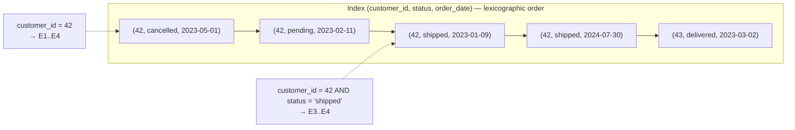

## Introduction

Real queries filter on more than one column: *orders of customer 42 that are still pending*, *cancelled orders in the first quarter*, *the latest 20 orders of a tenant*. You could create one index per column — but MySQL usually uses **one index per table access**, so three single-column indexes rarely add up to one good plan. The professional tool is the **composite (multi-column) index**, and the single most important thing to understand about it is that **column order matters**.

This lesson covers:

- Creating indexes (`CREATE INDEX`, `ALTER TABLE … ADD INDEX`) and **UNIQUE** indexes as constraints.
- How a composite index is sorted, and the **leftmost-prefix rule** that follows from it — demonstrated with `EXPLAIN`'s `key_len` column, which tells you exactly how many bytes of the index a query uses.
- Why **equality columns go before range columns**, measured with `EXPLAIN ANALYZE`.
- **Index merge**: when MySQL *does* combine several single-column indexes, and why a composite index is usually better.
- **Invisible indexes** (MySQL 8.0+): how to "drop" an index for the optimizer without dropping it from disk.

:::note[Lab data]
The lab generates the 200,000-row `orders_big` table used throughout this module. All plans shown were captured on a real server; the optimizer's choices depend on statistics, so **your plan may differ in row estimates and occasionally in choice**. Compare `key`, `key_len` and the iterator descriptions, which are much more stable.
:::

## DBMS Theory

:::theory[Composite keys and lexicographic order]
A composite index on (A, B, C) is a B+ tree whose search key is the **tuple** (A, B, C), ordered **lexicographically**: entries are sorted by A; entries with equal A are sorted by B; entries with equal (A, B) are sorted by C — exactly like words in a dictionary are sorted by first letter, then second letter, and so on.

Consequences:

1. Entries sharing a value of A form one **contiguous run**; within it, entries sharing B form a contiguous sub-run, and so on.
2. A predicate that fixes a **prefix** of the key — A, or (A, B), or (A, B, C) — selects one contiguous interval of the index. It can be found with one descent and read sequentially.
3. A predicate on B alone selects entries scattered across every A-run. There is no single interval to descend to.
4. After a **range** condition on a column, the following columns are no longer sorted across the whole interval (B is sorted only *within* each distinct A), so they cannot narrow the interval further.
:::

This is the **leftmost-prefix rule**: a composite index can be used to *locate* rows for any query that constrains a leftmost prefix of its columns, using equality on all prefix columns except possibly the last, which may be a range.

| Predicate on index (A, B, C) | Contiguous interval? | Columns that narrow the search |
|---|---|---|
| `A = 1` | yes | A |
| `A = 1 AND B = 2` | yes | A, B |
| `A = 1 AND B = 2 AND C > 5` | yes | A, B, C |
| `A = 1 AND C = 3` | yes for A; C cannot narrow (B is skipped) | A (C can still be checked on index entries) |
| `B = 2` | no | none (unless *skip scan*, see Access Paths) |
| `A > 1 AND B = 2` | yes for the A-range; B cannot narrow it | A |

A **unique index** adds a constraint to the structure: no two entries may have equal keys. In the relational model, this is how candidate keys (Module 1) are enforced physically. Under SQL's NULL semantics, NULL is not equal to anything, so a unique index permits **multiple NULLs** — standard behaviour that MySQL follows.

## Why It Exists

Without composite indexes the optimizer must pick the single most selective index and filter the remaining conditions row by row after fetching each row. Consider *pending orders of customer 42*: an index on `customer_id` finds the customer's 10 orders and fetches all 10 rows to check `status`; an index on `status` finds 20,000 pending orders. A composite `(customer_id, status)` index finds exactly the matching entries.

The benefits multiply:

- **Fewer rows examined** — every condition on a prefix column narrows the interval before any row is fetched.
- **Sorting for free** — `WHERE customer_id = 42 ORDER BY order_date` is already in order in an index on `(customer_id, order_date)`.
- **Covering** — the more columns an index contains, the more queries it can answer without touching the table (next lesson).
- **Fewer indexes overall** — an index on (A, B) also serves queries on A alone, so a separate index on A is redundant.

What goes wrong when you get the order wrong: the index exists, appears in `possible_keys`, may even be chosen — and still scans far more entries than necessary, as you will measure below.

## Internal Working

:::internals[How MySQL uses a composite index]
- **Building ranges.** The range optimizer walks the index columns left to right. For each column it can use **equality** (`=`, `<=>`, `IN`, `IS NULL`), it extends the search key and continues to the next column. When it meets a **range** (`<`, `>`, `BETWEEN`, `LIKE 'abc%'`), it uses that column and **stops considering further columns for narrowing the interval**. The 8.4 manual states this rule for multiple-part indexes.
- **key_len** in EXPLAIN reports the length in bytes of the index prefix used to build the lookup/range keys. Each key part contributes its storage size: `INT` 4, `BIGINT` 8, `DATE` 3, `DATETIME` 5 (+ fractional seconds), `CHAR(n)`/`VARCHAR(n)` = *n × max bytes per character* (4 for `utf8mb4`), plus **2** bytes for a `VARCHAR` length prefix, plus **1** byte if the column is nullable.
- **Index condition pushdown (ICP).** Conditions on index columns that cannot narrow the interval (e.g. C when B is skipped) can still be evaluated **on the index entry** before the row is fetched — EXPLAIN shows `Using index condition`. That saves bookmark lookups but not index reads.
- **Uniqueness checks.** On insert into a `UNIQUE` index, InnoDB must check for an existing equal key, which requires reading the target leaf page (and taking locks). This is why unique secondary indexes cannot use change buffering, and why they cost slightly more on writes than non-unique ones.
- **Index merge.** For conditions on *different* indexes, the optimizer may scan several indexes and combine the row IDs: **intersection** for AND, **union** for OR (on equality conditions), **sort-union** for OR of ranges.
:::



## MySQL Implementation

Generate the data, then create a three-column index. The generator is the module's usual `orders_big` shape — about 20,000 customers with roughly 10 orders each, four skewed statuses (5% cancelled, 10% pending, 65% shipped, 20% delivered), two years of dates and seven countries — with moduli chosen so that customer, status, date and country are not accidentally correlated:

```sql run
SET SESSION cte_max_recursion_depth = 300000;
CREATE TABLE orders_big (
  order_id    INT UNSIGNED  NOT NULL,
  customer_id INT UNSIGNED  NOT NULL,
  status      VARCHAR(10)   NOT NULL,
  order_date  DATE          NOT NULL,
  amount      DECIMAL(10,2) NOT NULL,
  country     CHAR(2)       NOT NULL,
  PRIMARY KEY (order_id)
) ENGINE=InnoDB;
INSERT INTO orders_big
WITH RECURSIVE seq(n) AS (SELECT 1 UNION ALL SELECT n + 1 FROM seq WHERE n < 200000)
SELECT n,
       1 + (n * 7919) % 19997,
       ELT(1 + (n % 20 > 0) + (n % 20 > 2) + (n % 20 > 15), 'cancelled', 'pending', 'shipped', 'delivered'),
       DATE '2023-01-01' + INTERVAL (n * 37) % 731 DAY,
       ROUND(5 + (n * 104729 % 99500) / 100, 2),
       ELT(1 + n % 7, 'US', 'IN', 'DE', 'BR', 'JP', 'FR', 'MX')
FROM seq;
CREATE INDEX idx_cust_status_date ON orders_big (customer_id, status, order_date);
ANALYZE TABLE orders_big;
```

The key parts' byte lengths, by the rules in Internal Working: `customer_id INT NOT NULL` = **4**, `status VARCHAR(10) utf8mb4 NOT NULL` = 10 × 4 + 2 = **42**, `order_date DATE NOT NULL` = **3**. So the possible `key_len` values are 4 (first column), 46 (first two) and 49 (all three). Now watch `key_len` grow as the predicate fixes a longer prefix:

```sql run
EXPLAIN SELECT * FROM orders_big WHERE customer_id = 4242;
EXPLAIN SELECT * FROM orders_big WHERE customer_id = 4242 AND status = 'shipped';
EXPLAIN SELECT * FROM orders_big WHERE customer_id = 4242 AND status = 'shipped' AND order_date >= '2024-01-01';
```

`key_len` 4 → 46 → 49: one, two, then three key parts used. In the first two, `ref` lists one and then two `const` values — one per equality key part. The third is a `range` because its last part is an inequality.

**Skip the middle column** and only the first part locates rows:

```sql run
EXPLAIN SELECT * FROM orders_big WHERE customer_id = 4242 AND order_date >= '2024-01-01';
```

`key_len = 4`: `status` is not constrained, so `order_date` cannot narrow the interval. The `Using index condition` in `Extra` shows that MySQL still checks `order_date` on the index entries (ICP) before fetching rows — it reads all 10 entries for the customer but fetches only the matching rows. `filtered` reflects the estimated fraction surviving the date condition.

**Omit the first column** and the index cannot locate anything:

```sql run
EXPLAIN SELECT * FROM orders_big WHERE status = 'shipped' AND order_date = '2024-01-01';
```

`possible_keys` is `NULL` and the plan is a full scan: there is no contiguous interval of `(customer_id, status, order_date)` holding these rows.

## Syntax Breakdown

```sql
CREATE [UNIQUE] INDEX idx_name ON tbl (col1 [ASC|DESC], col2 [ASC|DESC], ...)
       [INVISIBLE | VISIBLE] [COMMENT '...'];
ALTER TABLE tbl ADD [UNIQUE] INDEX idx_name (col1, col2, ...);
ALTER TABLE tbl ALTER INDEX idx_name INVISIBLE;     -- or VISIBLE
ALTER TABLE tbl RENAME INDEX old_name TO new_name;
DROP INDEX idx_name ON tbl;
```

| Element | Meaning |
|---|---|
| Column list order | Defines lexicographic sort order and therefore which predicates the index serves. MySQL allows up to 16 key parts per index (InnoDB's maximum key length is 3072 bytes for DYNAMIC/COMPRESSED row formats). |
| `UNIQUE` | Rejects a second row with an equal non-NULL key (error 1062 `ER_DUP_ENTRY`). If any key column is NULL, the row never conflicts. |
| `INVISIBLE` / `VISIBLE` | Invisible indexes are maintained on every write but ignored by the optimizer (unless `optimizer_switch='use_invisible_indexes=on'`). A primary key cannot be invisible. |
| `RENAME INDEX` | Metadata-only change; useful to apply naming conventions. |
| `key_len` | EXPLAIN column: bytes of the index key used. Sum of key-part sizes (+2 for VARCHAR, +1 if nullable). |
| `Using intersect(…)`, `Using union(…)`, `Using sort_union(…)` | EXPLAIN `Extra` for index-merge strategies; `type = index_merge`. |

:::standard[Standard SQL vs MySQL]
`UNIQUE` and `PRIMARY KEY` constraints are standard; `CREATE INDEX`, invisible indexes and `key_len` are MySQL features. Multiple NULLs in a unique column are allowed by the SQL standard and by MySQL; SQL Server historically allowed only one NULL in a unique index — a portability trap. (PostgreSQL 15+ offers `NULLS NOT DISTINCT` to forbid duplicates of NULL; MySQL has no equivalent option.)
:::

## Practical Examples

**1. UNIQUE indexes enforce business rules.** Each customer may have only one *default* address per type; emails must be unique:

```sql run
CREATE TABLE app_users (
  user_id  INT UNSIGNED NOT NULL AUTO_INCREMENT PRIMARY KEY,
  email    VARCHAR(100) NOT NULL,
  phone    VARCHAR(20)  NULL,
  UNIQUE KEY uq_app_users_email (email),
  UNIQUE KEY uq_app_users_phone (phone)
);
INSERT INTO app_users (email, phone) VALUES
  ('ana@example.com', NULL), ('ben@example.com', NULL), ('caro@example.com', '555-0100');
SELECT * FROM app_users ORDER BY user_id;
```

Two users have a NULL phone — allowed, because NULLs never conflict. A duplicate email is rejected:

```sql run error
INSERT INTO app_users (email, phone) VALUES ('ANA@example.com', '555-0199');
```

Note that the duplicate was spelled `'ANA@example.com'`: the column uses the default case-insensitive collation (`utf8mb4_0900_ai_ci`), so the unique index compares case-insensitively. Uniqueness follows the **collation**, not the bytes.

**2. Composite UNIQUE: one review per (product, customer).**

```sql run
CREATE TABLE product_reviews (
  review_id   INT UNSIGNED NOT NULL AUTO_INCREMENT PRIMARY KEY,
  product_id  INT UNSIGNED NOT NULL,
  customer_id INT UNSIGNED NOT NULL,
  rating      TINYINT NOT NULL,
  UNIQUE KEY uq_review_product_customer (product_id, customer_id)
);
INSERT INTO product_reviews (product_id, customer_id, rating) VALUES (1, 10, 5), (1, 11, 4), (2, 10, 3);
EXPLAIN SELECT rating FROM product_reviews WHERE product_id = 1 AND customer_id = 10;
EXPLAIN SELECT customer_id FROM product_reviews WHERE product_id = 1;
```

With the full key fixed, the unique index guarantees at most one row: `type = const`. With only the leftmost column fixed it is an ordinary `ref` lookup — the same index serves "all reviews of a product".

**3. Equality before range — measured.** The analysts' query: *cancelled orders in Q1 2024*. Two candidate indexes contain the same columns in opposite order. `FORCE INDEX` makes MySQL use each one so the plans can be compared (index hints are covered in [How the MySQL Optimizer Chooses Plans](/lessons/m07-optimizer-decisions)):

```sql run
ALTER TABLE orders_big
  ADD INDEX idx_date_status (order_date, status),
  ADD INDEX idx_status_date (status, order_date);
ANALYZE TABLE orders_big;
EXPLAIN SELECT COUNT(*) FROM orders_big FORCE INDEX (idx_date_status)
WHERE status = 'cancelled' AND order_date BETWEEN '2024-01-01' AND '2024-03-31';
EXPLAIN SELECT COUNT(*) FROM orders_big FORCE INDEX (idx_status_date)
WHERE status = 'cancelled' AND order_date BETWEEN '2024-01-01' AND '2024-03-31';
```

Look at `key_len` and `rows`. Both plans show `key_len = 45` (3 + 42): MySQL builds range endpoints from both key parts in each case. But `key_len` only says which parts appear in the range *endpoints*, not how effectively the interval is narrowed — the `rows` estimates differ by more than an order of magnitude. `EXPLAIN ANALYZE` shows the truth:

```sql run measured
EXPLAIN ANALYZE SELECT COUNT(*) FROM orders_big FORCE INDEX (idx_date_status)
WHERE status = 'cancelled' AND order_date BETWEEN '2024-01-01' AND '2024-03-31';
EXPLAIN ANALYZE SELECT COUNT(*) FROM orders_big FORCE INDEX (idx_status_date)
WHERE status = 'cancelled' AND order_date BETWEEN '2024-01-01' AND '2024-03-31';
```

With `(order_date, status)` the range scan reads **every entry of the quarter** — all statuses — and the Filter above it discards most of them: in the capture the index range scan produced 24,640 entries for 1,244 matching rows. With `(status, order_date)` the scan reads **only** the cancelled entries of the quarter: the range scan and the result are the same 1,244 rows. The difference is exactly the leftmost-prefix theory: with the range column first, `status` cannot narrow the interval.

**4. Index merge — combining single-column indexes.** Add single-column indexes and query with OR and AND:

```sql run
ALTER TABLE orders_big
  DROP INDEX idx_date_status,
  ADD INDEX idx_customer (customer_id),
  ADD INDEX idx_country (country),
  ADD INDEX idx_status (status);
ANALYZE TABLE orders_big;
EXPLAIN SELECT * FROM orders_big WHERE customer_id = 42 OR status = 'cancelled';
EXPLAIN SELECT order_id FROM orders_big WHERE country = 'JP' AND status = 'cancelled';
```

The OR query uses `index_merge` with a **union** of two index scans (the alternative would be a full scan — a single index cannot serve `A = x OR B = y`). The AND query may use an **intersection** of `idx_status` and `idx_country`: each index produces a sorted list of primary keys, and MySQL keeps only the IDs present in both. Whether the optimizer picks intersection depends on cost estimates — on your server it may choose a single index instead. A composite index `(status, country)` would answer the AND query with one contiguous range; intersection is a sign that such an index might be missing.

**5. Invisible indexes — test before you drop.** `idx_customer` is now redundant: `idx_cust_status_date` starts with `customer_id`. Before dropping it in production, make it invisible and check that plans remain good:

```sql run
ALTER TABLE orders_big ALTER INDEX idx_customer INVISIBLE;
EXPLAIN SELECT * FROM orders_big WHERE customer_id = 4242;
SELECT INDEX_NAME, IS_VISIBLE
FROM information_schema.STATISTICS
WHERE TABLE_SCHEMA = DATABASE() AND TABLE_NAME = 'orders_big' AND SEQ_IN_INDEX = 1
ORDER BY INDEX_NAME;
```

The optimizer switched to `idx_cust_status_date` (same `key_len = 4`, same rows) — dropping `idx_customer` is safe for this query. If something had regressed, `ALTER INDEX … VISIBLE` restores it instantly, with no rebuild. A session can still test with the invisible index:

```sql run
SET SESSION optimizer_switch = 'use_invisible_indexes=on';
EXPLAIN SELECT * FROM orders_big WHERE customer_id = 4242;
SET SESSION optimizer_switch = 'use_invisible_indexes=off';
```

The primary key cannot be made invisible:

```sql run error
ALTER TABLE orders_big ALTER INDEX `PRIMARY` INVISIBLE;
```

## Execution Walkthrough

Trace how the range optimizer turns a predicate into an interval of `idx_cust_status_date`, for a customer's shipped orders since 2024.

```walkthrough
title: WHERE customer_id = 4242 AND status = 'shipped' AND order_date >= '2024-01-01'
steps:
  - title: "1. The index entries of this customer"
    explain: >-
      customer_id = 4242 is an equality on the first key part, so all of the customer's entries form one contiguous run,
      sorted by status and then order_date. This covered query lists them in index order.
    sql: |
      SELECT customer_id, status, order_date, order_id
      FROM orders_big FORCE INDEX (idx_cust_status_date)
      WHERE customer_id = 4242
      ORDER BY customer_id, status, order_date;
  - title: "2. Extend with the second key part"
    explain: >-
      status = 'shipped' is also an equality, so the search key extends to (4242, 'shipped') — a sub-run inside the
      customer's run. key_len would now be 46.
    sql: |
      SELECT customer_id, status, order_date, order_id
      FROM orders_big FORCE INDEX (idx_cust_status_date)
      WHERE customer_id = 4242 AND status = 'shipped'
      ORDER BY order_date;
  - title: "3. The range on the third key part"
    explain: >-
      order_date >= '2024-01-01' is a range on the next key part. The interval becomes
      (4242, 'shipped', 2024-01-01) … (4242, 'shipped', +∞). One descent finds the start; the scan stops at the end of the sub-run.
      No further key part exists, and none could be used after a range anyway.
    sql: EXPLAIN FORMAT=TREE SELECT * FROM orders_big WHERE customer_id = 4242 AND status = 'shipped' AND order_date >= '2024-01-01';
  - title: "4. Fetch the rows"
    explain: >-
      For each entry in the interval, InnoDB follows the primary key into the clustered index to fetch the remaining
      columns (amount, country). Every fetched row already satisfies the whole predicate.
    sql: |
      SELECT * FROM orders_big
      WHERE customer_id = 4242 AND status = 'shipped' AND order_date >= '2024-01-01'
      ORDER BY order_id;
```

## Output

The captured `key_len` sequence is the cleanest evidence of the leftmost-prefix rule:

| Predicate | type | key_len | Key parts used to locate rows |
|---|---|---|---|
| `customer_id = ?` | ref | 4 | customer_id |
| `customer_id = ? AND status = ?` | ref | 46 | customer_id, status |
| `… AND order_date >= ?` | range | 49 | all three |
| `customer_id = ? AND order_date >= ?` | ref | 4 | customer_id (order_date checked by ICP) |
| `status = ? AND order_date = ?` | ALL | — | none |

And the equality-before-range comparison shows why `key_len` alone is not enough: both orderings reported `key_len = 45`, but `EXPLAIN ANALYZE` showed one index range scan producing roughly twenty times more entries than the other for the same result. Always confirm with **rows examined**.

## Alternative Approaches

| Approach | When it fits | Drawback |
|---|---|---|
| **One composite index** matching the query's equality columns then range/sort column | Frequent, well-known query shapes | Serves only predicates on its leftmost prefixes |
| **Several single-column indexes** + index merge | Ad-hoc filters on arbitrary combinations; OR conditions across columns | Merge reads several indexes fully for their ranges; usually slower than a matching composite |
| **Rewrite OR as UNION** | `A = x OR B = y` where each branch has its own good index | More SQL; `UNION` (distinct) needs deduplication, `UNION ALL` needs care with overlap |
| **Skip scan** (8.0.13+) | First column has few distinct values, query constrains later columns | Restricted conditions (covered single-table queries); see Access Paths |
| **Generated column + index** | The predicate is on an expression | Next lesson (functional indexes) |
| **Search engine / OLAP store** | Users filter on any of 20 columns | Separate system |

A useful design heuristic: for each important query, order columns as **equality columns first** (in any order among themselves — often most selective first, or ordered to maximize reuse by other queries), then **one range or ORDER BY column**, then optionally extra columns to make the index covering.

## Performance Analysis

**Rows examined vs rows returned** is the metric. In Practical Example 3 the wrong column order examined about twenty times more index entries for the same answer. On 200,000 rows that is a few milliseconds (measured on the build machine); on 2 billion rows it is the difference between an interactive query and a timeout.

**key_len is necessary but not sufficient.** It shows which key parts appear in the lookup key. For `ref` lookups (pure equalities) it maps directly to narrowing. For `range`, MySQL may include later key parts in the range *endpoints* even when a preceding range prevents them from narrowing the scan — as both orderings did. Read `rows` (estimated) and `EXPLAIN ANALYZE` (actual) alongside it.

**Index merge cost.** Intersection reads two (or more) index ranges completely and merges sorted row-ID streams; union does the same and deduplicates; sort-union additionally sorts row IDs. They avoid a full scan but typically examine more entries than one well-ordered composite index.

**Write cost.** Each composite index is one B+ tree; a 3-column index costs one tree maintenance per insert, like a 1-column index, though its entries are wider. Replacing three single-column indexes with one composite cuts write work. Redundant prefixes (an index on `(a)` when `(a, b)` exists) are pure write overhead — invisible indexes let you verify that before dropping.

:::performance[Plans depend on data]
Whether MySQL uses an index, merges indexes or scans depends on estimated row counts. Data distribution changes over time; a plan captured here (or in your staging environment) is evidence about *that* data. Re-check important plans after large data changes and after upgrades.
:::

## Best Practices

:::best-practice[Composite and unique index design]
1. **Design from queries.** For each important query: equality columns → one range/sort column → (optional) covering columns.
2. **Prefer one composite index over several single-column ones** for frequent multi-column predicates. Seeing `index_merge` in a hot query's plan is a hint to consider a composite index.
3. **Eliminate redundant prefixes.** If `(a, b)` exists, `(a)` is usually redundant (exception: when the narrower index makes a frequent query covered and much cheaper). Use invisible indexes to test before dropping.
4. **Use UNIQUE for every real business key** (emails, external IDs, one-row-per-pair rules). It is both a constraint and an index — never enforce uniqueness only in application code (race conditions).
5. **Mind collations in unique keys.** Case- and accent-insensitive collations treat 'a', 'A' and 'á' as equal for uniqueness. Choose the collation deliberately.
6. **Check key_len and rows together**, and confirm with `EXPLAIN ANALYZE` for important queries.
7. **Keep indexes narrow enough.** Very wide composite indexes reduce fan-out and cost space; add columns only for a measured benefit.
:::

## Common Mistakes

**Mistake 1 — expecting an index to serve a non-leftmost column.** Developers add `(customer_id, status, order_date)` and expect `WHERE status = 'shipped'` to use it. The captured plan for `status = … AND order_date = …` was a full scan with `possible_keys = NULL`. Either add an index that starts with `status`, or rely on skip scan in the narrow cases where it applies.

**Mistake 2 — putting the range column first.** Example 3 measured the cost: `(order_date, status)` examined about twenty times more entries than `(status, order_date)`.

**Mistake 3 — adding a UNIQUE index to a column that already has duplicates.** The statement fails, and in production a failed `ALTER TABLE` after an hour of work is costly. Check first:

```sql run
CREATE TABLE subscribers (id INT PRIMARY KEY, email VARCHAR(100) NOT NULL);
INSERT INTO subscribers VALUES (1, 'x@example.com'), (2, 'y@example.com'), (3, 'X@example.com');
SELECT email, COUNT(*) AS copies FROM subscribers GROUP BY email HAVING COUNT(*) > 1;
```

```sql run error
ALTER TABLE subscribers ADD UNIQUE KEY uq_subscribers_email (email);
```

The duplicate check query (with the column's own collation) finds the collision first; clean the data, then add the constraint.

**Mistake 4 — one index per column "to be safe".** Index merge may combine them for some queries, but every insert pays for every index, and plans are rarely as good as with a well-chosen composite.

**Mistake 5 — dropping an index without testing.** Some rarely run but critical query (a month-end report, a foreign-key check) may depend on it. Make it **invisible** first, watch for regressions for a full business cycle, then drop it. (Note: an index needed by a foreign key constraint cannot be dropped, or made redundant, without providing another index that starts with the FK columns.)

## Industry Application

- **Index reviews in code review.** New queries come with an `EXPLAIN`; reviewers check that the index columns follow equality → range → sort, and that `key_len` matches the intended prefix.
- **Multi-tenant schemas** put `tenant_id` first in nearly every composite index, because nearly every query starts with `WHERE tenant_id = ?`.
- **Safe index removal** at scale uses invisible indexes (MySQL 8.0+): flip to invisible, monitor slow-query logs and `performance_schema` for a week, then drop. Tools like `sys.schema_redundant_indexes` and `sys.schema_unused_indexes` (later in this module) find candidates.
- **Data integrity**: unique indexes on natural keys (email, external order ID, idempotency key) are the database-level guard against duplicate submissions from retries — a pattern used in payment systems for idempotent APIs.
- **Search screens** with many optional filters are a known weak spot for B-tree indexing; teams pick a few composite indexes for the most common filter combinations and push the long tail to a search engine.

## Practice Exercises

```exercise
id: ex1
title: Index for a customer's order history
difficulty: easy
kind: dml
concepts: [composite-index, create-index]
setup: |
  SET SESSION cte_max_recursion_depth = 100000;
  CREATE TABLE orders_x (
    order_id INT UNSIGNED PRIMARY KEY, customer_id INT UNSIGNED NOT NULL,
    order_date DATE NOT NULL, total DECIMAL(10,2) NOT NULL
  );
  INSERT INTO orders_x
  WITH RECURSIVE s(n) AS (SELECT 1 UNION ALL SELECT n + 1 FROM s WHERE n < 30000)
  SELECT n, 1 + n % 3000, DATE '2024-01-01' + INTERVAL n % 366 DAY, n % 900 FROM s;
prompt: |
  The order-history page runs
  `SELECT * FROM orders_x WHERE customer_id = ? ORDER BY order_date DESC LIMIT 20`.
  Create **one** index named `idx_orders_x_customer_date` that lets MySQL find the customer's rows *and* return them
  in date order without a filesort.
hints:
  - "The equality column comes first, then the column used for ORDER BY."
  - "CREATE INDEX idx_orders_x_customer_date ON orders_x (customer_id, order_date);"
solution: |
  CREATE INDEX idx_orders_x_customer_date ON orders_x (customer_id, order_date);
check: |
  SELECT INDEX_NAME, SEQ_IN_INDEX, COLUMN_NAME
  FROM information_schema.STATISTICS
  WHERE TABLE_SCHEMA = DATABASE() AND TABLE_NAME = 'orders_x' AND INDEX_NAME <> 'PRIMARY'
  ORDER BY INDEX_NAME, SEQ_IN_INDEX;
explanation: |
  Within the run of entries for one customer, entries are sorted by order_date, so MySQL reads the run backwards
  (Backward index scan) and stops after 20 rows. `(order_date, customer_id)` would not help: the customer's entries
  would be scattered over the whole index. A descending key part `(customer_id, order_date DESC)` also works.
```

```exercise
id: ex2
title: Which predicates can use the index?
difficulty: medium
kind: open
concepts: [leftmost-prefix, key-len]
prompt: |
  Table `t` has `a INT NOT NULL`, `b CHAR(4) CHARACTER SET ascii NULL`, `c DATE NOT NULL` and an index
  `idx_abc (a, b, c)`. For each predicate, state whether the index can locate rows, which key parts narrow the
  search, and the `key_len` you expect:

  1. `a = 1`
  2. `a = 1 AND b = 'XY'`
  3. `a = 1 AND b = 'XY' AND c > '2024-01-01'`
  4. `b = 'XY' AND c = '2024-01-01'`
  5. `a > 10 AND b = 'XY'`
  6. `a = 1 AND c = '2024-01-01'`
solution: |
  Key-part sizes: a = 4; b = CHAR(4) ascii = 4 bytes + 1 byte NULL flag = 5; c = DATE 3.

  1. Yes, a → key_len 4 (ref).
  2. Yes, a and b → 4 + 5 = 9 (ref).
  3. Yes, a, b and range on c → 9 + 3 = 12 (range).
  4. No leftmost column → the index cannot locate rows by range/ref (a full index scan or skip scan is possible
     only in special cases).
  5. Range on a; b cannot narrow after a range. MySQL may still report key_len 9 if it puts b into the range
     endpoints, but only `a > 10` narrows the scan; b can be checked via index condition pushdown.
  6. a narrows (key_len 4); c cannot narrow because b is skipped, but can be checked by ICP (Using index condition).
explanation: |
  Remember the extra byte for nullable columns and the +2 for VARCHAR (not CHAR). For ranges, key_len shows which parts
  appear in range endpoints, not necessarily how much they narrow — confirm with rows/EXPLAIN ANALYZE.
```

```exercise
id: ex3
title: Clean duplicates, then enforce uniqueness
difficulty: medium
kind: dml
concepts: [unique-index]
setup: |
  CREATE TABLE newsletter (
    id INT UNSIGNED PRIMARY KEY,
    email VARCHAR(100) NOT NULL,
    joined DATE NOT NULL
  );
  INSERT INTO newsletter VALUES
    (1, 'a@x.com', '2024-01-01'), (2, 'b@x.com', '2024-01-02'), (3, 'A@x.com', '2024-02-01'),
    (4, 'c@x.com', '2024-02-03'), (5, 'b@x.com', '2024-03-01'), (6, 'd@x.com', '2024-03-02');
prompt: |
  Add a unique index named `uq_newsletter_email` on `email`. The table already contains duplicates (under the
  column's case-insensitive collation). First delete duplicates, **keeping the row with the smallest `id`** for each
  email, then add the index.
hints:
  - "Find duplicates with GROUP BY email HAVING COUNT(*) > 1 — 'a@x.com' and 'A@x.com' are equal under the default collation."
  - "A self-join DELETE works: DELETE n1 FROM newsletter n1 JOIN newsletter n2 ON n1.email = n2.email AND n1.id > n2.id;"
solution: |
  DELETE n1 FROM newsletter n1
  JOIN newsletter n2 ON n1.email = n2.email AND n1.id > n2.id;
  ALTER TABLE newsletter ADD UNIQUE KEY uq_newsletter_email (email);
check: |
  SELECT n.id, n.email,
         (SELECT COUNT(*) FROM information_schema.STATISTICS s
          WHERE s.TABLE_SCHEMA = DATABASE() AND s.TABLE_NAME = 'newsletter'
            AND s.INDEX_NAME = 'uq_newsletter_email' AND s.NON_UNIQUE = 0) AS has_unique_index
  FROM newsletter n ORDER BY n.id;
explanation: |
  The self-join deletes every row for which a row with the same email (by collation) and a smaller id exists, leaving
  ids 1, 2, 4 and 6. Adding the unique index first fails with error 1062. Comparing with `BINARY email` would miss the
  'a@x.com'/'A@x.com' pair and the ALTER would still fail.
```

```exercise
id: ex4
title: Equality before range
difficulty: hard
kind: dml
concepts: [equality-before-range, composite-index]
setup: |
  SET SESSION cte_max_recursion_depth = 100000;
  CREATE TABLE events (
    event_id INT UNSIGNED PRIMARY KEY,
    tenant_id SMALLINT UNSIGNED NOT NULL,
    created DATE NOT NULL,
    kind VARCHAR(10) NOT NULL,
    INDEX idx_events_created_tenant (created, tenant_id)
  );
  INSERT INTO events
  WITH RECURSIVE s(n) AS (SELECT 1 UNION ALL SELECT n + 1 FROM s WHERE n < 50000)
  SELECT n, n % 50, DATE '2024-01-01' + INTERVAL n % 365 DAY, ELT(1 + n % 3, 'view', 'click', 'buy') FROM s;
prompt: |
  The hot query is `SELECT COUNT(*) FROM events WHERE tenant_id = ? AND created BETWEEN ? AND ?`.
  The existing index `idx_events_created_tenant` has the columns in the wrong order. Replace it (same name is **not**
  required) with an index named `idx_events_tenant_created` whose column order makes `tenant_id` narrow the scan,
  and drop the old index. End with exactly one secondary index.
hints:
  - "Equality column first, range column second."
  - "One ALTER TABLE can DROP INDEX … and ADD INDEX … together."
solution: |
  ALTER TABLE events
    DROP INDEX idx_events_created_tenant,
    ADD INDEX idx_events_tenant_created (tenant_id, created);
check: |
  SELECT INDEX_NAME, SEQ_IN_INDEX, COLUMN_NAME
  FROM information_schema.STATISTICS
  WHERE TABLE_SCHEMA = DATABASE() AND TABLE_NAME = 'events' AND INDEX_NAME <> 'PRIMARY'
  ORDER BY INDEX_NAME, SEQ_IN_INDEX;
explanation: |
  With (tenant_id, created) the interval is (t, start) … (t, end): only that tenant's entries in the date range are
  read. With (created, tenant_id) MySQL reads every tenant's entries in the date range — about 50 times more here —
  and filters by tenant. Doing both changes in one ALTER avoids a window with no suitable index.
```

```exercise
id: ex5
title: Consolidate an index set
difficulty: challenge
kind: open
concepts: [composite-index, leftmost-prefix, invisible-index, index-merge]
prompt: |
  Table `orders(order_id PK, customer_id, status, order_date, amount)` currently has these secondary indexes:
  `(customer_id)`, `(status)`, `(order_date)`, `(customer_id, order_date)`, `(status, customer_id)`.
  The workload is:

  - Q1 `WHERE customer_id = ? ORDER BY order_date DESC LIMIT 20` (very frequent)
  - Q2 `WHERE status = 'pending' AND order_date < NOW() - INTERVAL 1 DAY` (every minute)
  - Q3 `WHERE customer_id = ? AND status = ?` (frequent)
  - Q4 `WHERE order_date BETWEEN ? AND ?` (nightly report)

  Propose a minimal index set, justify each index with the leftmost-prefix and equality-before-range rules, list the
  indexes you would remove, and describe how you would remove them safely in production.
solution: |
  Proposed set:
  - **(customer_id, order_date)** — Q1: equality then ORDER BY column, backward scan with LIMIT. It also serves
    any `customer_id = ?` lookup, so `(customer_id)` is redundant.
  - **(status, order_date)** — Q2: equality on status then range on date. Replaces `(status)`.
  - **(order_date)** — Q4: range on date (keep; no other index starts with order_date). If Q4 needs few columns,
    consider making it covering.
  - Q3: `customer_id = ? AND status = ?` — `(customer_id, order_date)` narrows to the customer's ~N orders and can
    check status by ICP; if customers have many orders, `(customer_id, status)` or keeping `(status, customer_id)` is
    justified. Measure: for typical customers with tens of orders, the first index suffices.

  Remove: `(customer_id)` (redundant prefix), `(status)` (replaced by `(status, order_date)`), and probably
  `(status, customer_id)` (Q3 served adequately) → from five indexes to three, cheaper writes.

  Safe removal: make each candidate INVISIBLE (`ALTER TABLE orders ALTER INDEX … INVISIBLE`), monitor slow query log /
  performance_schema digests and key query plans for a full business cycle (including month-end jobs), then DROP.
  Re-enable instantly with VISIBLE if anything regresses. Check that foreign keys still have a supporting index.
explanation: |
  Good index sets are designed for the workload, avoid redundant leftmost prefixes, and are changed with evidence and
  a rollback path.
```

## Knowledge Assessment

```quiz
- id: q1
  question: "An index on (a, b, c) exists. Which WHERE clause lets MySQL use the index to narrow on **two** key parts?"
  options: ["b = 1 AND c = 2", "a = 1 AND c = 2", "a = 1 AND b > 5", "c = 2"]
  answer: 2
  explanation: "a = 1 fixes the first part; b > 5 is a range on the second. `a = 1 AND c = 2` narrows only on a (b is skipped; c can be checked by ICP). Predicates without `a` cannot locate an interval."
  concepts: [leftmost-prefix]
- id: q2
  question: "`status VARCHAR(10)` in utf8mb4, NOT NULL, is the second key part after an `INT NOT NULL`. EXPLAIN shows key_len = 46. What does that mean?"
  options:
    - "Only the INT column was used"
    - "Both key parts were used: 4 + (10 × 4 + 2) = 46"
    - "46 rows were read"
    - "The index is 46 bytes long in total"
  answer: 1
  explanation: "key_len counts bytes of the key prefix used. utf8mb4 reserves 4 bytes per character, plus 2 for the VARCHAR length. It is unrelated to rows read."
  concepts: [key-len]
- id: q3
  question: "For `WHERE status = 'cancelled' AND order_date BETWEEN '2024-01-01' AND '2024-03-31'`, which index is better and why?"
  options:
    - "(order_date, status), because dates are more selective"
    - "(status, order_date), because the equality column first makes the qualifying entries contiguous; after a range column, later columns cannot narrow the scan"
    - "Both are identical because they contain the same columns"
    - "Neither; MySQL cannot combine equality and range"
  answer: 1
  explanation: "The lab measured roughly 20× more entries examined with (order_date, status). Same columns ≠ same index: order defines the sort."
  concepts: [equality-before-range]
- id: q4
  question: "A UNIQUE index exists on nullable `phone`. Which statements are true in MySQL? (Select all that apply.)"
  type: multi
  options:
    - "Several rows may have phone = NULL"
    - "Two rows with the same non-NULL phone are rejected with error 1062"
    - "Uniqueness compares values using the column's collation"
    - "A UNIQUE index cannot be used for lookups"
  answer: [0, 1, 2]
  explanation: "NULL never equals NULL, so multiple NULLs are allowed. Duplicates under the collation raise ER_DUP_ENTRY (1062). Unique indexes are normal B+ trees usable for lookups (often giving const/eq_ref)."
  concepts: [unique-index]
- id: q5
  question: "EXPLAIN shows `type = index_merge`, `Extra = Using union(idx_customer, idx_status)`. What is MySQL doing?"
  options:
    - "Scanning both indexes for their conditions and combining the row IDs (for an OR), then fetching the rows"
    - "Joining two tables"
    - "Merging two indexes into one permanently"
    - "Using a composite index"
  answer: 0
  explanation: "Index merge union serves OR conditions over different indexes. It is a runtime strategy; nothing is changed on disk. A composite index would appear as a single key."
  concepts: [index-merge]
- id: q6
  question: "What happens when you run `ALTER TABLE t ALTER INDEX idx_x INVISIBLE`?"
  options:
    - "The index is dropped but can be recreated quickly"
    - "The optimizer ignores the index, but it is still maintained on every write and can be made visible instantly"
    - "Writes stop maintaining the index"
    - "Only the primary key can be made invisible"
  answer: 1
  explanation: "Invisible indexes are maintained (so writes still pay) but not used for plans, unless use_invisible_indexes=on in the session. The primary key cannot be invisible."
  concepts: [invisible-index]
- id: q7
  question: "Both (order_date, status) and (status, order_date) show key_len = 45 for the same range query, yet one examines 20× more entries. What is the lesson?"
  options:
    - "key_len is wrong in MySQL 8"
    - "For range access, key_len shows which key parts appear in the range endpoints, not how much they narrow the scan; check rows and EXPLAIN ANALYZE"
    - "The two indexes are physically identical"
    - "EXPLAIN ANALYZE is unreliable"
  answer: 1
  explanation: "After a range on the first key part, the second part cannot narrow the interval even if MySQL includes it in the endpoints. Actual rows in EXPLAIN ANALYZE expose the difference."
  concepts: [key-len, equality-before-range]
- id: q8
  question: "A table has indexes (customer_id) and (customer_id, order_date). What is usually true?"
  options:
    - "Both are required: one for equality and one for sorting"
    - "(customer_id) is redundant for most queries, since (customer_id, order_date) serves any predicate on customer_id"
    - "(customer_id, order_date) is redundant"
    - "MySQL will refuse to create the second one"
  answer: 1
  explanation: "A composite index serves its leftmost prefixes. The narrower index is redundant unless it makes some frequent query covered and measurably cheaper. Test with an invisible index before dropping."
  concepts: [leftmost-prefix, invisible-index]
```
