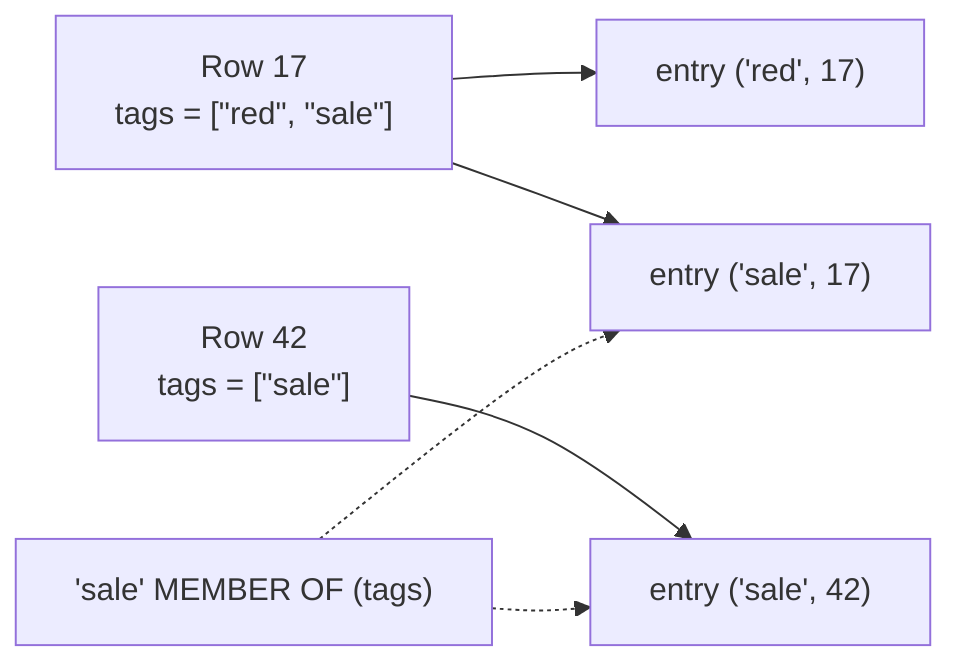

## Introduction

The previous lesson established the core rule of index design: column order decides which predicates an index can serve. This lesson adds five techniques that extend what an index can do — each solving a specific, common production problem:

| Technique | Problem it solves | Plan evidence |
|---|---|---|
| **Covering index** | A query matches many rows and each needs a bookmark lookup | `Extra: Using index`; *Covering index …* in the tree |
| **Prefix index** | Indexing long strings (URLs, emails, `TEXT`) is too large — or impossible | `key_len` = prefix length; never `Using index` |
| **Functional key part** (8.0.13+) | The predicate is on an expression (`YEAR(d)`, `JSON` path, `LOWER(x)`) | the expression index appears as `key` |
| **Descending index** (8.0+) | `ORDER BY a ASC, b DESC` needs a filesort | filesort disappears |
| **Multi-valued index** (8.0.17+) | Searching inside JSON arrays (`tags`, `roles`, `skills`) | `MEMBER OF` / `JSON_CONTAINS` / `JSON_OVERLAPS` use `ref`/`range` |

For each technique you will see the syntax, the captured plan before and after, and the trade-offs. Several of these are **MySQL-specific**; the standard SQL equivalents (or their absence) are noted as we go.

:::note[Lab data]
The lab generates the module's `orders_big` table (200,000 rows) plus a customer-email table and a JSON product table. All outputs are captured on a real server; plans depend on statistics and distribution, so **your plan may differ** in estimates.
:::

## DBMS Theory

:::theory[Index-only plans and index keys beyond plain columns]
**Index-only (covering) access.** If every attribute a query references — in `SELECT`, `WHERE`, `GROUP BY`, `ORDER BY`, join conditions — is present in the data entries of one index, the query can be evaluated from the index alone, without accessing the base records. In cost terms the plan touches only the (smaller) index pages, and for an unclustered index it eliminates one random record access per matching entry. Textbooks call this an **index-only plan**.

**Search keys need not be plain columns.** Formally an index maps a *search key function* f(t) of each tuple t to the tuple. Usually f is a projection on some attributes, but any deterministic function works:

- a **prefix** function f(t) = the first k characters of a string attribute — trading precision (several tuples share a key) for smaller entries;
- an arbitrary **expression** f(t) = g(attributes), called a *function-based* or *expression* index;
- a **set-valued** function that maps one tuple to *several* keys — e.g. every element of an array — giving an **inverted** structure in which one record has many index entries.

**Sort direction** is part of the key definition: an ordered index sorted by (A ascending, B descending) delivers tuples in exactly the order `ORDER BY A ASC, B DESC`, which neither (A, B) ascending nor its reverse scan can produce.
:::

These ideas are general; the SQL standard does not specify any of them (indexes are outside the standard). PostgreSQL, Oracle and SQL Server provide most of them with different syntax — e.g. PostgreSQL's `INCLUDE` columns for covering indexes, which MySQL does not have.

## Why It Exists

- **Covering indexes** exist because bookmark lookups are the dominant cost of secondary-index access for anything beyond a few rows (see [InnoDB Clustered and Secondary Indexes](/lessons/m07-clustered-secondary)). Removing them can turn a scan-or-thousands-of-lookups decision into a narrow index range read.
- **Prefix indexes** exist because InnoDB limits index key length (3,072 bytes with the default `DYNAMIC` row format) and because indexing a 255-character `utf8mb4` column means up to 1,022 bytes per entry. `TEXT`/`BLOB` columns *require* a prefix length for an ordinary index.
- **Functional key parts** exist because applications filter on expressions the index cannot see: `WHERE YEAR(order_date) = 2024`, `WHERE attrs->>'$.sku' = 'A-17'`, `WHERE LOWER(username) = 'ana'` on a case-sensitive collation. Before 8.0.13 the workaround was a generated column plus an index; functional key parts automate that.
- **Descending indexes** exist because mixed-direction sorts (newest first within each category, highest score with earliest timestamp as tie-breaker) cannot be served by an ascending index scanned in either direction. Before MySQL 8.0, `DESC` in an index definition was parsed and ignored.
- **Multi-valued indexes** exist because storing lists in JSON is common (tags, permissions, feature flags) and, without an index, every `JSON_CONTAINS` search scans and parses every document.

## Internal Working

:::internals[How InnoDB implements each technique]
- **Covering.** Nothing special is stored: a secondary leaf entry already contains the indexed columns plus the primary key. When the optimizer sees that all needed columns are among them, it reads the secondary B+ tree only. One subtlety: InnoDB secondary records carry no transaction ID; for rows recently changed by other transactions, InnoDB may still need to consult the clustered record to check visibility (MVCC), but in the steady state the index alone suffices.
- **Prefix key parts** store only the first *N* characters (bytes for binary types) of the value. Because the index entry is incomplete, MySQL must fetch the row to compare the full value — so a prefix index can **never cover** a query on that column and **cannot provide sort order** for the full column.
- **Functional key parts** are implemented as **hidden virtual generated columns**: `INDEX ((YEAR(order_date)))` creates a hidden column defined as `YEAR(order_date)` and indexes it. The optimizer uses the index only when the query contains the *same expression* (it matches expressions structurally). The expression must be deterministic; the key part's type is the expression's type.
- **Descending key parts** are stored in descending order inside the B+ tree. Since InnoDB pages on each level are doubly linked, both ascending and descending indexes can also be scanned backwards — what matters is whether the *combination* of directions in `ORDER BY` matches the index or its exact reverse.
- **Multi-valued indexes** are functional indexes over `CAST(json_expr AS type ARRAY)`: each array element becomes a separate index entry pointing to the same primary key. A row with 3 tags creates 3 entries; a row with an empty array creates none. They are used by `MEMBER OF()`, `JSON_CONTAINS()` and `JSON_OVERLAPS()` in `WHERE` clauses.
:::



## MySQL Implementation

Generate the lab table:

```sql run
SET SESSION cte_max_recursion_depth = 300000;
CREATE TABLE orders_big (
  order_id    INT UNSIGNED  NOT NULL,
  customer_id INT UNSIGNED  NOT NULL,
  status      VARCHAR(10)   NOT NULL,
  order_date  DATE          NOT NULL,
  amount      DECIMAL(10,2) NOT NULL,
  country     CHAR(2)       NOT NULL,
  PRIMARY KEY (order_id),
  INDEX idx_cust_date (customer_id, order_date)
) ENGINE=InnoDB;
INSERT INTO orders_big
WITH RECURSIVE seq(n) AS (SELECT 1 UNION ALL SELECT n + 1 FROM seq WHERE n < 200000)
SELECT n,
       1 + (n * 7919) % 19997,
       ELT(1 + (n % 20 > 0) + (n % 20 > 2) + (n % 20 > 15), 'cancelled', 'pending', 'shipped', 'delivered'),
       DATE '2023-01-01' + INTERVAL (n * 37) % 731 DAY,
       ROUND(5 + (n * 104729 % 99500) / 100, 2),
       ELT(1 + n % 7, 'US', 'IN', 'DE', 'BR', 'JP', 'FR', 'MX')
FROM seq;
ANALYZE TABLE orders_big;
```

### Covering indexes

A finance report sums the order amounts of a block of 3,000 customers — about 30,000 orders, 15% of the table:

```sql run
EXPLAIN SELECT SUM(amount) FROM orders_big WHERE customer_id BETWEEN 1 AND 3000;
```

`idx_cust_date` could locate the entries, but `amount` is not in it: every one of the ~30,000 entries would need a bookmark lookup. As in the previous lesson, the optimizer judges that too expensive and scans the whole table instead (`type = ALL`, `possible_keys` lists the unused index). Add `amount` to the index:

```sql run
CREATE INDEX idx_cust_date_amount ON orders_big (customer_id, order_date, amount);
EXPLAIN SELECT SUM(amount) FROM orders_big WHERE customer_id BETWEEN 1 AND 3000;
```

Now the plan is a `range` scan of the wider index with `Using index`: the whole query is answered from `idx_cust_date_amount`. Compare the actual execution (the first statement hides the new index to reproduce the old plan):

```sql run measured
EXPLAIN ANALYZE SELECT SUM(amount) FROM orders_big IGNORE INDEX (idx_cust_date_amount) WHERE customer_id BETWEEN 1 AND 3000;
EXPLAIN ANALYZE SELECT SUM(amount) FROM orders_big WHERE customer_id BETWEEN 1 AND 3000;
```

The uncovered plan reads all 200,000 rows of the clustered index (*Table scan*) and filters them; the covered plan reads only the ~30,000 entries in the range (*Covering index range scan*) from an index that is much narrower than the table. Rows examined is the robust evidence; the timings are measured on the build machine (where the covered plan was several times faster), and the gap grows when the table no longer fits in memory.

:::warning[A measurement surprise worth knowing]
While this lesson was being written, one capture ran while an unrelated session on the same server had left a transaction open for several minutes. In that run the covering index scan was *slower* than the table scan. The most likely reason is MVCC: InnoDB secondary-index records carry no transaction ID, so when a secondary page was modified more recently than the oldest snapshot still in use (and a freshly built index's pages always are), InnoDB must visit the clustered record to check visibility — the covering advantage disappears. Once the long transaction ended, the covered plan was consistently faster. Long-running transactions hurt more than purge; they can silently disable index-only reads. Repeat measurements, and check `information_schema.INNODB_TRX` when numbers look wrong.
:::

## Syntax Breakdown

```sql
-- Covering: just include the needed columns (no special keyword in MySQL)
CREATE INDEX idx ON t (filter_col, sort_col, extra_col);

-- Prefix key part: first N characters (or bytes for BINARY/BLOB)
CREATE INDEX idx ON t (email(12));

-- Functional key part (8.0.13+): expression in its own parentheses
CREATE INDEX idx ON t ((YEAR(order_date)));
CREATE INDEX idx ON t (customer_id, (CAST(attrs->>'$.sku' AS CHAR(20))));

-- Descending key part (honoured since 8.0)
CREATE INDEX idx ON t (country ASC, amount DESC);

-- Multi-valued index on a JSON array (8.0.17+)
CREATE INDEX idx ON t ((CAST(attrs->'$.tags' AS CHAR(20) ARRAY)));
```

| Element | Rules and limits |
|---|---|
| Covering columns | Order still matters for locating/sorting; columns only needed for output go at the end. MySQL has no `INCLUDE (…)` clause (PostgreSQL/SQL Server do). |
| `col(N)` prefix | Required for `TEXT`/`BLOB`. N counts characters for non-binary strings. `SHOW INDEX` reports it in `Sub_part`. Cannot cover; cannot satisfy `ORDER BY col`. |
| `((expr))` functional | Double parentheses distinguish an expression from a column list. Expression must be deterministic; no subqueries, parameters, variables or stored functions. Cannot be part of the PRIMARY KEY. `SHOW INDEX` shows it in `Expression`. |
| `ASC` / `DESC` | Per key part. Not supported for `HASH`, `FULLTEXT`, `SPATIAL` indexes. A plain index can be scanned backwards (*Backward index scan*); `DESC` is needed for **mixed** directions. |
| `CAST(… AS type ARRAY)` | Types: `CHAR(N)`, `BINARY(N)`, `SIGNED`/`UNSIGNED`, `DATE`, `TIME`, `DATETIME`, `DECIMAL(M,D)`, … Only one multi-valued key part per index; cannot be covering; used by `MEMBER OF`, `JSON_CONTAINS`, `JSON_OVERLAPS`. |

:::version[Version history of these features]
Descending indexes: MySQL 8.0 (5.7 ignored `DESC`). Functional key parts: 8.0.13. Multi-valued indexes: 8.0.17. All are available in 8.4 LTS with the same syntax. Index *skip scan*, which also helps some "wrong order" situations, arrived in 8.0.13 (see [Access Paths](/lessons/m07-access-paths)).
:::

## Practical Examples

### 1. Prefix indexes on long strings

Create a customer table with realistic emails:

```sql run
CREATE TABLE customers_big (
  customer_id INT UNSIGNED NOT NULL PRIMARY KEY,
  email       VARCHAR(100) NOT NULL
);
INSERT INTO customers_big
WITH RECURSIVE s(n) AS (SELECT 1 UNION ALL SELECT n + 1 FROM s WHERE n < 100000)
SELECT n,
       CONCAT(ELT(1 + n % 8, 'anna', 'ben', 'carlos', 'dmitri', 'emma', 'farah', 'george', 'hana'), '.',
              ELT(1 + (n DIV 8) % 10, 'smith', 'patel', 'garcia', 'kim', 'chen', 'nguyen', 'silva', 'mueller', 'rossi', 'tanaka'),
              n, '@', ELT(1 + n % 4, 'gmail.com', 'yahoo.com', 'outlook.com', 'sjsu.edu'))
FROM s;
SELECT email FROM customers_big ORDER BY customer_id LIMIT 3;
```

How long must the prefix be to distinguish the values? Measure the **selectivity** (distinct ÷ total) of several prefix lengths:

```sql run
SELECT ROUND(COUNT(DISTINCT LEFT(email, 4))  / COUNT(*), 4) AS sel_4,
       ROUND(COUNT(DISTINCT LEFT(email, 8))  / COUNT(*), 4) AS sel_8,
       ROUND(COUNT(DISTINCT LEFT(email, 12)) / COUNT(*), 4) AS sel_12,
       ROUND(COUNT(DISTINCT LEFT(email, 16)) / COUNT(*), 4) AS sel_16,
       ROUND(COUNT(DISTINCT LEFT(email, 20)) / COUNT(*), 4) AS sel_20,
       ROUND(COUNT(DISTINCT email)           / COUNT(*), 4) AS sel_full
FROM customers_big;
```

Short prefixes are nearly useless here (every address starts with one of eight first names). Around 16 characters the prefix distinguishes most rows; 20 is close to the full selectivity of 1.0. Create a 16-character prefix index and look at the plan:

```sql run
CREATE INDEX idx_email_16 ON customers_big (email(16));
ANALYZE TABLE customers_big;
EXPLAIN SELECT customer_id FROM customers_big WHERE email = 'ben.smith1@yahoo.com';
EXPLAIN SELECT email FROM customers_big ORDER BY email LIMIT 5;
```

The lookup uses the prefix (`key_len = 66` = 16 × 4 + 2) — but note `Using where` and **no** `Using index`, even though only `customer_id` (the PK) is selected: MySQL must read each candidate row to compare the full email. And `ORDER BY email` cannot use the prefix index at all: entries are ordered only by their first 16 characters.

### 2. Functional key parts

A monthly dashboard filters on `YEAR(order_date)`:

```sql run
EXPLAIN SELECT COUNT(*) FROM orders_big WHERE YEAR(order_date) = 2024;
```

The function hides `order_date` from the index: the best MySQL can do is a full scan of the narrowest index that contains `order_date` (`type = index` on `idx_cust_date`, `Using index`), evaluating `YEAR()` for all ~200,000 entries. A functional key part indexes the expression itself:

```sql run
CREATE INDEX idx_order_year ON orders_big ((YEAR(order_date)));
ANALYZE TABLE orders_big;
EXPLAIN SELECT COUNT(*) FROM orders_big WHERE YEAR(order_date) = 2024;
SELECT INDEX_NAME, COLUMN_NAME, EXPRESSION
FROM information_schema.STATISTICS
WHERE TABLE_SCHEMA = DATABASE() AND TABLE_NAME = 'orders_big' AND INDEX_NAME = 'idx_order_year';
```

`key = idx_order_year`, `type = ref`: the expression is now an indexed value. `information_schema.STATISTICS` shows `COLUMN_NAME = NULL` and the expression text — the hidden generated column is not a user-visible column. The optimizer matches the expression structurally, so a different spelling does not use the index — the plan falls back to the full index scan:

```sql run
EXPLAIN SELECT COUNT(*) FROM orders_big WHERE YEAR(order_date) + 0 = 2024;
```

:::best-practice[Prefer a SARGable rewrite when one exists]
For dates, `WHERE order_date >= '2024-01-01' AND order_date < '2025-01-01'` uses an ordinary index on `order_date` (or any index *starting* with it) and also serves other date ranges, while `idx_order_year` serves only whole-year predicates. Functional indexes are the right tool when **no equivalent predicate on the bare column exists** — JSON paths, case-insensitive matching on a case-sensitive column, computed values. See [SARGable Queries](/lessons/m07-sargable-queries).
:::

A typical legitimate case — indexing a scalar inside JSON. The `->>` operator returns a `LONGTEXT` value with the `utf8mb4_bin` collation, which cannot be indexed directly, so cast it to a sized type. Adding `COLLATE utf8mb4_bin` makes the indexed expression's type and collation match what `->>` returns, which (as the manual documents) lets the optimizer use the index both for the cast expression and for a plain `attrs->>'$.sku' = …` comparison:

```sql run
CREATE TABLE products_json (
  product_id INT UNSIGNED NOT NULL PRIMARY KEY,
  attrs      JSON NOT NULL,
  INDEX idx_sku ((CAST(attrs->>'$.sku' AS CHAR(20)) COLLATE utf8mb4_bin))
);
INSERT INTO products_json
WITH RECURSIVE s(n) AS (SELECT 1 UNION ALL SELECT n + 1 FROM s WHERE n < 30000)
SELECT n, JSON_OBJECT(
         'sku',   CONCAT('SKU-', LPAD(n, 6, '0')),
         'price', n % 500,
         'tags',  JSON_ARRAY(ELT(1 + n % 10, 'red', 'blue', 'green', 'black', 'white', 'sale', 'new', 'eco', 'kids', 'pro'),
                             ELT(1 + (n DIV 10) % 7, 'xs', 's', 'm', 'l', 'xl', 'sale', 'gift')))
FROM s;
ANALYZE TABLE products_json;
EXPLAIN SELECT product_id FROM products_json
WHERE CAST(attrs->>'$.sku' AS CHAR(20)) COLLATE utf8mb4_bin = 'SKU-004242';
EXPLAIN SELECT product_id FROM products_json WHERE attrs->>'$.sku' = 'SKU-004242';
```

### 3. Descending indexes for mixed-direction sorts

"Top orders per country": sort by country ascending, amount descending:

```sql run
CREATE INDEX idx_country_amount ON orders_big (country, amount);
EXPLAIN SELECT order_id, country, amount FROM orders_big ORDER BY country ASC, amount DESC LIMIT 10;
```

An ascending `(country, amount)` index cannot produce `country ASC, amount DESC` — scanning it backwards gives `country DESC, amount DESC`. The plan reads the whole index and still sorts (`Using filesort`). Define the second key part as descending:

```sql run
CREATE INDEX idx_country_amount_desc ON orders_big (country ASC, amount DESC);
EXPLAIN SELECT order_id, country, amount FROM orders_big ORDER BY country ASC, amount DESC LIMIT 10;
```

The filesort is gone: MySQL reads the first 10 entries of `idx_country_amount_desc` in order (`rows = 10`) and stops. The same index also serves the exact reverse (`country DESC, amount ASC`) by a backward scan.

### 4. Multi-valued indexes on JSON arrays

Products carry a JSON array of tags. Without an index, a tag search parses every document:

```sql run
EXPLAIN SELECT product_id FROM products_json WHERE 'gift' MEMBER OF (attrs->'$.tags');
```

Add a multi-valued index — each array element becomes an index entry:

```sql run
ALTER TABLE products_json ADD INDEX idx_tags ((CAST(attrs->'$.tags' AS CHAR(20) ARRAY)));
ANALYZE TABLE products_json;
EXPLAIN SELECT product_id FROM products_json WHERE 'gift' MEMBER OF (attrs->'$.tags');
EXPLAIN SELECT product_id FROM products_json WHERE JSON_OVERLAPS(attrs->'$.tags', '["eco", "kids"]');
EXPLAIN SELECT product_id FROM products_json WHERE JSON_CONTAINS(attrs->'$.tags', '["eco", "xl"]');
SELECT COUNT(*) AS gift_products FROM products_json WHERE 'gift' MEMBER OF (attrs->'$.tags');
```

All three JSON predicates now use `idx_tags`: `MEMBER OF` as a `ref` lookup of one value, `JSON_OVERLAPS` (any of several values) and `JSON_CONTAINS` (all of several values) as `range` scans over several values with a residual check (`Using where`).

## Execution Walkthrough

Trace the covered aggregate from the MySQL Implementation section, `SELECT SUM(amount) FROM orders_big WHERE customer_id BETWEEN 1 AND 3000`, with `idx_cust_date_amount`.

```walkthrough
title: SELECT SUM(amount) … WHERE customer_id BETWEEN 1 AND 3000 (covering index)
steps:
  - title: "1. Choose the index"
    explain: >-
      Two indexes start with customer_id. idx_cust_date would need a clustered lookup per entry to get amount;
      idx_cust_date_amount contains amount, so its cost estimate is far lower. The tree output names a covering range scan.
    sql: EXPLAIN FORMAT=TREE SELECT SUM(amount) FROM orders_big WHERE customer_id BETWEEN 1 AND 3000;
  - title: "2. Range scan over the secondary index"
    explain: >-
      One descent to (1, …), then a sequential walk of entries until customer_id exceeds 3000. Each entry is
      (customer_id, order_date, amount, order_id). This query lists the first few entries exactly as the scan sees them.
    sql: |
      SELECT customer_id, order_date, amount, order_id
      FROM orders_big FORCE INDEX (idx_cust_date_amount)
      WHERE customer_id BETWEEN 1 AND 3000
      ORDER BY customer_id, order_date, amount, order_id
      LIMIT 5;
  - title: "3. Aggregate from index entries"
    explain: >-
      The Aggregate iterator adds each entry's amount. The clustered index is never visited, so no random page
      accesses happen; the work is proportional to the number of index entries in the range.
    sql: |
      SELECT COUNT(*) AS entries_read, SUM(amount) AS total
      FROM orders_big WHERE customer_id BETWEEN 1 AND 3000;
  - title: "4. Verify there were no lookups"
    explain: >-
      EXPLAIN ANALYZE confirms: a single 'Covering index range scan' iterator under the aggregate. With the
      uncovered index the same node would read 'Index range scan', and each of its rows would cost a clustered lookup.
    sql: EXPLAIN ANALYZE SELECT SUM(amount) FROM orders_big WHERE customer_id BETWEEN 1 AND 3000;
```

## Output

How to read the evidence from each technique:

| Technique | Before | After |
|---|---|---|
| Covering | `ALL` (lookups too expensive; full table scan) | `range` on `idx_cust_date_amount`, `Using index`; *Covering index range scan* |
| Prefix | (no index) | `ref`, `key_len = 66`, `Using where`, never `Using index`; `ORDER BY email` still filesorts |
| Functional | full index scan (`index`), `YEAR()` evaluated per entry | `ref` on `idx_order_year`; a different expression spelling falls back to the full index scan |
| Descending | `index` + `Using filesort` over all entries | `index`, `rows = 10`, no filesort |
| Multi-valued | `ALL` (parse every document) | `ref` / `range` on `idx_tags` |

## Alternative Approaches

| Need | Option A | Option B | Notes |
|---|---|---|---|
| Avoid lookups | Covering composite index | Cluster the table differently (PK choice) | Covering costs space per index; clustering affects all access |
| Index long strings | Prefix index | Index a hash: generated column `email_hash BINARY(16) AS (UNHEX(MD5(email)))` + index, query `WHERE email_hash = UNHEX(MD5(?)) AND email = ?` | Hash gives full-value equality in 16 bytes; no ranges or prefix matching |
| Expression predicate | Functional key part | Explicit **generated column** (`VIRTUAL` or `STORED`) + ordinary index | Generated column is visible, can be selected and reused in queries; functional index keeps the schema cleaner |
| Mixed-direction sort | Descending key part | Sort in the application / accept filesort for small results | Filesort on a `LIMIT 10` from a small filtered set is often fine |
| Search in arrays | Multi-valued index | Normalize into a child table `product_tags(product_id, tag)` with an index on `(tag, product_id)` | The relational design supports joins, FK constraints and counts more naturally (Module 5/6) |
| Word search in text | — | `FULLTEXT` index | Prefix/functional indexes do not help `LIKE '%word%'` |

The generated-column alternative to a functional key part is worth seeing, because it existed before 8.0.13 and remains useful when you want to *query* the computed value too:

```sql
ALTER TABLE orders_big
  ADD COLUMN order_year SMALLINT AS (YEAR(order_date)) VIRTUAL,
  ADD INDEX idx_order_year_col (order_year);
-- The optimizer also uses this index for WHERE YEAR(order_date) = 2024
-- (it recognises expressions that match an indexed generated column).
```

## Performance Analysis

**Covering indexes** remove *m × (clustered height)* random page visits for *m* matching rows. They pay for it with a wider index: more space, lower fan-out, more write work when any covered column changes (updating `amount` now touches `idx_cust_date_amount`, which it would not if `amount` were unindexed). They are most valuable for frequent queries that match many rows (reports, counts, list pages); for single-row lookups the gain is one lookup.

**Prefix indexes** shrink entries — the 16-character email prefix is at most 66 bytes instead of up to 402 — at the cost of extra row reads for prefix collisions and the loss of covering and ordering. Choose the length by measuring selectivity, as above: aim close to the full column's selectivity with the shortest prefix.

**Functional indexes** cost like any secondary index, plus evaluating the expression on every insert and on updates of the referenced columns. Because the generated column is virtual, it takes no space in the clustered index — only in the secondary index.

**Descending indexes** cost the same as ascending ones. The benefit is avoiding a sort of the qualifying rows — decisive with `LIMIT` (top-N), less important when every row is returned anyway.

**Multi-valued indexes** create one entry per array element: a row with *k* elements costs *k* index inserts. Large arrays mean large indexes and slower writes. Lookups are efficient, but there is no covering and the residual JSON check (`Using where`) runs on each candidate row.

:::performance[Theory vs measurement]
The covering example's `EXPLAIN ANALYZE` output shows the structural difference (lookups vs none) directly; the timings are build-machine measurements. On a cold buffer pool or a table larger than memory, avoided lookups translate into avoided random I/O and the gap widens considerably — measure on your own data.
:::

## Best Practices

:::best-practice[Using specialised indexes well]
1. **Cover the hot queries, not all queries.** Extend an existing composite index with one or two output columns when a frequent query matches many rows. Avoid "index every column of the table".
2. **Order covering columns deliberately:** filter (equality) columns → range/sort column → output-only columns.
3. **Measure prefix selectivity** before choosing a length; re-check as data grows (new domains, new naming patterns).
4. **Never use a prefix index for a `UNIQUE` constraint you need on the full value** — a unique prefix index enforces uniqueness of the *prefix*, which rejects legitimate distinct values sharing a prefix.
5. **Prefer SARGable rewrites over functional indexes** when an equivalent predicate on the bare column exists; use functional indexes for JSON paths and genuinely computed predicates, and write the query expression exactly as indexed.
6. **Use descending key parts only for mixed directions**; a single-direction `ORDER BY … DESC` works with a backward scan of an ascending index.
7. **Consider normalization before multi-valued indexes**; JSON arrays plus multi-valued indexes are convenient for semi-structured attributes, but child tables give constraints and simpler analytics.
:::

## Common Mistakes

**Mistake 1 — a unique prefix index.** It enforces uniqueness of the first *N* characters, not of the value:

```sql run
CREATE TABLE urls (id INT PRIMARY KEY, url VARCHAR(300) NOT NULL, UNIQUE KEY uq_url_prefix (url(20)));
INSERT INTO urls VALUES (1, 'https://example.com/products/1');
```

```sql run error
INSERT INTO urls VALUES (2, 'https://example.com/products/2');
```

The second URL is different, but its first 20 characters equal the first one's, so it is rejected. For uniqueness of long values, index a hash in a generated column (`UNIQUE` on `BINARY(16)`/`BINARY(32)`) or use a shorter canonical key.

**Mistake 2 — expecting a prefix index to cover.** As captured above, `SELECT customer_id … WHERE email = ?` with `idx_email_16` still reads rows (`Using where`, no `Using index`). If the query must be index-only, index the full column.

**Mistake 3 — writing the expression differently from the index.** The functional index on `YEAR(order_date)` was ignored for `YEAR(order_date) + 0 = 2024`. Expression matching is structural; standardize the expression in application code (or use a generated column and query the column by name).

**Mistake 4 — functional index on JSON without the matching collation.** Here is the same SKU index *without* `COLLATE utf8mb4_bin`. The cast now produces the schema's default collation (`utf8mb4_0900_ai_ci`), which differs from the `utf8mb4_bin` result of `->>`, so the natural query no longer matches the indexed expression:

```sql run
CREATE TABLE products_json_nocoll (
  product_id INT UNSIGNED NOT NULL PRIMARY KEY,
  attrs      JSON NOT NULL,
  INDEX idx_sku_nocoll ((CAST(attrs->>'$.sku' AS CHAR(20))))
);
INSERT INTO products_json_nocoll SELECT product_id, attrs FROM products_json;
ANALYZE TABLE products_json_nocoll;
EXPLAIN SELECT product_id FROM products_json_nocoll WHERE attrs->>'$.sku' = 'SKU-004242';
EXPLAIN SELECT product_id FROM products_json_nocoll WHERE CAST(attrs->>'$.sku' AS CHAR(20)) = 'SKU-004242';
```

Only the query that repeats the exact cast uses the index. Either write queries with exactly the indexed expression, or define the index with `COLLATE utf8mb4_bin` as the manual recommends so that ordinary `->>` comparisons match.

**Mistake 5 — adding `DESC` everywhere.** `INDEX (created_at DESC)` brings nothing for `ORDER BY created_at DESC` that a backward scan of an ascending index would not already provide, and it can make other queries' plans less obvious. Use descending key parts for mixed directions.

## Industry Application

- **List and feed pages** ("latest 20 orders of a customer with status and total") are classic covering-index targets: the index `(customer_id, created_at, status, total)` serves the whole page without touching the table.
- **Authentication and lookup by long strings** (API keys, URLs, emails) often use a hash column with a unique index rather than a long prefix, for compact and exact uniqueness.
- **Semi-structured product catalogs** store attributes in JSON and use functional indexes on the few attributes that are filtered frequently (SKU, brand) and multi-valued indexes for tag/category arrays.
- **Leaderboards and rankings** (`ORDER BY score DESC, achieved_at ASC LIMIT 100`) rely on descending key parts to avoid sorting millions of rows per request.
- **Migration from MySQL 5.7**: teams upgrading to 8.0/8.4 replace hand-maintained "year" and "lowercase" columns with functional indexes, and revisit indexes whose `DESC` was silently ignored before.

## Practice Exercises

```exercise
id: ex1
title: Cover the dashboard query
difficulty: easy
kind: dml
concepts: [covering-index]
setup: |
  SET SESSION cte_max_recursion_depth = 100000;
  CREATE TABLE sales (
    sale_id INT UNSIGNED PRIMARY KEY, store_id SMALLINT UNSIGNED NOT NULL,
    sold_on DATE NOT NULL, revenue DECIMAL(10,2) NOT NULL, note VARCHAR(100) NOT NULL,
    INDEX idx_sales_store (store_id)
  );
  INSERT INTO sales
  WITH RECURSIVE s(n) AS (SELECT 1 UNION ALL SELECT n + 1 FROM s WHERE n < 40000)
  SELECT n, n % 80, DATE '2024-01-01' + INTERVAL n % 366 DAY, n % 1000, 'x' FROM s;
prompt: |
  The dashboard runs `SELECT sold_on, revenue FROM sales WHERE store_id = ? ORDER BY sold_on`.
  Replace `idx_sales_store` with a single index named `idx_sales_store_day_rev` that makes this query **covered**
  (`Using index`) and avoids a filesort. End with exactly one secondary index.
hints:
  - "Equality column, then the ORDER BY column, then the output-only column."
  - "ALTER TABLE sales DROP INDEX idx_sales_store, ADD INDEX idx_sales_store_day_rev (store_id, sold_on, revenue);"
solution: |
  ALTER TABLE sales DROP INDEX idx_sales_store, ADD INDEX idx_sales_store_day_rev (store_id, sold_on, revenue);
check: |
  SELECT INDEX_NAME, SEQ_IN_INDEX, COLUMN_NAME
  FROM information_schema.STATISTICS
  WHERE TABLE_SCHEMA = DATABASE() AND TABLE_NAME = 'sales' AND INDEX_NAME <> 'PRIMARY'
  ORDER BY INDEX_NAME, SEQ_IN_INDEX;
explanation: |
  `(store_id, sold_on, revenue)` locates the store's run, returns it already sorted by date, and contains revenue, so
  no lookup is needed. `(store_id, revenue, sold_on)` would cover but force a filesort; dropping the old index is
  safe because the new one starts with store_id.
```

```exercise
id: ex2
title: Choose a prefix length
difficulty: medium
concepts: [prefix-index]
setup: |
  SET SESSION cte_max_recursion_depth = 100000;
  CREATE TABLE pages (id INT PRIMARY KEY, url VARCHAR(300) NOT NULL);
  INSERT INTO pages
  WITH RECURSIVE s(n) AS (SELECT 1 UNION ALL SELECT n + 1 FROM s WHERE n < 20000)
  SELECT n, CONCAT('https://shop.example.com/', ELT(1 + n % 3, 'products', 'blog', 'help'), '/', n, '-item') FROM s;
prompt: |
  Return one row with the selectivity (distinct ÷ total, rounded to 3 decimals) of the first 25, 30 and 35
  characters of `url`, as columns `sel_25`, `sel_30`, `sel_35`.
hints:
  - "COUNT(DISTINCT LEFT(url, 25)) / COUNT(*)."
  - "Wrap each ratio in ROUND(…, 3)."
solution: |
  SELECT ROUND(COUNT(DISTINCT LEFT(url, 25)) / COUNT(*), 3) AS sel_25,
         ROUND(COUNT(DISTINCT LEFT(url, 30)) / COUNT(*), 3) AS sel_30,
         ROUND(COUNT(DISTINCT LEFT(url, 35)) / COUNT(*), 3) AS sel_35
  FROM pages;
explanation: |
  The common scheme-and-host part (`https://shop.example.com/`, 25 characters) carries no information, so a prefix of
  25 has selectivity close to 0. Long shared prefixes make prefix indexes ineffective — this is the classic case for
  indexing a hash of the URL (or the path only) instead.
```

```exercise
id: ex3
title: Index an expression the application filters on
difficulty: medium
kind: dml
concepts: [functional-index]
setup: |
  CREATE TABLE accounts (
    id INT PRIMARY KEY,
    username VARCHAR(40) CHARACTER SET utf8mb4 COLLATE utf8mb4_bin NOT NULL
  );
  INSERT INTO accounts VALUES (1, 'Ana'), (2, 'ana'), (3, 'Ben'), (4, 'CARLOS');
prompt: |
  `username` uses a case-sensitive binary collation, and login looks users up with
  `WHERE LOWER(username) = LOWER(?)`. Add a functional index named `idx_accounts_username_lower` on
  `LOWER(username)` so that this predicate can use an index.
hints:
  - "Functional key parts need their own parentheses: ON t ((expr))."
  - "CREATE INDEX idx_accounts_username_lower ON accounts ((LOWER(username)));"
solution: |
  CREATE INDEX idx_accounts_username_lower ON accounts ((LOWER(username)));
check: |
  SELECT INDEX_NAME, EXPRESSION
  FROM information_schema.STATISTICS
  WHERE TABLE_SCHEMA = DATABASE() AND TABLE_NAME = 'accounts' AND INDEX_NAME <> 'PRIMARY';
explanation: |
  The index stores LOWER(username) values; `WHERE LOWER(username) = 'ana'` becomes a ref lookup. Note that
  'Ana' and 'ana' are distinct usernames under the binary collation but collide in the functional index — if the
  business rule is "usernames are unique case-insensitively", a UNIQUE functional index would enforce it (and this
  data would violate it).
```

```exercise
id: ex4
title: Mixed-direction leaderboard
difficulty: hard
kind: dml
concepts: [descending-index]
setup: |
  SET SESSION cte_max_recursion_depth = 100000;
  CREATE TABLE scores (
    id INT UNSIGNED PRIMARY KEY, game_id SMALLINT UNSIGNED NOT NULL,
    score INT NOT NULL, achieved_at DATETIME NOT NULL
  );
  INSERT INTO scores
  WITH RECURSIVE s(n) AS (SELECT 1 UNION ALL SELECT n + 1 FROM s WHERE n < 50000)
  SELECT n, n % 20, (n * 7919) % 10000, TIMESTAMP '2024-01-01 00:00:00' + INTERVAL n MINUTE FROM s;
prompt: |
  The leaderboard runs `SELECT id, score, achieved_at FROM scores WHERE game_id = ? ORDER BY score DESC, achieved_at ASC LIMIT 10`
  (ties broken by who scored first). Create an index named `idx_scores_board` that lets MySQL read the top 10
  directly in order, with no filesort.
hints:
  - "game_id is an equality; then the two ORDER BY columns with their directions."
  - "Directions must match ORDER BY (or its exact reverse): score DESC, achieved_at ASC."
solution: |
  CREATE INDEX idx_scores_board ON scores (game_id, score DESC, achieved_at ASC);
check: |
  SELECT INDEX_NAME, SEQ_IN_INDEX, COLUMN_NAME, COLLATION
  FROM information_schema.STATISTICS
  WHERE TABLE_SCHEMA = DATABASE() AND TABLE_NAME = 'scores' AND INDEX_NAME <> 'PRIMARY'
  ORDER BY SEQ_IN_INDEX;
explanation: |
  STATISTICS.COLLATION shows 'D' for descending key parts and 'A' for ascending. `(game_id, score, achieved_at)`
  all ascending cannot produce `score DESC, achieved_at ASC` (its backward scan gives `score DESC, achieved_at DESC`).
  `(game_id, score ASC, achieved_at DESC)` would also work — it is the exact reverse, scanned backwards.
```

```exercise
id: ex5
title: Tags — JSON or child table?
difficulty: challenge
kind: open
concepts: [multi-valued-index, covering-index, functional-index]
prompt: |
  A marketplace stores `products(product_id, attrs JSON)` with `attrs.tags` as an array (average 6 tags, maximum 40)
  and 20 million products. Searches are "products having tag X" (very frequent), "products having all of tags X and Y"
  (frequent) and "how many products per tag" (nightly). Writes: 2 million product updates per day, often changing tags.

  Compare (a) a multi-valued index on `attrs->'$.tags'` with (b) a normalized `product_tags(product_id, tag)` table.
  Address index size, write cost, query patterns (including counts), covering, and data integrity.
solution: |
  **(a) Multi-valued index:** one entry per tag per product → ~120M entries; every tag change rewrites the JSON
  document (the clustered row) and deletes/inserts index entries. `MEMBER OF` gives ref lookups; `JSON_CONTAINS`
  for "all of X and Y" uses a range over both values plus a residual JSON check on each candidate row. No covering
  (multi-valued indexes cannot cover), and counting per tag requires scanning documents or the index without
  GROUP BY support → the nightly report scans 20M JSON documents. No referential integrity for tag values.

  **(b) Child table** `product_tags(tag, product_id)` with PRIMARY KEY (tag, product_id) (clustered by tag) and a
  secondary index (product_id): same ~120M rows, but each tag change is a small insert/delete of narrow rows; "tag X"
  is a contiguous clustered range that is effectively covering (returns product_ids); "all of X and Y" is a join/
  intersection or `GROUP BY product_id HAVING COUNT(*) = 2`; per-tag counts are an index-ordered GROUP BY over the
  clustered key. Tags can reference a `tags` table via FK.

  **Recommendation:** (b) for this workload (frequent tag queries, counts, many tag changes); (a) is attractive when
  tags are display attributes searched occasionally and the document model is otherwise convenient.
explanation: |
  Multi-valued indexes are a pragmatic tool for semi-structured data; for core query dimensions, the relational
  model with a well-chosen clustered key usually wins on flexibility, integrity and covering.
```

## Knowledge Assessment

```quiz
- id: q1
  question: "EXPLAIN shows `Using index` in Extra. What does it mean?"
  options:
    - "An index was used to locate rows"
    - "The query was answered from the index alone, without reading the table rows (covering)"
    - "Index condition pushdown was used"
    - "The index is being built"
  answer: 1
  explanation: "`Using index` is specifically index-only access. Locating rows with an index shows up in type/key; ICP shows as `Using index condition`."
  concepts: [covering-index]
- id: q2
  question: "Why can a prefix index `email(16)` never cover `SELECT customer_id FROM t WHERE email = ?`?"
  options:
    - "Because customer_id is not stored in secondary indexes"
    - "Because the index stores only the first 16 characters, so MySQL must read the row to compare the full email"
    - "Because prefix indexes are hash indexes"
    - "Because VARCHAR columns cannot be covered"
  answer: 1
  explanation: "The PK (customer_id) is in every secondary entry, but the full email is not, so equality cannot be verified from the index. Prefix indexes are B-trees; full VARCHAR indexes can cover."
  concepts: [prefix-index]
- id: q3
  question: "Which statements about functional key parts are true? (Select all that apply.)"
  type: multi
  options:
    - "They are implemented as hidden virtual generated columns"
    - "The expression is written in its own parentheses: INDEX ((expr))"
    - "The optimizer uses them for any predicate that is mathematically equivalent to the expression"
    - "They require MySQL 8.0.13 or later"
  answer: [0, 1, 3]
  explanation: "Matching is structural: `YEAR(d) + 0 = 2024` did not use an index on YEAR(d). The other three statements are documented behaviour."
  concepts: [functional-index]
- id: q4
  question: "Which index lets `ORDER BY country ASC, amount DESC LIMIT 10` avoid a filesort?"
  options:
    - "(country, amount)"
    - "(amount DESC, country)"
    - "(country ASC, amount DESC)"
    - "(country DESC, amount DESC)"
  answer: 2
  explanation: "The index order must match ORDER BY or its exact reverse. (country, amount) gives ASC/ASC or DESC/DESC; (country DESC, amount DESC) gives DESC/DESC or ASC/ASC; (amount, country) sorts by the wrong leading column."
  concepts: [descending-index]
- id: q5
  question: "A multi-valued index on `CAST(attrs->'$.tags' AS CHAR(20) ARRAY)` exists. A product has 5 tags. How many index entries does it have?"
  options: ["1", "5", "0", "It depends on the number of distinct tags in the table"]
  answer: 1
  explanation: "Each array element becomes its own index entry pointing to the same primary key. An empty array creates no entries."
  concepts: [multi-valued-index]
- id: q6
  question: "A table has `UNIQUE KEY (url(20))`. What happens when inserting two different URLs that share the first 20 characters?"
  options:
    - "Both are accepted; uniqueness is checked on the full value"
    - "The second is rejected with a duplicate-key error, because the unique constraint applies to the prefix"
    - "MySQL automatically extends the prefix"
    - "The index is silently disabled"
  answer: 1
  explanation: "A unique prefix index enforces uniqueness of the prefix — as the lab showed with two example.com product URLs."
  concepts: [prefix-index]
- id: q7
  question: "A report runs `WHERE YEAR(order_date) = 2024` daily, and other reports use arbitrary date ranges. What is the best indexing approach?"
  options:
    - "A functional index on YEAR(order_date) only"
    - "Rewrite as `order_date >= '2024-01-01' AND order_date < '2025-01-01'` and use an index on order_date, which serves all date ranges"
    - "A prefix index on order_date"
    - "A descending index on order_date"
  answer: 1
  explanation: "When a SARGable predicate on the bare column exists, one ordinary index serves every range. A functional YEAR index serves only whole-year predicates. Prefix indexes do not apply to DATE."
  concepts: [functional-index]
- id: q8
  question: "Adding `amount` to an index to make a report covered has which cost?"
  options:
    - "None — covering indexes are free"
    - "A wider index (space, lower fan-out), and every UPDATE of amount now also modifies that index"
    - "Queries that do not need amount can no longer use the index"
    - "The table's clustered index is rebuilt on every insert"
  answer: 1
  explanation: "Covering trades space and write cost for read speed. Other queries can still use the index's leftmost prefixes."
  concepts: [covering-index]
```
