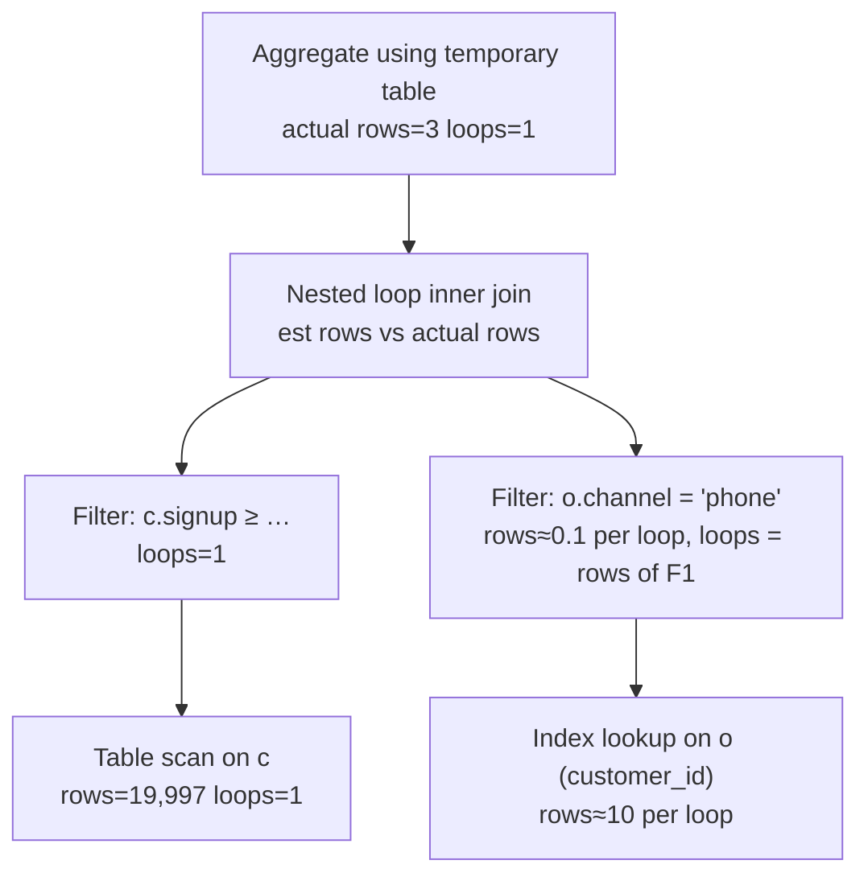

## Introduction

`EXPLAIN` tells you what the optimizer *expects*. Performance problems usually live in the gap between expectation and reality: the optimizer thought a filter would keep 6,000 rows and it kept 300; it thought a join would loop 10 times and it looped 30,000 times; it chose an index lookup that turned out slower than the scan it rejected. **`EXPLAIN ANALYZE`** (MySQL 8.0.18+) closes that gap. It **runs** the query, instruments every iterator in the execution tree, and prints for each one both the estimate and what actually happened:

```
-> Filter: (o.`channel` = 'phone')  (cost=2.51 rows=1) (actual time=0.0218..0.0219 rows=0.102 loops=3289)
```

(That line comes from one capture of Practical Example 1 made while writing this lesson — your timings will differ: the optimizer expected 1 row per execution of the filter, it executed 3,289 times and produced about 0.1 rows each time.) This lesson teaches you to read that line fluently — `cost`, estimated `rows`, `actual time=first..last`, actual `rows` and `loops` — and to use it the way performance engineers do:

- Understand **iterator-based execution**, the model the output describes.
- Compare **actual vs estimated rows** to find **misestimates**, and fix one with statistics.
- Understand **loops**: why an inner iterator's numbers are *per loop* and how to compute totals.
- Read **timings** correctly (they are cumulative, per loop, and measured on one run).
- **Measure responsibly**: warm vs cold caches, run-to-run variance, side effects and overhead.

:::note[Lab data]
The lab builds `orders_big` (200,000 rows) and `customers_big` (19,997 rows). Every `EXPLAIN ANALYZE` output here is labelled as **measured on the build machine**: timings will differ on your server and between runs. Row counts and loops are deterministic for a given plan and data; estimates depend on sampled statistics, so **your plan may differ** slightly.
:::

## DBMS Theory

:::theory[The iterator (Volcano) model and cardinality estimation error]
Most relational engines execute a physical plan as a tree of **operators** (iterators) with a common interface — `Init()`, `Read()` (next row), and end-of-data. A parent pulls rows from its children one at a time; leaves read tables or indexes. This is the **Volcano** / *iterator* model (Graefe, 1994). It makes plans composable: a filter, a join, a sort or an aggregate is just another iterator.

Measuring a plan means instrumenting each operator: how many rows it produced, how many times it was (re)started, and how long it took. Comparing produced rows with the optimizer's **cardinality estimates** reveals where the cost model went wrong. Research on real workloads (e.g. Leis et al., *"How Good Are Query Optimizers, Really?"*, VLDB 2015) shows that cardinality misestimates — especially compounding through joins — are the dominant cause of bad plans, far more than inaccuracies in the cost formulas themselves.
:::

Two theoretical facts matter when reading measurements:

1. **Errors compound multiplicatively.** If a filter is overestimated by 2× and the join fan-out by 10×, the estimated join output is off by 20×. Always find the *lowest* (earliest) iterator where estimate and reality diverge — fixing it often fixes everything above.
2. **A measurement is one sample.** The time of one execution depends on cache state, concurrency and hardware. Row counts are properties of the plan and data; times are properties of the run.

## Why It Exists

Before `EXPLAIN ANALYZE`, MySQL users diagnosed slow queries by combining `EXPLAIN` (estimates only), session status counters (`Handler_read_*`, aggregated over the whole statement), the slow query log (total time, rows examined) and guesswork. None of these says *which part* of a plan is slow or *which estimate* was wrong.

`EXPLAIN ANALYZE` exists to answer, per iterator:

- **Did the optimizer's row estimate match reality?** If not, why (statistics, skew, correlation, defaults)?
- **Where is the time spent?** Which iterator's cumulative time jumps relative to its children?
- **How often is each iterator executed?** `loops` exposes nested-loop multiplication directly.
- **Did an early stop work?** With `LIMIT`, actual rows show how much of an input was really consumed.

It also gives you a way to *compare* alternatives — the plan the optimizer chose versus a forced one — on rows touched and on time, as you have seen in earlier lessons of this module.

## Internal Working

:::internals[How MySQL instruments the iterator tree]
Since 8.0 MySQL's executor is built entirely from iterators (`TableScanIterator`, `IndexRangeScanIterator`, `RefIterator`, `FilterIterator`, `NestedLoopIterator`, `HashJoinIterator`, `AggregateIterator`, `SortingIterator`, `LimitOffsetIterator`, …). `FORMAT=TREE` prints that tree.

For `EXPLAIN ANALYZE` the server wraps each iterator in a **timing iterator** that records, for each start (*loop*) of the iterator:

- the time until the **first row** was returned and the time until the **last row** (end of data);
- the number of rows returned.

It then executes the query normally **but discards the result rows** instead of sending them to the client, and prints the tree with both the optimizer's estimates and the measurements:

`(cost=C rows=R)` — optimizer estimates: cost units and rows **per loop**.
`(actual time=F..L rows=N loops=K)` — measured: **average per loop** time to first row F and to last row L (milliseconds), average rows per loop N, and the number of loops K.

Times are **cumulative**: an iterator's time includes the time of its children (a parent cannot finish before its children have produced its input). The total work of an inner iterator is approximately `L × K` milliseconds and `N × K` rows.

Iterators that were never started print **(never executed)**. Statements the iterator executor does not handle (on 8.0, single-table `UPDATE`/`DELETE`) print `<not executable by iterator executor>`.
:::



## MySQL Implementation

Build the lab data: customers with a signup date, and orders with a skewed, **unindexed** `channel` column (90% `web`, 9% `app`, 1% `phone`):

```sql run
SET SESSION cte_max_recursion_depth = 300000;
CREATE TABLE customers_big (
  customer_id INT UNSIGNED NOT NULL PRIMARY KEY,
  segment     VARCHAR(10)  NOT NULL,
  signup      DATE         NOT NULL
) ENGINE=InnoDB;
INSERT INTO customers_big
WITH RECURSIVE s(n) AS (SELECT 1 UNION ALL SELECT n + 1 FROM s WHERE n < 19997)
SELECT n, ELT(1 + n % 3, 'consumer', 'business', 'student'), DATE '2020-01-01' + INTERVAL n % 1500 DAY
FROM s;
CREATE TABLE orders_big (
  order_id    INT UNSIGNED  NOT NULL PRIMARY KEY,
  customer_id INT UNSIGNED  NOT NULL,
  status      VARCHAR(10)   NOT NULL,
  order_date  DATE          NOT NULL,
  amount      DECIMAL(10,2) NOT NULL,
  channel     VARCHAR(5)    NOT NULL,
  INDEX idx_customer (customer_id),
  INDEX idx_status (status)
) ENGINE=InnoDB;
INSERT INTO orders_big
WITH RECURSIVE seq(n) AS (SELECT 1 UNION ALL SELECT n + 1 FROM seq WHERE n < 200000)
SELECT n,
       1 + (n * 7919) % 19997,
       ELT(1 + (n % 20 > 0) + (n % 20 > 2) + (n % 20 > 15), 'cancelled', 'pending', 'shipped', 'delivered'),
       DATE '2023-01-01' + INTERVAL (n * 37) % 731 DAY,
       ROUND(5 + (n * 104729 % 99500) / 100, 2),
       CASE WHEN n % 100 = 0 THEN 'phone' WHEN n % 100 < 10 THEN 'app' ELSE 'web' END
FROM seq;
ANALYZE TABLE customers_big, orders_big;
```

The simplest case — one iterator:

```sql run measured
EXPLAIN ANALYZE SELECT * FROM orders_big WHERE customer_id = 4242;
```

Read the single line left to right: the iterator (*Index lookup on orders_big using idx_customer (customer_id=4242)*); the **estimates** (`cost`, `rows` ≈ 10); then the **measurement** — time to the first row and to the last row in milliseconds, 10 actual rows, `loops=1`. Estimate and reality agree, as expected for an equality on a column with uniformly distributed values.

Now a plan with several iterators:

```sql run measured
EXPLAIN ANALYZE
SELECT status, COUNT(*) AS n
FROM orders_big
WHERE order_date >= '2024-07-01'
GROUP BY status;
```

Bottom-up: the optimizer chose an *Index scan on orders_big using idx_status* — a full scan of the status index, so that rows arrive already grouped by status and a streaming *Group aggregate* can count them without a temporary table. But the index does not contain `order_date`, so each of the 200,000 entries also costs a row fetch. The *Filter* keeps the orders since July 2024: in the capture it estimated about 66,500 rows (a default one-third guess, since `order_date` has no index or histogram) and actually kept 50,342. The aggregate produces 4 groups. The time on each line includes the lines beneath it, so the difference between a parent's and its children's last-row times is the parent's own work. (Whether the index scan beat a table scan plus temporary table here is exactly the kind of question you can settle by measuring both — try `IGNORE INDEX (idx_status)`.)

## Syntax Breakdown

```sql
EXPLAIN ANALYZE select_statement;               -- also TABLE statements and multi-table UPDATE/DELETE
EXPLAIN ANALYZE FORMAT = TREE select_statement; -- TREE is the default (and, on 8.0, the only) format
```

| Part of the output | Meaning | How to use it |
|---|---|---|
| Iterator name | The operation: *Table scan*, *Index lookup*, *Index range scan*, *Covering index …*, *Filter*, *Nested loop inner join*, *Inner hash join*, *Aggregate*, *Sort*, *Limit*, *Materialize* … | Identifies the access path / algorithm |
| `cost=C` | Optimizer's estimated cost (abstract units) of this subtree | Compare alternatives, not absolute time |
| `rows=R` (first parentheses) | Optimizer's estimated rows **per loop** | Compare with actual rows |
| `actual time=F..L` | Average ms **per loop** to first row / to last row | `L × loops` ≈ total time of this subtree |
| `rows=N` (second parentheses) | Actual rows **per loop** (average; can be fractional) | `N × loops` = total rows produced |
| `loops=K` | How many times this iterator was started | Nested-loop multiplication |
| `(never executed)` | The iterator was never started (e.g. its outer input was empty) | |

On the 8.0 capture server, `EXPLAIN ANALYZE` produces only the TREE format; requesting JSON fails:

```sql run error
EXPLAIN ANALYZE FORMAT=JSON SELECT COUNT(*) FROM orders_big;
```

:::version[EXPLAIN ANALYZE formats in 8.0 and 8.4]
Later releases extended this: with `explain_json_format_version = 2` (introduced in the 8.3 innovation release and therefore available in 8.4), MySQL can also produce `EXPLAIN ANALYZE` output in JSON. Display-only here; check the 8.4 manual for availability on your exact release:

```sql
SET SESSION explain_json_format_version = 2;    -- MySQL 8.4
EXPLAIN ANALYZE FORMAT=JSON SELECT COUNT(*) FROM orders_big;
```
:::

## Practical Examples

**1. Loops — the nested-loop multiplier.** Revenue by customer segment from phone orders of customers who signed up since mid-2023:

```sql run measured
EXPLAIN ANALYZE
SELECT c.segment, COUNT(*) AS orders, SUM(o.amount) AS revenue
FROM orders_big o
JOIN customers_big c ON c.customer_id = o.customer_id
WHERE o.channel = 'phone' AND c.signup >= '2023-06-01'
GROUP BY c.segment;
```

Read it from the bottom:

- *Table scan on c* runs **once** (`loops=1`) and reads all customers; the *Filter* on `signup` above it keeps a few thousand.
- For **each** of those customers, the inner side runs: *Index lookup on o using idx_customer* has `loops` equal to the number of customers that passed the filter, and about **10 rows per loop** (each customer's orders).
- The *Filter* on `channel` above the lookup shows a fractional `rows` value — around 0.1 per loop — because only about 1 in 10 customers has a phone order *on average per lookup*. Multiply by `loops` to get the total.
- The join produces a few hundred rows; the aggregate produces 3 groups.

Total work on the inner side ≈ (rows per loop × loops) index entries plus as many row fetches — exactly the multiplication you estimate from `EXPLAIN`, now measured.

**2. Misestimates — compare estimated with actual rows at every level.** In the same output, look at the estimates:

- The `signup` filter: estimated 6,807 rows, actual 3,289. `signup` has no index and no histogram, so the optimizer used a default selectivity of one third for `>=` (6,807 ≈ 20,424 / 3, where 20,424 is the sampled row estimate of the table).
- The `channel` filter: estimated 1 row per loop (10% of ~10 orders), actual about 0.1 — the real share of phone orders is 1%, not the default 10%.
- Consequently the join was estimated at about 6,830 rows and actually produced 334 — a 20× overestimate, the product of the two errors.

Here the misestimates do not change the plan shape (there is little choice for this join), but in larger queries such errors decide join order and algorithm. Give the optimizer real distributions:

```sql run
ANALYZE TABLE orders_big UPDATE HISTOGRAM ON channel WITH 8 BUCKETS;
ANALYZE TABLE customers_big UPDATE HISTOGRAM ON signup WITH 64 BUCKETS;
```

```sql run measured
EXPLAIN ANALYZE
SELECT c.segment, COUNT(*) AS orders, SUM(o.amount) AS revenue
FROM orders_big o
JOIN customers_big c ON c.customer_id = o.customer_id
WHERE o.channel = 'phone' AND c.signup >= '2023-06-01'
GROUP BY c.segment;
```

Now the `signup` filter is estimated at 3,347 (actual 3,289), the `channel` filter at about 0.1 rows per loop (actual 0.102), and the join at roughly 340 rows against 334 actual (histogram building samples, so the last digits vary between captures). Same plan, but the optimizer is now *reasoning about the right numbers* — which is what you want before data growth forces it to choose between alternatives.

**3. Early termination with LIMIT.**

```sql run measured
EXPLAIN ANALYZE SELECT order_id, customer_id FROM orders_big ORDER BY customer_id LIMIT 5;
```

The index scan under the *Limit* iterator reports only a handful of actual rows: the scan was stopped as soon as the limit was satisfied. Without an index on the `ORDER BY` column you would instead see a *Sort* iterator consuming every row before the limit could apply.

**4. `(never executed)`.** If an outer input produces no rows, inner iterators are never started:

```sql run measured
EXPLAIN ANALYZE
SELECT c.segment, o.amount
FROM orders_big o
JOIN customers_big c ON c.customer_id = o.customer_id
WHERE o.status = 'refunded';
```

There are no `refunded` orders, so the outer index lookup returns 0 rows, and the inner lookup into `customers_big` is marked *(never executed)*. Recognizing this saves time when an output contains surprisingly little timing data.

**5. The misestimate that picks a worse plan.** In [Selectivity, Cardinality and Index Statistics](/lessons/m07-selectivity-statistics) you saw InnoDB cap a range estimate at half the table. `status = 'shipped'` matches 65% of the rows:

```sql run measured
EXPLAIN ANALYZE SELECT SUM(amount) FROM orders_big WHERE status = 'shipped';
EXPLAIN ANALYZE SELECT SUM(amount) FROM orders_big IGNORE INDEX (idx_status) WHERE status = 'shipped';
```

Compare the *Index lookup* line's estimated rows with its actual rows (the estimate is capped at half of the table), then compare the two plans' last-row times. The index plan performs one clustered-index lookup per shipped order; the scan reads every row sequentially. When the measured times disagree with the optimizer's choice consistently across repeated runs, you have evidence for an intervention (dropping a useless low-selectivity index, a composite index, or — last resort — a hint).

## Execution Walkthrough

Reading an `EXPLAIN ANALYZE` tree is a procedure. Apply it to the segment-revenue query.

```walkthrough
title: Reading EXPLAIN ANALYZE for the segment revenue join, step by step
steps:
  - title: "1. Look at the shape without measurements"
    explain: >-
      Start with FORMAT=TREE to see the iterators and the estimated rows without executing anything. Identify the leaves
      (table accesses), the join, and the operators above it.
    sql: |
      EXPLAIN FORMAT=TREE
      SELECT c.segment, COUNT(*) AS orders, SUM(o.amount) AS revenue
      FROM orders_big o JOIN customers_big c ON c.customer_id = o.customer_id
      WHERE o.channel = 'phone' AND c.signup >= '2023-06-01'
      GROUP BY c.segment;
  - title: "2. Establish the ground truth for each filter"
    explain: >-
      Independently count what each filter should keep. These numbers are what the actual rows in EXPLAIN ANALYZE should
      show (multiplied by loops for inner iterators).
    sql: |
      SELECT (SELECT COUNT(*) FROM customers_big WHERE signup >= '2023-06-01') AS customers_kept,
             (SELECT COUNT(*) FROM orders_big WHERE channel = 'phone')         AS phone_orders,
             (SELECT COUNT(*) FROM orders_big o JOIN customers_big c ON c.customer_id = o.customer_id
              WHERE o.channel = 'phone' AND c.signup >= '2023-06-01')         AS join_rows;
  - title: "3. Compute totals for the inner side"
    explain: >-
      For the inner Index lookup, total rows = rows per loop × loops: about 10 orders per customer times the number of
      kept customers. That is the number of index entries read and rows fetched — the dominant work of this query.
    sql: |
      SELECT COUNT(*) AS inner_rows_fetched
      FROM orders_big o JOIN customers_big c ON c.customer_id = o.customer_id
      WHERE c.signup >= '2023-06-01';
  - title: "4. Find where time accumulates"
    explain: >-
      Run EXPLAIN ANALYZE. Compare each iterator's last-row time with its children's: the join's time is almost entirely
      the inner lookups' time × loops; the scan of customers is a small fraction. That tells you what to optimize — for
      example, an index on orders_big (customer_id, channel) would let the lookup skip non-phone orders without fetching them.
    sql: |
      EXPLAIN ANALYZE
      SELECT c.segment, COUNT(*) AS orders, SUM(o.amount) AS revenue
      FROM orders_big o JOIN customers_big c ON c.customer_id = o.customer_id
      WHERE o.channel = 'phone' AND c.signup >= '2023-06-01'
      GROUP BY c.segment;
```

The walkthrough's last step runs after the histograms were built, so its estimates are the corrected ones; its timings, like every measured block, vary from run to run.

## Output

How to summarize an `EXPLAIN ANALYZE` investigation — the outputs captured in this lesson support these conclusions:

| Question | Where in the output | Finding in this lab |
|---|---|---|
| Where are rows multiplied? | `loops` on inner iterators | The inner lookup into `orders_big` runs once per kept customer, ~10 rows per loop |
| Which estimates were wrong? | estimated vs actual `rows` per iterator | Default selectivities for `signup >=` (⅓) and `channel =` (10%) were far off; histograms fixed them |
| Where is time spent? | cumulative `actual time` | Mostly in the inner lookups (rows per loop × loops) |
| Did the plan stop early? | actual rows under `Limit` | Yes — the index scan delivered only the rows the LIMIT needed |
| Was any part skipped? | `(never executed)` | The inner lookup for the empty `refunded` input |
| Did the optimizer choose well? | compare chosen vs forced plans | For `status = 'shipped'`, measure both; a capped estimate favoured the index lookup |

## Alternative Approaches

| Tool | Gives you | Limitations |
|---|---|---|
| `EXPLAIN ANALYZE` | Per-iterator actual rows, loops, times | Executes the query; one run; overhead from instrumentation |
| `EXPLAIN` / `FORMAT=JSON` | Estimates and costs, no execution | No reality check |
| Session status counters (`SHOW SESSION STATUS LIKE 'Handler_read%'`) | Low-level row reads for the whole statement | Not per iterator; cumulative per session |
| Slow query log | Total time, `Rows_examined`, lock time, per execution in production | Statement level only |
| `performance_schema` statement digests / `sys` views | Aggregated latency and rows over many executions | Statement level; needs privileges (not in the sandbox) |
| Optimizer trace | Why a plan was chosen (alternatives and costs) | No execution data |

Handler counters are a useful cross-check for "rows examined". They are cumulative for the session, so read them before and after a statement and subtract:

```sql run
SHOW SESSION STATUS LIKE 'Handler_read_rnd_next';
SELECT COUNT(*) FROM orders_big WHERE amount > 990;
SHOW SESSION STATUS LIKE 'Handler_read_rnd_next';
```

The difference between the two values is roughly the number of rows read by the full table scan (`Handler_read_rnd_next` counts "read next row" calls of table scans; `Handler_read_next` counts index-order reads, `Handler_read_key` index lookups).

## Performance Analysis

**What `EXPLAIN ANALYZE` measures, and what it does not.**

- It **executes** the full query, including all reads, joins, sorts and temporary tables — but it **does not send result rows to the client**. Network transfer and client processing time are excluded; for queries returning millions of rows, real end-to-end time can be much larger.
- Instrumentation adds overhead: reading the clock around every row of every iterator. For iterators that process millions of cheap rows, the measured time can be noticeably higher than uninstrumented execution. Compare plans measured the same way; do not treat the numbers as exact.
- It is **one run**. The first execution after a restart, or after the data was evicted, reads pages from storage (a *cold* buffer pool); later runs find them in memory (*warm*). Run a query several times and look at the stable value — or deliberately measure the cold case if that is what users experience.

Run the same statement twice and compare:

```sql run measured
EXPLAIN ANALYZE SELECT COUNT(*), AVG(amount) FROM orders_big WHERE order_date BETWEEN '2023-01-01' AND '2023-12-31';
EXPLAIN ANALYZE SELECT COUNT(*), AVG(amount) FROM orders_big WHERE order_date BETWEEN '2023-01-01' AND '2023-12-31';
```

Row counts are identical; the times differ somewhat even on a quiet build machine with everything cached. On a busy production server the variance is larger.

**Side effects.** `EXPLAIN ANALYZE` of a `SELECT` that calls functions with side effects (stored functions writing to tables, `GET_LOCK`, `SLEEP`) performs them. For multi-table `UPDATE`/`DELETE`, the statement is executed — experiment inside a transaction you roll back, on a copy. Single-table `UPDATE`/`DELETE` are not supported on the 8.0 capture server:

```sql run
EXPLAIN ANALYZE UPDATE orders_big SET amount = amount WHERE order_id = 1;
```

The output `<not executable by iterator executor>` means nothing was measured (and nothing was changed: the statement was not run). Use `EXPLAIN` for its plan, or rewrite as an equivalent `SELECT` to measure the read part.

**Long-running queries.** Because it executes the query, `EXPLAIN ANALYZE` of a 20-minute report takes 20 minutes and holds its locks and resources for that time. Use a replica or a staging copy; set a statement timeout (`max_execution_time` for SELECTs) if you only need a rough picture.

:::performance[Theory vs measurement]
Use plans and cost models to *predict*; use `EXPLAIN ANALYZE` to *verify*. Trust row counts and loops more than milliseconds; trust repeated measurements more than a single one; trust measurements on production-like data and hardware more than on a laptop.
:::

## Best Practices

:::best-practice[Measuring responsibly]
1. **Read bottom-up and find the first divergence** between estimated and actual rows; fix that before anything above it.
2. **Always multiply by `loops`** for inner iterators: `rows` and `actual time` are per loop.
3. **Repeat measurements** and state cache conditions (warm/cold); report a range, not one number.
4. **Compare plans, not absolute numbers**: chosen vs forced (`FORCE INDEX` / `IGNORE INDEX`), before vs after an index — on the same machine, same data, same cache state.
5. **Use production-like data volumes and distributions** — misestimates often appear only with real skew.
6. **Never run `EXPLAIN ANALYZE` casually on production primaries** for heavy queries or DML; use replicas, copies or transactions you roll back.
7. **Record the full output** (and the server version) in tickets and reviews; the numbers are meaningful only with their context.
:::

## Common Mistakes

**Mistake 1 — ignoring `loops`.** An inner iterator showing `actual time=0.02..0.02 rows=10` looks cheap — until you notice `loops=3289`. Its real contribution is about 3,289 × 0.02 ms and 32,890 rows.

**Mistake 2 — reading `actual time` as the iterator's own time.** Times are cumulative (they include children). The iterator's own work is its time minus its children's.

**Mistake 3 — concluding from one cold or one warm run.** The first run after loading data may read from storage; subsequent runs hit the buffer pool. Report both if both matter.

**Mistake 4 — expecting estimates to match exactly.** Estimates are sampled and approximate. A 20% error is normal; a 10× error at a low level of the tree is a finding.

**Mistake 5 — forgetting that `EXPLAIN ANALYZE` runs the statement.** It is not a "more detailed EXPLAIN"; it is execution with instrumentation. A query that takes an hour takes an hour; a multi-table `DELETE` deletes (inside your transaction).

**Mistake 6 — comparing a plan's time with client-observed latency.** Network, result transfer and application processing are excluded. A query that "takes 30 ms in EXPLAIN ANALYZE but 2 s in the app" may be returning 500,000 rows to the client.

## Industry Application

- **Root-cause analysis.** Performance engineers attach the `EXPLAIN ANALYZE` output to incident tickets, highlighting the iterator where estimates diverged and where time accumulated; it turns "the query is slow" into "the inner lookup loops 3 million times because the filter estimate on `channel` is 10× too high".
- **Index and query reviews.** Before/after `EXPLAIN ANALYZE` on a staging copy is the standard evidence for adding an index, rewriting a query or introducing a hint.
- **Upgrade testing.** When moving between major versions, teams run their top queries with `EXPLAIN ANALYZE` on both versions to catch plan regressions.
- **Statistics maintenance.** Recurring misestimates on skewed columns lead teams to add histograms (and, on 8.4, `AUTO UPDATE` histograms) to their schema-management code.
- **Teaching the optimizer's limits.** Correlated predicates (city and state, product category and brand) are systematically underestimated under the independence assumption; `EXPLAIN ANALYZE` makes the error visible and justifies composite indexes or query restructuring.

## Practice Exercises

```exercise
id: ex1
title: Totals from per-loop numbers
difficulty: easy
kind: open
concepts: [loops, explain-analyze]
prompt: |
  An `EXPLAIN ANALYZE` line for the inner side of a nested-loop join reads:

  `-> Index lookup on o using idx_customer (customer_id=c.customer_id)  (cost=2.51 rows=10) (actual time=0.0202..0.0212 rows=10 loops=3289)`

  (This is the line from Practical Example 1 before histograms, from one capture on the build machine while this lesson was written; the capture displayed with the example may show slightly different times.)
  How many rows did this iterator produce in total, approximately how much time did it account for in total, and
  how accurate was the optimizer's row estimate per loop?
solution: |
  - Rows: 10 per loop × 3,289 loops ≈ 32,890 rows (index lookups, each fetching a row).
  - Time: ≈ 0.0212 ms per loop × 3,289 ≈ 70 ms of cumulative time (on the build machine) — almost all of the join's ~78 ms.
  - Estimate: 10 rows per loop vs 10 actual — accurate (customers have about 10 orders each). The misestimate
    in that query is elsewhere (the filters on signup and channel), not in this lookup.
explanation: |
  Per-loop values must be multiplied by loops. Accurate leaf estimates can coexist with large errors in filters above.
```

```exercise
id: ex2
title: Ground truth for a filter
difficulty: medium
concepts: [actual-vs-estimated]
setup: |
  SET SESSION cte_max_recursion_depth = 100000;
  CREATE TABLE visits (id INT UNSIGNED PRIMARY KEY, device VARCHAR(8) NOT NULL, ms INT NOT NULL);
  INSERT INTO visits
  WITH RECURSIVE s(n) AS (SELECT 1 UNION ALL SELECT n + 1 FROM s WHERE n < 50000)
  SELECT n, CASE WHEN n % 200 = 0 THEN 'tv' WHEN n % 3 = 0 THEN 'mobile' ELSE 'desktop' END, n % 3000 FROM s;
  ANALYZE TABLE visits;
prompt: |
  `EXPLAIN SELECT * FROM visits WHERE device = 'tv'` estimates `filtered = 10.00` (no index, no histogram). Return one
  row with columns `actual_rows` (rows matching `device = 'tv'`), `estimated_rows` (10% of the table's row count,
  computed with `COUNT(*)`), and `overestimate_factor` = estimated ÷ actual, rounded to 1 decimal.
hints:
  - "SUM(device = 'tv') counts matching rows; COUNT(*) * 0.10 is the default estimate."
  - "ROUND(COUNT(*) * 0.10 / SUM(device = 'tv'), 1)."
solution: |
  SELECT SUM(device = 'tv')                            AS actual_rows,
         COUNT(*) * 0.10                               AS estimated_rows,
         ROUND(COUNT(*) * 0.10 / SUM(device = 'tv'), 1) AS overestimate_factor
  FROM visits;
explanation: |
  250 rows match but the default guess is 5,000 — a 20× overestimate. In a join, this error would multiply through
  every subsequent table. A histogram on `device` would correct it.
```

```exercise
id: ex3
title: Fix the estimate with a histogram
difficulty: medium
kind: dml
concepts: [misestimates, explain-analyze]
setup: |
  SET SESSION cte_max_recursion_depth = 100000;
  CREATE TABLE tickets_m (id INT UNSIGNED PRIMARY KEY, queue_id INT NOT NULL, severity VARCHAR(8) NOT NULL);
  INSERT INTO tickets_m
  WITH RECURSIVE s(n) AS (SELECT 1 UNION ALL SELECT n + 1 FROM s WHERE n < 40000)
  SELECT n, n % 50, CASE WHEN n % 500 = 0 THEN 'sev1' WHEN n % 20 = 0 THEN 'sev2' ELSE 'sev3' END FROM s;
prompt: |
  Dashboards join `tickets_m` to other tables filtering `severity = 'sev1'`, and `EXPLAIN ANALYZE` shows the filter's
  estimated rows far above the actual rows. `severity` is not indexed and should not be. Give the optimizer the real
  distribution of `severity`.
hints:
  - "Histograms provide distribution statistics for non-indexed columns."
  - "ANALYZE TABLE tickets_m UPDATE HISTOGRAM ON severity;"
solution: |
  ANALYZE TABLE tickets_m UPDATE HISTOGRAM ON severity WITH 8 BUCKETS;
check: |
  SELECT COLUMN_NAME, HISTOGRAM->>'$."histogram-type"' AS histogram_type
  FROM information_schema.COLUMN_STATISTICS
  WHERE SCHEMA_NAME = DATABASE() AND TABLE_NAME = 'tickets_m';
explanation: |
  With three distinct values the histogram is a singleton histogram; EXPLAIN ANALYZE afterwards shows the sev1
  filter estimated at ~0.2% instead of 10%. Any bucket count ≥ 3 yields the same type.
```

```exercise
id: ex4
title: Find the expensive iterator
difficulty: hard
kind: open
concepts: [explain-analyze, iterator-executor, loops]
prompt: |
  Using the captured output of Practical Example 1 (before histograms) in this lesson:

  1. List the iterators bottom-up and, for each, its total actual rows (rows × loops).
  2. Which iterator accounts for most of the time, and how do you know from the cumulative timings?
  3. Propose one index change that would reduce the work of that iterator, and describe how the EXPLAIN ANALYZE
     output should change if your idea works.
solution: |
  1. Table scan on c: ~19,997 rows (1 loop) → Filter signup: ~3,300 rows (1 loop) → Index lookup on o:
     ~10 rows × ~3,300 loops ≈ 33,000 rows → Filter channel: ~0.1 × ~3,300 ≈ 330 rows → Nested loop join: ~330 rows →
     Aggregate: 3 rows.
  2. The inner index lookup (with its filter): the join's cumulative last-row time is almost entirely
     (lookup time per loop × loops); the customer scan and its filter finish within a few milliseconds of starting.
  3. Index `orders_big (customer_id, channel)` (optionally `, amount` to cover): the lookup becomes
     `customer_id = c.customer_id AND channel = 'phone'` on two key parts, returning ~0.1 rows per loop instead of 10;
     the separate channel Filter disappears (or becomes trivial), the lookup's rows per loop drop from ~10 to ~0.1, and
     with `amount` included it becomes a *Covering index lookup*. Alternatively drive from orders: an index on
     `(channel, customer_id)` lets MySQL start from the ~2,000 phone orders.
explanation: |
  The method — totals via loops, cumulative times, then target the dominant iterator — applies to any plan.
```

```exercise
id: ex5
title: A measurement protocol
difficulty: challenge
kind: open
concepts: [measurement, explain-analyze]
prompt: |
  Your team wants to decide between two indexes for a reporting query on a 300 GB table, using EXPLAIN ANALYZE.
  Write a short measurement protocol: environment, data, cache state, number of runs, what to record, how to compare,
  and what could invalidate the results.
solution: |
  - **Environment:** a staging replica with the same MySQL version, configuration (buffer pool size, sort/join buffers)
    and comparable hardware; no other heavy load during tests (or note it).
  - **Data:** a recent full copy (or at least the same size and distribution); run ANALYZE TABLE and build the same
    histograms as production so estimates match.
  - **Variants:** baseline, index A, index B — created one at a time (or made invisible/visible) so only one thing changes.
  - **Cache state:** measure both warm (run 3 times, discard the first, report the median of the next runs) and, if user
    experience is cold, cold (after evicting by restarting the replica or reading other large tables).
  - **Record:** the full EXPLAIN ANALYZE text, server version, estimated vs actual rows per key iterator, loops, last-row
    time of the root, and Handler/Innodb_buffer_pool_reads counters before/after.
  - **Compare:** rows examined and loops first (robust), times second (median of runs); also the index size and write cost
    (insert benchmark) for each variant.
  - **Threats:** caching differences between runs, background jobs, statistics differing from production, parameter
    values not representative (skewed tenants), and EXPLAIN ANALYZE overhead on row-heavy iterators.
explanation: |
  Measurements are only as trustworthy as the protocol behind them; robust metrics (rows, loops) beat single timings.
```

## Knowledge Assessment

```quiz
- id: q1
  question: "What does `EXPLAIN ANALYZE` do that `EXPLAIN` does not?"
  options:
    - "It shows possible_keys"
    - "It executes the query and reports actual rows, loops and timings per iterator alongside the estimates"
    - "It returns the result rows with timing information"
    - "It changes the plan to the fastest one"
  answer: 1
  explanation: "EXPLAIN ANALYZE runs the statement with instrumented iterators but discards the result rows. It never changes the plan."
  concepts: [explain-analyze]
- id: q2
  question: "An inner iterator shows `(actual time=0.05..0.06 rows=4 loops=2000)`. How many rows did it produce in total?"
  options: ["4", "2,000", "8,000", "0.06"]
  answer: 2
  explanation: "Actual rows are averaged per loop: 4 × 2,000 = 8,000. Its total time is about 0.06 ms × 2,000 = 120 ms."
  concepts: [loops]
- id: q3
  question: "A Filter's estimated rows are 6,636 but actual rows are 3,289; the column has no index and no histogram. What is the most likely cause?"
  options:
    - "A bug in EXPLAIN ANALYZE"
    - "The optimizer used a default selectivity for the condition because it had no statistics for the column"
    - "The buffer pool was cold"
    - "The query used a hash join"
  answer: 1
  explanation: "Without an index or histogram, MySQL falls back on fixed default selectivities (e.g. one third for range comparisons). Cache state affects time, not rows."
  concepts: [misestimates]
- id: q4
  question: "Which statements about timings in EXPLAIN ANALYZE are true? (Select all that apply.)"
  type: multi
  options:
    - "They are cumulative: a parent's time includes its children's time"
    - "They are averages per loop"
    - "They include the time to send result rows to the client"
    - "They can vary between runs because of caching and load"
  answer: [0, 1, 3]
  explanation: "Result rows are discarded, so network/client time is excluded. Times are per-loop averages, cumulative over children, and vary between runs."
  concepts: [explain-analyze, measurement]
- id: q5
  question: "An iterator is shown as `(never executed)`. What does that mean?"
  options:
    - "It failed with an error"
    - "It was never started, typically because the input feeding it produced no rows"
    - "It was optimized away at parse time"
    - "It ran but its timing was not recorded"
  answer: 1
  explanation: "In the lab, the lookup into customers_big was never executed because no orders had status 'refunded'."
  concepts: [iterator-executor]
- id: q6
  question: "You add histograms and re-run EXPLAIN ANALYZE. Estimates now match actual rows but the plan shape and timings are the same. Was the histogram useless?"
  options:
    - "Yes, histograms only matter if they make the query faster immediately"
    - "No — the optimizer now reasons with correct cardinalities, which protects future decisions (join order, access paths) as data or queries change"
    - "Yes, because histograms create indexes only for large tables"
    - "No, histograms always make queries faster"
  answer: 1
  explanation: "Histograms improve estimates, not access paths. When there is only one sensible plan, nothing changes now; with more alternatives, correct estimates lead to better choices."
  concepts: [misestimates]
- id: q7
  question: "Why is it risky to run `EXPLAIN ANALYZE` of a heavy reporting query on a production primary?"
  options:
    - "It locks the whole database"
    - "It actually executes the query, consuming the same resources and time (and locks for DML) as a real run"
    - "It disables the buffer pool"
    - "It writes the plan to the binary log"
  answer: 1
  explanation: "EXPLAIN ANALYZE is execution with instrumentation. Use replicas, copies, or transactions you roll back."
  concepts: [measurement]
- id: q8
  question: "Which is the most robust evidence when comparing two plans with EXPLAIN ANALYZE?"
  options:
    - "A single last-row time of each plan"
    - "Actual rows and loops per iterator (work done), backed by repeated timings under the same cache conditions"
    - "The cost values"
    - "The number of lines in the output"
  answer: 1
  explanation: "Rows and loops are deterministic for a plan and data; timings need repetition; cost values are estimates."
  concepts: [measurement, actual-vs-estimated]
```
