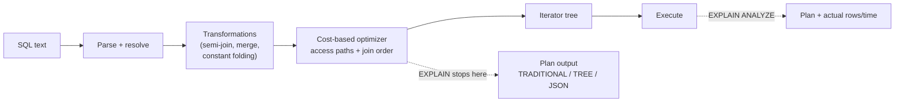

## Introduction

Every lesson in this module so far has relied on `EXPLAIN` to show *how* MySQL intended to run a query. This lesson turns that habit into a skill: reading a plan systematically, column by column, and knowing what each value implies for cost.

`EXPLAIN` answers the questions that matter when a query is slow or about to go to production:

- **Which tables are read, and in what order?** (`id`, `table`, row order)
- **How is each table accessed?** (`type`: a single-row lookup, an index range, a full scan …)
- **Which index is used, and how much of it?** (`possible_keys`, `key`, `key_len`, `ref`)
- **How many rows does the optimizer expect to examine, and how many survive the conditions?** (`rows`, `filtered`)
- **What extra work is needed?** (`Extra`: sorting, temporary tables, index-only reads, pushed-down conditions …)

You will also learn the two structured formats: `FORMAT=TREE`, which shows the iterator tree MySQL actually executes, and `FORMAT=JSON`, which adds the optimizer's cost estimates. The next lesson, [EXPLAIN ANALYZE](/lessons/m07-explain-analyze), runs the query and compares these *estimates* with reality.

:::note[Lab data]
The lab builds `orders_big` (200,000 rows) and `customers_big` (20,000 rows). Plans are captured on a real server; the optimizer's choices depend on statistics and distribution, so **your plan may differ** in estimates and occasionally in choice. The reading technique does not change.
:::

## DBMS Theory

:::theory[Logical vs physical plans]
A SQL query is **declarative**: it states *what* result is wanted. The DBMS translates it into a **logical plan** (a relational-algebra tree: σ, π, ⋈, γ …), applies equivalence-preserving rewrites (predicate pushdown, subquery unnesting, join reordering), and then chooses a **physical plan**: for every logical operator, a concrete algorithm (table scan vs index scan, nested-loop vs hash join, sort-based vs hash-based grouping) and an execution order.

Choosing among physical plans is **cost-based optimization**: the optimizer estimates the cost of each candidate from statistics (cardinalities, selectivities, page counts) and a cost model, and keeps the cheapest. An execution plan display such as `EXPLAIN` exposes the chosen physical plan *and the estimates behind it* — not measurements.
:::

Two consequences shape how you read any plan, in any DBMS:

1. **Plans show estimates.** `rows`, `filtered` and costs are predictions. They can be wrong, and a wrong estimate is the most common reason a "reasonable-looking" plan is slow. `EXPLAIN ANALYZE` (next lesson) measures.
2. **A plan is a tree, even when displayed as a table.** Traditional `EXPLAIN` prints one row per table access in **join order**; nesting (subqueries, derived tables, unions) is encoded in `id` and `select_type`. `FORMAT=TREE` prints the tree explicitly.

:::standard[Standard SQL vs MySQL]
`EXPLAIN` is not part of the SQL standard; every DBMS has its own (PostgreSQL `EXPLAIN (ANALYZE, BUFFERS)`, SQL Server showplan, Oracle `EXPLAIN PLAN` + `DBMS_XPLAN`). The concepts — access paths, join methods, estimated rows, costs — transfer directly; the column names and formats are MySQL-specific.
:::

## Why It Exists

Without a plan display, the only way to understand performance is trial and error: rewrite, run, time, repeat. That fails in exactly the situations that matter — on production-sized data you cannot casually run, for queries whose speed depends on data distribution, and for changes (a new index, a dropped index, an upgrade) whose effect you need to predict before deploying.

`EXPLAIN` exists so that you can:

- **Verify an index is used** — and used fully (`key_len`) — before shipping a query.
- **Spot the expensive operators** — full scans of big tables, filesorts of many rows, temporary tables — without executing anything (plain `EXPLAIN` does not run the query, except for derived tables in some older versions).
- **Explain regressions** — compare the plan before and after statistics changes, upgrades or schema changes.
- **Communicate** — a plan is the shared language of DBAs, developers and code reviewers.

## Internal Working

:::internals[Where the plan comes from]
When MySQL processes a statement it **parses** it, **resolves** names, applies **transformations** (e.g. converting `IN (subquery)` to a semi-join, merging derived tables, constant propagation), then the **optimizer** chooses access methods and a join order using the cost model, and finally builds an **iterator tree** that the executor runs (the Volcano model: each iterator returns rows to its parent on demand).

`EXPLAIN` stops after optimization and prints that plan:

- **Traditional format** — one row per table access, in the order the joins are executed (the first row is the outermost table of a nested-loop join). It predates the iterator executor, so some operations (hash join, aggregation, sorting placement) appear only as `Extra` notes.
- **`FORMAT=TREE`** — a rendering of the actual iterator tree (MySQL 8.0.16+), indented parent → child, with estimated cost and rows per iterator. Read it **inside-out / bottom-up**: leaves produce rows, parents consume them.
- **`FORMAT=JSON`** — a structured view of the optimizer's decisions, including `cost_info` (`read_cost`, `eval_cost`, `prefix_cost`, `query_cost`), `used_key_parts`, `attached_condition` and `rows_examined_per_scan`.
- **`SHOW WARNINGS`** right after `EXPLAIN` returns a Note (code 1003) containing the query **as rewritten** by the optimizer — very useful to see subquery transformations and constant folding.
:::



## MySQL Implementation

Build the lab tables:

```sql run
SET SESSION cte_max_recursion_depth = 300000;
CREATE TABLE customers_big (
  customer_id INT UNSIGNED NOT NULL,
  email       VARCHAR(100) NOT NULL,
  segment     VARCHAR(10)  NOT NULL,
  referrer_id INT UNSIGNED NULL,
  PRIMARY KEY (customer_id),
  UNIQUE KEY uq_customers_email (email),
  INDEX idx_customers_referrer (referrer_id)
) ENGINE=InnoDB;
INSERT INTO customers_big
WITH RECURSIVE s(n) AS (SELECT 1 UNION ALL SELECT n + 1 FROM s WHERE n < 20000)
SELECT n, CONCAT('user', n, '@example.com'),
       ELT(1 + n % 3, 'consumer', 'business', 'student'),
       IF(n % 4 = 0, NULL, 1 + (n * 31) % 500)
FROM s;
CREATE TABLE orders_big (
  order_id    INT UNSIGNED  NOT NULL,
  customer_id INT UNSIGNED  NOT NULL,
  status      VARCHAR(10)   NOT NULL,
  order_date  DATE          NOT NULL,
  amount      DECIMAL(10,2) NOT NULL,
  country     CHAR(2)       NOT NULL,
  PRIMARY KEY (order_id),
  INDEX idx_orders_customer (customer_id),
  INDEX idx_orders_status_date (status, order_date)
) ENGINE=InnoDB;
INSERT INTO orders_big
WITH RECURSIVE seq(n) AS (SELECT 1 UNION ALL SELECT n + 1 FROM seq WHERE n < 200000)
SELECT n,
       1 + (n * 7919) % 19997,
       ELT(1 + (n % 20 > 0) + (n % 20 > 2) + (n % 20 > 15), 'cancelled', 'pending', 'shipped', 'delivered'),
       DATE '2023-01-01' + INTERVAL (n * 37) % 731 DAY,
       ROUND(5 + (n * 104729 % 99500) / 100, 2),
       ELT(1 + n % 7, 'US', 'IN', 'DE', 'BR', 'JP', 'FR', 'MX')
FROM seq;
ANALYZE TABLE customers_big, orders_big;
```

The basic form is `EXPLAIN` followed by the statement. Start with a join and read the output row by row:

```sql run
EXPLAIN
SELECT c.email, o.order_id, o.amount
FROM orders_big o
JOIN customers_big c ON c.customer_id = o.customer_id
WHERE o.status = 'cancelled' AND o.order_date >= '2024-12-01';
```

Two rows, one per table, in **join order**: MySQL first reads `o` with a `range` scan of `idx_orders_status_date` (both key parts used: `key_len` = 42 + 3 = 45), estimating a few hundred rows; then, for each of those rows, it reads `c` by primary key — `type = eq_ref`, `ref = <schema>.o.customer_id`, `rows = 1`. That is a nested-loop join driven by the selective table.

## Syntax Breakdown

```sql
EXPLAIN [FORMAT = {TRADITIONAL | TREE | JSON}] {SELECT … | TABLE … | INSERT … | REPLACE … | UPDATE … | DELETE …};
EXPLAIN ANALYZE SELECT …;                       -- executes the query (next lesson)
EXPLAIN FOR CONNECTION <connection_id>;          -- plan of a statement running in another session
DESCRIBE / DESC                                  -- synonyms of EXPLAIN (also used for table structure)
```

**The columns of traditional EXPLAIN:**

| Column | Meaning | What to look for |
|---|---|---|
| `id` | SELECT number within the statement. Rows with the same id are joined; higher ids are subqueries/derived tables. | Many ids → nested query blocks. |
| `select_type` | `SIMPLE`, `PRIMARY`, `SUBQUERY`, `DEPENDENT SUBQUERY`, `DERIVED`, `MATERIALIZED`, `UNION`, `UNION RESULT` … | `DEPENDENT SUBQUERY` re-executes per outer row. |
| `table` | Table or alias; `<derivedN>`, `<subqueryN>`, `<unionM,N>` for internal results. | |
| `partitions` | Partitions accessed (NULL for non-partitioned tables). | Pruning works when few partitions are listed. |
| `type` | **Access type** (join type) — see below. | `ALL`/`index` on large tables. |
| `possible_keys` | Indexes the optimizer considered usable. | NULL → no usable index for this predicate. |
| `key` | Index actually chosen (NULL = none). | possible_keys set but key NULL → index rejected on cost. |
| `key_len` | Bytes of the index key used (sum of used key parts; +1 nullable, +2 VARCHAR). | Shorter than expected → only a prefix of a composite index is used. |
| `ref` | What is compared to the index: `const`, a column of a previous table, `func`. | |
| `rows` | **Estimated** rows examined per access of this table (per loop for inner tables). | Multiply along the join for total work. |
| `filtered` | **Estimated** percentage of those rows that satisfy the remaining conditions. | rows × filtered / 100 = rows passed to the next table. |
| `Extra` | Additional information — see below. | `Using filesort`, `Using temporary`, `Using join buffer`. |

**Access types, roughly from best to worst:**

| `type` | Meaning |
|---|---|
| `system` / `const` | At most one matching row, read once during optimization (PK or UNIQUE NOT NULL compared with constants). |
| `eq_ref` | Join: exactly one row of this table per row of the previous tables, via PK or UNIQUE NOT NULL index. |
| `ref` | Lookup of all rows with a given value of a non-unique index (or a prefix of a unique one). |
| `ref_or_null` | Like `ref`, plus the rows where the key is NULL. |
| `index_merge` | Several indexes scanned and their row IDs combined (union/intersection). |
| `unique_subquery` / `index_subquery` | `IN (subquery)` evaluated as an index lookup. |
| `range` | Index range scan: `BETWEEN`, `<`, `>`, `IN (…)`, `LIKE 'abc%'` … |
| `index` | Full scan of an index (all entries, in index order). Cheap if covering (`Using index`). |
| `ALL` | Full table scan. |

**Common `Extra` values:**

| Extra | Meaning |
|---|---|
| `Using where` | A condition is evaluated on rows after they are read (by the server). |
| `Using index` | Covering: data read from the index only. |
| `Using index condition` | Index Condition Pushdown: index columns checked by the storage engine before fetching rows. |
| `Using filesort` | A sort is needed (in memory or on disk) — not necessarily a file. |
| `Using temporary` | An internal temporary table is used (GROUP BY, DISTINCT, UNION, some ORDER BY). |
| `Using join buffer (hash join)` | Hash join (8.0.18+) — this table is the probe or build input without an index. |
| `Using MRR` | Multi-Range Read: row lookups sorted by PK to reduce random I/O. |
| `Backward index scan` | Index read in descending order. |
| `Using index for group-by` / `for skip scan` | Loose index scan / skip scan. |
| `Select tables optimized away` | Answered during optimization (e.g. MIN/MAX on an index). |
| `Impossible WHERE` | The condition is always false; no rows are read. |

## Practical Examples

**1. `const` and `ref` — and the effect of a UNIQUE index.**

```sql run
EXPLAIN SELECT * FROM customers_big WHERE email = 'user42@example.com';
EXPLAIN SELECT * FROM orders_big WHERE customer_id = 42;
```

The UNIQUE index on `email` guarantees at most one row, so the lookup is `const` (performed once during optimization, its values treated as constants for the rest of the query). `customer_id` in `orders_big` is not unique → `ref` with an estimated ~10 rows.

**2. `ref_or_null`.** Customers referred by customer 7 **or** with no referrer:

```sql run
EXPLAIN SELECT customer_id FROM customers_big WHERE referrer_id = 7 OR referrer_id IS NULL;
```

`ref_or_null` performs the `ref` lookup for 7 and an extra lookup of the NULL entries in the same index (NULLs are stored in InnoDB indexes, sorted first). Whether it is chosen depends on how many NULLs there are — here a quarter of the customers.

**3. `range`, `index` and `ALL` — the scans.**

```sql run
EXPLAIN SELECT * FROM orders_big WHERE customer_id BETWEEN 100 AND 120;
EXPLAIN SELECT customer_id FROM orders_big ORDER BY customer_id LIMIT 10;
EXPLAIN SELECT * FROM orders_big WHERE amount > 990;
```

A range of customers → `range`; reading the first entries of an index in order → `index` (a full-index scan type, stopped early by the LIMIT — `rows = 10`); a condition on an unindexed column → `ALL`, with `filtered` showing the optimizer's guess (33.33% is its default for a range comparison on a column it knows nothing about).

**4. The `Extra` column: sorting and temporary tables.**

```sql run
EXPLAIN SELECT country, COUNT(*) AS n FROM orders_big GROUP BY country ORDER BY n DESC;
```

`Using temporary` (a temporary table holds one row per country while counting) and `Using filesort` (the groups are then sorted by count). Both are normal for small group counts; on millions of groups they become expensive. Now a sort the index can provide:

```sql run
EXPLAIN SELECT order_id, order_date FROM orders_big
WHERE status = 'pending' ORDER BY order_date DESC LIMIT 5;
```

No filesort: `idx_orders_status_date` delivers the pending orders already ordered by date; reading it backwards (`Backward index scan`) gives descending order, and it is covering (`Using index` — `order_id` is the PK). The `rows` estimate (tens of thousands) is the size of the `ref` range; traditional EXPLAIN does not reduce it for the `LIMIT`, but execution stops after 5 entries.

**5. `select_type` for subqueries and derived tables.**

```sql run
EXPLAIN
SELECT c.segment, t.total
FROM customers_big c
JOIN (SELECT customer_id, SUM(amount) AS total FROM orders_big GROUP BY customer_id) t
  ON t.customer_id = c.customer_id
WHERE c.customer_id = 42;
```

Read the `id`, `select_type` and `table` columns. Row `id = 2`, `select_type = DERIVED`, is the subquery in `FROM`: it is **materialized** by scanning the whole of `idx_orders_customer` (`type = index`, ~200,000 rows) and grouping every customer. The outer query (`id = 1`, `PRIMARY`) reads `c` as a `const` and then looks up the materialized result `<derived2>` through an automatically created index `<auto_key0>`. In other words, MySQL computed totals for 20,000 customers to return one — the plan exposes an expensive pattern that moving `WHERE customer_id = 42` inside the derived table would avoid. Next, check the rewritten form of an `IN` subquery:

```sql run
EXPLAIN SELECT * FROM orders_big WHERE customer_id IN (SELECT customer_id FROM customers_big WHERE segment = 'student' AND referrer_id = 7);
SHOW WARNINGS;
```

Both rows have `id = 1` and `select_type = SIMPLE` — there is no subquery row any more. The Note from `SHOW WARNINGS` shows why: the statement after transformations reads `… from customers_big join orders_big where …`. Because `customer_id` is the primary key of `customers_big`, the subquery cannot produce duplicates, so the optimizer converted the `IN (subquery)` into an ordinary **inner join** (*table pull-out*, one of the semi-join strategies) and was free to start from `customers_big`. Subquery strategies are covered in [Optimizing Subqueries and Derived Tables](/lessons/m07-optimizing-subqueries).

**6. EXPLAIN for data-changing statements.** `EXPLAIN` works for `UPDATE`, `DELETE`, `INSERT … SELECT` and `REPLACE` without executing them — always check a mass update's plan before running it:

```sql run
EXPLAIN UPDATE orders_big SET status = 'delivered' WHERE status = 'shipped' AND order_date < '2023-02-01';
EXPLAIN DELETE FROM orders_big WHERE amount < 6;
```

The `UPDATE` uses a range on the composite index (`key_len = 45`). Its `Using temporary` has a specific reason: the statement changes `status`, a column of the very index it is scanning, so MySQL first collects the qualifying rows and then updates them, to avoid meeting an updated row again further along the index. The `DELETE` on an unindexed column would scan — and, under REPEATABLE READ, lock — every row it examines.

## Execution Walkthrough

Read the same join in all three formats, the way you would in a real investigation.

```walkthrough
title: Reading one plan in TRADITIONAL, TREE and JSON formats
steps:
  - title: "1. Traditional: the table view"
    explain: >-
      Join order is top to bottom. o is read by a range scan of idx_orders_status_date (key_len 45 = both key parts).
      For each o row, c is read by eq_ref on PRIMARY. Estimated work ≈ rows(o) × rows(c) = rows(o) × 1.
    sql: |
      EXPLAIN
      SELECT c.email, o.order_id, o.amount
      FROM orders_big o JOIN customers_big c ON c.customer_id = o.customer_id
      WHERE o.status = 'cancelled' AND o.order_date >= '2024-12-01';
  - title: "2. TREE: the iterator tree"
    explain: >-
      Read bottom-up. The innermost iterators are the index range scan on o and the single-row index lookup on c;
      the Nested loop inner join iterator pulls a row from its first child and probes the second child for each.
      Each line shows the estimated cost and rows for that iterator.
    sql: |
      EXPLAIN FORMAT=TREE
      SELECT c.email, o.order_id, o.amount
      FROM orders_big o JOIN customers_big c ON c.customer_id = o.customer_id
      WHERE o.status = 'cancelled' AND o.order_date >= '2024-12-01';
  - title: "3. JSON: costs and used key parts"
    explain: >-
      The JSON format is rendered as an interactive tree. Look for query_cost (total estimated cost), for each table its
      access_type, key, used_key_parts, rows_examined_per_scan, rows_produced_per_join, filtered, and cost_info
      (read_cost, eval_cost, prefix_cost — the cumulative cost up to and including this table).
    sql: |
      EXPLAIN FORMAT=JSON
      SELECT c.email, o.order_id, o.amount
      FROM orders_big o JOIN customers_big c ON c.customer_id = o.customer_id
      WHERE o.status = 'cancelled' AND o.order_date >= '2024-12-01';
  - title: "4. Change one thing and re-read"
    explain: >-
      Widen the date range to the whole period. Far more cancelled orders qualify; watch rows on the first table and
      whether the access method or join algorithm changes. Plans are a function of estimated row counts.
    sql: |
      EXPLAIN FORMAT=TREE
      SELECT c.email, o.order_id, o.amount
      FROM orders_big o JOIN customers_big c ON c.customer_id = o.customer_id
      WHERE o.status = 'cancelled';
```

## Output

A systematic way to read any traditional `EXPLAIN` output — apply it to the join in the walkthrough:

1. **Order** — rows top to bottom are the join order; the first table drives the nested loop.
2. **type per row** — `range` then `eq_ref`: the driving table is accessed selectively, the inner table by unique key. Good.
3. **key and key_len** — the intended index, both key parts used.
4. **rows × filtered** — the estimated number of rows passed on; multiply down the rows to estimate total lookups. For the inner `eq_ref` table rows = 1, so total work ≈ rows of the first table.
5. **Extra** — no filesort, no temporary table, no join buffer.

In the TREE output the same information appears as iterators: *Index range scan on o using idx_orders_status_date over (status = 'cancelled' AND '2024-12-01' <= order_date)* under a *Nested loop inner join* whose inner child is *Single-row index lookup on c using PRIMARY (customer_id = o.customer_id)*. In JSON, `query_cost` gives one number to compare alternatives — useful when testing a new index: the optimizer picks the plan with the lowest estimated cost.

## Alternative Approaches

| Tool | What it adds | When to use |
|---|---|---|
| `EXPLAIN` (traditional) | Compact table; universal in tutorials, tools and bug reports | Quick check of access types and indexes |
| `EXPLAIN FORMAT=TREE` | The real iterator tree: join algorithms, aggregation, sorting, filters in place | Understanding *where* work happens |
| `EXPLAIN FORMAT=JSON` | Costs, used key parts, attached conditions | Comparing alternatives quantitatively |
| `EXPLAIN ANALYZE` | Actual rows, loops and time per iterator (runs the query) | Verifying estimates; finding the slow iterator |
| Optimizer trace (`optimizer_trace`) | Every alternative considered and its cost | Understanding *why* a plan was chosen ([optimizer decisions](/lessons/m07-optimizer-decisions)) |
| `EXPLAIN FOR CONNECTION id` | Plan of a statement currently running in another session | Live incident: "what is that 10-minute query doing?" |
| Visual tools (MySQL Workbench Visual Explain) | Graphical JSON plan | Presentations, quick overview |

`EXPLAIN FOR CONNECTION` needs the `PROCESS` privilege (or to be the same user), so it is display-only in the sandbox:

```sql
SHOW PROCESSLIST;                         -- find the Id of the running statement
EXPLAIN FORMAT=TREE FOR CONNECTION 1234;  -- plan of what connection 1234 is executing now
```

The default format can be set per session (8.0.32+), which is convenient when you always want trees:

```sql run
SET SESSION explain_format = 'TREE';
EXPLAIN SELECT * FROM orders_big WHERE customer_id = 42;
SET SESSION explain_format = 'TRADITIONAL';
```

:::version[JSON plan format version 2 and EXPLAIN INTO (MySQL 8.4)]
MySQL 8.4 (from the 8.1–8.3 innovation releases) adds two conveniences not available on the 8.0 capture server:

```sql
-- Store a JSON plan in a user variable (8.1+), e.g. to inspect it with JSON functions
EXPLAIN FORMAT=JSON INTO @plan SELECT * FROM orders_big WHERE customer_id = 42;
SELECT JSON_EXTRACT(@plan, '$.query_block.cost_info.query_cost');

-- Switch FORMAT=JSON to the iterator-based "version 2" structure (8.3+)
SET SESSION explain_json_format_version = 2;
EXPLAIN FORMAT=JSON SELECT * FROM orders_big WHERE customer_id = 42;
```

Version 2 JSON mirrors the TREE format (one node per iterator) rather than the traditional table-per-row structure. Check the 8.4 manual for the full schema.
:::

## Performance Analysis

`EXPLAIN` itself is cheap: it runs the parser and optimizer, not the query. Two caveats:

- **Optimization can do real work.** Index dives read index pages; `const` tables are actually read during optimization; and uncorrelated scalar subqueries may be evaluated. On a heavily loaded server this is still negligible compared with running the query.
- **Estimates can mislead.** `rows` is per access of that table: for the inner table of a nested-loop join, it is per outer row. Total estimated work is the product down the join. And all of it is an estimate — the next lesson shows how to check.

How to turn a plan into a cost intuition:

| Plan feature | Cost driver |
|---|---|
| `ALL` on a large table | Table size (pages) — fine for small tables or when most rows are needed |
| `index` without `Using index` | Full index scan **plus** a lookup per entry — often worse than `ALL` |
| `ref`/`range` with large `rows` and no `Using index` | One bookmark lookup per row |
| `eq_ref` inner table | rows(outer) lookups of one row each |
| `Using filesort` | Rows sorted: O(n log n); spills to disk beyond `sort_buffer_size` |
| `Using temporary` | Temporary table; on disk if large (`TempTable` engine limits) |
| `Using join buffer (hash join)` | Build a hash table from one input; memory beyond `join_buffer_size` spills to disk |

Compare plans quantitatively with `query_cost` from `FORMAT=JSON` when testing an index. For example, ask the optimizer about the same query with and without the composite index:

```sql run
EXPLAIN FORMAT=JSON SELECT order_id FROM orders_big IGNORE INDEX (idx_orders_status_date)
WHERE status = 'cancelled' AND order_date >= '2024-12-01';
```

The forced full scan's `query_cost` is about 20,117 in the capture, against about 340 for the range-plus-`eq_ref` plan of the whole join in the walkthrough. Costs are in abstract optimizer units (calibrated so that roughly one page read ≈ 1 unit by default); compare them only between plans for the same query on the same server.

## Best Practices

:::best-practice[Reading plans like a professional]
1. **Read every column, in order**: type → key/key_len → rows/filtered → Extra, for each table in join order.
2. **Check `key_len` against your index design** — it reveals partially used composite indexes.
3. **Multiply estimates down the join**; a modest `rows` on an inner table repeated for every outer row is where time goes.
4. **Use TREE to see where work happens** (aggregation, sorting, filters, hash joins) and JSON to compare costs.
5. **Remember plans are estimates** — confirm the important ones with `EXPLAIN ANALYZE` on realistic data.
6. **EXPLAIN data-changing statements before running them**, especially `UPDATE`/`DELETE` with complex `WHERE` clauses on big tables.
7. **Look at the rewritten query** (`SHOW WARNINGS`) when subqueries or views are involved.
8. **Record plans in code reviews and incident reports** — they make performance discussions concrete.
:::

## Common Mistakes

**Mistake 1 — reading `rows` as "rows returned".** It is the estimated number of rows *examined* per access, before `filtered`. For the scan in Practical Example 3, `rows` is about 200,000 while the result has a few hundred rows.

**Mistake 2 — concluding "the index is used" from `possible_keys`.** `possible_keys` lists candidates; only `key` tells you what was chosen. A non-NULL `possible_keys` with `key = NULL` means the optimizer rejected the index on cost.

**Mistake 3 — treating `type = index` as good.** It means a *full* index scan. With `Using index` and a small index it can be fine; without `Using index` it adds a bookmark lookup for every entry.

**Mistake 4 — panicking at `Using filesort`.** It means *a sort happens*, often in memory and on few rows (after a selective filter or with LIMIT). It matters when many rows are sorted; check `rows` first.

**Mistake 5 — EXPLAINing on a toy dataset.** On a 50-row development table the optimizer correctly chooses to read everything, so the plan says nothing about production. A four-row table illustrates this:

```sql run
CREATE TABLE tiny_orders (id INT PRIMARY KEY, customer_id INT NOT NULL, INDEX idx_tiny_customer (customer_id));
INSERT INTO tiny_orders VALUES (1, 1), (2, 1), (3, 2), (4, 3);
ANALYZE TABLE tiny_orders;
EXPLAIN SELECT * FROM tiny_orders WHERE customer_id >= 1;
```

With four rows, MySQL simply reads every entry — here through a full scan of the small covering index (`type = index`, `rows = 4`) rather than a range — because nothing is cheaper at that size. Always analyze plans on data with production-like size and distribution.

## Industry Application

- **Code review gates.** Many teams require an `EXPLAIN` (often `FORMAT=TREE`) in pull requests that add or change queries on large tables; reviewers check access types, `key_len` and Extra notes.
- **Automated plan checks.** Tools and CI jobs run `EXPLAIN FORMAT=JSON` on a staging copy and flag `ALL` scans on tables above a size threshold, or plans whose `query_cost` exceeds a limit.
- **Incident response.** During an outage, DBAs find the long-running statement in the processlist and run `EXPLAIN FOR CONNECTION` to see its plan without killing or re-running it.
- **Upgrade validation.** Before upgrading (e.g. 8.0 → 8.4), teams capture plans of their top queries (from `performance_schema` digests) on both versions and compare them, because optimizer changes can alter plans.
- **Teaching and communication.** Plans are the shared vocabulary between application developers ("the endpoint is slow") and DBAs ("it's doing a filesort of 2 million rows because the index doesn't match the ORDER BY").

## Practice Exercises

```exercise
id: ex1
title: Turn a full scan into a lookup
difficulty: easy
kind: dml
concepts: [explain, access-types]
setup: |
  SET SESSION cte_max_recursion_depth = 100000;
  CREATE TABLE invoices (
    invoice_id INT UNSIGNED PRIMARY KEY, account_no VARCHAR(12) NOT NULL, total DECIMAL(10,2) NOT NULL
  );
  INSERT INTO invoices
  WITH RECURSIVE s(n) AS (SELECT 1 UNION ALL SELECT n + 1 FROM s WHERE n < 30000)
  SELECT n, CONCAT('AC-', LPAD(n % 2500, 6, '0')), n % 700 FROM s;
prompt: |
  `EXPLAIN SELECT * FROM invoices WHERE account_no = 'AC-000042'` shows `type = ALL`. Add an index named
  `idx_invoices_account` so that the plan becomes `type = ref` with `key_len = 50`. (Why 50? Work it out before
  you check.)
hints:
  - "The predicate column is account_no, a VARCHAR(12) in utf8mb4."
  - "12 characters × 4 bytes + 2 bytes length prefix = 50. CREATE INDEX idx_invoices_account ON invoices (account_no);"
solution: |
  CREATE INDEX idx_invoices_account ON invoices (account_no);
check: |
  SELECT INDEX_NAME, SEQ_IN_INDEX, COLUMN_NAME, SUB_PART
  FROM information_schema.STATISTICS
  WHERE TABLE_SCHEMA = DATABASE() AND TABLE_NAME = 'invoices' AND INDEX_NAME <> 'PRIMARY'
  ORDER BY SEQ_IN_INDEX;
explanation: |
  key_len counts the maximum byte length of the used key part: utf8mb4 reserves 4 bytes per character, and VARCHAR
  adds 2 bytes for the length. A prefix index such as `account_no(8)` would show key_len 34 and could not fully verify
  the value from the index.
```

```exercise
id: ex2
title: Make the join use eq_ref
difficulty: medium
kind: dml
concepts: [access-types, explain]
setup: |
  CREATE TABLE regions (code CHAR(3) NOT NULL, name VARCHAR(30) NOT NULL);
  INSERT INTO regions VALUES ('NAM', 'North America'), ('EMA', 'Europe'), ('APC', 'Asia Pacific');
  CREATE TABLE stores (store_id INT PRIMARY KEY, region_code CHAR(3) NOT NULL);
  INSERT INTO stores VALUES (1, 'NAM'), (2, 'EMA'), (3, 'APC'), (4, 'NAM');
prompt: |
  `EXPLAIN SELECT s.store_id, r.name FROM stores s JOIN regions r ON r.code = s.region_code` cannot use `eq_ref` for
  `regions`, because `regions.code` has no unique index. Make `code` the **primary key** of `regions`, so that each
  store matches exactly one region through a unique index.
hints:
  - "eq_ref requires a PRIMARY KEY or UNIQUE NOT NULL index on the joined column."
  - "ALTER TABLE regions ADD PRIMARY KEY (code);"
solution: |
  ALTER TABLE regions ADD PRIMARY KEY (code);
check: |
  SELECT INDEX_NAME, COLUMN_NAME, NON_UNIQUE
  FROM information_schema.STATISTICS
  WHERE TABLE_SCHEMA = DATABASE() AND TABLE_NAME = 'regions';
explanation: |
  With the primary key, the optimizer knows each lookup returns at most one row, which enables eq_ref (on such tiny
  tables it may still prefer another join method; the property that matters is the guarantee). A table without a
  primary key is also a design smell in InnoDB (hidden GEN_CLUST_INDEX).
```

```exercise
id: ex3
title: Remove the filesort
difficulty: medium
kind: dml
concepts: [extra-column, explain]
setup: |
  SET SESSION cte_max_recursion_depth = 100000;
  CREATE TABLE posts (
    post_id INT UNSIGNED PRIMARY KEY, author_id INT UNSIGNED NOT NULL,
    published DATETIME NOT NULL, title VARCHAR(80) NOT NULL,
    INDEX idx_posts_author (author_id)
  );
  INSERT INTO posts
  WITH RECURSIVE s(n) AS (SELECT 1 UNION ALL SELECT n + 1 FROM s WHERE n < 40000)
  SELECT n, n % 400, TIMESTAMP '2024-01-01 00:00:00' + INTERVAL (n * 7) MINUTE, CONCAT('Post ', n) FROM s;
prompt: |
  `EXPLAIN SELECT post_id, title FROM posts WHERE author_id = 7 ORDER BY published DESC LIMIT 10` shows
  `Using filesort`. Replace `idx_posts_author` with an index named `idx_posts_author_published` so that the filesort
  disappears. End with exactly one secondary index.
hints:
  - "The index must deliver the author's rows already ordered by published."
  - "ALTER TABLE posts DROP INDEX idx_posts_author, ADD INDEX idx_posts_author_published (author_id, published);"
solution: |
  ALTER TABLE posts DROP INDEX idx_posts_author, ADD INDEX idx_posts_author_published (author_id, published);
check: |
  SELECT INDEX_NAME, SEQ_IN_INDEX, COLUMN_NAME
  FROM information_schema.STATISTICS
  WHERE TABLE_SCHEMA = DATABASE() AND TABLE_NAME = 'posts' AND INDEX_NAME <> 'PRIMARY'
  ORDER BY SEQ_IN_INDEX;
explanation: |
  EXPLAIN then shows `ref` on the new index with `Backward index scan` and no filesort: entries for author 7 are
  ordered by published, read from the end, and the LIMIT stops after 10.
```

```exercise
id: ex4
title: Read the lesson's plans
difficulty: hard
kind: open
concepts: [explain, rows-filtered, key-len, access-types]
prompt: |
  Using the plans captured in this lesson:

  1. In the walkthrough's traditional EXPLAIN of the `orders_big ⋈ customers_big` join, explain how you know the join
     order, which index is used for each table, how many key parts of `idx_orders_status_date` are used, and how to
     estimate the total number of index lookups.
  2. In Practical Example 3, the scan on `amount > 990` shows `filtered = 33.33`. Where does that number come from,
     and how would you make the estimate realistic without adding an index?
  3. In Practical Example 4, why is a filesort needed for `ORDER BY n DESC` but not for
     `WHERE status = 'pending' ORDER BY order_date DESC LIMIT 5`?
solution: |
  1. Rows are listed in join order: `o` first (range on idx_orders_status_date), then `c` (eq_ref on PRIMARY, ref =
     o.customer_id). key_len 45 = status (10×4+2 = 42) + order_date (3): both key parts. Total lookups ≈ rows(o) ×
     filtered(o)/100 lookups into c, each returning 1 row (eq_ref), plus the rows(o) entries read from the range.
  2. With no index and no histogram on amount, the optimizer uses a fixed default selectivity for a range comparison
     (33.33%). A histogram (`ANALYZE TABLE orders_big UPDATE HISTOGRAM ON amount`) would give a realistic filtered
     value — affecting join order and other decisions, not the access path of this single-table scan.
  3. `n` is an aggregate computed after grouping, so no index can provide that order: the groups must be sorted
     (Using temporary + Using filesort). In the second query, status = 'pending' fixes the first key part of
     (status, order_date), so entries are already ordered by order_date; a backward scan yields DESC order and
     LIMIT 5 stops early.
explanation: |
  Reading plans means connecting each column to the underlying mechanism: join order, key parts, estimates and
  whether an index order matches the requested order.
```

```exercise
id: ex5
title: Plan review for a pull request
difficulty: challenge
kind: open
concepts: [explain, explain-format-tree, explain-format-json, extra-column]
prompt: |
  A pull request adds this query to a hot endpoint (tables as in the lab, at 100× the size):

  `SELECT c.segment, COUNT(*) FROM orders_big o JOIN customers_big c ON c.customer_id = o.customer_id
   WHERE o.order_date >= CURDATE() - INTERVAL 7 DAY GROUP BY c.segment;`

  Write the review: which EXPLAIN formats you would request, what you expect to see given the lab's indexes,
  which plan features would worry you, and which index (if any) you would ask for. Justify with key_len, rows,
  access types and Extra values.
solution: |
  Request EXPLAIN FORMAT=TREE (to see the join algorithm, aggregation and where filtering happens) and FORMAT=JSON
  (query_cost to compare with alternatives), on a staging copy with production-sized data; ideally EXPLAIN ANALYZE there.

  With the lab's indexes there is no index whose leftmost column is order_date (idx_orders_status_date starts with
  status). Expect `ALL` on orders_big (or a skip scan if conditions allow, unlikely with a join and non-covered
  columns), a Filter on order_date, then eq_ref into customers_big by PRIMARY, and `Using temporary` for GROUP BY
  segment. At 20M orders, scanning the whole table for one week (~1% of rows) is the problem.

  Ask for an index on (order_date, customer_id): a range on order_date (key_len 3 for the range) and covering for the
  orders side (customer_id + PK in the entries), so only the last week's index entries are read; then eq_ref lookups
  into customers. The temporary table for 3 segments is cheap — not a concern. Mention the write cost of the new index
  and check it is not redundant with existing ones. Re-run EXPLAIN to confirm range + Using index on o.
explanation: |
  A good plan review connects expected plan features to data sizes and proposes a minimal, justified change.
```

## Knowledge Assessment

```quiz
- id: q1
  question: "In a traditional EXPLAIN of a two-table join, what does the order of the rows tell you?"
  options:
    - "Alphabetical order of table names"
    - "The join order: the first row is the outer (driving) table of the nested loop"
    - "The order the tables appear in the FROM clause, always"
    - "Nothing; order is random"
  answer: 1
  explanation: "EXPLAIN rows appear in the execution (join) order chosen by the optimizer, which may differ from the FROM clause."
  concepts: [explain]
- id: q2
  question: "Which access type means 'one row from this table for each row combination of the previous tables, via a PRIMARY KEY or UNIQUE NOT NULL index'?"
  options: ["ref", "eq_ref", "const", "range"]
  answer: 1
  explanation: "eq_ref is the best join access type. const is a single-row lookup by constants, read once; ref can return multiple rows; range scans an interval."
  concepts: [access-types]
- id: q3
  question: "EXPLAIN shows `possible_keys = idx_a`, `key = NULL`, `type = ALL`. What does this mean?"
  options:
    - "idx_a does not exist"
    - "The optimizer considered idx_a but estimated a full scan to be cheaper"
    - "The query will fail"
    - "idx_a is used for sorting only"
  answer: 1
  explanation: "possible_keys lists candidates; key shows the choice. A NULL key with candidates means the index was rejected on cost (e.g. too many matching rows)."
  concepts: [explain, access-types]
- id: q4
  question: "A composite index is (status VARCHAR(10) utf8mb4 NOT NULL, order_date DATE NOT NULL). Which key_len indicates both columns are used?"
  options: ["10", "42", "45", "13"]
  answer: 2
  explanation: "status = 10×4 + 2 = 42 bytes, order_date = 3 bytes; both = 45. key_len 42 would mean only status."
  concepts: [key-len]
- id: q5
  question: "Which Extra values indicate potentially expensive extra work on large inputs? (Select all that apply.)"
  type: multi
  options: ["Using filesort", "Using temporary", "Using index", "Using join buffer (hash join)"]
  answer: [0, 1, 3]
  explanation: "Sorting, temporary tables and hash joins without indexes all scale with input size and can spill to disk. Using index is good news: a covering, index-only read."
  concepts: [extra-column]
- id: q6
  question: "For the inner table of a nested-loop join, EXPLAIN shows rows = 10 and the outer table rows = 5,000 with filtered = 100. What is the estimated total number of inner rows examined?"
  options: ["10", "5,010", "50,000", "5,000"]
  answer: 2
  explanation: "rows is per access of that table; the inner table is accessed once per outer row: 5,000 × 10 = 50,000."
  concepts: [rows-filtered]
- id: q7
  question: "What does FORMAT=TREE show that traditional EXPLAIN does not show directly?"
  options:
    - "The exact execution time"
    - "The iterator tree actually executed, including join algorithms, aggregation and filter placement, with estimated cost and rows per iterator"
    - "The rows returned by the query"
    - "Lock information"
  answer: 1
  explanation: "TREE renders the executor's iterators. Actual times and rows require EXPLAIN ANALYZE; locks are not in plans."
  concepts: [explain-format-tree]
- id: q8
  question: "Why might `EXPLAIN` on a development database with 50 rows per table be misleading?"
  options:
    - "EXPLAIN is disabled on small tables"
    - "With tiny tables full scans are genuinely cheapest, so the plan says little about production-sized data"
    - "Small tables have no statistics"
    - "EXPLAIN always shows the production plan"
  answer: 1
  explanation: "Plans depend on statistics and sizes. The 4-row tiny_orders table was scanned despite an index — correct for that size, irrelevant for production."
  concepts: [explain]
```
