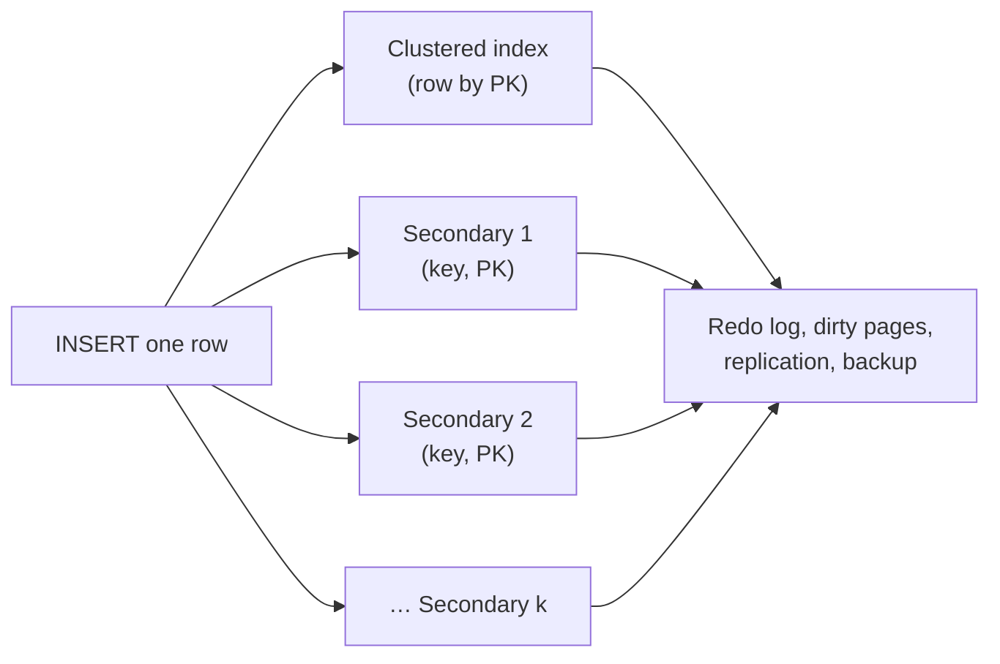

## Introduction

Indexes are the most effective performance tool in a relational database, which is exactly why they are over-used. The same B+ tree that turns a 200,000-row scan into a three-page lookup must be **maintained** on every `INSERT`, on every `DELETE`, and on every `UPDATE` that touches an indexed column. It occupies disk, buffer pool memory and backup time. It gives the optimizer one more option to evaluate — and occasionally to choose wrongly.

The mistakes in this lesson are not syntax errors; they are design debts that accumulate silently:

- **Over-indexing** — an index for every column or every query someone once ran, multiplying write cost.
- **Redundant and duplicate indexes** — `(last_name)` next to `(last_name, first_name)`, a `UNIQUE` and a plain index on the same column, an index on the primary key column.
- **Low-selectivity indexes** — an index on a boolean or a status that almost every row shares.
- **Wide primary keys** — a 32-byte string key copied into every secondary-index entry.
- **Unused indexes** — created for a feature that no longer exists.

You will measure write amplification and index size in your lab, detect redundancy with a query over `information_schema.STATISTICS`, see why the optimizer ignores low-selectivity indexes, and learn the safe procedure — **invisible first, drop later** — for removing indexes in production. The lesson builds on [InnoDB Clustered and Secondary Indexes](/lessons/m07-clustered-secondary), [Composite Indexes](/lessons/m07-composite-indexes) and [SARGable Queries](/lessons/m07-sargable-queries).

:::note[Lab data and timings]
**empty** dataset; all tables are generated in your lab. Sizes come from `information_schema.TABLES` after `ANALYZE TABLE` (InnoDB reports allocated pages, so values are approximate). Blocks marked *measured* include elapsed time from a shared build machine — compare relative differences, not absolute values.
:::

## DBMS Theory

:::theory[The cost of an index]
An index is a **redundant, ordered copy** of some columns plus a pointer to the row. Relational theory treats it as part of the physical schema: it never changes query results, only costs. Its cost model has three terms:

- **Write cost.** Each row insert/delete performs one B+ tree insert/delete per index, O(log N) each, often touching a page that is not in memory. An update of an indexed column is a delete plus an insert in that index. With *k* secondary indexes, a row insert does *k* + 1 tree modifications (the +1 is the clustered index in InnoDB). This multiplication is called **write amplification**.
- **Space cost.** Leaf entries hold the key plus the row pointer; in InnoDB the pointer is the full **primary key value**. Space translates into buffer pool pressure, I/O and backup/restore time.
- **Planning cost.** More indexes mean more alternatives for the optimizer — more index dives, a larger search, more chances for a misestimate to select a poor plan.

The benefit side is read-only: an index pays off only for queries whose access path, ordering or covering needs it.
:::

**Redundancy, formally.** For B+ tree indexes, index I₁ on (a₁, …, aₘ) is **redundant** with respect to I₂ on (a₁, …, aₘ, …, aₙ) if I₁'s key is a **left prefix** of I₂'s: every lookup, range, ordering or grouping I₁ can serve, I₂ can serve too (I₂'s entries are larger, so I₁ may be slightly cheaper to scan — rarely enough to justify its maintenance). Exceptions: a `UNIQUE` index enforces a constraint that the longer index does not, and a foreign key needs *some* index whose prefix is the FK columns (the longer index satisfies that).

**Selectivity.** An index on column *c* is useful for an equality lookup when the fraction of rows matching a typical value is small. For a column with *d* distinct, uniformly distributed values, a lookup returns about N/d rows. When N/d is a sizable fraction of N (booleans, status flags), reading those rows through the secondary index — one clustered lookup each — costs more than a sequential scan, so the optimizer ignores the index. Skew changes the picture: an index on a status column is useful for the *rare* values even if useless for the common one.

:::standard[Standard SQL vs MySQL]
Indexes are outside the SQL standard; `CREATE INDEX` syntax, invisible indexes, functional key parts and the `sys` views are MySQL-specific. Two features common elsewhere are **absent in MySQL**: *partial (filtered) indexes* (`CREATE INDEX … WHERE active` in PostgreSQL, filtered indexes in SQL Server) and *INCLUDE columns* (non-key payload columns in PostgreSQL/SQL Server). In MySQL you emulate them with composite indexes or generated columns — which affects how you fix low-selectivity and covering problems.
:::

## Why It Exists

Every one of these mistakes starts as a reasonable local decision:

- A query is slow, someone adds an index for it. Repeat for three years and the table has 14 indexes, half of them overlapping.
- An ORM or migration tool creates an index for every foreign key *and* the developer adds a composite index starting with the same column.
- A boolean "looks like a filter", so it gets an index.
- A team chooses UUID strings as primary keys for global uniqueness without realising InnoDB copies the primary key into every secondary index.

The consequences show up elsewhere and later: insert throughput drops, replication lag grows (every replica repeats the index maintenance), the buffer pool no longer holds the working set, backups and schema migrations take hours, and plan choices become less stable. This lesson exists so that an index review — removing, merging and right-sizing indexes — becomes part of normal engineering, not an emergency.

## Internal Working

:::internals[What an index costs inside InnoDB]
**Secondary-index entries carry the primary key.** A secondary index leaf entry is (indexed columns, primary key columns). With an `INT` primary key that is 4 bytes per entry; with a `CHAR(32)` hexadecimal key it is 32 bytes (more with multi-byte character sets in the in-memory format). Every secondary index grows accordingly, and every bookmark lookup compares longer keys.

**Insert path.** An `INSERT` writes the row into the clustered index, then inserts one entry into each secondary index. Unique secondary indexes must be checked immediately (a read of the relevant leaf page). For non-unique secondary indexes InnoDB can buffer the change when the leaf page is not in the buffer pool (the **change buffer**), merging it later; this reduces random I/O but does not remove the work. The insert also writes redo log records for every modified page, so log volume grows with the number of indexes.

**Update path.** Updating a non-indexed column changes the clustered record only. Updating an indexed column delete-marks the old secondary entry and inserts a new one (purge removes the old entry later). Updating the **primary key** moves the row and rewrites every secondary entry.

**Page splits and key order.** Monotonically increasing keys (auto-increment, time-ordered) append at the right edge of the B+ tree, filling pages almost completely. Random keys (hash strings, random UUIDs) insert into the middle, splitting pages that end up around half full — the tree is larger and its pages are spread over the buffer pool.

**Optimization path.** For each query, the range optimizer considers every index with a usable predicate and may perform index dives on each; more overlapping indexes mean more dives and more alternatives, including index-merge plans built from single-column indexes.
:::

:::version[8.0 vs 8.4]
In MySQL 8.4 LTS the default of `innodb_change_buffering` is `none` (it was `all` in 8.0), so secondary-index changes are no longer buffered by default and each index insert into an uncached page reads that page. Write amplification from many secondary indexes is therefore *more* visible on 8.4 when the working set exceeds the buffer pool. The capture server is 8.0, so the measured block below ran with change buffering enabled.

```sql
-- Display only: 8.4 default; changing it requires SET GLOBAL / SET PERSIST
SELECT @@GLOBAL.innodb_change_buffering;   -- 'none' on a default 8.4 install
```
:::



## MySQL Implementation

**Write amplification, measured.** Two tables with identical columns: `w_lean` has only a primary key, `w_heavy` has eight secondary indexes, several of them overlapping — a realistic "index for every query" table.

```sql run
SET SESSION cte_max_recursion_depth = 200000;
SET SESSION information_schema_stats_expiry = 0;   -- always read fresh sizes from InnoDB
CREATE TABLE w_lean (
  id INT UNSIGNED NOT NULL PRIMARY KEY,
  a  INT NOT NULL, b INT NOT NULL, c INT NOT NULL,
  d  VARCHAR(20) NOT NULL, e DATE NOT NULL
);
CREATE TABLE w_heavy LIKE w_lean;
ALTER TABLE w_heavy
  ADD INDEX i_a (a), ADD INDEX i_b (b), ADD INDEX i_c (c), ADD INDEX i_d (d), ADD INDEX i_e (e),
  ADD INDEX i_ab (a, b), ADD INDEX i_ba (b, a), ADD INDEX i_de (d, e);
```

Load the same 100,000 rows into each:

```sql run measured
INSERT INTO w_lean
WITH RECURSIVE s(n) AS (SELECT 1 UNION ALL SELECT n + 1 FROM s WHERE n < 100000)
SELECT n, (n * 7919) % 100000, (n * 104729) % 100000, (n * 31) % 5000,
       LEFT(MD5(n), 20), DATE '2020-01-01' + INTERVAL n % 1800 DAY
FROM s;
```

```sql run measured
INSERT INTO w_heavy
WITH RECURSIVE s(n) AS (SELECT 1 UNION ALL SELECT n + 1 FROM s WHERE n < 100000)
SELECT n, (n * 7919) % 100000, (n * 104729) % 100000, (n * 31) % 5000,
       LEFT(MD5(n), 20), DATE '2020-01-01' + INTERVAL n % 1800 DAY
FROM s;
```

Compare the elapsed times of the two blocks: the same rows, but each `w_heavy` row also required eight index insertions, most of them at random positions. Now the space:

```sql run
ANALYZE TABLE w_lean, w_heavy;
SELECT TABLE_NAME, TABLE_ROWS, DATA_LENGTH, INDEX_LENGTH,
       ROUND(INDEX_LENGTH / DATA_LENGTH, 2) AS index_to_data_ratio
FROM information_schema.TABLES
WHERE TABLE_SCHEMA = DATABASE() AND TABLE_NAME IN ('w_lean', 'w_heavy')
ORDER BY TABLE_NAME;
```

`DATA_LENGTH` (the clustered index, i.e. the rows) is the same for both tables; `w_lean` has no secondary-index space at all, while `w_heavy`'s secondary indexes together are about four times larger than the table data. That space has to live in the buffer pool to be fast, competes with the data, and is copied by every backup.

## Syntax Breakdown

| Statement | Purpose | Notes |
|---|---|---|
| `SHOW INDEX FROM t` | List indexes, columns, cardinality, visibility | Quick inspection |
| `information_schema.STATISTICS` | One row per index column: `INDEX_NAME`, `SEQ_IN_INDEX`, `COLUMN_NAME`, `NON_UNIQUE`, `IS_VISIBLE`, `EXPRESSION` | Queryable; basis for redundancy checks |
| `information_schema.TABLES` | `DATA_LENGTH`, `INDEX_LENGTH`, `TABLE_ROWS` (estimates) | Set `information_schema_stats_expiry = 0` for fresh values |
| `ALTER TABLE t ALTER INDEX i INVISIBLE` / `VISIBLE` | Hide an index from the optimizer while still maintaining it | Instant metadata change; primary key cannot be invisible |
| `SET SESSION optimizer_switch = 'use_invisible_indexes=on'` | Let one session use invisible indexes | Test before re-enabling |
| `ALTER TABLE t DROP INDEX i, ADD INDEX j (…)` | Replace indexes in one statement | Online DDL: in-place, concurrent DML allowed for secondary indexes |
| `ALTER TABLE t RENAME INDEX old TO new` | Rename without rebuilding | |
| `sys.schema_redundant_indexes` | Redundant/duplicate indexes with suggested `DROP` | Requires sys access (display-only here) |
| `sys.schema_unused_indexes` | Indexes with no recorded reads since startup | Based on performance_schema I/O instrumentation |
| `performance_schema.table_io_waits_summary_by_index_usage` | Per-index read/write counts | Source for unused-index analysis |

## Practical Examples

**1. Wide primary keys bloat every secondary index.** Two user tables with the same columns and the same three secondary indexes; one uses an `INT` primary key, the other a 32-character hexadecimal string (an MD5 here, standing in for an application-generated UUID string):

```sql run
CREATE TABLE users_int (
  id     INT UNSIGNED NOT NULL PRIMARY KEY,
  email  VARCHAR(40)  NOT NULL, city VARCHAR(20) NOT NULL, signup DATE NOT NULL,
  INDEX idx_email (email), INDEX idx_city (city), INDEX idx_signup (signup)
);
CREATE TABLE users_hex (
  id     CHAR(32)     NOT NULL PRIMARY KEY,
  email  VARCHAR(40)  NOT NULL, city VARCHAR(20) NOT NULL, signup DATE NOT NULL,
  INDEX idx_email (email), INDEX idx_city (city), INDEX idx_signup (signup)
);
INSERT INTO users_int
WITH RECURSIVE s(n) AS (SELECT 1 UNION ALL SELECT n + 1 FROM s WHERE n < 100000)
SELECT n, CONCAT('u', n, '@example.com'), ELT(1 + n % 10, 'Austin', 'Boston', 'Chicago', 'Denver', 'Fresno',
       'Houston', 'Irvine', 'Miami', 'Oakland', 'Seattle'), DATE '2020-01-01' + INTERVAL n % 1800 DAY
FROM s;
INSERT INTO users_hex
WITH RECURSIVE s(n) AS (SELECT 1 UNION ALL SELECT n + 1 FROM s WHERE n < 100000)
SELECT MD5(n), CONCAT('u', n, '@example.com'), ELT(1 + n % 10, 'Austin', 'Boston', 'Chicago', 'Denver', 'Fresno',
       'Houston', 'Irvine', 'Miami', 'Oakland', 'Seattle'), DATE '2020-01-01' + INTERVAL n % 1800 DAY
FROM s;
ANALYZE TABLE users_int, users_hex;
SELECT TABLE_NAME, DATA_LENGTH, INDEX_LENGTH
FROM information_schema.TABLES
WHERE TABLE_SCHEMA = DATABASE() AND TABLE_NAME IN ('users_int', 'users_hex')
ORDER BY TABLE_NAME;
```

Both the clustered index (`DATA_LENGTH`) and the secondary indexes (`INDEX_LENGTH`) of `users_hex` are much larger. Two effects combine: each secondary entry carries a 32-character key instead of 4 bytes, and random key order causes page splits that leave clustered-index pages partly empty. If globally unique ids are required, store them compactly — `BINARY(16)` with `UUID_TO_BIN(UUID(), 1)`, whose swap flag makes time-based UUIDs roughly increasing — or keep an `INT`/`BIGINT` auto-increment primary key and put the external id in a unique secondary index.

**2. A legacy table full of redundant indexes.** This is what years of "add an index for this query" look like:

```sql run
CREATE TABLE accounts_legacy (
  id         INT UNSIGNED NOT NULL PRIMARY KEY,
  email      VARCHAR(60)  NOT NULL,
  last_name  VARCHAR(40)  NOT NULL,
  first_name VARCHAR(40)  NOT NULL,
  status     VARCHAR(10)  NOT NULL,
  created_at DATETIME     NOT NULL,
  UNIQUE KEY uq_email (email),
  KEY idx_email (email),                      -- duplicate of uq_email
  KEY idx_id (id),                            -- duplicate of the PRIMARY KEY
  KEY idx_last (last_name),                   -- left prefix of idx_last_first
  KEY idx_last_first (last_name, first_name),
  KEY idx_status (status),
  KEY idx_created_id (created_at, id)         -- id is already the hidden suffix of every secondary index
);
SHOW WARNINGS;
```

MySQL accepts all of it, and `SHOW WARNINGS` is empty: none of these is an *identical* definition (same columns, same uniqueness), which is the only case where MySQL emits its deprecation warning about duplicate indexes. Redundancy is not something the server will tell you about. A query over `information_schema.STATISTICS` finds every index whose column list is a left prefix of — or identical to — another index's list:

```sql run
WITH idx AS (
  SELECT INDEX_NAME, NON_UNIQUE,
         GROUP_CONCAT(COLUMN_NAME ORDER BY SEQ_IN_INDEX SEPARATOR ',') AS cols
  FROM information_schema.STATISTICS
  WHERE TABLE_SCHEMA = DATABASE() AND TABLE_NAME = 'accounts_legacy'
  GROUP BY INDEX_NAME, NON_UNIQUE
)
SELECT r.INDEX_NAME AS redundant_index, r.cols AS redundant_cols,
       d.INDEX_NAME AS covered_by,      d.cols AS covering_cols
FROM idx AS r
JOIN idx AS d
  ON d.INDEX_NAME <> r.INDEX_NAME
 AND CONCAT(d.cols, ',') LIKE CONCAT(r.cols, ',%')
WHERE r.NON_UNIQUE = 1                 -- never report a UNIQUE/PRIMARY index as redundant
ORDER BY r.INDEX_NAME, d.INDEX_NAME;
```

The result lists `idx_email` (covered by `uq_email`), `idx_id` (covered by `PRIMARY`) and `idx_last` (covered by `idx_last_first`). The query cannot see the fourth problem: `idx_created_id (created_at, id)` is functionally identical to an index on `(created_at)` alone, because InnoDB appends the primary key to every secondary index anyway. The `sys` schema's `schema_redundant_indexes` view performs a similar analysis on a real server (display-only here):

```sql
-- Display only: requires access to the sys schema
SELECT table_name, redundant_index_name, redundant_index_columns,
       dominant_index_name, dominant_index_columns, sql_drop_index
FROM sys.schema_redundant_indexes
WHERE table_schema = 'shop';
```

Clean up in one online `ALTER TABLE` — dropping secondary indexes is an in-place, metadata-mostly operation:

```sql run
ALTER TABLE accounts_legacy
  DROP INDEX idx_email,
  DROP INDEX idx_id,
  DROP INDEX idx_last,
  DROP INDEX idx_created_id,
  ADD INDEX idx_created (created_at);
SELECT INDEX_NAME, GROUP_CONCAT(COLUMN_NAME ORDER BY SEQ_IN_INDEX) AS cols, MIN(NON_UNIQUE) AS non_unique
FROM information_schema.STATISTICS
WHERE TABLE_SCHEMA = DATABASE() AND TABLE_NAME = 'accounts_legacy'
GROUP BY INDEX_NAME ORDER BY INDEX_NAME;
```

Before dropping anything in production, check two things the query cannot know: whether a foreign key relies on the index (MySQL refuses to drop an index a foreign key needs, unless another index can serve it), and whether any statement uses an **index hint** naming it (`FORCE INDEX (idx_last)` would start failing with an error).

**3. Low-selectivity indexes.** An `is_active` flag that 95 % of rows share:

```sql run
CREATE TABLE members_flag (
  member_id  INT UNSIGNED NOT NULL PRIMARY KEY,
  is_active  TINYINT      NOT NULL,
  joined_at  DATETIME     NOT NULL,
  INDEX idx_active (is_active)
);
INSERT INTO members_flag
WITH RECURSIVE s(n) AS (SELECT 1 UNION ALL SELECT n + 1 FROM s WHERE n < 100000)
SELECT n, IF(n % 20 = 0, 0, 1), TIMESTAMP '2020-01-01 00:00:00' + INTERVAL n * 23 MINUTE FROM s;
ANALYZE TABLE members_flag;
EXPLAIN SELECT member_id, joined_at FROM members_flag WHERE is_active = 1;
EXPLAIN SELECT member_id, joined_at FROM members_flag WHERE is_active = 0;
```

Both plans are a `ref` on `idx_active` — including the one for the common value. Look at the estimates: 5,000 rows for `is_active = 0` (exact) but only about 50,000 — roughly half of the table — for `is_active = 1`, although 95,000 rows match. That is InnoDB's cap on range estimates at half the table (seen in [How the MySQL Optimizer Chooses Plans](/lessons/m07-optimizer-decisions)); with the estimate halved, reading "half the table" through the index looks competitive with a scan, so the optimizer reads 95 % of the table through one secondary-index lookup after another. For the rare value the index is genuinely useful. For the common value it is the worst of both worlds: it costs on every write *and* attracts a plan that is slower than the full scan it replaced. An index that exists only for the common value should not exist. The usual real-world query is not "all active members" but "the newest active members" — and that is served by a **composite** index that leads with the flag and continues with the sort column:

```sql run
ALTER TABLE members_flag DROP INDEX idx_active, ADD INDEX idx_active_joined (is_active, joined_at);
EXPLAIN SELECT member_id, joined_at FROM members_flag WHERE is_active = 1 ORDER BY joined_at DESC LIMIT 20;
```

A `ref` on `idx_active_joined`, read backwards, stopping after 20 entries — no filesort, and covering because `member_id` is the hidden primary-key suffix. The low-selectivity column is harmless, even useful, as the *leading equality column* of an index whose later columns do the real narrowing or ordering.

**4. Testing a removal with an invisible index.** Suspect that `idx_status` on `accounts_legacy` is unused? Make it invisible: the optimizer stops considering it, but InnoDB keeps maintaining it, so turning it back on is instant:

```sql run
ALTER TABLE accounts_legacy ALTER INDEX idx_status INVISIBLE;
EXPLAIN SELECT id FROM accounts_legacy WHERE status = 'locked';
SET SESSION optimizer_switch = 'use_invisible_indexes=on';
EXPLAIN SELECT id FROM accounts_legacy WHERE status = 'locked';
SET SESSION optimizer_switch = 'default';
SELECT INDEX_NAME, IS_VISIBLE FROM information_schema.STATISTICS
WHERE TABLE_SCHEMA = DATABASE() AND TABLE_NAME = 'accounts_legacy' AND INDEX_NAME = 'idx_status';
```

With the index invisible, `idx_status` is absent from `possible_keys`; a session that opts in with `use_invisible_indexes=on` sees it again — useful for comparing plans before deciding. In production you would leave the index invisible through a full business cycle (month-end jobs included), watching latency and digests, before dropping it.

## Execution Walkthrough

The walkthrough runs an index review of a table that has accumulated indexes, following the optimization method: inventory, detect, decide, change, verify.

```walkthrough
title: Index review of w_heavy
steps:
  - title: "1. Inventory"
    explain: >-
      List every index with its columns. Eight secondary indexes on a six-column table is already a smell; look for
      shared leading columns.
    sql: |
      SELECT INDEX_NAME, GROUP_CONCAT(COLUMN_NAME ORDER BY SEQ_IN_INDEX) AS cols
      FROM information_schema.STATISTICS
      WHERE TABLE_SCHEMA = DATABASE() AND TABLE_NAME = 'w_heavy'
      GROUP BY INDEX_NAME ORDER BY INDEX_NAME;
  - title: "2. Detect left-prefix redundancy"
    explain: >-
      i_a is a prefix of i_ab, i_b of i_ba and i_d of i_de. Each pair can serve the same lookups with one index.
    sql: |
      WITH idx AS (
        SELECT INDEX_NAME, NON_UNIQUE, GROUP_CONCAT(COLUMN_NAME ORDER BY SEQ_IN_INDEX) AS cols
        FROM information_schema.STATISTICS
        WHERE TABLE_SCHEMA = DATABASE() AND TABLE_NAME = 'w_heavy'
        GROUP BY INDEX_NAME, NON_UNIQUE)
      SELECT r.INDEX_NAME AS redundant_index, d.INDEX_NAME AS covered_by
      FROM idx r JOIN idx d
        ON d.INDEX_NAME <> r.INDEX_NAME AND CONCAT(d.cols, ',') LIKE CONCAT(r.cols, ',%')
      WHERE r.NON_UNIQUE = 1
      ORDER BY r.INDEX_NAME;
  - title: "3. Decide with the workload, not the schema alone"
    explain: >-
      Suppose the workload (from statement digests) is: lookups by a, by a and b, by b, by d and e, and by c.
      i_ab serves "a" and "a and b"; i_ba serves "b"; i_de serves "d and e" and "d"; i_c serves "c". i_e serves
      nothing in this workload. Plan: drop i_a, i_b, i_d and i_e; keep i_ab, i_ba, i_de, i_c.
  - title: "4. Confirm the replacement serves the query before dropping"
    explain: >-
      Make the candidate invisible and check that the plan for a lookup by a switches to i_ab with no loss of
      access type.
    sql: |
      ALTER TABLE w_heavy ALTER INDEX i_a INVISIBLE;
      EXPLAIN SELECT id FROM w_heavy WHERE a = 4242;
  - title: "5. Apply the change and measure what it saves"
    explain: >-
      Drop the four indexes in one online ALTER and re-read the sizes. INDEX_LENGTH falls substantially; every future
      insert does four fewer index modifications.
    sql: |
      ALTER TABLE w_heavy DROP INDEX i_a, DROP INDEX i_b, DROP INDEX i_d, DROP INDEX i_e;
      ANALYZE TABLE w_heavy;
      SELECT TABLE_NAME, DATA_LENGTH, INDEX_LENGTH
      FROM information_schema.TABLES
      WHERE TABLE_SCHEMA = DATABASE() AND TABLE_NAME = 'w_heavy';
```

## Output

Re-run the insert benchmark on the slimmed table to see the write-side effect. Load another 100,000 rows into `w_heavy`, now with four secondary indexes instead of eight:

```sql run measured
INSERT INTO w_heavy
WITH RECURSIVE s(n) AS (SELECT 1 UNION ALL SELECT n + 1 FROM s WHERE n < 100000)
SELECT 100000 + n, (n * 7919) % 100000, (n * 104729) % 100000, (n * 31) % 5000,
       LEFT(MD5(n), 20), DATE '2020-01-01' + INTERVAL n % 1800 DAY
FROM s;
```

Compare its elapsed time with the first `w_heavy` load (eight indexes) and the `w_lean` load (none). The three measurements, taken on the same shared build machine, show insert cost rising with the number of secondary indexes. Treat the exact ratios as indicative — they depend on the buffer pool, change buffering (enabled on the 8.0 capture server, disabled by default in 8.4), key randomness and concurrent load — but the direction is robust: every index is paid for on every write.

## Alternative Approaches

| Problem | Instead of | Consider | Trade-off |
|---|---|---|---|
| Many single-column indexes | `INDEX(a)`, `INDEX(b)`, `INDEX(c)` + index merge | One or two composite indexes ordered by the workload's equality/range/sort pattern | Must match leftmost prefixes; needs workload knowledge |
| Overlapping prefixes | `(a)` and `(a, b)` | Keep `(a, b)` only | `(a)` scans are marginally smaller |
| Covering needs | Wide composite with every selected column | Cover only the hottest queries; accept lookups elsewhere | Wider indexes cost more on writes |
| Low-selectivity flag | `INDEX(is_active)` | Composite `(is_active, sort_col)`; or no index; or split hot/cold rows into separate tables | No partial indexes in MySQL |
| Wide/random primary key | `CHAR(36)` UUID PK | `BIGINT AUTO_INCREMENT` PK + `UNIQUE BINARY(16)` external id; or `BINARY(16)` time-ordered UUID PK | Two identifiers to manage, or swap-flag UUID conventions |
| Index for a rare report | Permanent index on a hot OLTP table | Run the report on a replica with its own extra index (if the replication setup allows), or a summary table | Operational complexity |
| Unique constraint + index | `UNIQUE(email)` + `INDEX(email)` | The unique index alone | — |

## Performance Analysis

**Quantifying write amplification.** For a table with *k* secondary indexes, an insert performs *k* + 1 B+ tree inserts. If the indexed keys are random (hashes, UUIDs, `email`), each of those inserts touches a different, likely uncached leaf page once the table exceeds the buffer pool — up to *k* + 1 random page reads and later page writes per row. Updates of indexed columns cost two index operations each; updates of non-indexed columns cost none. The lab measured the insert side directly; the same logic predicts replication lag on replicas (which repeat all index maintenance) and redo volume.

**Space and memory.** `INDEX_LENGTH` in the lab exceeded `DATA_LENGTH` several times over with eight indexes. In production the question is whether the **working set** — the hot parts of the clustered index plus the hot parts of the indexes that queries use — fits in the buffer pool. Unused indexes still have hot pages (the right-hand edge where inserts land), so they steal memory even if no query reads them.

**Read-side benefits must justify the cost.** An index earns its keep if it is the best access path, ordering or covering structure for frequent or latency-critical queries. Measure: digests (`SUM_NO_INDEX_USED` before/after), EXPLAIN of the top statements, and per-index read counts.

**Unused index detection on a real server** (display-only; the sandbox cannot read performance_schema or sys):

```sql
-- Display only: indexes with no reads since the server started (or since stats were truncated)
SELECT object_schema, object_name, index_name
FROM sys.schema_unused_indexes
WHERE object_schema = 'shop';

-- The underlying per-index counters
SELECT OBJECT_NAME, INDEX_NAME, COUNT_READ, COUNT_WRITE, COUNT_FETCH, COUNT_INSERT, COUNT_DELETE
FROM performance_schema.table_io_waits_summary_by_index_usage
WHERE OBJECT_SCHEMA = 'shop' AND INDEX_NAME IS NOT NULL
ORDER BY COUNT_READ ASC;
```

*Illustrative output — not captured:* a row such as `orders | idx_coupon_code | COUNT_READ = 0 | COUNT_WRITE = 18,204,331` says the index was written eighteen million times since startup and never read. Interpret with care: "since startup" may not include the monthly billing job; an index used only by a quarterly report looks unused for eleven weeks. Combine the counters with a long observation window and the invisible-index test.

:::performance[Theory vs measurement]
Sizes are InnoDB page allocations after ANALYZE and are approximate; insert timings are from a shared build machine with an 8.0 configuration (change buffering on). Both are reliable for the *direction* and rough magnitude of the effects in this lesson. For production decisions, measure on the real workload: digest latency of the writes, replication lag, buffer pool hit rate and per-index read counts.
:::

## Best Practices

:::best-practice[Index hygiene]
1. **Design indexes from the workload**, not from the schema: list the top statements (digests), their equality/range/sort columns, and design the fewest composite indexes that serve them.
2. **Never keep left-prefix duplicates** unless one of them enforces uniqueness or a deliberate covering/size trade-off is documented.
3. **Do not append the primary key** to secondary indexes by hand in InnoDB — it is already there.
4. **Keep primary keys narrow and increasing**: `INT`/`BIGINT` auto-increment, or time-ordered `BINARY(16)` UUIDs. Never `CHAR(36)` UUID strings.
5. **Do not index low-selectivity columns alone**; use them as the leading equality of a composite index when queries combine them with a selective or ordering column.
6. **Remove indexes safely**: check FKs and index hints, make the index invisible, observe a full business cycle, then drop it with online DDL.
7. **Review indexes regularly** (e.g. quarterly) with `sys.schema_redundant_indexes`, `sys.schema_unused_indexes` and the top digests.
8. **Count the cost on replicas and in backups**, not only on the primary.
:::

## Common Mistakes

**Mistake 1 — "an index on every column, just in case".** Shown above with `w_heavy`: writes slow down in proportion, and the optimizer gains index-merge options that are usually worse than one good composite index.

**Mistake 2 — duplicate index on the primary key column.** `KEY idx_id (id)` next to `PRIMARY KEY (id)` serves no query the clustered index cannot, and doubles the work for that column. Same for `INDEX(email)` next to `UNIQUE(email)`.

**Mistake 3 — composite index in the wrong order, plus a "fix" index.** `INDEX(created_at, customer_id)` cannot serve `WHERE customer_id = ?`; adding `INDEX(customer_id)` beside it is the typical patch. The right design for `WHERE customer_id = ? AND created_at >= ?` is one index `(customer_id, created_at)` — equality before range — which also serves `WHERE customer_id = ?` alone.

**Mistake 4 — dropping an index that a foreign key needs or a hint names.**

```sql run error
CREATE TABLE parents_m (id INT PRIMARY KEY);
CREATE TABLE children_m (id INT PRIMARY KEY, parent_id INT NOT NULL,
  INDEX idx_parent (parent_id),
  CONSTRAINT fk_parent FOREIGN KEY (parent_id) REFERENCES parents_m (id));
ALTER TABLE children_m DROP INDEX idx_parent;
```

MySQL refuses: the foreign key needs an index on `parent_id`. (If another index started with `parent_id`, the drop would succeed and that index would take over.) Statements with `FORCE INDEX (idx_parent)` would fail after a successful drop — search the codebase for hints before removing indexes.

**Mistake 5 — trusting "unused" counters from a short window.** Performance_schema counters reset at restart. An index used only by month-end jobs looks unused for weeks. Use invisible indexes and long observation windows.

**Mistake 6 — random string primary keys "for scalability".** They make every secondary index larger, fragment the clustered index and slow inserts once the table outgrows memory — the opposite of scalable on a single InnoDB instance.

## Industry Application

- **Schema reviews and linters.** Many teams run automated checks in CI (e.g. pt-duplicate-key-checker, custom STATISTICS queries like the one above, or schema linters in migration tools) that flag duplicate and left-prefix-redundant indexes before a migration is merged.
- **Write-heavy services** (event ingestion, logging, IoT) deliberately keep only the primary key and one or two secondary indexes on hot tables, pushing analytics to replicas, summary tables or a warehouse.
- **Large migrations.** Dropping unused indexes before an `ALTER TABLE` that rebuilds a huge table shortens the rebuild and the replication catch-up; online schema change tools (gh-ost, pt-online-schema-change) copy every index.
- **Cost control in the cloud.** Index space is storage and I/O you pay for; teams regularly reclaim tens of percent of storage by removing redundant indexes from legacy schemas.
- **UUID migrations.** Organisations that started with `CHAR(36)` UUID primary keys commonly migrate to `BINARY(16)` with `UUID_TO_BIN(…, 1)` or to surrogate `BIGINT` keys after insert throughput and buffer pool efficiency degrade.

## Practice Exercises

Exercises are graded by comparing result rows (or the `check` query for DML exercises) with the reference solution.

```exercise
id: ex1
title: Remove the duplicates
difficulty: easy
kind: dml
concepts: [redundant-indexes]
setup: |
  CREATE TABLE vendors (
    vendor_id INT UNSIGNED PRIMARY KEY, tax_id VARCHAR(20) NOT NULL, name VARCHAR(60) NOT NULL,
    UNIQUE KEY uq_tax (tax_id), KEY idx_tax (tax_id), KEY idx_vendor (vendor_id), KEY idx_name (name));
prompt: |
  `vendors` has two indexes that duplicate other indexes exactly. Drop them (and only them) with one
  `ALTER TABLE` statement.
hints:
  - "Compare each secondary index's columns with PRIMARY KEY and the UNIQUE key."
  - "idx_tax duplicates uq_tax; idx_vendor duplicates the primary key."
solution: |
  ALTER TABLE vendors DROP INDEX idx_tax, DROP INDEX idx_vendor;
check: |
  SELECT INDEX_NAME, GROUP_CONCAT(COLUMN_NAME ORDER BY SEQ_IN_INDEX) AS cols
  FROM information_schema.STATISTICS
  WHERE TABLE_SCHEMA = DATABASE() AND TABLE_NAME = 'vendors'
  GROUP BY INDEX_NAME ORDER BY INDEX_NAME;
explanation: |
  `uq_tax` already provides an index on `tax_id` and enforces uniqueness; `PRIMARY` is the clustered index on
  `vendor_id`. Dropping the unique index instead of `idx_tax` would be wrong — it would remove the constraint.
  `idx_name` is not redundant and stays.
```

```exercise
id: ex2
title: Write a redundancy detector
difficulty: medium
concepts: [redundant-indexes, over-indexing]
setup: |
  CREATE TABLE trips (
    trip_id INT UNSIGNED PRIMARY KEY, driver_id INT NOT NULL, rider_id INT NOT NULL, city_id INT NOT NULL,
    started_at DATETIME NOT NULL, fare DECIMAL(8,2) NOT NULL,
    KEY idx_driver (driver_id), KEY idx_driver_started (driver_id, started_at),
    KEY idx_rider (rider_id), KEY idx_city (city_id), KEY idx_city_driver (city_id, driver_id),
    KEY idx_city_driver_started (city_id, driver_id, started_at), KEY idx_started (started_at));
prompt: |
  Using `information_schema.STATISTICS`, list every **non-unique** index of `trips` whose column list is a left
  prefix of another index's column list. Columns: `redundant_index`, `covered_by`. If an index is covered by
  several longer indexes, list each pair.
hints:
  - "Build one row per index with GROUP_CONCAT(COLUMN_NAME ORDER BY SEQ_IN_INDEX)."
  - "Self-join: d.cols starts with r.cols followed by a comma — compare CONCAT(d.cols, ',') LIKE CONCAT(r.cols, ',%')."
  - "Restrict to TABLE_SCHEMA = DATABASE() AND TABLE_NAME = 'trips', and r.NON_UNIQUE = 1."
solution: |
  WITH idx AS (
    SELECT INDEX_NAME, NON_UNIQUE, GROUP_CONCAT(COLUMN_NAME ORDER BY SEQ_IN_INDEX) AS cols
    FROM information_schema.STATISTICS
    WHERE TABLE_SCHEMA = DATABASE() AND TABLE_NAME = 'trips'
    GROUP BY INDEX_NAME, NON_UNIQUE)
  SELECT r.INDEX_NAME AS redundant_index, d.INDEX_NAME AS covered_by
  FROM idx r JOIN idx d
    ON d.INDEX_NAME <> r.INDEX_NAME AND CONCAT(d.cols, ',') LIKE CONCAT(r.cols, ',%')
  WHERE r.NON_UNIQUE = 1;
explanation: |
  `idx_driver` ⊂ `idx_driver_started`; `idx_city` ⊂ `idx_city_driver` and `idx_city_driver_started`;
  `idx_city_driver` ⊂ `idx_city_driver_started`. Appending a comma before comparing prevents false matches such as
  a column `city` matching `city_id`. `idx_rider` and `idx_started` are not prefixes of anything. Before dropping,
  remember that a shorter index can be a deliberate choice (smaller scans for covering COUNTs) — the query finds
  candidates, the workload decides.
```

```exercise
id: ex3
title: One composite instead of three
difficulty: medium
kind: dml
concepts: [over-indexing, redundant-indexes]
setup: |
  CREATE TABLE bookings (
    booking_id INT UNSIGNED PRIMARY KEY, hotel_id INT NOT NULL, check_in DATE NOT NULL, guest_id INT NOT NULL,
    KEY idx_hotel (hotel_id), KEY idx_checkin (check_in), KEY idx_checkin_hotel (check_in, hotel_id));
prompt: |
  The workload has exactly two queries:

  - `SELECT … FROM bookings WHERE hotel_id = ? AND check_in >= ? AND check_in < ?`
  - `SELECT … FROM bookings WHERE hotel_id = ?`

  Replace all three secondary indexes with a **single** index named `idx_hotel_checkin` that serves both queries
  optimally. Use one `ALTER TABLE`.
hints:
  - "Equality columns before range columns."
  - "An index whose leftmost column is hotel_id also serves the hotel_id-only query."
solution: |
  ALTER TABLE bookings
    DROP INDEX idx_hotel, DROP INDEX idx_checkin, DROP INDEX idx_checkin_hotel,
    ADD INDEX idx_hotel_checkin (hotel_id, check_in);
check: |
  SELECT INDEX_NAME, GROUP_CONCAT(COLUMN_NAME ORDER BY SEQ_IN_INDEX) AS cols
  FROM information_schema.STATISTICS
  WHERE TABLE_SCHEMA = DATABASE() AND TABLE_NAME = 'bookings' AND INDEX_NAME <> 'PRIMARY'
  GROUP BY INDEX_NAME;
explanation: |
  `(hotel_id, check_in)` gives an equality on the first key part and a range on the second for query 1, and a
  `ref` on the leftmost prefix for query 2. `(check_in, hotel_id)` is the wrong order: the range on `check_in` would
  stop `hotel_id` from narrowing the scan, and it cannot serve query 2 at all. Three indexes became one — a third of
  the write cost for these columns.
```

```exercise
id: ex4
title: Which column deserves an index?
difficulty: hard
concepts: [low-selectivity-indexes]
setup: |
  SET SESSION cte_max_recursion_depth = 20000;
  CREATE TABLE devices_m (device_id INT UNSIGNED PRIMARY KEY, os VARCHAR(10) NOT NULL, is_online TINYINT NOT NULL,
                          firmware VARCHAR(12) NOT NULL, owner_id INT UNSIGNED NOT NULL);
  INSERT INTO devices_m WITH RECURSIVE s(n) AS (SELECT 1 UNION ALL SELECT n + 1 FROM s WHERE n < 20000)
    SELECT n, ELT(1 + n % 3, 'ios', 'android', 'linux'), IF(n % 10 = 0, 0, 1),
           CONCAT('fw-', 1 + n % 40), 1 + (n * 37) % 5000 FROM s;
prompt: |
  Before adding indexes, quantify how selective each candidate column is. Return one row per column with:

  - `column_name` — one of `os`, `is_online`, `firmware`, `owner_id`
  - `distinct_values` — number of distinct values
  - `avg_rows_per_value` — table rows ÷ distinct values, rounded to 1 decimal

  Order by `avg_rows_per_value` ascending (most selective first).
hints:
  - "COUNT(DISTINCT col) and COUNT(*) per column; combine four SELECTs with UNION ALL."
  - "ROUND(COUNT(*) / COUNT(DISTINCT col), 1)."
solution: |
  SELECT 'os' AS column_name, COUNT(DISTINCT os) AS distinct_values,
         ROUND(COUNT(*) / COUNT(DISTINCT os), 1) AS avg_rows_per_value FROM devices_m
  UNION ALL
  SELECT 'is_online', COUNT(DISTINCT is_online), ROUND(COUNT(*) / COUNT(DISTINCT is_online), 1) FROM devices_m
  UNION ALL
  SELECT 'firmware', COUNT(DISTINCT firmware), ROUND(COUNT(*) / COUNT(DISTINCT firmware), 1) FROM devices_m
  UNION ALL
  SELECT 'owner_id', COUNT(DISTINCT owner_id), ROUND(COUNT(*) / COUNT(DISTINCT owner_id), 1) FROM devices_m
  ORDER BY avg_rows_per_value;
orderMatters: true
explanation: |
  `owner_id` returns about 4 rows per value — an excellent index candidate. `firmware` returns 500 per value
  (2.5 % of the table) — useful for occasional lookups. `os` (one third of the table per value) and `is_online`
  (10,000 rows per value on average, and very skewed: 90 % online) are poor standalone indexes. The average hides
  skew: `is_online = 0` matches only 10 % of rows, so it can still be the leading equality of a composite index
  such as `(is_online, owner_id)` for "offline devices of an owner" queries.
```

```exercise
id: ex5
title: Index review for a 14-index table
difficulty: challenge
kind: open
concepts: [over-indexing, redundant-indexes, unused-indexes, write-amplification, wide-primary-keys, invisible-index]
prompt: |
  An `orders` table (300 M rows, `id CHAR(36)` UUID primary key) has 14 secondary indexes. Inserts have slowed
  from 2 ms to 15 ms over a year, replicas lag during peaks, and the buffer pool hit rate dropped. Describe a
  step-by-step plan to review and fix the indexing: what data you collect, how you decide what to drop, merge or
  change, how you make the changes safely online, and how you verify the result. Address the primary key.
solution: |
  **Collect.** Index inventory from `information_schema.STATISTICS` (columns, uniqueness, visibility) and sizes
  from `information_schema.TABLES`/`mysql.innodb_index_stats`; redundancy candidates from
  `sys.schema_redundant_indexes`; per-index reads/writes from
  `performance_schema.table_io_waits_summary_by_index_usage` / `sys.schema_unused_indexes` over a window that
  includes month-end; top statement digests for the table with their EXPLAIN plans; foreign keys and index hints
  in the codebase.

  **Decide.** Drop exact duplicates and left-prefix-redundant non-unique indexes; drop indexes with zero reads over
  the window unless they serve FKs or rare but critical jobs; merge single-column indexes that the top digests use
  together into composites designed equality → range → sort; remove manually appended `id` suffixes. Target a
  handful of indexes that cover the top statements.

  **Change safely.** For each removal: make the index INVISIBLE, observe digests and latency for a full business
  cycle, then DROP with online DDL (`ALGORITHM=INPLACE, LOCK=NONE`) in a low-traffic window; add new composites
  online first, verify plans switch to them, then remove the old ones. Watch replication lag during DDL.

  **Primary key.** `CHAR(36)` makes every secondary entry carry 36+ bytes and random inserts split pages. Plan a
  migration to `BIGINT AUTO_INCREMENT` (keeping the UUID in a `UNIQUE BINARY(16)` column for external references)
  or to a time-ordered `BINARY(16)` key via `UUID_TO_BIN(uuid, 1)`, using an online schema-change tool — it
  rebuilds the table and every index, so do it after removing unnecessary indexes.

  **Verify.** Insert latency digests, replication lag, buffer pool hit rate, `INDEX_LENGTH` and the read latency of
  the top digests, compared before and after each step.
```

## Knowledge Assessment

```quiz
- id: q1
  question: "A table has a PRIMARY KEY and 6 secondary indexes. How many B+ tree modifications does inserting one row cause in InnoDB?"
  options: ["1", "6", "7", "It depends only on the number of columns"]
  answer: 2
  explanation: "One insert into the clustered index (the row) plus one per secondary index: 1 + 6 = 7. Some secondary changes can be buffered by the change buffer (default none in 8.4), but the work still happens."
  concepts: [write-amplification]
- id: q2
  question: "Which index is redundant given `INDEX idx_ab (a, b)` exists and is non-unique?"
  options: ["INDEX (b)", "INDEX (a)", "INDEX (b, a)", "UNIQUE (a)"]
  answer: 1
  explanation: "(a) is a left prefix of (a, b): every lookup, range or ordering on a is served by idx_ab. (b) and (b, a) have different leading columns. UNIQUE (a) enforces a constraint idx_ab does not, so it is not redundant."
  concepts: [redundant-indexes]
- id: q3
  question: "Why does a `CHAR(32)` primary key make *secondary* indexes larger in InnoDB?"
  options:
    - "Because secondary indexes store the full row"
    - "Because every secondary index entry stores the primary key value as the row pointer"
    - "Because InnoDB pads secondary indexes to 32 bytes"
    - "It does not; only the clustered index grows"
  answer: 1
  explanation: "Secondary leaf entries are (indexed columns, primary key). A 32-byte key instead of a 4-byte INT is copied into every entry of every secondary index. Random key order additionally fragments the clustered index."
  concepts: [wide-primary-keys]
- id: q4
  question: "95 % of rows have `is_active = 1`. Which statements are true? (Select all that apply.)"
  type: multi
  options:
    - "Reading the 95 % of rows with `is_active = 1` through a standalone index is typically slower than a full table scan"
    - "The same index can be useful for `is_active = 0`"
    - "A composite (is_active, joined_at) can serve `WHERE is_active = 1 ORDER BY joined_at DESC LIMIT 20` without a sort"
    - "MySQL can create a partial index `WHERE is_active = 1`"
  answer: [0, 1, 2]
  explanation: "Common values make index access more expensive than a scan (the lab showed the optimizer can still pick it, because InnoDB caps the range estimate at half the table); rare values make it selective. As the leading equality of a composite index, the flag is harmless and enables ordered reads. MySQL has no partial (filtered) indexes."
  concepts: [low-selectivity-indexes]
- id: q5
  question: "What is the safest first step before dropping an index you believe is unused in production?"
  options:
    - "DROP it during low traffic; recreate if needed"
    - "Make it INVISIBLE, observe the workload for a full business cycle, then drop it"
    - "Run OPTIMIZE TABLE"
    - "Rename it"
  answer: 1
  explanation: "An invisible index is ignored by the optimizer but still maintained, so it can be made visible instantly if a query regresses. Recreating a dropped index on a large table can take hours."
  concepts: [invisible-index, unused-indexes]
- id: q6
  question: "`ALTER TABLE children DROP INDEX idx_parent` fails. The most likely reason:"
  options:
    - "Secondary indexes cannot be dropped online"
    - "A foreign key on parent_id needs an index and no other index starts with parent_id"
    - "The table is not analysed"
    - "idx_parent is invisible"
  answer: 1
  explanation: "InnoDB requires an index whose leftmost columns are the foreign key columns; it refuses to drop the last such index. Invisible indexes can be dropped; dropping secondary indexes is a supported online operation."
  concepts: [redundant-indexes]
- id: q7
  question: "sys.schema_unused_indexes lists an index. Why might dropping it still be a mistake?"
  options:
    - "The view is always wrong"
    - "Its counters cover only the time since server start (or truncation); an index used by a monthly or quarterly job can look unused"
    - "Unused indexes speed up inserts"
    - "Indexes cannot be dropped once used"
  answer: 1
  explanation: "Usage counters are reset at restart. Combine them with a long observation window, knowledge of periodic jobs and the invisible-index test before dropping."
  concepts: [unused-indexes]
- id: q8
  question: "A developer defines `INDEX idx_created_id (created_at, id)` on an InnoDB table whose PRIMARY KEY is `id`. What is true?"
  options:
    - "It is required for ORDER BY created_at, id"
    - "It is equivalent to INDEX (created_at), because InnoDB already appends the primary key to every secondary index"
    - "It doubles the primary key"
    - "It makes id unique per created_at"
  answer: 1
  explanation: "Secondary entries already end with the PK, so (created_at) is effectively (created_at, id). Listing id explicitly adds nothing; an index on (created_at) already supports ORDER BY created_at, id and keyset pagination on that pair."
  concepts: [redundant-indexes, over-indexing]
```
