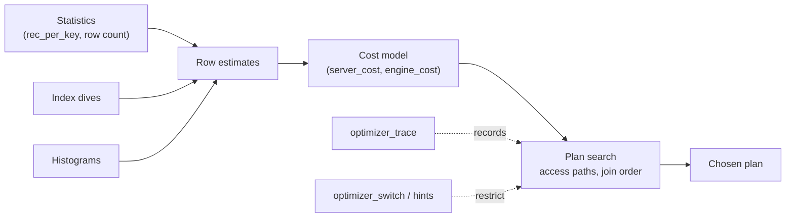

## Introduction

Every lesson in this module has shown the optimizer making a choice: a range scan or a full scan, FirstMatch or materialization, hash join or index nested loop, a filesort or an ordered index read. This lesson opens the box. How does MySQL decide? What numbers does it compare? What can make it change its mind tomorrow on the same query? And when it is wrong, what are the professional ways to correct it?

MySQL's optimizer is **cost-based**: it enumerates candidate plans, estimates the **number of rows** each step will process, converts rows and pages into an abstract **cost** using configurable constants, and picks the cheapest. Two things can therefore go wrong — the **row estimates** (statistics, index dives, assumptions about independence) or the **cost model** (how expensive it thinks a page read or a row evaluation is relative to the real hardware). In practice, row estimates cause the vast majority of bad plans.

You will:

- watch the plan of one query flip from a range scan to a full table scan as the predicate widens, and read the **optimizer trace** that shows the cost comparison;
- see how `eq_range_index_dive_limit` silently switches estimates from index dives to statistics and changes the plan;
- see the independence assumption fail on correlated columns;
- use `optimizer_switch`, **index hints** (`FORCE INDEX`, `IGNORE INDEX`) and **optimizer hints** (`/*+ INDEX(...) NO_INDEX(...) SET_VAR(...) */`), and learn when each is appropriate;
- discuss **plan stability**: why plans change and how teams keep critical queries predictable.

Prerequisites: [Selectivity, Cardinality and Index Statistics](/lessons/m07-selectivity-statistics) and [EXPLAIN ANALYZE](/lessons/m07-explain-analyze).

:::note[Lab data and timings]
**empty** dataset; a 200,000-row `shipments` table is generated in your lab. Plans, costs and trace excerpts are captured from a real server (the capture shows its version). Cost numbers are model units, not milliseconds, and can differ slightly between versions and after statistics are re-sampled. *Measured* blocks were timed on a shared build machine.
:::

## DBMS Theory

:::theory[Cost-based optimization]
A **cost-based optimizer** (Selinger et al., 1979) has three components:

1. **A plan space** — for each table, the applicable access paths; for joins, the possible orders and join methods; for subqueries and derived tables, the transformations.
2. **A cardinality estimator** — for each plan step, how many rows it will produce, derived from table statistics (row counts, distinct values per index prefix, histograms) and from **selectivity** estimates of predicates. Without better information, estimators assume predicates are **independent** (sel(A ∧ B) = sel(A) × sel(B)) and values are **uniformly** distributed.
3. **A cost model** — a function from (rows, pages, operations) to a single number, combining I/O and CPU with weights.

The optimizer returns the plan of minimum *estimated* cost. Because estimates are approximations, the chosen plan is the best plan **for the optimizer's model of the data**, which can differ from the best plan for the actual data.
:::

Two consequences are worth stating plainly:

- **Errors compound.** In a join of *n* tables, a factor-of-10 misestimate at the first table becomes a factor-of-10 error in the probe count of the second, and so on. That is why join-heavy queries are the most plan-sensitive.
- **Plans are piecewise constant in the data.** As a predicate's estimated selectivity crosses a threshold, the cheapest plan switches abruptly (range → full scan, nested loop → hash join). A query whose parameter sits near a threshold can alternate between plans as data grows — the root of most "it was fast yesterday" incidents.

:::standard[Standard SQL vs MySQL]
The SQL standard defines what a query returns, never how it is executed: hints, optimizer switches, traces and cost models are all vendor extensions. MySQL has two hint mechanisms — legacy **index hints** (`USE/FORCE/IGNORE INDEX`, MySQL syntax since 3.x) and **optimizer hints** in `/*+ … */` comments (5.7+, greatly extended in 8.0). The comment syntax is borrowed from Oracle and is ignored as a plain comment by other systems.
:::

## Why It Exists

A rule-based optimizer ("always use an index if one matches") is simple and predictable, and it is wrong whenever the index matches most of the table. Early MySQL versions leaned heavily on heuristics; modern MySQL estimates costs because the best plan genuinely depends on the data:

- an index on `shipped_at` is perfect for "last week" and harmful for "this year";
- an index on `status` is perfect for `'lost'` (1 % of rows) and harmful for `'delivered'` (90 %);
- a join order that is optimal for one customer segment is terrible for another.

The cost model exists to make those decisions automatically, per query and per parameter value. The tools in this lesson — trace, switches, hints — exist because no estimator is perfect, and engineers need to see and occasionally override what it does. Plan-stability practices exist because automatic re-decisions, while usually beneficial, occasionally pick a worse plan in production.

## Internal Working

:::internals[From statistics to a chosen plan]
**Row estimates for single-table predicates.**

- *Index dives*: for a range or equality on an indexed column, the range optimizer descends the B+ tree to both ends of each range and estimates the entries in between. Accurate even for skewed data, but costs a few page reads per range during optimization. InnoDB caps a single range's estimate at half of the table's estimated rows, so very unselective ranges are under-estimated (the lab shows this).
- *Index statistics*: `rec_per_key` from persistent InnoDB statistics (sampled `innodb_stats_persistent_sample_pages` pages, default 20; recalculated automatically after about 10 % of rows change when `innodb_stats_auto_recalc=ON`). Used instead of dives for equality ranges when an `IN` list or OR has at least `eq_range_index_dive_limit` (default 200) values, and for `ref` access estimates.
- *Histograms* (8.0+, `ANALYZE TABLE … UPDATE HISTOGRAM`): selectivity of predicates on **non-indexed** columns, stored in the data dictionary. Without them MySQL uses fixed guesses (e.g. 10 % for an equality, 33 % for a range) for the `filtered` column.

**Cost constants.** The cost model has two tables of constants in the `mysql` schema: `server_cost` (CPU-side: evaluating a row, comparing keys, creating and filling temporary tables) and `engine_cost` (reading a page from disk vs from the buffer pool). A full table scan costs roughly *pages × read cost + rows × row_evaluate_cost*; a secondary-index range costs index pages plus one clustered-index lookup per row, which is why ranges lose to scans as they widen. InnoDB also tells the optimizer what fraction of each table and index is in the buffer pool, but by default the in-memory and on-disk page costs are treated alike.

**Plan search.** Single-table access is chosen per table (`best_access_path`), then join orders are explored greedily with pruning (`optimizer_search_depth`, `optimizer_prune_level`), keeping the cheapest complete plan. Many transformations (semi-join strategies, derived merging, condition pushdown) are applied before or during this search.

**The optimizer trace** records all of this — transformations, range analysis with every candidate and its cost, `considered_execution_plans`, and why alternatives were rejected — as JSON in `information_schema.OPTIMIZER_TRACE`, for the last traced statements of your session.
:::

The default constants can be inspected by administrators — this is display-only because the sandbox cannot read the `mysql` schema:

```sql
-- Display only: requires SELECT on the mysql schema
SELECT cost_name, cost_value, default_value FROM mysql.server_cost;
SELECT engine_name, cost_name, cost_value, default_value FROM mysql.engine_cost;
```

In MySQL 8.0 and 8.4 the documented defaults are `row_evaluate_cost` 0.1, `key_compare_cost` 0.05, `memory_temptable_create_cost` 1.0, `memory_temptable_row_cost` 0.1, `disk_temptable_create_cost` 20.0, `disk_temptable_row_cost` 0.5, and on the engine side `io_block_read_cost` 1.0 and `memory_block_read_cost` 0.25. Changing them (`UPDATE mysql.server_cost …; FLUSH OPTIMIZER_COSTS;`) is a server-wide decision almost nobody should make; fixing estimates is far more effective.



## MySQL Implementation

Build the lab: 200,000 shipments through 2024, four carriers, and a skewed status distribution — 90 % delivered, 6 % in transit, 3 % returned, 1 % lost. Three single-column indexes give the optimizer choices.

```sql run
SET SESSION cte_max_recursion_depth = 200000;
CREATE TABLE shipments (
  shipment_id INT UNSIGNED NOT NULL PRIMARY KEY,
  carrier     VARCHAR(10)  NOT NULL,
  status      VARCHAR(12)  NOT NULL,
  shipped_at  DATETIME     NOT NULL,
  weight_kg   DECIMAL(7,2) NOT NULL,
  INDEX idx_status  (status),
  INDEX idx_shipped (shipped_at),
  INDEX idx_carrier (carrier)
);
INSERT INTO shipments
WITH RECURSIVE seq(n) AS (SELECT 1 UNION ALL SELECT n + 1 FROM seq WHERE n < 200000)
SELECT n,
       ELT(1 + n % 4, 'ups', 'fedex', 'usps', 'dhl'),
       CASE WHEN n % 100 = 0 THEN 'lost'
            WHEN n % 100 < 4 THEN 'returned'
            WHEN n % 100 < 10 THEN 'in_transit'
            ELSE 'delivered' END,
       TIMESTAMP '2024-01-01 00:00:00' + INTERVAL n * 157 SECOND,
       ((n * 37) % 5000) / 100
FROM seq;
ANALYZE TABLE shipments;
```

**The same query shape, two plans.** Shipments since December 1st, then since November 1st:

```sql run
EXPLAIN SELECT * FROM shipments WHERE shipped_at >= '2024-12-01';
EXPLAIN SELECT * FROM shipments WHERE shipped_at >= '2024-11-01';
```

The December query uses a `range` on `idx_shipped`; the November query — about twice as many rows — is a full table scan (`ALL`) even though `idx_shipped` is listed in `possible_keys`. Nothing is broken: the optimizer estimated that fetching that many rows through the secondary index (one clustered-index lookup per entry) costs more than reading the whole table sequentially. `Last_query_cost` exposes the cost of the plan chosen for the last statement your session compiled:

```sql run
SELECT COUNT(weight_kg) FROM shipments WHERE shipped_at >= '2024-12-01';
SHOW SESSION STATUS LIKE 'Last_query_cost';
SELECT COUNT(weight_kg) FROM shipments WHERE shipped_at >= '2024-11-01';
SHOW SESSION STATUS LIKE 'Last_query_cost';
```

The second cost is the cost of a full scan — the cheapest option for that predicate.

## Syntax Breakdown

| Tool | Syntax | Scope | Use it for |
|---|---|---|---|
| Optimizer trace | `SET SESSION optimizer_trace = 'enabled=on';` then query `information_schema.OPTIMIZER_TRACE` | Session; last `optimizer_trace_limit` statements (default 1) | Seeing why a plan was chosen |
| Trace size | `SET SESSION optimizer_trace_max_mem_size = …` | Session | Long traces truncated (`MISSING_BYTES_BEYOND_MAX_MEM_SIZE`) |
| Last plan cost | `SHOW SESSION STATUS LIKE 'Last_query_cost'` | Session | Comparing alternatives quickly |
| Optimizer switches | `SET SESSION optimizer_switch = 'flag=on\|off,…'` / `'default'` | Session (or global, admin) | Disabling a transformation to test |
| Per-statement setting | `/*+ SET_VAR(optimizer_switch = '…') */`, `SET_VAR(sort_buffer_size = …)` | One statement | Scoped tuning without session state |
| Index hints | `FROM t USE INDEX (i)`, `FORCE INDEX (i)`, `IGNORE INDEX (i)` `[FOR JOIN \| ORDER BY \| GROUP BY]` | Table reference | Legacy; still common |
| Index-level optimizer hints (8.0.20+) | `/*+ INDEX(t i) NO_INDEX(t i) JOIN_INDEX(t i) GROUP_INDEX(t i) ORDER_INDEX(t i) */` | Table in a query block | Preferred replacement for index hints |
| Other optimizer hints | `JOIN_ORDER`, `BKA`, `BNL`, `SEMIJOIN`, `MERGE`, `NO_RANGE_OPTIMIZATION`, `INDEX_MERGE`, `SKIP_SCAN`, `MAX_EXECUTION_TIME(ms)` | Query block / table | Targeted overrides |
| Dive limit | `SET SESSION eq_range_index_dive_limit = N` | Session | Controls dives vs statistics for IN lists |
| Statistics | `ANALYZE TABLE t`, `ANALYZE TABLE t UPDATE HISTOGRAM ON c WITH n BUCKETS` | Table | Fixing estimates — the first resort |

:::version[8.0 vs 8.4]
Everything above runs on 8.0.31+ and 8.4. Notable for 8.4 LTS: the `explain_format` system variable (8.0.32+) sets the default EXPLAIN format, and `EXPLAIN FORMAT=JSON` can emit a second JSON layout derived from the iterator tree when `explain_json_format_version = 2` (8.3+). The MySQL manual states that the index-level optimizer hints of 8.0.20+ are intended to supersede the legacy `USE/FORCE/IGNORE INDEX` hints, which are expected to be deprecated in a future release.

```sql
-- 8.4 only (display): new JSON layout for EXPLAIN
SET SESSION explain_json_format_version = 2;
EXPLAIN FORMAT=JSON SELECT * FROM shipments WHERE shipped_at >= '2024-12-01';
```
:::

## Practical Examples

**1. Reading the decision in the optimizer trace.** Enable the trace for your session, run the November query, and extract the two parts that matter: the cost of a full table scan and the range alternatives the range optimizer analysed.

```sql run
SET SESSION optimizer_trace = 'enabled=on';
SELECT COUNT(weight_kg) FROM shipments WHERE shipped_at >= '2024-11-01';
SELECT JSON_PRETTY(JSON_EXTRACT(TRACE, '$**.table_scan')) AS table_scan,
       JSON_PRETTY(JSON_EXTRACT(TRACE, '$**.range_scan_alternatives')) AS range_alternatives
FROM information_schema.OPTIMIZER_TRACE;
```

The `table_scan` object gives the estimated rows and cost of a full scan. The `range_scan_alternatives` entry for `idx_shipped` shows the range (`'2024-11-01 00:00:00' <= shipped_at`), its estimated `rows` (from index dives), its `cost`, `"chosen": false` and `"cause": "cost"` — the range plan was costed and lost. Compare the two `cost` values: that comparison *is* the decision. `JSON_TABLE` turns trace fragments into rows, which is convenient for scripts:

```sql run
SELECT jt.*
FROM information_schema.OPTIMIZER_TRACE,
     JSON_TABLE(JSON_EXTRACT(TRACE, '$**.range_scan_alternatives[*]'), '$[*]'
       COLUMNS (index_name VARCHAR(64) PATH '$.index',
                est_rows   INT         PATH '$.rows',
                chosen     VARCHAR(5)  PATH '$.chosen',
                cause      VARCHAR(30) PATH '$.cause')) AS jt;
```

Notice that the range estimate is not exact: the real count is the 32,153 returned by the COUNT query, while dives produce an estimate. Estimates within a factor of two rarely matter; orders of magnitude do.

**2. A skewed column: the estimator gets it right with dives.** Lost shipments are 1 % of the table, delivered ones 90 %:

```sql run
EXPLAIN SELECT * FROM shipments WHERE status = 'lost';
EXPLAIN SELECT * FROM shipments WHERE status = 'delivered';
```

`'lost'` uses `ref` on `idx_status` with an estimate of 2,000 rows — exact, because for a constant equality the optimizer dives into the index and sees the skew. `'delivered'` *also* gets a `ref` on `idx_status`, with an estimate of 99,876 rows. The true number is 180,000 (90 %). The estimate is exactly half of the table's estimated 199,752 rows: InnoDB caps a single range estimate at 50 % of the table, so for very common values the dive under-reports. With the estimate halved, the index plan looks cheaper than the scan. Measure both:

```sql run measured
EXPLAIN ANALYZE SELECT COUNT(weight_kg) FROM shipments WHERE status = 'delivered';
```

```sql run measured
EXPLAIN ANALYZE SELECT COUNT(weight_kg) FROM shipments IGNORE INDEX (idx_status) WHERE status = 'delivered';
```

The index lookup returns `rows=180000` against an estimate of 99,876, and each of those rows costs a clustered-index lookup. The table scan reads 200,000 rows sequentially and filters them. Compare the measured times on the build machine — this is a real misestimate producing a worse plan, and the fix is not obvious: a better estimate is not available through statistics, so for a query that always asks for `'delivered'` you would either avoid the predicate (it barely filters) or use `IGNORE INDEX`/`NO_INDEX` deliberately. Now the second trap — an `IN` list:

```sql run
EXPLAIN SELECT * FROM shipments WHERE status IN ('lost', 'returned');
SET SESSION eq_range_index_dive_limit = 1;
EXPLAIN SELECT * FROM shipments WHERE status IN ('lost', 'returned');
SET SESSION eq_range_index_dive_limit = DEFAULT;
```

With dives, the two values are correctly estimated as a few thousand rows and the plan is a `range` on `idx_status`. With the dive limit lowered below the number of values, MySQL estimates each value from **index statistics** — `rec_per_key`, i.e. table rows ÷ distinct statuses — as if every status were equally common. The estimate jumps to a large fraction of the table and the plan becomes `ALL`. In production nobody sets the limit to 1, but the default of 200 is reached by real `IN` lists generated by applications (IDs from a previous query, multi-select filters): **the same query can switch plans when the list grows from 199 to 200 values.**

**3. Correlated predicates break the independence assumption.** Combine two indexed equality filters:

```sql run
EXPLAIN SELECT * FROM shipments WHERE status = 'lost' AND carrier = 'dhl';
```

The optimizer chooses an **index merge intersection** of `idx_status` and `idx_carrier` and estimates roughly 1,000 rows: 2,000 lost × ¼ for DHL, assuming independence. In this data, lost shipments occur only at multiples of 100, which are never DHL's (carrier = n mod 4 = 3), so the true answer is zero rows — while for UPS it would be all 2,000. No single-column statistic can reveal that. Composite indexes (whose dives see the combination) or histograms do not fully solve correlation either; this is a fundamental limit of the estimator, and one of the few situations where a hint can be justified after measurement.

**4. Index hints — and how they can hurt.** `FORCE INDEX` tells MySQL to treat a table scan as extremely expensive and use the named index if at all possible:

```sql run
EXPLAIN SELECT * FROM shipments FORCE INDEX (idx_carrier) WHERE status = 'lost' AND carrier = 'dhl';
```

Now a `ref` on `idx_carrier` reads all DHL shipments — a quarter of the table — and filters status afterwards. Measured:

```sql run measured
EXPLAIN ANALYZE SELECT * FROM shipments WHERE status = 'lost' AND carrier = 'dhl';
```

```sql run measured
EXPLAIN ANALYZE SELECT * FROM shipments FORCE INDEX (idx_carrier) WHERE status = 'lost' AND carrier = 'dhl';
```

The optimizer's intersection reads 2,000 `idx_status` entries and scans the DHL range of `idx_carrier` to intersect row ids; the forced plan performs 50,000 clustered-index lookups via `idx_carrier`. A hint written for one data distribution freezes a decision that may be wrong for every other.

**5. Optimizer hints are more precise.** `NO_INDEX` removes one candidate without forcing another; `SET_VAR` changes a switch for one statement:

```sql run
EXPLAIN SELECT /*+ NO_INDEX(shipments idx_carrier) */ * FROM shipments
WHERE status = 'lost' AND carrier = 'dhl';
EXPLAIN SELECT /*+ SET_VAR(optimizer_switch = 'index_merge_intersection=off') */ * FROM shipments
WHERE status = 'lost' AND carrier = 'dhl';
```

Both produce a `ref` on `idx_status` (2,000 estimated rows) with carrier checked per row. The first expresses "never use this index here"; the second disables one transformation for this statement only, leaving the session untouched. Optimizer hints are also checked: an unknown index name or malformed hint produces a warning rather than silently doing nothing — check `SHOW WARNINGS` after EXPLAIN.

**6. Histograms improve `filtered` for unindexed columns.** `weight_kg` has no index; without a histogram the optimizer guesses the selectivity of a range on it:

```sql run
EXPLAIN SELECT * FROM shipments WHERE carrier = 'dhl' AND weight_kg > 49;
ANALYZE TABLE shipments UPDATE HISTOGRAM ON weight_kg WITH 32 BUCKETS;
EXPLAIN SELECT * FROM shipments WHERE carrier = 'dhl' AND weight_kg > 49;
```

The access path is the same `ref` on `idx_carrier`, but `filtered` changes from a fixed guess to about 2 % — the true fraction of weights above 49 kg. In a single-table query this only changes estimates; in a join it changes the estimated rows flowing into the next table, and therefore join order. Histograms are not updated automatically; refresh them with `ANALYZE TABLE … UPDATE HISTOGRAM` as part of maintenance.

## Execution Walkthrough

The walkthrough traces the optimizer's reasoning for one query, step by step, using the trace.

```walkthrough
title: How MySQL plans SELECT COUNT(weight_kg) FROM shipments WHERE status = 'lost' AND shipped_at >= '2024-06-01'
steps:
  - title: "1. Run the query with the trace enabled"
    explain: >-
      Two indexed predicates: status = 'lost' (rare) and a half-year range on shipped_at (common). The trace of the
      last statement replaces the previous one (optimizer_trace_limit = 1).
    sql: |
      SET SESSION optimizer_trace = 'enabled=on';
      SELECT COUNT(weight_kg) FROM shipments WHERE status = 'lost' AND shipped_at >= '2024-06-01';
  - title: "2. Table-scan baseline"
    explain: >-
      The optimizer first computes what a full table scan would cost — every other access path must beat this number.
    sql: |
      SELECT JSON_PRETTY(JSON_EXTRACT(TRACE, '$**.table_scan')) AS table_scan
      FROM information_schema.OPTIMIZER_TRACE;
  - title: "3. Range analysis — one candidate per usable index"
    explain: >-
      For each index with a usable predicate the range optimizer estimates rows (index dives) and cost. idx_status
      over status = 'lost' is cheap; idx_shipped over the half-year range is expensive and rejected for cost. It also
      considers combining them (row-order intersection) and reports why it did not.
    sql: |
      SELECT jt.*
      FROM information_schema.OPTIMIZER_TRACE,
           JSON_TABLE(JSON_EXTRACT(TRACE, '$**.range_scan_alternatives[*]'), '$[*]'
             COLUMNS (index_name VARCHAR(64) PATH '$.index', est_rows INT PATH '$.rows',
                      cost DOUBLE PATH '$.cost', chosen VARCHAR(5) PATH '$.chosen',
                      cause VARCHAR(30) PATH '$.cause')) AS jt;
  - title: "4. Best access path — ref versus range"
    explain: >-
      In the join-planning phase (a single table here) the optimizer compares ref access on idx_status with the range
      access found above. The trace records the considered paths, the chosen one, and condition filtering for the
      remaining predicate.
    sql: |
      SELECT JSON_PRETTY(JSON_EXTRACT(TRACE, '$**.considered_execution_plans')) AS plans
      FROM information_schema.OPTIMIZER_TRACE;
  - title: "5. The final plan"
    explain: >-
      EXPLAIN confirms what the trace decided. Turn the trace off when you are done — it adds overhead to every
      statement in the session.
    sql: |
      SET SESSION optimizer_trace = 'enabled=off';
      EXPLAIN SELECT COUNT(weight_kg) FROM shipments WHERE status = 'lost' AND shipped_at >= '2024-06-01';
```

## Output

The trace is long; reading it efficiently means knowing where to look:

| Trace section | What it tells you |
|---|---|
| `join_preparation` → `transformations` | Subquery-to-semi-join, derived merging, outer-to-inner join conversions |
| `condition_processing` | The WHERE clause after constant propagation and equality propagation |
| `rows_estimation` → `table_scan` | Rows and cost of a full scan — the baseline |
| `range_analysis` → `range_scan_alternatives` | Every index range considered: ranges, rows, cost, chosen, cause |
| `analyzing_roworder_intersect` / `index_merge` | Whether intersections/unions were possible |
| `considered_execution_plans` | Per-table best access path, join prefixes, `rows_for_plan`, `cost_for_plan` |
| `attaching_conditions_to_tables` | Which predicates are evaluated where (pushed to tables, ICP) |
| `reconsidering_access_paths_for_index_ordering` | Whether an ordering index replaced the chosen one for `ORDER BY … LIMIT` |

In the walkthrough, the `range_scan_alternatives` rows show `idx_status` chosen with an estimate of about 2,000 rows and `idx_shipped` rejected with `cause: cost`; `considered_execution_plans` shows `ref` on `idx_status` as the chosen access path, and the actual count (the step-1 result) confirms how few lost shipments fall in the second half of the year.

## Alternative Approaches

When the optimizer picks a bad plan, the options, in order of preference:

| Option | Example | Durability | Risk |
|---|---|---|---|
| Fix the query | SARGable predicates, remove functions, correct types | High | Low |
| Fix the indexes | Composite/covering index that makes the good plan obviously cheapest | High | Write cost |
| Fix the statistics | `ANALYZE TABLE`, raise `STATS_SAMPLE_PAGES` for the table, add a histogram | Medium (data changes) | Low |
| Restrict alternatives per statement | `/*+ NO_INDEX(…) */`, `SET_VAR(optimizer_switch=…)` | Medium | Moderate |
| Force a plan per statement | `FORCE INDEX`, `JOIN_ORDER`, `STRAIGHT_JOIN` | Low — frozen while data evolves | High |
| Change session/global switches or cost constants | `SET GLOBAL optimizer_switch=…`, `UPDATE mysql.server_cost` | Server-wide | Very high |
| Rewrite queries without touching application code | Query Rewrite plugin (admin-installed) | Medium | Operational complexity |

The Query Rewrite plugin and global changes are administrative and cannot be run in the sandbox; they are shown here for completeness:

```sql
-- Display only: requires administrative privileges
INSTALL COMPONENT 'file://component_query_rewriter';   -- or the query_rewrite plugin script
SET GLOBAL optimizer_switch = 'index_merge_intersection=off';
ALTER TABLE shipments STATS_SAMPLE_PAGES = 100;        -- per-table sampling (allowed for table owners)
```

Note the last statement is ordinary DDL; raising sampling for a skewed table is a legitimate, durable fix for poor `rec_per_key` estimates.

## Performance Analysis

**Where the optimizer's cost comes from.** For a range on a secondary index, cost ≈ index entries read × (key compare cost) + rows × (clustered lookup page cost + row evaluate cost). For a table scan, cost ≈ table pages × page read cost + rows × row evaluate cost. Because a lookup per row is far more expensive than reading a row in sequence, the crossover happens when the range covers a modest fraction of the table — in this lab, between the December predicate (15,644 rows, about 8 % of the table; estimated at 29,022) and the November one (32,153 rows, about 16 %; estimated at 60,882). Note that the decision is made on the *estimates*, which here are roughly twice the true counts. The exact point depends on row width (rows per page), whether the index is covering (no lookups at all), and the cost constants.

**Optimization itself costs time.** Index dives read pages; the greedy join search explores many prefixes. For queries with huge `IN` lists or many-table joins, optimization time can exceed execution time — the reason for `eq_range_index_dive_limit` and `optimizer_search_depth`. The trouble is that the shortcuts change estimates, as Practical Example 2 showed.

**Plan stability.** Plans change when:

1. **Statistics are re-sampled** — automatically after ~10 % of rows change, or by `ANALYZE TABLE`. Sampling 20 pages of a skewed index can produce different `rec_per_key` values each time.
2. **Data distribution shifts** — the same parameter crosses a cost threshold.
3. **Parameters differ** — the plan is chosen per execution (MySQL does not cache plans across executions of prepared statements in a way that freezes them, so each parameter set is optimized).
4. **The server is upgraded** — new transformations, changed cost formulas.
5. **Indexes are added or dropped** — including indexes created for other queries.

MySQL has no built-in SQL plan baselines (as Oracle's SQL Plan Management or SQL Server's Query Store plan forcing provide). Teams achieve stability with: persistent statistics with appropriate sampling, scheduled `ANALYZE TABLE`/histogram refreshes after bulk loads, **invisible indexes** to test the effect of dropping an index safely, regression tests that check EXPLAIN of critical queries, performance_schema digest monitoring to detect regressions (next lesson), and — sparingly — hints embedded in the SQL of the few queries where the estimator demonstrably fails.

:::performance[Theory vs measurement]
Costs in EXPLAIN and the trace are model units used for comparison inside one optimization, not predictions of time. Two plans with costs 450 and 2,700 tell you which the optimizer prefers, not that one takes six times longer. Validate decisions with EXPLAIN ANALYZE (actual rows, loops, time), as in the FORCE INDEX comparison above — and remember the measured times there came from a shared build machine.
:::

## Best Practices

:::best-practice[Working with the optimizer]
1. **Diagnose estimates first.** Compare EXPLAIN's `rows`/`filtered` with EXPLAIN ANALYZE's actual rows. Big gaps point to statistics, correlation or non-SARGable predicates — fix those before reaching for hints.
2. **Use the trace when EXPLAIN is not enough.** Enable it per session, extract `range_scan_alternatives` and `considered_execution_plans`, then disable it.
3. **Prefer optimizer hints to index hints**, and `NO_INDEX`/`SET_VAR` (removing one option) to `FORCE INDEX`/`JOIN_ORDER` (freezing a plan).
4. **Scope every override** to a statement; never change global switches or cost constants to fix one query.
5. **Document hints** in the SQL with the reason, the date and the measurement, and re-test them after upgrades and major data changes.
6. **Keep statistics healthy.** `ANALYZE TABLE` after bulk loads, raise `STATS_SAMPLE_PAGES` for skewed large tables, maintain histograms on filter columns that are not indexed.
7. **Test index removals with invisible indexes** (`ALTER TABLE … ALTER INDEX i INVISIBLE`) before dropping them.
8. **Watch for threshold parameters**: IN-list sizes near `eq_range_index_dive_limit`, date ranges near a range/scan crossover.
:::

## Common Mistakes

**Mistake 1 — "MySQL isn't using my index, so I'll force it."** For the November predicate the full scan *is* cheaper. Compare before forcing:

```sql run measured
EXPLAIN ANALYZE SELECT COUNT(weight_kg) FROM shipments WHERE shipped_at >= '2024-11-01';
```

```sql run measured
EXPLAIN ANALYZE SELECT COUNT(weight_kg) FROM shipments FORCE INDEX (idx_shipped) WHERE shipped_at >= '2024-11-01';
```

Both read the same 32,153 matching rows in the end, but the forced plan reaches them through one clustered-index lookup per entry. On the build machine it was not faster; on a cold buffer pool, random lookups are worse still. If the query really needs to be fast, make the index covering (`(shipped_at, weight_kg)`), which removes the lookups and makes the range cheap enough for the optimizer to choose it on its own.

**Mistake 2 — misspelling a hint and believing it applied.**

```sql run
EXPLAIN SELECT /*+ NO_INDEX(shipments idx_carrierr) */ * FROM shipments WHERE carrier = 'dhl' AND status = 'lost';
SHOW WARNINGS;
```

Warning 3128 reports the unresolved name — and look at the plan: it did **not** stay unchanged. `possible_keys` is NULL and the plan is a full scan. On the capture server (shown with the output), a `NO_INDEX` hint whose only index name cannot be resolved behaved like `NO_INDEX(shipments)` with no list, which disables *every* index of the table. A misspelled `INDEX(…)` hint, by contrast, is simply ignored. Do not reason about what a broken hint "probably" does: always run `SHOW WARNINGS` after EXPLAIN, and treat warning 3128 as a bug in your SQL. Legacy index hints with a bad name (`FORCE INDEX (bad_name)`) raise an error instead.

**Mistake 3 — leaving the trace on.** The trace adds overhead to every statement of the session and keeps memory. Turn it off when finished.

**Mistake 4 — tuning cost constants to fix a plan.** Cost constants are global and affect every query. A single bad plan almost always has a local cause: a misestimate, a missing composite index, a non-SARGable predicate.

**Mistake 5 — trusting costs across queries.** `Last_query_cost` is useful to compare *alternative plans for the same query*; comparing costs of different queries, or across versions, is meaningless.

## Industry Application

- **Incident response.** When a query regresses, engineers capture EXPLAIN and the optimizer trace on a replica, compare estimated and actual rows, and usually fix statistics (`ANALYZE TABLE`, histograms) or add a composite index. Hints are the last resort and are tracked in code review.
- **ORMs and hints.** Most ORMs can attach optimizer-hint comments (`/*+ … */`) to generated SQL; teams use this for a handful of known-hard queries, with comments linking to the incident.
- **Upgrade testing.** Before moving from 8.0 to 8.4 LTS, teams replay a captured workload (from performance_schema digests or the slow log) on the new version and diff EXPLAIN plans for the top queries, because new optimizer transformations can change plans in both directions.
- **Large IN lists.** Services that pass thousands of ids into `IN (…)` hit `eq_range_index_dive_limit`; common fixes are batching the list, loading it into a temporary table and joining, or raising the limit per session after measuring optimization time.
- **Managed services.** Cloud providers (Amazon RDS/Aurora, Google Cloud SQL, Azure) expose `optimizer_switch` and the statistics variables as parameter-group settings; changing them is treated as a fleet-wide change with load testing.

## Practice Exercises

Exercises are graded by comparing your result rows with the reference solution on the same data.

```exercise
id: ex1
title: Test an index removal safely
difficulty: easy
kind: dml
concepts: [plan-stability]
setup: |
  CREATE TABLE logs_o (log_id INT PRIMARY KEY, level VARCHAR(5) NOT NULL, created_at DATETIME NOT NULL,
                       INDEX idx_level (level), INDEX idx_created (created_at));
  INSERT INTO logs_o VALUES (1, 'INFO', '2024-01-01 10:00:00'), (2, 'WARN', '2024-01-01 11:00:00'),
                            (3, 'ERROR', '2024-01-02 09:00:00');
prompt: |
  The team suspects `idx_level` is useless but dropping and rebuilding a large index is slow. Make `idx_level`
  **invisible** to the optimizer (keeping it maintained), so that you can observe plans without it and make it
  visible again instantly if needed.
hints:
  - "ALTER TABLE … ALTER INDEX … INVISIBLE"
solution: |
  ALTER TABLE logs_o ALTER INDEX idx_level INVISIBLE;
check: |
  SELECT INDEX_NAME, IS_VISIBLE
  FROM information_schema.STATISTICS
  WHERE TABLE_SCHEMA = DATABASE() AND TABLE_NAME = 'logs_o' AND INDEX_NAME <> 'PRIMARY'
  ORDER BY INDEX_NAME;
explanation: |
  An invisible index is still updated on every write but ignored by the optimizer (unless the session sets
  `optimizer_switch='use_invisible_indexes=on'`). If performance degrades, `ALTER INDEX idx_level VISIBLE` restores
  it instantly — no rebuild. Only after a monitoring period do you `DROP INDEX`. Primary keys cannot be made
  invisible.
```

```exercise
id: ex2
title: Where is the crossover?
difficulty: medium
concepts: [cost-model, index-dives]
setup: |
  SET SESSION cte_max_recursion_depth = 40000;
  CREATE TABLE readings (reading_id INT UNSIGNED PRIMARY KEY, sensor_id SMALLINT UNSIGNED NOT NULL,
                         taken_at DATETIME NOT NULL, value_c DECIMAL(5,2) NOT NULL, INDEX idx_taken (taken_at));
  INSERT INTO readings WITH RECURSIVE s(n) AS (SELECT 1 UNION ALL SELECT n + 1 FROM s WHERE n < 40000)
    SELECT n, 1 + n % 40, TIMESTAMP '2024-01-01 00:00:00' + INTERVAL n * 13 MINUTE, (n % 400) / 10 FROM s;
prompt: |
  Before deciding whether a range plan on `idx_taken` is reasonable, quantify how much of the table each
  candidate predicate selects. Return one row with three columns:

  1. `total_rows` — rows in `readings`
  2. `pct_last_week` — percentage of rows with `taken_at >= '2024-12-25'`, rounded to 2 decimals
  3. `pct_since_june` — percentage of rows with `taken_at >= '2024-06-01'`, rounded to 2 decimals
hints:
  - "Conditional aggregation: SUM(taken_at >= '…') counts matching rows in one scan."
  - "100 * SUM(cond) / COUNT(*), wrapped in ROUND(…, 2)."
solution: |
  SELECT COUNT(*) AS total_rows,
         ROUND(100 * SUM(taken_at >= '2024-12-25') / COUNT(*), 2) AS pct_last_week,
         ROUND(100 * SUM(taken_at >= '2024-06-01') / COUNT(*), 2) AS pct_since_june
  FROM readings;
explanation: |
  Selectivity drives the cost comparison: a small percentage favours the range on `idx_taken` (few clustered-index
  lookups), a large one favours a full scan. Run `EXPLAIN SELECT * FROM readings WHERE taken_at >= …` for both
  dates afterwards: you should see `range` for last week and `ALL` for the half year. The exact crossover depends on
  row width and the cost constants, not on a fixed percentage.
```

```exercise
id: ex3
title: Ask the optimizer trace
difficulty: hard
concepts: [optimizer-trace, index-dives]
setup: |
  SET SESSION cte_max_recursion_depth = 30000;
  CREATE TABLE tickets_o (ticket_id INT UNSIGNED PRIMARY KEY, priority TINYINT UNSIGNED NOT NULL,
                          opened_at DATETIME NOT NULL, INDEX idx_priority (priority), INDEX idx_opened (opened_at));
  INSERT INTO tickets_o WITH RECURSIVE s(n) AS (SELECT 1 UNION ALL SELECT n + 1 FROM s WHERE n < 30000)
    SELECT n, IF(n % 50 = 0, 1, 3), TIMESTAMP '2024-01-01 00:00:00' + INTERVAL n * 17 MINUTE FROM s;
  ANALYZE TABLE tickets_o;
prompt: |
  Use the optimizer trace to find out which index ranges the range optimizer considered for

  ~~~sql
  SELECT COUNT(*) FROM tickets_o WHERE priority = 1 AND opened_at >= '2024-03-01';
  ~~~

  Your script must enable the trace, run that query, and end with a query over
  `information_schema.OPTIMIZER_TRACE` returning one row per range alternative with two columns:
  `index_name` and `chosen` (the JSON value `true`/`false` as text).
hints:
  - "SET SESSION optimizer_trace = 'enabled=on'; then run the query."
  - "The alternatives are under $**.range_scan_alternatives — an array of objects with index and chosen."
  - "JSON_TABLE(JSON_EXTRACT(TRACE, '$**.range_scan_alternatives[*]'), '$[*]' COLUMNS (index_name VARCHAR(64) PATH '$.index', chosen VARCHAR(5) PATH '$.chosen'))"
solution: |
  SET SESSION optimizer_trace = 'enabled=on';
  SELECT COUNT(*) FROM tickets_o WHERE priority = 1 AND opened_at >= '2024-03-01';
  SELECT jt.index_name, jt.chosen
  FROM information_schema.OPTIMIZER_TRACE,
       JSON_TABLE(JSON_EXTRACT(TRACE, '$**.range_scan_alternatives[*]'), '$[*]'
         COLUMNS (index_name VARCHAR(64) PATH '$.index', chosen VARCHAR(5) PATH '$.chosen')) AS jt;
explanation: |
  The range optimizer evaluates one alternative per usable index: `idx_priority` over `priority = 1` (rare value,
  found cheap by index dives) and `idx_opened` over the date range (most of the table, rejected for cost). The
  trace holds only the last traced statement by default (`optimizer_trace_limit = 1`), so the SELECT over
  OPTIMIZER_TRACE must come right after the traced query. Remember to disable the trace afterwards.
```

```exercise
id: ex4
title: Give the estimator a histogram
difficulty: medium
kind: dml
concepts: [plan-stability, cost-model]
setup: |
  SET SESSION cte_max_recursion_depth = 20000;
  CREATE TABLE parcels (parcel_id INT UNSIGNED PRIMARY KEY, depot VARCHAR(8) NOT NULL, weight_g INT UNSIGNED NOT NULL,
                        INDEX idx_depot (depot));
  INSERT INTO parcels WITH RECURSIVE s(n) AS (SELECT 1 UNION ALL SELECT n + 1 FROM s WHERE n < 20000)
    SELECT n, ELT(1 + n % 5, 'SJC', 'SFO', 'OAK', 'SMF', 'FAT'), IF(n % 97 = 0, 25000 + n, 100 + n % 2000) FROM s;
prompt: |
  Queries filter on `weight_g` (heavy parcels are rare), which is not indexed, so the optimizer guesses its
  selectivity. Create a histogram on `parcels.weight_g` with **16 buckets**.
hints:
  - "Histograms are created with ANALYZE TABLE … UPDATE HISTOGRAM ON column WITH n BUCKETS."
solution: |
  ANALYZE TABLE parcels UPDATE HISTOGRAM ON weight_g WITH 16 BUCKETS;
check: |
  SELECT COLUMN_NAME,
         JSON_UNQUOTE(JSON_EXTRACT(HISTOGRAM, '$."histogram-type"')) AS histogram_type,
         JSON_EXTRACT(HISTOGRAM, '$."number-of-buckets-specified"') AS buckets_specified
  FROM information_schema.COLUMN_STATISTICS
  WHERE SCHEMA_NAME = DATABASE() AND TABLE_NAME = 'parcels';
explanation: |
  With 2,000+ distinct weights and 16 buckets MySQL builds an equi-height histogram. EXPLAIN for
  `WHERE depot = 'SJC' AND weight_g > 20000` then shows a `filtered` close to the real fraction of heavy parcels
  instead of a fixed guess — which matters when this table is joined to others. Histograms are static: refresh them
  after significant data changes, and drop them with `ANALYZE TABLE … DROP HISTOGRAM ON weight_g`.
```

```exercise
id: ex5
title: A plan regression post-mortem
difficulty: challenge
kind: open
concepts: [plan-stability, optimizer-hints, index-hints, index-dives]
prompt: |
  An API endpoint runs `SELECT … FROM orders WHERE merchant_id = ? AND status IN (…) ORDER BY created_at DESC
  LIMIT 50`. Indexes: `(merchant_id, created_at)` and `(status)`. It was fast for months; this week p99 latency
  jumped from 15 ms to 4 s for a few large merchants. No code was deployed. The front-end recently allowed users to
  select "all statuses", which sends 214 status codes. Explain at least two plausible mechanisms, how you would
  confirm which one happened, and what you would change — distinguishing durable fixes from emergency mitigations.
solution: |
  Plausible mechanisms:
  1. **Dive limit.** 214 values exceed `eq_range_index_dive_limit` (200). Estimates for the IN list switch from index
     dives to `rec_per_key` statistics, which assume uniform statuses. The optimizer may now prefer a range on
     `(status)` (or misjudge filtering) instead of walking `(merchant_id, created_at)` backwards with LIMIT 50.
  2. **Ordering-index trade-off under LIMIT.** For large merchants, walking `(merchant_id, created_at)` until 50
     rows pass the status filter is fast only if matches are common; changed estimates for the IN list change the
     `prefer_ordering_index` decision, producing a filesort of all the merchant's rows.
  3. **Statistics re-sampling** after a batch of writes (auto recalc at ~10 % change) altered `rec_per_key` and
     crossed a threshold.

  Confirm: capture EXPLAIN and EXPLAIN ANALYZE for a large merchant with 199 vs 214 statuses on a replica; enable the
  optimizer trace and compare `range_scan_alternatives`, `index_dives_for_eq_ranges` and
  `reconsidering_access_paths_for_index_ordering`; check when ANALYZE ran (`mysql.innodb_table_stats.last_update`,
  admin access) and performance_schema digest history for when the plan changed.

  Fix: durable — when "all statuses" is selected, omit the predicate entirely (it is not a filter); otherwise add
  a composite index `(merchant_id, status, created_at)` only if the status filter is selective; keep statistics
  fresh and sampling adequate for skewed tables. Mitigation — a statement-scoped hint such as
  `/*+ INDEX(orders idx_merchant_created) */` or `SET_VAR(eq_range_index_dive_limit = 300)`, documented and
  scheduled for removal once the durable fix ships.
```

## Knowledge Assessment

```quiz
- id: q1
  question: "EXPLAIN shows `possible_keys: idx_shipped`, `key: NULL`, `type: ALL` for `WHERE shipped_at >= '2024-11-01'`. Which explanation is most likely?"
  options:
    - "The index is corrupted"
    - "The optimizer estimated that reading many rows via the secondary index (one clustered lookup each) costs more than a full scan"
    - "Range predicates can never use indexes"
    - "The query cache returned the result"
  answer: 1
  explanation: "possible_keys shows the index is usable; the cost comparison chose the scan. The trace's range_scan_alternatives would show chosen false, cause cost. Ranges use indexes routinely when selective; the query cache no longer exists."
  concepts: [cost-model]
- id: q2
  question: "What does `eq_range_index_dive_limit` control?"
  options:
    - "The maximum number of indexes the optimizer considers"
    - "The number of equality ranges (e.g. IN-list values) above which MySQL estimates rows from index statistics instead of index dives"
    - "The maximum depth of the B+ tree"
    - "How many rows an index range may return"
  answer: 1
  explanation: "With N equality ranges ≥ the limit (default 200), MySQL skips dives and uses rec_per_key, which assumes uniform distribution. On skewed columns this can change estimates and plans abruptly."
  concepts: [index-dives, plan-stability]
- id: q3
  question: "Which are valid ways to view or influence the optimizer from a sandboxed session with privileges on its own schema only? (Select all that apply.)"
  type: multi
  options:
    - "SET SESSION optimizer_trace = 'enabled=on' and read information_schema.OPTIMIZER_TRACE"
    - "SET SESSION optimizer_switch = 'index_merge_intersection=off'"
    - "UPDATE mysql.server_cost SET cost_value = … ; FLUSH OPTIMIZER_COSTS"
    - "/*+ NO_INDEX(t idx) */ in a SELECT"
    - "ANALYZE TABLE t UPDATE HISTOGRAM ON c"
  answer: [0, 1, 3, 4]
  explanation: "Trace, session switches, optimizer hints and histograms on your own tables are all session- or table-scoped. Changing cost constants needs write access to the mysql schema and FLUSH, which are administrative and server-wide."
  concepts: [optimizer-trace, optimizer-switch, optimizer-hints]
- id: q4
  question: "For `status = 'lost' AND carrier = 'dhl'` the optimizer estimates ~1,000 rows; the true answer is 0. What assumption failed?"
  options:
    - "Uniform distribution of status"
    - "Independence of predicates — it multiplied the two selectivities, but the columns are correlated"
    - "The B+ tree is unbalanced"
    - "Statistics were never collected"
  answer: 1
  explanation: "Status alone was estimated well (index dives). Multiplying sel(status) × sel(carrier) assumes independence; correlated data (lost only for one carrier) breaks it. Single-column statistics cannot detect correlation."
  concepts: [cost-model]
- id: q5
  question: "Why is `/*+ NO_INDEX(t idx_carrier) */` often preferable to `FORCE INDEX (idx_status)`?"
  options:
    - "It is faster to parse"
    - "It removes one bad option while leaving the optimizer free to choose among the rest, so it adapts better to changing data"
    - "FORCE INDEX is not supported in 8.4"
    - "NO_INDEX disables all indexes"
  answer: 1
  explanation: "Removing a single alternative is a smaller, more robust intervention than freezing a plan. FORCE INDEX still works in 8.4; the manual indicates index hints are expected to be deprecated in favour of index-level optimizer hints. NO_INDEX affects only the named index."
  concepts: [optimizer-hints, index-hints]
- id: q6
  question: "A teammate writes `/*+ INDEX(orders idx_custmer) */` (typo). What happens?"
  options:
    - "The statement fails with an error"
    - "The hint is ignored with a warning; the plan is chosen normally"
    - "MySQL picks the closest index name"
    - "All indexes are disabled"
  answer: 1
  explanation: "Optimizer hints that cannot be resolved produce warnings (visible via SHOW WARNINGS) and are ignored. Legacy index hints with an unknown index name raise an error instead."
  concepts: [optimizer-hints]
- id: q7
  question: "Which statement about `Last_query_cost` is correct?"
  options:
    - "It is the execution time of the last query in milliseconds"
    - "It is the optimizer's estimated cost of the plan chosen for the last compiled query — useful to compare alternative plans for the same query"
    - "It can be compared across different queries to rank them by speed"
    - "It includes network transfer time"
  answer: 1
  explanation: "Costs are model units for comparing plans within one optimization. They are not time and are not meaningful across different queries or versions."
  concepts: [cost-model]
- id: q8
  question: "Which practice best supports plan stability for a critical query in MySQL, which lacks built-in SQL plan baselines?"
  options:
    - "Set optimizer_search_depth = 0 globally"
    - "Keep statistics fresh with adequate sampling and histograms, test plan changes (e.g. invisible indexes, EXPLAIN checks in CI, digest monitoring), and use scoped, documented hints only where the estimator demonstrably fails"
    - "Put FORCE INDEX on every query"
    - "Disable innodb_stats_persistent"
  answer: 1
  explanation: "Stability comes from good estimates plus monitoring and testing; hints are a targeted last resort. Forcing every plan freezes decisions as data changes; disabling persistent statistics makes estimates less stable, not more."
  concepts: [plan-stability]
```
