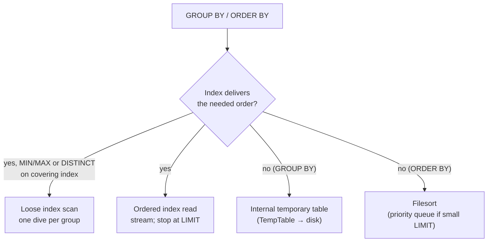

## Introduction

Grouping and sorting share one requirement: rows with the same key must be brought together, or rows must be produced in key order. A database can satisfy it in two ways — **read the rows in an order that already satisfies it** (an index), or **reorganise them after reading** (a hash/temporary table for grouping, a sort for ordering). The first streams rows with almost no memory; the second has to see *all* qualifying rows before it can output the first one.

That difference explains most aggregation and sorting performance in MySQL:

- `GROUP BY account_id` can stream groups straight out of an index on `account_id`, or build an **internal temporary table** of all groups.
- `MAX(created_at) … GROUP BY account_id` can jump from group to group through an index — a **loose index scan** — reading one entry per group instead of every row.
- `ORDER BY created_at DESC LIMIT 20` can read 20 index entries backwards, or **filesort** the whole table to find the top 20.
- Page 2,500 of a feed with `LIMIT 20 OFFSET 50000` reads and throws away 50,000 rows; **keyset pagination** reads 20.

This lesson builds a 250,000-row event table and applies the optimization method to each of these shapes. It builds on [GROUP BY and HAVING](/lessons/m03-group-by-having), [Sorting and Pagination](/lessons/m03-sorting-pagination), and in Module 7 on [Composite Indexes](/lessons/m07-composite-indexes) and [Covering Indexes](/lessons/m07-covering-prefix-functional).

:::note[Lab data and timings]
**empty** dataset; the `events` table is generated in your lab. Plans, row counts and session status counters are captured from a real server; *measured* blocks are timings from a shared build machine — compare rows read, not milliseconds.
:::

## DBMS Theory

:::theory[Interesting orders]
Selinger's System R optimizer introduced the idea of **interesting orders**: a plan that produces rows sorted on a column used later (by `GROUP BY`, `ORDER BY`, a merge join or `DISTINCT`) can be cheaper overall than a plan with a lower access cost, because it avoids a sort. A B+ tree index on (a, b) delivers rows ordered by a, then b — forwards or backwards — so it can satisfy:

- `ORDER BY a`, `ORDER BY a, b`, `ORDER BY a DESC, b DESC` (backward scan);
- `WHERE a = const ORDER BY b` (equality on the prefix fixes a, the remainder is ordered by b);
- `GROUP BY a` and `GROUP BY a, b` (equal keys are adjacent).

It cannot satisfy `ORDER BY b` alone, `ORDER BY a, b DESC` (mixed directions — unless the index is declared with mixed directions, see descending indexes), or `ORDER BY a` when `a` is compared with a range *and* the sort is on `b`.
:::

**Grouping algorithms.** Aggregation γ<sub>keys; F</sub>(R) is implemented by:

- **Sort-based (stream) aggregation**: if input arrives ordered by the keys, keep one accumulator, emit it when the key changes. Memory O(1), output streams — can stop early under `LIMIT`.
- **Hash-based aggregation**: keep a hash table of accumulators keyed by group. Memory O(number of groups); output only after all input is read.

**Top-k.** `ORDER BY x LIMIT k` does not need a full sort: a bounded heap (priority queue) of k elements gives the top k in O(n log k) time and O(k) memory.

**Pagination theory.** `OFFSET n` is defined as "skip the first n rows of the ordered result" — the only way to know which rows those are is to produce them. Its cost is therefore O(n + page size) per page, and the total cost of reading a feed page by page is quadratic. **Keyset (seek) pagination** instead remembers the last key seen and asks for "rows after this key", which an ordered index answers in O(log N + page size) regardless of depth.

:::standard[Standard SQL vs MySQL]
`GROUP BY`, `ORDER BY` and `FETCH FIRST n ROWS ONLY` / `OFFSET n ROWS` are standard; MySQL's `LIMIT n OFFSET m` (or `LIMIT m, n`) is an extension shared with PostgreSQL and SQLite. Row-value comparisons `(a, b) < (x, y)` are standard SQL, supported by MySQL — but, as you will see, MySQL does not turn that form into an index range for keyset pagination. Since MySQL 8.0, `GROUP BY` **no longer sorts implicitly** and `GROUP BY … ASC/DESC` is removed; add `ORDER BY` when you need ordered output.
:::

## Why It Exists

Most user-facing queries are "top N by something" or "per-group summaries": the latest 20 events, the 10 largest orders, revenue per account, a paged admin table. Without index-ordered execution:

- every "latest 20" query sorts the whole matching set, and its cost grows with table size even though its output does not;
- every per-group summary builds a temporary table, which spills to disk once it outgrows memory (`tmp_table_size`, `temptable_max_ram`);
- deep pages in admin UIs and API exports get slower page by page until requests time out — the classic "page 5,000 takes 30 seconds" bug.

These optimizations exist so that output-sized questions cost output-sized work. And they are fragile: one function in the `ORDER BY`, a mixed `ASC/DESC`, or a column missing from a composite index turns a 20-row index read into a full sort.

## Internal Working

:::internals[GROUP BY, DISTINCT and ORDER BY inside MySQL 8.x]
**Index-based GROUP BY.** When an index's leftmost columns match the GROUP BY columns (possibly after equality-fixed columns), the executor reads the index in order and feeds a **Group aggregate** iterator — streaming, no temporary table. Two flavours:

- *Tight index scan*: read every entry in the relevant range (needed for `COUNT`, `SUM`, `AVG` …).
- *Loose index scan* ("Using index for group-by"; in tree format *Covering index skip scan for grouping*): for `MIN()`/`MAX()` of the column right after the group columns — or for `DISTINCT`/`GROUP BY` with no aggregates — jump to the first (or last) entry of each group and skip the rest with an index dive. Requires a covering index and only those aggregate forms (plus `COUNT(DISTINCT …)`, `SUM(DISTINCT …)`, `AVG(DISTINCT …)` over group-prefix columns).

**Temporary-table GROUP BY.** Otherwise MySQL creates an **internal temporary table** keyed by the grouping columns ("Using temporary"; *Aggregate using temporary table*), updates one row per group, then reads it out. In 8.0+ it uses the `TempTable` storage engine in memory, overflowing to memory-mapped files or InnoDB on-disk temporary tables beyond `temptable_max_ram`/`tmp_table_size`. `DISTINCT` without a usable index uses the same mechanism with a unique key on all selected columns.

**Filesort.** When no index delivers the required order, the *Sort* iterator ("Using filesort") reads all input rows, stores sort keys plus either the needed columns ("packed additional fields", the usual case) or the primary key into the **sort buffer** (`sort_buffer_size`, default 256 KB, allocated per sort, per session), sorts it, and writes sorted runs to temporary files when the buffer fills; runs are then merged (`Sort_merge_passes` counts merge passes). With `LIMIT k` and a small k, MySQL uses a **priority queue** of k rows instead — the tree shows "limit input to k row(s) per chunk". Despite the name, a filesort touches no file if it fits in memory.

**ORDER BY … LIMIT with an index.** If an index delivers the order, the iterator chain simply stops after k rows: *Limit* over an *Index scan/lookup/range scan*, possibly marked `(reverse)` / "Backward index scan" for DESC.
:::



## MySQL Implementation

The lab table records 250,000 product-analytics events for 5,000 accounts, one event every two minutes through 2024, of four kinds. There is no secondary index yet.

```sql run
SET SESSION cte_max_recursion_depth = 300000;
CREATE TABLE events (
  event_id   INT UNSIGNED  NOT NULL PRIMARY KEY,
  account_id INT UNSIGNED  NOT NULL,
  kind       VARCHAR(10)   NOT NULL,
  created_at DATETIME      NOT NULL,
  amount     DECIMAL(10,2) NOT NULL
);
INSERT INTO events
WITH RECURSIVE seq(n) AS (SELECT 1 UNION ALL SELECT n + 1 FROM seq WHERE n < 250000)
SELECT n,
       1 + (n * 7919) % 5000,
       ELT(1 + n % 4, 'view', 'click', 'cart', 'purchase'),
       TIMESTAMP '2024-01-01 00:00:00' + INTERVAL n * 2 MINUTE,
       ((n * 31) % 40000) / 100
FROM seq;
ANALYZE TABLE events;
```

A per-account summary, first five accounts:

```sql run
EXPLAIN
SELECT account_id, COUNT(*) AS events, MAX(created_at) AS last_seen
FROM events GROUP BY account_id ORDER BY account_id LIMIT 5;
EXPLAIN FORMAT=TREE
SELECT account_id, COUNT(*) AS events, MAX(created_at) AS last_seen
FROM events GROUP BY account_id ORDER BY account_id LIMIT 5;
```

`Using temporary; Using filesort`: MySQL scans all 250,000 rows into a temporary table with one row per account (*Aggregate using temporary table*), then sorts the 5,000 groups to return the first five. Despite `LIMIT 5`, all work happens before the first row can be returned. Now give it an index whose order matches the grouping:

```sql run
CREATE INDEX idx_account_time ON events (account_id, created_at);
ANALYZE TABLE events;
EXPLAIN
SELECT account_id, COUNT(*) AS events, MAX(created_at) AS last_seen
FROM events GROUP BY account_id ORDER BY account_id LIMIT 5;
```

`type: index`, `Using index`, **no temporary table and no filesort**, and `rows` estimated at 5: the executor reads `idx_account_time` in order, emits a group each time `account_id` changes, and stops after five groups. Both columns are in the index, so it is also covering.

## Syntax Breakdown

| Clause / setting | What determines its cost |
|---|---|
| `GROUP BY cols` | Index whose leftmost columns are `cols` (after equality-fixed prefix) → streaming; otherwise temporary table |
| `MIN(c)`/`MAX(c) … GROUP BY g` | Index `(g, c)` → loose index scan (one dive per group) |
| `SELECT DISTINCT g` / `COUNT(DISTINCT g)` | Index on `g` → loose index scan; otherwise temporary table |
| `ORDER BY cols` | Index delivering `cols` in one direction (or matching mixed directions with a descending key part) → no sort; otherwise filesort |
| `WHERE a = ? ORDER BY b` | Index `(a, b)` |
| `WHERE a > ? ORDER BY b` | No index gives both a range on `a` and order on `b`; choose: range on `(a)` + filesort, or scan `(b)` + filter |
| `LIMIT k` | With index order: read k rows. With filesort: priority queue of k rows (if they fit) |
| `LIMIT k OFFSET n` | Reads n + k rows in order, discards n |
| `WHERE (k1 < ? OR (k1 = ? AND k2 < ?)) ORDER BY k1 DESC, k2 DESC LIMIT k` | Keyset pagination: index range from the cursor; reads k rows |
| `sort_buffer_size` (session) | Larger buffer → fewer merge passes; allocated per sort |
| `tmp_table_size`, `temptable_max_ram` | When in-memory temporary tables spill |
| `SQL_BIG_RESULT` / `SQL_SMALL_RESULT` | MySQL-specific modifiers hinting temporary-table vs sort strategy for GROUP BY/DISTINCT |

:::version[8.0 vs 8.4]
Since 8.0: GROUP BY has no implicit sort, descending indexes are real (8.0.1), and `TempTable` is the default in-memory engine for internal temporary tables. The `SQL_CALC_FOUND_ROWS` modifier and `FOUND_ROWS()` — once used to count total rows for pagination — are **deprecated** (since 8.0.17) and should be replaced by a separate `COUNT(*)` query. Behaviour in this lesson is the same in 8.4 LTS.
:::

## Practical Examples

**1. Loose index scan for per-group MIN/MAX.** "Last activity per account" needs only the largest `created_at` per `account_id` — which is the last index entry of each group in `idx_account_time`:

```sql run
EXPLAIN SELECT account_id, MAX(created_at) AS last_seen FROM events GROUP BY account_id;
EXPLAIN FORMAT=TREE SELECT account_id, MAX(created_at) AS last_seen FROM events GROUP BY account_id;
```

`type: range`, `key_len` covering only `account_id` (4 bytes), `Using index for group-by`, and `rows` ≈ the number of accounts instead of 250,000. The tree names it **Covering index skip scan for grouping**. `COUNT(*)` cannot use this trick — it must see every row of each group — which is why the first summary used a tight, full index scan. `SELECT DISTINCT account_id` and `COUNT(DISTINCT account_id)` use the loose scan too:

```sql run
EXPLAIN SELECT COUNT(DISTINCT account_id) FROM events;
```

**2. Grouping on an expression creates a temporary table.** Events per day:

```sql run
EXPLAIN SELECT DATE(created_at) AS day, COUNT(*) AS events FROM events GROUP BY day;
```

`Using temporary`: no index is ordered by `DATE(created_at)`, so MySQL uses a temporary table keyed by day (it still reads the narrow `idx_account_time` because it is covering for `created_at`). Session status counters confirm what happened. `Created_tmp_tables` counts internal temporary tables created by this session; read it before and after:

```sql run
SHOW SESSION STATUS LIKE 'Created_tmp_tables';
SELECT DATE(created_at) AS day, COUNT(*) AS events FROM events GROUP BY day ORDER BY day LIMIT 3;
SHOW SESSION STATUS LIKE 'Created_tmp_tables';
```

The counter went up when the query ran. (`Created_tmp_disk_tables` would rise as well if the temporary table had spilled to disk; 366 groups fit easily in memory.) A functional index on `(DATE(created_at))`, or a generated `day` column with an index, would let the GROUP BY stream instead — at the cost of maintaining another index.

**3. Top-k with filesort and a priority queue.** The ten largest events by amount, no index on `amount`:

```sql run
EXPLAIN FORMAT=TREE
SELECT event_id, amount FROM events ORDER BY amount DESC, event_id LIMIT 10;
```

*Sort: … limit input to 10 row(s) per chunk* over a table scan: MySQL reads every row but keeps only the best ten in a priority queue. The `Sort_rows` counter shows how many rows were sorted:

```sql run
SHOW SESSION STATUS WHERE Variable_name IN ('Sort_rows', 'Sort_scan', 'Sort_merge_passes');
SELECT event_id, amount FROM events ORDER BY amount DESC, event_id LIMIT 10;
SHOW SESSION STATUS WHERE Variable_name IN ('Sort_rows', 'Sort_scan', 'Sort_merge_passes');
```

`Sort_scan` (sorts done by scanning a table) rose by one and `Sort_rows` by only 10: the priority queue held ten rows, while 250,000 were read. The scan is still proportional to the table — top-k saves memory and sort time, not reading.

**4. A sort that does not fit in the buffer.** Sorting 200,000 rows with a deliberately tiny `sort_buffer_size` forces sorted runs on disk and merge passes:

```sql run
SET SESSION sort_buffer_size = 32768;
SHOW SESSION STATUS LIKE 'Sort_merge_passes';
SELECT COUNT(*), MAX(x) FROM (SELECT amount AS x FROM events ORDER BY amount, event_id LIMIT 200000) AS t;
SHOW SESSION STATUS LIKE 'Sort_merge_passes';
SET SESSION sort_buffer_size = DEFAULT;
```

`Sort_merge_passes` jumped by dozens. A steadily rising `Sort_merge_passes` on a production server is the classic signal that large sorts are spilling; the fix is usually an index that removes the sort, not a bigger global buffer (which every session could allocate).

**5. `WHERE … ORDER BY … LIMIT` — the feed query.** The 20 most recent purchases:

```sql run
EXPLAIN
SELECT event_id, created_at, amount FROM events
WHERE kind = 'purchase' ORDER BY created_at DESC LIMIT 20;
```

`ALL`, `Using where; Using filesort`: read everything, keep purchases, sort them, return 20. The interesting-order index is `(kind, created_at)` — equality on `kind` fixes the prefix and leaves the entries ordered by `created_at`:

```sql run
CREATE INDEX idx_kind_time ON events (kind, created_at);
ANALYZE TABLE events;
EXPLAIN
SELECT event_id, created_at, amount FROM events
WHERE kind = 'purchase' ORDER BY created_at DESC LIMIT 20;
```

`type: ref` on `idx_kind_time`, **`Backward index scan`**, no filesort. InnoDB indexes can be read in either direction, so a `DESC` index is not needed for a single-direction `ORDER BY … DESC`. A descending key part matters only for **mixed** directions such as `ORDER BY created_at DESC, amount ASC`.

## Execution Walkthrough

Pagination is where ORDER BY … LIMIT goes wrong in production. The walkthrough compares OFFSET with keyset pagination for page 2,501 of the purchase feed (20 rows per page).

```walkthrough
title: Page 2,501 of SELECT … WHERE kind = 'purchase' ORDER BY created_at DESC, event_id DESC
steps:
  - title: "1. OFFSET pagination — the page we want"
    explain: >-
      Page 2,501 starts after 50,000 rows. With OFFSET the query is easy to write; event_id is added as a tie-breaker
      so the order is total and pages are stable.
    sql: |
      SELECT event_id, created_at FROM events
      WHERE kind = 'purchase'
      ORDER BY created_at DESC, event_id DESC
      LIMIT 5 OFFSET 50000;
  - title: "2. What OFFSET costs"
    explain: >-
      The plan walks idx_kind_time backwards, and the Limit/Offset iterator discards the first 50,000 entries before
      returning the page. Rows read grow linearly with the page number.
    sql: |
      EXPLAIN FORMAT=TREE
      SELECT event_id, created_at, amount FROM events
      WHERE kind = 'purchase'
      ORDER BY created_at DESC, event_id DESC
      LIMIT 20 OFFSET 50000;
  - title: "3. The cursor — the last row of the previous page"
    explain: >-
      Keyset pagination remembers the sort key of the last row the client saw — here the 50,000th row. A real API
      returns it as an opaque cursor; in the lab we store it in session variables.
    sql: |
      SELECT created_at, event_id INTO @cursor_at, @cursor_id
      FROM events WHERE kind = 'purchase'
      ORDER BY created_at DESC, event_id DESC
      LIMIT 1 OFFSET 49999;
      SELECT @cursor_at AS cursor_created_at, @cursor_id AS cursor_event_id;
  - title: "4. Keyset page — seek, then read 20"
    explain: >-
      "Rows after the cursor" in descending order is created_at < cursor OR (created_at = cursor AND event_id <
      cursor_id). The result equals step 1's page (first five rows shown). InnoDB secondary indexes contain the
      primary key, so idx_kind_time is effectively ordered by (kind, created_at, event_id) and the tie-breaker is free.
    sql: |
      SELECT event_id, created_at FROM events
      WHERE kind = 'purchase'
        AND (created_at < @cursor_at OR (created_at = @cursor_at AND event_id < @cursor_id))
      ORDER BY created_at DESC, event_id DESC
      LIMIT 5;
  - title: "5. The keyset plan"
    explain: >-
      An index range scan that starts at the cursor (reverse) and stops after 20 rows. The work no longer depends on
      the page number.
    sql: |
      EXPLAIN FORMAT=TREE
      SELECT event_id, created_at, amount FROM events
      WHERE kind = 'purchase'
        AND (created_at < @cursor_at OR (created_at = @cursor_at AND event_id < @cursor_id))
      ORDER BY created_at DESC, event_id DESC
      LIMIT 20;
```

## Output

Measured, the two pagination strategies for the same page:

```sql run measured
EXPLAIN ANALYZE
SELECT event_id, created_at, amount FROM events
WHERE kind = 'purchase'
ORDER BY created_at DESC, event_id DESC
LIMIT 20 OFFSET 50000;
```

The index lookup iterator returns **50,020** rows to the Limit/Offset iterator, which discards 50,000.

```sql run measured
EXPLAIN ANALYZE
SELECT event_id, created_at, amount FROM events
WHERE kind = 'purchase'
  AND (created_at < @cursor_at OR (created_at = @cursor_at AND event_id < @cursor_id))
ORDER BY created_at DESC, event_id DESC
LIMIT 20;
```

The range scan returns **20** rows. Same page, about 2,500 times fewer rows read; on the build machine the measured time fell from tens of milliseconds to a few. Now the MySQL-specific trap — the standard row-constructor spelling of the same condition:

```sql run measured
EXPLAIN ANALYZE
SELECT event_id, created_at, amount FROM events
WHERE kind = 'purchase' AND (created_at, event_id) < (@cursor_at, @cursor_id)
ORDER BY created_at DESC, event_id DESC
LIMIT 20;
```

Logically identical, but the row comparison appears as a **Filter** above an index lookup on `kind` only, and the lookup again returns about 50,020 rows: this MySQL version does not build an index range from a row-constructor inequality, so the backward scan starts at the newest purchase and filters its way down to the cursor. Expand row comparisons into the `OR`/`AND` form for keyset pagination in MySQL, and verify with EXPLAIN.

## Alternative Approaches

| Approach | Cost per page | Supports "jump to page N" | Caveats |
|---|---|---|---|
| `LIMIT k OFFSET n` | O(n + k) | Yes | Slows with depth; rows shift if data changes between requests (duplicates/missing rows) |
| Keyset / seek (`WHERE key < cursor`) | O(log N + k) | No (next/previous only) | Needs a total order (unique tie-breaker) and a matching index; cursor must encode all sort columns |
| Deferred join ("late row lookup") | O(n) index-only + k row lookups | Yes | `SELECT … FROM t JOIN (SELECT id FROM t … ORDER BY … LIMIT k OFFSET n) AS p USING (id)` skips over a covering index instead of full rows — still linear |
| Pre-computed page markers / search engine | O(k) | Yes | Extra infrastructure; stale between rebuilds |

For aggregation, alternatives to "make GROUP BY faster" include **summary tables** maintained incrementally (daily totals per account), **generated columns** for grouping expressions, and moving analytical workloads to a columnar store — Module 12. For counts shown next to paginated lists ("1,284,551 results"), the deprecated `SQL_CALC_FOUND_ROWS` is replaced by a separate `COUNT(*)` — often cached, approximated, or dropped in favour of "next page" links.

## Performance Analysis

| Plan feature | Rows read | Memory | Starts returning rows |
|---|---|---|---|
| Ordered index read + LIMIT | ≈ k (+ offset) | O(1) | Immediately |
| Loose index scan | ≈ number of groups | O(1) | Immediately |
| Tight index GROUP BY | all rows in range | O(1) | Immediately (per group) |
| Temporary-table GROUP BY | all rows in range | O(groups); spills | After all input |
| Filesort, priority queue (small LIMIT) | all rows in range | O(k) | After all input |
| Filesort, full | all rows in range | sort buffer + merge files | After all input |

**Session status counters** are a cheap way to confirm what happened without reading performance_schema:

| Counter | Meaning |
|---|---|
| `Created_tmp_tables` / `Created_tmp_disk_tables` | Internal temporary tables created / created on disk |
| `Sort_scan` / `Sort_range` | Sorts performed after a table scan / after a range scan |
| `Sort_rows` | Rows sorted (with a priority queue, only the kept rows) |
| `Sort_merge_passes` | Merge passes of on-disk sort runs — a sign that sorts outgrow `sort_buffer_size` |
| `Handler_read_next` / `Handler_read_prev` | Index entries read forwards / backwards — the "rows read" behind index scans |

**Choosing between an index for the filter and an index for the order.** For `WHERE kind = 'purchase' AND amount > 390 ORDER BY created_at DESC LIMIT 20`, an index `(kind, created_at)` reads purchases newest first and filters on amount until 20 are found — fast if matches are common, slow if rare. An index `(kind, amount)` reads only matching rows but must filesort them. MySQL's cost model weighs this (the `prefer_ordering_index` switch, on by default, governs the preference for an ordering index under LIMIT), and it can misjudge when the filter's selectivity is poorly estimated. This is a classic place for a histogram on the filter column or, after measurement, an index hint.

:::performance[Theory vs measurement]
Rows read (50,020 vs 20 for page 2,501) are a deterministic property of the plans; the measured times depend on the shared build machine and buffer pool state. The asymptotics are what matter in production: OFFSET pagination and filesort scale with data volume, index-ordered reads with output size.
:::

## Best Practices

:::best-practice[Aggregation, sorting and pagination]
1. **Design composite indexes for `WHERE equality + ORDER BY`**: equality columns first, then the sort columns in sort order. That one index serves the filter, the order and the LIMIT.
2. **Make sort orders total.** Always add a unique tie-breaker (usually the primary key) to `ORDER BY` for pagination; otherwise rows with equal sort keys can appear on two pages or none.
3. **Use keyset pagination for feeds, infinite scroll, exports and APIs.** Keep OFFSET for small, shallow admin lists where "jump to page" matters.
4. **Write keyset predicates in the expanded `OR`/`AND` form** in MySQL and confirm a range scan with EXPLAIN.
5. **Put MIN/MAX-per-group behind an index `(group_col, agg_col)`** to get loose index scans; check for "Using index for group-by".
6. **Add `ORDER BY` explicitly** to grouped queries whose output order matters (MySQL 8 does not sort GROUP BY results).
7. **Watch `Created_tmp_disk_tables` and `Sort_merge_passes`** over time; fix the query or index before raising buffers, and raise buffers per session when you must.
:::

## Common Mistakes

**Mistake 1 — paginating on a non-unique column.** Many events share the same amount:

```sql run
SELECT amount, COUNT(*) AS events_with_this_amount
FROM events GROUP BY amount ORDER BY amount DESC LIMIT 3;
```

With `ORDER BY amount DESC LIMIT 10 OFFSET 0` and then `OFFSET 10`, the server is free to order ties differently in each query (and does, depending on plan, sort algorithm and LIMIT), so a row can appear on both pages or on neither. The fix is a tie-breaker: `ORDER BY amount DESC, event_id DESC`.

**Mistake 2 — the row-constructor keyset predicate.** `(created_at, event_id) < (?, ?)` is correct SQL but, as measured above, is evaluated as a filter in MySQL, not as a range — pagination stays linear. Use the expanded form.

**Mistake 3 — expecting GROUP BY to sort.** Code written for MySQL 5.7 that relied on implicitly sorted GROUP BY output returns groups in arbitrary order on 8.0/8.4. Add `ORDER BY`.

**Mistake 4 — a function or mixed direction in ORDER BY.** `ORDER BY DATE(created_at) DESC` or `ORDER BY kind ASC, created_at DESC` (with an ascending `(kind, created_at)` index) both require a filesort. Sort on the bare column, or declare the index to match the mixed direction (`(kind ASC, created_at DESC)`, 8.0+).

**Mistake 5 — raising `sort_buffer_size` globally.** It is allocated per sort, per connection; a large global value multiplies by concurrent sorts and can exhaust memory. Prefer an index; otherwise raise it per session or with `/*+ SET_VAR(sort_buffer_size = …) */`.

**Mistake 6 — `SELECT *` defeating covering indexes.** The loose index scan and covering GROUP BY above required every referenced column to be in the index. Adding one more column to the SELECT list turns a covering scan into per-row clustered-index lookups.

## Industry Application

- **Social feeds, notification lists, activity logs** use keyset pagination over `(owner_id, created_at, id)` indexes almost universally; public APIs (Stripe, GitHub, Slack and many others) expose cursor-based pagination for exactly the reasons shown here.
- **Data exports and ETL extraction** walk a table in primary-key order with `WHERE id > :last_id ORDER BY id LIMIT 10000` batches — keyset pagination on the clustered index — instead of OFFSET, so each batch costs the same and the job can resume after a failure.
- **Leaderboards and "top N" widgets** are served from an index on the score column (or a summary table), never by sorting the full table per request.
- **Dashboards** pre-aggregate into summary tables (per account per day) because temporary-table GROUP BY over raw events grows without bound; the summary table's primary key is chosen so that the dashboard's GROUP BY streams from it.
- **Admin back-offices** keep OFFSET pagination for small filtered lists but cap the maximum page or switch to search-engine-backed listings for large ones.

## Practice Exercises

Exercises are graded by comparing result rows with the reference solution. Use EXPLAIN afterwards to check that your query streams from an index.

```exercise
id: ex1
title: An index for the feed query
difficulty: easy
kind: dml
concepts: [order-by-limit, filesort]
setup: |
  SET SESSION cte_max_recursion_depth = 20000;
  CREATE TABLE messages (msg_id INT UNSIGNED PRIMARY KEY, room_id INT UNSIGNED NOT NULL, sent_at DATETIME NOT NULL,
                         body VARCHAR(40) NOT NULL);
  INSERT INTO messages WITH RECURSIVE s(n) AS (SELECT 1 UNION ALL SELECT n + 1 FROM s WHERE n < 20000)
    SELECT n, 1 + n % 50, TIMESTAMP '2024-05-01 00:00:00' + INTERVAL n * 3 MINUTE, CONCAT('msg ', n) FROM s;
prompt: |
  The chat app runs `SELECT msg_id, sent_at, body FROM messages WHERE room_id = ? ORDER BY sent_at DESC LIMIT 50`
  and EXPLAIN shows `Using filesort`. Create one secondary index named `idx_room_time` that removes the sort and
  lets the query stop after 50 index entries.
hints:
  - "Equality columns first, then the ORDER BY column."
  - "CREATE INDEX idx_room_time ON messages (room_id, sent_at);"
solution: |
  CREATE INDEX idx_room_time ON messages (room_id, sent_at);
check: |
  SELECT INDEX_NAME, SEQ_IN_INDEX, COLUMN_NAME
  FROM information_schema.STATISTICS
  WHERE TABLE_SCHEMA = DATABASE() AND TABLE_NAME = 'messages' AND INDEX_NAME <> 'PRIMARY'
  ORDER BY INDEX_NAME, SEQ_IN_INDEX;
explanation: |
  With `(room_id, sent_at)` the equality on `room_id` fixes the prefix and the remaining entries are ordered by
  `sent_at`; a backward index scan returns the newest 50 and stops. `(sent_at, room_id)` would give the order but
  not the filter (it would scan all rooms' messages newest-first, filtering), and `(room_id)` alone would need a
  filesort of the room's messages. A `DESC` key part is unnecessary because InnoDB scans indexes backwards.
```

```exercise
id: ex2
title: Last order per customer, the loose way
difficulty: medium
concepts: [loose-index-scan, index-group-by]
setup: |
  SET SESSION cte_max_recursion_depth = 30000;
  CREATE TABLE purchases (purchase_id INT UNSIGNED PRIMARY KEY, customer_id INT UNSIGNED NOT NULL,
                          bought_at DATETIME NOT NULL, total DECIMAL(8,2) NOT NULL,
                          INDEX idx_cust_time (customer_id, bought_at));
  INSERT INTO purchases WITH RECURSIVE s(n) AS (SELECT 1 UNION ALL SELECT n + 1 FROM s WHERE n < 30000)
    SELECT n, 1 + (n * 37) % 1500, TIMESTAMP '2024-01-01 00:00:00' + INTERVAL n * 17 MINUTE, (n % 300) + 0.99 FROM s;
prompt: |
  Return each customer's first and last purchase time: columns `customer_id`, `first_at`, `last_at`. Write it so
  that MySQL can use a loose index scan on `idx_cust_time` (EXPLAIN: `Using index for group-by`).
hints:
  - "MIN and MAX of the column that follows the GROUP BY column in the index qualify for the loose scan."
  - "Don't select total or use COUNT(*) — they force reading every row."
solution: |
  SELECT customer_id, MIN(bought_at) AS first_at, MAX(bought_at) AS last_at
  FROM purchases GROUP BY customer_id;
explanation: |
  `MIN`/`MAX` of `bought_at` grouped by `customer_id` can be answered by one dive to each end of every group in
  `(customer_id, bought_at)` — about 1,500 groups instead of 30,000 rows. Adding `COUNT(*)` or `SUM(total)` would
  switch the plan to a tight index scan (every entry) and, for `total`, row lookups or a different plan.
```

```exercise
id: ex3
title: Keyset pagination, next page
difficulty: hard
concepts: [keyset-pagination, order-by-limit]
setup: |
  SET SESSION cte_max_recursion_depth = 30000;
  CREATE TABLE articles (article_id INT UNSIGNED PRIMARY KEY, published_at DATETIME NOT NULL, title VARCHAR(30) NOT NULL,
                         INDEX idx_published (published_at));
  INSERT INTO articles WITH RECURSIVE s(n) AS (SELECT 1 UNION ALL SELECT n + 1 FROM s WHERE n < 30000)
    SELECT n, TIMESTAMP '2023-01-01 00:00:00' + INTERVAL (n DIV 3) HOUR, CONCAT('Article ', n) FROM s;
prompt: |
  Articles are listed newest first with `ORDER BY published_at DESC, article_id DESC`, 10 per page. Several
  articles share the same `published_at`. The last row of the previous page was
  `published_at = '2024-01-15 08:00:00'`, `article_id = 27313`.

  Write the query for the **next page** using keyset pagination (no OFFSET): columns `article_id`,
  `published_at`, `title`, in feed order, 10 rows.
hints:
  - "You need rows that come after the cursor in descending (published_at, article_id) order."
  - "published_at < cursor_time OR (published_at = cursor_time AND article_id < cursor_id)."
  - "Write it in the expanded OR form, not as a row constructor, so MySQL can use a range on idx_published (which contains article_id as its hidden suffix)."
solution: |
  SELECT article_id, published_at, title
  FROM articles
  WHERE published_at < '2024-01-15 08:00:00'
     OR (published_at = '2024-01-15 08:00:00' AND article_id < 27313)
  ORDER BY published_at DESC, article_id DESC
  LIMIT 10;
orderMatters: true
explanation: |
  The cursor encodes **both** sort columns. Using only `published_at < '2024-01-15 08:00:00'` would skip the
  other articles published in the same hour as the cursor row — a classic keyset bug with non-unique sort keys.
  Because InnoDB appends the primary key to `idx_published`, the index is ordered by (published_at, article_id) and
  the expanded predicate is a backward range scan that reads about 10 entries. `(published_at, article_id) <
  ('2024-01-15 08:00:00', 27313)` returns the same rows but MySQL evaluates it as a filter.
```

```exercise
id: ex4
title: Daily revenue without a temporary table
difficulty: hard
kind: dml
concepts: [temporary-tables, index-group-by]
setup: |
  SET SESSION cte_max_recursion_depth = 30000;
  CREATE TABLE sales_x (sale_id INT UNSIGNED PRIMARY KEY, sold_at DATETIME NOT NULL, amount DECIMAL(8,2) NOT NULL);
  INSERT INTO sales_x WITH RECURSIVE s(n) AS (SELECT 1 UNION ALL SELECT n + 1 FROM s WHERE n < 30000)
    SELECT n, TIMESTAMP '2024-01-01 00:00:00' + INTERVAL n * 11 MINUTE, (n % 250) + 0.5 FROM s;
prompt: |
  `SELECT DATE(sold_at) AS day, SUM(amount) FROM sales_x GROUP BY DATE(sold_at)` uses a temporary table. Add a
  **stored** generated column `sold_day DATE` computed from `sold_at`, and a composite index `idx_day_amount` on
  `(sold_day, amount)` so that the grouped query `GROUP BY sold_day` can stream from a covering index.
hints:
  - "ALTER TABLE … ADD COLUMN sold_day DATE AS (DATE(sold_at)) STORED"
  - "Put amount in the index too, so SUM(amount) is served from the index without row lookups."
solution: |
  ALTER TABLE sales_x
    ADD COLUMN sold_day DATE AS (DATE(sold_at)) STORED,
    ADD INDEX idx_day_amount (sold_day, amount);
check: |
  SELECT s.INDEX_NAME, s.SEQ_IN_INDEX, s.COLUMN_NAME, c.GENERATION_EXPRESSION <> '' AS is_generated, c.EXTRA
  FROM information_schema.STATISTICS s
  JOIN information_schema.COLUMNS c
    ON c.TABLE_SCHEMA = s.TABLE_SCHEMA AND c.TABLE_NAME = s.TABLE_NAME AND c.COLUMN_NAME = s.COLUMN_NAME
  WHERE s.TABLE_SCHEMA = DATABASE() AND s.TABLE_NAME = 'sales_x' AND s.INDEX_NAME = 'idx_day_amount'
  ORDER BY s.SEQ_IN_INDEX;
explanation: |
  With an index ordered by `sold_day`, `SELECT sold_day, SUM(amount) FROM sales_x GROUP BY sold_day` reads the
  index in order and aggregates one day at a time — no temporary table — and is covering because `amount` is in the
  index. A VIRTUAL column would work as well for the index; STORED also materialises the value in the row. A
  functional index `((DATE(sold_at)))` helps only queries that repeat that exact expression.
```

```exercise
id: ex5
title: Choose a pagination strategy
difficulty: challenge
kind: open
concepts: [keyset-pagination, order-by-limit, filesort]
prompt: |
  An admin page lists support tickets: `WHERE status = ? ORDER BY priority DESC, created_at ASC`, 50 per page,
  with "jump to page" links. There are 12 M tickets; the 'open' status has 2 M. Users report page 1 is instant but
  page 3,000 takes 20 s. (1) Explain both observations, including the index you expect is in use. (2) Propose a
  design that keeps deep pages fast. (3) What UI or API compromise does your design require, and how do you keep
  page boundaries stable while tickets change?
solution: |
  (1) With an index like `(status, priority, created_at)` — note `priority DESC, created_at ASC` is a mixed
  direction, so it must be declared `(status, priority DESC, created_at ASC)` (8.0+) or read with a filesort —
  page 1 reads 50 entries and stops. Page 3,000 uses `OFFSET 149950`: the executor must read and discard 149,950
  ordered entries (and, if the index is not covering, fetch their rows) before returning 50. Cost grows linearly
  with the page number; deep pages are slow by construction.

  (2) Keyset pagination: index `(status, priority DESC, created_at, ticket_id)` (ticket_id as unique tie-breaker,
  implicitly appended by InnoDB) and the predicate for "after the cursor" in the expanded form:
  `priority < :p OR (priority = :p AND (created_at > :c OR (created_at = :c AND ticket_id > :id)))` with
  `status = :s`, ORDER BY the same columns, LIMIT 50. Each page is a range scan reading ~50 entries. For the
  initial deep jump, a deferred join (covering index scan for ids, then 50 row lookups) is a cheaper OFFSET.

  (3) Keyset supports next/previous, not arbitrary page numbers. Replace "jump to page 3,000" with filters (date,
  priority) or a search box; show "next/previous" and an approximate total. Cursors make pages stable under
  inserts/updates because they are anchored to a key, not a position; with OFFSET, inserting one ticket shifts
  every later page and causes duplicates or skipped rows.
```

## Knowledge Assessment

```quiz
- id: q1
  question: "EXPLAIN shows `Using index for group-by` for `SELECT g, MAX(c) FROM t GROUP BY g`. What does MySQL do?"
  options:
    - "Builds a temporary table of groups"
    - "Jumps through an index on (g, c), reading only one entry per group (loose index scan)"
    - "Reads every index entry and sorts them"
    - "Uses a hash join"
  answer: 1
  explanation: "Using index for group-by is the loose index scan: one dive per group to the last (MAX) or first (MIN) entry. A temporary table would show Using temporary; a tight scan reads every entry; hash joins are unrelated."
  concepts: [loose-index-scan]
- id: q2
  question: "Which index lets `WHERE kind = 'purchase' ORDER BY created_at DESC LIMIT 20` avoid a filesort and stop after 20 entries?"
  options: ["(created_at)", "(kind)", "(kind, created_at)", "(created_at, kind)"]
  answer: 2
  explanation: "Equality on the first column fixes kind; the remaining entries are ordered by created_at and can be read backwards. (kind) needs a sort; (created_at) and (created_at, kind) give the order but must filter non-purchases along the way."
  concepts: [order-by-limit, filesort]
- id: q3
  question: "`ORDER BY amount DESC LIMIT 10` on an unindexed column shows `Sort: … limit input to 10 row(s) per chunk`. What is true?"
  options:
    - "Only 10 rows are read from the table"
    - "All rows are read, but a priority queue keeps only the best 10, so Sort_rows grows by about 10"
    - "The sort always spills to disk"
    - "MySQL uses the primary key order"
  answer: 1
  explanation: "Top-k with a priority queue saves memory and sort work, not reading — every row must still be examined. The lab showed Sort_scan +1 and Sort_rows +10 for a 250,000-row table."
  concepts: [filesort, order-by-limit]
- id: q4
  question: "Why does `LIMIT 20 OFFSET 50000` get slower as the offset grows, even with a perfect index?"
  options:
    - "Because MySQL re-sorts the table for every page"
    - "Because the executor must produce and discard the first 50,000 ordered rows before returning 20"
    - "Because OFFSET disables index usage"
    - "Because of the query cache"
  answer: 1
  explanation: "OFFSET means skip n rows of the ordered result; the only way is to read them. The lab plan returned 50,020 rows to the Limit/Offset iterator. The index is used — it just has to be walked. The query cache no longer exists."
  concepts: [keyset-pagination]
- id: q5
  question: "Which keyset predicates are correct AND can be used as an index range in MySQL for `ORDER BY ts DESC, id DESC`? (Select all that apply.)"
  type: multi
  options:
    - "`ts < :ts OR (ts = :ts AND id < :id)`"
    - "`(ts, id) < (:ts, :id)`"
    - "`ts < :ts`"
    - "`ts <= :ts AND id < :id`"
  answer: [0]
  explanation: "The expanded form is correct and range-optimizable. The row constructor is correct but MySQL evaluates it as a filter (linear cost). `ts < :ts` skips rows sharing the cursor's timestamp. `ts <= :ts AND id < :id` wrongly excludes older rows with larger ids."
  concepts: [keyset-pagination]
- id: q6
  question: "A MySQL 5.7 report relied on `GROUP BY region` returning regions alphabetically. After upgrading to 8.4 the order is random. Why?"
  options:
    - "A bug in 8.4"
    - "Since 8.0 GROUP BY no longer sorts implicitly; add ORDER BY region"
    - "The collation changed"
    - "Index statistics are stale"
  answer: 1
  explanation: "Implicit GROUP BY sorting (and GROUP BY … ASC/DESC) was removed in 8.0. Without ORDER BY, output order depends on the plan (temporary table, index, hash)."
  concepts: [index-group-by]
- id: q7
  question: "`Sort_merge_passes` rises steadily on a server. What is the best first response?"
  options:
    - "Set a much larger global sort_buffer_size"
    - "Find the queries doing large sorts and remove the sorts with suitable indexes, or raise the buffer per session for specific reports"
    - "Disable filesort"
    - "Increase innodb_buffer_pool_size"
  answer: 1
  explanation: "Merge passes mean sorts spill to disk. A big global buffer is allocated per sort per connection and risks memory exhaustion; fixing the queries (index-ordered reads) or per-session tuning is safer. Filesort cannot be disabled; the buffer pool does not hold sort buffers."
  concepts: [filesort]
- id: q8
  question: "`SELECT DATE(created_at) d, COUNT(*) FROM events GROUP BY d` shows Using temporary. Which change lets the GROUP BY stream from an index?"
  options:
    - "An index on created_at"
    - "A generated column (or functional index) on DATE(created_at), indexed, and grouping by it"
    - "ORDER BY NULL"
    - "SQL_SMALL_RESULT"
  answer: 1
  explanation: "An index on created_at is ordered by timestamp, not by the DATE() expression — the optimizer does not group by a function of an index column without a matching indexed expression. ORDER BY NULL was a 5.7 trick to skip implicit sorting; SQL_SMALL_RESULT only hints the temporary-table strategy."
  concepts: [temporary-tables, index-group-by]
```
