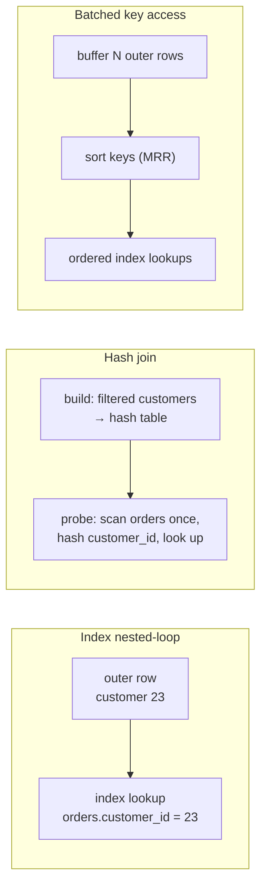

## Introduction

A join answers questions that span entities: *revenue per region*, *open tickets of enterprise customers*, *products never ordered*. In [Multi-Table Joins](/lessons/m04-multi-table-joins) you learned what a join **means**. This lesson is about what it **costs** — and why the same join can read eight thousand rows or eight hundred million, depending on three decisions:

1. **The join algorithm** — for each pair of tables, MySQL uses an *index nested-loop* lookup, a *hash join* or a *Batched Key Access* join.
2. **The join order** — which table drives the loop and which is probed. For *n* tables there are *n!* orders.
3. **The access path into each table** — which in turn depends on whether the join columns are indexed, with compatible types.

On top of these sits a correctness-and-performance problem that has nothing to do with the optimizer: **fan-out**. Joining a customer to ten orders and five tickets produces fifty rows per customer, and every `SUM` and `COUNT` above that join is silently multiplied.

You will build a 320,000-row lab (customers, orders, support tickets), then follow the optimization method on several joins: write the slow version, read its plan, find the bottleneck, fix the query or the indexes, compare plans, and discuss the trade-offs. Prerequisites: [Access Paths](/lessons/m07-access-paths) for `ref`/`eq_ref`, and [EXPLAIN ANALYZE](/lessons/m07-explain-analyze) for `loops` and actual rows.

:::note[Lab data and timings]
The lesson uses the **empty** dataset and generates its tables with recursive CTEs. Plans and row counts are captured from a real server; *measured* blocks show timings from the shared build machine — compare **rows and loops**, which are deterministic, and treat milliseconds as indicative.
:::

## DBMS Theory

:::theory[Three join algorithms]
For an equi-join R ⋈<sub>R.a = S.b</sub> S with |R| outer rows and |S| inner rows, database theory distinguishes:

- **Nested-loop join (NLJ).** For each row r of R, find the rows of S with S.b = r.a. Without an index on S.b the inner step is a scan: cost ∝ |R| × |S|. With a B+ tree index on S.b (an **index nested-loop join**) the inner step is a lookup: cost ∝ |R| × (log |S| + matches). It is the only algorithm that can exploit an index on the inner side, and it produces rows in the outer table's order, immediately (pipelined).
- **Hash join.** *Build* a hash table on the join key of the smaller input, then *probe* it with each row of the larger input: cost ∝ |R| + |S| when the build side fits in memory. No index is needed, but only **equality** conditions can be looked up in a hash table, and the build phase must finish before the first row is produced.
- **Sort-merge join.** Sort both inputs on the join key and merge them: cost ∝ |R| log |R| + |S| log |S| (or linear if already sorted). Common in PostgreSQL, Oracle and SQL Server — **MySQL does not implement it**.
:::

The **join order** problem: an inner join is commutative and associative, so (R ⋈ S) ⋈ T = R ⋈ (S ⋈ T) = (T ⋈ R) ⋈ S … All orders give the same result, but costs differ by orders of magnitude, because the number of rows flowing out of each step — its **cardinality** — becomes the number of probes into the next. Optimizers therefore estimate, for every candidate order, the rows produced after each join: rows(outer) × *fan-out* × *selectivity of remaining filters*. MySQL's classic optimizer considers **left-deep** plans — each join has a base table as its inner input — and searches them with a greedy, depth-limited exhaustive search (`optimizer_search_depth`, `optimizer_prune_level`).

**Fan-out** is the number of inner rows matched per outer row. In a 1:N join it is the average N. Joining two independent 1:N relationships of the same parent (customer→orders, customer→tickets) produces N₁ × N₂ rows per parent: a partial Cartesian product. That is not a MySQL issue; it follows from the definition of the join.

:::standard[Standard SQL vs MySQL]
Join syntax (`INNER`, `LEFT`, `CROSS`, `NATURAL`, `USING`, `LATERAL`) is standard SQL. **`STRAIGHT_JOIN`** and the comment-style optimizer hints (`/*+ JOIN_ORDER(…) BKA(…) */`) are MySQL extensions — the standard has no notion of hints. MySQL does not support `FULL OUTER JOIN` (emulate it with `UNION`) or sort-merge joins.
:::

## Why It Exists

Joins exist because normalisation splits facts across tables; join optimization exists because the naive algorithm — compare every row with every row — is quadratic. With 20,000 customers and 200,000 orders, a nested loop that scans orders for every customer would examine four billion row pairs. Every technique in this lesson exists to avoid that:

- **Indexes on join columns** turn the inner scan into a lookup.
- **Hash joins** remove the quadratic term when no index exists — ad-hoc analytics, staging tables, joins on columns nobody thought to index.
- **Join ordering** makes the smallest *filtered* input drive, so that the expensive inner step runs as few times as possible.
- **BKA** turns thousands of random index lookups into sorted batches.
- **Reducing fan-out** stops the result from growing before it is aggregated — and, as a side effect, stops wrong totals.

What goes wrong without this understanding is familiar from incident reports: a report that ran in 50 ms runs for minutes after a new filter changed the join order; a migration created a `VARCHAR` foreign-key column next to an `INT` primary key and the join stopped using indexes; a dashboard's revenue doubled because someone joined the tickets table "to also show ticket counts".

## Internal Working

:::internals[How the MySQL 8.x executor runs joins]
**Planning.** The optimizer picks a left-deep join order and, for each table in that order, an access method: `const`, `eq_ref` (unique index lookup), `ref` (non-unique lookup), `range`, or a scan. It costs each prefix of the order (rows × per-row cost, with `filtered` estimates for conditions that are not part of the access) and keeps the cheapest.

**Execution (iterators).** A join is a tree of iterators:

- *Nested loop inner/left/semi/anti join* — `Read()` a row from the outer child, then re-initialise the inner child with that row's key and read all its matches. With `eq_ref`/`ref` the inner child is an index lookup: `loops` in EXPLAIN ANALYZE equals the number of outer rows.
- *Hash join* (8.0.18+) — reads the **build** input (the inner table of the planned order, after its filters) into an in-memory hash table bounded by `join_buffer_size`; if it does not fit, both inputs are partitioned into chunk files on disk and joined chunk by chunk. Then it reads the **probe** input once. From 8.0.20 it replaces the old *block nested-loop* (BNL) algorithm entirely, and it is also used for outer, semi- and anti-joins and for inner joins without an equality condition.
- *Batched key access* — buffers outer rows in the join buffer, extracts their keys, hands them to the storage engine as a batch of ranges through the **Multi-Range Read** interface (which sorts them so the inner index and rows are visited in order), then matches the returned rows back to the buffered outer rows.

In the classic optimizer, the hash join decision is made late: the plan is chosen as if the join were a block nested loop on a table that has no usable index, and the executor then runs it as a hash join. That is why `EXPLAIN` prints `Using join buffer (hash join)` and why the optimizer's cost and row estimates for such joins can look very pessimistic.
:::



**Index requirements for `ref`/`eq_ref` on the inner table.** The inner table needs an index whose **leftmost** column(s) are compared with equality to columns of tables already read. The comparison must not convert the inner column: a `VARCHAR` inner column compared with an `INT` outer column is compared as doubles, and the index is unusable — exactly the implicit-conversion rule from [SARGable Queries](/lessons/m07-sargable-queries), now applied to a join condition. Different character sets or incompatible collations on two string join columns have the same effect.

**Join buffer.** `join_buffer_size` (default 256 KB) is allocated per join that uses buffering, per session. A hash join whose build input exceeds it spills to disk — correct, but slower. Raising it globally is dangerous on a busy server; raise it per session or with the `SET_VAR` hint for specific reports.

## MySQL Implementation

Build the lab. Customers are spread over eight regions and three segments; every customer has exactly 10 orders and 5 support tickets. The tickets table, loaded from a CRM export, stores the customer reference as a string — a realistic flaw we will meet later. **No secondary index exists on `orders_j.customer_id` yet.**

```sql run
SET SESSION cte_max_recursion_depth = 200000;
CREATE TABLE customers_j (
  customer_id INT UNSIGNED NOT NULL PRIMARY KEY,
  region      VARCHAR(10)  NOT NULL,
  segment     VARCHAR(10)  NOT NULL,
  signup_date DATE         NOT NULL
);
INSERT INTO customers_j
WITH RECURSIVE seq(n) AS (SELECT 1 UNION ALL SELECT n + 1 FROM seq WHERE n < 20000)
SELECT n,
       ELT(1 + n % 8, 'north', 'south', 'east', 'west', 'central', 'coast', 'mountain', 'islands'),
       ELT(1 + (n DIV 8) % 3, 'consumer', 'smb', 'enterprise'),
       DATE '2020-01-01' + INTERVAL n % 1500 DAY
FROM seq;
CREATE TABLE orders_j (
  order_id    INT UNSIGNED  NOT NULL PRIMARY KEY,
  customer_id INT UNSIGNED  NOT NULL,
  order_date  DATE          NOT NULL,
  amount      DECIMAL(10,2) NOT NULL
);
INSERT INTO orders_j
WITH RECURSIVE seq(n) AS (SELECT 1 UNION ALL SELECT n + 1 FROM seq WHERE n < 200000)
SELECT n, 1 + (n * 7919) % 20000, DATE '2024-01-01' + INTERVAL (n * 37) % 366 DAY, ((n * 31) % 50000) / 100
FROM seq;
CREATE TABLE tickets_j (
  ticket_id    INT UNSIGNED NOT NULL PRIMARY KEY,
  customer_ref VARCHAR(10)  NOT NULL,
  opened_on    DATE         NOT NULL,
  INDEX idx_customer_ref (customer_ref)
);
INSERT INTO tickets_j
WITH RECURSIVE seq(n) AS (SELECT 1 UNION ALL SELECT n + 1 FROM seq WHERE n < 100000)
SELECT n, CAST(1 + (n * 104729) % 20000 AS CHAR), DATE '2024-01-01' + INTERVAL n % 366 DAY
FROM seq;
ANALYZE TABLE customers_j, orders_j, tickets_j;
```

The business question: **order count and revenue of enterprise customers in the *islands* region**.

```sql run
SELECT COUNT(*) AS orders, SUM(o.amount) AS revenue
FROM customers_j AS c
JOIN orders_j    AS o ON o.customer_id = c.customer_id
WHERE c.region = 'islands' AND c.segment = 'enterprise';
```

How does MySQL execute it without an index on `orders_j.customer_id`?

```sql run
EXPLAIN FORMAT=TREE
SELECT COUNT(*) AS orders, SUM(o.amount) AS revenue
FROM customers_j AS c
JOIN orders_j    AS o ON o.customer_id = c.customer_id
WHERE c.region = 'islands' AND c.segment = 'enterprise';
```

Read the tree from the inside out. The optimizer made `orders_j` the **outer** table (a table scan of all 200,000 orders) and `customers_j` the inner table, probed by a **single-row index lookup on the primary key** for every order, with the region/segment filter applied after each lookup. That is an index nested-loop join — the only index available for this join is the customers' primary key, so the optimizer turned the join around to use it. It is not absurd, but it performs one primary-key lookup per order to keep about 4 % of them.

## Syntax Breakdown

| Syntax | Effect | Notes |
|---|---|---|
| `a JOIN b ON …` | Inner join; the optimizer chooses the order | Order in the SQL text does not matter for inner joins |
| `a LEFT JOIN b ON …` | Outer join; `a` must be read before `b` (unless the optimizer converts it to an inner join because a WHERE condition rejects NULL-extended rows) | Constrains join order |
| `SELECT STRAIGHT_JOIN …` | Join tables in exactly the order written in FROM | MySQL extension; applies to the whole query block |
| `a STRAIGHT_JOIN b ON …` | `a` is read before `b` | MySQL extension; pairwise |
| `/*+ JOIN_ORDER(t1, t2) */` | Join these tables in this order (others are free) | 8.0+ optimizer hint; also `JOIN_PREFIX`, `JOIN_SUFFIX`, `JOIN_FIXED_ORDER` |
| `/*+ BKA(t) */`, `/*+ NO_BKA(t) */` | Enable/disable Batched Key Access for inner table `t` | `batched_key_access` is **off** by default in `optimizer_switch` |
| `/*+ BNL(t) */`, `/*+ NO_BNL(t) */` | Enable/disable hash join (8.0.20+) for `t` | `HASH_JOIN`/`NO_HASH_JOIN` hints have no effect from 8.0.19 |
| `/*+ SET_VAR(join_buffer_size = 4194304) */` | Per-statement join buffer | Avoids changing the session or global value |
| `optimizer_switch='hash_join=…'` | Ignored from 8.0.19 for the same reason | Use the BNL hints / `block_nested_loop` flag |
| `JOIN LATERAL (subquery)` | Derived table that can reference preceding tables (8.0.14+) | Useful to pre-aggregate per outer row |

:::version[8.0 vs 8.4]
Hash join arrived in 8.0.18 (inner equi-joins) and became general in 8.0.20, when block nested-loop was removed. Everything in this lesson behaves the same in 8.4 LTS. Two 8.4 notes: the `HASH_JOIN`/`NO_HASH_JOIN` hints and the `hash_join` switch flag remain accepted but do nothing; and the default join optimizer is still the classic left-deep optimizer — the `hypergraph_optimizer` switch is not a supported production option in MySQL Community 8.4.
:::

## Practical Examples

**1. Index the join column.** The textbook fix: give the many-side foreign key column an index, so that customers can drive and orders can be probed.

```sql run
CREATE INDEX idx_customer ON orders_j (customer_id);
ANALYZE TABLE orders_j;
EXPLAIN
SELECT COUNT(*) AS orders, SUM(o.amount) AS revenue
FROM customers_j AS c
JOIN orders_j    AS o ON o.customer_id = c.customer_id
WHERE c.region = 'islands' AND c.segment = 'enterprise';
```

The order flipped: `c` is now first (`type: ALL` with `filtered` around 1 %, the optimizer's estimate for the two equality filters without histograms) and `o` is accessed by `ref` on `idx_customer` with `ref = c.customer_id` — an index nested-loop join driven by the *filtered* customers. Note that InnoDB does not create this index for you unless you declare a `FOREIGN KEY` constraint (which requires an index on the referencing column and creates one if missing).

**2. Join order — what happens if you force the wrong one.** `STRAIGHT_JOIN` makes the FROM order binding:

```sql run
EXPLAIN FORMAT=TREE
SELECT STRAIGHT_JOIN COUNT(*) AS orders, SUM(o.amount) AS revenue
FROM orders_j    AS o
JOIN customers_j AS c ON o.customer_id = c.customer_id
WHERE c.region = 'islands' AND c.segment = 'enterprise';
```

That is the plan of the unindexed case again: all orders drive, each probes the customers' primary key. The estimated cost in the tree is far larger than for the optimizer's own choice. Hints are a scalpel, not a default: a forced order is frozen even when data distribution changes. The optimizer-hint form is more targeted than `STRAIGHT_JOIN`, because it pins only the tables you name:

```sql run
EXPLAIN FORMAT=TREE
SELECT /*+ JOIN_ORDER(c, o) */ COUNT(*), SUM(o.amount)
FROM orders_j AS o JOIN customers_j AS c ON o.customer_id = c.customer_id
WHERE c.region = 'islands' AND c.segment = 'enterprise';
```

**3. Hash join when no index can help.** Analysts often join on columns that are not indexed — here we simulate it by telling the optimizer to ignore `idx_customer` and to read customers first:

```sql run
EXPLAIN
SELECT /*+ JOIN_ORDER(c, o) NO_INDEX(o idx_customer) */ COUNT(*), SUM(o.amount)
FROM customers_j AS c JOIN orders_j AS o ON o.customer_id = c.customer_id
WHERE c.region = 'islands' AND c.segment = 'enterprise';
```

Traditional EXPLAIN shows `o` with `type: ALL` and `Using join buffer (hash join)`. The tree format names the algorithm and its two inputs:

```sql run
EXPLAIN FORMAT=TREE
SELECT /*+ JOIN_ORDER(c, o) NO_INDEX(o idx_customer) */ COUNT(*), SUM(o.amount)
FROM customers_j AS c JOIN orders_j AS o ON o.customer_id = c.customer_id
WHERE c.region = 'islands' AND c.segment = 'enterprise';
```

`Inner hash join (o.customer_id = c.customer_id)`: the child under **Hash** is the build input — the filtered customers — and the other child, the table scan of `o`, is the probe input. Look at the **cost** on the join: millions of units, compared with a few thousand for the indexed nested loop and about ninety thousand for the forced orders-first plan. The optimizer plans this join as if it were a block nested loop — conceptually rescanning `o` for each buffered batch of customers — and costs it accordingly, even though the executor runs a single build and a single probe pass. Keep that in mind when reading costs of hash-join plans in 8.0/8.4: they are pessimistic.

Disabling hash join for that table shows what MySQL would have to do without it — a nested loop that scans all of `orders_j` once per qualifying customer (we only EXPLAIN it; executing it would examine tens of millions of rows):

```sql run
EXPLAIN FORMAT=TREE
SELECT /*+ JOIN_ORDER(c, o) NO_INDEX(o idx_customer) NO_BNL(o) */ COUNT(*), SUM(o.amount)
FROM customers_j AS c JOIN orders_j AS o ON o.customer_id = c.customer_id
WHERE c.region = 'islands' AND c.segment = 'enterprise';
```

**4. Batched Key Access.** BKA is off by default. Enable it for one table with a hint:

```sql run
EXPLAIN
SELECT /*+ BKA(o) */ COUNT(*), SUM(o.amount)
FROM customers_j AS c JOIN orders_j AS o ON o.customer_id = c.customer_id
WHERE c.region = 'islands' AND c.segment = 'enterprise';
EXPLAIN FORMAT=TREE
SELECT /*+ BKA(o) */ COUNT(*), SUM(o.amount)
FROM customers_j AS c JOIN orders_j AS o ON o.customer_id = c.customer_id
WHERE c.region = 'islands' AND c.segment = 'enterprise';
```

`Using join buffer (Batched Key Access)` in the classic format, and in the tree a **Batched key access inner join** whose outer side is **Batch input rows** and whose inner side is a **Multi-range index lookup**. BKA pays off when inner lookups are expensive random I/O — large tables not in the buffer pool, rows fetched through a secondary index in random primary-key order. On a fully cached table, the batching overhead can outweigh the benefit, which is why it is not the default.

**5. A type mismatch in the join condition.** Count tickets of our target customers:

```sql run
EXPLAIN
SELECT COUNT(*) FROM customers_j AS c
JOIN tickets_j AS t ON t.customer_ref = c.customer_id
WHERE c.region = 'islands' AND c.segment = 'enterprise';
SHOW WARNINGS;
```

The index on `customer_ref` cannot be used to probe tickets per customer: warning 1739 again, and the rewritten condition in the note shows both sides `cast(… as double)`. The optimizer instead scans the entire `idx_customer_ref` index and looks each ticket's customer up by primary key. Converting the **outer** side to the inner column's type restores the lookup:

```sql run
EXPLAIN
SELECT COUNT(*) FROM customers_j AS c
JOIN tickets_j AS t ON t.customer_ref = CAST(c.customer_id AS CHAR)
WHERE c.region = 'islands' AND c.segment = 'enterprise';
```

Now `t` is a `ref` lookup on `idx_customer_ref` with `ref = func`. The `CAST` is a workaround; the real fix is a schema migration that makes `customer_ref` an `INT UNSIGNED` (ideally with a foreign key), because every query that joins these tables has to remember the cast otherwise. The cast is also only equivalent if the strings are canonical (no leading zeros or spaces).

## Execution Walkthrough

The walkthrough reconstructs what each join algorithm does for the enterprise/islands query, using queries that show the intermediate row sets.

```walkthrough
title: Index nested-loop vs hash join for customers ⋈ orders
steps:
  - title: "1. Outer input — the filtered customers"
    explain: >-
      With customers driving, the table scan of customers_j feeds a filter on region and segment. This is the set
      of outer rows: every one of them will trigger an index lookup (NLJ) or be inserted into the hash table (hash
      join).
    sql: |
      SELECT COUNT(*) AS outer_rows, MIN(customer_id) AS first_id, MAX(customer_id) AS last_id
      FROM customers_j WHERE region = 'islands' AND segment = 'enterprise';
  - title: "2. NLJ — one index lookup per outer row"
    explain: >-
      For each outer row the executor re-initialises the inner iterator with c.customer_id and reads matching
      entries of idx_customer. Here are the first three probes and how many orders each returns — the fan-out.
      Total probes = outer_rows; total rows read from orders = outer_rows × fan-out.
    sql: |
      SELECT c.customer_id, COUNT(o.order_id) AS orders_found
      FROM customers_j AS c JOIN orders_j AS o ON o.customer_id = c.customer_id
      WHERE c.region = 'islands' AND c.segment = 'enterprise'
      GROUP BY c.customer_id ORDER BY c.customer_id LIMIT 3;
  - title: "3. Hash join — build phase"
    explain: >-
      A hash join first reads the whole build input (the same filtered customers) into a hash table keyed on
      customer_id. Nothing is output until this phase completes. A few hundred small keys fit comfortably in the
      256 KB default join_buffer_size, so no chunk files are written.
  - title: "4. Hash join — probe phase"
    explain: >-
      Then the executor scans the probe input — all of orders_j, once — hashes each order's customer_id and looks
      it up. Most orders find no match and are discarded. Rows read from orders = the whole table, regardless of how
      few customers qualify.
    sql: |
      SELECT COUNT(*) AS probe_rows_read,
             SUM(c.customer_id IS NOT NULL) AS probe_rows_matched
      FROM orders_j AS o
      LEFT JOIN customers_j AS c
        ON c.customer_id = o.customer_id AND c.region = 'islands' AND c.segment = 'enterprise';
  - title: "5. Same result, different work"
    explain: >-
      Both algorithms return the same rows. The NLJ reads outer_rows index lookups plus their matches; the hash join
      reads every order once. Which is cheaper depends on how selective the outer filter is and whether the probed
      table is in memory — the next section measures it.
```

The trade-off in one sentence: **index nested-loop work grows with the number of outer rows; hash join work grows with the size of both inputs.** With a few hundred qualifying customers the indexed NLJ is the clear winner; if the filter selected half of all customers, scanning orders once and hashing could beat a hundred thousand index lookups.

## Output

Measure the three strategies for the same query. First the indexed nested loop the optimizer chose on its own:

```sql run measured
EXPLAIN ANALYZE
SELECT COUNT(*), SUM(o.amount)
FROM customers_j AS c JOIN orders_j AS o ON o.customer_id = c.customer_id
WHERE c.region = 'islands' AND c.segment = 'enterprise';
```

The filter above the customers scan produces 833 rows; the `Index lookup on o using idx_customer` shows `loops=833` and `rows=10` per loop — 8,330 joined rows, which matches the result of the first query. Now the hash join (index ignored):

```sql run measured
EXPLAIN ANALYZE
SELECT /*+ JOIN_ORDER(c, o) NO_INDEX(o idx_customer) */ COUNT(*), SUM(o.amount)
FROM customers_j AS c JOIN orders_j AS o ON o.customer_id = c.customer_id
WHERE c.region = 'islands' AND c.segment = 'enterprise';
```

The probe-side table scan of `o` reads all 200,000 rows in one loop; the build side reads the 833 customers once. And the forced bad order, orders driving:

```sql run measured
EXPLAIN ANALYZE
SELECT STRAIGHT_JOIN COUNT(*), SUM(o.amount)
FROM orders_j AS o JOIN customers_j AS c ON o.customer_id = c.customer_id
WHERE c.region = 'islands' AND c.segment = 'enterprise';
```

Here the primary-key lookup into `c` runs with `loops=200000`. How to read the three outputs together:

| Plan | Rows read from orders | Inner probes | Shape of cost |
|---|---|---|---|
| Index NLJ, customers first | 8,330 (via index) | 833 index lookups | ∝ qualifying customers × fan-out |
| Hash join, customers build | 200,000 (one scan) | 200,000 hash probes (cheap, in memory) | ∝ \|orders\| + \|customers\| |
| NLJ, orders first (forced) | 200,000 (one scan) | 200,000 primary-key lookups | ∝ \|orders\| × lookup cost |

On the build machine the indexed NLJ was the fastest and the forced order the slowest, with the hash join in between — consistent with the work in the table. Note what the **optimizer's estimates** said: the hash-join plan was given a cost far *above* the forced-order plan, yet it did less work. Estimates for hash joins in the classic optimizer are conservative; this is one reason to confirm important plan choices with EXPLAIN ANALYZE rather than with costs alone.

## Alternative Approaches

Not every join performance problem is solved inside the join.

| Approach | When it fits | Trade-off |
|---|---|---|
| Index the inner join column (index NLJ) | Selective outer filter; OLTP lookups | Index maintenance on every write to the inner table |
| Composite index `(join_col, filter_col)` or covering `(join_col, …, selected cols)` | Inner table also filtered or only a few columns needed | Wider index; must follow the leftmost-prefix rule |
| Let a hash join run | Large fractions of both tables; ad-hoc analytics; no suitable index | Reads both inputs fully; build side memory (`join_buffer_size`), spills to disk |
| Pre-aggregate before joining (derived table, CTE, `LATERAL`) | 1:N joins feeding `GROUP BY` | Extra query block; derived table may be materialised |
| `EXISTS` / semi-join instead of `JOIN … DISTINCT` | You only need to know *whether* a match exists | Different result shape (no columns from the inner table) — see [Optimizing Subqueries](/lessons/m07-optimizing-subqueries) |
| Denormalise (store `region` on orders) or a summary table | Hot reporting query on very large tables | Redundancy must be maintained (triggers, application, CDC) — Module 6 |

**Pre-aggregation is the fan-out fix.** Per-customer orders and tickets, joined naïvely, multiply:

```sql run
SELECT c.customer_id,
       COUNT(o.order_id)  AS n_orders,
       SUM(o.amount)      AS revenue,
       COUNT(t.ticket_id) AS n_tickets
FROM customers_j AS c
JOIN orders_j    AS o ON o.customer_id = c.customer_id
LEFT JOIN tickets_j AS t ON t.customer_ref = CAST(c.customer_id AS CHAR)
WHERE c.region = 'islands' AND c.segment = 'enterprise'
GROUP BY c.customer_id
ORDER BY c.customer_id
LIMIT 3;
```

Every customer has 10 orders and 5 tickets, but the query reports 50 of each and a revenue five times too large: each order row was repeated once per ticket. Aggregate each child **before** joining — here orders with `LATERAL` (one indexed aggregate per customer) and tickets with a grouped derived table:

```sql run
SELECT c.customer_id, o.n_orders, o.revenue, COALESCE(t.n_tickets, 0) AS n_tickets
FROM customers_j AS c
JOIN LATERAL (
  SELECT COUNT(*) AS n_orders, SUM(amount) AS revenue
  FROM orders_j WHERE customer_id = c.customer_id
) AS o
LEFT JOIN (
  SELECT customer_ref, COUNT(*) AS n_tickets FROM tickets_j GROUP BY customer_ref
) AS t ON t.customer_ref = CAST(c.customer_id AS CHAR)
WHERE c.region = 'islands' AND c.segment = 'enterprise'
ORDER BY c.customer_id
LIMIT 3;
```

Correct numbers — 10 orders, 5 tickets, true revenue. The grouped tickets derived table aggregates *all* tickets, though; for a selective outer filter, a second `LATERAL` (or a correlated scalar subquery) that counts only the qualifying customers' tickets through `idx_customer_ref` reads far less. Which form is cheapest depends on how many customers qualify — the same NLJ-versus-scan trade-off as above.

## Performance Analysis

**A cost model you can do in your head.** For a left-deep plan t₁ ⋈ t₂ ⋈ … the work is roughly

> rows(t₁ after filters) × [lookup cost(t₂) + fan-out(t₂) × (lookup cost(t₃) + …)]

so the two levers are: make the first factor small (drive from the most selective filtered table) and make each lookup cheap (an index on the inner join column, ideally covering). The optimizer does exactly this arithmetic, using statistics for row counts and `filtered` percentages. When the estimates are wrong — correlated filters, skewed values, no histogram on a filtered column — the chosen order can be wrong, and the cost grows with the *misestimated* factor. [Selectivity, Cardinality and Index Statistics](/lessons/m07-selectivity-statistics) shows how histograms improve `filtered` for non-indexed columns, which directly affects join order.

**Reading join plans.** In traditional EXPLAIN the row order is the join order. For each inner table, multiply `rows × filtered / 100` of all *preceding* rows to estimate how many times it is probed. In EXPLAIN ANALYZE, compare `loops` on the inner iterator with the actual rows of the outer one — they should be equal for NLJ — and compare actual rows with estimates at each level. A large ratio between estimated and actual rows at an early table is the usual root cause of a bad join order.

**Hash join memory.** The build side is bounded by `join_buffer_size`. When it overflows, MySQL writes chunk files and processes them pairwise; the result is correct but involves disk I/O. For a known heavy report, `/*+ SET_VAR(join_buffer_size = 16777216) */` raises the limit for that statement only, which is much safer than a global change (the buffer is allocated per join, per connection).

**Choosing the build side.** The optimizer builds on the table that comes *later* in the chosen join order (the "inner" table of the planned BNL). If the larger table ends up as the build input, the hash table is large; `JOIN_ORDER` can fix that, but first check whether the estimates that led to that order are wrong.

:::performance[Theory vs measurement]
The plan comparisons above are robust: rows read and loops are deterministic properties of the plan and data. The ranking by time is what one would predict from them, but the absolute times were measured on a shared build server with a warm buffer pool. On cold caches, random index lookups (NLJ) suffer more than sequential scans (hash join), which can shift the crossover point. Measure on production-like data before you pin a plan with a hint.
:::

## Best Practices

:::best-practice[Joining well in MySQL]
1. **Index every foreign key column** on the many side, and declare `FOREIGN KEY` constraints where your architecture allows — they guarantee the index exists.
2. **Give join columns identical types, character sets and collations.** `INT UNSIGNED` to `INT UNSIGNED`, `utf8mb4_0900_ai_ci` to `utf8mb4_0900_ai_ci`. Check with `SHOW WARNINGS` after EXPLAIN for warning 1739.
3. **Filter early, on the driving table,** with SARGable predicates, so that the outer row count is small.
4. **Aggregate before you join** when two or more 1:N children feed one `GROUP BY`. Never fix fan-out with `DISTINCT` inside `SUM`.
5. **Use `EXISTS` for "has at least one"** instead of `JOIN … DISTINCT`.
6. **Prefer statistics and indexes over hints.** When you must pin an order, use `JOIN_ORDER`/`JOIN_PREFIX` on the specific tables, comment why, and re-test after upgrades and data growth.
7. **Use per-statement settings** (`SET_VAR`, hints) for special reports instead of changing global buffers.
:::

## Common Mistakes

**Mistake 1 — fixing fan-out with `DISTINCT`.** `COUNT(DISTINCT o.order_id)` repairs the order count in the fan-out query, but `SUM(DISTINCT o.amount)` does not repair revenue: two different orders with the same amount collapse into one.

```sql run
SELECT c.customer_id,
       COUNT(DISTINCT o.order_id) AS n_orders,
       SUM(DISTINCT o.amount)     AS revenue_wrong,
       SUM(o.amount) / COUNT(DISTINCT t.ticket_id) AS revenue_fragile
FROM customers_j AS c
JOIN orders_j    AS o ON o.customer_id = c.customer_id
JOIN tickets_j   AS t ON t.customer_ref = CAST(c.customer_id AS CHAR)
WHERE c.customer_id IN (23, 47)
GROUP BY c.customer_id
ORDER BY c.customer_id;
```

Compare with the pre-aggregated result above (2707.80 and 2025.40 for customers 23 and 47). Dividing by the ticket count works only while every customer has at least one ticket — a fragile trick. Pre-aggregate instead.

**Mistake 2 — joining columns of different types.** `t.customer_ref = c.customer_id` (VARCHAR vs INT) forced a full index scan in Practical Example 5. The fix is a schema change; the `CAST` is a stop-gap.

**Mistake 3 — `LEFT JOIN` that is really an inner join.** A `WHERE` condition on the right table (`WHERE t.opened_on >= '2024-06-01'`) rejects the NULL-extended rows, so the optimizer converts the outer join to an inner join — and your "customers with or without tickets" report silently loses customers. Put such conditions in the `ON` clause if you want to keep unmatched rows.

**Mistake 4 — hinting instead of indexing.** Forcing `JOIN_ORDER` on a join whose inner table has no index just chooses between a hash join and a bad nested loop. Index first, then consider hints.

**Mistake 5 — trusting the order in the FROM clause.** For inner joins, MySQL ignores it. Writing the small table first does not make it drive; only statistics, indexes and hints do.

## Industry Application

- **OLTP request paths** are almost always index nested-loop joins over primary and foreign keys: "load order 123 with its lines and products". Engineers make sure every such join is `eq_ref`/`ref` and treat `Using join buffer (hash join)` in a hot path as a missing-index alarm.
- **Reporting on the primary database** (before a warehouse exists) uses hash joins heavily. Teams set `join_buffer_size` per session for report connections and route them to replicas (Module 12).
- **ORM-generated SQL** produces the fan-out bug constantly: eager-loading two collections in one query (`JOIN orders JOIN tickets`) multiplies rows. ORMs offer "separate query" loading strategies precisely to avoid it.
- **Data pipelines and staging tables** loaded without indexes rely on hash joins; a common pattern is to load, `ANALYZE TABLE`, add indexes needed by the merge statements, then run them.
- **Schema reviews** check foreign key types: a mismatch like `VARCHAR` references to `INT` keys is one of the most frequently found performance defects in legacy schemas, and it also breaks foreign key declarations.

## Practice Exercises

Exercises compare your result with the reference solution on the same data. After passing, use `EXPLAIN` / `EXPLAIN ANALYZE` to check your plan — the grader only sees rows.

```exercise
id: ex1
title: Index the join column
difficulty: easy
kind: dml
concepts: [join-indexing, nested-loop-join]
setup: |
  SET SESSION cte_max_recursion_depth = 20000;
  CREATE TABLE stores (store_id INT UNSIGNED PRIMARY KEY, city VARCHAR(20) NOT NULL);
  CREATE TABLE receipts (receipt_id INT UNSIGNED PRIMARY KEY, store_id INT UNSIGNED NOT NULL, total DECIMAL(8,2) NOT NULL);
  INSERT INTO stores WITH RECURSIVE s(n) AS (SELECT 1 UNION ALL SELECT n + 1 FROM s WHERE n < 200)
    SELECT n, ELT(1 + n % 4, 'San Jose', 'Oakland', 'Fresno', 'Davis') FROM s;
  INSERT INTO receipts WITH RECURSIVE s(n) AS (SELECT 1 UNION ALL SELECT n + 1 FROM s WHERE n < 20000)
    SELECT n, 1 + (n * 37) % 200, (n % 500) / 4 FROM s;
prompt: |
  `SELECT SUM(r.total) FROM stores s JOIN receipts r ON r.store_id = s.store_id WHERE s.city = 'Davis'`
  cannot use an index on the receipts side. Create a secondary index named `idx_store` on `receipts` so that the
  join becomes an index nested-loop join driven by the filtered stores.
hints:
  - "The inner table of the join is receipts; the column compared with the outer row is receipts.store_id."
  - "CREATE INDEX idx_store ON receipts (store_id);"
solution: |
  CREATE INDEX idx_store ON receipts (store_id);
check: |
  SELECT INDEX_NAME, SEQ_IN_INDEX, COLUMN_NAME
  FROM information_schema.STATISTICS
  WHERE TABLE_SCHEMA = DATABASE() AND TABLE_NAME = 'receipts' AND INDEX_NAME <> 'PRIMARY'
  ORDER BY INDEX_NAME, SEQ_IN_INDEX;
explanation: |
  With `idx_store`, EXPLAIN shows `stores` first (filtered by city) and `receipts` with `type: ref`,
  `key: idx_store`, `ref: s.store_id`. Without it, the optimizer either drives from receipts and probes the stores
  primary key 20,000 times, or hash-joins. An index `(store_id, total)` would additionally make the inner access
  covering (`Using index`) — a valid improvement, but this exercise asks for the single-column index.
```

```exercise
id: ex2
title: Repair a join across mismatched types
difficulty: medium
concepts: [join-indexing, nested-loop-join]
setup: |
  SET SESSION cte_max_recursion_depth = 20000;
  CREATE TABLE devices (device_id INT UNSIGNED PRIMARY KEY, model VARCHAR(10) NOT NULL);
  CREATE TABLE alerts (alert_id INT UNSIGNED PRIMARY KEY, device_ref VARCHAR(10) NOT NULL, severity TINYINT NOT NULL,
                       INDEX idx_device_ref (device_ref));
  INSERT INTO devices WITH RECURSIVE s(n) AS (SELECT 1 UNION ALL SELECT n + 1 FROM s WHERE n < 2000)
    SELECT n, ELT(1 + n % 5, 'X1', 'X2', 'Z9', 'Q4', 'R7') FROM s;
  INSERT INTO alerts WITH RECURSIVE s(n) AS (SELECT 1 UNION ALL SELECT n + 1 FROM s WHERE n < 20000)
    SELECT n, CAST(1 + (n * 13) % 2000 AS CHAR), 1 + n % 5 FROM s;
prompt: |
  `alerts.device_ref` stores device ids as strings (always canonical: no leading zeros or spaces). This query
  cannot use `idx_device_ref` to find the alerts of each Z9 device:

  ~~~sql
  SELECT d.device_id, COUNT(*) AS alerts
  FROM devices d JOIN alerts a ON a.device_ref = d.device_id
  WHERE d.model = 'Z9'
  GROUP BY d.device_id;
  ~~~

  Rewrite the join condition so that `alerts` is probed through `idx_device_ref`, returning the same rows
  (columns `device_id`, `alerts`).
hints:
  - "Comparing a VARCHAR column with an INT converts the VARCHAR side for every row — the index side must stay unconverted."
  - "Convert the devices side instead: CAST(d.device_id AS CHAR)."
solution: |
  SELECT d.device_id, COUNT(*) AS alerts
  FROM devices d JOIN alerts a ON a.device_ref = CAST(d.device_id AS CHAR)
  WHERE d.model = 'Z9'
  GROUP BY d.device_id;
explanation: |
  The cast moves the conversion to the outer table's column, so the inner condition is `device_ref = <string>` and
  `ref` access on `idx_device_ref` is possible (EXPLAIN shows `ref: func`). It is equivalent only because the
  strings are canonical. The durable fix is `ALTER TABLE alerts MODIFY device_ref INT UNSIGNED NOT NULL` plus a
  foreign key. `CAST(a.device_ref AS UNSIGNED) = d.device_id` is the classic wrong fix: correct rows, but it wraps the
  indexed column and still prevents the lookup.
```

```exercise
id: ex3
title: Per-customer totals without fan-out
difficulty: medium
concepts: [join-fan-out]
setup: |
  CREATE TABLE accounts (account_id INT PRIMARY KEY, name VARCHAR(20) NOT NULL);
  CREATE TABLE invoices (invoice_id INT PRIMARY KEY, account_id INT NOT NULL, amount DECIMAL(8,2) NOT NULL, INDEX (account_id));
  CREATE TABLE payments (payment_id INT PRIMARY KEY, account_id INT NOT NULL, amount DECIMAL(8,2) NOT NULL, INDEX (account_id));
  INSERT INTO accounts VALUES (1, 'Acme'), (2, 'Globex'), (3, 'Initech'), (4, 'Umbrella');
  INSERT INTO invoices VALUES (1, 1, 100.00), (2, 1, 250.00), (3, 2, 80.00), (4, 3, 40.00), (5, 3, 40.00), (6, 3, 60.00);
  INSERT INTO payments VALUES (1, 1, 100.00), (2, 1, 150.00), (3, 1, 50.00), (4, 2, 80.00), (5, 3, 40.00);
prompt: |
  For **every** account, return `account_id`, `invoiced` (sum of invoice amounts, 0 if none) and `paid` (sum of
  payment amounts, 0 if none). The obvious query joining both tables and grouping gives inflated totals — avoid it.
hints:
  - "Joining invoices and payments to the same account multiplies rows: 2 invoices × 3 payments = 6 rows for Acme."
  - "Aggregate invoices per account and payments per account separately (derived tables), then join the results to accounts."
  - "Use LEFT JOIN and COALESCE(…, 0) so Umbrella (no invoices, no payments) appears with zeros."
solution: |
  SELECT a.account_id,
         COALESCE(i.invoiced, 0) AS invoiced,
         COALESCE(p.paid, 0)     AS paid
  FROM accounts a
  LEFT JOIN (SELECT account_id, SUM(amount) AS invoiced FROM invoices GROUP BY account_id) i ON i.account_id = a.account_id
  LEFT JOIN (SELECT account_id, SUM(amount) AS paid     FROM payments GROUP BY account_id) p ON p.account_id = a.account_id;
explanation: |
  Each derived table has at most one row per account, so the joins are 1:1 and nothing is multiplied. The naive
  `LEFT JOIN invoices … LEFT JOIN payments … GROUP BY` reports Acme as invoiced 1050 and paid 600 (each invoice row
  repeated three times, each payment row twice). `SUM(DISTINCT amount)` is not a fix: Initech's two 40.00 invoices
  would collapse into one. Correlated scalar subqueries in the SELECT list are an equally correct alternative.
```

```exercise
id: ex4
title: Exists, not join-and-distinct
difficulty: hard
concepts: [join-fan-out, nested-loop-join]
setup: |
  SET SESSION cte_max_recursion_depth = 30000;
  CREATE TABLE users_x (user_id INT UNSIGNED PRIMARY KEY, country CHAR(2) NOT NULL);
  CREATE TABLE logins_x (login_id INT UNSIGNED PRIMARY KEY, user_id INT UNSIGNED NOT NULL, login_at DATETIME NOT NULL,
                         INDEX idx_user_time (user_id, login_at));
  INSERT INTO users_x WITH RECURSIVE s(n) AS (SELECT 1 UNION ALL SELECT n + 1 FROM s WHERE n < 3000)
    SELECT n, ELT(1 + n % 4, 'US', 'IN', 'DE', 'BR') FROM s;
  INSERT INTO logins_x WITH RECURSIVE s(n) AS (SELECT 1 UNION ALL SELECT n + 1 FROM s WHERE n < 30000)
    SELECT n, 1 + (n * 17) % 2500, TIMESTAMP '2024-01-01 00:00:00' + INTERVAL (n * 53) % (366 * 1440) MINUTE FROM s;
prompt: |
  List the `user_id` of every **German** (`'DE'`) user who logged in at least once in **December 2024**. The current
  query joins every login and then removes duplicates:

  ~~~sql
  SELECT DISTINCT u.user_id
  FROM users_x u JOIN logins_x l ON l.user_id = u.user_id
  WHERE u.country = 'DE' AND l.login_at >= '2024-12-01' AND l.login_at < '2025-01-01';
  ~~~

  Rewrite it with `EXISTS` so that no duplicates are produced in the first place (single column `user_id`).
hints:
  - "EXISTS asks whether at least one matching login exists for each user; the subquery correlates on user_id."
  - "Keep the date range inside the subquery so that idx_user_time (user_id, login_at) can be used as a range."
solution: |
  SELECT u.user_id
  FROM users_x u
  WHERE u.country = 'DE'
    AND EXISTS (SELECT 1 FROM logins_x l
                WHERE l.user_id = u.user_id
                  AND l.login_at >= '2024-12-01' AND l.login_at < '2025-01-01');
explanation: |
  The join version produces one row per (user, December login) — the fan-out — and then de-duplicates with a
  temporary table. `EXISTS` is a semi-join: MySQL can stop at the first matching login per user (FirstMatch) or
  pick another semi-join strategy, and `idx_user_time` serves the probe as a range on (user_id, login_at). The
  result is identical. Whether it is faster depends on fan-out: with one login per user there is nothing to save.
  [Optimizing Subqueries](/lessons/m07-optimizing-subqueries) shows the semi-join strategies in detail.
```

```exercise
id: ex5
title: Region scorecard
difficulty: challenge
concepts: [join-fan-out, join-indexing, join-order]
setup: |
  SET SESSION cte_max_recursion_depth = 20000;
  CREATE TABLE reps (rep_id INT UNSIGNED PRIMARY KEY, region VARCHAR(8) NOT NULL);
  CREATE TABLE deals (deal_id INT UNSIGNED PRIMARY KEY, rep_id INT UNSIGNED NOT NULL, value DECIMAL(10,2) NOT NULL,
                      INDEX idx_rep (rep_id));
  CREATE TABLE calls (call_id INT UNSIGNED PRIMARY KEY, rep_id INT UNSIGNED NOT NULL, minutes SMALLINT NOT NULL,
                      INDEX idx_rep (rep_id));
  INSERT INTO reps WITH RECURSIVE s(n) AS (SELECT 1 UNION ALL SELECT n + 1 FROM s WHERE n < 300)
    SELECT n, ELT(1 + n % 3, 'west', 'east', 'south') FROM s;
  INSERT INTO deals WITH RECURSIVE s(n) AS (SELECT 1 UNION ALL SELECT n + 1 FROM s WHERE n < 6000)
    SELECT n, 1 + (n * 7) % 290, 100 + (n % 97) * 10 FROM s;
  INSERT INTO calls WITH RECURSIVE s(n) AS (SELECT 1 UNION ALL SELECT n + 1 FROM s WHERE n < 15000)
    SELECT n, 1 + (n * 11) % 300, 1 + n % 45 FROM s;
prompt: |
  Build a scorecard with one row per region and columns, in order:

  1. `region`
  2. `reps` — number of reps in the region
  3. `deal_value` — total value of their deals (0 if none)
  4. `call_minutes` — total minutes of their calls (0 if none)

  Some reps have no deals. The result must not be inflated by joining deals and calls together.
hints:
  - "Aggregate deals per rep and calls per rep in two derived tables, each with one row per rep."
  - "LEFT JOIN both to reps, then GROUP BY region and SUM the per-rep figures with COALESCE."
  - "COUNT(*) after the 1:1 joins counts reps correctly."
solution: |
  SELECT r.region,
         COUNT(*)                         AS reps,
         COALESCE(SUM(d.deal_value), 0)   AS deal_value,
         COALESCE(SUM(c.call_minutes), 0) AS call_minutes
  FROM reps r
  LEFT JOIN (SELECT rep_id, SUM(value) AS deal_value FROM deals GROUP BY rep_id) d ON d.rep_id = r.rep_id
  LEFT JOIN (SELECT rep_id, SUM(minutes) AS call_minutes FROM calls GROUP BY rep_id) c ON c.rep_id = r.rep_id
  GROUP BY r.region;
explanation: |
  Pre-aggregating to one row per rep keeps both joins 1:1, so the outer `GROUP BY region` sums each deal and call
  exactly once. A direct `reps ⋈ deals ⋈ calls` join would produce (deals × calls) rows per rep — 20 × 50 = 1,000
  rows for a typical rep — inflating both totals and doing far more work. The derived tables can be built with
  `idx_rep` as covering-for-grouping scans; check EXPLAIN for `<derived2>` and the auto-generated `<auto_key0>` the
  optimizer adds to join a materialised derived table.
```

```exercise
id: ex6
title: Explain a plan regression
difficulty: hard
kind: open
concepts: [join-order, hash-join, nested-loop-join]
prompt: |
  A nightly report joins `customers` (2 M rows) to `orders` (80 M rows) on `orders.customer_id` (indexed) with
  `WHERE customers.country = 'NZ'`. It used to take 2 seconds. After a marketing import added 600,000 NZ customers,
  it takes 9 minutes and EXPLAIN still shows customers first with `ref` on orders. Explain what changed in terms of
  join cost, what alternative plan might now be better, and how you would verify and implement the fix.
solution: |
  The plan shape did not change, but its input did: the index nested-loop join performs one `idx_customer_id`
  lookup per qualifying customer. Previously perhaps 20,000 NZ customers → 20,000 lookups; now 620,000 → 31× more
  random lookups into an 80 M-row index, plus their fan-out. Many of those pages are not in the buffer pool, so
  each lookup can cost disk I/O. NLJ cost grows with the outer row count; the plan became expensive without
  becoming "wrong" structurally.

  Alternatives: (a) a hash join building on the NZ customers and scanning orders once — sequential I/O over 80 M
  rows may beat 620 k × fan-out random lookups; (b) BKA (`/*+ BKA(orders) */`) to sort the lookups and make I/O
  more sequential; (c) a covering index `(customer_id, order_date, amount)` so lookups never touch the clustered
  index; (d) a summary table if the report is repetitive.

  Verify: check estimates vs actuals with EXPLAIN ANALYZE on a replica (are `filtered`/rows for country right?
  run ANALYZE TABLE or add a histogram on `country` if not); compare candidate plans with hints (`NO_INDEX(orders
  idx_customer_id)` + `JOIN_ORDER(customers, orders)` to force the hash join; `BKA(orders)`), measuring rows read and
  time on production-like data with cold and warm caches. Implement the cheapest durable option — preferably an
  index or statistics change; if a hint is needed, scope it to that statement and document it for re-evaluation.
```

## Knowledge Assessment

```quiz
- id: q1
  question: "Which join algorithm can use a B+ tree index on the inner table's join column?"
  options: ["Hash join", "Index nested-loop join", "Sort-merge join", "Block nested-loop join"]
  answer: 1
  explanation: "Only the nested-loop family performs a lookup into the inner table per outer row, so it can use an index there. A hash join builds its own in-memory hash table and needs no index; block nested-loop scanned the inner table (and was replaced by hash join in 8.0.20). MySQL does not implement sort-merge join."
  concepts: [nested-loop-join, hash-join]
- id: q2
  question: "EXPLAIN shows `Using join buffer (hash join)` for table `o`. What does that tell you?"
  options:
    - "An index on o was used to probe it"
    - "No index could be used for the join condition on o; MySQL builds a hash table on one input and probes it with the other"
    - "The query uses the query cache"
    - "MySQL performs a sort-merge join"
  answer: 1
  explanation: "Hash join (8.0.18+) is chosen for joins where no index applies to the join condition. In an OLTP query this usually indicates a missing index or a type mismatch. The query cache was removed in 8.0; sort-merge is not implemented."
  concepts: [hash-join]
- id: q3
  question: "Customers (20 k) are filtered to 800 rows; each has ~10 orders; orders.customer_id is indexed. Which order is best for an index nested-loop join, and how many orders lookups does it perform?"
  options:
    - "orders first; 200,000 lookups into customers"
    - "customers first; about 800 lookups into orders, returning about 8,000 rows"
    - "customers first; 20,000 lookups into orders"
    - "The order does not matter for inner joins"
  answer: 1
  explanation: "The filtered customers should drive: one index lookup per qualifying customer (800), each returning its ~10 orders. Driving from orders performs a lookup per order. The result is the same in every order, but cost is not."
  concepts: [join-order, nested-loop-join]
- id: q4
  question: "Which statements about MySQL join hints are true? (Select all that apply.)"
  type: multi
  options:
    - "`SELECT STRAIGHT_JOIN …` joins tables in the order they appear in FROM"
    - "`/*+ JOIN_ORDER(c, o) */` fixes the relative order of c and o only"
    - "`/*+ HASH_JOIN(o) */` is the supported way to force a hash join in 8.4"
    - "`/*+ BKA(o) */` enables Batched Key Access for o even though the switch is off by default"
  answer: [0, 1, 3]
  explanation: "STRAIGHT_JOIN and JOIN_ORDER both control order (the hint more selectively). BKA can be enabled per table with a hint. HASH_JOIN/NO_HASH_JOIN have no effect since 8.0.19 — use BNL/NO_BNL."
  concepts: [optimizer-hints, join-order, batched-key-access]
- id: q5
  question: "A query joins customers to orders (10 per customer) and to tickets (5 per customer) and sums order amounts. What happens?"
  options:
    - "Correct totals, because GROUP BY removes duplicates"
    - "Each order is counted 5 times, so revenue is five times too high"
    - "MySQL raises an error about ambiguous joins"
    - "Each ticket is ignored"
  answer: 1
  explanation: "Two independent 1:N joins produce 10 × 5 = 50 rows per customer; every order appears once per ticket. GROUP BY groups those 50 rows but SUM adds them all. Pre-aggregate each child before joining."
  concepts: [join-fan-out]
- id: q6
  question: "`tickets.customer_ref` is VARCHAR (indexed); `customers.customer_id` is INT. The join `ON t.customer_ref = c.customer_id` cannot probe the index. Why?"
  options:
    - "Because VARCHAR indexes cannot be used in joins"
    - "Because the comparison is done as double, converting the indexed VARCHAR column for every row"
    - "Because the join needs a FOREIGN KEY constraint"
    - "Because hash joins never use indexes"
  answer: 1
  explanation: "Mixed string/number comparisons convert both sides to double; converting the indexed column makes ref access impossible (warning 1739). VARCHAR indexes work fine with string comparisons; foreign keys are not required for index use."
  concepts: [join-indexing]
- id: q7
  question: "When is Batched Key Access most likely to help?"
  options:
    - "When the inner table is tiny and fully cached"
    - "When many inner lookups would otherwise cause random I/O on a large table, so sorting the keys makes access more sequential"
    - "When there is no index on the inner join column"
    - "When the query has no WHERE clause"
  answer: 1
  explanation: "BKA buffers outer keys and uses Multi-Range Read to issue sorted lookups; it requires an index on the inner table. On small cached tables the overhead can exceed the benefit — which is why it is off by default."
  concepts: [batched-key-access]
- id: q8
  question: "The optimizer's cost for a hash-join plan is much higher than for an alternative nested-loop plan, but EXPLAIN ANALYZE shows the hash join reads fewer rows and finishes faster. What is the best interpretation?"
  options:
    - "EXPLAIN ANALYZE is wrong"
    - "Costs are estimates; the classic optimizer plans hash joins pessimistically, so confirm plan choices with actual measurements"
    - "Hash joins always win"
    - "The nested-loop plan must be using the query cache"
  answer: 1
  explanation: "The cost model is an estimate (with default selectivities when statistics are missing). EXPLAIN ANALYZE measures actual rows and time. Neither algorithm always wins: it depends on selectivity, indexes and caching."
  concepts: [hash-join, join-order]
```
