## Introduction

"Subqueries are slow — rewrite them as joins" is advice from the MySQL 5.5 era, when `WHERE x IN (SELECT …)` was often executed as a correlated probe for every outer row. Since MySQL 5.6, and much more so in 8.0, the optimizer **rewrites** most `IN` and `EXISTS` subqueries into **semi-joins** or **anti-joins** and chooses among five execution strategies by cost; it **merges** most derived tables and views into the outer query; and since 8.0.22 it **pushes conditions down** into derived tables it cannot merge. The old rule is now wrong as often as it is right.

What remains true is that *some* shapes are still expensive — a correlated scalar subquery evaluated once per row of a large table, a derived table that is materialized in full before an outer filter removes almost all of it, a `NOT IN` over a nullable column — and that the plan depends on **indexes, statistics and the shape of the query**, not on whether you typed `JOIN` or `IN`.

This lesson teaches you to read what the optimizer did with a subquery (`FirstMatch`, `LooseScan`, `MATERIALIZED`, `Start temporary`, `<derived2>`, `dependent`), why it did it, and how to change it when it matters. It assumes [EXISTS and IN](/lessons/m04-exists-in), [Correlated Subqueries](/lessons/m04-correlated-subqueries) and [Optimizing Joins](/lessons/m07-optimizing-joins).

:::note[Lab data and timings]
Uses the **empty** dataset; the lab builds 20,000 customers and 200,000 orders with recursive CTEs. Plans and row counts are captured from a real server. *Measured* blocks were timed on a shared build machine — compare `rows` and `loops`, not milliseconds.
:::

## DBMS Theory

:::theory[Semi-join and anti-join]
Relational algebra defines two join variants that return rows of **one** input only:

- **Semi-join** R ⋉ S: the rows of R that have **at least one** match in S. Each row of R appears **at most once**, however many matches it has.
- **Anti-join** R ▷ S: the rows of R that have **no** match in S.

`WHERE r.a IN (SELECT s.b FROM S)` and `WHERE EXISTS (SELECT … FROM S WHERE s.b = r.a)` are SQL spellings of R ⋉ S; `NOT EXISTS` is R ▷ S. They are **not** the same as an inner join R ⋈ S, which returns one row per *matching pair* — the fan-out problem from the previous lesson. Rewriting `IN` as a plain join is only correct if duplicates are removed again or the inner side is unique on the join column.
:::

Because a semi-join is just "a join that stops caring after the first match", an optimizer can execute it with ordinary join machinery plus a **duplicate-elimination** device. The classic strategies, all implemented in MySQL:

| Strategy | Idea | Requires |
|---|---|---|
| **Table pullout** | If the subquery table is unique on the join column (PK/unique index), the semi-join *is* an inner join — no duplicates are possible | Unique key on the inner column |
| **FirstMatch** | Nested loop from the outer table; stop probing the inner table at the first match | Outer table read before inner |
| **LooseScan** | Scan an index on the inner table, reading only the **first** entry of each distinct key value, then join to the outer table | Index whose prefix is the IN column (after any equality conditions) |
| **Materialization** | Run the subquery once into a temporary table with a **unique** index (deduplicated), then join it — either scan it or look it up | Uncorrelated subquery |
| **Duplicate weedout** | Run as an ordinary join, then remove duplicate outer rows using a temporary table of their row ids | Nothing — the general fallback |

A **derived table** (`FROM (SELECT …) AS d`), a view reference and a CTE reference raise a different question: can the inner query block be **merged** into the outer one (so that the optimizer sees one flat set of tables and conditions), or must it be **materialized** into a temporary table first? Merging is possible when the inner block is a simple select–project–join; aggregation, `DISTINCT`, `LIMIT`, `UNION`, window functions and some other constructs force materialization. For materialized derived tables, **predicate pushdown** — moving an outer condition into the inner block — is the textbook optimization that recovers most of the lost efficiency.

:::standard[Standard SQL vs MySQL]
`IN`, `EXISTS`, `NOT EXISTS`, `ANY/ALL`, derived tables, `LATERAL` and CTEs are standard SQL. The strategy names and the hints `SEMIJOIN(…)`, `NO_SEMIJOIN`, `SUBQUERY(MATERIALIZATION | INTOEXISTS)`, `MERGE`/`NO_MERGE`, `DERIVED_CONDITION_PUSHDOWN` and `QB_NAME` are MySQL-specific. Other systems use different vocabulary for the same ideas (PostgreSQL shows "Hash Semi Join", SQL Server "Left Semi Join").
:::

## Why It Exists

SQL lets people state "customers who ordered something last week" as a subquery because that is how the question is phrased. If the database executed the text literally — run the inner query again for every outer row — a 20,000-customer table against 200,000 orders would perform 20,000 subquery executions. Subquery optimization exists so that the declarative form costs no more than the best hand-written join:

- **Semi-join transformations** let the optimizer reorder the subquery's tables together with the outer tables, choose any join order, and pick a duplicate-elimination strategy by cost.
- **Materialization** turns "execute N times" into "execute once, look up N times".
- **Derived-table merging and pushdown** stop a `FROM (SELECT … GROUP BY …)` from computing a result for every customer when the outer query wants twenty.

Without understanding these mechanisms, engineers make two opposite mistakes: rewriting already-optimal `IN` subqueries into joins that introduce duplicates (and then `DISTINCT` to hide them), or leaving genuinely expensive correlated subqueries in place because "the optimizer handles subqueries now".

## Internal Working

:::internals[What the optimizer does with a subquery]
**1. Classification during preparation.** For each subquery predicate MySQL checks whether it is a candidate for semi-join (an `IN`/`= ANY`/`EXISTS` predicate in the WHERE or ON clause, combined with `AND`, in a query block without `GROUP BY`/aggregation in the subquery, no `UNION`, no `LIMIT`, …) or anti-join (`NOT IN`, `NOT EXISTS`, `IN … IS NOT TRUE`, 8.0.17+). Candidates are flattened: the subquery's tables join the outer table list, marked as belonging to a semi-join nest.

**2. Join optimization.** The join optimizer considers the semi-join tables like any other tables when choosing a join order, and for each candidate order evaluates which strategies are applicable (pullout, FirstMatch, LooseScan, materialization-lookup, materialization-scan, duplicate weedout) and their costs. The cheapest wins. `optimizer_switch` flags (`semijoin`, `firstmatch`, `loosescan`, `materialization`, `duplicateweedout`) and the `SEMIJOIN(…)` / `NO_SEMIJOIN` hints restrict the choice.

**3. Non-semi-join subqueries** (for example an `IN` inside an `OR`, or in the SELECT list) are executed either by **materialization** (once, into a hashed temporary table: `select_type` `SUBQUERY`) or by the **IN-to-EXISTS** transformation, which pushes the outer value into the subquery as a correlated equality so that an index can be probed per outer row (`DEPENDENT SUBQUERY`). The choice is cost-based when `subquery_materialization_cost_based=on` (default).

**4. Derived tables.** If `derived_merge=on` (default) and the derived table is mergeable, it disappears from the plan. Otherwise it is materialized (`select_type DERIVED`, table `<derivedN>`); the optimizer can add an index on the materialized result (`<auto_key0>`) when that helps the outer join, and, since 8.0.22, push outer WHERE conditions into it (`derived_condition_pushdown=on`). A condition on a **grouping column** is pushed into the derived table's WHERE; a condition on an **aggregate** can only be pushed into its HAVING.
:::



```mermaid
flowchart TD
  S["Subquery predicate"] --> A{"IN / EXISTS in AND-ed<br/>WHERE/ON, no GROUP BY,<br/>no UNION/LIMIT?"}
  A -- yes --> B["Semi-join / anti-join nest<br/>joins the outer table list"]
  B --> C{"Cost-based strategy"}
  C --> C1["Table pullout"]
  C --> C2["FirstMatch"]
  C --> C3["LooseScan"]
  C --> C4["Materialization"]
  C --> C5["Duplicate weedout"]
  A -- no --> D{"Correlated?"}
  D -- no --> E["Materialize once<br/>(SUBQUERY)"]
  D -- yes --> F["Execute per outer row<br/>(DEPENDENT SUBQUERY)"]
```

**What EXPLAIN shows for each strategy.** Learn these markers; they are how you identify the strategy in traditional EXPLAIN:

| Strategy | Traditional EXPLAIN marker |
|---|---|
| Table pullout | Both tables `SIMPLE`, no special marker — it is just a join |
| FirstMatch | `FirstMatch(outer_table)` in Extra of the inner table |
| LooseScan | `LooseScan` in Extra of the inner table, which comes first |
| Materialization | Table `<subqueryN>` joined via `<auto_distinct_key>`, plus a row with `select_type MATERIALIZED` |
| Duplicate weedout | `Start temporary` … `End temporary` in Extra |
| Anti-join | `Not exists` in Extra; tree format shows `Nested loop antijoin` |
| Derived table materialized | `<derivedN>` table and a `DERIVED` row |

## MySQL Implementation

Build the lab: 20,000 customers in eight regions and three segments; 200,000 orders, 10 per customer, spread over 2024. Orders have a primary key and an index on `customer_id`.

```sql run
SET SESSION cte_max_recursion_depth = 200000;
CREATE TABLE customers (
  customer_id INT UNSIGNED NOT NULL PRIMARY KEY,
  region      VARCHAR(10)  NOT NULL,
  segment     VARCHAR(10)  NOT NULL
);
INSERT INTO customers
WITH RECURSIVE seq(n) AS (SELECT 1 UNION ALL SELECT n + 1 FROM seq WHERE n < 20000)
SELECT n,
       ELT(1 + n % 8, 'north', 'south', 'east', 'west', 'central', 'coast', 'mountain', 'islands'),
       ELT(1 + (n DIV 8) % 3, 'consumer', 'smb', 'enterprise')
FROM seq;
CREATE TABLE orders (
  order_id    INT UNSIGNED  NOT NULL PRIMARY KEY,
  customer_id INT UNSIGNED  NOT NULL,
  order_date  DATE          NOT NULL,
  amount      DECIMAL(10,2) NOT NULL,
  INDEX idx_customer (customer_id)
);
INSERT INTO orders
WITH RECURSIVE seq(n) AS (SELECT 1 UNION ALL SELECT n + 1 FROM seq WHERE n < 200000)
SELECT n, 1 + (n * 7919) % 20000, DATE '2024-01-01' + INTERVAL (n * 37) % 366 DAY, ((n * 31) % 50000) / 100
FROM seq;
ANALYZE TABLE customers, orders;
```

The question: **how many enterprise customers placed an order in the last week of 2024?**

```sql run
SELECT COUNT(*) AS customers_with_late_orders
FROM customers AS c
WHERE c.segment = 'enterprise'
  AND c.customer_id IN (SELECT o.customer_id FROM orders AS o WHERE o.order_date >= '2024-12-25');
```

```sql run
EXPLAIN
SELECT COUNT(*) FROM customers AS c
WHERE c.segment = 'enterprise'
  AND c.customer_id IN (SELECT o.customer_id FROM orders AS o WHERE o.order_date >= '2024-12-25');
```

Both rows have `select_type: SIMPLE` — the subquery has been flattened into a semi-join. Customers are read first, `o` is probed through `idx_customer` with `ref = c.customer_id`, and Extra says **`FirstMatch(c)`**: for each enterprise customer, MySQL reads that customer's orders until the first one dated on or after 25 December, then jumps back to the next customer. The date condition is checked on each fetched order (`Using where`). That is exactly what a hand-written `EXISTS` would do.

## Syntax Breakdown

| Element | Meaning |
|---|---|
| `expr IN (SELECT col …)` | Semi-join candidate; NULL-aware: if `expr` is NULL or no match and the subquery returns NULLs, the result is UNKNOWN |
| `EXISTS (SELECT … WHERE inner.col = outer.col)` | Semi-join candidate (8.0.16+ for EXISTS); only existence matters, the select list is ignored |
| `NOT EXISTS (…)` | Anti-join candidate (8.0.17+) |
| `expr NOT IN (SELECT col …)` | Anti-join candidate, but returns **no rows** if the subquery yields any NULL |
| `(SELECT agg(…) FROM … WHERE inner.k = outer.k)` | Correlated scalar subquery: executed per outer row unless transformed |
| `FROM (SELECT …) AS d` | Derived table: merged or materialized |
| `JOIN LATERAL (SELECT … WHERE … = outer.col) AS d` | Correlated derived table (8.0.14+); executed per outer row |
| `/*+ QB_NAME(sq) */` inside the subquery | Names the query block so hints in the outer block can refer to `@sq` |
| `/*+ SEMIJOIN(@sq FIRSTMATCH, LOOSESCAN, MATERIALIZATION, DUPSWEEDOUT) */` | Allow only the listed strategies |
| `/*+ NO_SEMIJOIN(@sq) */` | Do not flatten; execute as a subquery |
| `/*+ SUBQUERY(@sq MATERIALIZATION) */`, `SUBQUERY(@sq INTOEXISTS)` | Strategy for a non-semi-join subquery |
| `/*+ MERGE(d) */`, `/*+ NO_MERGE(d) */` | Force merging / materialization of derived table `d` |
| `/*+ NO_DERIVED_CONDITION_PUSHDOWN(d) */` | Disable pushdown for `d` (8.0.22+) |
| `optimizer_switch` flags | `semijoin`, `firstmatch`, `loosescan`, `materialization`, `duplicateweedout`, `subquery_materialization_cost_based`, `derived_merge`, `derived_condition_pushdown`, `subquery_to_derived` (off by default) |

:::version[Version notes]
Semi-join for `IN`: 5.6. Semi-join for `EXISTS` and anti-join for `NOT EXISTS`/`NOT IN`: 8.0.16/8.0.17. Derived condition pushdown: 8.0.22. `subquery_to_derived` (8.0.21, off by default) rewrites some scalar and correlated subqueries into derived tables. All of this applies unchanged in 8.4 LTS, which is the version the platform targets.
:::

## Practical Examples

**1. Same query, different strategies — forced with hints.** Hints let you see the alternatives the optimizer rejected. Name the subquery block with `QB_NAME`, then restrict strategies:

```sql run
EXPLAIN
SELECT /*+ SEMIJOIN(@late DUPSWEEDOUT) */ COUNT(*) FROM customers AS c
WHERE c.segment = 'enterprise'
  AND c.customer_id IN (SELECT /*+ QB_NAME(late) */ o.customer_id FROM orders AS o
                        WHERE o.order_date >= '2024-12-25');
```

`Start temporary; End temporary` in Extra: duplicate weedout. MySQL runs an ordinary join (every matching order of every enterprise customer) and removes repeated customers with a temporary table keyed on the customer's row id. More work than FirstMatch here, because it does not stop at the first match.

```sql run
EXPLAIN
SELECT /*+ NO_SEMIJOIN(@late) */ COUNT(*) FROM customers AS c
WHERE c.segment = 'enterprise'
  AND c.customer_id IN (SELECT /*+ QB_NAME(late) */ o.customer_id FROM orders AS o
                        WHERE o.order_date >= '2024-12-25');
```

With semi-join disabled the subquery reappears as its own query block (`select_type SUBQUERY`): MySQL materializes the set of customer ids from late orders **once** — a scan of `orders`, since no index covers `order_date` — and probes it for each enterprise customer.

**2. An index changes the winner.** Add a composite index whose prefix is the subquery's filter column and whose second column is the IN column:

```sql run
CREATE INDEX idx_date_customer ON orders (order_date, customer_id);
ANALYZE TABLE orders;
EXPLAIN
SELECT COUNT(*) FROM customers AS c
WHERE c.segment = 'enterprise'
  AND c.customer_id IN (SELECT o.customer_id FROM orders AS o WHERE o.order_date >= '2024-12-25');
```

The join order and the strategy both changed. `o` now comes **first**: a `range` on `idx_date_customer` over the late-December entries, `Using index` (covering, because both columns are in the index). Each of those orders probes `customers` by primary key (`eq_ref`), and the pair `Start temporary` … `End temporary` shows **duplicate weedout**: a customer with two late orders would be produced twice by this join, so MySQL records the row ids of emitted customers in a temporary table and drops repeats. Reading a narrow covering range of a few thousand entries and weeding out duplicates is now estimated cheaper than probing ten orders for each of thousands of enterprise customers. Nothing in the SQL changed.

The same index also makes **materialization** viable. Restricting the hint to it shows the *materialization-scan* variant — run the subquery once into a deduplicated temporary table, scan that table, and look each id up in `customers`:

```sql run
EXPLAIN
SELECT /*+ SEMIJOIN(@late MATERIALIZATION) */ COUNT(*) FROM customers AS c
WHERE c.segment = 'enterprise'
  AND c.customer_id IN (SELECT /*+ QB_NAME(late) */ o.customer_id FROM orders AS o
                        WHERE o.order_date >= '2024-12-25');
```

A row with `select_type MATERIALIZED` reads the covering range, `<subquery2>` is scanned (`ALL`) and `c` is joined by `eq_ref` with `ref = <subquery2>.customer_id`. Duplicate weedout and materialization-scan do similar work here; the optimizer's cost estimate favoured weedout. In Practical Example 5 you will see the *materialization-lookup* variant, where the outer table drives and probes the temporary table by its `<auto_distinct_key>`.

**3. LooseScan.** With an equality on the index's first column, the customer ids for one day are stored *sorted and grouped* inside `idx_date_customer`. LooseScan reads only the first entry of each distinct id:

```sql run
EXPLAIN
SELECT /*+ SEMIJOIN(@xmas LOOSESCAN) */ COUNT(*) FROM customers AS c
WHERE c.customer_id IN (SELECT /*+ QB_NAME(xmas) */ o.customer_id FROM orders AS o
                        WHERE o.order_date = '2024-12-25');
```

Now `o` comes **first** with `LooseScan` in Extra (a `ref` on the date, `Using index`), and each distinct customer id is joined to `customers` by `eq_ref` on the primary key. LooseScan is the semi-join analogue of the loose index scan for `GROUP BY` covered in [Optimizing Aggregation, Sorting and Pagination](/lessons/m07-optimizing-aggregation-sorting).

**4. Table pullout.** Reverse the direction: orders of customers in the *islands* region.

```sql run
EXPLAIN
SELECT COUNT(*) FROM orders AS o
WHERE o.customer_id IN (SELECT c.customer_id FROM customers AS c WHERE c.region = 'islands');
```

No strategy marker at all: because `customers.customer_id` is the primary key, each order can match at most one customer, so the semi-join is an inner join and the subquery table is *pulled out* into the outer query. The optimizer then reads the filtered customers first and probes `idx_customer` (`Using index`, covering for `COUNT(*)`).

**5. Anti-join.** Customers with **no** order in December:

```sql run
EXPLAIN
SELECT COUNT(*) FROM customers AS c
WHERE NOT EXISTS (SELECT 1 FROM orders AS o
                  WHERE o.customer_id = c.customer_id AND o.order_date >= '2024-12-01');
SELECT COUNT(*) AS customers_without_december_orders FROM customers AS c
WHERE NOT EXISTS (SELECT 1 FROM orders AS o
                  WHERE o.customer_id = c.customer_id AND o.order_date >= '2024-12-01');
```

The subquery was turned into an anti-join executed by **materialization-lookup**: the `MATERIALIZED` row scans `orders` once (December is a large date range, so a scan is estimated cheaper than the index), the distinct customer ids are stored in `<subquery2>` with a unique `<auto_distinct_key>`, and each customer — read from the primary key, covering — is looked up there. `Not exists` in Extra means a customer is emitted only when that lookup finds **nothing**: the inverse of FirstMatch, which emits on the first hit.

**6. Derived table merging.** A simple derived table is merged — it vanishes from the plan:

```sql run
EXPLAIN
SELECT d.order_id
FROM (SELECT order_id, customer_id, amount FROM orders WHERE amount > 400) AS d
JOIN customers AS c ON c.customer_id = d.customer_id
WHERE c.region = 'islands';
```

Both rows are `SIMPLE`: the optimizer sees `customers ⋈ orders` with `amount > 400` as an ordinary condition, and is free to drive from the filtered customers and probe `idx_customer`. Forcing materialization shows what merging saved:

```sql run
EXPLAIN
SELECT /*+ NO_MERGE(d) */ d.order_id
FROM (SELECT order_id, customer_id, amount FROM orders WHERE amount > 400) AS d
JOIN customers AS c ON c.customer_id = d.customer_id
WHERE c.region = 'islands';
```

Now a `DERIVED` row scans orders and materializes every order above 400 into a temporary table, and the outer join probes it through an automatically created index, `<auto_key0>`. Correct, but it computes rows for all regions before the outer filter keeps one-eighth of them.

## Execution Walkthrough

The walkthrough follows the optimization method on a derived table that cannot be merged — a per-customer aggregate — and shows **derived condition pushdown** (8.0.22+).

```walkthrough
title: SELECT * FROM (SELECT customer_id, COUNT(*), SUM(amount) FROM orders GROUP BY customer_id) d WHERE d.customer_id BETWEEN 100 AND 120
steps:
  - title: "1. The query and its result"
    explain: >-
      A reporting view computes order count and revenue per customer; the caller wants customers 100–120. The
      derived table has GROUP BY, so it cannot be merged into the outer query — it must be materialized.
    sql: |
      SELECT * FROM (SELECT customer_id, COUNT(*) AS n, SUM(amount) AS revenue
                     FROM orders GROUP BY customer_id) AS d
      WHERE d.customer_id BETWEEN 100 AND 120
      ORDER BY customer_id LIMIT 5;
  - title: "2. Without pushdown — materialize everything, then filter"
    explain: >-
      With derived_condition_pushdown switched off for the session, the plan scans the whole idx_customer index,
      groups all customers, materializes one row per customer, and only then applies the BETWEEN filter above the
      table scan of d.
    sql: |
      SET SESSION optimizer_switch = 'derived_condition_pushdown=off';
      EXPLAIN FORMAT=TREE
      SELECT * FROM (SELECT customer_id, COUNT(*) AS n, SUM(amount) AS revenue
                     FROM orders GROUP BY customer_id) AS d
      WHERE d.customer_id BETWEEN 100 AND 120;
  - title: "3. Why it is safe to push the condition"
    explain: >-
      customer_id is the GROUP BY column. Filtering the groups on it after aggregation removes exactly the same
      groups as filtering the input rows on it before aggregation — every row of group 105 has customer_id = 105.
      A condition on an aggregate (d.n > 5) could not move into the WHERE clause; it can only become a HAVING
      condition inside the derived table.
  - title: "4. With pushdown — the filter becomes an index range"
    explain: >-
      Back to the default: the BETWEEN is pushed into the derived table's WHERE, where it is SARGable on
      idx_customer. Only the index range for customers 100–120 is read, grouped and materialized.
    sql: |
      SET SESSION optimizer_switch = 'default';
      EXPLAIN FORMAT=TREE
      SELECT * FROM (SELECT customer_id, COUNT(*) AS n, SUM(amount) AS revenue
                     FROM orders GROUP BY customer_id) AS d
      WHERE d.customer_id BETWEEN 100 AND 120;
```

The difference is the leaf of each tree: an **Index scan on orders using idx_customer** over the whole table in step 2, an **Index range scan … over (100 <= customer_id <= 120)** in step 4. The `Materialize` step above it holds every customer in the first case and only the requested ones in the second.

## Output

Measure both plans:

```sql run measured
SET SESSION optimizer_switch = 'derived_condition_pushdown=off';
EXPLAIN ANALYZE
SELECT * FROM (SELECT customer_id, COUNT(*) AS n, SUM(amount) AS revenue
               FROM orders GROUP BY customer_id) AS d
WHERE d.customer_id BETWEEN 100 AND 120;
SET SESSION optimizer_switch = 'default';
```

The index scan produces all 200,000 order rows, the group aggregate 20,000 customer rows, `Materialize` stores all of them, and the filter keeps 21.

```sql run measured
EXPLAIN ANALYZE
SELECT * FROM (SELECT customer_id, COUNT(*) AS n, SUM(amount) AS revenue
               FROM orders GROUP BY customer_id) AS d
WHERE d.customer_id BETWEEN 100 AND 120;
```

With pushdown the range scan produces 210 rows (21 customers × 10 orders), and 21 groups are materialized. Rows processed fell by roughly three orders of magnitude, and the measured time on the build machine dropped accordingly. On MySQL 8.0.21 or earlier — or any database without this optimization — you would get the same effect by writing the filter inside the derived table yourself, which is still worth doing when the outer condition is not on a grouping column and cannot be pushed.

## Alternative Approaches

The expensive subquery shapes left in MySQL 8.x are mostly **correlated scalar subqueries over many outer rows**. Classic example — *orders larger than their customer's average order*:

```sql run measured
EXPLAIN ANALYZE
SELECT COUNT(*) FROM orders AS o
WHERE o.amount > (SELECT AVG(o2.amount) FROM orders AS o2 WHERE o2.customer_id = o.customer_id);
```

`Select #2 (subquery in condition; dependent)` runs with **`loops=200000`**: the average of a customer's ten orders is recomputed once per order, i.e. ten times per customer. MySQL has no cache of correlated subquery results, so this is 200,000 index lookups and aggregations. Three rewrites:

```sql run measured
-- A: aggregate once per customer in a derived table, then join
EXPLAIN ANALYZE
SELECT COUNT(*) FROM orders AS o
JOIN (SELECT customer_id, AVG(amount) AS avg_amount FROM orders GROUP BY customer_id) AS av
  ON av.customer_id = o.customer_id
WHERE o.amount > av.avg_amount;
```

The derived table is materialized once (20,000 groups) and joined back with 20,000 index lookups instead of 200,000 subquery executions.

```sql run measured
-- B: a window function computes the per-customer average in one pass
EXPLAIN ANALYZE
SELECT COUNT(*) FROM (
  SELECT amount, AVG(amount) OVER (PARTITION BY customer_id) AS avg_amount FROM orders
) AS w
WHERE w.amount > w.avg_amount;
```

One table scan, one sort by `customer_id`, one window pass — no lookups at all. The third option is to let MySQL do rewrite A itself with the `subquery_to_derived` switch (off by default):

```sql run
SET SESSION optimizer_switch = 'subquery_to_derived=on';
EXPLAIN FORMAT=TREE
SELECT COUNT(*) FROM orders AS o
WHERE o.amount > (SELECT AVG(o2.amount) FROM orders AS o2 WHERE o2.customer_id = o.customer_id);
SET SESSION optimizer_switch = 'default';
```

The tree shows a materialized, grouped derived table (`derived_1_2`) joined to `o` — the same shape as rewrite A. It is off by default because it is not always beneficial (see below).

| Approach | Work on this data | Best when | Watch out for |
|---|---|---|---|
| Correlated scalar subquery | one aggregate per **outer row** | Few outer rows and an index on the correlation column | Grows with outer rows × inner rows per key |
| Derived table + join | one aggregate per **group**, then a join | Many outer rows per group | Materializes all groups unless filters are pushed down |
| Window function | one sort + one pass | You need the per-group value next to every row | Sort/buffer memory; whole table processed |
| `JOIN LATERAL` | one execution per outer row (like correlated) | Top-N per group, multiple columns from the inner query | Same scaling as correlated subqueries |

A correlated subquery is **not** automatically bad. When the outer side is small, it is often the best plan:

```sql run measured
EXPLAIN ANALYZE
SELECT c.customer_id,
       (SELECT MAX(o.order_date) FROM orders AS o WHERE o.customer_id = c.customer_id) AS last_order
FROM customers AS c
WHERE c.region = 'islands' AND c.segment = 'enterprise';
```

833 outer rows → `loops=833` short index lookups. A derived table that computed `MAX(order_date)` for all 20,000 customers would do more work.

## Performance Analysis

**Reading subquery plans.** Start with `select_type`:

- `SIMPLE` everywhere: flattened (semi-join, pullout or merged derived table). Look at Extra for the strategy.
- `MATERIALIZED`: a semi-join materialization; `SUBQUERY`: a non-correlated subquery executed once.
- `DEPENDENT SUBQUERY`: executed per outer row. In EXPLAIN ANALYZE its `loops` equals the number of outer rows that reached it — multiply by its per-loop work to get the real cost.
- `DERIVED`: a materialized derived table; check whether outer filters were pushed into it.

**Cost drivers by strategy.**

| Strategy | Cost grows with | Typical sweet spot |
|---|---|---|
| FirstMatch | outer rows × (lookup + rows until first match) | Selective outer filter, indexed inner column |
| LooseScan | distinct inner keys | Few distinct keys in a covering index range |
| Materialization | inner result size (once) + outer lookups | Small/medium uncorrelated subquery result, unindexed or poorly indexed correlation |
| Duplicate weedout | full join size + temp table | Fallback when others do not apply |
| Dependent subquery | outer rows × inner work | Small outer side |

**Statistics matter as much as syntax.** In Practical Example 2 the strategy flipped from FirstMatch to duplicate weedout — and the join order reversed — because a new index made the subquery side cheap to read. A change in data distribution (say, a December sales campaign doubling late orders) can flip it again. That is the optimizer working as designed; if a flip causes a regression, compare the alternatives with hints and EXPLAIN ANALYZE before pinning one.

**Materialization memory.** Materialized subqueries and derived tables use internal temporary tables (the `TempTable` engine in 8.0+, bounded by `tmp_table_size` and `temptable_max_ram`), spilling to disk when large. A huge materialized derived table is a common source of `Created_tmp_disk_tables` growth.

:::performance[Theory vs measurement]
Row counts and loops in this lesson are deterministic properties of the plan and data; the millisecond figures in measured blocks were taken on a shared build machine. The robust conclusions: the dependent subquery's work scales with outer rows; pushdown reduces rows materialized from all groups to the requested ones; and the "best" semi-join strategy depends on the indexes present.
:::

## Best Practices

:::best-practice[Subqueries in MySQL 8.x]
1. **Write the semantics you mean.** Use `IN`/`EXISTS` for "has at least one", `NOT EXISTS` for "has none". Do not convert them into joins plus `DISTINCT` out of habit — that usually adds work.
2. **Never use `NOT IN` with a nullable subquery column.** Use `NOT EXISTS`, or add `WHERE col IS NOT NULL` inside the subquery.
3. **Index the correlation / IN column** of the inner table, and consider a composite index that also covers the subquery's filter (`(order_date, customer_id)` made the subquery-first strategies — weedout, materialization, LooseScan — possible above).
4. **Watch for `DEPENDENT SUBQUERY` over large outer sets.** Rewrite with a grouped derived table, a window function, or a join — and confirm with EXPLAIN ANALYZE.
5. **Keep derived tables mergeable** where possible, and filter **inside** a derived table that must be materialized when the filter cannot be pushed automatically (conditions on aggregates, or older versions).
6. **Use hints to diagnose, not to decorate.** `SEMIJOIN(@qb …)`, `NO_MERGE`, `NO_DERIVED_CONDITION_PUSHDOWN` are excellent for comparing plans; keep them out of production SQL unless measured and documented.
:::

## Common Mistakes

**Mistake 1 — `NOT IN` over a column containing NULL.** Create a referral table where one row has an unknown referrer:

```sql run
CREATE TABLE referrals (customer_id INT UNSIGNED NOT NULL, referred_by INT UNSIGNED NULL);
INSERT INTO referrals VALUES (1, 2), (2, NULL), (3, 2), (4, 1);
SELECT customer_id FROM customers
WHERE customer_id <= 4 AND customer_id NOT IN (SELECT referred_by FROM referrals)
ORDER BY customer_id;
```

No rows — although customers 3 and 4 never referred anyone. `3 NOT IN (2, NULL, 2, 1)` is `3 <> 2 AND 3 <> NULL AND …`, and `3 <> NULL` is UNKNOWN, so the whole predicate is never TRUE. The anti-join you intended:

```sql run
SELECT c.customer_id FROM customers AS c
WHERE c.customer_id <= 4
  AND NOT EXISTS (SELECT 1 FROM referrals AS r WHERE r.referred_by = c.customer_id)
ORDER BY c.customer_id;
```

**Mistake 2 — rewriting `IN` as a join and getting duplicates.**

```sql run
SELECT COUNT(*) AS join_rows
FROM customers AS c JOIN orders AS o ON o.customer_id = c.customer_id
WHERE c.segment = 'enterprise' AND o.order_date >= '2024-12-25';
```

Compare with the semi-join result in MySQL Implementation: the join counts one row per qualifying **order**, the semi-join one per **customer**. Patching it with `COUNT(DISTINCT c.customer_id)` gives the right number with extra work; the `IN`/`EXISTS` form was already optimal.

**Mistake 3 — assuming a `DEPENDENT SUBQUERY` is cached.** MySQL re-executes it for every outer row — the `loops=200000` above. Rewrite when the outer side is large.

**Mistake 4 — filtering outside a derived table on an aggregate and expecting pushdown into WHERE.** `WHERE d.n > 5` cannot reduce the rows aggregated; it can only become a HAVING inside the derived table. If you need fewer rows aggregated, add a filter on a grouping or base column.

**Mistake 5 — believing "subqueries are always slower than joins" (or the reverse).** The same semi-join ran as FirstMatch, duplicate weedout, materialization or LooseScan in this lesson, chosen by indexes and estimates. Measure the plan you actually get.

## Industry Application

- **Authorization filters.** "Documents the user can see" is typically `WHERE doc.id IN (SELECT doc_id FROM acl WHERE principal_id IN (…))`. With an index on `acl(principal_id, doc_id)` MySQL can drive from the ACL side with materialization, LooseScan or weedout; engineers verify it with EXPLAIN because ACL tables grow fastest.
- **Data-quality checks** use anti-joins: orphaned order lines (`NOT EXISTS` parent), customers without a billing profile. Teams standardise on `NOT EXISTS` after a `NOT IN`-over-NULL bug silently reported "no orphans".
- **Reporting views** are derived tables in disguise. A view with `GROUP BY` queried with a narrow filter relies on derived condition pushdown; on 5.7 those views were a classic performance trap, and upgrade projects to 8.0 often see them speed up dramatically.
- **ORM "has many" filters** (`where(customer.orders.any(...))`) compile to `EXISTS` subqueries — good news in 8.x, as long as the foreign key is indexed.
- **Window functions replacing correlated subqueries** ("above the group average", "latest row per group") are one of the most common rewrites in migrations from MySQL 5.7 to 8.0.

## Practice Exercises

Exercises compare your rows with the reference solution. After passing, run `EXPLAIN` to see which strategy MySQL picked for your version.

```exercise
id: ex1
title: Existence without counting
difficulty: easy
concepts: [semi-join, correlated-subqueries]
setup: |
  CREATE TABLE authors_x (author_id INT PRIMARY KEY, name VARCHAR(20) NOT NULL);
  CREATE TABLE posts_x (post_id INT PRIMARY KEY, author_id INT NOT NULL, published TINYINT NOT NULL, INDEX (author_id));
  INSERT INTO authors_x VALUES (1, 'ana'), (2, 'ben'), (3, 'chen'), (4, 'dita'), (5, 'eli');
  INSERT INTO posts_x VALUES (1, 1, 1), (2, 1, 1), (3, 2, 0), (4, 3, 1), (5, 3, 0), (6, 3, 1), (7, 5, 0);
prompt: |
  This query lists authors with at least one published post, but counts all of them first:

  ~~~sql
  SELECT a.author_id, a.name FROM authors_x a
  WHERE (SELECT COUNT(*) FROM posts_x p WHERE p.author_id = a.author_id AND p.published = 1) > 0;
  ~~~

  Rewrite it with `EXISTS` (or `IN`) so that MySQL can treat it as a semi-join. Columns: `author_id`, `name`.
hints:
  - "A scalar COUNT subquery is not a semi-join candidate; an EXISTS predicate is."
  - "WHERE EXISTS (SELECT 1 FROM posts_x p WHERE p.author_id = a.author_id AND p.published = 1)"
solution: |
  SELECT a.author_id, a.name FROM authors_x a
  WHERE EXISTS (SELECT 1 FROM posts_x p WHERE p.author_id = a.author_id AND p.published = 1);
explanation: |
  `COUNT(*) > 0` forces the subquery to count every matching post and is executed as a dependent subquery per
  author. `EXISTS` asks only whether one exists; MySQL 8.0.16+ flattens it into a semi-join (FirstMatch,
  materialization, …). `a.author_id IN (SELECT author_id FROM posts_x WHERE published = 1)` is equivalent.
```

```exercise
id: ex2
title: The NOT IN trap
difficulty: medium
concepts: [anti-join]
setup: |
  CREATE TABLE products_x (product_id INT PRIMARY KEY, name VARCHAR(20) NOT NULL);
  CREATE TABLE returns_x (return_id INT PRIMARY KEY, product_id INT NULL);
  INSERT INTO products_x VALUES (1, 'lamp'), (2, 'desk'), (3, 'chair'), (4, 'shelf'), (5, 'rug');
  INSERT INTO returns_x VALUES (1, 2), (2, NULL), (3, 4), (4, 2);
prompt: |
  List products that have **never been returned** (columns `product_id`, `name`). A colleague's query returns
  nothing:

  ~~~sql
  SELECT product_id, name FROM products_x WHERE product_id NOT IN (SELECT product_id FROM returns_x);
  ~~~

  Write a correct version.
hints:
  - "One return row has product_id NULL (the product was not recorded). What is 1 NOT IN (2, NULL, 4)?"
  - "Use NOT EXISTS with a correlated equality, or exclude NULLs inside the subquery."
solution: |
  SELECT p.product_id, p.name FROM products_x p
  WHERE NOT EXISTS (SELECT 1 FROM returns_x r WHERE r.product_id = p.product_id);
explanation: |
  `x NOT IN (list containing NULL)` is never TRUE — at best UNKNOWN — so the original returns zero rows.
  `NOT EXISTS` only asks whether a matching row exists; NULL product ids never match anything, so lamp, chair and
  rug are returned. `… NOT IN (SELECT product_id FROM returns_x WHERE product_id IS NOT NULL)` is also correct.
  MySQL executes both as anti-joins (`Not exists` in EXPLAIN).
```

```exercise
id: ex3
title: Latest order per customer without a dependent subquery
difficulty: medium
concepts: [correlated-subqueries, derived-table-merging]
setup: |
  SET SESSION cte_max_recursion_depth = 20000;
  CREATE TABLE orders_x (order_id INT UNSIGNED PRIMARY KEY, customer_id INT UNSIGNED NOT NULL, ordered_at DATETIME NOT NULL,
                         total DECIMAL(8,2) NOT NULL, INDEX idx_cust_time (customer_id, ordered_at));
  INSERT INTO orders_x WITH RECURSIVE s(n) AS (SELECT 1 UNION ALL SELECT n + 1 FROM s WHERE n < 20000)
    SELECT n, 1 + (n * 7) % 1000, TIMESTAMP '2024-01-01 00:00:00' + INTERVAL n * 23 MINUTE, (n % 400) + 0.5 FROM s;
prompt: |
  Return, for every customer, their most recent order: columns `customer_id`, `order_id`, `total`. The current
  query re-runs a subquery for each of the 20,000 orders:

  ~~~sql
  SELECT o.customer_id, o.order_id, o.total FROM orders_x o
  WHERE o.ordered_at = (SELECT MAX(o2.ordered_at) FROM orders_x o2 WHERE o2.customer_id = o.customer_id);
  ~~~

  Rewrite it so that the per-customer maximum is computed once per customer (derived table + join) or in one
  pass (window function). Timestamps are unique per customer.
hints:
  - "Derived table: SELECT customer_id, MAX(ordered_at) AS last_at FROM orders_x GROUP BY customer_id — then join on both columns."
  - "Window alternative: ROW_NUMBER() OVER (PARTITION BY customer_id ORDER BY ordered_at DESC) = 1 in an outer query."
solution: |
  SELECT o.customer_id, o.order_id, o.total
  FROM orders_x o
  JOIN (SELECT customer_id, MAX(ordered_at) AS last_at FROM orders_x GROUP BY customer_id) m
    ON m.customer_id = o.customer_id AND m.last_at = o.ordered_at;
explanation: |
  The derived table aggregates each customer once (and can use `idx_cust_time` for a loose index scan); the join
  back uses the same index for an `eq_ref`-like lookup on `(customer_id, ordered_at)`. The window-function version
  sorts once and keeps row number 1 per partition — also a single pass. Both remove the `DEPENDENT SUBQUERY`
  that ran 20,000 times. If timestamps could tie, the MAX join would return several rows per customer while
  ROW_NUMBER would pick one arbitrarily — decide which semantics you need.
```

```exercise
id: ex4
title: Push the filter yourself
difficulty: hard
concepts: [derived-condition-pushdown, derived-table-merging]
setup: |
  SET SESSION cte_max_recursion_depth = 30000;
  CREATE TABLE events_x (event_id INT UNSIGNED PRIMARY KEY, device_id INT UNSIGNED NOT NULL, kind VARCHAR(8) NOT NULL,
                         INDEX idx_device (device_id));
  INSERT INTO events_x WITH RECURSIVE s(n) AS (SELECT 1 UNION ALL SELECT n + 1 FROM s WHERE n < 30000)
    SELECT n, 1 + (n * 13) % 3000, ELT(1 + n % 3, 'error', 'warn', 'info') FROM s;
prompt: |
  A monitoring page runs:

  ~~~sql
  SELECT * FROM (
    SELECT device_id, COUNT(*) AS events, SUM(kind = 'error') AS errors
    FROM events_x GROUP BY device_id
  ) AS d
  WHERE d.device_id BETWEEN 500 AND 509 AND d.errors >= 3;
  ~~~

  The page must also run on a MySQL 8.0.20 replica, which has no derived condition pushdown. Rewrite the query
  so that **only devices 500–509 are aggregated** regardless of version, and the `errors >= 3` condition is
  applied inside the derived table. Columns: `device_id`, `events`, `errors`.
hints:
  - "A condition on the grouping column can move into the derived table's WHERE clause."
  - "A condition on an aggregate can only move into the derived table's HAVING clause."
solution: |
  SELECT * FROM (
    SELECT device_id, COUNT(*) AS events, SUM(kind = 'error') AS errors
    FROM events_x
    WHERE device_id BETWEEN 500 AND 509
    GROUP BY device_id
    HAVING errors >= 3
  ) AS d;
explanation: |
  `device_id` is the grouping column, so filtering input rows on it before grouping removes exactly the groups the
  outer filter would remove — and it becomes an index range on `idx_device`. `errors` is an aggregate, so it can
  only be tested after grouping, in HAVING. On 8.0.22+ the optimizer performs the same rewrite automatically
  (derived condition pushdown), but writing it explicitly is portable and documents intent.
```

```exercise
id: ex5
title: Strategy choice explained
difficulty: challenge
kind: open
concepts: [semi-join, subquery-materialization, optimizer-hints]
prompt: |
  `SELECT … FROM users u WHERE u.id IN (SELECT a.user_id FROM audit_log a WHERE a.action = 'export')` runs as
  FirstMatch (users first, probing `idx_user_id` on `audit_log`) and takes 40 s: `users` has 5 M rows, the
  subquery matches 2,000 log rows from 300 distinct users. (1) Explain why FirstMatch is a poor choice here.
  (2) Which strategies would be better and what index would enable them? (3) How would you test your
  hypothesis without changing production SQL permanently?
solution: |
  (1) FirstMatch drives from the outer table: 5 M users, each probing `audit_log` by `user_id` and scanning that
  user's log rows until one has `action = 'export'`. Users without exports — almost all of them — scan *all* their
  log rows. Work ∝ 5 M × log rows per user, to find 300 users. The optimizer probably misestimated the selectivity
  of `action = 'export'` (no index or histogram on `action`).

  (2) Drive from the subquery: **materialization** (compute the ~300 distinct user ids once, then `eq_ref` into
  `users` by primary key — materialization-scan) or **LooseScan** over an index `(action, user_id)`, which reads
  the 2,000 export entries in user order, takes the first per user and probes `users.id`. Both need
  `INDEX (action, user_id)` on `audit_log`, so that the subquery is a covering `ref` on `action`. A histogram on
  `action` (`ANALYZE TABLE audit_log UPDATE HISTOGRAM ON action`) helps the optimizer estimate correctly.

  (3) Compare plans on a replica or staging copy with hints: `/*+ SEMIJOIN(@sq MATERIALIZATION) */` and
  `/*+ SEMIJOIN(@sq LOOSESCAN) */` with `QB_NAME(sq)` in the subquery, before and after adding the index, using
  EXPLAIN ANALYZE (rows, loops, time). Ship the index and statistics; keep a hint only if the optimizer still
  chooses badly, and document it.
```

## Knowledge Assessment

```quiz
- id: q1
  question: "EXPLAIN for an `IN (SELECT …)` query shows both tables with `select_type SIMPLE` and `FirstMatch(c)` in Extra. What happened?"
  options:
    - "The subquery was executed once and cached"
    - "The subquery was flattened into a semi-join; for each row of c, the inner table is probed until the first match"
    - "The query was rewritten as an inner join that may return duplicates"
    - "The subquery is executed per row as a DEPENDENT SUBQUERY"
  answer: 1
  explanation: "SIMPLE on both rows means the subquery was flattened. FirstMatch(c) is the semi-join strategy that stops probing after the first match, which guarantees no duplicates. A cached one-time execution would show SUBQUERY/MATERIALIZED; a per-row execution would show DEPENDENT SUBQUERY."
  concepts: [semi-join]
- id: q2
  question: "Why can MySQL execute `WHERE o.customer_id IN (SELECT c.customer_id FROM customers c WHERE …)` as a plain inner join (table pullout)?"
  options:
    - "Because IN and JOIN are always equivalent"
    - "Because customers.customer_id is a primary key, so each order matches at most one customer and no duplicates can arise"
    - "Because the subquery has a WHERE clause"
    - "Because orders.customer_id is indexed"
  answer: 1
  explanation: "Table pullout is valid only when the subquery table is unique on the compared column. In general IN is a semi-join and a plain join could duplicate outer rows. The index on orders.customer_id is useful for access but is not what makes pullout correct."
  concepts: [semi-join]
- id: q3
  question: "`SELECT * FROM t WHERE id NOT IN (SELECT ref FROM s)` returns no rows, although many ids are not referenced. What is the most likely cause?"
  options:
    - "An index on s.ref is missing"
    - "s.ref contains at least one NULL, so NOT IN is never TRUE"
    - "The anti-join optimization is disabled"
    - "NOT IN is not supported for subqueries"
  answer: 1
  explanation: "x NOT IN (…, NULL, …) evaluates to UNKNOWN or FALSE, never TRUE. Use NOT EXISTS or filter NULLs inside the subquery. Indexes and optimizer switches change performance, not results."
  concepts: [anti-join]
- id: q4
  question: "Which constructs prevent a derived table from being merged into the outer query? (Select all that apply.)"
  type: multi
  options:
    - "GROUP BY or aggregate functions"
    - "A WHERE clause"
    - "LIMIT"
    - "Window functions"
    - "A join between two tables"
  answer: [0, 2, 3]
  explanation: "Aggregation, DISTINCT, LIMIT, UNION, window functions and some other constructs force materialization. Plain WHERE clauses and joins are mergeable — the merged derived table simply contributes its tables and conditions to the outer query."
  concepts: [derived-table-merging]
- id: q5
  question: "With derived condition pushdown (8.0.22+), which outer condition on `d = (SELECT k, COUNT(*) AS n FROM t GROUP BY k)` can be pushed into the derived table's WHERE clause?"
  options: ["`d.n > 10`", "`d.k = 42`", "Both", "Neither — conditions are never pushed into grouped derived tables"]
  answer: 1
  explanation: "A condition on a grouping column filters the same groups before or after aggregation, so it goes into WHERE (and can use an index on k). A condition on an aggregate can only be pushed into the derived table's HAVING clause, which does not reduce the rows aggregated."
  concepts: [derived-condition-pushdown]
- id: q6
  question: "EXPLAIN ANALYZE shows a `dependent` subquery with `loops=200000` under a scan of a 200,000-row table. What does that mean and what is a typical fix?"
  options:
    - "The subquery ran once; no fix needed"
    - "The subquery ran once per outer row; rewrite with a grouped derived table or a window function if the outer side is large"
    - "MySQL cached the subquery 200,000 times"
    - "The subquery is materialized into 200,000 temporary tables"
  answer: 1
  explanation: "loops is the number of executions. MySQL does not cache correlated subquery results, so work scales with outer rows. Computing the per-group value once (derived table) or in one pass (window function) removes the repetition."
  concepts: [correlated-subqueries]
- id: q7
  question: "After adding INDEX (order_date, customer_id) to orders, the plan for `customer_id IN (SELECT customer_id FROM orders WHERE order_date >= ?)` changes from FirstMatch (customers first) to duplicate weedout with orders first. Why?"
  options:
    - "Duplicate weedout is always faster than FirstMatch"
    - "The new index lets the subquery side be read as a narrow covering range, so driving from it and removing duplicate customers is estimated cheaper than probing orders for every outer customer"
    - "Indexes disable FirstMatch"
    - "The subquery became correlated"
  answer: 1
  explanation: "Strategies and join order are chosen by cost. The covering range made the subquery side cheap to read first; FirstMatch is still possible but now costs more. No strategy is always fastest, and the subquery is uncorrelated in both plans."
  concepts: [semi-join, subquery-materialization]
- id: q8
  question: "Which statement about correlated subqueries in MySQL 8.x is most accurate?"
  options:
    - "They should always be rewritten as joins"
    - "They are always transformed into joins automatically"
    - "They are efficient when the outer row count is small and the inner lookup is indexed, and expensive when executed for many outer rows"
    - "They cannot use indexes"
  answer: 2
  explanation: "A correlated subquery with an indexed correlation column is a nested-loop lookup; over 833 outer rows it was cheap in the lab, over 200,000 rows it dominated. subquery_to_derived can rewrite some of them but is off by default."
  concepts: [correlated-subqueries]
```
