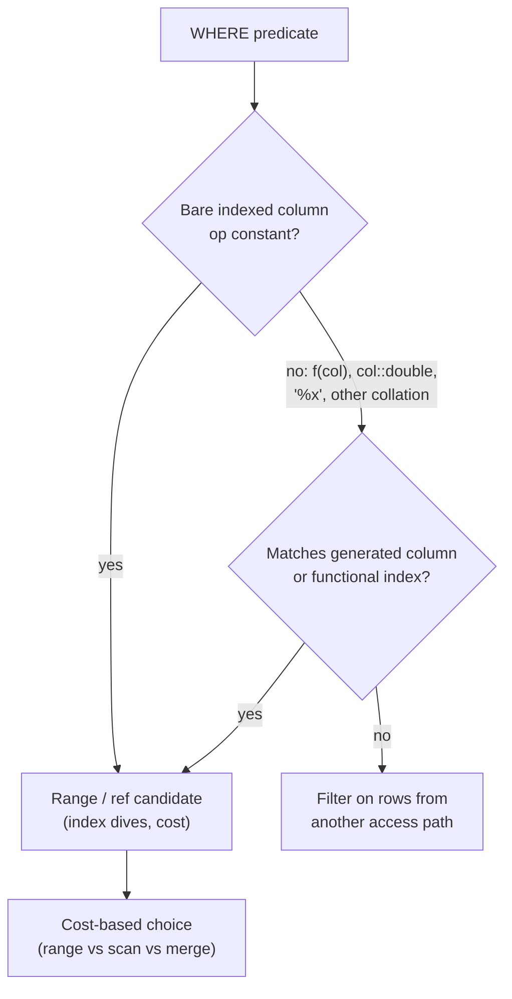

## Introduction

You have an index on `created_at`. You write `WHERE YEAR(created_at) = 2024 AND MONTH(created_at) = 3`, and MySQL reads **every** entry of the table anyway. You have an index on `ref_code`, a customer types a reference number into a search box, the application binds it as an integer, and the lookup that should touch one row scans two hundred thousand. Nobody dropped an index; the index is simply **unusable for the predicate as written**.

A predicate that the optimizer can turn into a search on an index is called **SARGable** — from *Search ARGument*. This lesson is about recognising predicates that are not SARGable, understanding *why* the optimizer cannot use the index for them, and rewriting them so that they return **exactly the same rows** while using an index range, a `ref` lookup or an index merge. It is the single most common fix in day-to-day query tuning, because the mistakes are invisible in the SQL text: the query is correct, it just reads far too much.

The lesson builds directly on [Access Paths](/lessons/m07-access-paths) (what `range`, `ref`, ICP and full scans are) and on [EXPLAIN](/lessons/m07-explain) and [EXPLAIN ANALYZE](/lessons/m07-explain-analyze) (how to read plans). You will work through the four classic causes:

- **Functions and arithmetic on the indexed column** — `DATE(col)`, `YEAR(col)`, `col + 0`, `amount * 1.1`.
- **Implicit type conversion** — a `VARCHAR` column compared with a number.
- **Leading wildcards** — `LIKE '%4999'`.
- **OR across different columns** — which MySQL can answer with an index merge, a `UNION`, or a full scan, depending on the indexes available.

:::note[Lab data and timings]
This lesson uses the **empty** dataset and builds a 200,000-row `orders_big` table inside your lab with a recursive CTE. Every plan and row count below was captured on a real server. Blocks marked *measured* contain timings from the build machine, which shares its server with other labs: treat absolute milliseconds as indicative, and compare **rows examined and plan shape**, which are stable.
:::

## DBMS Theory

:::theory[Search arguments and index ranges]
A B+ tree index stores its keys **in sorted order** by the indexed expression *k*. The only questions it can answer cheaply are of the form "where in this order does a value or an interval of values begin?" — a descent from root to leaf followed by a scan along the leaf chain. A predicate *p* is **SARGable with respect to index I(k)** when the set of rows satisfying *p* can be described as a union of **intervals over k**, computed *before* reading any rows:

- `k = c` → the point interval [c, c]
- `k < c`, `k BETWEEN a AND b`, `k IN (c₁, c₂)` → one or more intervals
- `k LIKE 'abc%'` → the interval ['abc', 'abd')
- `k IS NULL` → the NULL point

The term comes from IBM's System R (Selinger et al., 1979), where *sargable predicates* were those the storage component could evaluate as **search arguments** while scanning, before rows were passed up to the relational layer. Today's meaning is slightly wider: a predicate the optimizer can use to **bound** an index scan.
:::

The theory has one central consequence. If the predicate is on **f(k)** instead of **k**, the index is sorted by the wrong thing. For the rows to be found by an interval on *k*, the optimizer would need to invert *f*: find all *k* with f(k) = c. That is only possible when *f* is **monotonic** (order-preserving) and the optimizer knows its inverse. `YEAR()` is monotonic, but MySQL's range optimizer does **not** invert it; `DATE_FORMAT()` is not monotonic in any useful sense; `col + 0` is trivially monotonic but MySQL still treats it as an opaque expression. In general, **MySQL builds index ranges only from predicates of the form `column op constant-expression`** (or its symmetric form), where the column is a plain key part of the index — or an expression that *exactly* matches an indexed generated column or functional key part.

Three further theoretical points:

1. **Constants can be anything that is constant for the statement.** `created_at >= CURRENT_DATE - INTERVAL 7 DAY` is SARGable, because the right-hand side is evaluated once. The problem is never "a function in the WHERE clause"; it is "a function **wrapped around the indexed column**".
2. **Comparison semantics must be preserved by the ordering.** An index on a string column is ordered by its **collation**. If a predicate compares the column under different semantics — as a number, or under another collation — the index order no longer matches the comparison, and no interval on the index describes the matching rows.
3. **Disjunction (OR) splits the search space.** `a = 1 OR b = 2` is not an interval on any single index. It *is* the union of an interval on an index over `a` and an interval on an index over `b` — which is exactly what an index-merge union or a `UNION` query computes.

:::standard[Standard SQL vs MySQL]
"SARGable" is an industry term, not a keyword in the SQL standard. The standard says nothing about indexes at all — they are a physical design concept. What *is* MySQL-specific in this lesson: the type-conversion rules for comparing strings with numbers (MySQL converts both sides to floating point, where PostgreSQL would raise an error for `varchar = integer`), index merge, functional key parts (`INDEX ((expr))`, 8.0.13+), and indexes on generated columns.
:::

## Why It Exists

Without the concept, performance would depend on accidents of phrasing. Two predicates that mean the same thing to a human — "orders from March 2024" written as `MONTH(created_at) = 3 AND YEAR(created_at) = 2024` or as a half-open date range — can differ in cost by orders of magnitude because only one of them can bound an index scan.

What goes wrong in practice:

- **Silent full scans.** Nothing errors. The query returns correct rows, passes code review and tests on a 1,000-row development database, then degrades linearly with table size in production. At 200 rows it does not matter; at 200 million rows it is an outage.
- **Indexes that look used but are not.** EXPLAIN may list the index under `possible_keys` (it is relevant to the column) while `key` is NULL. Or it may show `type: index` — a scan of the *entire* index — which people often misread as "the index is being used".
- **Wrong results from "fixes".** An implicit conversion is a correctness bug as well as a performance bug: `WHERE ref_code = 4999` matches `'4999'`, `'0004999'` and `'4999.0'`. Rewriting it to `ref_code = '0004999'` makes it fast but changes which rows match if the data is not canonical. Optimization must preserve semantics, and you have to *check*.
- **Lock amplification.** In InnoDB, `UPDATE … WHERE f(indexed_col) = …` and locking reads must examine — and under REPEATABLE READ lock — every row they scan, not just the rows they change (Module 9, locking). A non-SARGable predicate in a write therefore costs concurrency, not just CPU.

## Internal Working

:::internals[Where SARGability is decided: the range optimizer and ref analysis]
During optimization MySQL analyses the WHERE clause (and join conditions) twice for every table:

1. **Ref analysis** (`update_ref_and_keys`) looks for equalities `key_part = expression` where the expression does not depend on the table itself. These become candidate `ref` / `eq_ref` / `const` accesses.
2. **The range optimizer** builds, for every index, a tree of intervals (internally a `SEL_TREE` of `SEL_ARG` nodes) from predicates of the form `key_part op constant`, combining them with AND (intersect intervals) and OR (union intervals). It then estimates rows per interval with **index dives** (or statistics, beyond `eq_range_index_dive_limit`) and costs the resulting range scan. If the tree for an OR has no single-index representation, it tries **index merge** plans.

A predicate on `YEAR(created_at)` produces **no interval** in step 2: the analyser only recognises a bare column (or an expression matching a generated column/functional index) as the left-hand side. The predicate is then evaluated by a **Filter** iterator on every row that some other access path returns — often a full table scan. That is the whole mechanism; there is no partial credit.
:::

**Implicit conversion internals.** When MySQL compares a string with a number, the manual's rule is that *both are compared as floating-point (double) numbers*. For `WHERE ref_code = 4999` on a `VARCHAR` column, every stored string has to be converted with string-to-double semantics, and many different strings convert to the same double (`'4999'`, `'04999'`, `' 4999'`, `'4999abc'` with a warning). The index is ordered by the strings' **collation**, in which `'0004999'` and `'4999'` are far apart. No interval on the index contains exactly the strings equal to 4999 as numbers — so ref and range access are impossible, and the optimizer records this as warning **1739** ("Cannot use ref access on index … due to type or collation conversion"), visible with `SHOW WARNINGS` after `EXPLAIN`.

The reverse direction is harmless: `WHERE customer_id = '42'` on an `INT` column converts the **constant** once, and the comparison is still "integer column = constant". The asymmetry is the key fact to remember: **converting the constant is free, converting the column is fatal.**

**Collations behave the same way.** Comparing a `utf8mb4_0900_ai_ci` column with a value forced into an incompatible collation, or joining two columns whose character sets differ (`latin1` vs `utf8mb4`), forces conversion of one side. If the converted side is the indexed column, the index cannot be used for that comparison.

**Leading wildcards.** `LIKE 'abc%'` becomes the interval ['abc', 'abc' + highest sort weight) — it is a prefix, and B+ tree order is lexicographic by prefix. `LIKE '%abc'` constrains the *end* of the string; matching rows are scattered uniformly through the index order, so no interval describes them.

**OR and index merge.** For `a = 1 OR b = 2` with separate indexes on `a` and `b`, the range optimizer can produce an **index merge union**: scan the `a` range and the `b` range, merge the two sorted streams of primary-key values (or sort them first — *sort_union* — when the ranges are not ordered by primary key), eliminate duplicates, then fetch the rows. If even one disjunct has no usable index, the whole OR must be evaluated by a scan, because the rows matching the unindexed branch could be anywhere.



## MySQL Implementation

Build the lab table. It is deliberately narrow: an order id, a customer, a status, a timestamp, an amount and a seven-digit, zero-padded reference code stored as a string — exactly the kind of column that invites a numeric comparison. Each of the 20,000 customers gets 10 orders; timestamps are spread over 2024.

```sql run
SET SESSION cte_max_recursion_depth = 300000;
CREATE TABLE orders_big (
  order_id    INT UNSIGNED  NOT NULL PRIMARY KEY,
  customer_id INT UNSIGNED  NOT NULL,
  status      VARCHAR(10)   NOT NULL,
  created_at  DATETIME      NOT NULL,
  amount      DECIMAL(10,2) NOT NULL,
  ref_code    VARCHAR(12)   NOT NULL
);
INSERT INTO orders_big
WITH RECURSIVE seq(n) AS (SELECT 1 UNION ALL SELECT n + 1 FROM seq WHERE n < 200000)
SELECT n,
       1 + (n * 7919) % 20000,
       ELT(1 + n % 5, 'pending', 'paid', 'shipped', 'delivered', 'cancelled'),
       TIMESTAMP '2024-01-01 00:00:00' + INTERVAL (n * 157) % (366 * 24 * 60) MINUTE,
       ((n * 31) % 50000) / 100,
       LPAD((n * 4999) % 1000000, 7, '0')
FROM seq;
-- one legacy row written by an old import that did not zero-pad
INSERT INTO orders_big VALUES (200001, 77, 'paid', '2024-03-15 10:00:00', 25.00, '4999');
CREATE INDEX idx_created  ON orders_big (created_at);
CREATE INDEX idx_customer ON orders_big (customer_id);
CREATE INDEX idx_ref      ON orders_big (ref_code);
ANALYZE TABLE orders_big;
```

Now the first experiment — the March 2024 order count written two ways:

```sql run
EXPLAIN
SELECT COUNT(*) FROM orders_big
WHERE YEAR(created_at) = 2024 AND MONTH(created_at) = 3;
```

`possible_keys` is NULL and `type` is `index`: MySQL scans the **whole** `idx_created` index (it is covering for `COUNT(*)`, so at least it avoids the clustered index), and the `rows` estimate is the entire table. `key = idx_created` here means "the smallest structure to scan end to end", not "the index narrowed the search". Now the half-open range:

```sql run
EXPLAIN
SELECT COUNT(*) FROM orders_big
WHERE created_at >= '2024-03-01' AND created_at < '2024-04-01';
```

`type: range`, `possible_keys: idx_created`, and the `rows` estimate drops to the March slice. Both queries return the same count:

```sql run
SELECT (SELECT COUNT(*) FROM orders_big
        WHERE YEAR(created_at) = 2024 AND MONTH(created_at) = 3)            AS with_functions,
       (SELECT COUNT(*) FROM orders_big
        WHERE created_at >= '2024-03-01' AND created_at < '2024-04-01')     AS with_range;
```

The interval `[2024-03-01 00:00:00, 2024-04-01 00:00:00)` is **half-open**: it includes every timestamp in March, including `2024-03-31 23:59:59.5` if the column had fractional seconds, and excludes midnight of April 1st. That form is correct for `DATE`, `DATETIME` and `TIMESTAMP` of any precision, which is why it is the professional default.

## Syntax Breakdown

The rewrites below are the core vocabulary of this lesson. Each pair returns the same rows (subject to the notes), but only the right-hand form can bound an index on the column.

| Non-SARGable form | SARGable rewrite | Notes |
|---|---|---|
| `YEAR(d) = 2024` | `d >= '2024-01-01' AND d < '2025-01-01'` | Half-open interval; correct for any time precision |
| `DATE(ts) = '2024-03-15'` | `ts >= '2024-03-15' AND ts < '2024-03-16'` | Or `'2024-03-15' + INTERVAL 1 DAY` as the upper bound |
| `DATE_FORMAT(d, '%Y-%m') = '2024-03'` | `d >= '2024-03-01' AND d < '2024-04-01'` | Never compare dates as formatted strings |
| `ts LIKE '2024-03%'` | same range as above | `LIKE` on a temporal column converts it to a string first |
| `col + 0 = 42`, `col * 1 = 42` | `col = 42` | Old "disable this index" tricks; prefer index hints |
| `amount * 1.1 > 549` | `amount > 549 / 1.1` | Check rounding: `/` on DECIMALs adds `div_precision_increment` digits |
| `varchar_col = 4999` | `varchar_col = '4999'` (exact string) | Only equivalent if the data is canonical — see Practical Examples |
| `int_col = '42'` | (already fine) | The constant is converted once; the index is usable |
| `col LIKE '%4999'` | indexed generated column on `RIGHT(col, 4)`, or FULLTEXT/n-gram | A leading wildcard has no interval |
| `col LIKE 'abc%'` | (already fine) | Prefix → range |
| `a = 1 OR b = 2` | needs indexes on **both** `a` and `b`; then index merge or `UNION` | One unindexed branch ⇒ full scan |
| `a = 1 OR a = 2` | `a IN (1, 2)` | Same column ORs are already a multi-range |
| `LOWER(email) = 'x@y.com'` | `email = 'x@y.com'` | Under a case-insensitive collation (`_ci`, the default) these are equivalent |
| `IFNULL(col, 0) = 0` | `(col = 0 OR col IS NULL)` | Becomes the `ref_or_null` access type |

:::warning[BETWEEN on timestamps]
`ts BETWEEN '2024-03-01' AND '2024-03-31'` is SARGable but **wrong**: `'2024-03-31'` means `2024-03-31 00:00:00`, so the whole of March 31st (except midnight) is excluded. Using `'2024-03-31 23:59:59'` is still wrong for `DATETIME(6)` columns. Use the half-open form.
:::

## Practical Examples

**1. `DATE()` on a timestamp — the most common mistake in reporting code.**

```sql run
EXPLAIN FORMAT=TREE
SELECT order_id, amount FROM orders_big WHERE DATE(created_at) = '2024-03-15';
```

The tree shows a **Table scan** feeding a **Filter** whose condition is `cast(orders_big.created_at as date) = '2024-03-15'` — `DATE()` appears as a `cast`, applied to every row. Rewritten:

```sql run
EXPLAIN FORMAT=TREE
SELECT order_id, amount FROM orders_big
WHERE created_at >= '2024-03-15' AND created_at < '2024-03-15' + INTERVAL 1 DAY;
```

Now the access is an **Index range scan on orders_big using idx_created** over `('2024-03-15 00:00:00' <= created_at < '2024-03-16 00:00:00')`, with the range condition also pushed down (`with index condition`). The upper bound `'2024-03-15' + INTERVAL 1 DAY` is a constant expression: the tree prints it as `<cache>(…)`, meaning it is evaluated once and reused, so it does not hurt SARGability.

**2. Implicit conversion — fast *and* wrong, or slow *and* right.** The application binds the user's input `4999` as an integer:

```sql run
EXPLAIN SELECT order_id, ref_code FROM orders_big WHERE ref_code = 4999;
SHOW WARNINGS;
```

`possible_keys` lists `idx_ref` — the optimizer *knows* the index is relevant — and `key` even shows `idx_ref`, but `type` is `index` and `rows` is the whole table. This is **not** a lookup: because the query only needs `order_id` and `ref_code`, and every `idx_ref` entry contains both (the primary key is part of each secondary-index entry), MySQL scans the entire index as a narrower copy of the table and converts every string it meets. Select one more column and the plan becomes a plain `ALL`. The warnings say exactly why no lookup was possible: warning 1739, *Cannot use ref access on index 'idx_ref' due to type or collation conversion on field 'ref_code'*, and the same for range access. Look at what the numeric comparison returns:

```sql run
SELECT order_id, ref_code FROM orders_big WHERE ref_code = 4999 ORDER BY order_id;
```

Two rows: the canonical `'0004999'` **and** the legacy `'4999'`, because both convert to the double 4999. The "obvious" fix compares strings and uses the index:

```sql run
EXPLAIN SELECT order_id, ref_code FROM orders_big WHERE ref_code = '0004999';
SELECT order_id, ref_code FROM orders_big WHERE ref_code = '0004999';
```

`type: ref`, `key: idx_ref`, one row estimated and one row returned — the legacy row is gone. Whether that is a fix or a regression depends on the business rule. If reference codes are *defined* as seven zero-padded digits, the legacy row is dirty data that should be repaired (`UPDATE … SET ref_code = LPAD(ref_code, 7, '0')`) and constrained (`CHECK (ref_code REGEXP '^[0-9]{7}$')`). If both spellings are legitimate, the SARGable equivalent is an explicit list, `ref_code IN ('0004999', '4999')`, generated by the application. The professional answer is to fix the type mismatch at its source: bind strings for string columns, or store a number in a numeric column.

**3. Leading wildcard — search by the last four digits.** Support agents look orders up by "the last four digits of the reference":

```sql run
EXPLAIN SELECT order_id, ref_code FROM orders_big WHERE ref_code LIKE '%4999';
```

Again `type: index` with the whole table in `rows`: a covering scan of all of `idx_ref` with the pattern tested on every entry, and `possible_keys` is NULL because the predicate offers no interval. The matching strings are spread across the whole index order, as theory predicts. A prefix pattern, by contrast, is a range:

```sql run
EXPLAIN SELECT order_id, ref_code FROM orders_big WHERE ref_code LIKE '00049%';
```

To make the suffix search SARGable, **materialise the searched expression** as an indexed generated column. A `VIRTUAL` generated column costs no row storage; only its index is stored:

```sql run
ALTER TABLE orders_big
  ADD COLUMN ref_last4 CHAR(4) AS (RIGHT(ref_code, 4)) VIRTUAL,
  ADD INDEX idx_ref_last4 (ref_last4);
ANALYZE TABLE orders_big;
EXPLAIN SELECT order_id, ref_code FROM orders_big WHERE ref_last4 = '4999';
```

Now it is a `ref` lookup on `idx_ref_last4`. MySQL also recognises the *defining expression* itself, so a query written as `WHERE RIGHT(ref_code, 4) = '4999'` can use the same index — the optimizer substitutes the generated column (see "Optimizer Use of Generated Column Indexes" in the references):

```sql run
EXPLAIN SELECT order_id, ref_code FROM orders_big WHERE RIGHT(ref_code, 4) = '4999';
SELECT COUNT(*) AS like_suffix,
       (SELECT COUNT(*) FROM orders_big WHERE ref_last4 = '4999') AS via_generated_column
FROM orders_big WHERE ref_code LIKE '%4999';
```

The two counts are equal, so the rewrite is result-preserving here. (It is equivalent for every string of length ≥ 4; for shorter strings `LIKE '%4999'` and `RIGHT(ref_code, 4) = '4999'` also agree, because neither can match.) For genuinely **infix** search — `LIKE '%term%'` over text — no B+ tree helps; that is the job of a `FULLTEXT` index (with the `ngram` parser for codes and CJK text) or an external search engine.

**4. OR across columns.** Finance asks for orders of customer 42 *or* any order above 499.50. There is no index on `amount` yet:

```sql run
EXPLAIN SELECT order_id FROM orders_big WHERE customer_id = 42 OR amount > 499.5;
```

`possible_keys` shows `idx_customer`, but the plan is `ALL`: the `amount` branch could match rows anywhere, so an index on `customer_id` alone cannot bound the scan. Add the missing index and look again:

```sql run
CREATE INDEX idx_amount ON orders_big (amount);
ANALYZE TABLE orders_big;
EXPLAIN SELECT order_id FROM orders_big WHERE customer_id = 42 OR amount > 499.5;
```

`type: index_merge` with `Using sort_union(idx_customer,idx_amount)`: MySQL reads both ranges, collects the primary keys, sorts and de-duplicates them, then fetches each row once. *sort_union* rather than *union* appears because the `amount > 499.5` range returns entries in `amount` order, not primary-key order, so the row ids must be sorted before they can be merged. The manual rewrite that every DBMS understands is a `UNION`:

```sql run
EXPLAIN
SELECT order_id FROM orders_big WHERE customer_id = 42
UNION
SELECT order_id FROM orders_big WHERE amount > 499.5;
```

Each branch now uses its own index — and both are **covering** (`Using index`), because a secondary index entry in InnoDB includes the primary key `order_id`. The cost is a third step, the `UNION RESULT` with `Using temporary`, which de-duplicates through an internal temporary table. Which is better is a cost question, not a rule: index merge avoids the temporary table but must fetch full rows unless the merge is covering; the `UNION` is covering here but materialises. With more selective or more numerous branches the balance shifts — measure.

**5. Arithmetic on the column.**

```sql run
EXPLAIN SELECT order_id FROM orders_big WHERE amount * 1.1 > 549;
EXPLAIN SELECT order_id FROM orders_big WHERE amount > 549 / 1.1;
SELECT 549 / 1.1 AS bound,
       (SELECT COUNT(*) FROM orders_big WHERE amount * 1.1 > 549) AS original,
       (SELECT COUNT(*) FROM orders_big WHERE amount > 549 / 1.1) AS rewritten;
```

The first form scans all of `idx_amount` (`type: index`); the second is a `range`. Moving the arithmetic to the constant side is algebra, but algebra on finite-precision numbers needs care: `549 / 1.1` is evaluated as a `DECIMAL` with four extra digits (`div_precision_increment`), giving a rounded bound. Because `amount` has two decimal places, the rounded bound selects the same values here — and the counts confirm it. Always verify such a rewrite on real data, and prefer exact bounds when the multiplier does not divide evenly.

## Execution Walkthrough

The walkthrough applies the full optimization method to one realistic query: *"order ids and amounts placed on 15 March 2024"*.

```walkthrough
title: Making SELECT … WHERE DATE(created_at) = '2024-03-15' SARGable
steps:
  - title: "1. The inefficient query and its result"
    explain: >-
      Start by recording what the query returns, so that any rewrite can be checked against it. A count plus an
      order-independent checksum (BIT_XOR of CRC32 over the primary key) is a cheap fingerprint of a row set.
    sql: |
      SELECT COUNT(*) AS n, BIT_XOR(CRC32(order_id)) AS fingerprint
      FROM orders_big WHERE DATE(created_at) = '2024-03-15';
  - title: "2. Analyse the plan"
    explain: >-
      EXPLAIN shows type ALL and possible_keys NULL. The optimizer did not even consider idx_created, because the
      predicate's left-hand side is an expression, not the column. The rows estimate is the whole table.
    sql: |
      EXPLAIN SELECT order_id, amount FROM orders_big WHERE DATE(created_at) = '2024-03-15';
  - title: "3. Name the bottleneck"
    explain: >-
      Every row of the clustered index is read and DATE() is evaluated per row, to keep a few hundred of them.
      Rows examined is proportional to table size, while rows returned is proportional to one day of orders. The
      fix must express "15 March" as an interval on created_at itself.
  - title: "4. Rewrite as a half-open range"
    explain: >-
      created_at >= '2024-03-15' AND created_at < '2024-03-16' describes exactly the same set of timestamps. Now
      possible_keys and key are idx_created, type is range, and the rows estimate is roughly one day's orders.
    sql: |
      EXPLAIN SELECT order_id, amount FROM orders_big
      WHERE created_at >= '2024-03-15' AND created_at < '2024-03-16';
  - title: "5. Prove the result is unchanged"
    explain: >-
      The fingerprint of the rewritten query must equal step 1. Matching count and checksum on real data is strong
      evidence (not proof) of equivalence; the proof is the algebra — DATE(ts) = d is true exactly when
      d ≤ ts < d + 1 day.
    sql: |
      SELECT COUNT(*) AS n, BIT_XOR(CRC32(order_id)) AS fingerprint
      FROM orders_big WHERE created_at >= '2024-03-15' AND created_at < '2024-03-16';
```

The JSON plan of the rewritten query exposes the cost figures the optimizer compared. The platform renders it as an interactive tree; look at `access_type`, `key`, `rows_examined_per_scan` and `cost_info`:

```sql run
EXPLAIN FORMAT=JSON
SELECT order_id, amount FROM orders_big
WHERE created_at >= '2024-03-15' AND created_at < '2024-03-16';
```

## Output

Now measure. `EXPLAIN ANALYZE` executes the query and reports, for each iterator, the **actual** rows produced and the time taken. First the original:

```sql run measured
EXPLAIN ANALYZE
SELECT order_id, amount FROM orders_big WHERE DATE(created_at) = '2024-03-15';
```

The **Table scan** iterator produces every row of the table (`rows=200001`), and the **Filter** above it keeps the matches for that day. Now the rewrite:

```sql run measured
EXPLAIN ANALYZE
SELECT order_id, amount FROM orders_big
WHERE created_at >= '2024-03-15' AND created_at < '2024-03-16';
```

A single **Index range scan** produces only the matching rows; nothing is read and then thrown away. How to read the comparison:

- **Rows examined** fell from the table size to the result size. That ratio — not the milliseconds — is the robust result, and it grows with the table: double the table and the full scan doubles, while the range scan stays proportional to one day of orders.
- **Time** fell too on the build machine, but the absolute values depend on whether the pages were in the buffer pool, on concurrent labs and on hardware. Use them as a sanity check, not as the headline.
- The same comparison for the monthly `COUNT(*)` is worth doing in your lab: there the slow plan is a *covering* full index scan, cheaper per row than a table scan, which narrows — but does not close — the gap.

## Alternative Approaches

Rewriting the predicate is not the only way to make a computed condition SARGable. Choose by who controls the SQL and how often the expression is used.

| Approach | Example | When it fits | Trade-off |
|---|---|---|---|
| Rewrite predicate to a range | `ts >= d AND ts < d + INTERVAL 1 DAY` | You control the SQL; the inverse is simple | None at runtime; needs discipline in every query |
| Functional key part (8.0.13+) | `INDEX ((DATE(created_at)))` | You cannot change the SQL (ORM, third-party app) | Extra index to maintain; the query must match the expression **exactly** |
| Indexed generated column | `ref_last4 AS (RIGHT(ref_code,4))` + index | Expression used in many places, or you want to name it | Same write cost as any index; schema change |
| Fix the data type | store `ref_code` as `INT` and format on display, or always bind strings | Root cause is a type mismatch | Migration; zero-padding semantics move to the application |
| `UNION` instead of `OR` | one branch per indexed column | Index merge not chosen or not possible (e.g. composite-index branches) | Temporary table for de-duplication; `UNION ALL` only when branches are disjoint |
| FULLTEXT / n-gram index | `MATCH(col) AGAINST(...)` | Infix or word search over text | Different semantics (tokens, relevance), not a drop-in for `LIKE` |

The functional-index alternative, applied to the `DATE()` query, without touching the SQL:

```sql run
ALTER TABLE orders_big ADD INDEX idx_created_day ((DATE(created_at)));
ANALYZE TABLE orders_big;
EXPLAIN SELECT order_id, amount FROM orders_big WHERE DATE(created_at) = '2024-03-15';
```

The unchanged query now uses `idx_created_day` with `type: ref`. You have paid for it with a second index on the same column, which every insert and every update of `created_at` must maintain, and which only helps queries that spell the expression exactly as `DATE(created_at)`. [Covering, Prefix, Functional and Descending Indexes](/lessons/m07-covering-prefix-functional) covers functional key parts in depth; drop this one so it does not influence later examples:

```sql run
ALTER TABLE orders_big DROP INDEX idx_created_day;
```

## Performance Analysis

**What a non-SARGable predicate costs.** With *N* rows in the table, *M* matching rows and an index of height *h* (typically 3–4 for millions of rows):

| Plan | Pages / entries touched | Grows with |
|---|---|---|
| Full table scan + filter (`ALL`) | all *N* rows, all clustered-index leaf pages | table size |
| Full index scan + filter (`index`) | all *N* index entries (fewer pages than the table) | table size |
| Range / ref on the right index | *h* pages to descend + *M* entries (+ *M* row lookups if not covering) | result size |

A full scan is not always worse. When *M* is a large fraction of *N* — say a quarter of all rows — a sequential scan can beat *M* random clustered-index lookups, and the optimizer will deliberately choose it even for a SARGable predicate (see [Selectivity, Cardinality and Index Statistics](/lessons/m07-selectivity-statistics)). SARGability gives the optimizer **the option** of an index plan; the cost model decides whether to take it. The bug this lesson targets is removing that option by accident.

**Evidence from this lab.** The pairs above differ in the plan's *access type* (`ALL`/`index` → `range`/`ref`), in the optimizer's *rows estimate* (whole table → result-sized), and in `EXPLAIN ANALYZE`'s *actual rows* at the leaf iterator. Those three are the measurements to quote in a performance review. Timings from the measured blocks are labelled as measured on the build machine for a reason: they are influenced by cache state and neighbouring workloads, and the build server is shared.

**OR plans are cost decisions.** Index merge, a `UNION` and a full scan were all valid for the OR example. The optimizer chose index merge because its estimate of the two ranges was small. Make one branch unselective (`OR status = 'cancelled'`, a fifth of the table) and a merge has to collect and sort tens of thousands of row ids; at some point the full scan is cheaper again. You can compare alternatives in your lab by disabling the merge for your session:

```sql run
SET SESSION optimizer_switch = 'index_merge=off';
EXPLAIN SELECT order_id FROM orders_big WHERE customer_id = 42 OR amount > 499.5;
SET SESSION optimizer_switch = 'default';
```

Without index merge the plan falls back to `ALL` — there is no single-index representation of the OR. [How the MySQL Optimizer Chooses Plans](/lessons/m07-optimizer-decisions) explains `optimizer_switch` and the cost model behind these choices.

:::performance[Theory vs measurement]
The decisive property is asymptotic: rows examined proportional to the table versus proportional to the answer. That is why a non-SARGable predicate is often harmless in development and catastrophic in production. Always reason with the plan first, then confirm with `EXPLAIN ANALYZE` on production-like data volumes and distributions.
:::

## Best Practices

:::best-practice[Writing SARGable predicates by habit]
1. **Keep indexed columns bare.** Put functions, casts and arithmetic on the constant side of the comparison.
2. **Use half-open ranges for time.** `ts >= :start AND ts < :end` — never `DATE(ts) =`, `YEAR(ts) =`, `BETWEEN … '23:59:59'`, or `LIKE '2024-03%'`.
3. **Bind parameters with the column's type.** A string column gets a string parameter. Check ORMs and drivers: some bind numeric-looking user input as integers. Use `SHOW WARNINGS` after `EXPLAIN` to catch warning 1739.
4. **Match character sets and collations across join columns.** Declare foreign key and lookup columns with the same type, character set and collation as the key they reference.
5. **Index every branch of an OR** you need to be fast, or rewrite it as a `UNION` of indexed branches — and choose `UNION` vs `UNION ALL` by whether branches can overlap.
6. **When the SQL cannot change, index the expression** (functional key part or generated column) — and accept that it only matches the exact expression.
7. **Prove equivalence.** Before shipping a rewrite, compare row counts and a checksum on real data, and reason about edge cases: NULLs, non-canonical strings, time precision, rounding.
:::

## Common Mistakes

**Mistake 1 — the "end of day" BETWEEN.** It is SARGable but drops data:

```sql run
SELECT (SELECT COUNT(*) FROM orders_big
        WHERE created_at BETWEEN '2024-03-01' AND '2024-03-31') AS between_dates,
       (SELECT COUNT(*) FROM orders_big
        WHERE created_at >= '2024-03-01' AND created_at < '2024-04-01') AS half_open;
```

The `BETWEEN` count is smaller: it silently excludes almost all of March 31st. A fast wrong query is worse than a slow right one.

**Mistake 2 — "fixing" an implicit conversion by changing the semantics.** Changing `ref_code = 4999` to `ref_code = '0004999'` lost the legacy row in Practical Example 2. The correct procedure is: decide what the business rule is, clean the data to match it, add a constraint, and only then simplify the predicate.

**Mistake 3 — `UNION ALL` as an OR rewrite.** `UNION ALL` is cheaper than `UNION` because it skips de-duplication, but a row matching **both** branches is returned twice:

Customer 42 happens to have no order above 499.50, so for the earlier example both forms return the same count — which is exactly how this bug survives testing. Customer 898 does have such orders:

```sql run
SELECT COUNT(*) AS or_rows FROM orders_big
WHERE customer_id = 898 OR amount > 499.5;
SELECT COUNT(*) AS union_all_rows FROM (
  SELECT order_id FROM orders_big WHERE customer_id = 898
  UNION ALL
  SELECT order_id FROM orders_big WHERE amount > 499.5
) AS u;
```

The `UNION ALL` count is larger: the orders of customer 898 above 499.50 appear once per branch. Use `UNION`, or make the branches disjoint: `… UNION ALL SELECT … WHERE amount > 499.5 AND customer_id <> 898`.

**Mistake 4 — trusting `type: index`.** A plan with `type: index` and `key: idx_created` reads every entry of that index; it is a full scan of a smaller structure. Look at `rows` and at whether `possible_keys` contains the index at all.

**Mistake 5 — wrapping the column "for safety".** `WHERE TRIM(ref_code) = ?`, `WHERE UPPER(status) = 'PAID'` or `WHERE COALESCE(customer_id, 0) = ?` are defensive habits from other databases. Under MySQL's default case-insensitive collations `UPPER()` is unnecessary; `TRIM()` hides a data-quality problem that should be fixed on write; `COALESCE` on a `NOT NULL` column does nothing except disable the index.

**Mistake 6 — assuming the optimizer will invert the function.** MySQL does not rewrite `YEAR(d) = 2024` into a range. Some other systems perform limited rewrites of this kind; relying on that makes SQL non-portable in performance even when it is portable in meaning.

## Industry Application

- **Time-series and reporting queries.** Dashboards filter by day, week and month. Mature codebases have a single helper that turns a reporting period into `[start, end)` bounds; code review rejects `DATE(col) =` in hot paths. Partitioned tables (Module 12) depend on the same discipline: partition pruning needs SARGable predicates on the partitioning column too.
- **Search boxes and lookup APIs.** Identifiers that look numeric — phone numbers, ZIP codes, invoice numbers, SKUs — are stored as strings to keep leading zeros. Production incidents caused by an ORM binding them as integers are common enough that many teams run `EXPLAIN` checks in CI or alert on statements that do full scans (Module 7, [Slow Query Log, Performance Schema and the sys Schema](/lessons/m07-slow-query-diagnostics) — `sys.statements_with_full_table_scans`).
- **Customer-support tooling.** "Find by last four digits" and "find by email domain" are implemented with generated columns or reversed-string indexes rather than `LIKE '%…'`, because support tools run on the primary OLTP database.
- **Multi-tenant SaaS.** OR conditions such as "my records or records shared with my team" are frequently rewritten as `UNION`s of indexed branches, each starting from a tenant-scoped composite index.
- **Migrations off other databases.** Teams porting from SQL Server or PostgreSQL meet MySQL's permissive string/number comparison for the first time: queries that would have failed to compile now run — slowly and sometimes returning extra rows.

## Practice Exercises

Exercises are graded by comparing the **rows** your query returns with the reference solution on the same data, so a correct rewrite must return exactly the same rows as the original. After passing, run `EXPLAIN` on your answer to confirm it is SARGable — the grader cannot see your plan.

```exercise
id: ex1
title: Monthly report without functions on the column
difficulty: easy
concepts: [sargability, functions-on-indexed-columns]
setup: |
  SET SESSION cte_max_recursion_depth = 30000;
  CREATE TABLE sales (
    sale_id INT UNSIGNED PRIMARY KEY, sold_at DATETIME NOT NULL, amount DECIMAL(10,2) NOT NULL,
    INDEX idx_sold_at (sold_at)
  );
  INSERT INTO sales
  WITH RECURSIVE s(n) AS (SELECT 1 UNION ALL SELECT n + 1 FROM s WHERE n < 30000)
  SELECT n, TIMESTAMP '2023-11-01 00:00:00' + INTERVAL (n * 97) % (400 * 1440) MINUTE, (n % 900) + 0.99 FROM s;
prompt: |
  This report query cannot use `idx_sold_at`:

  ~~~sql
  SELECT sale_id, amount FROM sales
  WHERE YEAR(sold_at) = 2024 AND MONTH(sold_at) = 2;
  ~~~

  Rewrite it so that it returns **the same rows** (columns `sale_id`, `amount`) and its predicate can be used as a
  range on `idx_sold_at`. Remember that 2024 is a leap year.
hints:
  - "Express February 2024 as an interval on sold_at itself."
  - "Use a half-open interval: from the first instant of February up to, but not including, the first instant of March."
solution: |
  SELECT sale_id, amount FROM sales
  WHERE sold_at >= '2024-02-01' AND sold_at < '2024-03-01';
explanation: |
  The half-open range `[2024-02-01, 2024-03-01)` contains every timestamp in February regardless of leap years or
  time precision — you never need to know the last day of the month. `BETWEEN '2024-02-01' AND '2024-02-29'` fails
  (it excludes almost all of the 29th), and `sold_at LIKE '2024-02%'` returns the right rows but converts every
  timestamp to a string and cannot use the index. Check with `EXPLAIN`: `type` should be `range` on `idx_sold_at`.
```

```exercise
id: ex2
title: Stop converting the column
difficulty: medium
concepts: [implicit-conversion, sargability]
setup: |
  SET SESSION cte_max_recursion_depth = 20000;
  CREATE TABLE shipments (
    shipment_id INT UNSIGNED PRIMARY KEY,
    tracking_no VARCHAR(16) NOT NULL,
    carrier VARCHAR(10) NOT NULL,
    INDEX idx_tracking (tracking_no),
    CONSTRAINT chk_tracking CHECK (tracking_no REGEXP '^[0-9]{10}$')
  );
  INSERT INTO shipments
  WITH RECURSIVE s(n) AS (SELECT 1 UNION ALL SELECT n + 1 FROM s WHERE n < 20000)
  SELECT n, LPAD((n * 7777777) % 10000000000, 10, '0'), ELT(1 + n % 3, 'ups', 'fedex', 'usps') FROM s;
prompt: |
  Tracking numbers are always exactly ten digits, zero-padded (a CHECK constraint enforces it). The API runs:

  ~~~sql
  SELECT shipment_id, carrier FROM shipments WHERE tracking_no = 7777777;
  ~~~

  `EXPLAIN` shows `type: ALL` with warning 1739. Write an equivalent query (columns `shipment_id`, `carrier`) that
  can use `idx_tracking` as a `ref` lookup and returns the same rows.
hints:
  - "The column is a string; compare it with a string, not a number."
  - "The stored value is zero-padded to ten characters: what string does the number 7777777 correspond to?"
  - "'0007777777' — or let MySQL build it: LPAD('7777777', 10, '0') is a constant expression."
solution: |
  SELECT shipment_id, carrier FROM shipments WHERE tracking_no = '0007777777';
explanation: |
  Comparing a VARCHAR with a number makes MySQL convert **every stored string** to a double, so the index ordered by
  the string collation is useless (warning 1739). Comparing with a string literal is a `ref` lookup. The rewrite is
  only equivalent because the CHECK constraint guarantees canonical ten-digit strings — without it, `'7777777'` or
  `' 0007777777'` would match the numeric comparison but not the string one. `WHERE tracking_no = '7777777'` (no
  padding) is the classic wrong answer: fast, but it returns nothing.
```

```exercise
id: ex3
title: Make the suffix search indexable
difficulty: medium
concepts: [leading-wildcard, sargability]
setup: |
  SET SESSION cte_max_recursion_depth = 20000;
  CREATE TABLE members (
    member_id INT UNSIGNED PRIMARY KEY,
    phone VARCHAR(15) NOT NULL
  );
  INSERT INTO members
  WITH RECURSIVE s(n) AS (SELECT 1 UNION ALL SELECT n + 1 FROM s WHERE n < 20000)
  SELECT n, CONCAT('408', LPAD((n * 104729) % 10000000, 7, '0')) FROM s;
prompt: |
  The front desk finds members by the **last four digits** of their phone number:

  ~~~sql
  SELECT member_id, phone FROM members WHERE phone LIKE '%2345';
  ~~~

  Make this search SARGable: add a column `phone_last4` that MySQL derives automatically from `phone`, index it,
  and finish your script with a query that returns the same rows (columns `member_id`, `phone`) using the new column.
starter: |
  ALTER TABLE members
    ADD COLUMN phone_last4 CHAR(4) AS (...) VIRTUAL,
    ADD INDEX idx_phone_last4 (phone_last4);
  SELECT member_id, phone FROM members WHERE ...;
hints:
  - "A generated column is declared with AS (expression); VIRTUAL means it is computed on read and only the index stores it."
  - "RIGHT(phone, 4) returns the last four characters."
solution: |
  ALTER TABLE members
    ADD COLUMN phone_last4 CHAR(4) AS (RIGHT(phone, 4)) VIRTUAL,
    ADD INDEX idx_phone_last4 (phone_last4);
  SELECT member_id, phone FROM members WHERE phone_last4 = '2345';
explanation: |
  A leading wildcard cannot be an index range, because rows ending in `2345` are scattered across the index order.
  Materialising the suffix as an indexed generated column turns the search into an equality (`ref`). MySQL can also
  match the defining expression, so `WHERE RIGHT(phone, 4) = '2345'` would use the index too. A functional index
  `INDEX ((RIGHT(phone, 4)))` is the same idea without a named column. For infix search (`'%23%'`) neither works —
  that needs FULLTEXT/n-gram or a search engine.
```

```exercise
id: ex4
title: OR to UNION without changing the answer
difficulty: hard
concepts: [or-conditions, index-merge, predicate-rewriting]
setup: |
  SET SESSION cte_max_recursion_depth = 30000;
  CREATE TABLE tickets (
    ticket_id INT UNSIGNED PRIMARY KEY,
    assignee_id INT UNSIGNED NOT NULL,
    priority TINYINT UNSIGNED NOT NULL,
    INDEX idx_assignee (assignee_id),
    INDEX idx_priority (priority)
  );
  INSERT INTO tickets
  WITH RECURSIVE s(n) AS (SELECT 1 UNION ALL SELECT n + 1 FROM s WHERE n < 30000)
  SELECT n, 1 + (n * 31) % 500, 1 + (n * 7) % 100 FROM s;
prompt: |
  Rewrite this query as a `UNION` of two SELECTs — one per indexed column — that returns exactly the same rows
  (single column `ticket_id`):

  ~~~sql
  SELECT ticket_id FROM tickets WHERE assignee_id = 17 OR priority = 100;
  ~~~

  Careful: some tickets of assignee 17 also have priority 100.
hints:
  - "One branch filters on assignee_id, the other on priority."
  - "UNION ALL keeps duplicates: a ticket matching both branches would appear twice, which the grader treats as a different result."
  - "Use UNION (distinct), or keep UNION ALL and exclude the overlap in the second branch."
solution: |
  SELECT ticket_id FROM tickets WHERE assignee_id = 17
  UNION
  SELECT ticket_id FROM tickets WHERE priority = 100;
explanation: |
  `UNION` removes duplicates, so the result is the set of tickets satisfying either predicate — the meaning of OR.
  `UNION ALL` returns overlapping tickets twice (the multiset comparison catches it). An equally correct and often
  cheaper form is `UNION ALL` with disjoint branches: `… UNION ALL SELECT ticket_id FROM tickets WHERE priority = 100
  AND assignee_id <> 17` (fine here because `assignee_id` is NOT NULL; with a nullable column the exclusion must
  also keep NULLs). On this table MySQL can answer the original OR with an index-merge union by itself — compare
  the two plans with EXPLAIN.
```

```exercise
id: ex5
title: Clean up a reporting query
difficulty: challenge
concepts: [sargability, functions-on-indexed-columns, implicit-conversion, predicate-rewriting]
setup: |
  SET SESSION cte_max_recursion_depth = 40000;
  CREATE TABLE invoices (
    invoice_id INT UNSIGNED PRIMARY KEY,
    account_code VARCHAR(8) NOT NULL,
    status VARCHAR(10) NOT NULL,
    issued_at DATETIME NOT NULL,
    total DECIMAL(10,2) NOT NULL,
    INDEX idx_account_issued (account_code, issued_at),
    CONSTRAINT chk_account CHECK (account_code REGEXP '^A[0-9]{4}$')
  );
  INSERT INTO invoices
  WITH RECURSIVE s(n) AS (SELECT 1 UNION ALL SELECT n + 1 FROM s WHERE n < 40000)
  SELECT n, CONCAT('A', LPAD(1 + n % 400, 4, '0')), ELT(1 + (n DIV 3) % 4, 'open', 'paid', 'void', 'overdue'),
         TIMESTAMP '2024-01-01 00:00:00' + INTERVAL (n * 113) % (366 * 1440) MINUTE, (n % 2000) / 4
  FROM s;
prompt: |
  This query is correct but cannot use the composite index `idx_account_issued (account_code, issued_at)`
  efficiently:

  ~~~sql
  SELECT invoice_id, total
  FROM invoices
  WHERE UPPER(account_code) = 'A0042'
    AND DATE_FORMAT(issued_at, '%Y-%m') = '2024-06'
    AND status IN ('open', 'overdue');
  ~~~

  Rewrite it so that both key parts of the index can be used (equality on `account_code`, range on `issued_at`)
  and it returns the same rows (columns `invoice_id`, `total`). The table uses the default case-insensitive collation.
hints:
  - "Under a _ci collation, account_code = 'A0042' already matches case-insensitively, so UPPER() adds nothing but cost."
  - "June 2024 as a half-open interval on issued_at."
  - "Keep the status filter as it is — it is evaluated on the rows the index range returns."
solution: |
  SELECT invoice_id, total
  FROM invoices
  WHERE account_code = 'A0042'
    AND issued_at >= '2024-06-01' AND issued_at < '2024-07-01'
    AND status IN ('open', 'overdue');
explanation: |
  Removing `UPPER()` makes `account_code` a bare column compared for equality, so the first key part is usable;
  replacing `DATE_FORMAT` with a half-open range makes the second key part a range, giving `type: range` with
  `key_len` covering both parts. The status filter stays as a residual condition. Removing `UPPER()` is only
  equivalent because the collation is case-insensitive and the CHECK constraint fixes the format; under a binary
  or `_cs` collation you would instead normalise the data on write. Partial credit traps: keeping `DATE_FORMAT` but
  fixing `UPPER()` gives a `ref` on the first key part only, with the month evaluated per row.
```

```exercise
id: ex6
title: Design review — a phone column compared with a number
difficulty: medium
kind: open
concepts: [implicit-conversion, sargability]
prompt: |
  A code review finds `SELECT * FROM customers WHERE phone = 4085551234` in a service. `phone` is a
  `VARCHAR(20)` with an index. Explain (1) why the query does a full scan in MySQL, (2) why it can return rows
  the developer did not intend, and (3) what you would change at the application, data and schema level.
solution: |
  (1) Comparing a string column with a number makes MySQL compare both as double-precision numbers. Every stored
  string must be converted, and many strings map to the same number, so the index — ordered by the string
  collation — cannot be used for `ref` or `range` access (warning 1739 after EXPLAIN). The plan is `type: ALL`.

  (2) Every phone string that converts to 4085551234 matches: `'4085551234'`, `'04085551234'`, `' 4085551234'`,
  `'4085551234 ext 2'` (with a truncation warning). Formatted values like `'408-555-1234'` convert to 408 and never
  match. The result depends on formatting accidents.

  (3) Application: bind the parameter as a string. Data: normalise phone numbers to one canonical format (E.164,
  e.g. `+14085551234`) on write, and backfill existing rows. Schema: add a CHECK constraint (or a generated,
  indexed normalised column if raw input must be kept) so the canonical form is guaranteed; then the predicate
  `phone = '+14085551234'` is a `ref` lookup and is semantically exact. Add an EXPLAIN/full-scan check in CI or
  monitoring to catch regressions.
```

## Knowledge Assessment

```quiz
- id: q1
  question: "Which predicate can MySQL use as a range on an index over `created_at` (a DATETIME)?"
  options:
    - "`DATE(created_at) = '2024-03-15'`"
    - "`created_at >= CURRENT_DATE - INTERVAL 7 DAY`"
    - "`YEAR(created_at) = 2024`"
    - "`created_at LIKE '2024-03%'`"
  answer: 1
  explanation: "The function is on the constant side: CURRENT_DATE - INTERVAL 7 DAY is evaluated once, leaving a bare column compared with a constant. DATE() and YEAR() wrap the column, and LIKE on a DATETIME converts the column to a string first; MySQL does not invert any of these into a range."
  concepts: [sargability, functions-on-indexed-columns]
- id: q2
  question: "`ref_code` is VARCHAR with an index. Which statement about `WHERE ref_code = 4999` is correct?"
  options:
    - "MySQL converts 4999 to '4999' once and uses the index"
    - "MySQL compares as floating point, so each stored string is converted; the index cannot be used and rows such as '04999' also match"
    - "MySQL raises a type error, as PostgreSQL would"
    - "The index is used but the comparison is case-sensitive"
  answer: 1
  explanation: "String-vs-number comparisons are done as doubles. Converting the column per row makes ref/range access impossible (warning 1739), and different strings converting to the same number all match. Converting a constant once only happens in the opposite case (numeric column, string constant). MySQL does not raise an error."
  concepts: [implicit-conversion]
- id: q3
  question: "`customer_id` is INT UNSIGNED with an index. `WHERE customer_id = '42'`:"
  options:
    - "Forces a full scan because of implicit conversion"
    - "Uses the index: the string constant is converted once"
    - "Returns no rows because the types differ"
    - "Is rejected under strict SQL mode"
  answer: 1
  explanation: "When the column is numeric, MySQL converts the constant, not the column, so the predicate is still 'integer column = constant' and ref access works. The danger is only the reverse case: a string column compared with a number."
  concepts: [implicit-conversion, sargability]
- id: q4
  question: "EXPLAIN shows `type: index`, `key: idx_created`, `possible_keys: NULL`, rows ≈ table size for a filtered COUNT(*). What is happening?"
  options:
    - "An efficient range scan on idx_created"
    - "A full scan of the whole idx_created index, used only because it is smaller than the table; the predicate did not narrow it"
    - "An index merge of idx_created with the primary key"
    - "A const lookup resolved at optimization time"
  answer: 1
  explanation: "type index means a full index scan. possible_keys NULL shows that no index was considered for the WHERE condition; idx_created was chosen only as a covering structure to scan. A range scan would show type range and a much smaller rows estimate."
  concepts: [sargability]
- id: q5
  question: "Which changes can let MySQL use an index for `WHERE RIGHT(phone, 4) = '1234'` without editing the query? (Select all that apply.)"
  type: multi
  options:
    - "Add a functional index `INDEX ((RIGHT(phone, 4)))`"
    - "Add a generated column `AS (RIGHT(phone, 4))` and index it"
    - "Add a plain index on `phone`"
    - "Add a prefix index `INDEX (phone(4))`"
  answer: [0, 1]
  explanation: "The optimizer matches an expression to an indexed generated column or functional key part with the same definition. A plain or prefix index on phone is ordered by the beginning of the string, which says nothing about its last four characters."
  concepts: [leading-wildcard, functions-on-indexed-columns]
- id: q6
  question: "Indexes exist on `a` only. Why does `WHERE a = 1 OR b = 2` do a full table scan?"
  options:
    - "Because OR is never optimized in MySQL"
    - "Because rows matching `b = 2` could be anywhere, so no single index range or index merge covers the OR; an index on b is needed too"
    - "Because index merge requires a composite index (a, b)"
    - "Because the optimizer statistics are stale"
  answer: 1
  explanation: "An OR is a union of the branches. Each branch must be answerable by an index for an index-merge union (or a UNION rewrite) to work. A composite (a, b) would not help the b branch either, because b is not a leftmost prefix. Statistics are irrelevant when no access path exists."
  concepts: [or-conditions, index-merge]
- id: q7
  question: "A developer rewrites `WHERE x = 1 OR y = 2` as `SELECT … WHERE x = 1 UNION ALL SELECT … WHERE y = 2`. What can go wrong?"
  options:
    - "Nothing — UNION ALL and OR are equivalent"
    - "Rows satisfying both predicates are returned twice"
    - "Rows satisfying both predicates are lost"
    - "UNION ALL cannot use indexes"
  answer: 1
  explanation: "OR has set semantics per row; UNION ALL concatenates the branch results, so overlapping rows appear in both. Use UNION (de-duplicates, at the cost of a temporary table) or make the branches disjoint."
  concepts: [or-conditions, predicate-rewriting]
- id: q8
  question: "Why is `ts BETWEEN '2024-03-01' AND '2024-03-31'` a poor way to select March from a DATETIME column?"
  options:
    - "It is not SARGable"
    - "It excludes nearly all of March 31st, because '2024-03-31' means midnight"
    - "BETWEEN is exclusive at both ends"
    - "It includes April 1st"
  answer: 1
  explanation: "BETWEEN is inclusive and SARGable, but the upper bound '2024-03-31' is 2024-03-31 00:00:00. The half-open form ts >= '2024-03-01' AND ts < '2024-04-01' is correct for any time precision."
  concepts: [sargability, predicate-rewriting]
```
