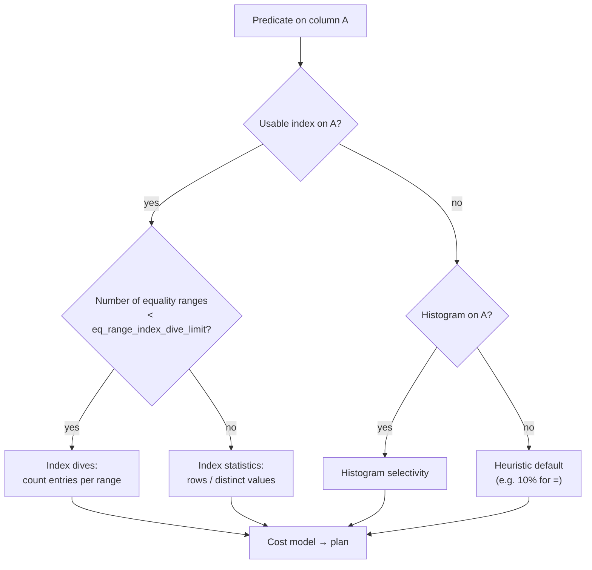

## Introduction

So far you have seen the optimizer choose an index for some predicates and a full scan for others — the 1% customer range used the index, the 15% range did not. Those choices are **cost-based**: the optimizer estimates how many rows each access path will touch and picks the cheapest. Every estimate starts from one question: *what fraction of the rows does this predicate match?*

This lesson is about where the answers come from and what happens when they are wrong:

- **Selectivity** and **cardinality** — the two numbers that describe how well a column or index narrows a search.
- **Index dives** — looking into the index at optimization time to count matching entries.
- **Persistent statistics** — InnoDB's sampled per-index statistics (`information_schema.STATISTICS.CARDINALITY`, `TABLES.TABLE_ROWS`), how they are collected and how they go stale.
- **`ANALYZE TABLE`** — refreshing statistics on demand.
- **Histograms** (8.0+) — distribution statistics for columns **without** an index.
- **When the optimizer ignores an index** — and how to tell a correct decision from a bad estimate.

:::note[Lab data]
The lab builds the module's 200,000-row `orders_big` table with deliberately **skewed** columns. Estimates are sampled and can vary slightly between servers and runs: **your numbers and occasionally your plans may differ**. Compare orders of magnitude, not exact values.
:::

## DBMS Theory

:::theory[Selectivity, cardinality and the uniformity assumption]
- The **cardinality** of a column (or index key) is the number of **distinct values** it contains, V(R, A). (Confusingly, "cardinality of a relation" also means its number of rows, |R| — context decides.)
- The **selectivity** of a predicate p is the fraction of rows that satisfy it: sel(p) = |σ_p(R)| / |R|, a number between 0 and 1. A *highly selective* predicate has selectivity close to 0 — it matches few rows.
- Under the classic **uniformity assumption** (System R), every distinct value is equally frequent, so sel(A = c) ≈ 1 / V(R, A). The **independence assumption** says sel(p ∧ q) ≈ sel(p) × sel(q).
- The estimated output size is |R| × sel(p). Errors multiply through joins: a 10× error on each of three tables can become a 1,000× error in the join's estimated size.
:::

Real data is rarely uniform. In an e-commerce table, 65% of orders might be `shipped` and 5% `cancelled`; with four distinct statuses the uniformity assumption predicts 25% for both — off by 2.6× and 5× respectively. Databases therefore collect better statistics:

| Statistic | Captures | Cost to maintain | Used for |
|---|---|---|---|
| Row count \|R\| | table size | cheap | everything |
| Distinct values per index prefix | average rows per key value | sampling pages | `ref` estimates, join fan-out |
| Index dives | exact-ish counts for specific constant ranges | a few page reads per range at optimization time | `range`/`ref` with constants |
| Histograms | value distribution (frequencies, ranges) | a scan or sample when built | filtering estimates on non-indexed columns |

**Selectivity vs. index usefulness.** A predicate's selectivity determines how many rows an index would deliver; whether the index is *worth using* also depends on whether the query is covered, how expensive each lookup is, and how the rows are laid out. A highly selective predicate on a well-indexed column is the ideal case; a predicate matching half the table is usually best served by a scan.

## Why It Exists

The optimizer cannot know the result size of a predicate without executing it. Executing every alternative plan to find out would cost more than running the query. So it relies on **cheap summaries** of the data — statistics — and on quick probes of the index at optimization time.

When estimates are good, plans are good. When they are wrong, typical consequences are:

- A full table scan where an index lookup would read 0.1% of the rows (estimate too high).
- Tens of thousands of random index lookups where a sequential scan would be faster (estimate too low).
- A join order that starts from the wrong table, multiplying rows through every subsequent join.
- A plan that suddenly changes after statistics are recalculated — a classic cause of "nothing changed but the query got slow overnight".

Understanding statistics lets you diagnose those cases instead of guessing, and fix them with the right tool: `ANALYZE TABLE`, more sample pages, a histogram, a better index, or (last resort) a hint.

## Internal Working

:::internals[Where MySQL's estimates come from]
**1. Index dives (range optimizer).** For a predicate with constants on an indexed column — `status = 'cancelled'`, `order_date BETWEEN …` — the optimizer descends the index to both ends of each range and estimates the number of entries between them (`records_in_range`). This is usually accurate. For many equality ranges, e.g. `IN (…)` with hundreds of values, diving into each one is expensive; once the number of equality ranges reaches **`eq_range_index_dive_limit`** (default 200), MySQL switches to index statistics (average rows per value) instead.

**2. Persistent index statistics (InnoDB).** With `innodb_stats_persistent=ON` (default), InnoDB stores per-index statistics in `mysql.innodb_index_stats` and `mysql.innodb_table_stats`: the number of rows, clustered/secondary sizes, and for each index prefix the estimated number of distinct values (`n_diff_pfxNN`). They are computed by **sampling** `innodb_stats_persistent_sample_pages` leaf pages (default 20) per index, or a per-table `STATS_SAMPLE_PAGES` value. They feed `information_schema.STATISTICS.CARDINALITY`, `TABLES.TABLE_ROWS` and the `ref` estimate rows ≈ |R| / V(prefix).

**3. Automatic recalculation.** With `innodb_stats_auto_recalc=ON` (default) InnoDB recalculates a table's statistics in the background when **more than 10%** of its rows have changed since the last calculation. It is asynchronous, so statistics may lag right after a bulk load. Per table, `STATS_AUTO_RECALC=0|1` overrides it.

**4. Histograms (server layer, 8.0+).** Stored in the data dictionary and visible in `information_schema.COLUMN_STATISTICS`. Built only by `ANALYZE TABLE … UPDATE HISTOGRAM` (they are **not** maintained automatically by DML in 8.0). Two types: **singleton** (one bucket per distinct value with its cumulative frequency) when the number of distinct values ≤ the bucket count, otherwise **equi-height** (buckets with roughly equal numbers of rows). The optimizer uses them to estimate the `filtered` percentage for conditions on columns that have **no usable index** — for indexed columns it prefers index dives.

**5. Defaults when nothing is known.** For a condition on an unindexed column without a histogram, the optimizer falls back on fixed heuristic selectivities (for example, 10% for an equality), which is why `filtered` often shows round numbers such as 10.00 or 33.33.
:::



## MySQL Implementation

Build the table. Compared with earlier lessons it adds a `channel` column that is heavily skewed (90% `web`, 9% `app`, 1% `phone`) and has **no index** — the histogram example needs it:

```sql run
SET SESSION cte_max_recursion_depth = 300000;
CREATE TABLE orders_big (
  order_id    INT UNSIGNED  NOT NULL,
  customer_id INT UNSIGNED  NOT NULL,
  status      VARCHAR(10)   NOT NULL,
  order_date  DATE          NOT NULL,
  amount      DECIMAL(10,2) NOT NULL,
  country     CHAR(2)       NOT NULL,
  channel     VARCHAR(5)    NOT NULL,
  PRIMARY KEY (order_id),
  INDEX idx_customer (customer_id),
  INDEX idx_status (status),
  INDEX idx_order_date (order_date)
) ENGINE=InnoDB;
INSERT INTO orders_big
WITH RECURSIVE seq(n) AS (SELECT 1 UNION ALL SELECT n + 1 FROM seq WHERE n < 200000)
SELECT n,
       1 + (n * 7919) % 19997,
       ELT(1 + (n % 20 > 0) + (n % 20 > 2) + (n % 20 > 15), 'cancelled', 'pending', 'shipped', 'delivered'),
       DATE '2023-01-01' + INTERVAL (n * 37) % 731 DAY,
       ROUND(5 + (n * 104729 % 99500) / 100, 2),
       ELT(1 + n % 7, 'US', 'IN', 'DE', 'BR', 'JP', 'FR', 'MX'),
       CASE WHEN n % 100 = 0 THEN 'phone' WHEN n % 100 < 10 THEN 'app' ELSE 'web' END
FROM seq;
ANALYZE TABLE orders_big;
```

**Measuring selectivity.** The per-column cardinality and the selectivity of an equality under the uniformity assumption:

```sql run
SELECT COUNT(*)                                       AS total_rows,
       COUNT(DISTINCT customer_id)                    AS card_customer,
       COUNT(DISTINCT status)                         AS card_status,
       COUNT(DISTINCT order_date)                     AS card_order_date,
       COUNT(DISTINCT channel)                        AS card_channel,
       ROUND(1 / COUNT(DISTINCT customer_id), 6)      AS uniform_sel_customer,
       ROUND(1 / COUNT(DISTINCT status), 2)           AS uniform_sel_status
FROM orders_big;
```

The *actual* per-value selectivity of the skewed `status` column is far from the uniform 0.25:

```sql run
SELECT status, COUNT(*) AS n_rows, ROUND(COUNT(*) / 200000, 3) AS selectivity
FROM orders_big
GROUP BY status
ORDER BY n_rows DESC;
```

**What the optimizer knows.** `information_schema.STATISTICS` exposes the sampled cardinality of every index:

```sql run
SELECT INDEX_NAME, SEQ_IN_INDEX, COLUMN_NAME, CARDINALITY
FROM information_schema.STATISTICS
WHERE TABLE_SCHEMA = DATABASE() AND TABLE_NAME = 'orders_big'
ORDER BY INDEX_NAME, SEQ_IN_INDEX;
```

The estimates are close to the true distinct counts above but not identical — they are extrapolated from a sample of 20 leaf pages per index. In the capture `idx_status` reports a cardinality of **3** although there are 4 statuses (the rare `cancelled` entries can be missed by the sample), and `idx_order_date` reports a value near, but not equal to, the 731 distinct dates (between roughly 715 and 755 across our captures). Now compare the optimizer's row estimates for two status values:

```sql run
EXPLAIN SELECT * FROM orders_big WHERE status = 'cancelled';
EXPLAIN SELECT * FROM orders_big WHERE status = 'shipped';
```

The `rows` column differs per value even though the cardinality of `idx_status` is the same for both: with a constant in the predicate, the optimizer performed **index dives** and estimated each value's range separately. Compare those estimates with the true counts: in the capture, 18,336 estimated vs 10,000 actual cancelled orders, and 99,838 estimated vs 130,000 actual shipped orders. Dives are approximations too. The 99,838 is no accident: it is exactly half of the estimated table size (199,677) — InnoDB's range estimator caps an estimate at half of the table, and you will see the same number again below whenever a range covers more than half the rows.

## Syntax Breakdown

```sql
-- Refresh persistent index statistics (and table row estimate)
ANALYZE [NO_WRITE_TO_BINLOG | LOCAL] TABLE t1 [, t2 ...];

-- Histograms (8.0+)
ANALYZE TABLE t UPDATE HISTOGRAM ON col1 [, col2 ...] [WITH N BUCKETS];   -- N: 1..1024, default 100
ANALYZE TABLE t DROP HISTOGRAM ON col1 [, col2 ...];

-- Per-table statistics options
CREATE TABLE t (...) STATS_PERSISTENT = 1 STATS_AUTO_RECALC = 1 STATS_SAMPLE_PAGES = 50;
ALTER TABLE t STATS_SAMPLE_PAGES = 100;
```

| Item | Meaning |
|---|---|
| `ANALYZE TABLE` | Recomputes InnoDB persistent statistics by sampling; quick (reads a few pages per index, not the table). Requires `SELECT` and `INSERT` privileges on the table. Written to the binary log unless `NO_WRITE_TO_BINLOG`/`LOCAL`. |
| `UPDATE HISTOGRAM … WITH N BUCKETS` | Builds a histogram per column; reads the table (sampling if it exceeds `histogram_generation_max_mem_size`). Does **not** refresh index statistics. |
| `STATS_PERSISTENT` | 1 = store statistics on disk (survive restarts); 0 = transient in-memory statistics recalculated more often. Default follows `innodb_stats_persistent` (ON). |
| `STATS_AUTO_RECALC` | 1 = recalculate in the background after >10% of rows change. |
| `STATS_SAMPLE_PAGES` | Leaf pages sampled per index; more pages = more accurate and slower `ANALYZE`. Default from `innodb_stats_persistent_sample_pages` (20). |
| `information_schema.STATISTICS.CARDINALITY` | Estimated distinct values of each index prefix (from persistent stats). |
| `information_schema.TABLES.TABLE_ROWS` | Estimated row count. |
| `information_schema.COLUMN_STATISTICS` | One row per histogram: `SCHEMA_NAME`, `TABLE_NAME`, `COLUMN_NAME`, `HISTOGRAM` (JSON). |
| `eq_range_index_dive_limit` | Session variable (default 200): from this many equality ranges on, use statistics instead of dives. |

```sql run
SELECT @@innodb_stats_persistent         AS stats_persistent,
       @@innodb_stats_auto_recalc        AS auto_recalc,
       @@innodb_stats_persistent_sample_pages AS sample_pages,
       @@eq_range_index_dive_limit       AS dive_limit,
       @@histogram_generation_max_mem_size AS histogram_mem_bytes;
```

:::version[Histogram maintenance in 8.4]
In 8.0, histograms change only when you run `ANALYZE TABLE … UPDATE HISTOGRAM`. MySQL 8.4 adds an `AUTO UPDATE` option so a histogram is refreshed whenever InnoDB automatically recalculates the table's statistics (and `MANUAL UPDATE`, the default, keeps the 8.0 behaviour). Display-only here because the capture server runs 8.0:

```sql
-- MySQL 8.4
ANALYZE TABLE orders_big UPDATE HISTOGRAM ON channel WITH 8 BUCKETS AUTO UPDATE;
```

Check the 8.4 manual's *Optimizer Statistics* page for the exact semantics on your release.
:::

## Practical Examples

**1. Histograms fix estimates on unindexed columns.** `channel` has no index. Without a histogram, the optimizer guesses:

```sql run
EXPLAIN SELECT * FROM orders_big WHERE channel = 'phone';
EXPLAIN SELECT * FROM orders_big WHERE channel = 'web';
```

Both show the same heuristic `filtered` value, although one value matches 1% of rows and the other 90%. Build a histogram:

```sql run
ANALYZE TABLE orders_big UPDATE HISTOGRAM ON channel WITH 8 BUCKETS;
SELECT COLUMN_NAME,
       HISTOGRAM->>'$."histogram-type"'       AS histogram_type,
       JSON_LENGTH(HISTOGRAM->'$.buckets')     AS buckets,
       HISTOGRAM->'$.buckets'                  AS bucket_data
FROM information_schema.COLUMN_STATISTICS
WHERE SCHEMA_NAME = DATABASE() AND TABLE_NAME = 'orders_big';
```

Three distinct values and eight buckets allowed → a **singleton** histogram: each bucket is `[value, cumulative_frequency]`, sorted by value (string values are stored base64-encoded with a type prefix in the JSON: `YXBw` is `app`, `cGhvbmU=` is `phone`, `d2Vi` is `web`). The cumulative frequencies — about 0.090, 0.100 and 1.0 — encode the 9% / 1% / 90% split (histogram building may sample, so they are not exact). Now the estimates:

```sql run
EXPLAIN SELECT * FROM orders_big WHERE channel = 'phone';
EXPLAIN SELECT * FROM orders_big WHERE channel = 'web';
```

`filtered` is now 1.00 for `phone` and 90.03 for `web` instead of 10.00 for both. The access path is still a table scan — a histogram does not create an access path, it improves **estimates**, which matters most when the estimate feeds another decision: join order, or whether to use an index for a *different* condition in the same query.

**2. A histogram that changes a plan.** Combine an indexed and an unindexed condition in a join between `orders_big` and a small table — the estimate on `channel` decides which table drives the join:

```sql run
CREATE TABLE countries (code CHAR(2) PRIMARY KEY, region VARCHAR(10) NOT NULL);
INSERT INTO countries VALUES ('US','americas'),('BR','americas'),('MX','americas'),('IN','apac'),('JP','apac'),('DE','emea'),('FR','emea');
ANALYZE TABLE countries;
EXPLAIN FORMAT=TREE
SELECT c.region, COUNT(*) FROM orders_big o JOIN countries c ON c.code = o.country
WHERE o.channel = 'phone' GROUP BY c.region;
```

Note the estimated `rows=` on the *Filter* node above the scan of `o`, and on the join. Now drop the histogram and explain again, so the optimizer is back to its default guess for `channel`:

```sql run
ANALYZE TABLE orders_big DROP HISTOGRAM ON channel;
EXPLAIN FORMAT=TREE
SELECT c.region, COUNT(*) FROM orders_big o JOIN countries c ON c.code = o.country
WHERE o.channel = 'phone' GROUP BY c.region;
ANALYZE TABLE orders_big UPDATE HISTOGRAM ON channel WITH 8 BUCKETS;
```

In the capture the Filter estimate is 200 rows with the histogram and 1,997 without it, and the join estimate moves from 1.4 to 140 rows: a tenfold difference that propagates up the plan. (The absolute numbers in a join plan include further join-selectivity heuristics, so they need not equal the single-table `filtered` value; the *ratio* is the histogram's effect.) On this small schema the plan *shape* stays the same — a hash join with the 7-row table as the build input; in larger multi-table joins such estimates decide the join order.

**3. Index dives vs. statistics.** An `IN` list on `status` is estimated by diving into each value. Force MySQL to use index statistics instead by lowering the dive limit for this session:

```sql run
EXPLAIN SELECT order_id FROM orders_big WHERE status IN ('cancelled', 'pending');
SET SESSION eq_range_index_dive_limit = 1;
EXPLAIN SELECT order_id FROM orders_big WHERE status IN ('cancelled', 'pending');
SET SESSION eq_range_index_dive_limit = 200;
```

The real answer is 30,000 rows (10,000 + 20,000). With dives the capture estimated 53,306 — imprecise but in the right range. With statistics only, the optimizer assumes each value has |R| / cardinality(idx_status) rows; with the sampled cardinality of 3 that is 199,677 / 3 ≈ 66,559 per value, **133,118** for the two — more than four times the truth, because the uniformity assumption cannot see the skew (and the sampled cardinality is itself off). In production, long `IN` lists (≥ 200 values, often generated by ORMs) silently switch to this statistics-based estimate.

**4. Stale statistics.** Create a table with automatic recalculation disabled, analyze it while small, then load it:

```sql run
CREATE TABLE stale_demo (
  id  INT UNSIGNED NOT NULL PRIMARY KEY,
  grp INT UNSIGNED NOT NULL,
  INDEX idx_grp (grp)
) STATS_AUTO_RECALC = 0;
INSERT INTO stale_demo VALUES (1, 1), (2, 2), (3, 3);
ANALYZE TABLE stale_demo;
INSERT INTO stale_demo
WITH RECURSIVE s(n) AS (SELECT 4 UNION ALL SELECT n + 1 FROM s WHERE n < 100000)
SELECT n, n % 50 FROM s;
SELECT TABLE_ROWS FROM information_schema.TABLES
WHERE TABLE_SCHEMA = DATABASE() AND TABLE_NAME = 'stale_demo';
SELECT INDEX_NAME, CARDINALITY FROM information_schema.STATISTICS
WHERE TABLE_SCHEMA = DATABASE() AND TABLE_NAME = 'stale_demo' ORDER BY INDEX_NAME;
```

The statistics still describe a 3-row table: InnoDB believes there are only a handful of rows and three distinct `grp` values. Any estimate that relies on them (join fan-out, `ref` estimates without dives, `TABLE_ROWS`) is wrong by orders of magnitude. Refresh them:

```sql run
ANALYZE TABLE stale_demo;
SELECT TABLE_ROWS FROM information_schema.TABLES
WHERE TABLE_SCHEMA = DATABASE() AND TABLE_NAME = 'stale_demo';
SELECT INDEX_NAME, CARDINALITY FROM information_schema.STATISTICS
WHERE TABLE_SCHEMA = DATABASE() AND TABLE_NAME = 'stale_demo' ORDER BY INDEX_NAME;
```

After `ANALYZE TABLE` the capture shows a `TABLE_ROWS` value close to 100,000 and a cardinality close to 50 for `idx_grp` — sampled (successive captures gave slightly different values, e.g. 45, 48 and 51), but now in the right order of magnitude.

## Execution Walkthrough

How does the optimizer decide whether to use `idx_order_date` for a date range? Follow the estimate from statistics to plan for a wide and a narrow range.

```walkthrough
title: WHERE order_date >= ? — when the optimizer ignores an index
steps:
  - title: "1. The data: how many rows does each range match?"
    explain: >-
      The ground truth. A range starting in March 2023 matches 183,858 rows (92% of the table); a range covering the last two
      weeks of 2024 matches 3,832 rows (about 2%).
    sql: |
      SELECT SUM(order_date >= '2023-03-01') AS rows_since_mar_2023,
             SUM(order_date >= '2024-12-18') AS rows_since_dec_18_2024,
             COUNT(*) AS total
      FROM orders_big;
  - title: "2. Estimate by index dive — narrow range"
    explain: >-
      The optimizer dives into idx_order_date at both ends of the range and estimates the entries between them.
      Few rows → few bookmark lookups → the range scan is cheapest.
    sql: EXPLAIN SELECT * FROM orders_big WHERE order_date >= '2024-12-18';
  - title: "3. Estimate by index dive — wide range"
    explain: >-
      The same index, a range matching most rows. Bookmark lookups for that many rows would cost far more than a
      sequential pass over the clustered index, so the optimizer chooses ALL even though possible_keys lists the index.
      This is a correct decision based on a correct estimate.
    sql: EXPLAIN SELECT * FROM orders_big WHERE order_date >= '2023-03-01';
  - title: "4. Covered variant — no lookups, different decision"
    explain: >-
      When the query needs only columns in the index (order_date and the PK), the index range scan has no lookups and is
      far cheaper than reading whole rows, so the wide range uses the index after all.
    sql: EXPLAIN SELECT COUNT(*) FROM orders_big WHERE order_date >= '2023-03-01';
  - title: "5. Inspect the cost comparison"
    explain: >-
      The JSON plan shows the optimizer's cost estimate (query_cost) for the chosen plan; comparing it with the cost when
      the index is forced (next block in Performance Analysis) shows why the scan won.
    sql: EXPLAIN FORMAT=JSON SELECT * FROM orders_big WHERE order_date >= '2023-03-01';
```

## Output

The key captured results of this lesson:

- **Selectivity table.** `status` has 4 distinct values but per-value selectivities of roughly 0.05 to 0.65; the uniform estimate of 0.25 is wrong for every value.
- **`STATISTICS.CARDINALITY`** values are sampled estimates close to, but not equal to, the true distinct counts (3 instead of 4 for `status`).
- **Index dives** gave different `rows` estimates per status value; with `eq_range_index_dive_limit = 1` the `IN` estimate jumped to the uniform-assumption value.
- **Histogram**: `filtered` for `channel` moved from a fixed 10% to 1% / 90%, matching the distribution.
- **Stale statistics**: a 100,000-row table described as a 3-row table until `ANALYZE TABLE`.
- **Ignoring an index**: the wide date range was a full scan, the narrow one a range scan, and the covered wide range used the index.

## Alternative Approaches

When estimates are wrong or a plan is unstable, there is a ladder of remedies, from least to most invasive:

| Remedy | Fixes | Caveat |
|---|---|---|
| `ANALYZE TABLE` | Stale index statistics after bulk changes | Sampling noise remains; plans may still change between runs |
| Raise `STATS_SAMPLE_PAGES` for the table | Inaccurate cardinality on large or skewed indexes | Slower `ANALYZE`; still a sample |
| Histogram on unindexed filter columns | Skewed non-indexed predicates, join ordering | Must be refreshed manually in 8.0 (8.4 adds `AUTO UPDATE`) |
| Better index (composite, covering) | Makes the right plan cheap and obvious | Write/space cost |
| Rewrite the query | Avoid predicates the optimizer cannot estimate (functions, OR across columns) | Code change |
| Optimizer hints / index hints | Force a plan when the optimizer is demonstrably wrong | Freezes a plan that may become wrong as data changes — see [How the MySQL Optimizer Chooses Plans](/lessons/m07-optimizer-decisions) |

## Performance Analysis

Compare the optimizer's choice for the wide range with the plan it rejected, forcing the index:

```sql run measured
EXPLAIN ANALYZE SELECT SUM(amount) FROM orders_big WHERE order_date >= '2023-03-01';
EXPLAIN ANALYZE SELECT SUM(amount) FROM orders_big FORCE INDEX (idx_order_date) WHERE order_date >= '2023-03-01';
```

The first plan scans the clustered index once (sequential, 200,000 rows, of which 183,858 pass the filter). The forced plan walks the index range and performs one clustered-index lookup per matching entry — 183,858 lookups. In the build-machine capture the forced plan took several times longer even though the whole table is cached; on a table larger than the buffer pool each of those lookups can become a random I/O. The optimizer's choice was right. (Its estimate was not: `filtered = 50.00` in the JSON plan is the half-table cap again — the decision happened to be robust to that error.)

**The ref-on-unselective-value case.** For `status = 'shipped'` (65% of the table) the optimizer chose `ref` on `idx_status` in the MySQL Implementation section. Two things push it there: the estimate is capped at half the table (99,838 instead of 130,000), and MySQL's cost model for `ref` access is optimistic for very common values. Measure both plans:

```sql run measured
EXPLAIN ANALYZE SELECT SUM(amount) FROM orders_big WHERE status = 'shipped';
EXPLAIN ANALYZE SELECT SUM(amount) FROM orders_big IGNORE INDEX (idx_status) WHERE status = 'shipped';
```

Read the iterator names and the `actual … rows` values first: an *Index lookup* producing 130,000 rows means 130,000 bookmark lookups; a *Table scan* reads 200,000 rows sequentially. In the build-machine capture the index plan the optimizer chose took more than twice as long as the table scan it rejected — a **misestimate leading to a worse plan**, the kind of case you diagnose with `EXPLAIN ANALYZE` in the next chapter. This is exactly the situation where an index on a low-selectivity column does more harm than good — and a reason to avoid single-column indexes on such columns unless they serve rare values or are part of a composite index.

**Statistics costs.** `ANALYZE TABLE` samples a fixed number of pages per index, so it is cheap even on big tables (it does not scan them). Histogram generation reads the column data (sampling beyond `histogram_generation_max_mem_size`), so it is more expensive — run it off-peak on large tables. Note that `ANALYZE TABLE` takes a brief metadata lock and, historically, could trigger a table definition cache flush that waits for running queries on that table; schedule it thoughtfully on busy servers.

## Best Practices

:::best-practice[Working with statistics]
1. **Run `ANALYZE TABLE` after bulk loads, large deletes or big batch updates**, before relying on plans — don't wait for the asynchronous 10% trigger.
2. **Check `CARDINALITY` when a plan looks wrong.** Stale or wildly inaccurate cardinality is a common, cheap-to-fix root cause.
3. **Increase `STATS_SAMPLE_PAGES` for large, skewed tables** whose plans flip between runs because of sampling noise.
4. **Add histograms on unindexed columns used in selective filters or joins** (status flags, categories, enums with skew). Prefer them over adding an index that would only serve estimation.
5. **Refresh histograms on a schedule** in 8.0 (or use `AUTO UPDATE` in 8.4); a stale histogram is worse than none when the distribution shifts.
6. **Do not index low-selectivity columns alone** (booleans, 3–5-value enums) unless queries target the rare values; combine them into composite indexes instead.
7. **Verify, don't assume:** confirm estimated vs actual rows with `EXPLAIN ANALYZE` before changing indexes or adding hints.
:::

## Common Mistakes

**Mistake 1 — treating `TABLE_ROWS` (or `SHOW TABLE STATUS` Rows) as an exact count.** It is a statistic: after `ANALYZE` it is close, before it can be wildly off (the stale demo showed it). Use `COUNT(*)` when exactness matters.

**Mistake 2 — expecting histograms to speed up a query by themselves.** A histogram never adds an access path; it improves estimates. The `channel = 'phone'` query still scanned the table after the histogram was built. If you need fast access, you need an index.

**Mistake 3 — building a histogram on an indexed column and expecting it to matter.** For columns with a usable index, the optimizer prefers index dives; the histogram is largely ignored for that predicate. MySQL lets you create it, but it costs maintenance for little benefit.

**Mistake 4 — forgetting that statistics are sampled.** Two `ANALYZE TABLE` runs can produce slightly different cardinalities, and a plan near a cost tipping point can flip. If a critical query's plan is unstable, make the right plan clearly cheaper (better index) rather than relying on luck.

**Mistake 5 — fixing a statistics problem with a hint.** `FORCE INDEX` added during an incident because statistics were stale outlives the incident; months later the data changes and the hint forces a bad plan. Fix the statistics first.

## Industry Application

- **Post-load procedures.** ETL jobs that bulk-load staging tables run `ANALYZE TABLE` as their last step so that downstream queries get correct plans immediately.
- **Plan regressions after upgrades or migrations.** A common incident pattern: a table migrated with a tool such as `pt-online-schema-change` or restored from a logical dump has fresh but different statistics, and a hot query flips plans. Teams compare `CARDINALITY` and `EXPLAIN` before and after, and keep `ANALYZE` in the runbook.
- **Skewed multi-tenant data.** One tenant with 40% of all rows makes `tenant_id = ?` estimates useless under uniformity; index dives handle constants, but prepared statements and joins rely on averages. Teams add histograms on non-indexed skewed columns, split huge tenants, or tune queries per tenant class.
- **ORM-generated `IN` lists.** Batches with hundreds of IDs cross `eq_range_index_dive_limit`; the switch to statistics-based estimates explains some "it's slow only for big batches" mysteries.
- **Monitoring.** Some teams track `innodb_index_stats.last_update` and plan fingerprints from `performance_schema` digests to detect plan changes caused by statistics refreshes.

## Practice Exercises

```exercise
id: ex1
title: Compute per-value selectivity
difficulty: easy
concepts: [selectivity]
setup: |
  SET SESSION cte_max_recursion_depth = 100000;
  CREATE TABLE tickets (id INT PRIMARY KEY, priority VARCHAR(8) NOT NULL);
  INSERT INTO tickets
  WITH RECURSIVE s(n) AS (SELECT 1 UNION ALL SELECT n + 1 FROM s WHERE n < 20000)
  SELECT n, CASE WHEN n % 50 = 0 THEN 'urgent' WHEN n % 5 = 0 THEN 'high' ELSE 'normal' END FROM s;
prompt: |
  Return one row per `priority` with columns `priority`, `n_rows` and `selectivity` (fraction of all rows, rounded to
  3 decimals), ordered by `n_rows` ascending.
hints:
  - "GROUP BY priority; the denominator is the total row count."
  - "A scalar subquery (SELECT COUNT(*) FROM tickets) or a window function SUM(COUNT(*)) OVER () gives the total."
solution: |
  SELECT priority, COUNT(*) AS n_rows,
         ROUND(COUNT(*) / (SELECT COUNT(*) FROM tickets), 3) AS selectivity
  FROM tickets
  GROUP BY priority
  ORDER BY n_rows;
orderMatters: true
explanation: |
  'urgent' (2%) is highly selective, 'normal' (80%) is not. Under the uniformity assumption the optimizer would guess
  1/3 for each — the reason histograms or index dives are needed for skewed columns.
```

```exercise
id: ex2
title: Refresh stale statistics
difficulty: medium
kind: dml
concepts: [analyze-table, index-statistics]
setup: |
  SET SESSION cte_max_recursion_depth = 100000;
  CREATE TABLE sessions_log (
    id INT UNSIGNED PRIMARY KEY, user_id INT UNSIGNED NOT NULL, INDEX idx_user (user_id)
  ) STATS_AUTO_RECALC = 0;
  INSERT INTO sessions_log VALUES (1, 1);
  ANALYZE TABLE sessions_log;
  INSERT INTO sessions_log
  WITH RECURSIVE s(n) AS (SELECT 2 UNION ALL SELECT n + 1 FROM s WHERE n < 30000)
  SELECT n, n % 1000 FROM s;
prompt: |
  The table now holds 30,000 rows, but its statistics still describe a one-row table and automatic recalculation is
  disabled. Bring the statistics up to date. (The checker reports whether `TABLE_ROWS` is above 20,000 and whether
  `idx_user` has a cardinality above 500.)
hints:
  - "One statement recomputes InnoDB's persistent statistics."
  - "ANALYZE TABLE sessions_log;"
solution: |
  ANALYZE TABLE sessions_log;
check: |
  SELECT (SELECT TABLE_ROWS > 20000 FROM information_schema.TABLES
          WHERE TABLE_SCHEMA = DATABASE() AND TABLE_NAME = 'sessions_log') AS rows_ok,
         (SELECT CARDINALITY > 500 FROM information_schema.STATISTICS
          WHERE TABLE_SCHEMA = DATABASE() AND TABLE_NAME = 'sessions_log' AND INDEX_NAME = 'idx_user') AS cardinality_ok;
explanation: |
  ANALYZE TABLE samples leaf pages of each index and rewrites the persistent statistics. Alternatively,
  `ALTER TABLE sessions_log STATS_AUTO_RECALC = 1` would let InnoDB recalculate in the background — but asynchronously,
  so a checker running immediately afterwards might still see the old values.
```

```exercise
id: ex3
title: Read a histogram
difficulty: medium
concepts: [histograms]
setup: |
  SET SESSION cte_max_recursion_depth = 100000;
  CREATE TABLE payments_h (id INT PRIMARY KEY, method VARCHAR(10) NOT NULL, amount INT NOT NULL);
  INSERT INTO payments_h
  WITH RECURSIVE s(n) AS (SELECT 1 UNION ALL SELECT n + 1 FROM s WHERE n < 10000)
  SELECT n, CASE WHEN n % 20 = 0 THEN 'crypto' WHEN n % 4 = 0 THEN 'paypal' ELSE 'card' END, n % 700 FROM s;
  ANALYZE TABLE payments_h UPDATE HISTOGRAM ON method, amount WITH 16 BUCKETS;
prompt: |
  Two histograms exist on `payments_h`. Using `information_schema.COLUMN_STATISTICS`, return for each one the
  columns `column_name`, `histogram_type` and `buckets` (number of buckets), ordered by `column_name`.
hints:
  - "The HISTOGRAM column is JSON. The type is at '$.\"histogram-type\"', the buckets array at '$.buckets'."
  - "Use ->> for the type and JSON_LENGTH(HISTOGRAM->'$.buckets') for the count. Filter on SCHEMA_NAME = DATABASE()."
solution: |
  SELECT COLUMN_NAME AS column_name,
         HISTOGRAM->>'$."histogram-type"' AS histogram_type,
         JSON_LENGTH(HISTOGRAM->'$.buckets') AS buckets
  FROM information_schema.COLUMN_STATISTICS
  WHERE SCHEMA_NAME = DATABASE() AND TABLE_NAME = 'payments_h'
  ORDER BY COLUMN_NAME;
orderMatters: true
explanation: |
  `method` has 3 distinct values ≤ 16 buckets → singleton (one bucket per value, 3 buckets). `amount` has 700 distinct
  values > 16 → equi-height with 16 buckets, each covering a value range with roughly equal row counts.
```

```exercise
id: ex4
title: Index or histogram?
difficulty: hard
kind: dml
concepts: [histograms, selectivity, cardinality]
setup: |
  SET SESSION cte_max_recursion_depth = 100000;
  CREATE TABLE shipments_s (
    id INT UNSIGNED PRIMARY KEY, carrier VARCHAR(10) NOT NULL, express TINYINT NOT NULL, weight INT NOT NULL
  );
  INSERT INTO shipments_s
  WITH RECURSIVE s(n) AS (SELECT 1 UNION ALL SELECT n + 1 FROM s WHERE n < 40000)
  SELECT n, ELT(1 + n % 4, 'ups', 'fedex', 'dhl', 'usps'), (n % 200 = 0), n % 5000 FROM s;
prompt: |
  Two frequent queries exist: (a) `WHERE express = 1` must return quickly (express is 0.5% of rows); (b) reports join
  shipments to other tables with `WHERE carrier = ?` and the optimizer misjudges the fan-out, but `carrier` filters too
  little (25% each) to be worth an index. Create **an index named `idx_express`** for (a) and **a histogram on
  `carrier`** for (b). Do not create any other index.
hints:
  - "A rare value of a low-cardinality column is a good index target; the common value is not."
  - "CREATE INDEX idx_express ON shipments_s (express); ANALYZE TABLE shipments_s UPDATE HISTOGRAM ON carrier;"
solution: |
  CREATE INDEX idx_express ON shipments_s (express);
  ANALYZE TABLE shipments_s UPDATE HISTOGRAM ON carrier WITH 8 BUCKETS;
check: |
  SELECT 'index' AS kind, INDEX_NAME AS name FROM information_schema.STATISTICS
  WHERE TABLE_SCHEMA = DATABASE() AND TABLE_NAME = 'shipments_s' AND INDEX_NAME <> 'PRIMARY'
  UNION ALL
  SELECT 'histogram', COLUMN_NAME FROM information_schema.COLUMN_STATISTICS
  WHERE SCHEMA_NAME = DATABASE() AND TABLE_NAME = 'shipments_s'
  ORDER BY kind, name;
explanation: |
  `express = 1` matches 200 of 40,000 rows — an index lookup is ideal (for `express = 0` the optimizer will rightly scan).
  `carrier` needs better *estimates*, not an access path: a histogram gives the optimizer the distribution without the
  write cost of another index. The bucket count does not matter for grading.
```

```exercise
id: ex5
title: Diagnose a plan regression
difficulty: challenge
kind: open
concepts: [index-statistics, cost-based-optimization, analyze-table, index-dives]
prompt: |
  After a nightly job deleted 60% of the rows of `events` and inserted a new batch, a query
  `SELECT … FROM events e JOIN users u ON u.id = e.user_id WHERE e.kind = 'purchase' AND e.created >= ?`
  went from 20 ms to 9 s. `EXPLAIN` now starts the join from `users` (full scan) instead of `events` (range on
  `idx_kind_created`). Describe, step by step, how you would determine whether statistics are the cause, what you
  would look at (with concrete queries/commands), how you would fix it, and how you would prevent a recurrence.
solution: |
  1. **Compare estimates with reality.** `EXPLAIN ANALYZE` the query (on a replica if heavy) and look for iterators
     whose estimated rows differ from actual rows by orders of magnitude — especially the events range and the join
     fan-out.
  2. **Inspect statistics.** `SELECT INDEX_NAME, CARDINALITY FROM information_schema.STATISTICS WHERE TABLE_NAME='events'`
     and `TABLE_ROWS` from `information_schema.TABLES`; on servers where allowed, `mysql.innodb_index_stats.last_update`.
     Stale values (cardinality from before the delete/insert) or a TABLE_ROWS far from `COUNT(*)` point to statistics.
  3. **Check recalculation settings.** `STATS_AUTO_RECALC` for the table and `innodb_stats_auto_recalc`; recalculation
     is asynchronous and may not have run yet, or may be disabled.
  4. **Fix.** `ANALYZE TABLE events, users;` then re-run `EXPLAIN`. If estimates remain inaccurate because of skew,
     raise `STATS_SAMPLE_PAGES` and re-analyze; for skewed non-indexed filter columns add a histogram.
  5. **Prevent.** Add `ANALYZE TABLE` as the final step of the nightly job; monitor plan changes for key queries
     (performance_schema digests / slow log); if the plan remains near a tipping point, improve the index so the good
     plan is clearly cheaper rather than adding a FORCE INDEX hint.
explanation: |
  The professional method is evidence first (estimated vs actual rows), then the cheapest correct fix (fresh
  statistics), then prevention — not hints applied under pressure.
```

## Knowledge Assessment

```quiz
- id: q1
  question: "A column has 4 distinct values in 200,000 rows. Under the uniformity assumption, what is the estimated selectivity of `col = 'x'`?"
  options: ["0.0005", "0.25", "4", "It cannot be estimated"]
  answer: 1
  explanation: "sel(A = c) ≈ 1 / V(R, A) = 1/4. The actual selectivity may be very different if the data is skewed — e.g. 0.05 or 0.65 for status values in the lab."
  concepts: [selectivity]
- id: q2
  question: "Which statements about `information_schema.STATISTICS.CARDINALITY` in InnoDB are true? (Select all that apply.)"
  type: multi
  options:
    - "It is an estimate of the number of distinct values of the index prefix"
    - "It is computed by sampling leaf pages"
    - "It is always exact after every INSERT"
    - "It can be refreshed with ANALYZE TABLE"
  answer: [0, 1, 3]
  explanation: "Cardinality is a sampled estimate from persistent statistics, updated by ANALYZE TABLE or background recalculation after >10% of rows change — not after every insert."
  concepts: [cardinality, index-statistics, analyze-table]
- id: q3
  question: "For `WHERE status = 'cancelled'` with an index on status, where does the row estimate in EXPLAIN typically come from?"
  options:
    - "A histogram on status"
    - "An index dive that estimates the number of entries for that constant"
    - "The exact row count stored in the table header"
    - "A fixed 10% default"
  answer: 1
  explanation: "With a constant and a usable index, the range optimizer dives into the index. Histograms are for non-indexed columns; InnoDB stores no exact count; the 10% default applies when nothing better is known."
  concepts: [index-dives]
- id: q4
  question: "You build a histogram on a non-indexed column `channel`. What changes?"
  options:
    - "Queries filtering on channel become index lookups"
    - "The optimizer's filtered/row estimates for conditions on channel become more accurate, which can change join order or other plan choices"
    - "The table is rebuilt sorted by channel"
    - "Nothing until the server restarts"
  answer: 1
  explanation: "A histogram provides statistics, never an access path. The lab showed the scan remained, while filtered changed to match the real distribution."
  concepts: [histograms]
- id: q5
  question: "An `IN` list with 500 constants on an indexed column gets a row estimate based on average rows per value. Why?"
  options:
    - "IN lists cannot use indexes"
    - "The number of equality ranges reached eq_range_index_dive_limit (default 200), so MySQL used index statistics instead of dives"
    - "The table has no statistics"
    - "Histograms are always used for IN lists"
  answer: 1
  explanation: "Diving into 500 ranges would be expensive; beyond the limit MySQL uses rows/cardinality, which ignores skew."
  concepts: [index-dives, index-statistics]
- id: q6
  question: "`EXPLAIN SELECT * FROM orders_big WHERE order_date >= '2023-03-01'` shows `type = ALL` and `possible_keys = idx_order_date`. What is the most likely explanation?"
  options:
    - "The index is corrupted"
    - "The range matches most of the table; bookmark lookups for all those rows would cost more than a sequential scan"
    - "Range predicates cannot use indexes"
    - "The statistics are disabled"
  answer: 1
  explanation: "A correct cost-based decision. The narrow range used the index, and the covered COUNT(*) used it even for the wide range."
  concepts: [cost-based-optimization, selectivity]
- id: q7
  question: "A table was loaded with 5 million rows 2 minutes ago and `TABLE_ROWS` shows 12. What should you do before tuning queries on it?"
  options:
    - "Restart MySQL"
    - "Run ANALYZE TABLE to refresh the persistent statistics"
    - "Add FORCE INDEX hints to every query"
    - "Drop and recreate all indexes"
  answer: 1
  explanation: "Background recalculation is asynchronous (and may be disabled per table). ANALYZE TABLE is cheap and fixes stale statistics; hints and rebuilds are unnecessary."
  concepts: [analyze-table, index-statistics]
- id: q8
  question: "Which histogram type does MySQL build for a column with 3 distinct values when you request 8 buckets?"
  options: ["equi-height", "singleton", "equi-width", "hash"]
  answer: 1
  explanation: "If the number of distinct values is ≤ the bucket count, MySQL builds a singleton histogram (one bucket per value with cumulative frequency). Otherwise equi-height. MySQL has no equi-width or hash histograms."
  concepts: [histograms]
```
