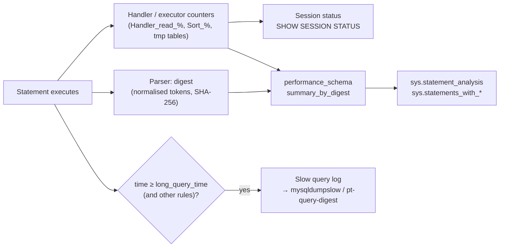

## Introduction

Every lesson so far started with a query that was already known to be slow. In production the hard part is the step before: **which** of the thousands of distinct statements an application sends deserve attention? The slowest single execution? The statement that runs ten million times a day at 3 ms each? The one that reads two million rows to return twenty?

MySQL gives you three instruments, from oldest to newest:

1. **The slow query log** — a file (or table) where the server writes every statement that exceeds a time threshold, with its execution time, lock time, rows examined and rows sent. Summarised with `mysqldumpslow` or Percona's `pt-query-digest`.
2. **performance_schema statement digests** — in-memory aggregates per *normalised* statement ("digest"): how many times it ran, total and maximum latency, rows examined, full scans, temporary tables, sorts. Always on by default in 8.x.
3. **The sys schema** — human-readable views over performance_schema such as `sys.statement_analysis` and `sys.statements_with_full_table_scans`.

This lesson explains how each works, how to configure it, and how to turn its output into a ranked list of optimization candidates. Then it closes the loop: confirm a candidate with session status counters and `EXPLAIN ANALYZE`, fix it, and verify.

:::warning[What the sandbox can and cannot show]
Your lab account only has privileges on its own schema. It **cannot** change global variables, read server log files, or query `performance_schema` and `sys`. In this lesson those statements appear as **display-only** SQL, and their outputs are **illustrative examples written for teaching — not captured from a server**; they are labelled as such. Everything that *can* run in a session does run: `SHOW VARIABLES`, session-scoped `long_query_time`, the digest functions `STATEMENT_DIGEST()` / `STATEMENT_DIGEST_TEXT()`, session status counters (`Handler_read_%`, `Select_%`, `Sort_%`), `Last_query_cost` and `EXPLAIN ANALYZE`. Their outputs are real captures.
:::

## DBMS Theory

:::theory[Workload analysis]
Performance work on a database is **workload analysis**: the server executes a multiset of statements, and the goal is to reduce the total resource consumption (or a latency percentile) of that workload. Three ideas from theory and practice make it tractable:

- **Normalisation into statement classes.** Statements that differ only in literal values (`WHERE id = 42` vs `WHERE id = 7`) share a plan shape and an optimization. Grouping them into a class — a *fingerprint* or *digest* — turns millions of executions into a few hundred classes.
- **Pareto distribution of cost.** In most OLTP workloads a handful of statement classes account for most of the total time. Rank classes by **total** time (count × average), not by average or maximum alone.
- **Efficiency ratios.** *Rows examined ÷ rows sent* measures how much work a statement does per useful row; a large ratio is the signature of a missing index or a non-SARGable predicate, independent of hardware.
:::

The **response time** of one execution decomposes into waiting (locks, I/O, CPU queueing) and working (rows read, sorted, joined). A statement can be slow because it does too much work, or because it waits behind others; diagnostics must distinguish the two. The slow log records `Lock_time`; performance_schema separates lock time, and wait events, from statement time.

Two sampling choices matter: **threshold-based capture** (log only statements slower than *T*) misses fast-but-frequent statements whose total cost dominates; **aggregate counters** (digests) capture everything but lose individual executions and parameters. Professionals use both.

:::standard[Standard SQL vs MySQL]
None of this is in the SQL standard. The slow query log, performance_schema, the sys schema, `STATEMENT_DIGEST()` and the status counters are MySQL-specific. Other systems have equivalents — PostgreSQL's `pg_stat_statements` and `log_min_duration_statement`, SQL Server's Query Store and DMVs, Oracle's AWR/ASH — built on the same ideas of normalisation and aggregation.
:::

## Why It Exists

Without workload-level diagnostics, tuning is guesswork driven by whoever complains loudest. Typical failure modes:

- **Optimizing the wrong query.** A report that takes 40 s once a night is visible and annoying; a 4 ms lookup that runs 2,000 times per second costs 8 CPU-seconds every second. The second deserves the attention.
- **Missing regressions.** A deploy changes an ORM call so that a query loses its index. Average latency rises from 1 ms to 30 ms — below any alerting threshold — and database CPU doubles.
- **Fixing symptoms.** Adding RAM or replicas to a server whose top statement reads 200,000 rows to return one.

The slow query log has existed since MySQL's early days because "show me the slow statements" is the most basic question. Performance_schema (5.5+, digests from 5.6) and the sys schema (bundled since 5.7) exist because a log only shows statements above a threshold, costs I/O to write, and must be parsed offline — whereas digests are always-on aggregates queryable with SQL.

## Internal Working

:::internals[How MySQL records statement performance]
**Slow query log.** After a statement finishes, the server checks: execution time ≥ `long_query_time` (seconds, fractional, default 10) **and** rows examined ≥ `min_examined_row_limit` (default 0) — or, if `log_queries_not_using_indexes` is ON, the statement did not use an index (full scan). Qualifying statements are written to the destinations in `log_output` (`FILE` and/or `TABLE` = `mysql.slow_log`). With `log_slow_extra=ON` (8.0.14+) the FILE format adds handler and sort counters per statement. Administrative statements are logged only with `log_slow_admin_statements`, replica-applied ones with `log_slow_replica_statements`. `long_query_time` is also a **session** variable, so one connection can log more aggressively than the rest.

**Digests.** While parsing, the server computes a **normalised token stream**: literals become `?`, `IN (1,2,3)` lists collapse to `IN (...)`, whitespace and letter case of keywords are normalised, comments are dropped. The SHA-256 hash of that stream is the **digest**, and the token text (truncated at `max_digest_length`, default 1024 bytes) is `DIGEST_TEXT`. The same machinery is exposed as the SQL functions `STATEMENT_DIGEST()` and `STATEMENT_DIGEST_TEXT()`.

**Statement summaries.** When the statement ends, performance_schema adds its metrics to the row for (schema, digest) in `events_statements_summary_by_digest`: counts, timer sums/min/max (in **picoseconds**), lock time, errors, warnings, rows affected/sent/examined, temporary tables (memory/disk), sort counters, joins without indexes (`SUM_SELECT_FULL_JOIN`), `SUM_NO_INDEX_USED`, `SUM_NO_GOOD_INDEX_USED`, first/last seen, latency quantiles (`QUANTILE_95`, `QUANTILE_99`) and a sample statement text (`QUERY_SAMPLE_TEXT`). The table holds at most `performance_schema_digests_size` rows; once full, new digests are aggregated into a catch-all row with NULL digest. Counters are cumulative since startup or the last `TRUNCATE TABLE`.

**Session status counters.** Independently, every handler call increments counters such as `Handler_read_key` (index lookups that position a cursor), `Handler_read_next`/`_prev` (next entries in index order), `Handler_read_rnd_next` (next row in a table scan) and `Handler_read_rnd` (row fetched by position, e.g. after a sort). Query-level counters such as `Select_scan`, `Select_range`, `Select_full_join`, `Sort_rows` and `Created_tmp_tables` classify plans. `SHOW SESSION STATUS` shows your own connection's values — this is what the sandbox can use.
:::



## MySQL Implementation

**Inspecting the logging configuration.** Reading variables is allowed in the sandbox:

```sql run
SHOW VARIABLES WHERE Variable_name IN
  ('slow_query_log', 'long_query_time', 'log_output', 'log_queries_not_using_indexes',
   'min_examined_row_limit', 'log_slow_extra', 'performance_schema', 'max_digest_length');
```

On the capture server the slow log is off and `long_query_time` is the default 10 seconds — typical for a fresh install, and far too high for an OLTP application. An administrator enables and tunes it globally (display-only — `SET GLOBAL` and `SET PERSIST` are forbidden in the sandbox):

```sql
-- Display only: requires SYSTEM_VARIABLES_ADMIN
SET PERSIST slow_query_log = ON;
SET PERSIST long_query_time = 0.2;              -- 200 ms; fractional seconds allowed
SET PERSIST log_slow_extra = ON;                -- handler/sort counters in each entry (8.0.14+)
SET PERSIST log_output = 'FILE';                -- or 'TABLE' (mysql.slow_log) or 'FILE,TABLE'
SET PERSIST min_examined_row_limit = 0;
SET PERSIST log_queries_not_using_indexes = OFF; -- ON is very noisy; see Best Practices
SELECT @@GLOBAL.slow_query_log_file;
```

`long_query_time` is also session-scoped, so a single connection — a batch job you are investigating, or your own debugging session — can use a lower threshold without changing the server:

```sql run
SET SESSION long_query_time = 0.05;
SELECT @@SESSION.long_query_time AS session_threshold, @@GLOBAL.long_query_time AS global_threshold;
```

(With the global log disabled nothing is written, but on a server with the slow log ON this is how you capture one session's statements at a finer threshold.)

**Digests in your session.** The normalisation that performance_schema applies can be observed directly:

```sql run
SELECT STATEMENT_DIGEST_TEXT(
  'SELECT order_id FROM orders WHERE customer_id = 42 AND status IN (''paid'', ''shipped'')') AS digest_text_1,
       STATEMENT_DIGEST_TEXT(
  'select order_id  from orders where customer_id=7 and status in (''paid'')') AS digest_text_2;
SELECT STATEMENT_DIGEST('SELECT order_id FROM orders WHERE customer_id = 42')
     = STATEMENT_DIGEST('select order_id from orders where customer_id = 7') AS same_digest;
```

Both statements normalise to the same text — literals become `?`, the `IN` list becomes `IN (...)`, identifiers are quoted and keywords upper-cased — and share one digest. That is why performance_schema can aggregate millions of executions into one row per statement shape.

## Syntax Breakdown

| Setting / object | Scope | Purpose |
|---|---|---|
| `slow_query_log` | Global | Enable the slow log |
| `long_query_time` | Global **and session** | Threshold in seconds (fractional, microsecond resolution) |
| `log_output` | Global | `FILE`, `TABLE` (`mysql.slow_log`), `NONE` |
| `slow_query_log_file` | Global | File path (default `<host_name>-slow.log` in the data directory) |
| `log_slow_extra` | Global | Extra per-entry fields (Rows/Bytes, Read_*, Sort_*, tmp tables) — FILE only |
| `min_examined_row_limit` | Global and session | Only log statements that examined at least N rows |
| `log_queries_not_using_indexes` | Global | Also log statements without index use, regardless of time |
| `log_throttle_queries_not_using_indexes` | Global | Cap per minute for the above |
| `mysqldumpslow -s t -t 10 file` | Shell | Summarise a slow log: sort by total time, top 10 |
| `performance_schema.events_statements_summary_by_digest` | Server | Aggregates per (schema, digest) |
| `events_statements_history[_long]` | Server | Recent individual statements (per thread / global ring buffer) |
| `sys.statement_analysis` | Server | Formatted digest summary (`x$statement_analysis` = raw numbers) |
| `sys.statements_with_full_table_scans`, `…_with_temp_tables`, `…_with_sorting`, `…_with_errors_or_warnings`, `…_with_runtimes_in_95th_percentile` | Server | Pre-filtered digest views |
| `STATEMENT_DIGEST(sql)`, `STATEMENT_DIGEST_TEXT(sql)` | Function | Compute digest / normalised text for a string (8.0.4+) |
| `SHOW SESSION STATUS LIKE 'Handler_read%'` | Session | Handler counters for your connection |

:::version[8.0 vs 8.4]
All of the above exists in 8.0 and 8.4 LTS. Terminology changed in 8.4: replication-related options use only the *replica/source* names (for example `log_slow_replica_statements`; the old `log_slow_slave_statements` alias was removed). The query cache, which older tuning guides mention alongside the slow log, was removed in 8.0.
:::

## Practical Examples

The examples build a small application schema and treat four statements as the "workload" of an order service.

```sql run
SET SESSION cte_max_recursion_depth = 200000;
CREATE TABLE orders (
  order_id    INT UNSIGNED  NOT NULL PRIMARY KEY,
  customer_id INT UNSIGNED  NOT NULL,
  status      VARCHAR(10)   NOT NULL,
  created_at  DATETIME      NOT NULL,
  amount      DECIMAL(10,2) NOT NULL,
  INDEX idx_customer (customer_id),
  INDEX idx_created  (created_at)
);
INSERT INTO orders
WITH RECURSIVE seq(n) AS (SELECT 1 UNION ALL SELECT n + 1 FROM seq WHERE n < 200000)
SELECT n, 1 + (n * 7919) % 20000,
       ELT(1 + n % 5, 'pending', 'paid', 'shipped', 'delivered', 'cancelled'),
       TIMESTAMP '2024-01-01 00:00:00' + INTERVAL (n * 157) % (366 * 24 * 60) MINUTE,
       ((n * 31) % 50000) / 100
FROM seq;
ANALYZE TABLE orders;
```

**1. What a slow log entry looks like.** With `log_slow_extra=ON`, an entry for a non-SARGable daily report would look like this. *Illustrative example — not captured; values are realistic but invented for teaching:*

```text
# Time: 2026-03-02T14:05:11.482913Z
# User@Host: app[app] @ app-07 [10.0.4.17]  Id: 81423
# Query_time: 0.612480  Lock_time: 0.000004 Rows_sent: 1  Rows_examined: 200000 Thread_id: 81423 Errno: 0 Killed: 0 Bytes_received: 92 Bytes_sent: 61 Read_first: 1 Read_last: 0 Read_key: 1 Read_next: 0 Read_prev: 0 Read_rnd: 0 Read_rnd_next: 200001 Sort_merge_passes: 0 Sort_range_count: 0 Sort_rows: 0 Sort_scan_count: 0 Created_tmp_disk_tables: 0 Created_tmp_tables: 0 Start: 2026-03-02T14:05:10.870433Z End: 2026-03-02T14:05:11.482913Z
SET timestamp=1772460310;
SELECT COUNT(*), SUM(amount) FROM orders WHERE DATE(created_at) = '2024-03-15';
```

How to read it: `Rows_examined: 200000` for `Rows_sent: 1`, and `Read_rnd_next` ≈ table size — a full table scan. `Lock_time` is negligible, so the statement was working, not waiting.

**2. Summarising the log.** `mysqldumpslow` groups entries by abstracting numbers to `N` and strings to `'S'`, then sorts. *Illustrative output — not captured:*

```text
$ mysqldumpslow -s t -t 3 /var/lib/mysql/db1-slow.log

Count: 1840  Time=0.58s (1067s)  Lock=0.00s (0s)  Rows=1.0 (1840), app[app]@4hosts
  SELECT COUNT(*), SUM(amount) FROM orders WHERE DATE(created_at) = 'S'

Count: 12  Time=41.20s (494s)  Lock=0.00s (0s)  Rows=8760.0 (105120), report[report]@batch-01
  SELECT ... FROM orders o JOIN order_items i ON ... GROUP BY ...

Count: 96211  Time=0.21s (20204s)  Lock=0.00s (0s)  Rows=20.0 (1924220), app[app]@4hosts
  SELECT order_id, created_at FROM orders WHERE status = 'S' ORDER BY created_at DESC LIMIT N, N
```

`-s t` sorts by **total** time — the number in parentheses. In this example the paginated listing (0.21 s each, but 96,211 executions) dominates; the 41-second report ranks below it. `-s c` (count), `-s at` (average time) and `-s r` (rows) give other views. `pt-query-digest` (Percona Toolkit) does the same with richer statistics (percentiles, query fingerprints, EXPLAIN integration).

**3. Top statements from performance_schema.** The equivalent query over digests — display-only (the sandbox cannot read performance_schema):

```sql
-- Display only: requires SELECT on performance_schema
SELECT SCHEMA_NAME,
       LEFT(DIGEST_TEXT, 70)                         AS statement,
       COUNT_STAR                                    AS execs,
       ROUND(SUM_TIMER_WAIT / 1e12, 1)               AS total_s,
       ROUND(AVG_TIMER_WAIT / 1e9, 2)                AS avg_ms,
       ROUND(QUANTILE_95 / 1e9, 2)                   AS p95_ms,
       SUM_ROWS_EXAMINED,
       SUM_ROWS_SENT,
       ROUND(SUM_ROWS_EXAMINED / NULLIF(SUM_ROWS_SENT, 0)) AS examined_per_sent,
       SUM_NO_INDEX_USED,
       SUM_CREATED_TMP_DISK_TABLES
FROM performance_schema.events_statements_summary_by_digest
WHERE SCHEMA_NAME = 'shop'
ORDER BY SUM_TIMER_WAIT DESC
LIMIT 5;
```

*Illustrative output — not captured:*

```text
+-------------+------------------------------------------------------------------------+---------+---------+--------+--------+-------------------+---------------+-------------------+-------------------+-----------------------------+
| SCHEMA_NAME | statement                                                              | execs   | total_s | avg_ms | p95_ms | SUM_ROWS_EXAMINED | SUM_ROWS_SENT | examined_per_sent | SUM_NO_INDEX_USED | SUM_CREATED_TMP_DISK_TABLES |
+-------------+------------------------------------------------------------------------+---------+---------+--------+--------+-------------------+---------------+-------------------+-------------------+-----------------------------+
| shop        | SELECT `order_id` , `created_at` FROM `orders` WHERE `status` = ? ORDE | 1240211 | 25140.7 |  20.27 |  57.54 |       62039441712 |      24804220 |              2501 |                 0 |                           0 |
| shop        | SELECT COUNT ( * ) , SUM ( `amount` ) FROM `orders` WHERE DATE ( `crea |   23880 | 13854.2 | 580.16 | 630.96 |        4776000000 |         23880 |            200000 |             23880 |                           0 |
| shop        | SELECT * FROM `customers` WHERE `customer_id` = ?                      | 9921140 |   812.3 |   0.08 |   0.13 |           9921140 |       9921140 |                 1 |                 0 |                           0 |
+-------------+------------------------------------------------------------------------+---------+---------+--------+--------+-------------------+---------------+-------------------+-------------------+-----------------------------+
```

Timer columns are in picoseconds (÷ 10¹² for seconds, ÷ 10⁹ for milliseconds). The third row runs ten million times at 0.08 ms with one row examined per row sent — perfectly efficient, nothing to do. The first two are the candidates: one with deep OFFSET pagination (2,501 rows examined per row sent), one with a full scan every time (`SUM_NO_INDEX_USED` = executions).

**4. The sys schema shortcut.** The same information, formatted (display-only):

```sql
-- Display only: requires access to the sys schema (and performance_schema underneath)
SELECT query, db, exec_count, total_latency, avg_latency, rows_examined_avg, rows_sent_avg, full_scan
FROM sys.statement_analysis
ORDER BY total_latency DESC          -- sys views pre-sort; x$ views return raw numbers for sorting
LIMIT 5;

SELECT query, exec_count, no_index_used_count, no_good_index_used_count, rows_examined_avg
FROM sys.statements_with_full_table_scans
WHERE db = 'shop'
LIMIT 5;
```

Use the `x$`-prefixed variants (`sys.x$statement_analysis`) when sorting or doing arithmetic, because the plain views format latencies as strings such as `'1.23 s'`.

## Execution Walkthrough

The walkthrough runs the full diagnostic loop on the lab's own workload, using only what a session can see: **handler counters as a stand-in for performance_schema's rows-examined metrics.** Each step reads the counters, runs one statement, and reads them again; the difference is the work the statement did.

```walkthrough
title: Diagnosing the order service workload with session counters
steps:
  - title: "1. Baseline the counters"
    explain: >-
      Session status counters are cumulative for the connection. Read them first; every later step reports values
      to compare against the previous step. Handler_read_rnd_next counts rows read by table scans,
      Handler_read_next index entries read in order, Handler_read_key index lookups.
    sql: |
      SHOW SESSION STATUS WHERE Variable_name IN
        ('Handler_read_key', 'Handler_read_next', 'Handler_read_rnd_next', 'Select_scan', 'Select_range');
  - title: "2. Candidate A — daily revenue with DATE()"
    explain: >-
      Run the statement, then read the counters. Handler_read_rnd_next grows by about the table size and Select_scan
      by one: a full table scan to compute one row.
    sql: |
      SELECT COUNT(*) AS orders, SUM(amount) AS revenue FROM orders WHERE DATE(created_at) = '2024-03-15';
      SHOW SESSION STATUS WHERE Variable_name IN
        ('Handler_read_key', 'Handler_read_next', 'Handler_read_rnd_next', 'Select_scan', 'Select_range');
  - title: "3. Candidate B — a customer's recent orders"
    explain: >-
      An index lookup on idx_customer: Handler_read_key rises by one and Handler_read_next by roughly the customer's
      ten orders. Efficient — rows examined is close to rows sent.
    sql: |
      SELECT order_id, created_at, amount FROM orders WHERE customer_id = 4242 ORDER BY created_at DESC LIMIT 5;
      SHOW SESSION STATUS WHERE Variable_name IN
        ('Handler_read_key', 'Handler_read_next', 'Handler_read_rnd_next', 'Select_scan', 'Select_range');
  - title: "4. Confirm the bottleneck of candidate A with EXPLAIN"
    explain: >-
      The plan explains the counters: type ALL, possible_keys NULL — DATE() wraps the indexed column, so
      idx_created cannot bound the scan (see the SARGable Queries lesson).
    sql: |
      EXPLAIN SELECT COUNT(*), SUM(amount) FROM orders WHERE DATE(created_at) = '2024-03-15';
  - title: "5. Fix and re-measure"
    explain: >-
      The half-open range returns the same row (compare with step 2) and the counters now grow through
      Handler_read_key/Handler_read_next by about one day of orders, with Select_range instead of Select_scan.
    sql: |
      SELECT COUNT(*) AS orders, SUM(amount) AS revenue FROM orders
      WHERE created_at >= '2024-03-15' AND created_at < '2024-03-16';
      SHOW SESSION STATUS WHERE Variable_name IN
        ('Handler_read_key', 'Handler_read_next', 'Handler_read_rnd_next', 'Select_scan', 'Select_range');
```

Reading the walkthrough: between steps 1 and 2 `Handler_read_rnd_next` grows by the size of the table — that is the statement's "rows examined". Between steps 3 and 5 the scan counter does not move; the index counters grow by a few hundred. That is the same evidence a digest row gives (`SUM_ROWS_EXAMINED`, `SUM_NO_INDEX_USED`), obtained from inside a single session.

## Output

`EXPLAIN ANALYZE` gives per-iterator actual rows and time for the before/after pair:

```sql run measured
EXPLAIN ANALYZE SELECT COUNT(*), SUM(amount) FROM orders WHERE DATE(created_at) = '2024-03-15';
```

```sql run measured
EXPLAIN ANALYZE SELECT COUNT(*), SUM(amount) FROM orders
WHERE created_at >= '2024-03-15' AND created_at < '2024-03-16';
```

The first reads every row in a table scan and filters; the second's index range scan returns only the day's rows. The optimizer's own estimate of the work is visible as `Last_query_cost`:

```sql run
SELECT COUNT(*), SUM(amount) FROM orders WHERE DATE(created_at) = '2024-03-15';
SHOW SESSION STATUS LIKE 'Last_query_cost';
SELECT COUNT(*), SUM(amount) FROM orders WHERE created_at >= '2024-03-15' AND created_at < '2024-03-16';
SHOW SESSION STATUS LIKE 'Last_query_cost';
```

How to present the result of a diagnosis: name the statement class (digest text), its share of total time, rows examined per row sent before and after, the plan change (ALL → range), and measured latency on production-like data. In production you then watch the digest's `AVG_TIMER_WAIT` and `SUM_ROWS_EXAMINED` growth rate after the deploy to confirm the effect — the measured times above came from a shared build machine and only illustrate the direction.

## Alternative Approaches

| Instrument | Captures | Strengths | Weaknesses |
|---|---|---|---|
| Slow query log (threshold) | Individual executions ≥ T, with literals | Exact statements and parameters; offline analysis; history on disk | Misses fast-but-frequent statements; I/O cost at low T; files must be rotated and protected (they contain data values) |
| Slow log with `long_query_time = 0` for a short window | Every statement | Complete sample for `pt-query-digest` | Heavy I/O; only for short, planned windows |
| performance_schema digests | Aggregates of all statements | Always on, cheap, SQL-queryable, rows examined/tmp tables/no-index flags | Cumulative counters (need snapshots and deltas); limited rows (`performance_schema_digests_size`); no parameters except a sample |
| `events_statements_history_long` | Recent individual statements | Recent examples with metrics | Small ring buffer; consumer may be disabled |
| sys schema views | Formatted digests | Fast human triage | Same limits as performance_schema |
| `EXPLAIN ANALYZE` / session counters | One statement | Precise confirmation | Requires a candidate first; runs the query |
| External APM / Percona Monitoring and Management / cloud insights | Digests over time | Dashboards, history, alerting | Extra infrastructure |

A practical rhythm: digests (or a monitoring tool built on them) to **rank** statement classes continuously; the slow log to keep **examples with parameters** of the expensive ones; EXPLAIN ANALYZE and session counters on a replica to **confirm** and **verify** fixes.

## Performance Analysis

**Overhead of the instruments.**

- The slow log costs a write per logged statement. At `long_query_time = 0.2` on an OLTP server it usually logs a small fraction of statements; at 0 it logs all of them and can noticeably increase I/O. `log_queries_not_using_indexes` can flood the log with harmless small-table scans — throttle it.
- performance_schema has a modest, mostly fixed overhead with the default instrumentation, which includes statement digests. Enabling many additional wait/stage instruments costs more.
- Session counters are free; they are always maintained.

**Choosing the ranking metric.**

| Rank by | Finds | Misses |
|---|---|---|
| Total time (`SUM_TIMER_WAIT`) | Where the server spends its time | Rare but user-visible slow requests |
| p95/p99 latency (`QUANTILE_95`) | Tail latency that users feel | Cheap-but-frequent load |
| Rows examined / rows sent | Inefficient plans regardless of hardware | Efficient statements that are slow for other reasons (locks, network) |
| `SUM_NO_INDEX_USED`, `SUM_CREATED_TMP_DISK_TABLES`, `SUM_SORT_MERGE_PASSES` | Specific plan defects | Defects that do not trigger these flags |
| `SUM_LOCK_TIME`, errors | Contention, deadlock-prone statements | CPU-bound work |

**Cumulative counters need deltas.** Digest counters grow from server start. To see "what happened in the last hour", take snapshots into a table and subtract — or let a monitoring system do it. The same applies to the session counters in the walkthrough. Practice Exercise 4 builds exactly that calculation on synthetic snapshot data.

:::performance[Theory vs measurement]
The plan change and the rows examined in this lesson are deterministic. The latency numbers in the illustrative slow-log, mysqldumpslow and digest outputs are invented for teaching and labelled as such; the timings in measured blocks are real but come from a shared build machine. Production decisions should be based on your own digests over a representative period.
:::

## Best Practices

:::best-practice[Running diagnostics in production]
1. **Turn the slow log on** with a threshold matched to your latency budget (100–500 ms for OLTP is common) and `log_slow_extra=ON`. Rotate the file and restrict access: entries contain literal values, which may include personal data.
2. **Rank by total time and by examined-per-sent**, not by the single slowest execution.
3. **Snapshot digests** periodically (or use a monitoring tool) so you can compute deltas and see trends and regressions per deploy.
4. **Confirm before fixing.** Reproduce the candidate on a replica or staging copy with production-like data; read EXPLAIN, then EXPLAIN ANALYZE.
5. **Fix the class, not the instance.** One digest = one code path; fix the query or index once and every execution benefits.
6. **Verify after deploying**: the digest's average latency and rows examined should drop; if a new digest appears (changed SQL text), compare it to the old one.
7. **Use session-scoped thresholds** (`SET SESSION long_query_time`) and session counters for focused investigations instead of global changes.
:::

## Common Mistakes

**Mistake 1 — reading cumulative counters as if they were per-query.** `SHOW SESSION STATUS` values accumulate for the connection; only differences between two readings describe a statement. Likewise, a digest row with `SUM_ROWS_EXAMINED = 4.7 billion` may be the result of months of uptime.

**Mistake 2 — optimizing by maximum latency.** The slowest execution is often a one-off (a cold cache after restart, a lock wait). Look at count × average and percentiles.

**Mistake 3 — leaving `long_query_time` at 10 seconds.** The default hides essentially every OLTP problem. Conversely, setting it to 0 permanently creates gigabytes of log.

**Mistake 4 — trusting digest text as the exact query.** Digest text is normalised and truncated at `max_digest_length`; two statements with long, different tails can share a digest. Use `QUERY_SAMPLE_TEXT`, the slow log or application tracing to get real parameter values before running EXPLAIN — the plan can depend on them.

**Mistake 5 — confusing waiting with working.** A statement with high latency but low rows examined and high `Lock_time` / `SUM_LOCK_TIME` needs a concurrency fix (shorter transactions, better indexes for locking reads — Module 9), not a better plan.

**Mistake 6 — forgetting the timer unit.** performance_schema timers are picoseconds: `SUM_TIMER_WAIT = 25140700000000000` is 25,140.7 seconds, not 25 trillion milliseconds. The sys views and `FORMAT_PICO_TIME()` (8.0.16+) convert for you.

## Industry Application

- **Weekly query reviews.** Many teams hold a short weekly review of the top 10 digests by total time and by examined-per-sent, assigning owners to regressions. Percona Monitoring and Management, Datadog, New Relic and cloud tools (Amazon RDS Performance Insights, Google Cloud SQL Query Insights) present the same digest data over time.
- **Deploy gates.** Some organisations snapshot digests before and after a canary deploy and fail the rollout if a statement class's average latency or rows examined jumps.
- **Incident response.** During an incident, `sys.statement_analysis` ordered by latency over the last minutes (via snapshots), plus `SHOW PROCESSLIST` / `sys.session` to see what is running now, identifies the culprit quickly. `EXPLAIN FOR CONNECTION <id>` shows the plan of a statement currently running in another session (requires the `PROCESS` privilege — display-only here).
- **Capacity planning.** Total time by digest, divided by wall-clock time, approximates how many CPU cores the workload keeps busy; removing the top inefficient digest is often cheaper than scaling hardware.
- **Privacy and compliance.** Because slow logs include literals, regulated environments ship them to secured storage with retention limits, or rely on digests (which store `?` placeholders) plus sampled statements with masking.

## Practice Exercises

Exercises 2–4 use a small table `digest_snapshot` whose columns mirror `performance_schema.events_statements_summary_by_digest`. Its rows are **synthetic** — created in the exercise setup for practice, not captured from a server — so that you can write the same ranking queries you would run in production.

```exercise
id: ex1
title: Normalise a statement
difficulty: easy
concepts: [statement-digests]
prompt: |
  Use MySQL's digest function to return the normalised text of this statement (single column `digest_text`):

  ~~~sql
  SELECT * FROM invoices WHERE account_id = 981 AND status IN ('open', 'overdue', 'disputed')
  ~~~
hints:
  - "STATEMENT_DIGEST_TEXT(string) returns the normalised statement text."
  - "Inside a string literal, single quotes are doubled: 'it''s'."
solution: |
  SELECT STATEMENT_DIGEST_TEXT(
    'SELECT * FROM invoices WHERE account_id = 981 AND status IN (''open'', ''overdue'', ''disputed'')'
  ) AS digest_text;
explanation: |
  The literal 981 becomes `?` and the three-element list becomes `IN (...)`, so this statement aggregates with every
  other account id and status list into one digest. The function parses the text only — the table need not exist.
```

```exercise
id: ex2
title: Top statements by total time
difficulty: medium
concepts: [top-queries, statement-digests]
setup: |
  CREATE TABLE digest_snapshot (
    digest VARCHAR(16) PRIMARY KEY, digest_text VARCHAR(200) NOT NULL, count_star BIGINT UNSIGNED NOT NULL,
    sum_timer_wait BIGINT UNSIGNED NOT NULL, sum_rows_examined BIGINT UNSIGNED NOT NULL,
    sum_rows_sent BIGINT UNSIGNED NOT NULL, sum_no_index_used BIGINT UNSIGNED NOT NULL);
  INSERT INTO digest_snapshot VALUES
    ('a1', 'SELECT * FROM `customers` WHERE `customer_id` = ?', 9921140, 812300000000000, 9921140, 9921140, 0),
    ('b2', 'SELECT COUNT ( * ) FROM `orders` WHERE DATE ( `created_at` ) = ?', 23880, 13854200000000000, 4776000000, 23880, 23880),
    ('c3', 'SELECT `order_id` FROM `orders` WHERE `status` = ? ORDER BY `created_at` DESC LIMIT ?, ?', 1240211, 25140700000000000, 62039441712, 24804220, 0),
    ('d4', 'UPDATE `carts` SET `qty` = ? WHERE `cart_id` = ?', 3110400, 1990000000000000, 3110400, 0, 0),
    ('e5', 'SELECT * FROM `products` WHERE `name` LIKE ?', 51200, 2380000000000000, 512000000, 640000, 51200);
prompt: |
  Return the **three** statement classes with the highest total time, highest first, with columns:

  1. `digest_text`
  2. `execs` — `count_star`
  3. `total_s` — total time in seconds (`sum_timer_wait` is in picoseconds), rounded to 1 decimal
  4. `avg_ms` — average time per execution in milliseconds, rounded to 2 decimals
hints:
  - "1 second = 10^12 picoseconds; 1 millisecond = 10^9 picoseconds."
  - "avg_ms = sum_timer_wait / count_star / 1e9."
  - "ORDER BY sum_timer_wait DESC LIMIT 3."
solution: |
  SELECT digest_text,
         count_star AS execs,
         ROUND(sum_timer_wait / 1e12, 1) AS total_s,
         ROUND(sum_timer_wait / count_star / 1e9, 2) AS avg_ms
  FROM digest_snapshot
  ORDER BY sum_timer_wait DESC
  LIMIT 3;
orderMatters: true
explanation: |
  Ranking by total time surfaces where the server spends its time: the paginated listing first, the DATE() report
  second, and the cart UPDATE third — even though the UPDATE averages well under a millisecond. Ranking by `avg_ms`
  would put the DATE() report on top and hide the pagination cost; ranking by `count_star` would put the
  perfectly efficient customer lookup first.
```

```exercise
id: ex3
title: Inefficient plans, independent of hardware
difficulty: hard
concepts: [top-queries, performance-schema]
setup: |
  CREATE TABLE digest_snapshot (
    digest VARCHAR(16) PRIMARY KEY, digest_text VARCHAR(200) NOT NULL, count_star BIGINT UNSIGNED NOT NULL,
    sum_timer_wait BIGINT UNSIGNED NOT NULL, sum_rows_examined BIGINT UNSIGNED NOT NULL,
    sum_rows_sent BIGINT UNSIGNED NOT NULL, sum_no_index_used BIGINT UNSIGNED NOT NULL);
  INSERT INTO digest_snapshot VALUES
    ('a1', 'SELECT * FROM `customers` WHERE `customer_id` = ?', 9921140, 812300000000000, 9921140, 9921140, 0),
    ('b2', 'SELECT COUNT ( * ) FROM `orders` WHERE DATE ( `created_at` ) = ?', 23880, 13854200000000000, 4776000000, 23880, 23880),
    ('c3', 'SELECT `order_id` FROM `orders` WHERE `status` = ? ORDER BY `created_at` DESC LIMIT ?, ?', 1240211, 25140700000000000, 62039441712, 24804220, 0),
    ('d4', 'UPDATE `carts` SET `qty` = ? WHERE `cart_id` = ?', 3110400, 1990000000000000, 3110400, 0, 0),
    ('e5', 'SELECT * FROM `products` WHERE `name` LIKE ?', 51200, 2380000000000000, 512000000, 640000, 51200);
prompt: |
  List the SELECT statement classes whose **rows examined per row sent** is at least 100, with columns
  `digest_text`, `examined_per_sent` (rounded to a whole number) and `full_scan_pct` (percentage of executions
  that used no index, rounded to 1 decimal), ordered by `examined_per_sent` descending. Exclude statements that
  send no rows (such as UPDATEs) — they would divide by zero.
hints:
  - "examined_per_sent = sum_rows_examined / sum_rows_sent; use NULLIF(sum_rows_sent, 0) to avoid division by zero."
  - "full_scan_pct = 100 * sum_no_index_used / count_star."
  - "Filter on the ratio in WHERE (repeat the expression) or use a derived table."
solution: |
  SELECT digest_text,
         ROUND(sum_rows_examined / NULLIF(sum_rows_sent, 0)) AS examined_per_sent,
         ROUND(100 * sum_no_index_used / count_star, 1) AS full_scan_pct
  FROM digest_snapshot
  WHERE sum_rows_sent > 0
    AND sum_rows_examined / sum_rows_sent >= 100
  ORDER BY examined_per_sent DESC;
orderMatters: true
explanation: |
  The DATE() report examines 200,000 rows per row returned and never uses an index — a non-SARGable predicate. The
  pagination statement examines about 2,500 rows per row sent while using an index — deep OFFSET pagination. The
  `LIKE` search examines 800 per row sent with full scans — probably a leading wildcard. Each ratio points to a
  different fix from this module. The customer lookup (ratio 1) and the UPDATE (no rows sent) are excluded.
```

```exercise
id: ex4
title: What changed in the last hour?
difficulty: hard
concepts: [top-queries, performance-schema]
setup: |
  CREATE TABLE digest_history (
    snapshot_at DATETIME NOT NULL, digest VARCHAR(16) NOT NULL, count_star BIGINT UNSIGNED NOT NULL,
    sum_timer_wait BIGINT UNSIGNED NOT NULL, PRIMARY KEY (snapshot_at, digest));
  INSERT INTO digest_history VALUES
    ('2026-03-02 13:00:00', 'a1', 9800000,   800000000000000),
    ('2026-03-02 13:00:00', 'b2',   23000, 13340000000000000),
    ('2026-03-02 13:00:00', 'c3', 1200000, 24300000000000000),
    ('2026-03-02 14:00:00', 'a1', 9921140,   812300000000000),
    ('2026-03-02 14:00:00', 'b2',   23880, 13854200000000000),
    ('2026-03-02 14:00:00', 'c3', 1240211, 25140700000000000),
    ('2026-03-02 14:00:00', 'f6',    5000,   900000000000000);
prompt: |
  Digest counters are cumulative. Using the two snapshots (13:00 and 14:00), compute for each digest present at
  14:00 the activity **during that hour**: columns `digest`, `execs_in_hour`, `seconds_in_hour` (rounded to 1
  decimal). A digest that did not exist at 13:00 (new statement class) counts from zero. Order by
  `seconds_in_hour` descending.
hints:
  - "Self-join the table: the 14:00 row LEFT JOIN the 13:00 row on digest."
  - "Delta = later − COALESCE(earlier, 0)."
  - "Picoseconds ÷ 1e12 = seconds."
solution: |
  SELECT cur.digest,
         cur.count_star - COALESCE(prev.count_star, 0) AS execs_in_hour,
         ROUND((cur.sum_timer_wait - COALESCE(prev.sum_timer_wait, 0)) / 1e12, 1) AS seconds_in_hour
  FROM digest_history cur
  LEFT JOIN digest_history prev
    ON prev.digest = cur.digest AND prev.snapshot_at = '2026-03-02 13:00:00'
  WHERE cur.snapshot_at = '2026-03-02 14:00:00'
  ORDER BY seconds_in_hour DESC;
orderMatters: true
explanation: |
  Cumulative counters only become meaningful as differences. Over the hour, c3 used 840.7 s and the brand-new f6
  already 900 s — a regression that the cumulative view would hide behind digests with months of history. This
  is how monitoring tools compute per-interval load from performance_schema; LAG() over snapshot_at partitioned
  by digest is an equivalent formulation.
```

```exercise
id: ex5
title: Design a diagnostics setup
difficulty: challenge
kind: open
concepts: [slow-query-log, performance-schema, sys-schema, mysqldumpslow]
prompt: |
  You join a team running MySQL 8.4 for an e-commerce API (p99 target 150 ms, ~3,000 statements/s). Nothing is
  configured: the slow log is off and nobody looks at performance_schema. Propose a diagnostics setup: slow log
  settings (with justification), what you collect from performance_schema and how often, how you rank candidates,
  how you handle privacy, and how a candidate goes from "spotted" to "verified fixed".
solution: |
  **Slow log:** `slow_query_log=ON`, `long_query_time=0.1` (below the p99 budget so near-budget statements are
  captured), `log_slow_extra=ON` for handler/sort counters, `log_output=FILE`, rotation by size/day with
  compression and short retention, file permissions restricted to DBAs. Keep `log_queries_not_using_indexes=OFF`
  (or throttled) to avoid noise. For a planned 10-minute window, `long_query_time=0` to feed `pt-query-digest`.

  **performance_schema:** keep default statement instrumentation; snapshot `events_statements_summary_by_digest`
  (digest, schema, count, timers, rows examined/sent, no-index flags, tmp disk tables, sort merge passes,
  quantiles) every 1–5 minutes into a monitoring store; size `performance_schema_digests_size` so the catch-all
  NULL-digest row stays small.

  **Ranking:** per interval deltas; top digests by total time, by p95/p99, and by rows examined per row sent;
  flags for `SUM_NO_INDEX_USED`, disk temp tables and merge passes; new digests since the last deploy.

  **Privacy:** digests store placeholders; slow logs and `QUERY_SAMPLE_TEXT` contain literals — mask before
  shipping, restrict access, set retention.

  **Workflow:** spot (dashboard) → get a real sample with parameters (slow log) → reproduce on a replica with
  EXPLAIN and EXPLAIN ANALYZE, session counters → fix (query, index, statistics) with a code review → deploy →
  verify the digest's average latency and rows examined drop, and no new expensive digest appeared.
```

## Knowledge Assessment

```quiz
- id: q1
  question: "Which statement classes would a slow query log with `long_query_time = 1` most likely miss?"
  options:
    - "A nightly report that takes 40 seconds"
    - "A lookup that takes 4 ms but runs 2,000 times per second"
    - "A statement that waits 5 seconds for a row lock"
    - "A full table scan of a large table taking 3 seconds"
  answer: 1
  explanation: "Threshold capture only records executions above T. A 4 ms statement is never logged, although its total cost (8 CPU-seconds per second) can dominate the server. Digests capture it because they aggregate every execution. The other statements exceed 1 s and are logged."
  concepts: [slow-query-log, statement-digests]
- id: q2
  question: "`STATEMENT_DIGEST_TEXT('select * from t where id=5 and c in (1,2,3)')` returns approximately:"
  options:
    - "select * from t where id=5 and c in (1,2,3)"
    - "SELECT * FROM `t` WHERE `id` = ? AND `c` IN (...)"
    - "SELECT * FROM t WHERE id = 5"
    - "A SHA-256 hash"
  answer: 1
  explanation: "Digest text replaces literals with ? and collapses IN lists to (...), with normalised keywords and quoted identifiers. STATEMENT_DIGEST() (without _TEXT) returns the hash."
  concepts: [statement-digests]
- id: q3
  question: "A digest row shows COUNT_STAR = 1,000,000 and SUM_TIMER_WAIT = 2,000,000,000,000,000. What is the average latency?"
  options: ["2 ms", "2 s", "2 µs", "2,000 ms"]
  answer: 0
  explanation: "Timers are in picoseconds. 2×10^15 ps ÷ 10^6 executions = 2×10^9 ps = 2 ms. Forgetting the unit is a classic mistake; FORMAT_PICO_TIME() or the sys views convert automatically."
  concepts: [performance-schema]
- id: q4
  question: "Which metrics best identify statements with inefficient plans regardless of hardware speed? (Select all that apply.)"
  type: multi
  options:
    - "Rows examined per row sent"
    - "SUM_NO_INDEX_USED relative to executions"
    - "Maximum latency of a single execution"
    - "SUM_CREATED_TMP_DISK_TABLES and SUM_SORT_MERGE_PASSES"
  answer: [0, 1, 3]
  explanation: "Work ratios and plan-defect flags describe the plan, not the machine. A single maximum latency can be caused by a cold cache, a lock wait or a noisy neighbour."
  concepts: [top-queries, performance-schema]
- id: q5
  question: "`mysqldumpslow -s t -t 10` sorts by:"
  options: ["Average time", "Total time across all occurrences of each abstracted statement", "Count", "Rows examined"]
  answer: 1
  explanation: "-s t sorts by total query time (the value in parentheses); -s at sorts by average time, -s c by count, -s r by rows sent. -t 10 shows the top 10."
  concepts: [mysqldumpslow]
- id: q6
  question: "In your session, `Handler_read_rnd_next` increases by about 200,000 after one SELECT on a 200,000-row table. What does that indicate?"
  options:
    - "200,000 index lookups"
    - "A full table scan read about every row"
    - "200,000 rows were sent to the client"
    - "200,000 rows were sorted"
  answer: 1
  explanation: "Handler_read_rnd_next counts requests for the next row in a table (data file) scan. Index lookups increment Handler_read_key, ordered index reads Handler_read_next; rows sent and sorted have their own metrics."
  concepts: [session-status-counters]
- id: q7
  question: "A statement has high average latency but rows examined ≈ rows sent, and a high SUM_LOCK_TIME. What should you investigate first?"
  options:
    - "Missing indexes for its WHERE clause"
    - "Lock contention — long transactions or conflicting writes holding the rows it needs"
    - "A larger sort_buffer_size"
    - "Rewriting it with a UNION"
  answer: 1
  explanation: "The plan is efficient (little work per row); the time is spent waiting. Shorter transactions, consistent access order and indexes that narrow locking reads are the remedies (Module 9). Buffer sizes and rewrites target work, not waiting."
  concepts: [top-queries]
- id: q8
  question: "Why do monitoring tools store periodic snapshots of events_statements_summary_by_digest?"
  options:
    - "Because the table is cleared after every query"
    - "Because its counters are cumulative since startup (or truncation), so per-interval activity must be computed as differences between snapshots"
    - "Because it only contains the last 10 statements"
    - "Because digests change every minute"
  answer: 1
  explanation: "Summary counters only grow. Deltas between snapshots give the load per interval and reveal regressions that cumulative totals hide. events_statements_history holds recent individual statements; the summary table holds aggregates."
  concepts: [performance-schema]
```
