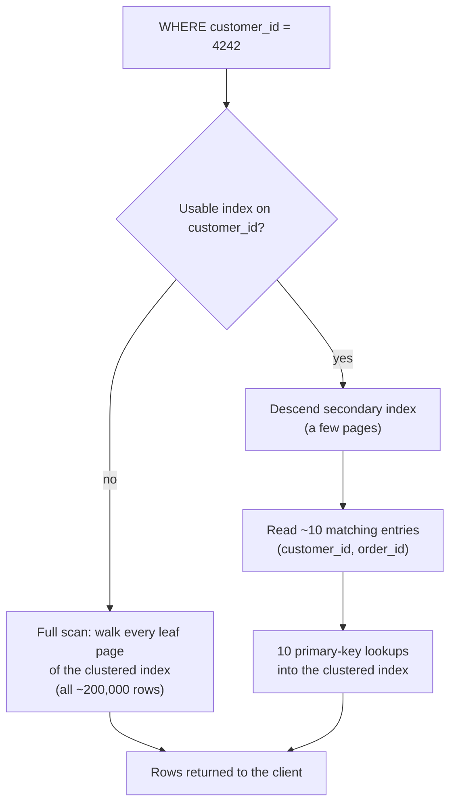

## Introduction

A customer calls support: *"Where is my order?"* The agent's screen runs `SELECT * FROM orders WHERE customer_id = 4242`. On a table with 80 rows this is instant no matter how it is executed. On a table with 200,000 rows it is still fast on a modern laptop — but it is already doing **20,000 times more work than necessary**, and on a table with 500 million rows serving 2,000 such requests per second the same query takes the whole system down.

The difference between "reads every row" and "reads the 10 rows that matter" is an **index**. This lesson answers the questions every later lesson in this module builds on:

- What does it *cost* to find data, and why do databases count **pages**, not rows?
- What exactly does a **full table scan** do, and why is its cost proportional to the table size?
- What is an index, formally, and why is it a **sorted access path** rather than "a faster table"?
- What does an index **cost** — on disk, in memory and on every `INSERT`, `UPDATE` and `DELETE`?

You will build a 200,000-row table in your lab, watch MySQL scan it, add one index, and compare the plans and the rows actually examined. The next lesson, [B-Trees and B+ Trees](/lessons/m07-btree-bplustree), opens the box and shows the data structure behind the index.

:::note[Lab data]
This lesson uses the **empty** dataset and generates its own data with a recursive CTE, so plans are visible at a realistic scale. Every output shown was captured on a real MySQL server; plans depend on statistics and data distribution, so **your plan details (especially row estimates and timings) may differ slightly**.
:::

## DBMS Theory

:::theory[Cost is measured in page accesses]
Relational databases store tables on block devices in fixed-size **pages** (also called blocks). A page is the unit of transfer between storage and memory: to read one 100-byte row, the DBMS reads the whole page that contains it. Classical query-cost analysis therefore counts **page I/Os**, not rows or CPU instructions.

For a table (relation) **R** with **N** tuples stored in **B** pages:

| Organisation | Equality search on key *k* | Range search | Insert |
|---|---|---|---|
| **Heap file** (unordered) | scan: **B** page reads (B/2 on average if the key is unique and you can stop early) | **B** | 1–2 (append) |
| **Sorted file** on *k* | binary search: **log₂ B** | log₂ B + matching pages | **B/2** on average (shift rows) |
| **Tree index** on *k* (fan-out *F*) | **log_F B** + 1 | log_F B + matching pages | log_F B + split cost |
| **Hash index** on *k* | ≈ **1–2** | not supported (hash order is random) | ≈ 1–2 |
:::

An **index** is an auxiliary data structure that maps values of a **search key** (one or more columns — not necessarily a candidate key) to the locations of the records with those values. Three pieces of terminology recur throughout this module:

1. **Access path** — a way of retrieving the tuples of a relation: a full scan, or an index plus a matching predicate. The term comes from the System R optimizer (Selinger et al., 1979), the ancestor of every cost-based optimizer including MySQL's. Choosing access paths is the optimizer's first job.
2. **Search key vs. key** — an index on `customer_id` has `customer_id` as its search key even though many rows share each value. "Key" in the indexing sense is not "candidate key" in the normalization sense.
3. **Primary vs. secondary index** — a *primary* (or clustering) index determines the physical order of the records; a *secondary* index is a separate structure whose entries point to the records. A table can be physically ordered only one way, so it has at most one clustering index and any number of secondary indexes.

Complexity tells the story at scale. Suppose a table has 100 million rows in about 1 million pages:

| Method | Page reads to find one key (theory) |
|---|---|
| Full scan | ~1,000,000 |
| Binary search on a sorted file | log₂(1,000,000) ≈ 20 |
| B+ tree with fan-out ≈ 1,000 | log₁₀₀₀(1,000,000) = 2, plus the leaf → ≈ 3–4 |

The B+ tree wins over binary search not because of a better complexity class — both are logarithmic — but because its **base** is the fan-out (hundreds) instead of 2, and the top levels are small enough to stay permanently in memory. That is the subject of the next lesson.

## Why It Exists

Storage is orders of magnitude slower than the CPU, and random access is slower than sequential access. As rough, commonly cited orders of magnitude: a main-memory access is on the order of 100 ns, a random read from an NVMe SSD on the order of tens of microseconds, and a random read from a spinning disk on the order of milliseconds. Exact figures vary greatly by hardware; the *ratios* are what matter. Even when the whole table is cached in RAM, scanning it costs CPU time proportional to its size: every row must be located in its page, decoded and compared.

Without indexes a DBMS has exactly one access path for every query — read everything — and three things go wrong as data grows:

- **Latency grows linearly with table size.** A query that touches 10 rows costs as much as reading 200,000 (or 200 million) rows. Response time degrades silently as the business succeeds.
- **Throughput collapses under concurrency.** Fifty concurrent full scans compete for buffer-pool memory, I/O bandwidth and CPU; each one evicts pages the others need.
- **Locking gets worse.** In InnoDB, a locking read or an `UPDATE … WHERE` that has no usable index must examine — and, under REPEATABLE READ, lock — every row it scans, not just the rows that match. Indexes therefore also reduce lock footprints (Module 8).

Indexes exist to give the optimizer **cheaper access paths**: jump directly to the qualifying rows, read them in a useful order (avoiding a sort), or answer the query from the index alone. The price is that every copy of the data in an index must be maintained whenever the data changes. An index is a **read optimization paid for by writes and storage** — the central trade-off of this whole module.

## Internal Working

:::internals[How InnoDB stores a table and what a scan really reads]
- **Pages.** InnoDB's default page size is **16 KB** (`innodb_page_size`, fixed when the instance is initialized). Rows, index entries and internal pointers all live in pages. Pages are grouped into 1 MB *extents* inside a tablespace file (`.ibd` with `innodb_file_per_table`, the default).
- **The table *is* an index.** An InnoDB table is stored as a B+ tree ordered by the primary key — the **clustered index**. Its leaf pages contain the complete rows. There is no separate "heap file" as in the theory table above.
- **A full table scan** walks the leaf level of the clustered index from left to right, following the links between leaf pages, and evaluates the `WHERE` condition on every row. For sequential scans InnoDB issues **read-ahead** requests (prefetching whole extents) so that the I/O is mostly sequential.
- **A secondary index** is a separate B+ tree whose leaf entries contain the indexed column values **plus the primary-key value** of the row. A lookup descends the secondary tree to find matching entries, then uses each primary-key value to descend the clustered index and fetch the full row (a *bookmark lookup*).
- **The buffer pool** caches pages in memory. A "page read" may be satisfied from memory (a logical read) or require storage I/O (a physical read). The optimizer's cost model accounts for both, and estimates how much of each index is already cached.
:::



You can check the page size of the server you are connected to:

```sql run
SELECT @@innodb_page_size AS page_bytes,
       @@innodb_page_size / 1024 AS page_kb;
```

Two consequences follow directly from page-based storage:

1. **Narrow rows are cheaper to scan.** More rows fit in a page, so the same number of rows needs fewer pages. This is why `SELECT *` over a table with large `TEXT` columns behaves differently from a table of integers.
2. **A lookup's cost is dominated by the number of distinct pages touched**, not by the number of comparisons. Binary search inside a 16 KB page in memory is essentially free compared with fetching the page.

## MySQL Implementation

First, build a realistic order table: 200,000 orders, 20,000 customers (exactly 10 orders each, spread over the whole table), four statuses with a skewed distribution, two years of dates, and five countries. There is a primary key but **no secondary index** yet.

```sql run
SET SESSION cte_max_recursion_depth = 300000;
CREATE TABLE orders_big (
  order_id    INT UNSIGNED  NOT NULL,
  customer_id INT UNSIGNED  NOT NULL,
  status      VARCHAR(10)   NOT NULL,
  order_date  DATE          NOT NULL,
  amount      DECIMAL(10,2) NOT NULL,
  country     CHAR(2)       NOT NULL,
  PRIMARY KEY (order_id)
) ENGINE=InnoDB;
INSERT INTO orders_big
WITH RECURSIVE seq(n) AS (SELECT 1 UNION ALL SELECT n + 1 FROM seq WHERE n < 200000)
SELECT n,
       1 + (n * 7919) % 20000,
       ELT(1 + (n % 20 > 0) + (n % 20 > 2) + (n % 20 > 15), 'cancelled', 'pending', 'shipped', 'delivered'),
       DATE '2023-01-01' + INTERVAL (n * 37) % 730 DAY,
       ROUND(5 + (n * 104729 % 99500) / 100, 2),
       ELT(1 + n % 5, 'US', 'IN', 'DE', 'BR', 'JP')
FROM seq;
ANALYZE TABLE orders_big;
```

`ANALYZE TABLE` refreshes the persistent statistics (row count estimate, index cardinalities, size) so that what follows is based on current numbers — you will study statistics in detail in [Selectivity, Cardinality and Index Statistics](/lessons/m07-selectivity-statistics). Now look at how big the table is, in pages:

```sql run
SELECT TABLE_ROWS                         AS estimated_rows,
       DATA_LENGTH                        AS clustered_index_bytes,
       DATA_LENGTH / @@innodb_page_size   AS clustered_index_pages,
       INDEX_LENGTH                       AS secondary_index_bytes
FROM information_schema.TABLES
WHERE TABLE_SCHEMA = DATABASE() AND TABLE_NAME = 'orders_big';
```

Note that `TABLE_ROWS` is an **estimate** from sampled statistics, not an exact count. `DATA_LENGTH` is the size of the clustered index (the table itself); `INDEX_LENGTH` — the secondary indexes — is zero because there are none yet. Roughly 600 pages of 16 KB hold the 200,000 rows, so about 330 rows share each page.

Now ask the support question and look at the plan:

```sql run
EXPLAIN SELECT * FROM orders_big WHERE customer_id = 4242;
```

Read the key columns: `type = ALL` means a **full table scan**; `possible_keys` and `key` are `NULL` because there is no index on `customer_id`; `rows` is the optimizer's estimate of rows to examine — essentially the whole table; `filtered` is its guess at the percentage of those rows that survive the `WHERE` (a default heuristic here, because it knows nothing about `customer_id`). `EXPLAIN ANALYZE` actually runs the query and reports what happened:

```sql run measured
EXPLAIN ANALYZE SELECT * FROM orders_big WHERE customer_id = 4242;
```

The bottom line, *Table scan on orders_big*, read every row (`rows=200000` in the *actual* part). The *Filter* iterator above it kept **10**. Twenty thousand rows examined per row returned.

Now create the index and ask again:

```sql run
CREATE INDEX idx_orders_big_customer ON orders_big (customer_id);
EXPLAIN SELECT * FROM orders_big WHERE customer_id = 4242;
```

`type = ref` means "look up all rows whose index value equals a constant", `key` names the index that is used, `ref = const` says the lookup value is a constant from the query, and `rows` drops to 10.

```sql run measured
EXPLAIN ANALYZE SELECT * FROM orders_big WHERE customer_id = 4242;
```

The iterator tree now has a single *Index lookup on orders_big using idx_orders_big_customer* node that produces exactly 10 rows. There is no Filter iterator: the index itself guarantees that every row it returns satisfies the condition. The timings (labelled as measured on the build machine) differ by orders of magnitude, but the more robust evidence is the row count — **200,000 rows examined became 10**.

## Syntax Breakdown

MySQL offers three equivalent ways to create an ordinary (B-tree) secondary index, plus ways to inspect and drop it:

```sql
-- 1. Standalone statement
CREATE [UNIQUE] INDEX index_name ON tbl (col1 [ASC|DESC], col2, ...)
       [ALGORITHM = {DEFAULT | INPLACE | COPY}] [LOCK = {DEFAULT | NONE | SHARED | EXCLUSIVE}];

-- 2. Inside ALTER TABLE (can add several indexes in one table rebuild/pass)
ALTER TABLE tbl ADD INDEX index_name (col1, col2), ADD UNIQUE KEY uq_name (col3);

-- 3. Inside CREATE TABLE
CREATE TABLE tbl (..., INDEX index_name (col1), UNIQUE KEY uq_name (col3));

-- Inspect and remove
SHOW INDEX FROM tbl;
DROP INDEX index_name ON tbl;          -- or: ALTER TABLE tbl DROP INDEX index_name;
```

| Element | Meaning |
|---|---|
| `INDEX` / `KEY` | Synonyms in MySQL. Both create a non-unique B-tree index on InnoDB. |
| `UNIQUE` | Adds a constraint: no two rows may have the same non-NULL key value (multiple NULLs are allowed). Covered in [Unique and Composite Indexes](/lessons/m07-composite-indexes). |
| `index_name` | Optional in `ALTER TABLE` (MySQL derives one from the first column) but always name indexes explicitly — names appear in `EXPLAIN`, error messages and hints. A common convention is `idx_<table>_<cols>` / `uq_<table>_<cols>`. |
| `(col1, col2, …)` | The search key. Order matters for composite indexes (leftmost-prefix rule). |
| `ASC` / `DESC` | Sort direction per key part. Honoured since MySQL 8.0 (descending indexes); earlier versions parsed and ignored `DESC`. |
| `USING BTREE` / `USING HASH` | Index type. InnoDB always builds B-trees (it silently uses BTREE if you ask for HASH); the `MEMORY` engine supports real hash indexes. |
| `ALGORITHM=INPLACE, LOCK=NONE` | InnoDB **online DDL**: adding a secondary index does not rebuild the table and allows concurrent reads and writes during the build. Requesting them explicitly makes the statement fail instead of silently falling back to a blocking method. |
| `PRIMARY KEY (…)` | The clustered index. Declared in `CREATE TABLE` or added with `ALTER TABLE … ADD PRIMARY KEY` (which rebuilds the table). |

:::standard[Standard SQL vs MySQL]
The SQL standard does not define indexes at all — `CREATE INDEX` is a vendor extension that every major DBMS happens to provide with similar syntax. Index *types*, options like `ALGORITHM`/`LOCK`, `INVISIBLE` and functional key parts are MySQL-specific. Constraints (`PRIMARY KEY`, `UNIQUE`) *are* standard; MySQL implements them with indexes.
:::

`SHOW INDEX` lists every index part with its estimated cardinality:

```sql run
SHOW INDEX FROM orders_big;
```

The secondary index has one row per key part; the `Cardinality` column (estimated number of distinct values) is about 20,000 — matching the 20,000 customers — and the primary key's cardinality is about the number of rows.

## Practical Examples

**1. An index is a *sorted* access path — it can replace a sort.** Because index entries are kept in key order, MySQL can return rows in `customer_id` order by reading the index from the start, and stop after five rows:

```sql run
EXPLAIN SELECT order_id, customer_id FROM orders_big ORDER BY customer_id LIMIT 5;
```

`type = index` with `Extra = Using index` means "read the index in order, from the index alone". Compare it with ordering by an unindexed column, which forces MySQL to read every row and sort them (*Using filesort*):

```sql run
EXPLAIN SELECT order_id, amount FROM orders_big ORDER BY amount DESC LIMIT 5;
```

**2. Range predicates use the same order.** All orders of customers 100 through 109 sit next to each other in the index:

```sql run
EXPLAIN SELECT order_id, customer_id, amount
FROM orders_big
WHERE customer_id BETWEEN 100 AND 109;
```

`type = range` reads one contiguous slice of the index — an estimated 100 entries — instead of the whole table. (*Using index condition* is index condition pushdown, explained in [Access Paths](/lessons/m07-access-paths).)

**3. MIN and MAX come from the ends of the index.** The smallest and largest keys are at the two ends of the sorted structure, so the optimizer resolves them during optimization:

```sql run
EXPLAIN SELECT MIN(customer_id), MAX(customer_id) FROM orders_big;
```

*Select tables optimized away* means no table access happens at execution time at all.

**4. Counting rows reads the smallest index.** InnoDB keeps no stored row count (MVCC), so `COUNT(*)` must read an index. The optimizer chooses the narrowest one — the secondary index, whose entries are (customer_id, order_id) instead of whole rows:

```sql run
EXPLAIN SELECT COUNT(*) FROM orders_big;
```

**5. The cost of the index on disk.** Statistics are refreshed by `ANALYZE TABLE`; then `INDEX_LENGTH` shows the space taken by the new index:

```sql run
ANALYZE TABLE orders_big;
SELECT DATA_LENGTH  / @@innodb_page_size AS table_pages,
       INDEX_LENGTH / @@innodb_page_size AS secondary_index_pages,
       ROUND(100 * INDEX_LENGTH / DATA_LENGTH, 1) AS index_pct_of_table
FROM information_schema.TABLES
WHERE TABLE_SCHEMA = DATABASE() AND TABLE_NAME = 'orders_big';
```

The secondary index is a fraction of the table's size because each entry holds only a 4-byte `customer_id` plus the 4-byte primary key and some per-record overhead, instead of the whole row. A table with eight such indexes, however, carries eight such copies.

## Execution Walkthrough

Let us trace the indexed lookup `SELECT * FROM orders_big WHERE customer_id = 4242` one stage at a time. The SQL in each step reproduces the intermediate state with an ordinary query so you can see it.

```walkthrough
title: SELECT * FROM orders_big WHERE customer_id = 4242 (with idx_orders_big_customer)
steps:
  - title: "1. Optimize — choose the access path"
    explain: >-
      The optimizer sees an equality predicate on customer_id and an index whose first column is customer_id.
      It estimates about 10 matching entries (from the index's cardinality ≈ 20,000 distinct values over ≈ 200,000 rows)
      and compares the cost of 10 lookups with the cost of scanning ~600 pages. The index wins easily.
    sql: EXPLAIN FORMAT=TREE SELECT * FROM orders_big WHERE customer_id = 4242;
  - title: "2. Descend the secondary index"
    explain: >-
      InnoDB starts at the root page of idx_orders_big_customer, binary-searches inside the page for 4242, follows the child
      pointer and repeats until it reaches a leaf page. With ~200,000 small entries the tree is only a few levels deep.
      The leaf holds entries (customer_id, order_id) — this query shows exactly what those entries contain, and because
      it needs nothing else it is answered from the index alone (Using index).
    sql: |
      SELECT customer_id, order_id FROM orders_big WHERE customer_id = 4242 ORDER BY order_id;
  - title: "3. Bookmark lookups into the clustered index"
    explain: >-
      For each of the 10 entries, InnoDB takes the order_id (the primary key stored in the secondary leaf) and descends the
      clustered index to fetch the full row. Ten matching rows means ten such lookups; the rows are scattered across
      different pages because order_ids of one customer are spread over the whole table.
  - title: "4. Return the rows"
    explain: >-
      No residual filter is needed: every entry found by the index matches the predicate. The ten full rows go to the client.
    sql: SELECT * FROM orders_big WHERE customer_id = 4242 ORDER BY order_id;
```

Notice in step 3 that the matching `order_id`s are far apart (the generator spread each customer's orders across the whole key range). Each lookup therefore probably touches a **different** clustered-index leaf page. That is why an index is great for finding *few* rows and becomes worse than a scan when a predicate matches a large fraction of the table — each match costs a random page access, whereas a scan reads pages sequentially. The optimizer weighs exactly this trade-off; you will see it reject an index in [InnoDB Clustered and Secondary Indexes](/lessons/m07-clustered-secondary).

## Output

The two `EXPLAIN ANALYZE` outputs from the MySQL Implementation section are the evidence that matters. Read them side by side:

| | Without index | With `idx_orders_big_customer` |
|---|---|---|
| Access path | *Table scan on orders_big* + *Filter* | *Index lookup on orders_big using idx_orders_big_customer (customer_id=4242)* |
| Rows examined (actual) | 200,000 | 10 |
| Rows returned | 10 | 10 |
| Work per returned row | 20,000 rows | 1 row |
| Timing | measured on the build machine; large | measured on the build machine; tiny |

The **result** is identical — ten rows. An index never changes *what* a query returns, only *how* the rows are found. (The one visible difference: without `ORDER BY`, row order is not guaranteed and may differ between plans. Never rely on the order of rows from a query without `ORDER BY`.)

## Alternative Approaches

An index is not the only way to make "find the rows for customer 4242" fast. Professionals consider:

| Approach | How it helps | When it fits | Trade-off |
|---|---|---|---|
| **Secondary B-tree index** | Logarithmic lookup, ordered access | The default for selective predicates, joins, `ORDER BY` | Write cost, space |
| **Choose a different primary key** | The clustered index *is* the table: clustering by `(customer_id, order_id)` stores each customer's orders together | Access is almost always "by customer" (multi-tenant SaaS) | Inserts are no longer append-only; secondary indexes get wider PKs (next lessons) |
| **Partitioning** (Module 12) | Prunes whole partitions, e.g. by month | Time-based retention and very large tables | Does not replace indexes inside each partition; queries without the partition key touch all partitions |
| **Summary / materialized tables** | Precompute answers for aggregates | Dashboards, reports | Staleness, refresh logic |
| **Application cache** (Redis, etc.) | Avoid the query entirely | Hot, rarely changing data | Invalidation complexity, consistency |
| **Hash index** (`MEMORY` engine, InnoDB adaptive hash index) | O(1) equality lookups | Pure point lookups | No ranges, no ordering; AHI is internal and automatic, not user-defined |
| **Full-text index** | Word search in text | `MATCH … AGAINST` | A different structure (inverted index), Module 12 |
| **Columnar / analytic store** | Scans become cheap (column compression) | Analytics over most rows | Separate system, ETL |

:::version[Adaptive hash index in 8.4]
InnoDB can build an in-memory **adaptive hash index** on top of frequently accessed B-tree pages. In MySQL 8.4 LTS it is **disabled by default** (`innodb_adaptive_hash_index=OFF`); in 8.0 it was ON. It is an internal optimization you cannot create or target from SQL, so do not count on it when designing indexes.

```sql
SELECT @@innodb_adaptive_hash_index;   -- 0 (OFF) by default on 8.4
```
:::

## Performance Analysis

The read side was clear: 200,000 examined rows became 10. Now measure the other side of the trade-off — **every index must be maintained on every write**. Create two empty copies of the table, one with no secondary indexes and one with four, and insert the same 100,000 rows into each:

```sql run
CREATE TABLE ins_no_idx LIKE orders_big;
ALTER TABLE ins_no_idx DROP INDEX idx_orders_big_customer;
CREATE TABLE ins_four_idx LIKE ins_no_idx;
ALTER TABLE ins_four_idx
  ADD INDEX idx_c (customer_id),
  ADD INDEX idx_d (order_date),
  ADD INDEX idx_s_d (status, order_date),
  ADD INDEX idx_a (amount);
```

```sql run measured
INSERT INTO ins_no_idx   SELECT * FROM orders_big WHERE order_id <= 100000;
INSERT INTO ins_four_idx SELECT * FROM orders_big WHERE order_id <= 100000;
```

The per-statement timings shown above are measured on the build machine and will differ on yours (in the build-machine capture the insert into the four-index table took several times as long), but the direction is reliable: each insert into `ins_four_idx` writes the clustered-index row **and** four secondary-index entries, each in a different B+ tree, at a different (essentially random) position in that tree. Space tells the same story:

```sql run
ANALYZE TABLE ins_no_idx, ins_four_idx;
SELECT TABLE_NAME,
       DATA_LENGTH  / @@innodb_page_size AS table_pages,
       INDEX_LENGTH / @@innodb_page_size AS secondary_index_pages
FROM information_schema.TABLES
WHERE TABLE_SCHEMA = DATABASE() AND TABLE_NAME IN ('ins_no_idx', 'ins_four_idx')
ORDER BY TABLE_NAME;
```

In the capture, the four secondary indexes together occupy about **twice as many pages as the table itself** (708 vs 353 pages). Each index entry is small, but there are four entries per row, each with its own per-record overhead and its own copy of the primary key.

| Operation | Effect of each additional secondary index |
|---|---|
| `INSERT` | One more B+ tree insert (possibly a page split). InnoDB may buffer secondary-index changes for pages not in memory (*change buffer*) — but see the version note below. |
| `DELETE` | One more entry to delete-mark and later purge. |
| `UPDATE` of an indexed column | Delete old entry + insert new entry in that index. Updates of non-indexed columns do not touch secondary indexes. |
| `UPDATE` of the primary key | Every secondary index must change (each stores the PK). |
| Buffer pool | Index pages compete with data pages for memory. |
| Backups, replication, `ALTER TABLE` | Larger data to copy; index builds take time. |

:::version[Change buffering default in 8.4]
In MySQL 8.4 LTS the default is `innodb_change_buffering=none` (8.0 defaulted to `all`). Secondary-index changes for pages not in the buffer pool are therefore applied immediately rather than deferred, which makes the write cost of many secondary indexes more visible on 8.4 for I/O-bound workloads.

```sql
SELECT @@innodb_change_buffering;   -- 'none' by default on 8.4
```
:::

:::performance[Theory vs measurement]
The cost table in DBMS Theory is a *model*. Real costs depend on whether pages are cached (a 600-page table fits entirely in the buffer pool, so the scan in this lab never touched storage), on CPU speed, on concurrency and on data layout. Use the model to predict *which* plan should win and by roughly how much, then verify with `EXPLAIN ANALYZE` on realistic data. Never generalize timings from a laptop to production.
:::

## Best Practices

:::best-practice[Professional habits]
1. **Index for queries, not for columns.** Start from the important queries (the ones that run most often or that users wait for) and design indexes for their `WHERE`, `JOIN`, `ORDER BY` and `GROUP BY` clauses. An index nobody's query uses is pure cost.
2. **Prefer selective predicates.** An index pays off when it narrows the search to a small fraction of the rows. An index on a 4-value `status` column rarely helps on its own.
3. **Verify with evidence.** Use `EXPLAIN` before and after; use `EXPLAIN ANALYZE` to compare rows examined. "It feels faster" is not evidence.
4. **Name indexes explicitly and consistently** (`idx_orders_customer`, `uq_users_email`).
5. **Account for write cost.** On write-heavy tables (event logs, queues), every extra index slows ingestion and replication. Each index must earn its place.
6. **Add indexes online.** On InnoDB, `ALTER TABLE … ADD INDEX …, ALGORITHM=INPLACE, LOCK=NONE` builds secondary indexes without blocking writes; still schedule large builds off-peak (they consume I/O and grow the online-DDL log).
7. **Re-check after data changes shape.** A plan that was right at 10,000 rows may be wrong at 10 million; statistics and distribution matter.
:::

## Common Mistakes

**Mistake 1 — wrapping the indexed column in a function.** The index is sorted by `customer_id`, not by `customer_id + 0` or `CAST(customer_id AS CHAR)`. An expression on the column hides it from the index:

```sql run
EXPLAIN SELECT * FROM orders_big WHERE customer_id + 0 = 4242;
```

`type = ALL` again — the index exists, but this predicate cannot use it. Write the predicate on the bare column (`customer_id = 4242`). This is the core of [SARGable Queries](/lessons/m07-sargable-queries).

**Mistake 2 — comparing a string column with a number.** Suppose customer codes are stored as strings:

```sql run
CREATE TABLE customer_codes (
  code  VARCHAR(10) NOT NULL,
  name  VARCHAR(40) NOT NULL,
  PRIMARY KEY (code)
);
INSERT INTO customer_codes
WITH RECURSIVE seq(n) AS (SELECT 1 UNION ALL SELECT n + 1 FROM seq WHERE n < 5000)
SELECT LPAD(n, 6, '0'), CONCAT('Customer ', n) FROM seq;
ANALYZE TABLE customer_codes;
EXPLAIN SELECT * FROM customer_codes WHERE code = 42;
```

Comparing a `VARCHAR` with an integer makes MySQL convert **every** `code` to a number (`'000042'`, `'42'` and `'42abc'` all equal 42 numerically), so the sorted string index cannot be used and the plan scans. Notice that `possible_keys` still lists `PRIMARY` while `key` is `NULL`: the optimizer considered the index and found no way to use it for this comparison. The correct predicate uses a string literal of the right form:

```sql run
EXPLAIN SELECT * FROM customer_codes WHERE code = '000042';
```

`type = const`: a single primary-key lookup.

**Mistake 3 — "add an index on every column".** Ten single-column indexes cost ten B+ tree maintenance operations per insert, and most queries use only one index per table access anyway. A small number of well-designed **composite** indexes usually beats many single-column ones (next chapter).

**Mistake 4 — expecting an index to help every query on that column.** `WHERE customer_id <> 4242` matches 99.99% of rows; reading them through the index would be slower than scanning. Indexes help predicates that are **selective**.

**Mistake 5 — judging an index by timings on a tiny table.** On the 80-row `shop.orders` table every plan takes microseconds. Test with realistic volumes, as this lab does.

## Industry Application

- **OLTP request paths.** In a typical web application, almost every request is a handful of point lookups and short range scans (user by id, orders by user, items by order). Teams require each such query to be index-backed; code review checks `EXPLAIN` for new queries, and some teams fail CI if a query plan shows `type = ALL` on a large table.
- **Slow-query triage.** The most common root cause of a sudden production slowdown is a query that lost its index — a new predicate shape, a function on a column, a type mismatch, or a table that grew past the point where the scan was tolerable. The slow query log and `performance_schema` digests (later in this module) surface them; `EXPLAIN` confirms.
- **Write-heavy systems.** Ingestion pipelines (logs, metrics, clickstreams) deliberately keep few secondary indexes, accept slower ad-hoc reads, and move analytics to a warehouse. Index count is an explicit design parameter.
- **Schema migrations.** Adding an index to a billion-row table is an operational project: online DDL or tools such as `gh-ost`/`pt-online-schema-change`, replica lag monitoring, and disk-space checks (the new index needs space while being built).
- **Capacity planning.** The working set — the hot index and data pages — must fit in the buffer pool for consistent latency. Index size is therefore budgeted like any other resource.

## Practice Exercises

These exercises run in a fresh lab. Some create their own data in `setup`. For index exercises, grading compares the **resulting index definitions** (read from `information_schema.STATISTICS`), so follow the naming instructions exactly.

```exercise
id: ex1
title: How many pages does the table use?
difficulty: easy
concepts: [pages-io]
setup: |
  SET SESSION cte_max_recursion_depth = 100000;
  CREATE TABLE events (id INT UNSIGNED PRIMARY KEY, kind TINYINT NOT NULL, note CHAR(40) NOT NULL);
  INSERT INTO events
  WITH RECURSIVE s(n) AS (SELECT 1 UNION ALL SELECT n + 1 FROM s WHERE n < 50000)
  SELECT n, n % 7, 'x' FROM s;
  ANALYZE TABLE events;
prompt: |
  Using `information_schema.TABLES`, return **one row** with one column `pages`: the number of
  16 KB-or-whatever-the-server-uses pages occupied by the clustered index of table `events`
  (i.e. `DATA_LENGTH` divided by the server's page size). Restrict to the current schema with `DATABASE()`.
hints:
  - "DATA_LENGTH in information_schema.TABLES is the size in bytes of the clustered index (the table itself)."
  - "Divide by @@innodb_page_size and filter on TABLE_SCHEMA = DATABASE() AND TABLE_NAME = 'events'."
solution: |
  SELECT DATA_LENGTH / @@innodb_page_size AS pages
  FROM information_schema.TABLES
  WHERE TABLE_SCHEMA = DATABASE() AND TABLE_NAME = 'events';
explanation: |
  The clustered index *is* the table in InnoDB, so DATA_LENGTH measures the pages a full table scan has to
  read. Dividing by `@@innodb_page_size` instead of a hard-coded 16384 keeps the query correct on servers
  initialized with a different page size. Remember that these figures come from statistics: run
  `ANALYZE TABLE` after bulk loads before trusting them.
```

```exercise
id: ex2
title: Make the lookup index-backed
difficulty: medium
kind: dml
concepts: [indexes, access-paths]
setup: |
  SET SESSION cte_max_recursion_depth = 100000;
  CREATE TABLE tickets (
    ticket_id INT UNSIGNED PRIMARY KEY,
    agent_id  INT UNSIGNED NOT NULL,
    opened_on DATE NOT NULL,
    priority  TINYINT NOT NULL
  );
  INSERT INTO tickets
  WITH RECURSIVE s(n) AS (SELECT 1 UNION ALL SELECT n + 1 FROM s WHERE n < 30000)
  SELECT n, 1 + n % 300, DATE '2024-01-01' + INTERVAL n % 366 DAY, n % 4 FROM s;
prompt: |
  The help-desk screen runs `SELECT * FROM tickets WHERE agent_id = ?` hundreds of times per minute and
  currently does a full table scan. Add **one** secondary index named `idx_tickets_agent` so that this query
  becomes an index lookup (`type = ref`). Do not change anything else.
  Verify your work with `EXPLAIN SELECT * FROM tickets WHERE agent_id = 7;`
hints:
  - "The search key of the index should be the column in the WHERE clause."
  - "CREATE INDEX idx_tickets_agent ON tickets (…);"
solution: |
  CREATE INDEX idx_tickets_agent ON tickets (agent_id);
check: |
  SELECT INDEX_NAME, SEQ_IN_INDEX, COLUMN_NAME, NON_UNIQUE
  FROM information_schema.STATISTICS
  WHERE TABLE_SCHEMA = DATABASE() AND TABLE_NAME = 'tickets'
  ORDER BY INDEX_NAME, SEQ_IN_INDEX;
explanation: |
  With the index, EXPLAIN shows `type = ref`, `key = idx_tickets_agent`, `ref = const` and about 100 rows
  (30,000 tickets ÷ 300 agents). `ALTER TABLE tickets ADD INDEX idx_tickets_agent (agent_id)` is equivalent.
  A composite index such as `(agent_id, opened_on)` would also make the lookup index-backed, but the task asked
  for the minimal change — and wider indexes cost more on every write.
```

```exercise
id: ex3
title: Spot the predicate that cannot use the index
difficulty: medium
concepts: [indexes, sargability]
setup: |
  SET SESSION cte_max_recursion_depth = 100000;
  CREATE TABLE readings (
    id        INT UNSIGNED PRIMARY KEY,
    sensor_id INT UNSIGNED NOT NULL,
    value     INT NOT NULL,
    INDEX idx_readings_sensor (sensor_id)
  );
  INSERT INTO readings
  WITH RECURSIVE s(n) AS (SELECT 1 UNION ALL SELECT n + 1 FROM s WHERE n < 40000)
  SELECT n, 1 + n % 2000, (n * 31) % 1000 FROM s;
prompt: |
  A developer wrote `SELECT id, value FROM readings WHERE sensor_id * 2 = 84;` and complains that the index on
  `sensor_id` is "ignored". Rewrite the query so that it returns **the same rows** (columns `id`, `value`) but can
  use `idx_readings_sensor`.
hints:
  - "Arithmetic on the indexed column hides it from the index. Move the arithmetic to the other side."
  - "sensor_id * 2 = 84 is equivalent to sensor_id = 42 for integers."
solution: |
  SELECT id, value FROM readings WHERE sensor_id = 42;
explanation: |
  The index stores `sensor_id` values in sorted order; it does not store `sensor_id * 2`. MySQL does not
  algebraically rewrite such predicates, so the original query scans 40,000 rows while the rewrite performs an
  index lookup of 20 rows (`type = ref`). Always isolate the bare indexed column on one side of the comparison.
```

```exercise
id: ex4
title: Price of an index
difficulty: hard
concepts: [write-amplification, pages-io]
setup: |
  SET SESSION cte_max_recursion_depth = 100000;
  CREATE TABLE logins (
    id      INT UNSIGNED PRIMARY KEY,
    user_id INT UNSIGNED NOT NULL,
    ip      VARCHAR(39) NOT NULL,
    at_day  DATE NOT NULL,
    INDEX idx_logins_user (user_id),
    INDEX idx_logins_ip (ip),
    INDEX idx_logins_day (at_day)
  );
  INSERT INTO logins
  WITH RECURSIVE s(n) AS (SELECT 1 UNION ALL SELECT n + 1 FROM s WHERE n < 60000)
  SELECT n, 1 + n % 5000, CONCAT('10.', n % 250, '.', n % 199, '.', n % 97), DATE '2024-01-01' + INTERVAL n % 300 DAY FROM s;
  ANALYZE TABLE logins;
prompt: |
  Return one row with these columns, computed from `information_schema.TABLES` for table `logins`:

  1. `table_pages` — DATA_LENGTH in pages (divide by `@@innodb_page_size`)
  2. `index_pages` — INDEX_LENGTH in pages
  3. `index_to_table_ratio` — INDEX_LENGTH ÷ DATA_LENGTH, rounded to 2 decimals
hints:
  - "INDEX_LENGTH is the total size of all secondary indexes."
  - "ROUND(INDEX_LENGTH / DATA_LENGTH, 2)."
solution: |
  SELECT DATA_LENGTH / @@innodb_page_size  AS table_pages,
         INDEX_LENGTH / @@innodb_page_size AS index_pages,
         ROUND(INDEX_LENGTH / DATA_LENGTH, 2) AS index_to_table_ratio
  FROM information_schema.TABLES
  WHERE TABLE_SCHEMA = DATABASE() AND TABLE_NAME = 'logins';
explanation: |
  Three secondary indexes on a narrow table can approach or exceed the size of the table itself, because each
  entry repeats the indexed value plus the primary key. The `ip` index is the largest: a variable-length string
  key. Every one of those pages must be modified on inserts and competes for buffer-pool memory — the storage
  side of the read/write trade-off.
```

```exercise
id: ex5
title: Should this table get an index?
difficulty: challenge
kind: open
concepts: [indexes, write-amplification, access-paths]
prompt: |
  An IoT platform stores 2 billion rows in `measurements(device_id, ts, value)` with an AUTO_INCREMENT primary key.
  It ingests 50,000 rows per second. Analysts occasionally (a few times a day) run
  `SELECT AVG(value) FROM measurements WHERE device_id = ? AND ts >= NOW() - INTERVAL 1 DAY`, which takes minutes.
  The on-call engineer proposes adding indexes on `device_id`, on `ts` and on `value`.

  Evaluate the proposal: what is each index for, what does each cost, and what would you do instead? Mention at
  least one option that changes the clustered index rather than adding secondary ones.
solution: |
  - **`value` index:** useless for this query (value is only aggregated, never filtered or sorted) — pure write cost.
  - **Separate `device_id` and `ts` indexes:** only one would normally be used per table access (index merge
    intersection is possible but rarely better than a composite). `ts` alone matches a whole day of *all* devices
    (≈ 4.3 billion rows/day ÷ … far too many); `device_id` alone matches all history of one device.
  - **Better secondary index:** one composite index `(device_id, ts)` serves the predicate as an equality-then-range
    scan; adding `value` — `(device_id, ts, value)` — makes it *covering*, so the AVG is computed from the index
    alone. Cost: one extra B+ tree maintained at 50k inserts/s, whose inserts land in random places (device_id
    first), plus roughly the size of the three columns + PK per row in space.
  - **Change the clustered index:** make the primary key `(device_id, ts, seq)` so the table itself is ordered by
    device and time. The query becomes a contiguous range read of the clustered index with no extra index at all;
    the cost is non-sequential inserts into the clustered index (more page splits), and every other secondary index
    would carry the wider PK.
  - **Other options:** partition by time for retention and pruning; pre-aggregate per device per hour in a summary
    table; or ship analytics to a columnar warehouse. Given a few queries per day versus 50k writes/s, a summary
    table or warehouse may be the most economical answer — the decision must weigh query frequency against
    write volume.
explanation: |
  Index design is always a trade-off between the value of faster reads and the cost of every write. Frequency
  matters as much as speed.
```

## Knowledge Assessment

```quiz
- id: q1
  question: "Why does query-cost analysis in databases count page I/Os rather than rows?"
  options:
    - "Because rows are compressed and cannot be counted"
    - "Because a page is the unit of transfer between storage and memory, so reading one row costs reading its whole page"
    - "Because MySQL does not know how many rows a table has"
    - "Because CPU comparisons are slower than disk reads"
  answer: 1
  explanation: "Storage is read in fixed-size pages (16 KB by default in InnoDB). The number of distinct pages touched dominates cost. Row counts are known approximately; compression is irrelevant here; and CPU comparisons are far *cheaper* than I/O, which is exactly why I/O is the unit."
  concepts: [pages-io]
- id: q2
  question: "`EXPLAIN` shows `type = ALL`, `key = NULL`, `rows = 199677` for a query that returns 10 rows. What does this mean?"
  options:
    - "MySQL returned all rows of the table to the client"
    - "MySQL will examine (approximately) every row of the table and filter them, because no index is used"
    - "The query uses every index on the table"
    - "The statistics are wrong and the query will actually read 10 rows"
  answer: 1
  explanation: "`ALL` is a full table scan; `rows` is the estimate of rows to examine, not rows returned. Filtering happens on each examined row, so only the matches reach the client. The estimate is approximate but not 'wrong' — EXPLAIN ANALYZE confirms ~200,000 rows actually read."
  concepts: [full-table-scan, access-paths]
- id: q3
  question: "Binary search on a sorted file and a B+ tree are both logarithmic. Why is the B+ tree far better for disk-resident data?"
  options:
    - "Because its base is the fan-out (hundreds of keys per node), so it needs only a few page reads, and its top levels stay cached"
    - "Because binary search only works on integers"
    - "Because a B+ tree is O(1)"
    - "Because binary search cannot find duplicates"
  answer: 0
  explanation: "log₂(1,000,000 pages) ≈ 20 page reads versus ≈ 3–4 for a tree with fan-out ~1,000. A B+ tree is O(log_F N), not O(1); binary search works on any ordered type and can find duplicates."
  concepts: [search-complexity]
- id: q4
  question: "Which statements about InnoDB are correct? (Select all that apply.)"
  type: multi
  options:
    - "The table data is stored in the leaf pages of the clustered (primary key) index"
    - "A secondary index leaf entry contains the indexed columns plus the row's primary-key value"
    - "A full table scan reads a separate heap file"
    - "InnoDB builds a hash index when you write USING HASH"
  answer: [0, 1]
  explanation: "InnoDB has no heap file: the clustered index is the table, and a full scan walks its leaf pages. Secondary leaves store the PK as the row pointer. InnoDB accepts USING HASH syntactically but builds a B-tree; only the MEMORY engine has user-defined hash indexes."
  concepts: [indexes, pages-io]
- id: q5
  question: "You add four secondary indexes to a table. What happens to a single-row INSERT?"
  options:
    - "Nothing — indexes are only used by SELECT"
    - "It must also insert one entry into each of the four index B+ trees, increasing write I/O and possibly causing page splits"
    - "It becomes faster because the row can be placed via the index"
    - "It fails unless the indexes are dropped first"
  answer: 1
  explanation: "Every index is a separate sorted structure that must reflect every row. Writes pay for reads. Indexes never make a plain INSERT faster (a UNIQUE index even adds a duplicate check)."
  concepts: [write-amplification]
- id: q6
  question: "`orders_big` has an index on `customer_id`. Which query can use it for an index lookup?"
  options:
    - "WHERE customer_id + 0 = 4242"
    - "WHERE CAST(customer_id AS CHAR) = '4242'"
    - "WHERE customer_id = 4242"
    - "WHERE customer_id <> 4242"
  answer: 2
  explanation: "Only the bare column compared with a constant matches the index's sort order. Expressions on the column hide it from the index. `<>` matches almost every row, so even when it could be expressed as two ranges, a scan is cheaper."
  concepts: [access-paths, sargability]
- id: q7
  question: "`EXPLAIN SELECT order_id, customer_id FROM orders_big ORDER BY customer_id LIMIT 5` shows `type = index`, `Extra = Using index` and no filesort. Why?"
  options:
    - "The optimizer cached the previous result"
    - "The index stores entries sorted by customer_id and contains order_id (the PK), so MySQL reads the first 5 entries in order from the index alone"
    - "LIMIT always disables sorting"
    - "customer_id is the primary key"
  answer: 1
  explanation: "An index is a sorted access path; reading it in order makes the sort unnecessary, and since the secondary leaf contains the PK, the query is covered. LIMIT does not disable sorting (ORDER BY amount LIMIT 5 still filesorts); there is no result cache in MySQL 8; order_id is the PK, not customer_id."
  concepts: [access-paths, indexes]
- id: q8
  question: "A 4-value `status` column (65% of rows are 'shipped') gets its own index. Which statement is most accurate?"
  options:
    - "Every query filtering on status will now be much faster"
    - "The index can help for rare values but reading 65% of the table through it would cost more than a scan; it adds write cost for every row"
    - "Indexes on low-cardinality columns are rejected by MySQL"
    - "The index makes the table smaller"
  answer: 1
  explanation: "Index usefulness depends on selectivity. For a common value each match costs a random lookup, so a sequential scan can be cheaper. MySQL accepts such indexes; it simply may not use them. Indexes always add space."
  concepts: [access-paths, write-amplification]
```
