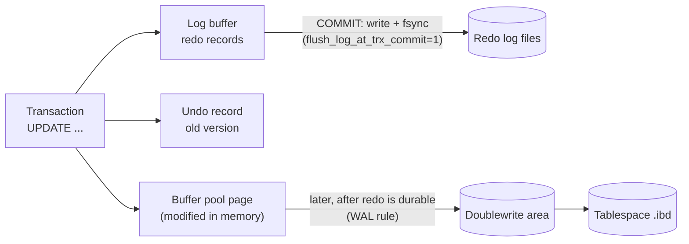

## Introduction

Every database brochure promises ACID. What a professional needs to know is **how** a specific engine keeps each promise, because that determines what the promise actually covers, what it costs, and which configuration switches quietly weaken it.

In InnoDB the four letters map to four quite different mechanisms:

| Property | Promise | InnoDB mechanism |
|---|---|---|
| **Atomicity** | All of a transaction's changes happen, or none do | **Undo log**: every change records how to reverse it |
| **Consistency** | A transaction moves the database from one valid state to another | **Constraints** (keys, foreign keys, `CHECK`, `NOT NULL`, types, strict SQL mode) plus correct application logic |
| **Isolation** | Concurrent transactions do not see each other's partial work | **MVCC** (old row versions rebuilt from undo) for reads, **locks** for writes and locking reads |
| **Durability** | Once committed, changes survive crashes | **Redo log** written ahead of data pages and **flushed to disk** at commit; the **doublewrite buffer** against torn pages |

This lesson walks through each mechanism, demonstrates what can be observed from SQL, and explains the one setting every MySQL operator must understand: `innodb_flush_log_at_trx_commit`, the dial between "every commit is on disk" and "fast, but a crash can lose the last second of commits".

:::note[Dataset]
The examples use the **bank** dataset. Its `accounts.balance` has `CHECK (balance >= 0)`, its ledger has `CHECK (amount > 0)` and foreign keys, and every account's balance equals the `balance_after` of its latest ledger row — an application-level invariant you will verify below.
:::

## DBMS Theory

:::theory[ACID, precisely]
The acronym was coined by Härder and Reuter (1983), building on Jim Gray's transaction concept:

- **Atomicity** — a transaction is an indivisible unit with respect to *failures*: the outcome is all of its effects or none.
- **Consistency** — a transaction that runs alone on a consistent database leaves it consistent. Consistency is defined by **integrity constraints**, some declared to the DBMS and some known only to the application.
- **Isolation** — the effect of concurrently running transactions equals the effect of some serial execution (the strongest form, serializability); weaker isolation levels permit specific anomalies.
- **Durability** — the effects of a committed transaction survive subsequent failures of the system (process crash, OS crash, power loss), though not necessarily destruction of the storage media — that is what backups and replication are for.
:::

Two observations from theory help avoid common misunderstandings:

1. **A, I and D are the DBMS's job; C is shared.** The database can only enforce the constraints it knows about. "The sum of all balances only changes through deposits and withdrawals" or "every balance equals the latest ledger row" are invariants of the *application*; the DBMS guarantees that a transaction which preserves them when run alone still preserves them under concurrency (thanks to I) and failure (thanks to A and D). If the transaction's logic is wrong, ACID faithfully commits the wrong result.
2. **Recovery theory needs two kinds of log information.** After a crash, the system must **undo** changes of transactions that did not commit (which may already be in data files) and **redo** changes of committed transactions (which may not yet be in data files). In the classic terminology, InnoDB is a **steal / no-force** engine: it may write uncommitted changes to disk (*steal* — so it needs undo), and it does not force data pages to disk at commit (*no-force* — so it needs redo). This is the same family of algorithms as ARIES, and it is the most common design because it gives the buffer pool maximum freedom.

:::standard[Standard SQL vs MySQL]
The SQL standard defines isolation levels and constraint semantics, but not durability mechanisms or configuration. Two MySQL behaviours deviate from the standard and matter for consistency: constraints are checked **immediately, row by row** (the standard checks non-deferred constraints at the end of each statement, and allows `DEFERRABLE` constraints checked at commit — MySQL supports neither), and `CHECK` constraints were parsed but **ignored before MySQL 8.0.16**.
:::

## Why It Exists

Without each mechanism, a specific, realistic failure occurs:

- **No undo** → a transfer that fails after the debit leaves money destroyed; a crash in the middle of a 1-million-row `UPDATE` leaves half the rows changed with no record of what they were.
- **No constraints** → a bug in one service writes a negative balance or an orphan ledger row, and every downstream report silently inherits it. Each application would have to re-implement integrity checks — and their concurrency control.
- **No isolation** → a report adding up balances while transfers run counts some money twice and some not at all; two clerks overwrite each other's updates.
- **No redo / no fsync** → the application is told "committed", the server loses power one millisecond later, and the transfer is gone. Customers and auditors call this "losing money".

Writing every changed data page to disk at commit (*force*) would also give durability, but it is extremely slow: a transaction that changes 10 rows on 10 different 16 KB pages would need 10 random writes before it could commit. A sequential, compact redo log record of those changes is a single small append. That is why write-ahead logging exists.

## Internal Working

### Atomicity — the undo log

:::internals[Undo records]
For every row change, InnoDB writes an **undo record** before (logically) changing the row:

- **Insert undo** records only the primary key — undoing an insert means deleting the row. Insert undo can be discarded right after commit, because no other transaction can need the "before" image of a row that did not exist.
- **Update undo** records the old values of the changed columns (and, for deletes, marks that the row was delete-marked). It is needed for rollback **and** for MVCC: other transactions may need to reconstruct the old version, so it is kept until **purge** decides no read view needs it.

Undo records live in **rollback segments** inside **undo tablespaces** (separate files since MySQL 8.0, with two created by default). Every clustered-index row carries two hidden columns: `DB_TRX_ID` (the ID of the transaction that last changed it) and `DB_ROLL_PTR` (a pointer to the undo record holding the previous version). Rollback follows those pointers and applies the undo records in reverse. Crucially, undo records are themselves protected by redo logging, so they survive a crash and can be used to roll back transactions that were in progress when the server died.
:::

### Consistency — constraints, checked immediately

InnoDB enforces primary keys, unique keys and foreign keys inside the storage engine; the server layer enforces `NOT NULL`, data types (strictly, under the default `STRICT_TRANS_TABLES` SQL mode) and `CHECK` constraints. All are checked **as each row is written**. If a check fails, the statement is rolled back to its internal statement savepoint — the same undo machinery that provides atomicity. Foreign-key checks also take **shared locks** on the referenced parent rows, so a parent cannot be deleted while a child insert that depends on it is in flight (you will see this kind of lock in *Locking*).

### Isolation — MVCC plus locks

Plain `SELECT`s (consistent reads) use a **read view** to decide which committed row version they may see; if the current row is too new, InnoDB follows `DB_ROLL_PTR` into the undo log and rebuilds an older version. Readers therefore never block writers and writers never block readers. Writes and locking reads (`FOR UPDATE`, `FOR SHARE`) take **row locks** that are held until the end of the transaction (strict two-phase locking), which serialises conflicting writers. The details fill the *MVCC* and *Locking* lessons; this lesson demonstrates the effect.

### Durability — redo log, WAL and fsync

:::internals[Write-ahead logging in InnoDB]
1. A change modifies the page in the **buffer pool** (memory) and produces **redo log records** describing the physical change, tagged with an ever-increasing **log sequence number (LSN)**.
2. Redo records go to the in-memory **log buffer** (`innodb_log_buffer_size`) and are written to the **redo log files** (in the `#innodb_redo` directory since 8.0.30, sized by `innodb_redo_log_capacity`).
3. **The WAL rule**: a dirty data page may be written to its tablespace only after all redo records up to that page's LSN are on disk. So at any moment, the redo log on disk describes every change that might be missing from data files.
4. **At commit**, with `innodb_flush_log_at_trx_commit = 1`, InnoDB writes the log buffer to the redo files **and calls fsync** (or equivalent) before acknowledging the commit. Concurrent committers are batched into one flush (*group commit*).
5. Dirty pages are flushed to data files later, in the background. A **checkpoint** records the LSN up to which all changes are in data files; redo older than the checkpoint can be overwritten.
6. **Crash recovery** reads the redo log from the last checkpoint and re-applies changes (redo), then rolls back transactions that had not committed, using their undo records. Transactions left in the *prepared* state by the binary-log two-phase commit are committed or rolled back depending on whether they reached the binary log (see *Transaction Logs*).
7. The **doublewrite buffer** protects against *torn pages*: a 16 KB page write interrupted by power loss may leave a page half old, half new, which redo cannot repair (redo records assume a consistent page). InnoDB first writes pages to the doublewrite area, then to their real location; on recovery a torn page is restored from its doublewrite copy.
:::



## MySQL Implementation

Most of the machinery is invisible to SQL, but its configuration and its effects are not. First, the settings that govern durability on the capture server (server-wide; a lab can read but not change them):

```sql run
SELECT @@innodb_flush_log_at_trx_commit AS flush_log_at_trx_commit,
       @@innodb_flush_log_at_timeout    AS flush_log_at_timeout_s,
       @@sync_binlog                    AS sync_binlog,
       @@innodb_doublewrite             AS doublewrite,
       @@innodb_redo_log_capacity       AS redo_log_capacity_bytes;
```

**Atomicity**: a statement that changes many rows and fails partway is undone completely, from undo records. Withdrawing 3,000.00 from every savings account fails on the first account that cannot afford it — and leaves all ten savings accounts untouched, including those that had already been debited when the failure occurred:

```sql run
SELECT COUNT(*) AS savings_accounts, SUM(balance) AS total_savings FROM accounts WHERE account_type = 'savings';
```

```sql run error
UPDATE accounts SET balance = balance - 3000.00 WHERE account_type = 'savings';
```

```sql run
SELECT COUNT(*) AS savings_accounts, SUM(balance) AS total_savings FROM accounts WHERE account_type = 'savings';
```

**Consistency**: declared constraints reject invalid states. A ledger row for a non-existent account violates the foreign key:

```sql run error
INSERT INTO transactions (account_id, txn_type, amount, balance_after, created_at)
VALUES (999, 'deposit', 10.00, 10.00, '2024-12-31 10:00:00');
```

Application invariants are not declared, so you verify them with queries. Every account's balance must equal the `balance_after` of its most recent ledger row:

```sql run
SELECT COUNT(*) AS accounts,
       SUM(a.balance = (SELECT t.balance_after FROM transactions t
                        WHERE t.account_id = a.account_id
                        ORDER BY t.created_at DESC, t.txn_id DESC LIMIT 1)) AS matching_latest_ledger_row
FROM accounts a;
```

All 25 accounts satisfy the invariant. Only transactions that update the balance **and** write the ledger row atomically keep it that way.

## Syntax Breakdown

Settings and statements related to each ACID property. "Scope" says whether a lab session can change it.

| Setting / statement | Property | Values and meaning | Scope |
|---|---|---|---|
| `innodb_flush_log_at_trx_commit` | D | `1` (default): write and flush redo at every commit. `2`: write to the OS at commit, flush about once per second. `0`: write and flush about once per second. | Global only |
| `innodb_flush_log_at_timeout` | D | Seconds between background flushes for settings 0 and 2 (default 1) | Global |
| `sync_binlog` | D | `1` (default): fsync the binary log at every commit (group). `0`: leave it to the OS. `N`: every N commit groups. | Global |
| `innodb_doublewrite` | D | `ON` (default) protects against torn pages | Global, startup |
| `innodb_redo_log_capacity` | D | Total redo log size (8.0.30+); too small forces aggressive checkpointing | Global, dynamic |
| `PRIMARY KEY`, `UNIQUE`, `FOREIGN KEY`, `CHECK`, `NOT NULL` | C | Declared constraints, checked row by row | DDL |
| `sql_mode` (`STRICT_TRANS_TABLES`) | C | Strict: invalid or out-of-range values are errors. Non-strict: silently adjusted with warnings | Session |
| `foreign_key_checks` | C | `0` disables FK checking for the session (used by dump/restore tools); existing violations are **not** re-checked later | Session |
| `ROLLBACK`, statement rollback | A | Apply undo records | — |
| Isolation level, `FOR UPDATE` / `FOR SHARE` | I | See *Isolation Levels* and *Locking* | Session |

Changing durability is a server-administration task, shown here display-only (the sandbox forbids `SET GLOBAL`):

```sql
-- Display only: server administration, not allowed in the lab
SET GLOBAL innodb_flush_log_at_trx_commit = 2;   -- faster commits; an OS crash or power loss may lose ~1 s
SET GLOBAL sync_binlog = 1;
SET PERSIST innodb_flush_log_at_trx_commit = 1;  -- keep the durable default across restarts
```

:::version[MySQL 8.4 changes relevant to durability]
MySQL 8.4 LTS changed several InnoDB defaults compared with 8.0, among them `innodb_flush_method` (now `O_DIRECT` on Linux systems that support it), `innodb_log_buffer_size` (64 MB) and `innodb_use_fdatasync` (`ON`). `innodb_flush_log_at_trx_commit = 1` and `sync_binlog = 1` remain the defaults. The capture server for this lesson is an 8.0 release, so the values in the outputs above reflect its configuration, not necessarily 8.4 defaults. Check your own server with `SELECT @@innodb_flush_method, @@innodb_log_buffer_size;`.
:::

## Practical Examples

**1. Strict SQL mode is part of consistency.** In the default strict mode, a value that does not fit is an error. With strict mode turned off for the session, MySQL silently truncates it and issues only a warning — the bad value is committed:

```sql run error
INSERT INTO branches VALUES (7, REPEAT('x', 80), 'Fremont');
```

```sql run
SET SESSION sql_mode = '';
INSERT INTO branches VALUES (7, REPEAT('x', 80), 'Fremont');
SET SESSION sql_mode = DEFAULT;
SELECT branch_id, CHAR_LENGTH(name) AS stored_name_length FROM branches WHERE branch_id = 7;
```

The 80-character name was cut to the column's 60 characters. A production server should never run with strict mode disabled.

**2. Turning off foreign-key checks lets orphans in — permanently.** `foreign_key_checks = 0` is how dump files load tables in any order. MySQL does **not** validate existing rows when the checks are turned back on:

```sql run
SET SESSION foreign_key_checks = 0;
INSERT INTO accounts (account_id, customer_id, branch_id, account_type, balance, opened_at)
VALUES (90, 999, 1, 'checking', 0.00, '2024-12-01 09:00:00');
SET SESSION foreign_key_checks = 1;
SELECT a.account_id, a.customer_id, c.customer_id AS matching_customer
FROM accounts a LEFT JOIN customers c ON c.customer_id = a.customer_id
WHERE a.account_id = 90;
```

Account 90 references customer 999, who does not exist. The database is now inconsistent, and no error will ever report it. Clean up:

```sql run
DELETE FROM accounts WHERE account_id = 90;
```

**3. Immediate, row-by-row uniqueness checking.** Shifting every key up by one is a valid statement under the SQL standard (the final state has no duplicates), but MySQL checks each row as it is updated and fails when row 1 becomes 2 while row 2 still exists:

```sql run
CREATE TABLE queue_pos (pos INT PRIMARY KEY, item VARCHAR(20));
INSERT INTO queue_pos VALUES (1, 'alpha'), (2, 'bravo'), (3, 'charlie');
```

```sql run error
UPDATE queue_pos SET pos = pos + 1;
```

```sql run
UPDATE queue_pos SET pos = pos + 1 ORDER BY pos DESC;
SELECT * FROM queue_pos ORDER BY pos;
```

The MySQL extension `ORDER BY` in `UPDATE` controls the row order so that no intermediate state collides.

**4. Atomicity for a whole transaction.** A transfer whose ledger insert fails is rolled back by the application, and undo restores the balance change that had already succeeded:

```sql run
START TRANSACTION;
UPDATE accounts SET balance = balance - 400.00 WHERE account_id = 1;
```

```sql run error
INSERT INTO transactions (account_id, txn_type, amount, balance_after, reference, created_at)
VALUES (999, 'transfer_in', 400.00, 400.00, 'TRF-BROKEN', '2024-12-31 11:00:00');
```

```sql run
ROLLBACK;
SELECT account_id, balance FROM accounts WHERE account_id = 1;
```

The foreign-key violation undid only the `INSERT`; the explicit `ROLLBACK` then applied the undo record of the debit. Account 1 is back at its original balance of 492.57.

## Execution Walkthrough

### Isolation in action

```concurrency
title: Readers see the old version; locking readers wait
description: Session A withdraws 300.00 from account 3 but has not committed. Session B reads the balance with a plain SELECT and then with a locking read.
steps:
  - session: A
    sql: START TRANSACTION; UPDATE accounts SET balance = balance - 300.00 WHERE account_id = 3;
  - session: B
    sql: START TRANSACTION; SELECT balance FROM accounts WHERE account_id = 3;
    note: A consistent read — B gets the last committed version, rebuilt from A's undo record. No lock is requested.
  - session: B
    sql: SELECT balance FROM accounts WHERE account_id = 3 FOR SHARE;
    expect: blocks
    note: A locking read must see the latest version and needs a shared lock, which conflicts with A's exclusive lock.
  - observe: locks
  - session: A
    sql: COMMIT;
    note: A's lock is released; B's locking read returns the new, committed balance.
  - session: B
    sql: SELECT balance FROM accounts WHERE account_id = 3; COMMIT;
    note: Inside the same REPEATABLE READ transaction, the plain SELECT still returns the snapshot value.
```

The lock snapshot shows A's granted `X,REC_NOT_GAP` lock on primary-key value 3 and B's `S,REC_NOT_GAP` request on the same record in state `WAITING`; B's transaction is in `LOCK WAIT`. After A commits, notice the difference within B's own transaction: the locking read returned the new balance, but the following plain `SELECT` returned the old one again — consistent reads use the snapshot, locking reads use the current version. This duality is central to the *MVCC* lesson.

### Consistency under concurrency

```concurrency
title: Two withdrawals that would overdraw an account
description: Account 1 holds 492.57. Sessions A and B each try to withdraw 400.00 concurrently.
steps:
  - session: A
    sql: START TRANSACTION; UPDATE accounts SET balance = balance - 400.00 WHERE account_id = 1;
    note: A's withdrawal succeeds inside its transaction (492.57 − 400.00 = 92.57).
  - session: B
    sql: UPDATE accounts SET balance = balance - 400.00 WHERE account_id = 1;
    expect: blocks
    note: An UPDATE reads the latest version and needs an exclusive lock — B waits for A.
  - session: A
    sql: COMMIT;
    note: A commits. B resumes and re-evaluates its UPDATE against the committed balance of 92.57.
  - session: C
    sql: SELECT account_id, balance FROM accounts WHERE account_id = 1;
    note: The final state — only one withdrawal happened.
```

B's `UPDATE`, once unblocked, failed with error 3819 (`Check constraint 'chk_accounts_balance' is violated`), because it computed `92.57 − 400.00` from the **committed** value it read after the wait, not from the 492.57 it would have seen before. Isolation (B waited instead of working on a stale value) and consistency (the `CHECK` constraint) together prevented an overdraft. Contrast this with an application that first `SELECT`s the balance, checks it in code and then writes an absolute value — that pattern is the lost update of the next lessons.

### What happens at COMMIT

```walkthrough
title: The life of one committed deposit, mapped to ACID mechanisms
steps:
  - title: "1. Begin and change"
    explain: >-
      The UPDATE takes an exclusive record lock (isolation), writes an undo record with the old balance and version
      (atomicity, MVCC), changes the page in the buffer pool and appends redo records to the log buffer (durability,
      not yet on disk).
    sql: |
      START TRANSACTION;
      UPDATE accounts SET balance = balance + 1000.00, version = version + 1 WHERE account_id = 24;
  - title: "2. Ledger row"
    explain: >-
      The INSERT is checked against the foreign key (shared lock on the parent account row), CHECK (amount > 0) and
      NOT NULL constraints (consistency), and gets an insert undo record and redo records.
    sql: |
      INSERT INTO transactions (account_id, txn_type, amount, balance_after, reference, created_at)
      SELECT account_id, 'deposit', 1000.00, balance, 'ACID-DEMO', '2024-12-31 15:00:00'
      FROM accounts WHERE account_id = 24;
  - title: "3. Commit"
    explain: >-
      Two-phase commit with the binary log; the redo log is written and flushed (setting 1), the commit is
      acknowledged, locks are released. From now on a crash cannot lose the deposit — recovery would redo it from
      the redo log if its pages had not reached the data files.
    sql: COMMIT;
  - title: "4. Invariant still holds"
    explain: The account's balance equals the balance_after of its newest ledger row — the transaction preserved the application invariant.
    sql: |
      SELECT a.account_id, a.balance, t.balance_after, t.reference
      FROM accounts a
      JOIN transactions t ON t.account_id = a.account_id
      WHERE a.account_id = 24
      ORDER BY t.created_at DESC, t.txn_id DESC
      LIMIT 1;
```

## Output

- The failed savings withdrawal left the count and total of savings balances exactly as before: one row's `CHECK` failure undid all changes the statement had already made.
- The foreign key rejected a ledger row for account 999 with error 1452; the invariant query found all 25 accounts consistent with their latest ledger row.
- In non-strict mode the 80-character branch name was stored as 60 characters with only a warning; with `foreign_key_checks = 0` an orphan account was accepted and remained undetected after the checks were re-enabled.
- `UPDATE queue_pos SET pos = pos + 1` failed with a duplicate-key error on the intermediate state, and succeeded with `ORDER BY pos DESC`.
- In the concurrency scenarios, B's plain read returned the pre-withdrawal balance while A's change was uncommitted, its locking read waited; and the second 400.00 withdrawal from account 1 failed the `CHECK` constraint after waiting, leaving a final balance of 92.57.

## Alternative Approaches

Each ACID property has engineering alternatives — places where systems deliberately relax it:

| Property | Alternative | Where it is used | What you give up |
|---|---|---|---|
| Atomicity | Application-level compensation (sagas) | Multi-service workflows where one database transaction cannot span all systems | Intermediate states are visible; compensations can fail |
| Consistency | Enforce invariants in the application only | Legacy MyISAM-era schemas, some high-write designs that drop FKs | Bugs and concurrent races create invalid data; every writer must re-implement checks |
| Consistency | Triggers or stored procedures for complex rules | Rules not expressible as CHECK/FK (e.g. per-customer limits across rows) | Harder to test; still need correct locking to be race-free |
| Isolation | Lower isolation levels (`READ COMMITTED`) | High-concurrency OLTP, most PostgreSQL/Oracle defaults | Non-repeatable reads, phantoms — see the next lessons |
| Durability | `innodb_flush_log_at_trx_commit = 2` or `0`; `sync_binlog = 0` | Bulk loads, replicas that can be rebuilt, caches, test environments | Up to about a second of committed transactions on crash (OS crash for 2, even mysqld crash for 0) |
| Durability | Synchronous/semisynchronous replication or Group Replication | HA clusters | Network round trip per commit; protects against losing a whole server, which local fsync cannot |

The durability table deserves care:

| `innodb_flush_log_at_trx_commit` | At each commit | mysqld crash | OS crash / power loss |
|---|---|---|---|
| `1` (default) | write + flush to disk | no loss | no loss (if the storage honours flushes) |
| `2` | write to OS cache | no loss | up to ~`innodb_flush_log_at_timeout` seconds of commits lost |
| `0` | nothing; background write + flush every ~second | up to ~1 s lost | up to ~1 s lost |

The manual notes that the once-per-second flush is not guaranteed to happen exactly every second, and that DDL and other internal InnoDB activity flush the log regardless of the setting. "No loss" for setting 1 also assumes the disk and controller do not lie about completed flushes — a volatile write cache without battery or capacitor protection defeats any software setting.

## Performance Analysis

Durability is where ACID costs the most. With setting 1, a commit cannot complete until the storage confirms the flush; a single-threaded workload that commits after every row is therefore limited by **flush latency**, not by CPU. Three facts shape real-world performance:

- **Group commit** amortises flushes: when many sessions commit concurrently, one flush covers all of them, so throughput scales with concurrency even at setting 1. The binary log participates in the same grouping (`binlog_order_commits`).
- **Batching** amortises flushes for a single writer: 1,000 rows per transaction costs one flush instead of 1,000.
- **Storage matters more than settings**: devices with power-loss-protected write caches complete flushes quickly; network block storage may take far longer per flush.

Undo has costs too: large transactions produce large undo, rollback is expensive, and long-running transactions prevent purge (covered in *MVCC*). Constraint checking costs index lookups — every FK check is an index probe on the parent table and a shared lock — which is why some very high-write systems drop FKs, accepting the consistency risk.

:::performance[Theory vs measurement]
The impact of flush settings is real but entirely hardware-dependent; this lesson deliberately shows no numbers. To quantify it, run the same write workload (for example `sysbench oltp_write_only`) on your own hardware with setting 1 and 2, and compare commits per second and p99 latency. Then decide whether the gain is worth losing up to a second of commits on power failure. The sandbox cannot change global settings, so this experiment is for your own server.
:::

## Best Practices

:::best-practice[Keeping ACID intact in production]
1. **Keep `innodb_flush_log_at_trx_commit = 1` and `sync_binlog = 1` on any primary that holds data you cannot recreate.** Relax them only on systems you can rebuild (replicas you can reclone, ephemeral analytics copies, bulk-load windows) and document the decision.
2. **Declare every invariant you can**: primary keys, foreign keys, `NOT NULL`, `CHECK`, appropriate types. Each one is a bug the database will catch for every writer, forever.
3. **Keep strict SQL mode on**; never let an application session set `sql_mode = ''`.
4. **Use `foreign_key_checks = 0` only for trusted restores**, and verify referential integrity afterwards with anti-join queries.
5. **Verify application invariants with scheduled queries** (balances vs ledger, sum of debits = sum of credits) — reconciliation jobs are the safety net for constraints the database cannot express.
6. **Make transactions short**, so undo stays small, locks are held briefly, and purge keeps up.
7. **Trust but verify the hardware**: confirm that storage write caches are power-loss protected before relying on fsync for durability.
:::

## Common Mistakes

**Mistake 1 — believing "ACID" means the application's rules are enforced.** The database committed every statement it was given. If the application reads a balance, checks it in code, and writes an absolute value, two concurrent requests can both pass the check — a lost update that no constraint catches unless the invariant is declared (here, `CHECK (balance >= 0)` would catch an overdraft but not a lost deposit).

**Mistake 2 — setting `innodb_flush_log_at_trx_commit = 2` "for performance" on the primary** without recognising that an OS crash or power cut can lose acknowledged commits — and with replication, a replica may have received transactions the recovered primary no longer has.

**Mistake 3 — relying on CHECK constraints on old servers.** Before 8.0.16, `CHECK` was parsed and ignored. Schemas migrated from 5.7 may contain data that violates constraints added later — `ALTER TABLE … ADD CONSTRAINT … CHECK` validates existing rows and fails if any violate it:

```sql run error
ALTER TABLE accounts ADD CONSTRAINT chk_min_balance CHECK (balance >= 200);
```

**Mistake 4 — assuming constraints are checked at the end of the statement or transaction.** MySQL checks row by row (Example 3). Swaps and shifts of unique values need an explicit `ORDER BY`, a temporary value, or a two-step update.

**Mistake 5 — confusing durability with backup.** A committed transaction survives a crash; it does not survive `DROP TABLE`, a bad migration, or a failed disk. Durability is not a replacement for backups and point-in-time recovery (Module 11).

## Industry Application

- **Financial systems** run with full durability (1/1) and add replication for media failure, with reconciliation jobs that check ledger invariants daily. Regulatory audits ask exactly the questions in this lesson: what happens to an acknowledged transaction on power loss?
- **Cloud managed MySQL** (Amazon RDS/Aurora, Google Cloud SQL, Azure Database for MySQL) default to durable settings; Aurora replaces InnoDB's local redo/doublewrite path with a distributed storage layer that acknowledges commits after a quorum of storage nodes has the log records — the same WAL principle, implemented differently.
- **Bulk loading and migrations** temporarily relax durability on a dedicated host (or disable redo logging with `ALTER INSTANCE DISABLE INNODB REDO_LOG`, which MySQL documents as suitable only for loading data into a new instance), then restore defaults before taking traffic.
- **Microservice architectures** lose cross-service atomicity and reintroduce it with the transactional outbox and sagas (Module 12) — but each service's local transaction still relies on exactly the InnoDB mechanisms described here.

## Practice Exercises

```exercise
id: ex1
title: Verify the ledger invariant
difficulty: easy
concepts: [consistency]
prompt: |
  Return **one row** with two columns: `consistent_accounts` — the number of accounts whose `balance` equals the
  `balance_after` of their most recent ledger row (latest `created_at`, ties broken by highest `txn_id`), and
  `inconsistent_accounts` — the number whose balance does not.
hints:
  - "A correlated subquery with ORDER BY created_at DESC, txn_id DESC LIMIT 1 returns the latest balance_after for an account."
  - "SUM(condition) counts rows where the condition is true; SUM(NOT condition) or COUNT(*) − SUM(condition) counts the rest."
solution: |
  SELECT SUM(x.ok) AS consistent_accounts, COUNT(*) - SUM(x.ok) AS inconsistent_accounts
  FROM (
    SELECT a.balance = (SELECT t.balance_after FROM transactions t
                        WHERE t.account_id = a.account_id
                        ORDER BY t.created_at DESC, t.txn_id DESC LIMIT 1) AS ok
    FROM accounts a
  ) x;
explanation: |
  This is the kind of reconciliation query production systems run on a schedule, because the invariant is known
  only to the application. A window-function version (ROW_NUMBER() OVER (PARTITION BY account_id ORDER BY
  created_at DESC, txn_id DESC)) works too. Forgetting the tie-breaker can pick the wrong row when two ledger rows
  share a timestamp.
```

```exercise
id: ex2
title: Make room at the front of the queue
difficulty: medium
kind: dml
concepts: [consistency, constraints]
setup: |
  CREATE TABLE queue_pos (pos INT PRIMARY KEY, item VARCHAR(20));
  INSERT INTO queue_pos VALUES (1, 'alpha'), (2, 'bravo'), (3, 'charlie'), (4, 'delta');
prompt: |
  Shift every item in `queue_pos` back by one position (pos 1 → 2, 2 → 3, …), then insert `(1, 'urgent')`.
  A plain `UPDATE queue_pos SET pos = pos + 1` fails in MySQL — make it work.
hints:
  - "MySQL checks the primary key row by row, so the order in which rows are updated matters."
  - "UPDATE … ORDER BY pos DESC updates the highest position first."
solution: |
  UPDATE queue_pos SET pos = pos + 1 ORDER BY pos DESC;
  INSERT INTO queue_pos VALUES (1, 'urgent');
check: |
  SELECT pos, item FROM queue_pos ORDER BY pos;
explanation: |
  Updating from the top down means no intermediate state ever contains a duplicate. The SQL standard would accept
  the unordered update because it checks constraints at statement end; MySQL's immediate row-by-row checking is a
  documented deviation, and `ORDER BY` in a single-table UPDATE is the MySQL-specific fix. Another portable fix is a
  two-step update through negative values: `SET pos = -pos - 1`, then `SET pos = -pos`.
```

```exercise
id: ex3
title: Declare the closed-account rule
difficulty: medium
kind: dml
concepts: [consistency, constraints]
prompt: |
  The bank's rule is: **a closed account must have a zero balance.** Add a CHECK constraint named
  `chk_closed_zero_balance` to `accounts` that enforces this rule. (All existing rows already satisfy it.)
hints:
  - "Express 'if closed then balance = 0' as a boolean without IF: NOT closed OR balance = 0."
  - "ALTER TABLE accounts ADD CONSTRAINT chk_closed_zero_balance CHECK (…);"
solution: |
  ALTER TABLE accounts ADD CONSTRAINT chk_closed_zero_balance CHECK (status <> 'closed' OR balance = 0);
check: |
  SELECT CONSTRAINT_NAME, CONSTRAINT_TYPE
  FROM information_schema.TABLE_CONSTRAINTS
  WHERE TABLE_SCHEMA = DATABASE() AND TABLE_NAME = 'accounts' AND CONSTRAINT_TYPE = 'CHECK'
  ORDER BY CONSTRAINT_NAME;
explanation: |
  The implication "closed → balance = 0" is equivalent to "not closed, or balance = 0". MySQL validated every
  existing row while adding the constraint; had account 12 held money, the ALTER would have failed with error 3819.
  From now on every writer — any application, any ad-hoc session — is held to the rule, which is the whole point
  of declaring invariants rather than coding them in one service.
```

```exercise
id: ex4
title: Choose durability settings
difficulty: hard
kind: open
concepts: [durability, innodb-flush-log-at-trx-commit]
prompt: |
  For each system, choose `innodb_flush_log_at_trx_commit` and `sync_binlog`, and justify the choice in terms
  of what can be lost and when:

  1. The primary database of a payments service.
  2. A read replica used only for analytics dashboards, which can be re-cloned from the primary in 30 minutes.
  3. A one-off server used for a 6-hour initial data load into a brand-new schema, before any traffic.
solution: |
  1. **Payments primary: 1 and 1.** Every acknowledged commit must survive mysqld crash, OS crash and power loss.
     The binary log must also be durable, or after a crash the binary log (and therefore replicas and
     point-in-time recovery) could disagree with InnoDB about which transactions committed. Throughput comes from
     group commit, fast storage with power-loss protection and batching, not from relaxing durability.
  2. **Analytics replica: 2 (or even 0) with sync_binlog = 0** is defensible. A crash may lose up to about a second
     of applied replication events, but with GTID-based replication and crash-safe replica metadata the replica
     can usually resume, and in the worst case it is re-cloned. Faster apply reduces replication lag. Document it,
     and never promote this replica to primary without restoring durable settings.
  3. **Initial load: 0 or 2 with sync_binlog = 0** (or disable the binary log for the load, or even
     `ALTER INSTANCE DISABLE INNODB REDO_LOG`, which the manual restricts to loading a new instance). If the server
     crashes, simply restart the load. Restore 1/1 (and re-enable redo logging) before production traffic.
```

```exercise
id: ex5
title: Trace a crash
difficulty: challenge
kind: open
concepts: [atomicity, durability, undo-log, redo-log]
prompt: |
  With `innodb_flush_log_at_trx_commit = 1`, three transactions are running when the power fails:

  - **T1** committed (the client received OK) 2 ms before the failure; its modified pages are still only in the buffer pool.
  - **T2** has updated 50,000 rows and not committed; some of its modified pages were already flushed to the data files by the page cleaner.
  - **T3** has issued COMMIT; the server crashed during the commit, after InnoDB's prepare step but before the transaction was written to the binary log.

  Describe precisely what InnoDB does with each transaction during crash recovery, naming the log used for each step.
solution: |
  Recovery starts by reading the **redo log** from the last checkpoint and re-applying all changes to pages (redo
  phase) — including changes of uncommitted transactions and changes to undo pages themselves.

  - **T1**: its redo records (including the commit) were flushed before the client got OK. Redo replay brings its
    modified pages up to date in the data files. T1 is durable — no loss.
  - **T2**: redo replay restores the pages (including the ones already flushed) to the state at the crash, including
    its undo records. T2 has no commit record, so it is an active transaction at the end of redo; InnoDB **rolls it
    back using its undo log** (in the background after startup for large transactions). The flushed pages
    ("steal") are corrected by that rollback. Atomicity is preserved.
  - **T3**: it is in the **prepared** state in InnoDB. The server consults the **binary log**: because T3's events
    never reached the binary log, the server tells InnoDB to roll it back. (Had it been fully written to the binary
    log, recovery would commit it so InnoDB and the binary log — and therefore replicas — agree.) The client never
    got OK for T3, so rolling it back breaks no promise.
```

## Knowledge Assessment

```quiz
- id: q1
  question: "Which InnoDB structure is used both to roll back a transaction and to give other transactions an older version of a row?"
  options: ["The redo log", "The undo log", "The doublewrite buffer", "The binary log"]
  answer: 1
  explanation: "Update undo records hold old column values: rollback applies them, and MVCC reads follow DB_ROLL_PTR into them to rebuild old versions. The redo log replays changes for durability, the doublewrite buffer repairs torn pages, and the binary log records changes for replication and point-in-time recovery."
  concepts: [undo-log, atomicity, isolation]
- id: q2
  question: "With `innodb_flush_log_at_trx_commit = 2`, which failure can lose transactions that were acknowledged as committed?"
  options: ["A mysqld crash only", "An operating-system crash or power loss", "Neither — setting 2 is fully durable", "Only a disk failure"]
  answer: 1
  explanation: "Setting 2 writes the redo log to the OS at each commit but flushes to disk about once per second. If only mysqld crashes, the OS still has the data; an OS crash or power loss can lose up to about a second of commits. Setting 0 can lose commits even on a mysqld crash; disk failure is outside durability's scope altogether."
  concepts: [durability, innodb-flush-log-at-trx-commit]
- id: q3
  question: "Why is InnoDB described as a 'steal / no-force' engine, and what does that imply?"
  options:
    - "It steals locks from idle sessions and never forces commits, so it needs no logs"
    - "It may write uncommitted changes to data files (needs undo) and does not force data pages to disk at commit (needs redo)"
    - "It forces every page to disk at commit, so it needs only undo"
    - "It steals buffer pool pages from other engines, so it needs the doublewrite buffer"
  answer: 1
  explanation: "Steal = dirty pages of uncommitted transactions may be flushed, so recovery must undo them. No-force = commit does not wait for data pages, so recovery must redo committed changes from the log. A force engine would need no redo but would be far slower."
  concepts: [undo-log, redo-log, durability]
- id: q4
  question: "Which statements about consistency in MySQL 8.4 are true? (Select all that apply.)"
  type: multi
  options:
    - "CHECK constraints are enforced"
    - "Foreign keys can be declared DEFERRABLE to be checked at commit"
    - "Uniqueness is checked row by row, so `UPDATE t SET id = id + 1` can fail on intermediate duplicates"
    - "Turning foreign_key_checks back on validates rows inserted while it was off"
    - "Application invariants such as 'balance equals latest ledger row' must be maintained by correct transactions"
  answer: [0, 2, 4]
  explanation: "CHECK is enforced since 8.0.16. MySQL has no DEFERRABLE constraints. Row-by-row checking makes the unordered shift fail. Re-enabling foreign_key_checks does not re-check existing rows. Invariants the database does not know about are the application's responsibility."
  concepts: [consistency, constraints]
- id: q5
  question: "Session A has updated account 3 without committing. Session B (REPEATABLE READ) runs a plain SELECT of account 3, then `SELECT … FOR SHARE`. What happens?"
  options:
    - "Both reads block until A commits"
    - "The plain SELECT returns the old committed value immediately; the FOR SHARE read waits for A's lock"
    - "Both return A's uncommitted value"
    - "The plain SELECT waits; FOR SHARE returns immediately"
  answer: 1
  explanation: "Consistent reads use MVCC and take no locks, so they return the last committed version. Locking reads need an S lock on the current version, which conflicts with A's X lock — exactly what the captured scenario shows. Uncommitted values are only visible at READ UNCOMMITTED."
  concepts: [isolation]
- id: q6
  question: "What problem does the doublewrite buffer solve?"
  options:
    - "Lost commits when the redo log is not flushed"
    - "Torn (partially written) data pages after a power failure, which redo records cannot repair"
    - "Replication lag on replicas"
    - "Duplicate rows caused by retries"
  answer: 1
  explanation: "A 16 KB page write interrupted mid-way leaves an inconsistent page; redo assumes a consistent page to apply changes to. The doublewrite copy allows the page to be restored first. Commit durability is the redo log's job, and the other options are unrelated."
  concepts: [durability]
- id: q7
  question: "Two sessions each withdraw 400.00 from an account holding 492.57 with `UPDATE accounts SET balance = balance - 400 WHERE account_id = 1`. The table has `CHECK (balance >= 0)`. What is the outcome?"
  options:
    - "Both succeed and the balance becomes −307.43"
    - "Both succeed because each read 492.57 before writing"
    - "The second UPDATE waits for the first to commit, re-reads 92.57, and fails the CHECK constraint"
    - "The second UPDATE fails immediately with a deadlock"
  answer: 2
  explanation: "UPDATE is a locking (current) read: B waits for A's row lock, then evaluates balance − 400 against the committed 92.57, violating the CHECK — as captured in this lesson. A negative balance is impossible with the constraint, stale reads do not apply to UPDATE's current read, and no deadlock cycle exists."
  concepts: [consistency, isolation]
```
