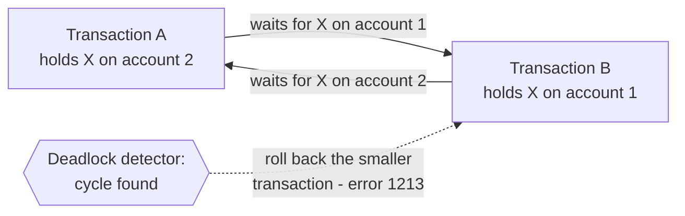

## Introduction

Two clerks transfer money at the same moment: one from account 1 to account 2, the other from account 2 to account 1. Each locks its source account, then reaches for its destination — which the other already holds. Neither can proceed, and neither will ever release its lock by waiting longer. This is a **deadlock**.

Deadlocks are not bugs in MySQL; they are a normal consequence of transactions that lock resources incrementally. Every lock-based database has them, and InnoDB handles them automatically: it **detects** the cycle within moments, **chooses a victim**, rolls that transaction back with error **1213**, and lets the others continue. The professional's job is therefore twofold:

1. **Prevent** most deadlocks by design — consistent lock ordering, short transactions, good indexes, avoiding lock upgrades and gap-lock "reservations".
2. **Handle** the remainder correctly — every transaction that can deadlock must be retried as a whole by the application.

This lesson reproduces the most common deadlock patterns on real sessions, explains InnoDB's detection and victim selection, walks through a real `LATEST DETECTED DEADLOCK` report, contrasts deadlocks with lock-wait timeouts (error 1205), and builds a correct retry strategy.

:::note[Dataset]
The scenarios use the **bank** dataset (account 1 holds 492.57, account 2 holds 4428.20) and, for one pattern, a small table created in the scenario's setup. Sessions A, B and C are real concurrent connections at REPEATABLE READ.
:::

## DBMS Theory

:::theory[Deadlock and the wait-for graph]
A **deadlock** is a state in which each transaction in a set {T₁, …, Tₙ} waits for a lock held by another transaction in the set, so none can ever proceed. Coffman et al. (1971) showed four conditions are necessary: **mutual exclusion** (locks are exclusive), **hold and wait** (a transaction holds locks while requesting more), **no preemption** (locks cannot be taken away), and **circular wait**.

The **wait-for graph** (WFG) has a node per transaction and an edge Tᵢ → Tⱼ when Tᵢ waits for a lock held by Tⱼ. A deadlock exists **if and only if** the WFG contains a cycle.
:::

Database systems choose among three strategies:

| Strategy | How | Trade-off |
|---|---|---|
| **Prevention** | Break a Coffman condition by protocol: acquire all locks up front (no hold-and-wait), or order resources and lock in that order (no circular wait); timestamp schemes such as *wait-die* and *wound-wait* abort transactions that might form a cycle | Pre-declaring locks is impractical for ad-hoc SQL; timestamp schemes abort transactions that would never have deadlocked |
| **Detection and recovery** | Let cycles form, detect them in the WFG, abort a **victim** to break the cycle | Wasted work of the victim; requires the application to retry |
| **Timeout** | Abort any transaction that waits longer than a threshold | Cannot distinguish a deadlock from a long wait; slow to resolve real deadlocks; may abort innocent long waiters |

InnoDB uses **detection** (enabled by default) **plus a timeout** as a backstop. Applications additionally use **prevention by lock ordering** in their own code.

**Victim selection** aims to minimise wasted work and avoid starvation. Common criteria: the transaction that has done the least work (fewest locks or log records), the youngest, or the one closest to completing; a transaction repeatedly chosen as victim should eventually be protected.

:::standard[Standard SQL vs MySQL]
The SQL standard defines the SQLSTATE class **40** "transaction rollback", with **40001** "serialization failure" — the state MySQL returns for a deadlock (error 1213, `ER_LOCK_DEADLOCK`). How deadlocks are detected, which victim is chosen, error 1205 (`ER_LOCK_WAIT_TIMEOUT`, SQLSTATE HY000), and the variables `innodb_deadlock_detect`, `innodb_lock_wait_timeout` and `innodb_print_all_deadlocks` are MySQL/InnoDB specifics.
:::

## Why It Exists

Deadlocks exist because InnoDB acquires locks **incrementally**, as statements run, rather than all at once — which is exactly what makes ordinary SQL transactions possible. A transaction cannot know at `START TRANSACTION` which rows its later statements will touch (they may depend on earlier results). Holding locks while acquiring more ("hold and wait") is inherent; so is exclusivity; and InnoDB never preempts a granted lock. That leaves circular wait as the only condition applications can realistically break, and the reason detection is necessary: without it, a deadlocked set of transactions would wait until `innodb_lock_wait_timeout` (50 seconds by default) — holding every lock they own, blocking everyone queued behind them.

Detection turns a 50-second stall into a near-instant error for one transaction. The price is that **a deadlock is visible to the application as an error**, and correct code must be prepared for it at any statement that takes locks. "We never get deadlocks" usually means either very low concurrency, or deadlocks that are being swallowed and lost.

## Internal Working

:::internals[How InnoDB detects and resolves deadlocks]
- **Detection.** With `innodb_deadlock_detect = ON` (the default), InnoDB examines the wait-for relationships whenever transactions wait for row locks and recognises a cycle almost immediately — in every scenario in this lesson, the victim received its error in the same step that closed the cycle. Only **InnoDB row and table locks** are considered; metadata locks and `GET_LOCK()` waits are handled by the server, and table locks taken with `LOCK TABLES` are detected only when `innodb_table_locks = 1` and `autocommit = 0`.
- **Victim selection.** The manual states that InnoDB tries to pick **small** transactions to roll back, where size is determined by the number of rows inserted, updated or deleted. The victim is not necessarily the transaction whose request closed the cycle — you will see a deadlock in which the *first* waiter is chosen because it had changed fewer rows.
- **Resolution.** The victim's **entire transaction is rolled back** (not just the statement), its locks are released, and its current statement returns **error 1213** (`Deadlock found when trying to get lock; try restarting transaction`). The other transactions' pending lock requests can now be granted. The victim's session is back in autocommit mode with no open transaction.
- **Reporting.** Information about the most recent deadlock is kept in memory and shown in the `LATEST DETECTED DEADLOCK` section of `SHOW ENGINE INNODB STATUS` (it is overwritten by the next deadlock). With `innodb_print_all_deadlocks = ON`, every deadlock is also written to the error log. The global counter `lock_deadlocks` in `INFORMATION_SCHEMA.INNODB_METRICS` counts them.
- **Timeout backstop.** A transaction waiting longer than `innodb_lock_wait_timeout` seconds receives **error 1205**. By default (`innodb_rollback_on_timeout = OFF`) only the **waiting statement** is rolled back; the transaction and its other locks remain.
- **Disabling detection.** On systems with very many threads waiting for the same lock, detection itself can become costly; `innodb_deadlock_detect = OFF` then relies solely on `innodb_lock_wait_timeout` (which should be set low, for example a few seconds). This is an unusual, measured decision, not a default.
:::



## MySQL Implementation

There is nothing to "turn on" — detection runs by default. What you can inspect and control from a session:

```sql run
SELECT @@innodb_deadlock_detect      AS deadlock_detect,
       @@innodb_lock_wait_timeout    AS lock_wait_timeout_s,
       @@innodb_rollback_on_timeout  AS rollback_on_timeout,
       @@innodb_print_all_deadlocks  AS print_all_deadlocks;
```

`innodb_lock_wait_timeout` can be set per session — useful for interactive or latency-sensitive paths:

```sql run
SET SESSION innodb_lock_wait_timeout = 5;
SELECT @@SESSION.innodb_lock_wait_timeout AS my_timeout_s;
SET SESSION innodb_lock_wait_timeout = DEFAULT;
```

The other settings are global and require administrative privileges (display-only here):

```sql
-- Display only: server administration
SET GLOBAL innodb_print_all_deadlocks = ON;     -- log every deadlock to the error log
SET GLOBAL innodb_deadlock_detect = OFF;        -- rare; rely on a low innodb_lock_wait_timeout instead
SHOW ENGINE INNODB STATUS;                       -- requires PROCESS; see LATEST DETECTED DEADLOCK
SELECT NAME, COUNT FROM information_schema.INNODB_METRICS WHERE NAME = 'lock_deadlocks';
```

### Reading a real deadlock report

The report below was captured on the build server (MySQL 8.0.46) with an administrator account, after reproducing the opposite-order transfer deadlock in a scratch database `bank_demo` (table `accounts(account_id INT PRIMARY KEY, balance DECIMAL(14,2))`). Transaction (1) had debited account 2 and was crediting account 1; transaction (2) had debited account 1 and was crediting account 2.

```text
------------------------
LATEST DETECTED DEADLOCK
------------------------
2026-11-08 21:25:16 139804026156736
*** (1) TRANSACTION:
TRANSACTION 156938, ACTIVE 1 sec starting index read
mysql tables in use 1, locked 1
LOCK WAIT 3 lock struct(s), heap size 1128, 2 row lock(s), undo log entries 1
MySQL thread id 883, OS thread handle 139804341622464, query id 50564 localhost root updating
UPDATE accounts SET balance = balance + 100 WHERE account_id = 1

*** (1) HOLDS THE LOCK(S):
RECORD LOCKS space id 6489 page no 4 n bits 72 index PRIMARY of table `bank_demo`.`accounts` trx id 156938 lock_mode X locks rec but not gap
Record lock, heap no 3 PHYSICAL RECORD: n_fields 4; compact format; info bits 0
 0: len 4; hex 80000002; asc     ;;
 1: len 6; hex 00000002650a; asc     e ;;
 2: len 7; hex 020000014913cc; asc     I  ;;
 3: len 7; hex 8000000010e814; asc        ;;


*** (1) WAITING FOR THIS LOCK TO BE GRANTED:
RECORD LOCKS space id 6489 page no 4 n bits 72 index PRIMARY of table `bank_demo`.`accounts` trx id 156938 lock_mode X locks rec but not gap waiting
Record lock, heap no 2 PHYSICAL RECORD: n_fields 4; compact format; info bits 0
 0: len 4; hex 80000001; asc     ;;
 1: len 6; hex 00000002650b; asc     e ;;
 2: len 7; hex 01000000e10151; asc       Q;;
 3: len 7; hex 8000000001ba39; asc       9;;


*** (2) TRANSACTION:
TRANSACTION 156939, ACTIVE 1 sec starting index read
mysql tables in use 1, locked 1
LOCK WAIT 3 lock struct(s), heap size 1128, 2 row lock(s), undo log entries 1
MySQL thread id 884, OS thread handle 139803737642688, query id 50565 localhost root updating
UPDATE accounts SET balance = balance + 50 WHERE account_id = 2

*** (2) HOLDS THE LOCK(S):
RECORD LOCKS space id 6489 page no 4 n bits 72 index PRIMARY of table `bank_demo`.`accounts` trx id 156939 lock_mode X locks rec but not gap
Record lock, heap no 2 PHYSICAL RECORD: n_fields 4; compact format; info bits 0
 0: len 4; hex 80000001; asc     ;;
 1: len 6; hex 00000002650b; asc     e ;;
 2: len 7; hex 01000000e10151; asc       Q;;
 3: len 7; hex 8000000001ba39; asc       9;;


*** (2) WAITING FOR THIS LOCK TO BE GRANTED:
RECORD LOCKS space id 6489 page no 4 n bits 72 index PRIMARY of table `bank_demo`.`accounts` trx id 156939 lock_mode X locks rec but not gap waiting
Record lock, heap no 3 PHYSICAL RECORD: n_fields 4; compact format; info bits 0
 0: len 4; hex 80000002; asc     ;;
 1: len 6; hex 00000002650a; asc     e ;;
 2: len 7; hex 020000014913cc; asc     I  ;;
 3: len 7; hex 8000000010e814; asc        ;;

*** WE ROLL BACK TRANSACTION (2)
```

How to read it:

- **The statements** each transaction was running when the deadlock was detected are shown — but **not** the earlier statements that acquired the held locks. You often have to infer those from application code (or from `performance_schema.events_statements_history`).
- **`lock_mode X locks rec but not gap`** is the report's wording for `X,REC_NOT_GAP` in `data_locks`. Other wordings: `lock_mode X` (next-key), `lock_mode X locks gap before rec` (gap), `lock_mode X locks gap before rec insert intention`, `lock mode S`.
- **The record dump** lists the physical fields of the clustered-index record: field 0 is the primary key (`80000002` is the integer 2 — InnoDB stores signed integers with the sign bit flipped so that they sort correctly as bytes), field 1 is the hidden **`DB_TRX_ID`** (`0x2650a` = 156938, the transaction that last modified the row — transaction (1) itself), field 2 is the hidden **`DB_ROLL_PTR`**, and field 3 is the `balance` column in InnoDB's binary DECIMAL format.
- So: (1) holds account 2 and waits for account 1; (2) holds account 1 and waits for account 2 — a two-node cycle. Both had changed one row (`undo log entries 1`); InnoDB rolled back (2).

## Syntax Breakdown

| Item | Meaning |
|---|---|
| Error **1213** `ER_LOCK_DEADLOCK`, SQLSTATE **40001** | You were the deadlock victim; your **whole transaction** was rolled back. Retry the transaction from the beginning. |
| Error **1205** `ER_LOCK_WAIT_TIMEOUT`, SQLSTATE HY000 | You waited longer than `innodb_lock_wait_timeout`. Only the **statement** was rolled back (default); you are still in the transaction and still hold your other locks. Usually: `ROLLBACK`, then retry. |
| Error **3572** `ER_LOCK_NOWAIT` | A `NOWAIT` locking read found a locked row. Nothing waited. |
| `innodb_deadlock_detect` | Global, default `ON`. |
| `innodb_lock_wait_timeout` | Global/session, default 50 s, applies to row-lock waits. |
| `innodb_rollback_on_timeout` | Startup option, default `OFF`; `ON` makes 1205 roll back the whole transaction. |
| `innodb_print_all_deadlocks` | Global, default `OFF`; `ON` logs every deadlock to the error log. |
| `lock_wait_timeout` | Metadata-lock wait limit (server layer), default one year. |
| `SHOW ENGINE INNODB STATUS` | `LATEST DETECTED DEADLOCK` section (PROCESS privilege). |
| `INFORMATION_SCHEMA.INNODB_METRICS` `lock_deadlocks` | Count of deadlocks since startup (PROCESS privilege). |

## Practical Examples

### 1. The classic: opposite lock order

```concurrency
title: Two transfers in opposite directions deadlock
description: A transfers 100.00 from account 2 to account 1; B transfers 50.00 from account 1 to account 2. Each debits its source first.
steps:
  - session: A
    sql: START TRANSACTION; UPDATE accounts SET balance = balance - 100.00 WHERE account_id = 2;
    note: A holds X on account 2.
  - session: B
    sql: START TRANSACTION; UPDATE accounts SET balance = balance - 50.00 WHERE account_id = 1;
    note: B holds X on account 1.
  - session: A
    sql: UPDATE accounts SET balance = balance + 100.00 WHERE account_id = 1;
    expect: blocks
    note: A waits for B (edge A → B in the wait-for graph).
  - observe: locks
  - session: B
    sql: UPDATE accounts SET balance = balance + 50.00 WHERE account_id = 2;
    expect: error
    errorCode: 1213
    note: B would wait for A (edge B → A) — a cycle. InnoDB rolls B back immediately; A's UPDATE proceeds.
  - session: B
    sql: SELECT account_id, balance FROM accounts WHERE account_id IN (1, 2) ORDER BY account_id;
    note: B's earlier debit of account 1 is gone — the whole transaction was rolled back. A's work is not yet committed, so B sees the original balances.
  - session: A
    sql: COMMIT; SELECT account_id, balance FROM accounts WHERE account_id IN (1, 2) ORDER BY account_id;
    note: Only A's transfer happened. B must retry its transfer.
```

The snapshot just before the cycle closed shows A holding `X,REC_NOT_GAP` on account 2 and waiting (`WAITING`, transaction state `LOCK WAIT`) for `X,REC_NOT_GAP` on account 1, which B holds. When B requested account 2, the detector found the cycle and rolled back B, the transaction whose request closed it — both had changed one row. B's follow-up `SELECT` shows account 1 back at 492.57: its debit was undone. After A's commit the balances are 592.57 and 4328.20 — A's transfer only.

### 2. The victim is the smaller transaction, not the last one in

```concurrency
title: Victim selection by transaction size
description: A updates four accounts (1, 3, 4, 5); B updates one (2). B then waits for A, and finally A requests B's row, closing the cycle.
steps:
  - session: A
    sql: START TRANSACTION; UPDATE accounts SET version = version + 1 WHERE account_id IN (1, 3, 4, 5);
  - session: B
    sql: START TRANSACTION; UPDATE accounts SET version = version + 1 WHERE account_id = 2;
  - session: B
    sql: UPDATE accounts SET version = version + 1 WHERE account_id = 1;
    expect: error
    errorCode: 1213
    note: B waits for A's lock on account 1 — and is later chosen as the victim.
  - session: A
    sql: UPDATE accounts SET version = version + 1 WHERE account_id = 2;
    note: A closes the cycle, yet A survives — its request is granted once B is rolled back.
  - session: A
    sql: SELECT account_id, version FROM accounts WHERE account_id <= 5 ORDER BY account_id; COMMIT;
```

This time the transaction that **closed** the cycle (A) was not the victim. A had modified four rows, B one; InnoDB rolled back the smaller transaction, B, whose waiting statement then returned 1213, and A's request for account 2 was granted. All five accounts end with version 1 — every one updated by A alone. Never assume which session will be the victim: any participant in a cycle can receive 1213.

### 3. Lock upgrade on a single row

```concurrency
title: Two FOR SHARE readers both try to update the same row
description: A and B read account 4 with FOR SHARE (to check its balance), then each withdraws.
steps:
  - session: A
    sql: START TRANSACTION; SELECT balance FROM accounts WHERE account_id = 4 FOR SHARE;
  - session: B
    sql: START TRANSACTION; SELECT balance FROM accounts WHERE account_id = 4 FOR SHARE;
    note: Shared locks are compatible — both readers hold S on account 4.
  - session: A
    sql: UPDATE accounts SET balance = balance - 100.00 WHERE account_id = 4;
    expect: blocks
    note: A needs X, which conflicts with B's S.
  - session: B
    sql: UPDATE accounts SET balance = balance - 200.00 WHERE account_id = 4;
    expect: error
    errorCode: 1213
    note: B needs X, which conflicts with A's S — while A waits for B. Deadlock on one row.
  - session: A
    sql: COMMIT; SELECT balance FROM accounts WHERE account_id = 4;
```

One row is enough for a deadlock when two transactions **upgrade** shared locks to exclusive. A's withdrawal went through (7946.37 → 7846.37); B was rolled back. The fix is to request the lock you will eventually need: `FOR UPDATE` instead of `FOR SHARE` when the read is followed by a write. Then B's read would simply wait for A.

### 4. "Reserving" a missing key with FOR UPDATE

```concurrency
title: Gap locks plus inserts — the check-then-insert deadlock
description: Two requests create branch 50. Each first checks that it does not exist with FOR UPDATE, then inserts it.
steps:
  - session: A
    sql: START TRANSACTION; SELECT * FROM branches WHERE branch_id = 50 FOR UPDATE;
    note: Empty result; A locks the gap where 50 would go.
  - session: B
    sql: START TRANSACTION; SELECT * FROM branches WHERE branch_id = 50 FOR UPDATE;
    note: Also empty; gap locks are compatible, so B gets the same gap lock.
  - session: A
    sql: INSERT INTO branches VALUES (50, 'Kiosk A', 'Palo Alto');
    expect: blocks
    note: A's insert-intention lock conflicts with B's gap lock.
  - observe: locks
  - session: B
    sql: INSERT INTO branches VALUES (50, 'Kiosk B', 'Palo Alto');
    expect: error
    errorCode: 1213
    note: B's insert-intention lock conflicts with A's gap lock — cycle.
  - session: A
    sql: COMMIT; SELECT * FROM branches WHERE branch_id = 50;
```

Because 50 is larger than every existing `branch_id`, the gap in question is the one before the **supremum** pseudo-record. The snapshot shows both A and B holding `X` on the supremum (a next-key lock on the supremum, which covers only the gap because the supremum is not a real row) and A waiting with `X,INSERT_INTENTION` on it. B's insert closed the cycle and B was rolled back. The "safety check" caused the deadlock; a plain `INSERT` with duplicate-key handling would have produced a clean error 1062 for the loser instead.

### 5. Three sessions inserting the same key

```concurrency
title: Duplicate-key waits turn into a deadlock when the first inserter rolls back
description: A inserts key 1 without committing. B and C insert the same key and wait. Then A rolls back.
dataset: empty
setup: |
  CREATE TABLE coupons (code INT PRIMARY KEY);
steps:
  - session: A
    sql: START TRANSACTION; INSERT INTO coupons VALUES (1);
  - session: B
    sql: START TRANSACTION;
  - session: B
    sql: INSERT INTO coupons VALUES (1);
    expect: blocks
    note: Duplicate found — B requests an S lock on the existing (uncommitted) record and waits for A.
  - session: C
    sql: START TRANSACTION;
  - session: C
    sql: INSERT INTO coupons VALUES (1);
    expect: blocks
    note: C also waits with an S request. When A rolls back, both B and C get S, both need X to insert — cycle. InnoDB rolls one of the two back with error 1213; which one varies from run to run.
  - session: A
    sql: ROLLBACK;
  - session: B
    sql: COMMIT; SELECT * FROM coupons;
```

This is the example from the MySQL manual's deadlock chapter. While A's row existed (uncommitted), B and C each found a duplicate and queued an **S** lock request on it — a duplicate-key check takes a shared lock so that the duplicate cannot disappear under it. When A rolled back, the row vanished and both shared requests were granted; each then needed an exclusive (insert-intention) lock that conflicted with the other's S lock. InnoDB rolled back one of the two waiters with error 1213 and the other's insert succeeded, so the table ends with one coupon. Which waiter becomes the victim is not deterministic here — both transactions have done the same amount of work — so the capture above shows the choice InnoDB made on that run, and your live run may pick the other session. Nothing in B's or C's code was "wrong" — this deadlock can only be handled by retrying.

### 6. Prevention: lock in a consistent order

```concurrency
title: Ordered locking turns a deadlock into a short wait
description: A transfers 100.00 from account 8 to 5; B transfers 50.00 from 5 to 8. Both first lock the two accounts in ascending id order.
steps:
  - session: A
    sql: START TRANSACTION; SELECT account_id FROM accounts WHERE account_id IN (5, 8) ORDER BY account_id FOR UPDATE;
  - session: B
    sql: START TRANSACTION;
  - session: B
    sql: SELECT account_id FROM accounts WHERE account_id IN (5, 8) ORDER BY account_id FOR UPDATE;
    expect: blocks
    note: B waits for A at the very first lock — it holds nothing A could need.
  - session: A
    sql: UPDATE accounts SET balance = balance - 100.00 WHERE account_id = 8; UPDATE accounts SET balance = balance + 100.00 WHERE account_id = 5; COMMIT;
  - session: B
    sql: UPDATE accounts SET balance = balance - 50.00 WHERE account_id = 5; UPDATE accounts SET balance = balance + 50.00 WHERE account_id = 8; COMMIT; SELECT account_id, balance FROM accounts WHERE account_id IN (5, 8) ORDER BY account_id;
```

Both transfers completed. Because both transactions requested locks in the same global order (lower id first), the wait-for graph could only contain edges from "later" to "earlier" transactions on the same first lock — no cycle is possible. Net effect: account 5 +50.00, account 8 −50.00 (6998.91 → 7048.91 and 10403.88 → 10353.88).

### 7. A long wait is not a deadlock

```concurrency
title: Lock wait timeout — no cycle, just a slow holder
description: A holds a lock on account 6 and does not commit. B (2-second timeout) has already updated account 14 and now needs account 6.
steps:
  - session: A
    sql: START TRANSACTION; UPDATE accounts SET version = version + 1 WHERE account_id = 6;
  - session: B
    sql: SET SESSION innodb_lock_wait_timeout = 2; START TRANSACTION; UPDATE accounts SET version = version + 1 WHERE account_id = 14;
  - session: B
    sql: UPDATE accounts SET version = version + 1 WHERE account_id = 6;
    expect: error
    errorCode: 1205
    note: There is no cycle (A is not waiting for B), so the detector does nothing; B gives up after 2 s.
  - session: C
    sql: SELECT account_id, version FROM accounts WHERE account_id = 14;
    note: C sees version 0 — B's change is still uncommitted.
  - session: B
    sql: SELECT account_id, version FROM accounts WHERE account_id = 14; ROLLBACK;
    note: Unlike after 1213, B's earlier update is still in its open transaction. B must roll back explicitly.
  - session: A
    sql: ROLLBACK;
```

After error 1205, B was still inside its transaction, still saw its own update of account 14 (version 1), and still held that row's lock — the opposite of the deadlock victim in Example 1. Handle 1205 by rolling back (and then retrying or reporting), never by committing.

## Execution Walkthrough

Tracing Example 1 as the detector sees it:

| Step | Event | Locks held | Wait-for graph | Detector |
|---|---|---|---|---|
| 1 | A: `UPDATE … account 2` | A: X(2) | — | — |
| 2 | B: `UPDATE … account 1` | A: X(2); B: X(1) | — | — |
| 3 | A: `UPDATE … account 1` → conflicts with B | A: X(2), waiting X(1) | A → B | No cycle; A sleeps |
| 4 | B: `UPDATE … account 2` → conflicts with A | B: X(1), would wait X(2) | A → B, B → A | **Cycle** |
| 5 | Choose victim: both changed 1 row; B is rolled back | A: X(2); B: none | A's wait satisfied | B gets 1213 |
| 6 | A's waiting `UPDATE` is granted; A commits | — | — | — |

Retrying correctly is the second half of the walkthrough. A minimal retry loop in pseudocode:

```text
for attempt in 1..MAX_ATTEMPTS:                 # e.g. 3–5
    try:
        BEGIN
        ... all statements of the unit of work ...
        COMMIT
        return success
    except error 1213:                          # transaction already rolled back by InnoDB
        sleep(random_backoff(attempt))          # jitter avoids synchronised retries
        continue
    except error 1205:                          # only the statement was rolled back
        ROLLBACK
        sleep(random_backoff(attempt))
        continue
    except other error:
        ROLLBACK
        raise
raise TooManyRetries
```

Rules that make retries safe:

1. **Retry the whole transaction**, re-reading any data it depends on. Replaying only the failed statement would act on a rolled-back context.
2. **Keep side effects outside the transaction** (emails, HTTP calls, messages) or make them idempotent — they must not happen twice when the transaction is retried.
3. **Bound the attempts and add jittered backoff**, so a pathological hot spot degrades gracefully instead of turning into a retry storm.
4. **Log every retry** with the transaction name; a rising deadlock rate is a design signal.

The SQL side of the walkthrough — retrying B's transfer from Example 1 after the deadlock — is simply the same transaction again:

```walkthrough
title: B's transfer, retried after the deadlock
steps:
  - title: "1. State after A's committed transfer"
    explain: >-
      In this lab session, reproduce A's committed transfer (100.00 from account 2 to account 1) so the starting
      state matches the end of Example 1.
    sql: |
      UPDATE accounts SET balance = balance - 100.00 WHERE account_id = 2;
      UPDATE accounts SET balance = balance + 100.00 WHERE account_id = 1;
      SELECT account_id, balance FROM accounts WHERE account_id IN (1, 2) ORDER BY account_id;
  - title: "2. Retry B's whole transaction — locking in id order"
    explain: >-
      The retry starts from the beginning, re-reads the balances under exclusive locks (lower id first, to avoid a
      repeat of the cycle), and repeats every statement.
    sql: |
      START TRANSACTION;
      SELECT account_id, balance FROM accounts WHERE account_id IN (1, 2) ORDER BY account_id FOR UPDATE;
      UPDATE accounts SET balance = balance - 50.00 WHERE account_id = 1;
      UPDATE accounts SET balance = balance + 50.00 WHERE account_id = 2;
      COMMIT;
  - title: "3. Final state"
    explain: Both transfers are now applied exactly once; the pair total is unchanged.
    sql: SELECT account_id, balance, SUM(balance) OVER () AS pair_total FROM accounts WHERE account_id IN (1, 2) ORDER BY account_id;
```

## Output

- **Example 1**: B received 1213, its debit of account 1 was undone, and only A's transfer committed (592.57 / 4328.20).
- **Example 2**: the four-row transaction A survived although it closed the cycle; the one-row transaction B was the victim.
- **Example 3**: two `FOR SHARE` readers of one row deadlocked on upgrade; A's withdrawal left 7846.37.
- **Example 4**: two "check-then-insert" transactions deadlocked on gap locks around the supremum; A inserted branch 50.
- **Example 5**: after the first inserter rolled back, the two waiting inserters deadlocked; one coupon row remains.
- **Example 6**: ordered locking made B wait instead of deadlock; both transfers applied (7048.91 / 10353.88).
- **Example 7**: a non-circular wait ended with 1205 after 2 seconds, and B's earlier change stayed pending until it rolled back.
- **Walkthrough**: retrying B's whole transaction applied both transfers exactly once (542.57 / 4378.20, pair total unchanged).

## Alternative Approaches

| Approach | Prevents / handles | Cost |
|---|---|---|
| **Consistent lock order** (by primary key, or by a canonical entity order) | Prevents cycles among transactions that follow the rule | Discipline across every code path; sometimes requires an extra `SELECT … FOR UPDATE` up front |
| **Lock everything up front** (`SELECT … WHERE id IN (…) ORDER BY id FOR UPDATE`) | Removes hold-and-wait within the transaction | Requires knowing the set of rows in advance |
| **`FOR UPDATE` instead of `FOR SHARE`** before writes | Prevents upgrade deadlocks (Example 3) | Readers serialise earlier |
| **Atomic single-statement updates** | Fewer, shorter lock holds | Not always expressible |
| **Optimistic concurrency** (version columns) | No locks held between read and write → no deadlocks in that phase | Conflicts surface as retries instead |
| **Insert + handle 1062** instead of check-then-insert | Prevents gap-lock deadlocks (Example 4) | Must map 1062 to a business result |
| **READ COMMITTED** | Fewer gap locks → fewer gap deadlocks | Weaker isolation (see *Isolation Levels*) |
| **Better indexes** | Fewer rows locked by scans → fewer overlaps | Index maintenance cost |
| **Retry logic** | Handles every deadlock that still happens | Wasted work; must be idempotent |

No combination eliminates deadlocks entirely in a concurrent system — the duplicate-key pattern in Example 5 arises from correct code — so retry logic is mandatory, and prevention keeps the retry rate low.

## Performance Analysis

A deadlock costs the victim's work (rolled back via undo — expensive for large transactions), the retry, and the waiting time of every transaction queued behind the deadlocked ones until detection. With detection on, that last component is tiny; with detection off, it is up to `innodb_lock_wait_timeout` for every deadlock.

**Detection cost.** In normal workloads detection is cheap. MySQL documents that on high-concurrency systems where many threads wait for the same lock, deadlock detection can slow things down, and that it may then be more efficient to disable it and rely on `innodb_lock_wait_timeout`. That is the specific symptom — hundreds of threads queued on one hot row — not a general tuning tip.

**Rate, not existence.** A handful of deadlocks per hour on a busy system is normal and harmless when retries exist. A rising rate signals contention: hot rows, long transactions, missing indexes causing broad scans, or a new code path that locks in a different order. Track `lock_deadlocks` (or count 1213s in application metrics) over time.

:::performance[Theory vs measurement]
Whether ordering, optimistic locking or READ COMMITTED reduces your deadlocks most is an empirical question. Enable `innodb_print_all_deadlocks` on a staging (or production) server, classify the logged deadlocks by the statements involved, fix the top pattern, and measure again. Avoid tuning `innodb_deadlock_detect` unless profiling shows detection itself is a bottleneck.
:::

## Best Practices

:::best-practice[Deadlock hygiene]
1. **Write every transaction to be retried.** Catch 1213 (and 1205), roll back if needed, back off with jitter, retry the whole unit a bounded number of times.
2. **Lock rows in a consistent global order** — typically ascending primary key — and lock all rows of a unit up front when you can.
3. **Request the strongest lock you will need first**: `FOR UPDATE` rather than `FOR SHARE` followed by an update.
4. **Keep transactions short and small**: fewer locks, held briefly, means fewer cycles.
5. **Index the predicates of locking statements** so scans do not lock rows they do not need.
6. **Replace check-then-insert with insert-and-handle-1062** or `INSERT … ON DUPLICATE KEY UPDATE`.
7. **Turn on `innodb_print_all_deadlocks`** and review the error log regularly; `LATEST DETECTED DEADLOCK` only keeps the most recent one.
8. **Keep `innodb_deadlock_detect = ON`** unless you have measured that detection is the bottleneck, and then lower `innodb_lock_wait_timeout` accordingly.
:::

## Common Mistakes

**Mistake 1 — retrying only the failed statement.** After 1213 the transaction no longer exists; re-running the last `UPDATE` in autocommit mode applies half a transfer.

**Mistake 2 — committing after 1205.** The timed-out statement was rolled back, but the earlier statements were not (Example 7). Committing persists a partial unit of work.

**Mistake 3 — assuming the "second" session is always the victim.** Example 2 showed the first waiter being chosen because it was smaller.

**Mistake 4 — raising `innodb_lock_wait_timeout` to "fix deadlocks".** Deadlocks are detected regardless of the timeout; a higher timeout only makes non-deadlock waits (and deadlocks with detection disabled) last longer.

**Mistake 5 — non-idempotent side effects inside the retried block.** A transaction that sends an email and then deadlocks sends the email again on retry. Move side effects after `COMMIT` or use an outbox table written in the same transaction (Module 12).

**Mistake 6 — believing the deadlock report shows the whole story.** It shows the statement each transaction was waiting on, not the earlier statements that acquired the held locks. Correlate with application logs or `performance_schema.events_statements_history`.

## Industry Application

- **Payments and wallets** lock the two accounts of a transfer in ascending account-id order (or by a hash) — the standard prevention for Example 1 — and wrap every transfer in a retry helper.
- **E-commerce checkout** updates inventory rows in a canonical order (by product id) across all items of the cart, preventing deadlocks between two carts containing the same products in a different order.
- **ORMs and frameworks**: Spring's `@Retryable` on deadlock exceptions (`DeadlockLoserDataAccessException`), Django/SQLAlchemy retry decorators, and Go helpers that check for MySQL error 1213 encode the retry loop once for the whole code base.
- **Operations**: DBAs enable `innodb_print_all_deadlocks`, ship the error log to a log platform, and alert on deadlock-rate spikes after deployments — new code paths that lock in a different order show up within hours.
- **High-contention counters** (likes, stock, rate limits) avoid deadlocks and lock waits by splitting one hot row into N slot rows and summing them, or by moving the counter to an in-memory store and reconciling.

## Practice Exercises

```exercise
id: ex1
title: Find the cycle
difficulty: easy
kind: open
concepts: [wait-for-graph, deadlocks]
prompt: |
  Four transactions hold and wait as follows:

  - T1 holds X on row a and waits for row b.
  - T2 holds X on row b and waits for row c.
  - T3 holds X on row c and waits for row d.
  - T4 holds S on row d and is not waiting.

  Draw the wait-for graph. Is there a deadlock? What happens if T4 now requests X on row a?
solution: |
  Edges: T1 → T2 (b), T2 → T3 (c), T3 → T4 (d). This is a chain, not a cycle — **no deadlock**; when T4
  finishes, T3, then T2, then T1 can proceed.

  If T4 requests X on row a (held by T1), the edge T4 → T1 closes the cycle T1 → T2 → T3 → T4 → T1: a
  **four-transaction deadlock**. InnoDB detects it and rolls back one participant — by its rules, a small one
  (fewest rows changed); whichever is chosen gets error 1213 and must retry, and the others continue.
```

```exercise
id: ex2
title: A deadlock-free transfer
difficulty: medium
kind: dml
concepts: [lock-ordering, deadlocks]
prompt: |
  Transfer **75.00** from account **9** to account **4** in a way that cannot deadlock with any other transfer
  that follows the same rule: in one transaction, first lock **both** accounts with a single locking read in
  ascending `account_id` order, then debit 9, credit 4 (incrementing `version` on both), and commit.
hints:
  - "SELECT … FROM accounts WHERE account_id IN (4, 9) ORDER BY account_id FOR UPDATE;"
  - "Then two UPDATEs with balance ± 75.00 and version + 1, then COMMIT."
solution: |
  START TRANSACTION;
  SELECT account_id, balance FROM accounts WHERE account_id IN (4, 9) ORDER BY account_id FOR UPDATE;
  UPDATE accounts SET balance = balance - 75.00, version = version + 1 WHERE account_id = 9;
  UPDATE accounts SET balance = balance + 75.00, version = version + 1 WHERE account_id = 4;
  COMMIT;
check: |
  SELECT account_id, balance, version FROM accounts WHERE account_id IN (4, 9) ORDER BY account_id;
explanation: |
  Locking both rows up front in a global order removes both hold-and-wait between the two updates and circular
  wait between transactions (Example 6): a competing transfer between the same accounts waits at its first lock
  instead of deadlocking. Debiting the source first without the up-front lock is the pattern that deadlocks in
  Example 1 when another transfer runs in the opposite direction.
```

```exercise
id: ex3
title: Interpret the deadlock report
difficulty: hard
kind: open
concepts: [deadlock-detection, victim-selection]
prompt: |
  Using the real `LATEST DETECTED DEADLOCK` report in this lesson, answer:

  1. Which rows did transaction (1) and (2) hold, and which were they waiting for? Show how you decoded the keys.
  2. What do `undo log entries 1` and `2 row lock(s)` tell you?
  3. What is field 1 (`hex 00000002650a`) of the first record dump, and why is it equal to transaction (1)'s ID?
  4. Which statements are *missing* from the report that you would need to fully explain the deadlock?
solution: |
  1. (1) holds `X locks rec but not gap` on the PRIMARY record whose field 0 is `80000002` → InnoDB stores signed
     INT with the sign bit flipped, so `0x80000002` → 2: **account 2**; it waits for `80000001` → **account 1**.
     (2) holds account 1 and waits for account 2. A two-transaction cycle.
  2. Each transaction had made one row change (one undo record) so far, and had two record lock entries (one
     granted, one waiting). Equal size — InnoDB rolled back (2).
  3. Field 1 is the hidden **DB_TRX_ID** column: `0x2650a` = 156938, the ID of the last transaction to modify the
     record — transaction (1), which had already updated account 2 (field 2 is DB_ROLL_PTR).
  4. The report shows only the statement each transaction was executing when the deadlock was detected (the
     credits). The earlier debits that **acquired** the held locks are not shown; you find them in application
     code/logs or `performance_schema.events_statements_history`.
```

```exercise
id: ex4
title: A retry wrapper that is actually safe
difficulty: challenge
kind: open
concepts: [retry-logic, deadlocks, lock-wait-timeout]
prompt: |
  Design a reusable helper `run_in_transaction(fn)` for a service that talks to MySQL. Specify: which errors are
  retried and what is done before each retry; how many attempts and what backoff; how you keep side effects safe;
  what you log/measure; and one situation in which retrying would be wrong.
solution: |
  - **Retried errors**: 1213 (deadlock — transaction already rolled back by InnoDB) and 1205 (lock wait timeout —
    issue `ROLLBACK` first, because only the statement was undone). Optionally connection-loss errors *before*
    COMMIT was sent. Not retried: constraint violations (1062, 3819, 1452), syntax errors, business errors.
  - **Each attempt** calls `fn` from the beginning in a new transaction (`START TRANSACTION … COMMIT`), so all reads
    are repeated and decisions are re-made on current data.
  - **Attempts/backoff**: 3–5 attempts, exponential backoff with full jitter (e.g. random 0–(base·2ⁿ) ms, capped),
    to avoid synchronised retry storms.
  - **Side effects**: `fn` may only touch the database. External effects (emails, HTTP, message publishing) happen
    after COMMIT, or are written to an outbox table inside the transaction and delivered by a separate process;
    client-facing operations carry an idempotency key stored with a unique constraint.
  - **Observability**: count retries and final failures per transaction name and error code; alert on rate
    increases; enable `innodb_print_all_deadlocks` to correlate.
  - **When retrying is wrong**: if COMMIT was sent and the connection dropped before the reply, the outcome is
    unknown — a blind retry could apply the operation twice. Resolve by checking (e.g. via the idempotency key)
    whether the first attempt committed. Retrying is also wrong for non-transient errors.
```

```exercise
id: ex5
title: Diagnose from the symptoms
difficulty: medium
kind: open
concepts: [deadlocks, lock-wait-timeout, deadlock-detection]
prompt: |
  After a release, a booking service logs many errors. For each log line, say whether it indicates a deadlock or
  a lock wait, what state the transaction is in afterwards, and the likely fix:

  1. `ERROR 1213 (40001): Deadlock found when trying to get lock` on `INSERT INTO bookings …`, always after a
     preceding `SELECT … FROM bookings WHERE room_id = ? AND day = ? FOR UPDATE` that returned no rows.
  2. `ERROR 1205 (HY000): Lock wait timeout exceeded` on `UPDATE rooms SET … WHERE room_id = 7`, while a nightly
     report has been running for 40 minutes.
solution: |
  1. **Deadlock**; the transaction has been rolled back entirely. Pattern: check-then-insert with `FOR UPDATE` on a
     non-existent key — two requests take compatible gap locks and then block each other's inserts (Example 4).
     Fix: add a unique key on (room_id, day) and simply INSERT, mapping 1062 to "already booked" (or use
     `INSERT … ON DUPLICATE KEY UPDATE`); keep retry logic for the remaining deadlocks.
  2. **Lock wait timeout**, not a deadlock: only the UPDATE was rolled back; the transaction is still open and must
     be rolled back (or retried). Something holds a lock on room 7 for a long time — e.g. the report runs locking
     reads (`FOR SHARE`, `INSERT … SELECT`, SERIALIZABLE) or a transaction that touched room 7 is held open. Fix:
     make the report non-locking (plain SELECTs at REPEATABLE READ, ideally on a replica) and keep write
     transactions short.
```

## Knowledge Assessment

```quiz
- id: q1
  question: "What does InnoDB do when it detects a deadlock?"
  options:
    - "Waits until innodb_lock_wait_timeout expires for all participants"
    - "Rolls back one victim transaction entirely and returns error 1213 to it, letting the others proceed"
    - "Rolls back only the last statement of every participant"
    - "Kills all connections involved"
  answer: 1
  explanation: "Detection breaks the cycle by rolling back a whole victim transaction (Example 1: B's earlier debit was undone). Timeouts are the backstop when detection is off, statement-only rollback is the 1205 behaviour, and connections stay open."
  concepts: [deadlock-detection]
- id: q2
  question: "How does InnoDB choose the deadlock victim?"
  options:
    - "Always the transaction whose lock request closed the cycle"
    - "Always the oldest transaction"
    - "It tries to pick a small transaction, measured by rows inserted, updated or deleted"
    - "Randomly"
  answer: 2
  explanation: "The manual describes choosing small transactions by rows changed. Example 2 shows the cycle-closing transaction (four rows changed) surviving while the one-row transaction was rolled back, so 'always the cycle closer' is wrong."
  concepts: [victim-selection]
- id: q3
  question: "After error 1205 (lock wait timeout) with default settings, what is the state of the transaction?"
  options:
    - "Rolled back entirely"
    - "Still open, with its earlier changes and locks; only the timed-out statement was rolled back"
    - "Committed up to the failed statement"
    - "Converted to READ COMMITTED"
  answer: 1
  explanation: "With innodb_rollback_on_timeout = OFF, only the statement is rolled back (Example 7 showed B still seeing its own update). Nothing is committed automatically; the application must ROLLBACK or retry."
  concepts: [lock-wait-timeout]
- id: q4
  question: "Which practices reduce the frequency of deadlocks? (Select all that apply.)"
  type: multi
  options:
    - "Locking rows in a consistent order, e.g. ascending primary key"
    - "Using FOR SHARE before an UPDATE of the same row"
    - "Replacing 'SELECT … FOR UPDATE on a missing key, then INSERT' with INSERT plus duplicate-key handling"
    - "Increasing innodb_lock_wait_timeout"
    - "Adding indexes so locking statements scan fewer rows"
  answer: [0, 2, 4]
  explanation: "Consistent ordering, insert-and-handle-1062, and narrower scans reduce cycles. FOR SHARE followed by UPDATE causes upgrade deadlocks (Example 3), and a longer timeout does not affect detected deadlocks at all."
  concepts: [lock-ordering, deadlocks]
- id: q5
  question: "Two sessions each run `SELECT … FROM accounts WHERE account_id = 4 FOR SHARE` and then `UPDATE accounts … WHERE account_id = 4`. What happens?"
  options:
    - "Both updates succeed one after the other"
    - "One update waits and the other gets error 1213"
    - "Both get error 3572"
    - "The second FOR SHARE blocks"
  answer: 1
  explanation: "Both hold S locks; each UPDATE needs X, which conflicts with the other's S — a cycle on one row (Example 3). Shared locks are compatible, so the second FOR SHARE does not block, and 3572 only occurs with NOWAIT."
  concepts: [deadlocks]
- id: q6
  question: "Why must a retry after 1213 re-run the whole transaction, including its reads?"
  options:
    - "Because InnoDB requires it syntactically"
    - "Because the victim's entire transaction was rolled back, and the data it read may have changed since"
    - "Because the connection was closed"
    - "Because savepoints are disabled after a deadlock"
  answer: 1
  explanation: "Nothing of the victim's transaction survives, and the competing transaction may have committed changes that alter the decisions (e.g. a balance check). The connection stays open; savepoints are simply gone with the transaction."
  concepts: [retry-logic]
- id: q7
  question: "In a LATEST DETECTED DEADLOCK report, a lock is described as `lock_mode X locks gap before rec insert intention waiting`. Which data_locks LOCK_MODE corresponds to it?"
  options: ["X,REC_NOT_GAP", "X,GAP,INSERT_INTENTION", "S,GAP", "IX"]
  answer: 1
  explanation: "The report's wording maps to X,GAP,INSERT_INTENTION — an inserter waiting for a gap held by someone else. X,REC_NOT_GAP is 'locks rec but not gap', S,GAP is a shared gap lock, and IX is a table-level intention lock."
  concepts: [deadlock-detection]
```
