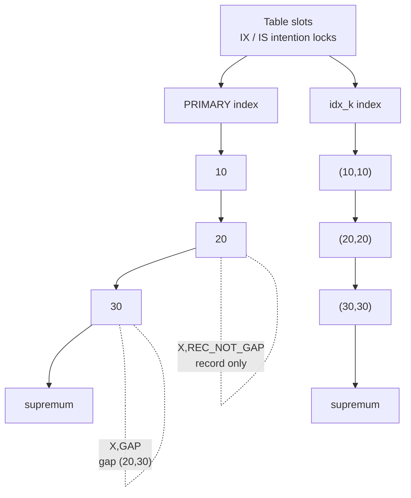

## Introduction

MVCC lets plain reads run without locks. Everything else — `UPDATE`, `DELETE`, `INSERT`, `SELECT … FOR UPDATE`, `SELECT … FOR SHARE`, DDL — needs **locks**, because two transactions must never act on the same data at the same time in conflicting ways. InnoDB's locking is fine-grained and, at first sight, complicated: a single `SELECT … FOR UPDATE` can produce five different kinds of lock on three different indexes.

This lesson takes the complexity apart. You will learn:

- the two **modes** (shared S, exclusive X) and how they combine;
- the **granularities**: table locks, the **intention locks** (IS, IX) that make row and table locks coexist, and the row-level **record**, **gap**, **next-key** and **insert-intention** locks;
- **implicit locks** on freshly inserted rows that appear in no lock table until someone collides with them;
- **metadata locks**, which protect table *definitions* and explain why an `ALTER TABLE` can take a production system down;
- the SQL you use to request locks — `FOR UPDATE`, `FOR SHARE`, `NOWAIT`, `SKIP LOCKED`, `LOCK TABLES` — and how to read `performance_schema.data_locks`.

Every lock described here is shown in a **real lock snapshot** captured from `performance_schema.data_locks` while the sessions were running.

:::note[Dataset and the scenarios' table]
Most scenarios use a tiny table created in their own setup, with deliberate **gaps** between key values so that gap locks are visible:

```sql
CREATE TABLE slots (id INT PRIMARY KEY, k INT NOT NULL, note VARCHAR(20), KEY idx_k (k));
INSERT INTO slots VALUES (10, 10, 'a'), (20, 20, 'b'), (30, 30, 'c');
```

The index on the primary key therefore contains 10, 20, 30 and the **supremum** pseudo-record (a sentinel "larger than everything" record at the end of each index page). The gaps are (−∞, 10), (10, 20), (20, 30) and (30, +∞). Row locking with and without a usable index on the **bank** tables is demonstrated in [UPDATE and DELETE](/lessons/m03-update-delete); this lesson concentrates on lock *types*.
:::

## DBMS Theory

:::theory[Locking protocols]
A **lock** is a permission, held by a transaction on a database object, that restricts what other transactions may do to it. With two modes — **shared** (S, for reading) and **exclusive** (X, for writing) — the compatibility rule is: S is compatible with S; X is compatible with nothing.

**Two-phase locking (2PL)**: a transaction acquires locks in a *growing* phase and releases them in a *shrinking* phase, never acquiring after releasing. 2PL guarantees conflict-serializable schedules. **Strict 2PL** holds all exclusive locks until commit or abort, which additionally prevents cascading aborts; **rigorous 2PL** holds all locks to the end. InnoDB holds row locks until the transaction ends (strict/rigorous 2PL for the locks it takes).

**Multiple-granularity locking** (Gray et al., 1975): objects form a hierarchy (database → table → page → row). Before locking a row in S or X, a transaction must hold an **intention** lock (IS or IX) on every ancestor. Intention locks announce "I hold or will hold finer-grained locks below", so a request for a whole-table lock can be checked against one table-level lock instead of millions of row locks.

**Phantom protection** needs locks on *predicates* (e.g. "all rows with 15 ≤ id ≤ 25"), not just existing rows. True predicate locking is expensive; B+ tree-based systems approximate it with **key-range locking** — locking the index records the scan visits *and the gaps between them*.
:::

InnoDB's lock modes and their table-level compatibility:

| Requested ↓ / Held → | X | IX | S | IS |
|---|---|---|---|---|
| **X** | ✗ | ✗ | ✗ | ✗ |
| **IX** | ✗ | ✓ | ✗ | ✓ |
| **S** | ✗ | ✗ | ✓ | ✓ |
| **IS** | ✗ | ✓ | ✓ | ✓ |

Intention locks never conflict with each other: many transactions can hold IX on the same table while locking *different* rows. They conflict only with whole-table S or X locks (from `LOCK TABLES`, for example).

At the row level, InnoDB's key-range locking produces four lock *types*:

| Type | `LOCK_MODE` in data_locks | Protects | Blocks |
|---|---|---|---|
| **Record lock** | `X,REC_NOT_GAP` / `S,REC_NOT_GAP` | One index record | Conflicting locks on that record |
| **Gap lock** | `X,GAP` / `S,GAP` | The open interval *before* the record named in `LOCK_DATA` | Only inserts into the gap (insert-intention locks) |
| **Next-key lock** | `X` / `S` | The record **and** the gap before it: (previous, record] | Both of the above |
| **Insert-intention lock** | `X,GAP,INSERT_INTENTION` | "I want to insert at this position in the gap before the record" | Nothing — but must wait for gap/next-key locks on that gap |

Gap locks are **purely inhibitive**: their only purpose is to stop other transactions inserting into the gap. Two transactions can hold gap locks on the same gap simultaneously, even X-mode gap locks, and insert-intention locks from different inserters into the same gap do not conflict with each other.

:::standard[Standard SQL vs MySQL]
Standard SQL defines `FOR UPDATE` only in the context of cursors and leaves locking to the implementation; isolation levels are specified by anomalies. `SELECT … FOR UPDATE` on a plain query, `FOR SHARE`, the deprecated `LOCK IN SHARE MODE`, `NOWAIT`, `SKIP LOCKED`, `OF table`, `LOCK TABLES` and the `performance_schema.data_locks` table are MySQL features (several other databases offer similar syntax with differing semantics).
:::

## Why It Exists

Each kind of lock exists because something specific goes wrong without it:

- **Exclusive record locks** prevent dirty writes: two transactions changing the same row before either commits would make rollback impossible to define.
- **Shared locks** let a transaction say "nobody may change this row until I finish" — for example, "this parent account must still exist when I commit my child ledger row" (foreign keys use exactly this).
- **Gap and next-key locks** prevent phantoms for locking reads and DML at REPEATABLE READ — they make "no account with id between 15 and 25 exists" a stable fact for the transaction that checked it. Historically they were also required for statement-based replication to be deterministic.
- **Insert-intention locks** let many concurrent inserters into the same gap proceed in parallel (an auto-increment table's inserts all go into the gap before the supremum), while still respecting a range lock held by a reader.
- **Intention locks** make `LOCK TABLES … WRITE` or a table-level S lock cheap to check against the row locks of hundreds of transactions.
- **Metadata locks** stop the table definition from changing under a running transaction — imagine a column being dropped between two statements of a transaction that reads it.

## Internal Working

:::internals[How InnoDB stores and checks locks]
- **Row locks are index locks.** InnoDB locks *index records*, not rows in the abstract. A statement that uses a secondary index locks entries in that secondary index **and** the corresponding clustered-index records. A statement that scans without a useful index locks every record it scans.
- **The lock system** keeps lock structures in a hash table keyed by page. One lock struct can cover many records of the same page with a bitmap, which is why the `trx_lock_structs` count in `INNODB_TRX` is usually much smaller than `trx_rows_locked`.
- **Implicit locks.** An `INSERT` does not create a lock struct for the new record. The record's `DB_TRX_ID` *is* the lock: as long as that transaction is active, the row is implicitly X-locked. Only when another transaction wants to lock the record does InnoDB convert the implicit lock into an explicit one (owned by the inserting transaction). This keeps bulk inserts cheap.
- **Which locks a statement takes** depends on the index used, whether the search is a unique equality search, the isolation level, and the statement type. The rules at REPEATABLE READ include: a unique-index equality search that finds one row takes a record lock only; a search that finds nothing, a range scan, or a non-unique search takes next-key locks on the records scanned and a gap lock on the first record beyond the range; `UPDATE`/`DELETE` take X locks; `INSERT` takes an insert-intention lock on the gap and an implicit X lock on the new record; a duplicate-key error makes the failing inserter take an S lock on the existing record.
- **Waiting.** A request that conflicts is queued as a `WAITING` lock. The waiting thread sleeps until the lock is granted, `innodb_lock_wait_timeout` (default 50 s) expires (error 1205), or the deadlock detector chooses it as a victim (error 1213).
- **Metadata locks (MDL)** live in the server layer, not in InnoDB. Every statement acquires an MDL on each table it touches; inside a transaction those locks are held **until the transaction ends**. DDL needs an exclusive MDL. MDL waits use `lock_wait_timeout` (default one year), not `innodb_lock_wait_timeout`, and do not appear in `data_locks` (they are in `performance_schema.metadata_locks`).
:::



## MySQL Implementation

Locking reads are requested with a suffix on `SELECT`:

```sql
SELECT … FOR UPDATE   [OF tbl [, tbl] …] [NOWAIT | SKIP LOCKED];
SELECT … FOR SHARE    [OF tbl [, tbl] …] [NOWAIT | SKIP LOCKED];
SELECT … LOCK IN SHARE MODE;   -- older synonym for FOR SHARE (no NOWAIT / SKIP LOCKED / OF)
```

They only make sense inside a transaction: with autocommit on, the statement is its own transaction and its locks are released as soon as it finishes. Let us create the `slots` table in the lab as well:

```sql run
CREATE TABLE slots (id INT PRIMARY KEY, k INT NOT NULL, note VARCHAR(20), KEY idx_k (k));
INSERT INTO slots VALUES (10, 10, 'a'), (20, 20, 'b'), (30, 30, 'c');
START TRANSACTION;
SELECT * FROM slots WHERE id = 20 FOR UPDATE;
SELECT * FROM slots WHERE k BETWEEN 10 AND 20 ORDER BY id FOR SHARE;
COMMIT;
```

In a single session there is nobody to conflict with, so these simply return rows. The interesting part is what other sessions experience — the scenarios below.

Lock information lives in performance_schema and information_schema tables that require privileges lab accounts do not have. The scenarios' **observe** steps run these queries as an administrator, filtered to the scenario's sessions:

```sql
-- Display only (requires SELECT on performance_schema / PROCESS)
SELECT ENGINE_TRANSACTION_ID, THREAD_ID, OBJECT_NAME, INDEX_NAME,
       LOCK_TYPE, LOCK_MODE, LOCK_STATUS, LOCK_DATA
FROM performance_schema.data_locks;

SELECT REQUESTING_ENGINE_TRANSACTION_ID, BLOCKING_ENGINE_TRANSACTION_ID
FROM performance_schema.data_lock_waits;

SELECT * FROM sys.innodb_lock_waits\G     -- human-friendly "who blocks whom"
```

In a lab you can still read your own `SELECT … FOR UPDATE NOWAIT` errors and lock-wait counters:

```sql run volatile
SHOW GLOBAL STATUS LIKE 'Innodb_row_lock%';
```

## Syntax Breakdown

| Clause / statement | Lock taken | Notes |
|---|---|---|
| `SELECT … FOR UPDATE` | X locks on index records read (next-key/gap at RR) | Blocks other locking readers and writers; plain readers unaffected |
| `SELECT … FOR SHARE` | S locks | Compatible with other `FOR SHARE`; blocks writers and `FOR UPDATE` |
| `… NOWAIT` | Same, but fail immediately with **3572** if any row is locked | Good for interactive "is it free?" checks |
| `… SKIP LOCKED` | Same, but silently **skip** locked rows | Queue consumers; result is intentionally inconsistent |
| `… OF t1, t2` | Lock only rows of the named tables in a join | MySQL 8.0+ |
| `UPDATE` / `DELETE` | X locks on every index record the scan visits (RR) | Without a usable index: the whole table — see Module 3 |
| `INSERT` | Insert-intention lock on the gap, implicit X lock on the new row | Duplicate-key: S lock on the existing record |
| `INSERT … ON DUPLICATE KEY UPDATE` | X (next-key) lock on the duplicate | Not S |
| `LOCK TABLES t READ / WRITE` | Server-level table lock + MDL (InnoDB table lock only when `autocommit = 0`) | Implicitly commits; conflicts with transactions using the table |
| `ALTER TABLE`, `DROP`, `TRUNCATE`… | Exclusive metadata lock | Waits for all open transactions that touched the table |
| `innodb_lock_wait_timeout` | — | Row-lock wait limit (session-settable); 1205 when exceeded |
| `lock_wait_timeout` | — | Metadata-lock wait limit (session-settable) |

`LOCK TABLES` is a server-level mechanism with its own rules:

```sql run error
LOCK TABLES slots READ;
UPDATE slots SET note = 'x' WHERE id = 10;
```

```sql run
UNLOCK TABLES;
```

A session that holds `LOCK TABLES … READ` cannot write the table (error 1099), and other sessions cannot write it either until `UNLOCK TABLES`. It is rarely the right tool for InnoDB, where row locks give finer control.

## Practical Examples

### 1. Record locks: exactly one row

```concurrency
title: A unique equality search locks one record
description: A locks slot 20 with FOR UPDATE. B updates slot 10, then tries to read slot 20 with FOR SHARE.
dataset: empty
setup: |
  CREATE TABLE slots (id INT PRIMARY KEY, k INT NOT NULL, note VARCHAR(20), KEY idx_k (k));
  INSERT INTO slots VALUES (10, 10, 'a'), (20, 20, 'b'), (30, 30, 'c');
steps:
  - session: A
    sql: START TRANSACTION; SELECT * FROM slots WHERE id = 20 FOR UPDATE;
  - observe: locks
  - session: B
    sql: UPDATE slots SET note = 'B' WHERE id = 10;
    note: A different record — no conflict.
  - session: B
    sql: SELECT * FROM slots WHERE id = 20 FOR SHARE;
    expect: blocks
    note: S conflicts with A's X on record 20.
  - session: A
    sql: COMMIT;
```

The snapshot contains exactly two locks: `IX` on the table and `X,REC_NOT_GAP` on `PRIMARY` record 20. Because `id` is the primary key and the row exists, InnoDB knows no other row can ever match `id = 20`, so it locks the record but not the gaps around it. B's update of slot 10 went straight through; its locking read of slot 20 waited for A's commit.

### 2. Shared locks are compatible with each other

```concurrency
title: Two FOR SHARE readers coexist; a FOR UPDATE waits for both
description: A and B both lock slot 10 in share mode. C asks for an exclusive lock.
dataset: empty
setup: |
  CREATE TABLE slots (id INT PRIMARY KEY, k INT NOT NULL, note VARCHAR(20), KEY idx_k (k));
  INSERT INTO slots VALUES (10, 10, 'a'), (20, 20, 'b'), (30, 30, 'c');
steps:
  - session: A
    sql: START TRANSACTION; SELECT * FROM slots WHERE id = 10 FOR SHARE;
  - session: B
    sql: START TRANSACTION; SELECT * FROM slots WHERE id = 10 FOR SHARE;
  - session: C
    sql: SELECT * FROM slots WHERE id = 10 FOR UPDATE;
    expect: blocks
  - observe: locks
  - session: A
    sql: COMMIT;
    note: C still waits — B's shared lock remains.
  - session: B
    sql: COMMIT;
    note: Now C gets its exclusive lock.
```

The snapshot shows A and B each holding `IS` on the table and `S,REC_NOT_GAP` on record 10, both `GRANTED`, and C holding `IX` with an `X,REC_NOT_GAP` request on record 10 in `WAITING`. C was released only after **both** readers committed. (If A and B had both then tried to update the row, each would wait for the other's S lock — the classic deadlock of the next lesson.)

### 3. Gap locks: locking what is not there

```concurrency
title: Searching for a missing key locks the gap — and gap locks do not conflict with each other
description: A and C both look for slot 15 with FOR UPDATE (it does not exist). B then tries to insert slot 12.
dataset: empty
setup: |
  CREATE TABLE slots (id INT PRIMARY KEY, k INT NOT NULL, note VARCHAR(20), KEY idx_k (k));
  INSERT INTO slots VALUES (10, 10, 'a'), (20, 20, 'b'), (30, 30, 'c');
steps:
  - session: A
    sql: START TRANSACTION; SELECT * FROM slots WHERE id = 15 FOR UPDATE;
    note: Empty result — A has locked the gap where 15 would be.
  - session: C
    sql: START TRANSACTION; SELECT * FROM slots WHERE id = 15 FOR UPDATE;
    note: Does not wait. An X gap lock is compatible with another X gap lock.
  - session: B
    sql: INSERT INTO slots VALUES (12, 12, 'B');
    expect: blocks
    note: 12 lies in the same gap (10, 20).
  - observe: locks
  - session: A
    sql: ROLLBACK;
  - observe: locks
  - session: C
    sql: ROLLBACK;
    note: Only when the last gap lock is gone can B insert.
  - session: B
    sql: SELECT * FROM slots ORDER BY id;
```

In the first snapshot A and C **both** hold `X,GAP` with `LOCK_DATA` = 20 — a lock on the gap *before* record 20, i.e. (10, 20) — and B waits with `X,GAP,INSERT_INTENTION` on the same gap. After A rolled back, the second snapshot shows B still waiting, now only on C's gap lock. B's insert completed only after C rolled back. Gap locks block inserts, not each other: this is why two transactions that each "reserve" the same non-existent key with `FOR UPDATE` and then both insert it deadlock — each waits for the other's gap lock (see *Deadlocks*).

### 4. Next-key locks on a range — and an insert-intention lock

```concurrency
title: A range scan locks records and gaps, but not the record after the range
description: A locks id BETWEEN 15 AND 25. C updates slot 30 and inserts 35 and 5. B tries to insert 25.
dataset: empty
setup: |
  CREATE TABLE slots (id INT PRIMARY KEY, k INT NOT NULL, note VARCHAR(20), KEY idx_k (k));
  INSERT INTO slots VALUES (10, 10, 'a'), (20, 20, 'b'), (30, 30, 'c');
steps:
  - session: A
    sql: START TRANSACTION; SELECT * FROM slots WHERE id BETWEEN 15 AND 25 FOR UPDATE;
  - session: C
    sql: UPDATE slots SET note = 'C' WHERE id = 30; INSERT INTO slots VALUES (35, 35, 'C'); INSERT INTO slots VALUES (5, 5, 'C');
    note: Record 30 itself, the gap after 30 and the gap before 10 are all free.
  - session: B
    sql: INSERT INTO slots VALUES (25, 25, 'B');
    expect: blocks
    note: 25 lies in the gap (20, 30), which A has locked.
  - observe: locks
  - session: A
    sql: COMMIT;
```

A holds `X` on record 20 — a **next-key lock**, covering the gap (10, 20] including record 20 — and `X,GAP` on record 30, covering only the gap (20, 30). Together they protect the whole range 15–25 against inserts, which is how InnoDB prevents phantoms for locking reads. B's request appears as `X,GAP,INSERT_INTENTION` `WAITING` on 30. C's three statements all succeeded: record 30 itself was not locked (only the gap before it), and 35 and 5 are outside the locked gaps. (Older MySQL versions locked the first record beyond the range with a full next-key lock; recent 8.0 releases and 8.4 lock only its gap, as captured here.)

### 5. Non-unique secondary index: locks on two indexes

```concurrency
title: Locking through a secondary index
description: A locks the rows with k = 20 through the non-unique index idx_k. C inserts k = 5 and k = 35; B inserts k = 15.
dataset: empty
setup: |
  CREATE TABLE slots (id INT PRIMARY KEY, k INT NOT NULL, note VARCHAR(20), KEY idx_k (k));
  INSERT INTO slots VALUES (10, 10, 'a'), (20, 20, 'b'), (30, 30, 'c');
steps:
  - session: A
    sql: START TRANSACTION; SELECT * FROM slots WHERE k = 20 FOR UPDATE;
  - observe: locks
  - session: C
    sql: INSERT INTO slots VALUES (40, 5, 'C'); INSERT INTO slots VALUES (41, 35, 'C');
    note: Outside the locked part of idx_k.
  - session: B
    sql: INSERT INTO slots VALUES (15, 15, 'B');
    expect: blocks
    note: k = 15 falls into the gap before (20, 20) in idx_k.
  - observe: locks
  - session: A
    sql: COMMIT;
```

Because `idx_k` is not unique, more rows with `k = 20` could be inserted, so InnoDB locks: `X` (next-key) on the `idx_k` entry `20, 20` (index value 20, primary key 20), `X,GAP` on the next entry `30, 30`, and `X,REC_NOT_GAP` on the clustered-index record 20 — the row itself. `LOCK_DATA` for secondary indexes lists the indexed value followed by the primary key. B's insert of k = 15 waited on the gap before `20, 20` (its insert-intention lock appears on `idx_k`, not on `PRIMARY`), while C's inserts of k = 5 and k = 35 succeeded.

### 6. Implicit locks — invisible until someone collides

```concurrency
title: Fresh inserts hold implicit locks; a conflicting request makes them explicit
description: A and B insert into the same gap. Then C tries to read A's new row with FOR SHARE.
dataset: empty
setup: |
  CREATE TABLE slots (id INT PRIMARY KEY, k INT NOT NULL, note VARCHAR(20), KEY idx_k (k));
  INSERT INTO slots VALUES (10, 10, 'a'), (20, 20, 'b'), (30, 30, 'c');
steps:
  - session: A
    sql: START TRANSACTION; INSERT INTO slots VALUES (12, 12, 'A');
  - session: B
    sql: START TRANSACTION; INSERT INTO slots VALUES (14, 14, 'B');
    note: Insert-intention locks into the same gap do not conflict — B does not wait.
  - observe: locks
  - session: C
    sql: SELECT * FROM slots WHERE id = 12 FOR SHARE;
    expect: blocks
  - observe: locks
  - session: A
    sql: COMMIT;
  - session: B
    sql: COMMIT;
```

The first snapshot is surprising: A and B each modified a row, yet the only locks listed are their two `IX` table locks. The new rows are protected by **implicit** locks — their `DB_TRX_ID` — which `data_locks` cannot list. When C requested an S lock on record 12, InnoDB converted A's implicit lock into an explicit `X,REC_NOT_GAP` lock on 12 and queued C's `S,REC_NOT_GAP` request behind it.

Read the second snapshot carefully: the converted `X,REC_NOT_GAP` lock is labelled with session **C**, because `data_locks` reports the thread that *created* the lock structure — C's thread performed the conversion. The transaction columns tell the truth: A's `lockStructs` rose from 1 to 2 and its `rowsLocked` from 0 to 1, so the lock belongs to A's transaction. When diagnosing real systems, join `data_locks` on `ENGINE_TRANSACTION_ID` (and use `data_lock_waits` / `sys.innodb_lock_waits` for who-blocks-whom) rather than trusting `THREAD_ID` alone.

### 7. Metadata locks — the ALTER TABLE pile-up

```concurrency
title: An open transaction blocks ALTER TABLE, and the queued ALTER blocks everyone else
description: A reads slots inside a transaction and stays open. B runs ALTER TABLE. C, a plain autocommit SELECT, arrives afterwards.
dataset: empty
setup: |
  CREATE TABLE slots (id INT PRIMARY KEY, k INT NOT NULL, note VARCHAR(20), KEY idx_k (k));
  INSERT INTO slots VALUES (10, 10, 'a'), (20, 20, 'b'), (30, 30, 'c');
steps:
  - session: A
    sql: START TRANSACTION; SELECT COUNT(*) AS n FROM slots;
    note: A holds a shared metadata lock on slots until its transaction ends.
  - session: B
    sql: ALTER TABLE slots ADD COLUMN reserved_by VARCHAR(20) NULL;
    expect: blocks
    note: The ALTER needs an exclusive metadata lock — it waits for A.
  - session: C
    sql: SELECT COUNT(*) AS n FROM slots;
    expect: blocks
    note: Even a plain SELECT now waits, queued behind the pending exclusive request.
  - observe: locks
  - session: A
    sql: COMMIT;
    note: A's metadata lock is released; the ALTER runs, then C's SELECT.
  - session: C
    sql: SELECT * FROM slots ORDER BY id;
```

The lock snapshot shows **no row locks at all** — A's plain `SELECT` took none, and the waits are metadata-lock waits, which live in the server layer (`performance_schema.metadata_locks`), not in `data_locks`. Yet both B and C were stuck until A committed. In production, "A" is often an idle connection or a long report; the ALTER queues; and every new query on the table queues behind the ALTER, so the application appears to hang. Mitigations: kill or finish long transactions before DDL, set `SET SESSION lock_wait_timeout = <a few seconds>` in the migration session so the ALTER gives up instead of blocking traffic, and use online schema-change tools.

### 8. NOWAIT and SKIP LOCKED

```concurrency
title: Queue consumers with SKIP LOCKED; fail-fast with NOWAIT
description: Four queued jobs. Workers A and B each claim up to two jobs with SKIP LOCKED. C tries to lock job 1 with NOWAIT.
dataset: empty
setup: |
  CREATE TABLE jobs (id INT PRIMARY KEY, status VARCHAR(10) NOT NULL, KEY idx_status (status));
  INSERT INTO jobs VALUES (1, 'queued'), (2, 'queued'), (3, 'queued'), (4, 'queued');
steps:
  - session: A
    sql: START TRANSACTION; SELECT id FROM jobs WHERE status = 'queued' ORDER BY id LIMIT 2 FOR UPDATE SKIP LOCKED;
  - session: B
    sql: START TRANSACTION; SELECT id FROM jobs WHERE status = 'queued' ORDER BY id LIMIT 2 FOR UPDATE SKIP LOCKED;
    note: B skips A's locked rows instead of waiting.
  - observe: locks
  - session: C
    sql: SELECT id FROM jobs WHERE id = 1 FOR UPDATE NOWAIT;
    expect: error
    errorCode: 3572
    note: Job 1 is locked — NOWAIT fails immediately instead of waiting.
  - session: A
    sql: UPDATE jobs SET status = 'running' WHERE id IN (1, 2); COMMIT;
  - session: B
    sql: UPDATE jobs SET status = 'running' WHERE id IN (3, 4); COMMIT; SELECT * FROM jobs ORDER BY id;
```

A claimed jobs 1 and 2, B claimed 3 and 4 — no waiting, no double processing. The snapshot shows each worker's `X` locks on its two `idx_status` entries (`'queued', 1` and so on) and `X,REC_NOT_GAP` on the corresponding primary-key records. C's `NOWAIT` request failed at once with error 3572. *Optimistic vs Pessimistic Concurrency Control* builds a complete job queue on this pattern.

## Execution Walkthrough

Which locks does a statement take? Work it out in three questions, then confirm with a snapshot:

1. **Which index does the statement use, and is the search a unique equality match?** Unique match on an existing row → record lock only (Example 1). Anything else → next-key locks on every record scanned (Examples 4, 5), plus a gap lock on the first record past the range.
2. **What is the isolation level?** At READ COMMITTED, gap and next-key locks are not taken for searches and locks on non-matching rows are released (see *Isolation Levels*).
3. **Which other indexes are involved?** A lock through a secondary index also locks the clustered record (Example 5); an `UPDATE` that changes an indexed column also locks entries in that index.

The walkthrough below executes the same statement shapes in a single session and uses `EXPLAIN` to show the access path InnoDB will lock along — the information you need for step 1.

```walkthrough
title: Predicting lock footprints from access paths
steps:
  - title: "1. Unique equality on the primary key"
    explain: >-
      type const on PRIMARY: one record, found by a unique search. Expected locks: X,REC_NOT_GAP on 20
      (Example 1).
    sql: EXPLAIN SELECT * FROM slots WHERE id = 20 FOR UPDATE;
  - title: "2. Range on the primary key"
    explain: >-
      type range on PRIMARY: InnoDB scans 20 and stops at 30. Expected locks: next-key X on 20, gap X,GAP on 30
      (Example 4).
    sql: EXPLAIN SELECT * FROM slots WHERE id BETWEEN 15 AND 25 FOR UPDATE;
  - title: "3. Equality on a non-unique secondary index"
    explain: >-
      type ref on idx_k: entries (20,20) and the next entry (30,30) are visited in idx_k, plus clustered record 20.
      Expected locks: X on (20,20), X,GAP on (30,30), X,REC_NOT_GAP on PRIMARY 20 (Example 5).
    sql: EXPLAIN SELECT * FROM slots WHERE k = 20 FOR UPDATE;
  - title: "4. A predicate with no usable index"
    explain: >-
      type ALL: a full scan of the clustered index. At REPEATABLE READ every record and gap scanned is locked —
      the whole table — even though only one row matches. The Module 3 UPDATE and DELETE lesson shows the blocking.
    sql: EXPLAIN SELECT * FROM slots WHERE note = 'b' FOR UPDATE;
```

## Output

- **Record lock** (Example 1): `X,REC_NOT_GAP` on 20 only; an update of 10 went through.
- **Shared locks** (Example 2): two `S,REC_NOT_GAP` locks granted on the same record; the exclusive request waited for both.
- **Gap locks** (Example 3): two transactions held `X,GAP` on the gap before 20 simultaneously; the insert of 12 waited for both to finish.
- **Next-key locks** (Example 4): `X` on 20 plus `X,GAP` on 30; insert of 25 waited with `X,GAP,INSERT_INTENTION`; record 30 and inserts of 35 and 5 were unaffected.
- **Secondary index** (Example 5): locks on `idx_k` (`20, 20` next-key, `30, 30` gap) and on `PRIMARY` 20; insert of k = 15 waited, k = 5 and k = 35 did not.
- **Implicit locks** (Example 6): no record locks listed after two inserts; a conflicting request materialised A's lock (displayed under the converting session's thread).
- **Metadata locks** (Example 7): no InnoDB locks, but an `ALTER TABLE` and a subsequent `SELECT` both waited for an idle open transaction.
- **SKIP LOCKED / NOWAIT** (Example 8): two workers claimed disjoint jobs; `NOWAIT` returned error 3572 immediately.

## Alternative Approaches

| Need | Locking approach | Alternative |
|---|---|---|
| Protect a read-modify-write | `SELECT … FOR UPDATE` then `UPDATE` | Atomic `UPDATE … SET x = x + ?`; optimistic version check (no locks between read and write) |
| Ensure a key stays unused until I insert it | `FOR UPDATE` on the missing key (gap lock) | Just `INSERT` and handle duplicate-key error 1062 — cheaper and deadlock-free; or `INSERT … ON DUPLICATE KEY UPDATE` |
| Prevent concurrent processing of the same job | `FOR UPDATE SKIP LOCKED` | Atomic claim: `UPDATE jobs SET owner = ? WHERE status = 'queued' … LIMIT 1` then read back |
| Serialise a whole workflow (e.g. nightly batch) | `LOCK TABLES` | A single "mutex" row locked with `FOR UPDATE`; or `GET_LOCK('name', timeout)` named user-level locks |
| Avoid waiting | `NOWAIT` | Lower `innodb_lock_wait_timeout` for the session |
| Fewer gap locks | — | READ COMMITTED; better indexes so scans touch fewer records |

`GET_LOCK()` deserves a mention: it is a **named advisory lock** managed by the server, unrelated to any table, released explicitly with `RELEASE_LOCK()` or when the session ends (not at commit). It is useful for "only one instance of this cron job may run" coordination:

```sql run volatile
SELECT GET_LOCK('nightly_interest_run', 0) AS acquired,
       IS_USED_LOCK('nightly_interest_run') IS NOT NULL AS in_use,
       RELEASE_LOCK('nightly_interest_run') AS released;
```

## Performance Analysis

Locks cost in three ways:

1. **Waiting.** A lock wait stalls a transaction for as long as the holder runs. Throughput collapses when many transactions queue on a hot row (a global counter, a popular product's stock, the latest page of an auto-increment index under certain patterns). The fix is design: shorter transactions, atomic updates, splitting hot rows into N slots, or moving the counter out of the hot path.
2. **Lock footprint.** The number of records locked depends on the **access path**, not the number of rows returned. An `UPDATE … WHERE unindexed_col = ?` at REPEATABLE READ locks every row; with an index it locks a handful. Range scans lock gaps that block inserts from other sessions. Always check the plan (`EXPLAIN`) of locking statements.
3. **Deadlocks.** More locks held longer means more opportunities for cycles; each deadlock costs a rollback and a retry (next lesson).

Lock structures themselves are cheap (bitmaps per page), and InnoDB does not escalate row locks to table locks, so locking many rows is a concurrency problem rather than a memory problem.

:::performance[Theory vs measurement]
Contention is measurable: `Innodb_row_lock_waits` and `Innodb_row_lock_time` (global status) show how often and how long transactions wait; `sys.innodb_lock_waits` and `performance_schema.data_lock_waits` show who is blocking whom right now; `performance_schema.events_transactions_*` shows transaction durations. Use them to find the hot rows and the long transactions before changing isolation levels or adding retries.
:::

## Best Practices

:::best-practice[Locking deliberately]
1. **Lock only when the read drives a write**, and lock as late and as briefly as possible: do the slow work before `START TRANSACTION`.
2. **Index every predicate used by locking statements**; check `EXPLAIN` for `UPDATE`, `DELETE` and `FOR UPDATE` queries.
3. **Prefer `INSERT` + duplicate-key handling** over "check with `FOR UPDATE` then insert" for uniqueness — it avoids gap-lock deadlocks.
4. **Access rows in a consistent order** (e.g. ascending primary key) across transactions to avoid deadlocks.
5. **Use `NOWAIT` for user-facing "try to reserve" actions** and `SKIP LOCKED` for queue consumers; remember `SKIP LOCKED` returns an intentionally partial view.
6. **Guard DDL with a short `lock_wait_timeout`** and check for long transactions first; never run schema changes while long reports are open.
7. **Diagnose with `data_locks`, `data_lock_waits` and `sys.innodb_lock_waits`**, joining on transaction IDs; remember implicit locks are invisible until converted and metadata locks are in a different table.
8. **Avoid `LOCK TABLES` with InnoDB** except for specific maintenance tasks; it implicitly commits and blocks far more than necessary.
:::

## Common Mistakes

**Mistake 1 — `FOR UPDATE` in autocommit mode.** The lock is released as soon as the statement ends, protecting nothing:

```sql run
SELECT * FROM slots WHERE id = 10 FOR UPDATE;
SELECT @@autocommit AS autocommit_still_on;
```

The `SELECT` returned the row and its lock was released immediately when its one-statement transaction committed. Wrap it in `START TRANSACTION … COMMIT`.

**Mistake 2 — combining NOWAIT and SKIP LOCKED**, or using them with `LOCK IN SHARE MODE`. They are mutually exclusive options of `FOR UPDATE` / `FOR SHARE`:

```sql run error
SELECT * FROM slots WHERE id = 10 FOR UPDATE NOWAIT SKIP LOCKED;
```

**Mistake 3 — "reserving" a key with `FOR UPDATE` before inserting it.** Two sessions doing this for the same missing key both get compatible gap locks (Example 3), then both inserts wait for the other's gap lock — a deadlock. Insert directly and handle error 1062.

**Mistake 4 — reading `THREAD_ID` in `data_locks` as the lock owner.** As Example 6 showed, a converted implicit lock is reported under the converting thread. Use `ENGINE_TRANSACTION_ID`.

**Mistake 5 — expecting `innodb_lock_wait_timeout` to limit DDL waits.** Metadata-lock waits use `lock_wait_timeout`, whose default is one year (31,536,000 seconds):

```sql run
SELECT @@innodb_lock_wait_timeout AS row_lock_wait_s, @@lock_wait_timeout AS metadata_lock_wait_s;
```

**Mistake 6 — believing a `SKIP LOCKED` result is a consistent view.** It deliberately omits locked rows; use it to *claim work*, never for counts or reports.

## Industry Application

- **Job queues in the database.** Background workers (billing runs, email sending, ETL steps) claim work with `SELECT … FOR UPDATE SKIP LOCKED LIMIT n`, a pattern supported by MySQL 8.0+ and PostgreSQL that lets a relational table serve as a reliable queue at moderate scale.
- **Inventory and ticketing.** Flash sales and seat maps use `FOR UPDATE NOWAIT` (or atomic guarded updates) to give users an immediate "seat already taken" response instead of a spinning page.
- **Schema migrations at scale.** Teams wrap DDL with `SET SESSION lock_wait_timeout = 5` and retry loops, check `INNODB_TRX` for long transactions first, and use tools (gh-ost, pt-online-schema-change, `ALGORITHM=INSTANT`) to keep exclusive metadata locks short.
- **Incident diagnosis.** "Everything is waiting" incidents are triaged with `sys.innodb_lock_waits` (row locks) and `sys.schema_table_lock_waits` (metadata locks) to find the single blocking transaction.
- **Singleton jobs.** `GET_LOCK('job-name', 0)` ensures only one instance of a scheduled job runs across many application servers.

## Practice Exercises

```exercise
id: ex1
title: Read a lock snapshot
difficulty: easy
kind: open
concepts: [record-locks, gap-locks, next-key-locks, data-locks]
prompt: |
  On the `slots` table (ids 10, 20, 30), a transaction holds exactly these locks on `PRIMARY`:

  | LOCK_MODE | LOCK_DATA |
  |---|---|
  | `X` | 20 |
  | `X` | 30 |
  | `X` | supremum pseudo-record |

  Which of these would block: (a) `UPDATE slots SET note='z' WHERE id = 10`, (b) `INSERT … id = 25`,
  (c) `INSERT … id = 99`, (d) `INSERT … id = 5`, (e) `SELECT … WHERE id = 30 FOR SHARE`? Which statement could
  have produced these locks?
solution: |
  `X` without qualifiers is a next-key lock: record + gap before it. So the transaction locks (10, 20], (20, 30]
  and (30, +∞) — everything above 10.

  - (a) **No** — record 10 itself is not locked (the gap before 20 starts after 10).
  - (b) **Blocks** — 25 is in (20, 30].
  - (c) **Blocks** — 99 is in the gap before the supremum.
  - (d) **No** — 5 is in (−∞, 10), which is not locked.
  - (e) **Blocks** — record 30 is X-locked.

  A statement such as `SELECT * FROM slots WHERE id > 15 FOR UPDATE` (or `UPDATE … WHERE id > 15`) at REPEATABLE
  READ produces this footprint: a range scan from 20 to the end of the index.
```

```exercise
id: ex2
title: Claim the next job
difficulty: medium
kind: dml
concepts: [nowait-skip-locked, locking]
setup: |
  CREATE TABLE jobs (id INT PRIMARY KEY, status VARCHAR(10) NOT NULL, worker VARCHAR(10) NULL, KEY idx_status (status));
  INSERT INTO jobs VALUES (1, 'done', 'w0'), (2, 'queued', NULL), (3, 'queued', NULL), (4, 'queued', NULL);
prompt: |
  Write the transaction a worker named `'w1'` runs to claim **the oldest queued job** (lowest `id`) safely under
  concurrency: lock it without waiting for jobs other workers have locked, mark it `status = 'running'`,
  `worker = 'w1'`, and commit. Use the job id **2** in your UPDATE once your locking SELECT has returned it.
hints:
  - "SELECT id FROM jobs WHERE status = 'queued' ORDER BY id LIMIT 1 FOR UPDATE SKIP LOCKED;"
  - "Then UPDATE jobs SET status = 'running', worker = 'w1' WHERE id = 2; COMMIT;"
solution: |
  START TRANSACTION;
  SELECT id FROM jobs WHERE status = 'queued' ORDER BY id LIMIT 1 FOR UPDATE SKIP LOCKED;
  UPDATE jobs SET status = 'running', worker = 'w1' WHERE id = 2;
  COMMIT;
check: |
  SELECT id, status, worker FROM jobs ORDER BY id;
explanation: |
  `FOR UPDATE SKIP LOCKED` locks the first queued job that no other worker holds, so concurrent workers claim
  different jobs without waiting (Example 8). In application code the UPDATE uses the id returned by the SELECT.
  Without SKIP LOCKED, every worker would queue on the same first job; without FOR UPDATE, two workers could claim
  the same job (a lost update).
```

```exercise
id: ex3
title: Predict the footprint on a secondary index
difficulty: hard
kind: open
concepts: [next-key-locks, gap-locks, insert-intention-locks]
prompt: |
  Table `slots(id PK, k, idx_k(k))` contains (10, k=10), (20, k=20), (30, k=30), (40, k=20). At REPEATABLE READ,
  transaction A runs `SELECT * FROM slots WHERE k = 20 FOR UPDATE`.

  1. List the locks you expect on `idx_k` and on `PRIMARY`, in data_locks notation.
  2. Which of these inserts by another session block: (40 is taken) `(35, k=25)`, `(36, k=20)`, `(37, k=15)`,
     `(38, k=31)`, `(5, k=9)`?
solution: |
  idx_k entries are ordered by (k, id): (10,10), (20,20), (20,40), (30,30).

  1. Locks: on `idx_k`: `X` on `20, 20`; `X` on `20, 40` (both next-key locks on matching entries); `X,GAP` on
     `30, 30` (the gap before the first non-matching entry). On `PRIMARY`: `X,REC_NOT_GAP` on 20 and on 40.
  2. The locked idx_k interval is from just after (10,10) up to (30,30) exclusive:
     - `(35, k=25)` → entry (25,35) is in the gap before (30,30) → **blocks**.
     - `(36, k=20)` → entry (20,36) lies between (20,20) and (20,40) → **blocks** (that gap is covered by the
       next-key lock on (20,40)).
     - `(37, k=15)` → (15,37) is in the gap before (20,20), covered by its next-key lock → **blocks**.
     - `(38, k=31)` → (31,38) is after (30,30) → **does not block**.
     - `(5, k=9)` → (9,5) is before (10,10) → **does not block**.
```

```exercise
id: ex4
title: Make a migration safe
difficulty: medium
kind: open
concepts: [metadata-locks]
prompt: |
  A deployment runs `ALTER TABLE accounts ADD COLUMN risk_score INT NULL` on a busy primary. Last time, the site
  "hung" for four minutes although the ALTER itself would take under a second (it is an instant operation). Explain
  exactly what happened and write the SQL/procedure you would use next time.
solution: |
  Even an instant ALTER needs an **exclusive metadata lock** briefly. Some transaction that had touched `accounts`
  (an idle `autocommit = 0` connection, or a long report) was still open, so the ALTER waited for its shared MDL.
  While the exclusive request was queued, every new statement on `accounts` — including plain SELECTs — queued
  behind it (Example 7). The site hung until the old transaction ended.

  Next time:

  ~~~
  -- 1. look for long transactions first (needs PROCESS)
  SELECT trx_mysql_thread_id, trx_started FROM information_schema.INNODB_TRX ORDER BY trx_started;
  -- 2. in the migration session, give up quickly instead of blocking traffic
  SET SESSION lock_wait_timeout = 3;
  ALTER TABLE accounts ADD COLUMN risk_score INT NULL, ALGORITHM = INSTANT;
  -- 3. on error 1205, wait and retry a few times; investigate the blocker if it keeps failing
  ~~~

  Also monitor `sys.schema_table_lock_waits` during the deploy, and fix the source of long transactions (pool
  settings, reports on replicas).
```

```exercise
id: ex5
title: Check-then-insert without deadlocks
difficulty: challenge
kind: open
concepts: [gap-locks, insert-intention-locks, locking]
prompt: |
  Two concurrent requests try to create a branch with the same new `branch_id` = 50. Each runs:

  ~~~
  START TRANSACTION;
  SELECT * FROM branches WHERE branch_id = 50 FOR UPDATE;   -- returns nothing
  INSERT INTO branches VALUES (50, 'Kiosk', 'Palo Alto');
  COMMIT;
  ~~~

  Trace the locks of both transactions step by step and explain the outcome. Then propose a correct, simpler
  design.
solution: |
  - T1's `FOR UPDATE` finds no row 50; at REPEATABLE READ it locks the gap where 50 would go. Because 50 is above
    every existing branch_id, that is the gap before the supremum: data_locks shows it as `X` on the
    supremum pseudo-record (a next-key lock on the supremum covers only the gap, since the supremum is not a row).
  - T2's `FOR UPDATE` also finds nothing and takes the same lock — gap locks are compatible (Example 3).
  - T1's `INSERT` needs an insert-intention lock in that gap, which conflicts with **T2's** gap lock → T1 waits.
  - T2's `INSERT` needs an insert-intention lock, which conflicts with **T1's** gap lock → cycle → deadlock.
    InnoDB rolls one back with error 1213; the other inserts successfully.

  The `FOR UPDATE` check added nothing but a deadlock. Simpler design: rely on the primary key — just
  `INSERT INTO branches VALUES (50, …)`. One request succeeds; the other waits briefly for the first (S lock on
  the duplicate) and then gets error **1062** (duplicate entry), which the application maps to "already exists". If
  "create or update" is wanted, use `INSERT … ON DUPLICATE KEY UPDATE`. Both are single statements with
  well-defined behaviour and no gap-lock deadlock.
```

## Knowledge Assessment

```quiz
- id: q1
  question: "What does `LOCK_MODE = X,GAP` with `LOCK_DATA = 20` mean in performance_schema.data_locks?"
  options:
    - "An exclusive lock on record 20 only"
    - "An exclusive lock on the gap before record 20, not on record 20 itself"
    - "An exclusive lock on record 20 and the gap after it"
    - "A table-level exclusive lock"
  answer: 1
  explanation: "A gap lock covers the open interval preceding the record named in LOCK_DATA. Record-only locks are X,REC_NOT_GAP; next-key locks (record + preceding gap) are plain X; table locks have LOCK_TYPE TABLE."
  concepts: [gap-locks, data-locks]
- id: q2
  question: "Transactions A and C both run `SELECT * FROM slots WHERE id = 15 FOR UPDATE` (no row 15 exists). What happens to C?"
  options: ["C waits for A", "C proceeds — both hold compatible gap locks", "C gets error 3572", "C deadlocks immediately"]
  answer: 1
  explanation: "Gap locks are purely inhibitive and compatible with each other, even in X mode (Example 3). They only block insert-intention locks. NOWAIT was not used, and there is no cycle yet — the deadlock appears only if both then insert into the gap."
  concepts: [gap-locks]
- id: q3
  question: "Why does InnoDB need intention locks (IS/IX)?"
  options:
    - "To lock rows faster"
    - "So that a request for a table-level S or X lock can detect existing row locks by checking one table-level lock"
    - "To replace gap locks at READ COMMITTED"
    - "To prevent deadlocks"
  answer: 1
  explanation: "Multiple-granularity locking: a transaction takes IS/IX on the table before row locks, so LOCK TABLES or other table locks conflict with them directly. Intention locks are compatible with each other, do not speed up row locking, are unrelated to gap locks, and do not prevent deadlocks."
  concepts: [intention-locks]
- id: q4
  question: "Which statements about InnoDB locks are true? (Select all that apply.)"
  type: multi
  options:
    - "A unique-index equality search for an existing row at REPEATABLE READ takes a record lock without a gap lock"
    - "Two transactions can hold insert-intention locks for different positions in the same gap at the same time"
    - "A freshly inserted row always appears as an explicit record lock in data_locks"
    - "Metadata lock waits are limited by innodb_lock_wait_timeout"
    - "Locking through a secondary index also locks the clustered-index record"
  answer: [0, 1, 4]
  explanation: "Example 1 showed X,REC_NOT_GAP only; Example 6 showed two inserters into one gap not waiting; Example 5 showed PRIMARY locks alongside idx_k locks. New rows hold implicit locks, invisible until converted, and metadata lock waits use lock_wait_timeout."
  concepts: [record-locks, insert-intention-locks, implicit-locks, metadata-locks]
- id: q5
  question: "A worker runs `SELECT id FROM jobs WHERE status = 'queued' ORDER BY id LIMIT 2 FOR UPDATE SKIP LOCKED` while another worker holds locks on jobs 1 and 2. Which ids are returned (jobs 1–4 are queued)?"
  options: ["1, 2 after waiting", "3, 4", "Error 3572", "An empty result"]
  answer: 1
  explanation: "SKIP LOCKED skips rows locked by others and continues scanning, as captured in Example 8 (B got 3 and 4). Waiting is the default behaviour, error 3572 is NOWAIT's behaviour, and the result is not empty because unlocked queued jobs exist."
  concepts: [nowait-skip-locked]
- id: q6
  question: "An idle session has an open transaction that once ran `SELECT COUNT(*) FROM accounts`. A DBA runs `ALTER TABLE accounts ADD COLUMN x INT`. Which is true?"
  options:
    - "The ALTER proceeds because the SELECT took no row locks"
    - "The ALTER waits for the open transaction's metadata lock, and new queries on accounts queue behind the ALTER"
    - "The ALTER kills the idle session"
    - "The ALTER fails immediately with error 1205"
  answer: 1
  explanation: "Statements hold shared metadata locks until their transaction ends; DDL needs an exclusive MDL and waits, and later requests queue behind it (Example 7). Row locks are irrelevant here, MySQL does not kill sessions automatically, and the wait lasts until lock_wait_timeout (default one year)."
  concepts: [metadata-locks]
- id: q7
  question: "At REPEATABLE READ, `SELECT * FROM slots WHERE id BETWEEN 15 AND 25 FOR UPDATE` (ids 10, 20, 30 exist). Which other-session statement succeeds without waiting?"
  options: ["INSERT id 25", "INSERT id 18", "UPDATE … WHERE id = 30", "UPDATE … WHERE id = 20"]
  answer: 2
  explanation: "The locks are next-key X on 20 (gap (10,20] plus record 20) and X,GAP on 30 (gap (20,30) only). Record 30 is not locked, so updating it succeeds (Example 4). Inserts of 18 and 25 fall into locked gaps and record 20 is locked."
  concepts: [next-key-locks]
```
