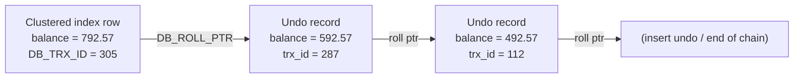
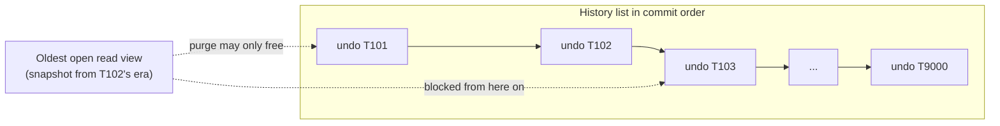

## Introduction

In the previous lessons, two sessions repeatedly looked at the same row at the same moment and saw **different values** — one saw the committed balance, another saw an uncommitted change, a third saw a value from several seconds earlier. None of them waited for a lock. That is **multi-version concurrency control (MVCC)**: instead of one copy of each row protected by locks, the database keeps several **versions**, and each reader is shown the version that fits its snapshot.

MVCC is why a long report in InnoDB does not stop the bank from processing transfers, why `mysqldump --single-transaction` can back up a busy database without blocking it, and why `SELECT COUNT(*)` cannot be answered from a stored counter. It also has costs that every operator meets eventually: old versions must be kept until no one needs them, and a single forgotten transaction can make the undo log grow without bound.

This lesson answers:

- Where do old row versions live, and how does InnoDB find them? (Hidden columns `DB_TRX_ID`, `DB_ROLL_PTR`; the undo log.)
- How does a transaction decide which version it may see? (The **read view**.)
- Why do `SELECT` and `SELECT … FOR UPDATE` return different results in the same transaction?
- What is **purge**, what is the **history list length**, and why do long-running transactions hurt?

:::note[Dataset]
The examples use the **bank** dataset; scenarios that need many versions of one row build a small `counter` table in their own setup. Sessions A, B and C are real concurrent connections at the default REPEATABLE READ level.
:::

## DBMS Theory

:::theory[Multiversion concurrency control]
In a **multiversion** database, each write of item x by transaction Tᵢ creates a new **version** xᵢ instead of overwriting x. A read of x by transaction Tⱼ is served by **some** version of x, chosen by a version-selection rule. Under **snapshot isolation**, Tⱼ is assigned a *snapshot point*, and reads the latest version of x written by a transaction that committed before that point (or its own write, if it wrote x). Because a reader never needs to wait for a writer — there is always a committed version to read — the classic reader/writer conflicts of lock-based concurrency control disappear. Writer/writer conflicts remain and must be handled by locks or by validation at commit.
:::

The idea is old: Reed's 1978 thesis described multiversion timestamp ordering, and Bernstein and Goodman formalised multiversion serializability in the early 1980s. Products differ mainly in **where they store old versions** and **how they clean them up**:

| Design | Old versions are stored… | Cleanup | Examples |
|---|---|---|---|
| **Undo-based (in-place update)** | The table holds the newest version; older versions are reconstructed from an **undo log** | A background **purge** discards undo no longer needed by any snapshot | InnoDB, Oracle |
| **Append-only (heap tuples)** | Each version is a separate tuple in the table itself | **VACUUM** removes dead tuples | PostgreSQL |
| **Separate version store** | Older versions copied to a version store (tempdb) | Version-store cleanup | SQL Server snapshot isolation |

All designs share the same fundamental trade-off: **reads are cheap and non-blocking, but every snapshot that is still open pins all versions newer than it**. The longer the oldest snapshot lives, the more history the system must keep.

Two kinds of read follow from MVCC:

- **Snapshot (consistent) reads** — read the version selected by the snapshot. No locks.
- **Current (locking) reads** — read the newest committed version and lock it, because the transaction intends to act on it. Any write must be based on a current read: writing on top of a stale snapshot version would lose other transactions' committed changes.

:::standard[Standard SQL vs MySQL]
The SQL standard does not mention MVCC; it defines isolation levels by observable phenomena, and MVCC is one way to implement them. Hidden columns, read views, purge and the history list are InnoDB implementation details. `SELECT … FOR UPDATE` is standard SQL (in cursor contexts); `FOR SHARE` (and the older `LOCK IN SHARE MODE`), `NOWAIT` and `SKIP LOCKED` are MySQL syntax.
:::

## Why It Exists

Without multiversioning, a database has two bad options for a long read:

1. **Lock everything you read** (shared locks until commit). A 10-minute report holds shared locks on millions of rows; every transfer that touches those rows waits 10 minutes. This is how SERIALIZABLE behaves in InnoDB — correct, but it turns analytics into an outage.
2. **Read without locks and accept inconsistency.** The report sees some rows before and some after concurrent transfers (read skew), so its totals do not add up.

MVCC gives a third option: read a **consistent snapshot without locks**. The report sees the bank exactly as it was at its snapshot point; transfers continue unhindered because they create new versions instead of waiting. The cost is moved from *blocking* to *storage and cleanup* — keeping old versions around and eventually purging them — which is almost always the better deal for mixed workloads.

MVCC also explains behaviours that otherwise seem arbitrary:

- InnoDB cannot keep an exact row count for `COUNT(*)`, because different snapshots legitimately see different numbers of rows.
- A deleted row is not removed immediately; it is **delete-marked**, because older snapshots may still need to see it.
- A transaction that has been open for hours can make the database grow and slow down even if it never writes anything.

## Internal Working

### Hidden columns

:::internals[What every InnoDB row carries]
Every record in an InnoDB **clustered index** (the table itself) contains, in addition to the user columns:

- **`DB_TRX_ID`** (6 bytes) — the ID of the transaction that last inserted or updated the row. A delete is treated internally as an update that sets a **delete-mark** bit.
- **`DB_ROLL_PTR`** (7 bytes) — the *roll pointer*: the address of the **undo log record** that holds the previous version of the row's changed columns.
- **`DB_ROW_ID`** (6 bytes) — only for tables without a primary key or non-null unique key: a monotonically increasing row ID that InnoDB uses as the clustered index key. (Since MySQL 8.0.30, `sql_generate_invisible_primary_key` can instead add a visible-on-request `my_row_id` primary key.)

These columns are not accessible from SQL. Secondary-index records do not carry them; instead each secondary-index **page** records the highest transaction ID that modified it, and secondary-index entries are delete-marked and re-inserted rather than updated in place.
:::

### Version chains in the undo log

When transaction T updates a row:

1. T takes an exclusive lock on the row.
2. T writes an **update undo record** containing the *old* values of the changed columns plus the row's old `DB_TRX_ID` and `DB_ROLL_PTR`.
3. T changes the row in place, sets `DB_TRX_ID = T`, and points `DB_ROLL_PTR` at the new undo record.

Repeated updates therefore form a linked list — a **version chain** — from the newest version in the table back through the undo log:



To read an older version, InnoDB starts from the current row and applies undo records one by one until it reaches a version whose `DB_TRX_ID` is visible to the reader. The longer the chain, the more work that read does.

### Read views

:::internals[The visibility rule]
A **read view** is a small structure created at a well-defined moment — at the first consistent read of a REPEATABLE READ transaction, or at the start of every consistent-read statement at READ COMMITTED. It records:

- `m_ids` — the IDs of read-write transactions that were **active** (not yet committed) at that moment;
- `m_up_limit_id` — the smallest ID in `m_ids` (every transaction with a smaller ID had committed);
- `m_low_limit_id` — the next transaction ID to be assigned (transactions with this ID or higher started after the view was created);
- `m_creator_trx_id` — the reader's own transaction ID (if it has one).

A row version written by transaction `trx_id` is **visible** to the view if:

1. `trx_id = m_creator_trx_id` (your own change), **or**
2. `trx_id < m_up_limit_id` (committed before every transaction that was active), **or**
3. `trx_id < m_low_limit_id` **and** `trx_id` is not in `m_ids` (it had committed when the view was created).

Otherwise the version is invisible and InnoDB follows `DB_ROLL_PTR` to the previous version and tests again. If the visible version is delete-marked, the row does not exist for this reader.
:::

Creating a read view copies the list of active transactions — cheap. Read-only transactions do not need an ID at all (which is why they show large, made-up IDs in `INNODB_TRX`), so they never appear in other transactions' `m_ids`.

**Secondary indexes and MVCC.** Because secondary-index records carry no `DB_TRX_ID`, a consistent read through a secondary index checks the page's maximum transaction ID. If that is newer than the read view allows, or the entry is delete-marked, InnoDB must look up the clustered-index record to determine the visible version — so a *covering index* read may still visit the clustered index while concurrent changes are recent.

### Purge and the history list

When a transaction commits, its **insert undo** can be discarded immediately (no snapshot can need the "before" of a row that did not exist), but its **update undo** is added to the **history list** in its rollback segment, ordered by commit. The **purge** system (`innodb_purge_threads` background threads):

1. computes the **oldest read view** still open in the system;
2. walks the history list from the oldest end, and for every undo log whose transaction committed before that oldest view, it physically removes delete-marked records from clustered and secondary indexes and frees the undo records;
3. stops at the first undo log some open read view might still need.

The number of committed-but-not-yet-purged undo logs is the **history list length** (HLL). It grows when purge cannot keep up with the write rate or — far more often — when an **old read view** blocks purge. A single transaction that opened a snapshot hours ago pins every version created since, on every table, for every other transaction.



## MySQL Implementation

The hidden columns exist but cannot be queried:

```sql run error
SELECT account_id, DB_TRX_ID, DB_ROLL_PTR FROM accounts WHERE account_id = 1;
```

What you *can* do from SQL is control **which** read you get:

| You write | Read type | Version read | Locks |
|---|---|---|---|
| `SELECT …` (RC, RR) | Consistent | Visible to the read view | None |
| `SELECT … FOR SHARE` | Locking | Newest committed | S row (and gap, at RR) locks |
| `SELECT … FOR UPDATE` | Locking | Newest committed | X row (and gap, at RR) locks |
| `UPDATE`, `DELETE`, `INSERT … SELECT` (target rows) | Locking | Newest committed | X locks |
| `INSERT … SELECT`, `CREATE TABLE … SELECT` (source rows, at RR) | Locking (shared) | Newest committed | S locks on the source rows |

A transaction always sees its own changes, even in a consistent read, because of visibility rule 1:

```sql run
START TRANSACTION;
UPDATE accounts SET balance = balance + 0.43, version = version + 1 WHERE account_id = 1;
SELECT account_id, balance, version FROM accounts WHERE account_id = 1;
ROLLBACK;
SELECT account_id, balance, version FROM accounts WHERE account_id = 1;
```

The purge and undo configuration of the capture server (all global; read-only from a lab):

```sql run
SELECT @@innodb_purge_threads     AS purge_threads,
       @@innodb_purge_batch_size  AS purge_batch_size,
       @@innodb_max_purge_lag     AS max_purge_lag,
       @@innodb_undo_log_truncate AS undo_log_truncate,
       @@innodb_max_undo_log_size AS max_undo_log_size_bytes;
```

`innodb_max_purge_lag = 0` means no throttling. When it is set to N > 0 and the history list exceeds N, InnoDB delays DML statements slightly to give purge a chance to catch up. `innodb_undo_log_truncate = ON` lets InnoDB shrink undo tablespaces that grew beyond `innodb_max_undo_log_size` once purge has emptied them.

Monitoring needs the `PROCESS` privilege, which lab accounts do not have — so the following are display-only here, with output shown as captured from the build server's administrator account:

```sql
-- Display only: requires PROCESS
SELECT trx_id, trx_state, trx_started, trx_isolation_level, trx_rows_modified,
       TIMESTAMPDIFF(SECOND, trx_started, NOW()) AS age_s
FROM information_schema.INNODB_TRX
ORDER BY trx_started
LIMIT 5;

SELECT NAME, COUNT FROM information_schema.INNODB_METRICS WHERE NAME = 'trx_rseg_history_len';

SHOW ENGINE INNODB STATUS;   -- see the TRANSACTIONS section
```

A real excerpt of the `TRANSACTIONS` section of `SHOW ENGINE INNODB STATUS` from the build server (MySQL 8.0.46), taken a few seconds after a test that committed 3,000 single-row updates:

```text
------------
TRANSACTIONS
------------
Trx id counter 144656
Purge done for trx's n:o < 144656 undo n:o < 0 state: running but idle
History list length 3042
LIST OF TRANSACTIONS FOR EACH SESSION:
---TRANSACTION 421279494827224, not started
0 lock struct(s), heap size 1128, 0 row lock(s)
```

`History list length 3042` is the number of committed update-undo logs not yet purged; `not started` sessions are idle connections with no open transaction.

## Syntax Breakdown

| Element | Role in MVCC |
|---|---|
| `START TRANSACTION WITH CONSISTENT SNAPSHOT` | Creates the read view immediately (REPEATABLE READ only) |
| First consistent read in an RR transaction | Creates the read view if none exists yet |
| Every consistent-read statement at READ COMMITTED | Creates a fresh read view for that statement |
| `COMMIT` / `ROLLBACK` | Close the transaction's read view, letting purge advance |
| `SELECT … FOR SHARE` / `FOR UPDATE` | Bypass the read view: read newest committed version and lock it |
| `START TRANSACTION READ ONLY` | No transaction ID is assigned; the transaction never appears in others' read views |
| `innodb_purge_threads`, `innodb_purge_batch_size` | Purge parallelism and batch size (global) |
| `innodb_max_purge_lag`, `innodb_max_purge_lag_delay` | Throttle DML when the history list is too long (global) |
| `innodb_undo_log_truncate`, `innodb_max_undo_log_size` | Shrink oversized undo tablespaces after purge (global) |
| `INNODB_TRX.trx_started`, `INNODB_METRICS 'trx_rseg_history_len'` | Find long-running transactions and measure the history list (PROCESS privilege) |

## Practical Examples

### 1. Three readers, three versions

```concurrency
title: Each snapshot sees its own version of the same row
description: A takes a snapshot, C deposits 100.00 into account 1 and commits, B takes a snapshot, C deposits another 200.00 and commits. Then all three read the row.
steps:
  - session: A
    sql: START TRANSACTION WITH CONSISTENT SNAPSHOT;
    note: A's read view is created now — before any deposit.
  - session: C
    sql: UPDATE accounts SET balance = balance + 100.00, version = version + 1 WHERE account_id = 1;
  - session: B
    sql: START TRANSACTION WITH CONSISTENT SNAPSHOT;
    note: B's read view includes the first deposit but not the second.
  - session: C
    sql: UPDATE accounts SET balance = balance + 200.00, version = version + 1 WHERE account_id = 1;
  - session: A
    sql: SELECT balance, version FROM accounts WHERE account_id = 1;
    note: A must walk back two versions in the undo chain.
  - session: B
    sql: SELECT balance, version FROM accounts WHERE account_id = 1;
    note: B walks back one version.
  - session: C
    sql: SELECT balance, version FROM accounts WHERE account_id = 1;
    note: C (autocommit) reads the current row directly.
  - session: A
    sql: COMMIT;
  - session: B
    sql: COMMIT;
```

At the same instant, A read **492.57** (version 0), B read **592.57** (version 1) and C read **792.57** (version 2). Physically, the table held only the newest version; A's and B's results were reconstructed from undo records, exactly as in the version-chain diagram above. Nobody waited for anyone.

### 2. A read view is created at the first read, not at START TRANSACTION

```concurrency
title: Snapshot timing — START TRANSACTION vs WITH CONSISTENT SNAPSHOT
description: A runs a plain START TRANSACTION; B runs START TRANSACTION WITH CONSISTENT SNAPSHOT. C then updates account 2. Afterwards both A and B read it for the first time.
steps:
  - session: A
    sql: START TRANSACTION;
  - session: B
    sql: START TRANSACTION WITH CONSISTENT SNAPSHOT;
  - session: C
    sql: UPDATE accounts SET balance = balance - 28.20, version = version + 1 WHERE account_id = 2;
  - session: A
    sql: SELECT balance FROM accounts WHERE account_id = 2; COMMIT;
    note: A's read view is created by this first read — after C's commit.
  - session: B
    sql: SELECT balance FROM accounts WHERE account_id = 2; COMMIT;
    note: B's read view was created at START TRANSACTION — before C's commit.
```

A saw C's update (4400.00); B did not (4428.20). Code that measures "how stale can my report be" must count from the first read unless it uses `WITH CONSISTENT SNAPSHOT`.

### 3. Deleted rows live on for older snapshots

```concurrency
title: A consistent read still sees rows another transaction deleted; a locking read does not
description: A counts the ledger rows of closed account 12. B deletes them and commits. A counts again, first with a plain SELECT, then with FOR UPDATE.
steps:
  - session: A
    sql: START TRANSACTION; SELECT COUNT(*) AS ledger_rows FROM transactions WHERE account_id = 12;
  - session: B
    sql: DELETE FROM transactions WHERE account_id = 12;
    note: The rows are delete-marked, not physically removed — A's snapshot may still need them.
  - session: A
    sql: |
      SELECT COUNT(*) AS ledger_rows FROM transactions WHERE account_id = 12;
      SELECT COUNT(*) AS ledger_rows_locking FROM transactions WHERE account_id = 12 FOR UPDATE;
      COMMIT;
```

A's consistent read still counted the two rows B had deleted and committed: the visible version for A is the pre-delete version. A's locking read in the same transaction counted zero, because the newest committed version of those rows is "deleted". Purge can remove the delete-marked records physically only after A's read view closes.

### 4. A long version chain

```concurrency
title: An old snapshot keeps 3,000 versions alive
description: A opens a snapshot of a counter row. B increments the counter 3,000 times (one UPDATE statement per increment, inside one transaction) and commits. A reads again.
dataset: empty
setup: |
  CREATE TABLE counter (id INT PRIMARY KEY, hits INT NOT NULL);
  INSERT INTO counter VALUES (1, 0);
  CREATE PROCEDURE bump(IN n INT)
  BEGIN
    DECLARE i INT DEFAULT 0;
    START TRANSACTION;
    WHILE i < n DO
      UPDATE counter SET hits = hits + 1 WHERE id = 1;
      SET i = i + 1;
    END WHILE;
    COMMIT;
  END;
steps:
  - session: A
    sql: START TRANSACTION WITH CONSISTENT SNAPSHOT; SELECT hits FROM counter WHERE id = 1;
  - session: B
    sql: CALL bump(3000); SELECT hits FROM counter WHERE id = 1;
    note: Each UPDATE statement wrote an undo record, so the row now has a chain of 3,000 older versions.
  - session: A
    sql: SELECT hits FROM counter WHERE id = 1; SELECT hits FROM counter WHERE id = 1 FOR SHARE; COMMIT;
    note: The consistent read must traverse the chain back to the version visible to A's view.
```

B read 3000; A's consistent read still returned 0, and A's locking read returned 3000. To produce the 0, InnoDB walked back through the chain of undo records for that row. While A's snapshot was open, purge could free none of them. In production, a reporting transaction left open over a busy hot row causes exactly this: every read by that transaction gets slower, and the undo tablespace grows.

## Execution Walkthrough

Tracing the visibility decision for Example 1 at the moment A runs its `SELECT`. Transaction IDs are illustrative (the real ones are server-assigned), but the sequence of decisions is exactly the one InnoDB performs.

| Step | Version examined | `DB_TRX_ID` | A's read view (created before both deposits) | Decision |
|---|---|---|---|---|
| 1 | Current row: balance 792.57, version 2 | C₂ (second deposit) | C₂ ≥ `m_low_limit_id` — started after the view | Invisible → follow `DB_ROLL_PTR` |
| 2 | Undo record: balance 592.57, version 1 | C₁ (first deposit) | C₁ ≥ `m_low_limit_id` — also after the view | Invisible → follow roll pointer |
| 3 | Undo record: balance 492.57, version 0 | an old loader transaction | `< m_up_limit_id` — committed long before | **Visible → return 492.57** |

For B, step 2 succeeds: C₁ had committed before B's view was created (C₁ < B's `m_low_limit_id` and not in B's `m_ids`), so B returns 592.57 after one hop. C reads with a new read view in autocommit mode; its first check on the current row succeeds.

The walkthrough below shows the same effect from a single session, using the fact that a transaction always sees its own uncommitted change while the stored snapshot of everything else stays fixed:

```walkthrough
title: One transaction, its own versions, and the committed version others see
steps:
  - title: "1. Committed state"
    explain: The current committed version of account 14.
    sql: SELECT account_id, balance, version FROM accounts WHERE account_id = 14;
  - title: "2. Snapshot and first change"
    explain: >-
      The UPDATE writes an undo record holding the old balance/version, stamps the row with this transaction's ID
      and points DB_ROLL_PTR at the undo record. Visibility rule 1 lets this transaction see its own version.
    sql: |
      START TRANSACTION WITH CONSISTENT SNAPSHOT;
      UPDATE accounts SET balance = balance + 10.00, version = version + 1 WHERE account_id = 14;
      SELECT account_id, balance, version FROM accounts WHERE account_id = 14;
  - title: "3. A second change by the same transaction"
    explain: Another undo record is added to the chain; the row now has two older versions in undo.
    sql: |
      UPDATE accounts SET balance = balance + 5.00, version = version + 1 WHERE account_id = 14;
      SELECT account_id, balance, version FROM accounts WHERE account_id = 14;
  - title: "4. Roll back"
    explain: >-
      ROLLBACK applies both undo records in reverse order, restoring the original version. Because the transaction
      never committed, its undo records are discarded rather than added to the history list.
    sql: |
      ROLLBACK;
      SELECT account_id, balance, version FROM accounts WHERE account_id = 14;
```

## Output

- Example 1: at one instant three sessions read three versions of account 1 — 492.57 (v0), 592.57 (v1), 792.57 (v2) — and no session waited.
- Example 2: the plain `START TRANSACTION` saw an update committed after it began (4400.00); `WITH CONSISTENT SNAPSHOT` did not (4428.20).
- Example 3: a deleted-and-committed pair of ledger rows remained visible to an older snapshot (2 rows) but not to a locking read (0 rows) in the same transaction.
- Example 4: a snapshot opened before 3,000 committed updates still read 0, while a locking read in the same transaction read 3000.
- The walkthrough's own changes were visible to their transaction (account 14 went from 2106.08 to 2116.08 to 2121.08 inside it) and vanished on rollback.

## Alternative Approaches

MVCC is the engine's mechanism; at the application level there are related design choices:

| Need | Engine MVCC | Application-level alternative |
|---|---|---|
| Consistent multi-query read | One REPEATABLE READ transaction | Single statement; or read from a replica |
| See data "as of" a past time | Not available: undo history is internal and purged | Temporal/history tables (ledger with `balance_after`, `valid_from`/`valid_to` columns), event sourcing, or point-in-time restore from backups and binary logs |
| Detect concurrent modification | Not exposed (`DB_TRX_ID` is hidden) | A `version` column or `updated_at` timestamp checked in `UPDATE … WHERE version = ?` (optimistic locking) |
| Long analytical reads without pinning history on the primary | — | Run them on a **replica**; or export to a warehouse |
| Avoid lock waits for readers entirely | Already the default (consistent reads take no locks) | — |

The bank's `transactions` ledger is an application-level multiversion design: every change creates a new row with `balance_after`, and old "versions" are never purged. That is what makes "balance as of 31 December 2023" a query (exercise 2), something InnoDB's internal MVCC deliberately cannot offer.

## Performance Analysis

**Reads.** A consistent read of a row that has not changed since the read view was created costs the same as a normal read: the first visibility check succeeds. Each version that must be skipped costs one undo-record lookup — usually in the buffer pool, sometimes a disk read from the undo tablespace. Reads by old snapshots of **hot** rows (counters, queue heads, popular products) degrade first.

**Writes.** Every update writes an undo record (and redo for it). Updates that change many columns or large values write bigger undo records. Deletes are cheap at first (delete-mark) and pay later in purge.

**Purge and the history list.** As long as purge keeps up, the history list stays small (typically hundreds to low thousands on a busy server). When it grows into the millions, the symptoms are:

- consistent reads slow down (long version chains);
- secondary-index range scans slow down (more delete-marked entries to skip);
- undo tablespaces grow on disk;
- in severe cases, `innodb_max_purge_lag` throttling delays all DML.

The overwhelmingly common cause is **one old read view** — an idle transaction in a forgotten session, a long report on the primary, a stuck `mysqldump --single-transaction`, or an application using `autocommit = 0` that never commits after reading. The remedy is to find and end that transaction (the `INNODB_TRX` query in *MySQL Implementation*, sorted by `trx_started`), then fix the code path.

:::performance[Theory vs measurement]
How large a history list your server tolerates depends on write rate, row size and hardware; monitor `trx_rseg_history_len` (or "History list length" in `SHOW ENGINE INNODB STATUS`) over time and alert on sustained growth or on any transaction older than a threshold (for example, a few minutes for an OLTP primary) rather than on a fixed number taken from elsewhere.
:::

## Best Practices

:::best-practice[Living well with MVCC]
1. **Keep transactions short** — especially REPEATABLE READ transactions that read. Commit read-only transactions as soon as their reads are done.
2. **Never leave sessions idle inside a transaction.** Configure pools to roll back on return; avoid `autocommit = 0` unless the code always commits.
3. **Run long reports and dumps on replicas**, not the primary, so their snapshots do not pin the primary's history.
4. **Base every write on a current read**: use `UPDATE … SET x = x + ?`, `FOR UPDATE`, or a version check — never an absolute value computed from a snapshot.
5. **Monitor history list length and oldest transaction age**, with alerts. Treat a transaction older than a few minutes on an OLTP primary as an incident.
6. **Use `START TRANSACTION READ ONLY`** for read-only transactions; they avoid transaction-ID assignment.
7. **Know that `DB_TRX_ID` is not an API.** If the application needs change detection, add an explicit `version` column.
:::

## Common Mistakes

**Mistake 1 — "my transaction only reads, so it cannot hurt anyone".** A read-only transaction with an open read view blocks purge for the whole server for as long as it stays open (Example 4 shows the pinned chain).

**Mistake 2 — deciding with a snapshot read, acting with a current read.** In Example 3, the snapshot said two ledger rows existed; a `DELETE` or `UPDATE` in the same transaction would have found none. Use a locking read when the result drives a write.

**Mistake 3 — assuming the snapshot starts at `START TRANSACTION`.** It starts at the first consistent read (Example 2). Use `WITH CONSISTENT SNAPSHOT` if the start time matters, for example when coordinating a snapshot with a binary-log position.

**Mistake 4 — expecting a deleted row's space to be freed immediately.** Deletes are delete-marks until purge runs, and purge waits for old read views. Large `DELETE`s followed by an immediate size check show no change.

**Mistake 5 — trying to read hidden columns.** As shown above, `DB_TRX_ID` and `DB_ROLL_PTR` are not addressable (error 1054). Add a `version` or `updated_at` column instead.

**Mistake 6 — using `SELECT … FOR UPDATE` everywhere "to be safe".** It bypasses MVCC, takes exclusive locks (plus gap locks at REPEATABLE READ) and turns harmless concurrent reads into lock waits. Use it only where the result drives a write.

## Industry Application

- **Online backups.** `mysqldump --single-transaction` and logical backup tools open one REPEATABLE READ snapshot and read every table through it, producing a consistent backup while the application keeps writing. On a busy primary, the dump's snapshot is also the oldest read view in the system, so DBAs schedule dumps on replicas.
- **Reporting replicas.** Analytics queries run on replicas precisely so their long snapshots do not inflate the primary's history list.
- **Incident response.** "The database got slow and the disk filled up" is very often a long-running transaction pinning purge. Runbooks start with: list `INNODB_TRX` by `trx_started`, identify the session (`trx_mysql_thread_id`), and end it (`KILL`, outside the sandbox).
- **Change data capture and auditing.** Because InnoDB's versions are internal and purged, systems that need history use the binary log (Debezium, Maxwell) or explicit history tables — the same trade-off as the bank ledger.
- **Database selection.** Comparing InnoDB (undo + purge) with PostgreSQL (heap tuples + VACUUM) is a classic design discussion: both suffer from long-running transactions, with different symptoms — growing undo and history list in InnoDB, table and index bloat in PostgreSQL.

## Practice Exercises

```exercise
id: ex1
title: Which version does the reader see?
difficulty: easy
kind: open
concepts: [read-view, mvcc]
prompt: |
  The newest version of a row was written by transaction 230 (still active). Its version chain in the undo log
  contains, from newer to older: a version written by transaction 210 (committed), then a version written by
  transaction 150 (committed).

  A read view was created with `m_ids = {205, 210, 230}`, `m_up_limit_id = 205`, `m_low_limit_id = 231` and
  `m_creator_trx_id = 0` (a read-only reader). Which version does the reader see? Walk through each check.
solution: |
  - **Current version, trx 230**: not the creator; 230 ≥ 205 (not below `m_up_limit_id`); 230 < 231 but 230 **is**
    in `m_ids` (it was active) → invisible. Follow the roll pointer.
  - **Version by trx 210**: 210 ≥ 205; 210 < 231 but 210 **is in `m_ids`** — it was still active when the view was
    created, even though it has committed since → invisible. Follow the roll pointer.
  - **Version by trx 150**: 150 < `m_up_limit_id` (205) → committed before every active transaction → **visible**.

  The reader sees the version written by transaction 150. The key point: transaction 210's commit happened after
  the view was created, so it stays invisible for the life of this read view (REPEATABLE READ).
```

```exercise
id: ex2
title: Balance as of a past date (application-level versions)
difficulty: medium
concepts: [mvcc, row-versions]
prompt: |
  InnoDB cannot show you old row versions, but the bank ledger keeps them explicitly. For every account that has
  at least one ledger row on or before `'2023-06-30 23:59:59'`, return `account_id` and `balance_as_of` — the
  `balance_after` of its latest ledger row up to that moment (latest `created_at`, ties broken by highest
  `txn_id`). Order by `account_id`.
hints:
  - "Filter the ledger to created_at <= '2023-06-30 23:59:59' first."
  - "ROW_NUMBER() OVER (PARTITION BY account_id ORDER BY created_at DESC, txn_id DESC) = 1 selects the latest row per account."
solution: |
  SELECT account_id, balance_after AS balance_as_of
  FROM (
    SELECT account_id, balance_after,
           ROW_NUMBER() OVER (PARTITION BY account_id ORDER BY created_at DESC, txn_id DESC) AS rn
    FROM transactions
    WHERE created_at <= '2023-06-30 23:59:59'
  ) v
  WHERE rn = 1
  ORDER BY account_id;
orderMatters: true
explanation: |
  This is an application-level multiversion read: each ledger row is a version of the account balance, and the
  query selects the version visible "as of" a timestamp — the same idea as a read view, but with versions that
  are never purged. A correlated subquery with ORDER BY … LIMIT 1 works too. Forgetting the txn_id tie-breaker
  can return the wrong version when two rows share a created_at value.
```

```exercise
id: ex3
title: Keep an explicit version history
difficulty: hard
kind: dml
concepts: [row-versions, mvcc]
setup: |
  CREATE TABLE account_versions (
    account_id INT UNSIGNED NOT NULL,
    version    INT UNSIGNED NOT NULL,
    balance    DECIMAL(14,2) NOT NULL,
    status     VARCHAR(10) NOT NULL,
    PRIMARY KEY (account_id, version)
  );
prompt: |
  Implement application-level versioning for one change. In **one transaction**:

  1. copy the **current** `account_id`, `version`, `balance` and `status` of account **13** into `account_versions`;
  2. then freeze account 13 (`status = 'frozen'`) and increment its `version`.

  The checker shows `account_versions` and account 13's current row.
hints:
  - "INSERT INTO account_versions SELECT account_id, version, balance, status FROM accounts WHERE account_id = 13;"
  - "Wrap both statements in START TRANSACTION … COMMIT. For full safety the SELECT should read the current version under a lock (the INSERT … SELECT does take shared locks on the source row at REPEATABLE READ)."
solution: |
  START TRANSACTION;
  INSERT INTO account_versions (account_id, version, balance, status)
  SELECT account_id, version, balance, status FROM accounts WHERE account_id = 13 FOR SHARE;
  UPDATE accounts SET status = 'frozen', version = version + 1 WHERE account_id = 13;
  COMMIT;
check: |
  SELECT 'history' AS src, account_id, version, balance, status FROM account_versions
  UNION ALL
  SELECT 'current', account_id, version, balance, status FROM accounts WHERE account_id = 13
  ORDER BY src, version;
explanation: |
  This mimics what InnoDB does internally with undo records — save the old version, then update in place — but
  the history is permanent and queryable. Doing both in one transaction keeps history and current state
  consistent. The source read should be a current (locking) read: `INSERT … SELECT` at REPEATABLE READ already
  locks source rows with shared locks, and `FOR SHARE` makes the intent explicit. MySQL also offers triggers to
  automate this (Module 9).
```

```exercise
id: ex4
title: Diagnose a growing history list
difficulty: challenge
kind: open
concepts: [purge, history-list-length, long-running-transactions]
prompt: |
  At 14:00 your monitoring shows the InnoDB history list length climbing steadily from 2,000 to 4,500,000 since
  09:00, the undo tablespaces have grown by 30 GB, and p99 latency of a frequently read "account summary" query
  has tripled. Write rate is normal. Describe how you investigate (queries and what you look for), the most likely
  root causes, the immediate remediation and the long-term fixes.
solution: |
  **Investigate.** Steady growth with a normal write rate means purge is *blocked*, not overloaded. Find the oldest
  read view:

  ~~~
  SELECT trx_id, trx_mysql_thread_id, trx_state, trx_started,
         TIMESTAMPDIFF(MINUTE, trx_started, NOW()) AS age_min,
         trx_rows_modified, trx_query
  FROM information_schema.INNODB_TRX ORDER BY trx_started LIMIT 5;
  ~~~

  A transaction started around 09:00 is the prime suspect. Join `trx_mysql_thread_id` to
  `performance_schema.threads` / `processlist` for user, host and current statement (often `NULL`: the session is
  idle in a transaction). `SHOW ENGINE INNODB STATUS` confirms "History list length" and shows "Purge done for
  trx's n:o < …" stuck. Also check replication/backup jobs (`mysqldump --single-transaction` running on the
  primary) and XA transactions in PREPARED state (`XA RECOVER`).

  **Likely causes.** An application connection with `autocommit = 0` that read something and never committed; a
  long report or ETL query on the primary; a hung backup; an orphaned XA transaction.

  **Immediate remediation.** End the offending transaction (`KILL <thread_id>` — if it modified many rows, expect a
  rollback that takes time). Purge then catches up; the history list falls and the summary query's latency
  recovers as version chains shorten. Undo tablespaces are truncated later if `innodb_undo_log_truncate` is ON.

  **Long-term fixes.** Pool settings that roll back on return; statement/transaction timeouts in the application;
  move reports and dumps to replicas; alerts on oldest transaction age and on history list length growth;
  code review for `autocommit = 0` read paths.
```

```exercise
id: ex5
title: Why did the covering index read touch the table?
difficulty: hard
kind: open
concepts: [mvcc, consistent-read]
prompt: |
  `SELECT customer_id FROM accounts WHERE customer_id BETWEEN 5 AND 8` can be answered entirely from
  `idx_accounts_customer` ("Using index"). A DBA notices that, during heavy concurrent updates to `accounts`, the
  same query performs clustered-index lookups anyway. Explain why, in terms of MVCC.
solution: |
  Secondary-index records have no `DB_TRX_ID` or `DB_ROLL_PTR`; only the clustered-index record has version
  information. Each secondary-index page stores the maximum transaction ID that modified it. During a consistent
  read, if that page's maximum transaction ID is too new for the reader's read view (or the entry is delete-marked),
  InnoDB cannot tell from the index alone whether the entry is visible, so it looks up the clustered-index record,
  follows the version chain if needed, and checks that the visible version still matches. When pages are
  quiet (old max transaction IDs), the index-only path suffices. So the covering-index optimisation degrades under
  concurrent modifications of the indexed rows — one more cost of MVCC.
```

## Knowledge Assessment

```quiz
- id: q1
  question: "What do the hidden columns DB_TRX_ID and DB_ROLL_PTR store in an InnoDB clustered-index record?"
  options:
    - "The ID of the transaction that last changed the row, and a pointer to the undo record with the previous version"
    - "The row's creation time and its page number"
    - "The ID of the transaction that holds a lock on the row, and the lock mode"
    - "The binary log position and the redo log LSN of the last change"
  answer: 0
  explanation: "DB_TRX_ID is the last modifier's transaction ID and DB_ROLL_PTR points into the undo log, forming the version chain. Locks are tracked separately (lock system / implicit locks), and log positions are not stored per row."
  concepts: [mvcc, undo-log]
- id: q2
  question: "At REPEATABLE READ, when is a transaction's read view created?"
  options: ["At START TRANSACTION", "At its first consistent read (or at START TRANSACTION WITH CONSISTENT SNAPSHOT)", "At every statement", "At COMMIT"]
  answer: 1
  explanation: "Example 2 captured this: a plain START TRANSACTION saw a change committed before its first read, while WITH CONSISTENT SNAPSHOT did not. A new view per statement describes READ COMMITTED."
  concepts: [read-view]
- id: q3
  question: "Session A (REPEATABLE READ) counted 2 ledger rows. Session B deleted them and committed. In A's same transaction, what do `SELECT COUNT(*) …` and `SELECT COUNT(*) … FOR UPDATE` return?"
  options: ["0 and 0", "2 and 2", "2 and 0", "0 and 2"]
  answer: 2
  explanation: "The consistent read uses A's snapshot, in which the rows still exist (delete-marked, not purged): 2. The locking read reads the newest committed versions, which are deleted: 0 — as captured in Example 3."
  concepts: [consistent-read, locking-read]
- id: q4
  question: "Which situations typically cause the InnoDB history list length to grow? (Select all that apply.)"
  type: multi
  options:
    - "A session that ran a SELECT with autocommit = 0 and then went idle for hours"
    - "A long-running report on the primary at REPEATABLE READ"
    - "Many short autocommit SELECT statements"
    - "mysqldump --single-transaction running on the primary"
    - "Purge threads unable to keep up with an extremely high update rate"
  answer: [0, 1, 3, 4]
  explanation: "Old read views (idle transactions, long reports, single-transaction dumps) block purge, and a write rate beyond purge capacity also grows the list. Short autocommit SELECTs close their read views immediately and do not hold purge back."
  concepts: [purge, history-list-length, long-running-transactions]
- id: q5
  question: "Why can a committed transaction's insert undo be discarded immediately, while its update undo must wait for purge?"
  options:
    - "Insert undo is written to the redo log instead"
    - "No snapshot can need the 'before' image of a row that did not exist, but older snapshots may need the previous version of an updated row"
    - "Inserts are never rolled back"
    - "Update undo is needed for replication"
  answer: 1
  explanation: "Older read views treat a newly inserted row as invisible because its DB_TRX_ID is too new — they need no older version. Updated rows may need to be reconstructed for older snapshots, so their undo stays until no read view needs it. Replication uses the binary log, not undo."
  concepts: [undo-log, purge]
- id: q6
  question: "In Example 1, A, B and C read the same row at the same moment and got 492.57, 592.57 and 792.57. How many versions of the row were physically stored in the table's clustered index?"
  options: ["Three", "One — older versions were reconstructed from undo records", "Two", "None — all came from the redo log"]
  answer: 1
  explanation: "InnoDB updates in place: the clustered index holds only the newest version; older versions are rebuilt by following DB_ROLL_PTR into the undo log. PostgreSQL, by contrast, stores each version as a separate heap tuple. The redo log is for crash recovery, not reads."
  concepts: [mvcc, undo-log]
- id: q7
  question: "A transaction updates a row and then runs a plain SELECT of that row. Which version does it see?"
  options: ["Its own uncommitted version", "The version visible to its read view, ignoring its own change", "The latest committed version by any transaction", "It blocks until its own change is committed"]
  answer: 0
  explanation: "Visibility rule 1: a version whose DB_TRX_ID equals the reader's own transaction ID is always visible. The walkthrough showed the transaction seeing 2116.08 and 2121.08 before rolling back."
  concepts: [read-view, consistent-read]
```
