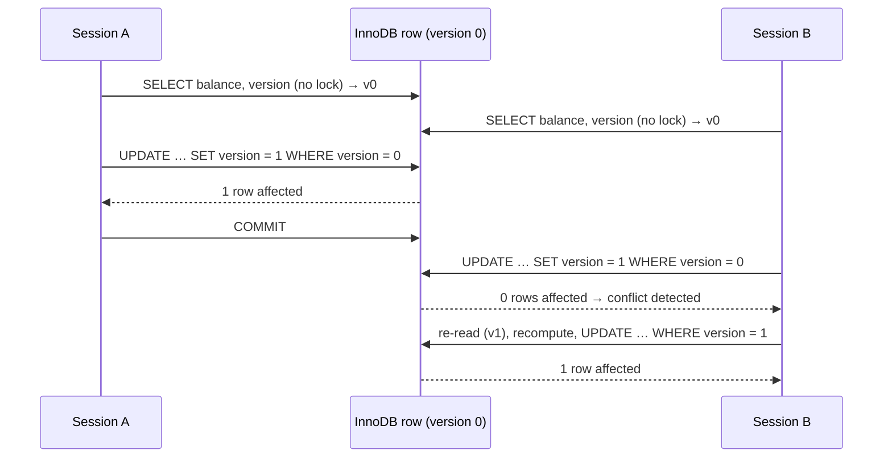

## Introduction

The lost update is the most common concurrency bug in business applications: two users (or two service instances) read the same record, each changes it in memory, and the second save silently overwrites the first. The read-phenomena lesson showed it losing a 100.00 deposit at InnoDB's default isolation level.

There are two families of solutions, and choosing between them is a design decision you will make again and again:

- **Pessimistic concurrency control** assumes conflicts are likely, so it **prevents** them: lock the data when you read it (`SELECT … FOR UPDATE`), and nobody else can change it until you commit.
- **Optimistic concurrency control** assumes conflicts are rare, so it **detects** them: read without locks, and at write time check that nobody changed the data in the meantime (a `version` column and a compare-and-set `UPDATE … WHERE version = ?`). On conflict, retry or tell the user.

A third option often beats both: express the change as a single **atomic `UPDATE`** that computes the new value inside the database (`SET balance = balance - ? WHERE balance >= ?`). And for one important special case — many workers taking items from a shared queue — MySQL offers `SKIP LOCKED`.

This lesson implements all four patterns on the bank schema (whose `accounts.version` column exists precisely for optimistic locking), shows each one under real concurrency, and gives a decision framework.

:::note[Dataset]
The examples use the **bank** dataset: `accounts.version` starts at 0 for every account; account 1 holds 492.57. Job-queue scenarios build a `payout_jobs` table in their own setup. Sessions A, B and C are real concurrent connections at REPEATABLE READ.
:::

## DBMS Theory

:::theory[Two families of concurrency control]
**Pessimistic (lock-based) concurrency control** — two-phase locking and its variants — requires a transaction to obtain a lock before accessing data. Conflicts are resolved by **waiting** (and, for deadlocks, by aborting a victim). Correctness is guaranteed before the operation proceeds.

**Optimistic concurrency control (OCC)**, introduced by Kung and Robinson (1981), runs each transaction in three phases: a **read phase** (work on private copies without locks), a **validation phase** (check whether any data the transaction read was changed by a concurrent committed transaction), and a **write phase** (publish changes if validation succeeded; otherwise abort and restart). Conflicts are resolved by **aborting and retrying**.

Which is cheaper depends on the conflict rate: with few conflicts, OCC avoids all locking overhead and waiting; with many conflicts, OCC wastes work on repeated aborts while locking would simply queue the transactions.
:::

In application development the terms are used more loosely, at the level of a **business operation** that may span several database transactions — for example, an edit form that is loaded in one HTTP request and saved minutes later in another:

| | Pessimistic | Optimistic |
|---|---|---|
| Mechanism | `SELECT … FOR UPDATE` (or `FOR SHARE`) inside the transaction that writes | `version` (or timestamp/hash) read with the data, checked in `UPDATE … WHERE id = ? AND version = ?` |
| Conflict handling | Second writer **waits** | Second writer's update **affects 0 rows** → retry or report |
| Can span user think time? | No — would hold locks for minutes | Yes — no locks between read and write |
| Deadlock risk | Yes (lock ordering needed) | None in the read phase |
| Best when | Conflicts frequent, transactions short | Conflicts rare, think time long, many readers |

The compare-and-set update is the database-level analogue of a CPU's **compare-and-swap** instruction: "set the value to *new* only if it is still *expected*". Its atomicity comes from InnoDB executing the `UPDATE` as a **current read under an exclusive lock**: the `WHERE version = ?` predicate is evaluated on the latest committed version of the row while no one else can change it.

:::standard[Standard SQL vs MySQL]
Version columns and compare-and-set updates are plain standard SQL and portable to every relational database. `SELECT … FOR UPDATE` is widely supported (standard in cursor contexts). `SKIP LOCKED` and `NOWAIT` exist in MySQL 8.0+, PostgreSQL and Oracle with similar semantics but are not in the SQL standard. `UPDATE … ORDER BY … LIMIT` is a MySQL extension. How the affected-row count is reported (changed rows vs matched rows, the `CLIENT_FOUND_ROWS` flag) is MySQL client-protocol behaviour.
:::

## Why It Exists

Isolation levels protect **reads**. They do not protect a write that is based on an earlier read: at REPEATABLE READ the snapshot even guarantees you keep seeing the old value. Every read-modify-write therefore needs one of these patterns, chosen consciously:

- A **bank teller** application where two tellers might work on the same account at once: short transactions, real conflicts → pessimistic or atomic.
- An **account settings page** that a customer edits for three minutes before saving: holding a database lock for three minutes is unacceptable → optimistic, with a friendly "this record was changed by someone else" message.
- A **REST API** with `ETag`/`If-Match` headers: the HTTP layer already speaks optimistic concurrency, and the `version` column is the ETag.
- **Background workers** pulling tasks from a table: they must never process the same task twice and should not wait for each other → `FOR UPDATE SKIP LOCKED`.

Without these patterns, the failure is silent: no error, no warning, just a deposit that never happened or an address change that disappeared.

## Internal Working

:::internals[Why each pattern is correct in InnoDB]
- **Pessimistic `SELECT … FOR UPDATE`** is a locking read: it bypasses the snapshot, reads the **latest committed** version, and takes an exclusive record lock (plus next-key/gap locks for range searches at REPEATABLE READ). A second transaction's `FOR UPDATE` on the same row waits; when it proceeds, it reads the value the first transaction committed. The application's computation is therefore always based on current data.
- **Optimistic `UPDATE … WHERE version = ?`** is also a current read. If another transaction has an **uncommitted** change to the row, the `UPDATE` waits for its lock; when that transaction commits, the `UPDATE` re-reads the row, sees the incremented version, the predicate is false, and **0 rows** are affected. If the other transaction rolls back, the predicate is still true and the update proceeds. No snapshot can fool it.
- **Atomic `UPDATE … SET x = x - ? WHERE x >= ?`** computes on the current version under the lock — read, check and write become one indivisible step.
- **`FOR UPDATE SKIP LOCKED`** asks InnoDB to skip any row whose lock it cannot obtain immediately, instead of waiting. Each worker therefore locks a disjoint set of rows. Rows are skipped only if *locked*, so a crashed worker's rows become available again as soon as its transaction is rolled back (the connection closes or a timeout fires).
- **Affected rows.** For `UPDATE`, MySQL reports the number of rows actually *changed* by default; a client that sets the `CLIENT_FOUND_ROWS` capability receives the number of rows *matched* instead (MySQL Connector/J does this by default unless `useAffectedRows=true`). Because an optimistic update always changes `version`, matched and changed coincide — one more reason to increment a version rather than compare "old values".
:::



## MySQL Implementation

### Pessimistic: lock, compute, write

```sql
START TRANSACTION;
SELECT balance FROM accounts WHERE account_id = ? FOR UPDATE;   -- lock now
-- application computes new_balance
UPDATE accounts SET balance = ?, version = version + 1 WHERE account_id = ?;
COMMIT;                                                         -- lock released
```

### Optimistic: read, compute, compare-and-set

```sql
SELECT balance, version FROM accounts WHERE account_id = ?;     -- no lock, any transaction
-- application computes new_balance; time may pass (user think time)
UPDATE accounts SET balance = ?, version = version + 1
WHERE account_id = ? AND version = ?;                           -- the version that was read
-- affected rows = 1 → success; 0 → somebody else changed it: re-read and retry, or report
```

In SQL you can read the affected-row count with `ROW_COUNT()` immediately after the `UPDATE`:

```sql run
SELECT account_id, balance, version FROM accounts WHERE account_id = 5;
```

```sql run
UPDATE accounts SET balance = 7098.91, version = version + 1 WHERE account_id = 5 AND version = 0;
SELECT ROW_COUNT() AS rows_updated;
```

```sql run
UPDATE accounts SET balance = 7198.91, version = version + 1 WHERE account_id = 5 AND version = 0;
SELECT ROW_COUNT() AS rows_updated;
SELECT account_id, balance, version FROM accounts WHERE account_id = 5;
```

The first compare-and-set matched version 0 and succeeded; the second, still expecting version 0, matched nothing — the conflict a real application would detect — and the balance kept the first update's value.

### Atomic: let the database do the arithmetic

```sql run
UPDATE accounts SET balance = balance - 100.00, version = version + 1
WHERE account_id = 23 AND status = 'active' AND balance >= 100.00;
SELECT ROW_COUNT() AS withdrawn;
UPDATE accounts SET balance = balance - 100.00, version = version + 1
WHERE account_id = 23 AND status = 'active' AND balance >= 100.00;
SELECT ROW_COUNT() AS withdrawn_again;
SELECT account_id, balance, version FROM accounts WHERE account_id = 23;
```

Account 23 held 144.47: the first withdrawal of 100.00 succeeded, the second matched no row (only 44.47 left) — a clean "insufficient funds" signal without an error and without a prior `SELECT`.

## Syntax Breakdown

| Pattern | Core SQL | Success signal | Conflict signal |
|---|---|---|---|
| Pessimistic | `SELECT … FOR UPDATE` then `UPDATE` | Rows returned, update succeeds | Waiting (then 1205 on timeout, 1213 on deadlock); `NOWAIT` → 3572 |
| Optimistic (version) | `UPDATE … SET …, version = version + 1 WHERE id = ? AND version = ?` | Affected rows = 1 | Affected rows = 0 |
| Optimistic (value CAS) | `UPDATE … SET status = 'frozen' WHERE id = ? AND status = 'active'` | 1 | 0 |
| Atomic increment | `UPDATE … SET balance = balance + ? WHERE id = ?` | 1 | — (never conflicts, only waits briefly) |
| Atomic guarded | `UPDATE … SET stock = stock - ? WHERE id = ? AND stock >= ?` | 1 | 0 (= rule would be violated) |
| Queue claim (lock) | `SELECT … WHERE status = 'queued' ORDER BY id LIMIT n FOR UPDATE SKIP LOCKED` | Rows returned | Empty result = nothing available |
| Queue claim (atomic) | `UPDATE jobs SET status = 'running', worker = ? WHERE status = 'queued' ORDER BY id LIMIT 1` | 1 | 0 |
| Read affected rows in SQL | `SELECT ROW_COUNT()` right after the DML | | |

Version column choices:

| Column | Pros | Cons |
|---|---|---|
| `version INT UNSIGNED` incremented on every update | Exact, cheap, always changes | Every writer must increment it |
| `updated_at TIMESTAMP(6) ON UPDATE CURRENT_TIMESTAMP(6)` | Automatic | Two updates within the same microsecond are indistinguishable; clock changes |
| Hash of the row's relevant columns | No schema change | Costly to compute; ABA problem (value changes and changes back) |

## Practical Examples

### 1. Pessimistic: the second teller waits for the first

```concurrency
title: SELECT … FOR UPDATE serialises two read-modify-write cycles
description: Teller A deposits 100.00 and teller B withdraws 50.00 from account 1. Each locks the row, computes the new balance in the application, and writes it.
steps:
  - session: A
    sql: START TRANSACTION; SELECT balance FROM accounts WHERE account_id = 1 FOR UPDATE;
    note: A reads 492.57 and computes 592.57.
  - session: B
    sql: START TRANSACTION;
  - session: B
    sql: SELECT balance FROM accounts WHERE account_id = 1 FOR UPDATE;
    expect: blocks
    note: B cannot even read for update until A finishes.
  - session: A
    sql: UPDATE accounts SET balance = 592.57, version = version + 1 WHERE account_id = 1; COMMIT;
    note: B's locking read now returns 592.57 — the committed value.
  - session: B
    sql: UPDATE accounts SET balance = 542.57, version = version + 1 WHERE account_id = 1; COMMIT; SELECT balance, version FROM accounts WHERE account_id = 1;
    note: B computed 592.57 − 50.00 = 542.57 from current data.
```

B's locking read waited and then returned **592.57**, so B's absolute write of 542.57 was correct and both operations counted (version 2). Compare with the read-phenomena lesson, where the same two writes with plain `SELECT`s ended at 442.57. The cost: B waited for the whole duration of A's transaction.

### 2. Optimistic: the second writer detects the conflict

```concurrency
title: Version check — B's stale update affects 0 rows
description: A and B both read account 1 (balance and version) without locks. A saves first. B then tries to save based on what it read.
steps:
  - session: A
    sql: SELECT balance, version FROM accounts WHERE account_id = 1;
    note: A reads 492.57, version 0.
  - session: B
    sql: SELECT balance, version FROM accounts WHERE account_id = 1;
    note: B reads the same.
  - session: A
    sql: UPDATE accounts SET balance = 592.57, version = version + 1 WHERE account_id = 1 AND version = 0; SELECT ROW_COUNT() AS rows_updated;
    note: Autocommit — A's deposit is saved; version is now 1.
  - session: B
    sql: UPDATE accounts SET balance = 442.57, version = version + 1 WHERE account_id = 1 AND version = 0; SELECT ROW_COUNT() AS rows_updated;
    note: B still expects version 0 — nothing matches. Conflict detected instead of a lost update.
  - session: B
    sql: SELECT balance, version FROM accounts WHERE account_id = 1;
    note: B re-reads (592.57, version 1) and retries its withdrawal.
  - session: B
    sql: UPDATE accounts SET balance = 542.57, version = version + 1 WHERE account_id = 1 AND version = 1; SELECT ROW_COUNT() AS rows_updated;
  - session: C
    sql: SELECT balance, version FROM accounts WHERE account_id = 1;
```

A's update reported **1** row, B's first attempt **0** rows. After re-reading and recomputing, B's second attempt succeeded, and the final state is 542.57 at version 2 — the same correct result as the pessimistic version, but nobody ever waited, and no lock was held while the "application" was thinking.

### 3. Optimistic checks are safe even while the other transaction is open

```concurrency
title: Compare-and-set against an uncommitted change
description: A's version-checked update is inside an open transaction when B issues its own version-checked update for the same expected version.
steps:
  - session: A
    sql: START TRANSACTION; UPDATE accounts SET balance = balance + 100.00, version = version + 1 WHERE account_id = 1 AND version = 0;
  - session: B
    sql: UPDATE accounts SET balance = balance - 50.00, version = version + 1 WHERE account_id = 1 AND version = 0;
    expect: blocks
    note: B's UPDATE is a current read; the row is locked by A, so B waits rather than reading a snapshot.
  - session: A
    sql: COMMIT;
    note: B re-evaluates WHERE version = 0 on the committed row (version 1) — it no longer matches.
  - session: B
    sql: SELECT ROW_COUNT() AS rows_updated_by_previous_statement;
  - session: C
    sql: SELECT balance, version FROM accounts WHERE account_id = 1;
```

B waited for A and then updated **zero** rows — both the completed `UPDATE` and the following `ROW_COUNT()` report 0 — and the final balance is A's 592.57 at version 1. The compare-and-set did not overwrite A's change, even though a snapshot read by B would still have shown version 0: the `UPDATE` waited for A's lock and then evaluated `version = 0` against the committed row.

### 4. Atomic guarded updates: two withdrawals that would overdraw

```concurrency
title: Two guarded withdrawals of 400.00 from 492.57
description: A and B each run UPDATE … SET balance = balance - 400 WHERE balance >= 400. A's transaction is open when B arrives.
steps:
  - session: A
    sql: START TRANSACTION; UPDATE accounts SET balance = balance - 400.00, version = version + 1 WHERE account_id = 1 AND balance >= 400.00;
  - session: B
    sql: UPDATE accounts SET balance = balance - 400.00, version = version + 1 WHERE account_id = 1 AND balance >= 400.00;
    expect: blocks
  - session: A
    sql: COMMIT;
    note: B re-evaluates the guard on the committed balance (92.57) — it fails, so B changes nothing.
  - session: C
    sql: SELECT balance, version FROM accounts WHERE account_id = 1;
```

The final balance is **92.57** at version 1: one withdrawal happened, the second was refused by its own `WHERE` clause after waiting — with **no error**, unlike the unguarded version in *ACID in Practice*, where the second statement failed the `CHECK` constraint. The application reads the affected-row count (0) and reports "insufficient funds". The `CHECK (balance >= 0)` constraint remains as a safety net.

### 5. A job queue with SKIP LOCKED — and a gap-lock surprise at REPEATABLE READ

```concurrency
title: SKIP LOCKED workers at REPEATABLE READ — claiming works, but finishing a job can wait
description: Three queued payout jobs. Workers A and B each claim one job with FOR UPDATE SKIP LOCKED. B finishes first; A then "crashes" (rolls back) before finishing, and worker C claims what is available.
dataset: empty
setup: |
  CREATE TABLE payout_jobs (
    job_id INT PRIMARY KEY,
    account_id INT NOT NULL,
    amount DECIMAL(14,2) NOT NULL,
    status VARCHAR(10) NOT NULL DEFAULT 'queued',
    worker VARCHAR(10) NULL,
    KEY idx_status (status, job_id)
  );
  INSERT INTO payout_jobs (job_id, account_id, amount) VALUES (1, 3, 250.00), (2, 6, 900.00), (3, 8, 75.00);
steps:
  - session: A
    sql: START TRANSACTION; SELECT job_id, amount FROM payout_jobs WHERE status = 'queued' ORDER BY job_id LIMIT 1 FOR UPDATE SKIP LOCKED;
    note: A claims job 1.
  - session: B
    sql: START TRANSACTION; SELECT job_id, amount FROM payout_jobs WHERE status = 'queued' ORDER BY job_id LIMIT 1 FOR UPDATE SKIP LOCKED;
    note: Job 1 is locked by A, so B skips it and claims job 2 — without waiting.
  - session: B
    sql: UPDATE payout_jobs SET status = 'done', worker = 'B' WHERE job_id = 2;
    expect: blocks
    note: Surprise — B waits for A although they work on different jobs.
  - observe: locks
  - session: A
    sql: ROLLBACK;
    note: Worker A crashes before finishing. Its rollback releases its locks; job 1 is still 'queued', and B's UPDATE completes.
  - session: B
    sql: COMMIT;
  - session: C
    sql: START TRANSACTION; SELECT job_id, amount FROM payout_jobs WHERE status = 'queued' ORDER BY job_id LIMIT 1 FOR UPDATE SKIP LOCKED;
    note: Job 1 is available again — C picks it up.
  - session: C
    sql: UPDATE payout_jobs SET status = 'done', worker = 'C' WHERE job_id = 1; COMMIT; SELECT job_id, status, worker FROM payout_jobs ORDER BY job_id;
```

The claims worked as intended: A got job 1, B got job 2, nobody waited, and after A's "crash" (rollback) job 1 was still `queued` and C claimed it. Final state: jobs 1 and 2 done (by C and B), job 3 still queued. Because claim and work happen in **one** transaction, a worker crash can never lose a job or mark it done prematurely.

But B's `UPDATE … SET status = 'done'` **waited for A**. The lock snapshot explains why. At REPEATABLE READ, A's claim took a **next-key** lock `X` on its `idx_status` entry `'queued', 1` — covering that record *and the gap before it*. Changing B's job to `'done'` moves its index entry: InnoDB must insert a new `idx_status` entry `('done', 2)`, which sorts **before** `('queued', 1)` and therefore lands in A's locked gap. B's request appears as `X,GAP,INSERT_INTENTION` `WAITING` on `'queued', 1`. With long-running jobs, every worker that finishes would queue behind the oldest unfinished claim.

### 6. The same queue at READ COMMITTED

```concurrency
title: SKIP LOCKED workers at READ COMMITTED — no gap locks, no waiting
description: The same three jobs and the same steps, with every worker session at READ COMMITTED.
dataset: empty
setup: |
  CREATE TABLE payout_jobs (
    job_id INT PRIMARY KEY,
    account_id INT NOT NULL,
    amount DECIMAL(14,2) NOT NULL,
    status VARCHAR(10) NOT NULL DEFAULT 'queued',
    worker VARCHAR(10) NULL,
    KEY idx_status (status, job_id)
  );
  INSERT INTO payout_jobs (job_id, account_id, amount) VALUES (1, 3, 250.00), (2, 6, 900.00), (3, 8, 75.00);
steps:
  - session: A
    sql: SET SESSION TRANSACTION ISOLATION LEVEL READ COMMITTED; START TRANSACTION; SELECT job_id, amount FROM payout_jobs WHERE status = 'queued' ORDER BY job_id LIMIT 1 FOR UPDATE SKIP LOCKED;
  - session: B
    sql: SET SESSION TRANSACTION ISOLATION LEVEL READ COMMITTED; START TRANSACTION; SELECT job_id, amount FROM payout_jobs WHERE status = 'queued' ORDER BY job_id LIMIT 1 FOR UPDATE SKIP LOCKED;
  - observe: locks
  - session: B
    sql: UPDATE payout_jobs SET status = 'done', worker = 'B' WHERE job_id = 2; COMMIT;
    note: No wait this time.
  - session: A
    sql: ROLLBACK;
  - session: C
    sql: SET SESSION TRANSACTION ISOLATION LEVEL READ COMMITTED; START TRANSACTION; SELECT job_id, amount FROM payout_jobs WHERE status = 'queued' ORDER BY job_id LIMIT 1 FOR UPDATE SKIP LOCKED;
  - session: C
    sql: UPDATE payout_jobs SET status = 'done', worker = 'C' WHERE job_id = 1; COMMIT; SELECT job_id, status, worker FROM payout_jobs ORDER BY job_id;
```

At READ COMMITTED the claims take only `X,REC_NOT_GAP` record locks (on `'queued', 1` and `'queued', 2` in `idx_status` and on the primary-key records) — no gaps — so B's status change inserted its new index entry without waiting. The outcome is the same as before, minus the stall. For queue workers this is the usual recommendation: run them at READ COMMITTED (they need no repeatable snapshot), or claim with an atomic `UPDATE` and work in a separate transaction (see below).

## Execution Walkthrough

### One optimistic edit, step by step

The walkthrough below follows an "edit customer account" form through its two HTTP requests — load and save — with a concurrent change in between (made in the same lab session for illustration).

```walkthrough
title: Optimistic edit of account 15 across two requests
steps:
  - title: "1. Request 1 — load the form"
    explain: >-
      The page reads the account and keeps the version (0) in a hidden form field or an ETag. No transaction
      stays open and no lock is held while the user edits.
    sql: SELECT account_id, status, balance, version FROM accounts WHERE account_id = 15;
  - title: "2. Meanwhile — another process changes the account"
    explain: A back-office job freezes account 15 and bumps the version, as every writer must.
    sql: |
      UPDATE accounts SET status = 'frozen', version = version + 1 WHERE account_id = 15;
      SELECT account_id, status, version FROM accounts WHERE account_id = 15;
  - title: "3. Request 2 — save with the version from step 1"
    explain: >-
      The user's save sets status back to 'active' — but only if the version is still 0. It is 1, so zero rows
      change. Without the version check, the user would have silently unfrozen the account.
    sql: |
      UPDATE accounts SET status = 'active', version = version + 1 WHERE account_id = 15 AND version = 0;
      SELECT ROW_COUNT() AS rows_updated;
  - title: "4. Report the conflict"
    explain: >-
      The application re-reads the current state and shows it to the user ("This account was changed by someone
      else: it is now frozen"). The user decides; a blind automatic retry would be wrong here because the user's
      intent was based on outdated information.
    sql: SELECT account_id, status, version FROM accounts WHERE account_id = 15;
```

### An atomic queue claim without SKIP LOCKED

When each job can be claimed and **completed in separate transactions** (so the claim does not hold a lock while the job runs), claim with a single atomic `UPDATE` that writes the worker's name, then read back what you claimed:

```sql run
CREATE TABLE payout_jobs (
  job_id INT PRIMARY KEY, account_id INT NOT NULL, amount DECIMAL(14,2) NOT NULL,
  status VARCHAR(10) NOT NULL DEFAULT 'queued', worker VARCHAR(10) NULL,
  claimed_at DATETIME NULL, KEY idx_status (status, job_id)
);
INSERT INTO payout_jobs (job_id, account_id, amount) VALUES (1, 3, 250.00), (2, 6, 900.00), (3, 8, 75.00);
UPDATE payout_jobs SET status = 'running', worker = 'w1', claimed_at = '2024-12-31 08:00:00'
WHERE status = 'queued' ORDER BY job_id LIMIT 1;
SELECT ROW_COUNT() AS claimed;
SELECT job_id, status, worker FROM payout_jobs WHERE worker = 'w1' AND status = 'running';
```

The claim is committed immediately, so a crashed worker leaves a `running` row behind; a sweeper job must reset rows whose `claimed_at` is older than a **lease** timeout (`UPDATE … SET status = 'queued', worker = NULL WHERE status = 'running' AND claimed_at < NOW() - INTERVAL 10 MINUTE`). This is the "visibility timeout" model used by message queues.

## Output

- **Pessimistic** (Example 1): B waited for A's lock, then read 592.57 and wrote 542.57; final version 2.
- **Optimistic** (Example 2): A's compare-and-set affected 1 row, B's first attempt 0 rows; after re-reading, B's retry succeeded; final 542.57, version 2; no waiting.
- **Optimistic vs open transaction** (Example 3): B's version check waited for A's lock and then matched nothing; final 592.57, version 1.
- **Atomic guarded** (Example 4): one of two concurrent 400.00 withdrawals happened; final 92.57; no error.
- **SKIP LOCKED queue** (Examples 5 and 6): two workers claimed different jobs simultaneously and a rolled-back claim made job 1 available again (final: jobs 1 and 2 done, job 3 queued); at REPEATABLE READ, B's status update waited on A's next-key lock in `idx_status`, at READ COMMITTED it did not.
- **Single-session runs**: the stale compare-and-set on account 5 updated 0 rows; the guarded withdrawals on account 23 succeeded once and then reported 0; the walkthrough's save on account 15 was refused because the version had moved to 1.

## Alternative Approaches

| Situation | Best fit | Why |
|---|---|---|
| Simple counter or balance change, rule expressible in SQL | **Atomic UPDATE** (`SET x = x ± ?` with a guard) | One statement, shortest lock, no retries, no application round trip |
| Several rows/tables must be read, decided on and written together; conflicts common | **Pessimistic** `FOR UPDATE` in a short transaction, rows locked in a fixed order | Waiting is cheaper than repeated aborts; decisions use current data |
| User edits with think time; conflicts rare | **Optimistic** version column | No locks across requests; conflicts shown to the user |
| REST/HTTP APIs | **Optimistic** with `ETag` = version and `If-Match` | Standard HTTP semantics (412 Precondition Failed) |
| Many workers, shared queue, short jobs | **`FOR UPDATE SKIP LOCKED`** | No waiting, no double processing, crash-safe within one transaction |
| Long-running jobs | **Atomic claim + lease** | Does not hold row locks for the job's duration |
| Cross-row rules (write skew) | Pessimistic lock on a parent/limits row, or SERIALIZABLE | Optimistic per-row versions do not catch write skew unless every participant updates a common version row |

The last row matters: optimistic locking on individual rows does **not** prevent write skew, because each transaction updates a different row with its own version. To protect a rule spanning rows, both transactions must touch a **common** row — for example, increment a `version` on the customer row in every withdrawal from any of that customer's accounts — or lock it pessimistically.

## Performance Analysis

The trade-off is between **waiting** and **retrying**:

| Factor | Pessimistic | Optimistic | Atomic |
|---|---|---|---|
| Cost with no contention | Lock acquisition (cheap) | Nothing extra | Nothing extra |
| Cost under contention | Queueing: throughput limited by lock hold time | Wasted work: each conflict re-reads, recomputes, re-sends | Queueing, but hold time is minimal |
| Lock hold time | Whole transaction, including application computation | Only during the final `UPDATE` (and its transaction) | Only the `UPDATE`'s transaction |
| Deadlocks | Possible; need ordering + retries | Not in the read phase; the final updates can still deadlock if a transaction updates several rows in inconsistent order | Possible if several rows are updated in inconsistent order |
| Behaviour on a hot row | Orderly queue | Retry storm; starvation possible for slow clients | Orderly queue, fastest |

For **queues**, `SKIP LOCKED` scales with the number of workers as long as each claim scans few rows: an index on `(status, job_id)` lets the claim query find the next queued rows without scanning completed ones. Without it, every claim scans (and at REPEATABLE READ, locks or skips) far more rows. Deleting or archiving completed jobs keeps the index small.

:::performance[Theory vs measurement]
The crossover point between optimistic and pessimistic depends on conflict probability, transaction length and retry cost in *your* system. Instrument it: count optimistic conflicts (affected rows = 0) and retries per operation, and measure lock waits (`Innodb_row_lock_waits`, `Innodb_row_lock_time`) for the pessimistic variant under realistic load before choosing.
:::

## Best Practices

:::best-practice[Choosing and implementing concurrency patterns]
1. **Prefer an atomic `UPDATE` whenever the new value can be computed in SQL**, guarded by the business rule in `WHERE`, and check the affected-row count.
2. **Use optimistic locking for anything that spans user think time or multiple requests**; never hold database locks across HTTP requests.
3. **Make every writer increment the version** — including back-office jobs and admin scripts — or the version check is meaningless. A trigger can enforce it (Module 9), or the column can be maintained by the ORM (JPA `@Version`, Rails `lock_version`, Django packages).
4. **Treat affected rows = 0 as a first-class outcome**: retry automatically only when the operation can be safely recomputed; otherwise show the conflict to the user.
5. **Keep pessimistic transactions short** and lock rows in a consistent order; use `NOWAIT` for user-facing "try to reserve" actions.
6. **For queues, index `(status, id)`**, claim with `FOR UPDATE SKIP LOCKED LIMIT n`, run workers at **READ COMMITTED** (Example 6) so next-key locks on the status index do not make finishing workers wait for each other, and decide explicitly between "claim and work in one transaction" (crash-safe, holds the lock) and "atomic claim + lease" (no long locks, needs a sweeper).
7. **Never base an absolute write on a plain `SELECT`** — that is the lost update.
:::

## Common Mistakes

**Mistake 1 — checking the version in the application instead of in the `UPDATE`.** `SELECT version` → "still 0, good" → `UPDATE … WHERE account_id = ?` is a race: another transaction can commit between the check and the write. The check must be part of the `UPDATE`'s `WHERE` clause.

**Mistake 2 — ignoring the affected-row count.** An optimistic `UPDATE` that matches nothing is not an error; if the code does not check `ROW_COUNT()` (or the driver's equivalent), the conflict is detected by the database and then ignored by the application:

```sql run
UPDATE accounts SET status = 'closed', version = version + 1 WHERE account_id = 2 AND version = 99;
SELECT ROW_COUNT() AS rows_updated;
```

No error, no warning — just 0 rows.

**Mistake 3 — forgetting to increment the version in one code path.** A batch job that updates balances without `version = version + 1` makes every concurrent optimistic edit succeed against stale data.

**Mistake 4 — `FOR UPDATE` across user interaction.** Opening a transaction, locking the row, rendering a form and waiting for the user holds an exclusive lock for minutes; other users queue, connections pile up, and lock-wait timeouts fire.

**Mistake 5 — using `SKIP LOCKED` for reporting.** A count with `SKIP LOCKED` silently ignores rows other transactions are working on. It is a work-distribution tool, not a read strategy.

**Mistake 6 — comparing "old values" instead of a version.** `UPDATE … WHERE balance = 492.57` is vulnerable to the **ABA problem**: the balance could change to 592.57 and back to 492.57 between read and write, and the stale update would succeed. A monotonically increasing version cannot repeat.

## Industry Application

- **ORMs**: JPA/Hibernate `@Version`, Ruby on Rails `lock_version`, Entity Framework concurrency tokens and many Django libraries implement exactly the compare-and-set update above and raise an exception (e.g. `OptimisticLockException`, `StaleObjectError`) when the affected-row count is 0. Their pessimistic options (`LockModeType.PESSIMISTIC_WRITE`, `lock!`, `select_for_update()`) emit `SELECT … FOR UPDATE`.
- **HTTP APIs**: the version becomes the `ETag`; clients send `If-Match`, and the server returns `412 Precondition Failed` when the compare-and-set updates 0 rows. Cloud APIs (Kubernetes `resourceVersion`, Google Cloud `etag` fields) use the same idea.
- **Inventory and ticketing**: `UPDATE inventory SET available = available - ? WHERE sku = ? AND available >= ?` is the standard oversell guard in e-commerce, often combined with a reservation table.
- **Background job systems** built on relational databases (for example Rails' Solid Queue, and similar libraries for other ecosystems) rely on `FOR UPDATE SKIP LOCKED` in MySQL 8.0+ and PostgreSQL to let many workers poll one table efficiently.
- **Financial ledgers** usually combine patterns: pessimistic locks on the account rows in a fixed order for transfers, atomic guarded updates for simple debits, and optimistic versions on customer-profile edits.

## Practice Exercises

```exercise
id: ex1
title: An optimistic save
difficulty: easy
kind: dml
concepts: [optimistic-locking, version-column]
prompt: |
  A user loaded account **18** when its `version` was **0** and now saves a change: `status = 'frozen'`. Write the
  optimistic update that applies the change only if the version is still 0, and increments the version.
hints:
  - "The expected version goes into the WHERE clause; the increment goes into SET."
  - "UPDATE accounts SET status = 'frozen', version = version + 1 WHERE account_id = 18 AND version = 0;"
solution: |
  UPDATE accounts SET status = 'frozen', version = version + 1 WHERE account_id = 18 AND version = 0;
check: |
  SELECT account_id, status, version FROM accounts WHERE account_id = 18;
explanation: |
  The `AND version = 0` makes the update a compare-and-set: it succeeds only if nobody changed the row since it was
  loaded, and the increment invalidates every other copy loaded at version 0. Omitting `version = version + 1` is
  a classic bug — later stale saves would still match version 0.
```

```exercise
id: ex2
title: Claim the next job atomically
difficulty: medium
kind: dml
concepts: [atomic-update, job-queue]
setup: |
  CREATE TABLE payout_jobs (
    job_id INT PRIMARY KEY, account_id INT NOT NULL, amount DECIMAL(14,2) NOT NULL,
    status VARCHAR(10) NOT NULL DEFAULT 'queued', worker VARCHAR(10) NULL, KEY idx_status (status, job_id)
  );
  INSERT INTO payout_jobs (job_id, account_id, amount, status, worker) VALUES
    (1, 3, 250.00, 'done', 'w0'), (2, 6, 900.00, 'queued', NULL), (3, 8, 75.00, 'queued', NULL);
prompt: |
  Worker `'w2'` must claim **the lowest-numbered queued job** with a **single statement** (no SELECT first, no
  explicit transaction): set its `status` to `'running'` and `worker` to `'w2'`.
hints:
  - "MySQL allows ORDER BY and LIMIT in a single-table UPDATE."
  - "UPDATE payout_jobs SET … WHERE status = 'queued' ORDER BY job_id LIMIT 1;"
solution: |
  UPDATE payout_jobs SET status = 'running', worker = 'w2'
  WHERE status = 'queued' ORDER BY job_id LIMIT 1;
check: |
  SELECT job_id, status, worker FROM payout_jobs ORDER BY job_id;
explanation: |
  The UPDATE locks and changes the first queued row in one atomic step; a concurrent worker running the same
  statement waits briefly for the lock, then re-evaluates `status = 'queued'` and claims the next job instead.
  The worker then reads back its claim with `WHERE worker = 'w2' AND status = 'running'`. `ORDER BY … LIMIT` in
  UPDATE is a MySQL extension; in other databases use `FOR UPDATE SKIP LOCKED` in a subquery or CTE.
```

```exercise
id: ex3
title: Find stale client caches
difficulty: medium
concepts: [optimistic-locking, version-column]
setup: |
  CREATE TABLE client_cache (client VARCHAR(10), account_id INT UNSIGNED, cached_version INT UNSIGNED,
                             PRIMARY KEY (client, account_id));
  INSERT INTO client_cache VALUES ('mobile', 1, 0), ('mobile', 2, 0), ('web', 3, 0), ('web', 4, 1);
  UPDATE accounts SET version = version + 1 WHERE account_id IN (2, 3);
  UPDATE accounts SET version = version + 1 WHERE account_id = 3;
prompt: |
  Clients cache account data together with the version they saw. Return the cache entries that are **stale or
  invalid** — the cached version differs from the account's current version — with columns `client`,
  `account_id`, `cached_version`, `current_version`, ordered by `client`, then `account_id`.
hints:
  - "Join client_cache to accounts on account_id."
  - "Compare cached_version with accounts.version using <>."
solution: |
  SELECT c.client, c.account_id, c.cached_version, a.version AS current_version
  FROM client_cache c
  JOIN accounts a ON a.account_id = c.account_id
  WHERE c.cached_version <> a.version
  ORDER BY c.client, c.account_id;
orderMatters: true
explanation: |
  Version columns are useful beyond write conflicts: they make cache invalidation and incremental sync cheap
  ("send me everything whose version changed"). Account 4's cached version (1) is *ahead* of the database (0) —
  impossible in a correct system, so it also appears and deserves investigation.
```

```exercise
id: ex4
title: Choose the pattern
difficulty: hard
kind: open
concepts: [optimistic-locking, pessimistic-locking, atomic-update, skip-locked]
prompt: |
  For each feature, choose pessimistic locking, optimistic locking, an atomic UPDATE, or SKIP LOCKED, and justify
  the choice in two or three sentences:

  1. "Like" counter on a viral post receiving thousands of likes per second.
  2. A customer support agent editing a customer's address in a web form.
  3. Transferring money between two accounts, including writing ledger rows.
  4. Twenty workers sending queued notification emails.
  5. Applying monthly interest to all savings accounts in a nightly job while customers are active.
solution: |
  1. **Atomic UPDATE** (`SET likes = likes + 1`) — and for extreme rates, split the counter into N slot rows (or
     aggregate in memory and flush). Optimistic would retry constantly on a hot row; pessimistic would add a
     round trip while holding the lock.
  2. **Optimistic** (version column, `If-Match`/ETag). Think time is long and conflicts are rare; show a
     "changed by someone else" message on 0 affected rows.
  3. **Pessimistic** in one short transaction: `SELECT … WHERE account_id IN (a, b) ORDER BY account_id FOR UPDATE`,
     then guarded updates and ledger inserts. Several rows must change together based on current balances; lock
     ordering prevents deadlocks. (Guarded atomic updates for the debit are a good complement.)
  4. **SKIP LOCKED** (`FOR UPDATE SKIP LOCKED LIMIT n` on an indexed status column), or an atomic claim with a
     lease if sending can take long. Workers never wait for each other and never send twice.
  5. **Atomic UPDATE** in key-ranged batches (`SET balance = balance * (1 + rate), version = version + 1 WHERE
     account_type = 'savings' AND account_id BETWEEN ? AND ?`), committing per batch. Incrementing `version`
     keeps concurrent optimistic edits honest; batching keeps lock time short.
```

```exercise
id: ex5
title: A crash-safe queue design
difficulty: challenge
kind: open
concepts: [job-queue, skip-locked, atomic-update]
prompt: |
  Design a MySQL-backed queue for payout jobs that take **between 2 seconds and 5 minutes** each (they call a
  payment provider). Requirements: many workers; no job processed twice concurrently; a crashed worker's job
  must be retried; a job's payout must not be sent twice even if a worker crashes after the provider accepted it.
  Give the table design, the claim SQL, completion SQL, recovery SQL, and explain how you meet the last
  requirement.
solution: |
  **Table**: `payout_jobs(job_id PK, account_id, amount, status ENUM('queued','running','done','failed'),
  worker, lease_until DATETIME, attempts INT, idempotency_key VARCHAR(64) UNIQUE, provider_ref VARCHAR(64) NULL,
  KEY (status, job_id), KEY (status, lease_until))`.

  Because jobs can run for minutes, do **not** hold a row lock for the job's duration (long transactions, purge
  lag, lock pile-ups). Use **claim + lease**:

  ~~~
  -- claim (short transaction)
  START TRANSACTION;
  SELECT job_id FROM payout_jobs WHERE status = 'queued' ORDER BY job_id LIMIT 1 FOR UPDATE SKIP LOCKED;
  UPDATE payout_jobs SET status = 'running', worker = ?, lease_until = NOW() + INTERVAL 10 MINUTE,
         attempts = attempts + 1 WHERE job_id = ?;
  COMMIT;
  -- complete (compare-and-set on ownership)
  UPDATE payout_jobs SET status = 'done', provider_ref = ? WHERE job_id = ? AND worker = ? AND status = 'running';
  -- recovery sweeper
  UPDATE payout_jobs SET status = 'queued', worker = NULL
  WHERE status = 'running' AND lease_until < NOW();
  ~~~

  The completion is a compare-and-set: if the lease expired and another worker took over, the first worker's
  completion affects 0 rows and it must not overwrite. Long jobs extend their lease periodically
  (`UPDATE … SET lease_until = … WHERE job_id = ? AND worker = ?`).

  **Exactly-once payout** cannot come from the database alone: a worker may crash after the provider accepted the
  payment but before marking the job done. Send the job's **idempotency key** to the provider with every
  attempt, so a retried request returns the original result instead of paying twice; on retry, first query the
  provider by idempotency key. Add a `max attempts` rule that moves a job to `failed` for human review.
```

## Knowledge Assessment

```quiz
- id: q1
  question: "Two sessions read account 1 at version 0. Session A runs `UPDATE accounts SET balance = 592.57, version = version + 1 WHERE account_id = 1 AND version = 0` and commits. What happens when B runs the same statement with balance 442.57?"
  options: ["It overwrites A's change", "It affects 0 rows", "It fails with error 1213", "It blocks forever"]
  answer: 1
  explanation: "B's WHERE version = 0 no longer matches (the row is at version 1), so 0 rows are affected — the conflict signal of optimistic locking, as captured in Example 2. It is not an error or a deadlock, and nothing blocks because A has committed."
  concepts: [optimistic-locking, compare-and-set]
- id: q2
  question: "Why is a compare-and-set `UPDATE … WHERE version = ?` safe at REPEATABLE READ, even though plain SELECTs read a snapshot?"
  options:
    - "Because UPDATE reads the latest committed version under an exclusive lock (a current read)"
    - "Because REPEATABLE READ prevents all lost updates"
    - "Because the version column is indexed"
    - "Because MySQL automatically retries conflicting updates"
  answer: 0
  explanation: "UPDATE is a locking/current read: it waits for uncommitted changes and evaluates the predicate on the committed row (Example 3). REPEATABLE READ alone does not prevent lost updates, indexing is irrelevant to correctness, and MySQL never retries for you."
  concepts: [compare-and-set]
- id: q3
  question: "Which situations favour optimistic over pessimistic concurrency control? (Select all that apply.)"
  type: multi
  options:
    - "A user edits a record in a form for several minutes before saving"
    - "Thousands of concurrent increments of the same counter row"
    - "A REST API using ETag and If-Match headers"
    - "Conflicts are rare and most transactions only read"
    - "A transfer that must lock two accounts and write ledger rows atomically under heavy contention"
  answer: [0, 2, 3]
  explanation: "Long think time, HTTP precondition semantics and low conflict rates suit optimistic control. A hot counter is best served by an atomic UPDATE (optimistic would retry constantly), and a contended multi-row transfer by short pessimistic locking with consistent ordering."
  concepts: [optimistic-locking, pessimistic-locking]
- id: q4
  question: "Two sessions concurrently run `UPDATE accounts SET balance = balance - 400 WHERE account_id = 1 AND balance >= 400` on a balance of 492.57. What is the result?"
  options:
    - "Both succeed; the balance becomes −307.43"
    - "One succeeds; the other waits, re-checks the guard against 92.57 and affects 0 rows"
    - "Both fail with a CHECK constraint error"
    - "Both affect 0 rows"
  answer: 1
  explanation: "The guard is evaluated on the current version under the lock, so the second statement sees 92.57 and matches nothing (Example 4) — no error, unlike an unguarded update that would hit the CHECK constraint."
  concepts: [atomic-update]
- id: q5
  question: "In a SKIP LOCKED job queue where claim and work happen in the same transaction, what happens to a job when its worker crashes mid-way?"
  options:
    - "It stays locked forever"
    - "It is marked done"
    - "The transaction is rolled back, the lock is released, and the job is available to other workers again"
    - "It is deleted"
  answer: 2
  explanation: "A crashed connection's transaction is rolled back, which releases its locks and undoes any status change; the job remains queued and the next SKIP LOCKED claim picks it up (Example 5 simulated this with ROLLBACK)."
  concepts: [skip-locked, job-queue]
- id: q6
  question: "Why is a monotonically increasing version column preferable to checking the old values (`WHERE balance = 492.57`)?"
  options:
    - "Old-value checks are slower"
    - "Old-value checks suffer from the ABA problem: the value can change and change back, letting a stale update succeed"
    - "MySQL does not allow DECIMAL in WHERE clauses"
    - "Version columns prevent write skew automatically"
  answer: 1
  explanation: "If the balance goes 492.57 → 592.57 → 492.57, an old-value check passes although the record changed twice; a version only increases. Performance is not the issue, DECIMAL comparisons are fine, and per-row versions do not prevent write skew across rows."
  concepts: [version-column]
- id: q7
  question: "An application issues an optimistic UPDATE and never checks the affected-row count. What is the consequence?"
  options:
    - "MySQL raises an error on conflict, so nothing is lost"
    - "Conflicts are detected by the database (0 rows) but ignored by the application, so the user's change is silently dropped"
    - "The update is automatically retried"
    - "The update is applied anyway"
  answer: 1
  explanation: "A non-matching UPDATE is not an error. Without checking ROW_COUNT() or the driver's affected-rows value, the application believes the save succeeded although nothing changed. It is neither retried nor applied."
  concepts: [optimistic-locking]
```
