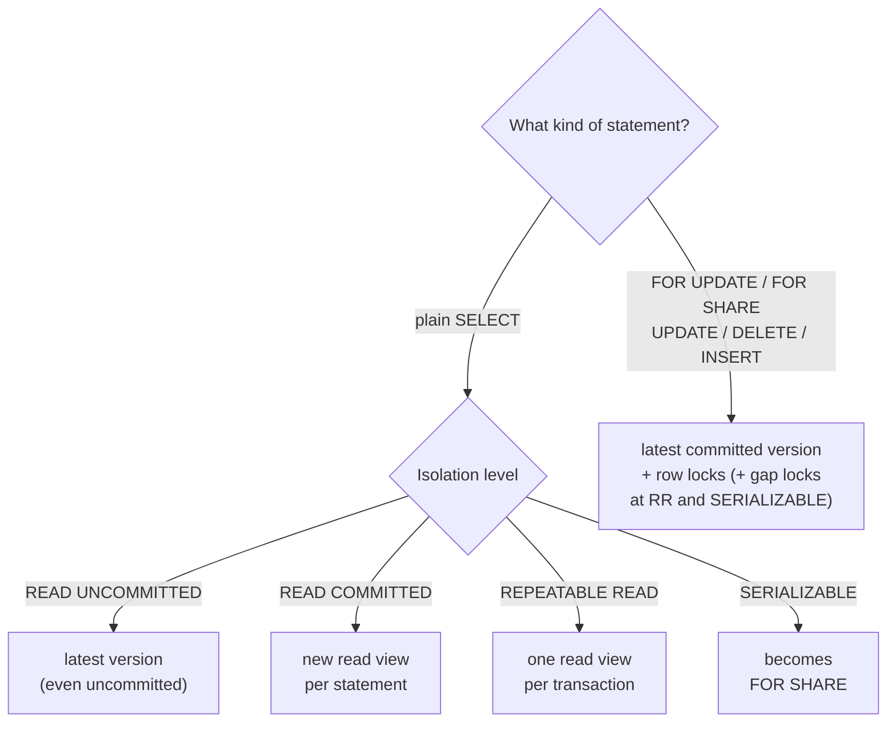

## Introduction

If transactions ran one after another, there would be no concurrency problems — and no performance either. Real databases interleave the operations of hundreds of transactions. Most interleavings are harmless; some produce results that could never occur if the transactions had run one at a time. Those results are called **anomalies** or **read phenomena**, and the isolation levels you will study next are defined by which of them they allow.

This lesson reproduces each anomaly on real MySQL sessions, using banking examples where the anomaly costs money:

| Anomaly | One-line description | Typical damage |
|---|---|---|
| **Dirty read** | You read data another transaction has not committed (and may roll back) | Decisions based on data that never existed |
| **Non-repeatable read** | Reading the same row twice in one transaction gives different values | Inconsistent calculations within one transaction |
| **Read skew** | Two related rows are read at different moments, so together they are inconsistent | A report where money appears or disappears |
| **Phantom read** | Re-running the same query returns new (or missing) rows | Counts and totals change mid-transaction; range checks fail |
| **Lost update** | Two read-modify-write cycles overlap; one overwrites the other | A deposit vanishes |
| **Write skew** | Two transactions each check a rule, then update *different* rows; together they break the rule | A combined-balance or staffing rule is violated |

You will also see which anomalies InnoDB prevents by default, which it prevents only for some kinds of reads, and which it never prevents unless **you** write the transaction correctly.

:::note[Dataset]
The scenarios use the **bank** dataset. Useful facts: account 1 (customer 1) holds 492.57 and account 2 (also customer 1) holds 4428.20; exactly three accounts (3, 6, 8) hold more than 10,000. Sessions A, B and C are real concurrent connections; the server's default isolation level is `REPEATABLE READ`.
:::

## DBMS Theory

:::theory[Anomalies as forbidden histories]
Write a *history* as a sequence of operations: r₁[x] means "transaction 1 reads item x", w₂[x] "transaction 2 writes x", c₁ / a₁ commit / abort, and r₁[P] "transaction 1 reads the set of items satisfying predicate P". Berenson et al. (1995) formalised the phenomena of ANSI SQL-92 like this:

- **P0 Dirty write**: w₁[x] … w₂[x] … (c₁ or a₁) — two uncommitted writes to the same item.
- **P1 Dirty read**: w₁[x] … r₂[x] … (c₁ or a₁) — T2 reads a value T1 has not committed.
- **P2 Fuzzy (non-repeatable) read**: r₁[x] … w₂[x] … (c₁ or a₁) — T2 changes an item T1 has read, while T1 is still running.
- **P3 Phantom**: r₁[P] … w₂[y in P] … (c₁ or a₁) — T2 inserts, deletes or updates a row that satisfies a predicate T1 has read.
- **P4 Lost update**: r₁[x] … w₂[x] … w₁[x] … c₁ — T1 overwrites x based on a value read before T2's write.
- **A5A Read skew**: r₁[x] … w₂[x] … w₂[y] … c₂ … r₁[y] — T1 sees x before and y after T2's change.
- **A5B Write skew**: r₁[x] … r₂[y] … w₁[y] … w₂[x] … (c₁ and c₂) — each reads what the other writes; both commit.
:::

These are written in their *broad* form: the history is suspicious as soon as the pattern appears, whether or not a bad result follows. A **serializable** schedule — one equivalent to some serial order of the transactions — exhibits none of them. Every weaker isolation level is a decision to allow some patterns in exchange for concurrency.

Three subtleties matter for practitioners:

1. **The ANSI SQL-92 definitions are informal English sentences** about P1, P2 and P3 only. Berenson et al. showed they are ambiguous, that P0 (dirty write) must be forbidden at every level, and that **snapshot isolation** — the model behind InnoDB's consistent reads and PostgreSQL's REPEATABLE READ — prevents P1–P3 in their strict interpretation yet still allows **write skew**. So "prevents phantoms" does not mean "serializable".
2. **Phantoms are about predicates, not rows.** A non-repeatable read changes a row you read; a phantom adds or removes a row from the *set* you read. Locking existing rows cannot prevent phantoms — preventing them needs predicate locks, range (gap) locks, or snapshots.
3. **Lost update and write skew are write-side anomalies.** They involve reads that feed later writes. Isolation levels based on snapshots can still allow them, because the snapshot makes the stale read *look* perfectly consistent.

:::standard[Standard SQL vs MySQL]
The SQL standard defines four levels by the phenomena P1–P3 they must prevent: READ UNCOMMITTED (none), READ COMMITTED (P1), REPEATABLE READ (P1, P2) and SERIALIZABLE (all, and additionally serializable execution). It does not mention lost update, read skew or write skew. InnoDB's levels follow the names but implement them with MVCC snapshots plus locks, which prevents more than the standard requires in some places (phantoms for consistent reads at REPEATABLE READ) and behaves differently in others (locking reads see current data). The next lesson compares them in detail.
:::

## Why It Exists

Anomalies exist because the alternative — executing transactions so that no anomaly is ever possible — is expensive. A database can guarantee serializability by making every reader lock what it reads and every range read lock the range, so writers wait for readers and readers wait for writers. Throughput falls and deadlocks rise. Most systems therefore default to a weaker level (InnoDB: REPEATABLE READ with MVCC; PostgreSQL, Oracle and SQL Server: READ COMMITTED) and expect developers to know which anomalies remain and to close them where they matter.

The anomalies that remain at the default level are precisely the ones that cause real incidents:

- **Lost updates** in "read the balance, compute in code, write the result" endpoints — the most common concurrency bug in web applications.
- **Write skew** in rules that span rows — "at least one doctor on call", "combined balance of linked accounts ≥ limit", "no double booking of a room" — checked with a `SELECT` and enforced with an `UPDATE` or `INSERT` on a different row.
- **Read skew** in reports that run several queries at READ COMMITTED.

Knowing the anomalies by name lets you recognise them in code review before they reach production.

## Internal Working

:::internals[Which InnoDB mechanism blocks which anomaly]
InnoDB uses two mechanisms, and which one applies depends on the **kind of read**:

- **Consistent (non-locking) reads** — plain `SELECT` outside `SERIALIZABLE` — read from a **read view**: a snapshot of which transactions had committed. Rows changed by transactions that are not visible are reconstructed from the undo log. At `READ COMMITTED` a new read view is created for every statement; at `REPEATABLE READ` one read view is created by the first consistent read and reused for the whole transaction. At `READ UNCOMMITTED` no read view is used: the latest version of each row is returned, committed or not.
- **Locking reads and writes** — `SELECT … FOR UPDATE / FOR SHARE`, `UPDATE`, `DELETE`, `INSERT` — always operate on the **latest committed version** of each row (never a snapshot) and take row locks held to the end of the transaction. At `REPEATABLE READ` and `SERIALIZABLE`, range scans also lock the **gaps** between index records (next-key locks), so no other transaction can insert into a range that has been read with a locking read.
:::

The consequences for each anomaly:

| Anomaly | Prevented by | InnoDB default (REPEATABLE READ) |
|---|---|---|
| Dirty write | Exclusive row locks on every write, at all levels | Prevented |
| Dirty read | Read views (any level above READ UNCOMMITTED) | Prevented |
| Non-repeatable read | One read view per transaction | Prevented for consistent reads |
| Read skew | One read view per transaction | Prevented for consistent reads |
| Phantom | Snapshot for consistent reads; next-key (gap) locks for locking reads | Prevented for consistent reads; locking reads block inserters but see *current* data |
| Lost update | Locking reads or atomic updates — **written by you** | **Not prevented** for read-modify-write with plain `SELECT` |
| Write skew | Locking the rows/ranges you read, or SERIALIZABLE | **Not prevented** |



## MySQL Implementation

Each session can choose its own isolation level, which is how the scenarios below put two sessions at different levels side by side:

```sql
SET SESSION TRANSACTION ISOLATION LEVEL READ UNCOMMITTED;  -- for the rest of this session
SET TRANSACTION ISOLATION LEVEL READ COMMITTED;            -- for the next transaction only
SELECT @@transaction_isolation;                            -- the session's current level
```

The current level of your lab session:

```sql run
SELECT @@transaction_isolation AS session_level;
```

The data used throughout the lesson:

```sql run
SELECT account_id, customer_id, account_type, balance
FROM accounts
WHERE account_id IN (1, 2) OR balance > 10000
ORDER BY account_id;
```

Every demonstration below follows the same recipe: session A starts a transaction and reads; another session changes data (and usually commits); A reads again or writes; finally we inspect what happened. The first scenario runs at `READ UNCOMMITTED`, the lowest level, because that is the only level at which a dirty read can occur.

## Syntax Breakdown

The statements and clauses that decide whether an anomaly can occur:

| Element | Effect on anomalies |
|---|---|
| `SET [SESSION] TRANSACTION ISOLATION LEVEL …` | Chooses which read view policy plain `SELECT`s use (and, at SERIALIZABLE, turns them into locking reads) |
| Plain `SELECT` | Consistent read from a snapshot (except READ UNCOMMITTED); never blocks, never prevents others from writing |
| `SELECT … FOR SHARE` | Locking read: shared locks on the rows (and gaps, at RR) read — others cannot modify them until you finish |
| `SELECT … FOR UPDATE` | Locking read: exclusive locks — others cannot modify **or** lock them |
| `UPDATE t SET c = c + ?` | Atomic read-modify-write on the current version under an exclusive lock — immune to lost update |
| `UPDATE t SET c = ?` (value computed by the application from an earlier plain `SELECT`) | Blind overwrite — the classic lost update |
| `UPDATE … WHERE version = ?` | Optimistic compare-and-set; detects a concurrent change via the affected-row count |
| `START TRANSACTION WITH CONSISTENT SNAPSHOT` | Creates the read view immediately rather than at the first read |

## Practical Examples

Each example is a real concurrency scenario. Read the notes under each step, then the commentary below it.

### 1. Dirty read — READ UNCOMMITTED

```concurrency
title: Dirty read — B sees a withdrawal that is later rolled back
description: Session A withdraws 400.00 from account 1 but rolls back. Session B runs at READ UNCOMMITTED; session C at the default level.
steps:
  - session: A
    sql: START TRANSACTION; UPDATE accounts SET balance = balance - 400.00 WHERE account_id = 1;
    note: Uncommitted withdrawal — the balance is 92.57 only inside A's transaction.
  - session: B
    sql: SET SESSION TRANSACTION ISOLATION LEVEL READ UNCOMMITTED; SELECT balance FROM accounts WHERE account_id = 1;
    note: B reads the latest version of the row, even though A has not committed it.
  - session: C
    sql: SELECT balance FROM accounts WHERE account_id = 1;
    note: C (REPEATABLE READ) reads the last committed version from the undo log.
  - session: A
    sql: ROLLBACK;
    note: The withdrawal never happened.
  - session: B
    sql: SELECT balance FROM accounts WHERE account_id = 1;
    note: The value B saw a moment ago never existed in any committed state.
```

B read **92.57**, a balance that was never committed; C read the committed **492.57**; after A's rollback B also sees 492.57. If B had been a fraud-scoring job or a "low balance" notifier, it would have acted on a phantom withdrawal. Dirty reads are only possible at `READ UNCOMMITTED`.

### 2. Non-repeatable read and read skew — READ COMMITTED vs REPEATABLE READ

```concurrency
title: Non-repeatable read at READ COMMITTED, stable snapshot at REPEATABLE READ
description: A runs at READ COMMITTED and B at REPEATABLE READ. Both read account 1. Session C then transfers 300.00 from account 2 to account 1 and commits. Both re-read.
steps:
  - session: A
    sql: SET SESSION TRANSACTION ISOLATION LEVEL READ COMMITTED; START TRANSACTION; SELECT balance FROM accounts WHERE account_id = 1;
  - session: B
    sql: SET SESSION TRANSACTION ISOLATION LEVEL REPEATABLE READ; START TRANSACTION; SELECT balance FROM accounts WHERE account_id = 1;
  - session: C
    sql: |
      START TRANSACTION;
      UPDATE accounts SET balance = balance - 300.00 WHERE account_id = 2;
      UPDATE accounts SET balance = balance + 300.00 WHERE account_id = 1;
      COMMIT;
    note: A committed transfer between customer 1's two accounts — the customer's total is unchanged.
  - session: A
    sql: SELECT balance FROM accounts WHERE account_id = 1; SELECT balance FROM accounts WHERE account_id = 2; COMMIT;
    note: READ COMMITTED takes a fresh snapshot per statement.
  - session: B
    sql: SELECT balance FROM accounts WHERE account_id = 1; SELECT balance FROM accounts WHERE account_id = 2; COMMIT;
    note: REPEATABLE READ keeps the snapshot of its first read.
```

A read account 1 as 492.57, then — in the same transaction — as 792.57: a **non-repeatable read**. Suppose A were computing customer 1's total: if it had read account 2 *before* the transfer (4428.20) and account 1 *after* it (792.57), it would report 5220.77 — 300.00 more than the customer owns. That combination is **read skew**, and it is just as possible at READ COMMITTED because each statement sees the latest committed data. B, at REPEATABLE READ, read 492.57 and 4428.20 throughout: a consistent pair from one snapshot, even though C had committed in between.

### 3. Phantoms — consistent reads vs locking reads

```concurrency
title: Phantom rows at READ COMMITTED; none for REPEATABLE READ consistent reads
description: A (READ COMMITTED) and B (REPEATABLE READ) count accounts holding more than 10,000. C opens a new account with 25,000 and commits. A and B count again — B also with a locking read.
steps:
  - session: A
    sql: SET SESSION TRANSACTION ISOLATION LEVEL READ COMMITTED; START TRANSACTION; SELECT COUNT(*) AS big_accounts FROM accounts WHERE balance > 10000;
  - session: B
    sql: START TRANSACTION; SELECT COUNT(*) AS big_accounts FROM accounts WHERE balance > 10000;
  - session: C
    sql: INSERT INTO accounts (account_id, customer_id, branch_id, account_type, balance, opened_at) VALUES (26, 15, 2, 'savings', 25000.00, '2024-12-31 09:00:00');
  - session: A
    sql: SELECT COUNT(*) AS big_accounts FROM accounts WHERE balance > 10000; COMMIT;
    note: A phantom row appeared in A's result.
  - session: B
    sql: |
      SELECT COUNT(*) AS big_accounts FROM accounts WHERE balance > 10000;
      SELECT COUNT(*) AS big_accounts_locking FROM accounts WHERE balance > 10000 FOR SHARE;
      SELECT COUNT(*) AS big_accounts_again FROM accounts WHERE balance > 10000;
      COMMIT;
    note: The consistent reads use B's snapshot; the locking read sees the current committed data.
```

A's count went from 3 to 4 — a phantom. B's plain `SELECT` returned 3 both before and after C's insert, so REPEATABLE READ in InnoDB prevents phantoms **for consistent reads** (stronger than the SQL standard requires of REPEATABLE READ). But B's `FOR SHARE` read in the very same transaction returned 4, and the next plain read 3 again. A locking read always reads the latest committed rows. If B were about to make a decision with an `UPDATE` (which is also a current read), it would act on 4 rows while its plain `SELECT`s report 3 — the source of many "impossible" bugs.

### 4. How InnoDB stops phantoms for locking reads: gap locks

```concurrency
title: A locking range read blocks inserts into the range
description: B reads the accounts with id > 20 FOR UPDATE at REPEATABLE READ. C tries to open account 26.
steps:
  - session: B
    sql: START TRANSACTION; SELECT account_id, balance FROM accounts WHERE account_id > 20 FOR UPDATE;
  - session: C
    sql: INSERT INTO accounts (account_id, customer_id, branch_id, account_type, balance, opened_at) VALUES (26, 15, 2, 'savings', 25000.00, '2024-12-31 09:00:00');
    expect: blocks
    note: The new key 26 falls in a range B has locked. C must wait.
  - observe: locks
  - session: B
    sql: SELECT account_id, balance FROM accounts WHERE account_id > 20 FOR UPDATE; COMMIT;
    note: B re-reads with the same locking read — still five rows. No phantom could appear while B held its locks.
  - session: C
    sql: SELECT COUNT(*) AS accounts_now FROM accounts;
```

The snapshot shows B holding `X` (next-key) locks on primary-key records 21 to 25 and on the **supremum pseudo-record** — the "infinity" record at the end of the index, so the gap after 25 is covered too — and C waiting with `X,INSERT_INTENTION` on the supremum. B's second locking read therefore returned the same five rows. This is how InnoDB makes REPEATABLE READ phantom-free for locking reads: by locking the gaps, not just the rows. *Locking* explains every lock mode in the snapshot.

### 5. Lost update — read, compute in the application, write back

```concurrency
title: Lost update — a deposit disappears
description: A teller (session A) deposits 100.00 and an ATM (session B) withdraws 50.00 from account 1. Each reads the balance, computes the new balance in application code and writes it back.
steps:
  - session: A
    sql: START TRANSACTION; SELECT balance FROM accounts WHERE account_id = 1;
    note: A reads 492.57 and computes 492.57 + 100.00 = 592.57 in the application.
  - session: B
    sql: START TRANSACTION; SELECT balance FROM accounts WHERE account_id = 1;
    note: B also reads 492.57 and computes 492.57 − 50.00 = 442.57.
  - session: A
    sql: UPDATE accounts SET balance = 592.57 WHERE account_id = 1; COMMIT;
  - session: B
    sql: UPDATE accounts SET balance = 442.57 WHERE account_id = 1; COMMIT;
    note: B's write is based on a value read before A's commit. It overwrites A's deposit.
  - session: C
    sql: SELECT balance FROM accounts WHERE account_id = 1;
    note: Correct result would be 492.57 + 100.00 − 50.00 = 542.57.
```

The final balance is **442.57**: the 100.00 deposit was lost, at the default REPEATABLE READ level, with no error and no warning. Nothing blocked, because A's lock was released at its commit before B's `UPDATE` arrived, and B's `UPDATE` set an absolute value it had computed from a stale read. REPEATABLE READ even made it *more* likely: B's snapshot guaranteed it kept seeing 492.57.

### 6. The fix that needs no extra locking: an atomic update

```concurrency
title: Lost update prevented with an atomic UPDATE
description: The same two operations, but each expressed as UPDATE … SET balance = balance ± amount.
steps:
  - session: A
    sql: START TRANSACTION; UPDATE accounts SET balance = balance + 100.00 WHERE account_id = 1;
  - session: B
    sql: UPDATE accounts SET balance = balance - 50.00 WHERE account_id = 1;
    expect: blocks
    note: B's UPDATE is a current read and needs the row's exclusive lock — it waits for A.
  - session: A
    sql: COMMIT;
    note: B resumes and applies −50.00 to the committed balance of 592.57.
  - session: C
    sql: SELECT balance FROM accounts WHERE account_id = 1;
```

The final balance is **542.57** — both operations counted. The arithmetic now happens inside the database, on the latest committed version, under an exclusive lock. `SELECT … FOR UPDATE` before the computation and an optimistic version check are the other two fixes; *Optimistic vs Pessimistic Concurrency Control* compares all three.

### 7. Write skew — two valid decisions, one invalid result

The bank lets customer 1 overdraw individual accounts only as long as the **combined** balance of their accounts stays at least 1,000.00. Combined balance now: 492.57 + 4428.20 = 4920.77.

```concurrency
title: Write skew — each withdrawal checks the rule, together they break it
description: A withdraws 3,500.00 from account 2 and B withdraws 450.00 from account 1. Each first checks that the combined balance stays ≥ 1,000.00 after its own withdrawal.
steps:
  - session: A
    sql: START TRANSACTION; SELECT SUM(balance) AS combined FROM accounts WHERE customer_id = 1;
    note: 4920.77 − 3500.00 = 1420.77 ≥ 1000 — A's check passes.
  - session: B
    sql: START TRANSACTION; SELECT SUM(balance) AS combined FROM accounts WHERE customer_id = 1;
    note: 4920.77 − 450.00 = 4470.77 ≥ 1000 — B's check passes.
  - session: A
    sql: UPDATE accounts SET balance = balance - 3500.00 WHERE account_id = 2; COMMIT;
  - session: B
    sql: UPDATE accounts SET balance = balance - 450.00 WHERE account_id = 1; COMMIT;
    note: B updates a different row from A — there is no lock conflict at all.
  - session: C
    sql: SELECT SUM(balance) AS combined FROM accounts WHERE customer_id = 1;
```

Both transactions committed and the combined balance is **970.77**, below the 1,000.00 floor. Neither transaction did anything wrong on its own; each would have been correct if run alone, and each `UPDATE` even used the safe `balance = balance - x` form. They read the **same** set of rows but wrote **different** rows, so no write–write conflict existed for locks or snapshots to detect. This is write skew, and REPEATABLE READ does not prevent it. Fixes: lock the rows the rule depends on (`SELECT … FROM accounts WHERE customer_id = 1 FOR UPDATE`), run the transactions at SERIALIZABLE (next lesson shows it turning this scenario into a deadlock that one transaction must retry), or materialise the rule in a single row that every withdrawal must update (a per-customer limits row).

## Execution Walkthrough

The scenarios above showed *what* each session saw. This walkthrough traces, inside a single transaction, the two read paths that explain those results: it pins a read view with `START TRANSACTION WITH CONSISTENT SNAPSHOT` and then contrasts a consistent read, a locking read, and a read of the transaction's own write.

```walkthrough
title: One transaction, two kinds of read
steps:
  - title: "1. Open a transaction with an immediate snapshot"
    explain: >-
      WITH CONSISTENT SNAPSHOT creates the read view now. Every plain SELECT in this transaction will see the
      database as of this instant.
    sql: |
      START TRANSACTION WITH CONSISTENT SNAPSHOT;
      SELECT COUNT(*) AS accounts, SUM(balance) AS total FROM accounts;
  - title: "2. A consistent read"
    explain: >-
      Plain SELECT: no locks, served from the snapshot. Concurrent commits by other sessions after step 1
      would not change this result (Examples 2 and 3 demonstrated that with real concurrent sessions).
    sql: SELECT account_id, balance FROM accounts WHERE account_id IN (1, 2) ORDER BY account_id;
  - title: "3. A locking read in the same transaction"
    explain: >-
      FOR SHARE ignores the snapshot, reads the latest committed versions, and takes shared next-key locks on the
      rows it reads. Here nobody else has committed changes, so the values agree — but the mechanism differs.
    sql: SELECT account_id, balance FROM accounts WHERE account_id IN (1, 2) ORDER BY account_id FOR SHARE;
  - title: "4. Your own writes are always visible"
    explain: >-
      A transaction always sees its own changes, even in plain SELECTs: rows it modified carry its own transaction
      ID, which every read view treats as visible.
    sql: |
      UPDATE accounts SET balance = balance + 1.00 WHERE account_id = 1;
      SELECT account_id, balance FROM accounts WHERE account_id IN (1, 2) ORDER BY account_id;
  - title: "5. End"
    explain: ROLLBACK discards the change and the read view, and releases the shared locks.
    sql: |
      ROLLBACK;
      SELECT account_id, balance FROM accounts WHERE account_id IN (1, 2) ORDER BY account_id;
```

Putting the evidence from all scenarios together:

| Scenario | Level | First read | Second read | Anomaly |
|---|---|---|---|---|
| Dirty read | RU | 92.57 (uncommitted) | 492.57 after rollback | Yes |
| Re-read after commit | RC | 492.57 | 792.57 | Non-repeatable read (and read skew possible) |
| Re-read after commit | RR | 492.57 | 492.57 | No |
| Count after insert | RC | 3 | 4 | Phantom |
| Count after insert | RR consistent | 3 | 3 | No |
| Count after insert | RR `FOR SHARE` | — | 4 | Sees current data |
| Read-modify-write | RR | 492.57 / 492.57 | final 442.57 | Lost update |
| Atomic update | RR | — | final 542.57 | No |
| Check-then-write on different rows | RR | 4920.77 / 4920.77 | final 970.77 | Write skew |

## Output

The final states after the scenarios tell the story in numbers:

- **Dirty read**: B saw 92.57, a value that was rolled back; the committed balance never changed from 492.57.
- **Non-repeatable read**: A (READ COMMITTED) saw account 1 change from 492.57 to 792.57 inside one transaction; B (REPEATABLE READ) saw 492.57 and 4428.20 throughout.
- **Phantoms**: A's count rose from 3 to 4; B's consistent count stayed 3, its `FOR SHARE` count was 4.
- **Gap locks**: C's insert of account 26 waited until B committed; B's locking read returned the same five accounts twice.
- **Lost update**: 442.57 instead of 542.57; with an atomic `UPDATE`, 542.57.
- **Write skew**: customer 1's combined balance fell to 970.77, below the 1,000.00 rule, with both transactions committing successfully.

## Alternative Approaches

Each anomaly can be prevented in several ways. Choosing among them is the core skill of concurrency control.

| Anomaly | Approach | Cost / trade-off |
|---|---|---|
| Dirty read | Use any level ≥ READ COMMITTED | None in InnoDB — consistent reads are cheap |
| Non-repeatable read, read skew | REPEATABLE READ, or a single statement that reads everything at once | Long transactions keep old versions alive (purge lag) |
| Phantom (consistent reads) | REPEATABLE READ snapshot | As above |
| Phantom (decisions based on a range) | Locking read at REPEATABLE READ (gap locks) or SERIALIZABLE | Blocks inserters into the range; deadlock risk |
| Lost update | Atomic `UPDATE … SET x = x + ?` | Only works when the new value is a function the database can compute |
| Lost update | `SELECT … FOR UPDATE`, then compute and write | Holds an exclusive lock during application think time |
| Lost update | Optimistic `version` column with `UPDATE … WHERE version = ?` | Requires retry logic on conflict; no locks held between read and write |
| Write skew | `SELECT … FOR UPDATE` on **all** rows the rule reads | Must lock the whole predicate (including gaps) or new rows can still sneak in |
| Write skew | SERIALIZABLE for the transactions involved | Plain reads become shared locks; conflicts surface as deadlocks/timeouts to retry |
| Write skew | Materialise the conflict: one row (e.g. `customer_limits`) every participant updates | Schema change; that row becomes a serialisation point |
| Write skew | Declare the rule as a constraint, if expressible | Only single-row rules fit `CHECK`; cross-row rules do not |

## Performance Analysis

The approaches differ mainly in **what they make other transactions wait for**:

- **Consistent reads** cost almost nothing in terms of concurrency — no locks — but each version a read view might need must be kept in the undo log. A transaction at REPEATABLE READ that stays open for an hour forces InnoDB to keep an hour's worth of old versions, slowing purge and making other consistent reads walk longer version chains (see *MVCC*).
- **Locking reads** make writers (and other locking readers, for `FOR UPDATE`) wait. At REPEATABLE READ, range locking reads also lock **gaps**, so inserters wait too; with poor indexes a locking read can lock far more than the rows it returns (a scan with no usable index locks every row it examines — see *UPDATE and DELETE* in Module 3 for that demonstration).
- **Atomic updates** hold an exclusive lock only for the duration of the transaction that contains them; if that transaction is short, contention is minimal. They are the cheapest correct fix for lost updates.
- **SERIALIZABLE** adds shared locks to every plain `SELECT` in a transaction. Read-heavy transactions start blocking writers, and conflicting patterns become deadlocks that the application must retry.

:::performance[Theory vs measurement]
Which fix performs best depends on contention: with rare conflicts, optimistic checks almost never retry and hold no locks; with a hot row updated by many sessions, they retry constantly and an atomic update or a short pessimistic lock is better. Measure lock waits (`SHOW GLOBAL STATUS LIKE 'Innodb_row_lock%'`) and retry rates under realistic concurrency instead of guessing.
:::

## Best Practices

:::best-practice[Preventing anomalies in application code]
1. **Never compute a new value from a plain `SELECT` and write it back as an absolute value.** Use `SET x = x + ?`, a locking read, or an optimistic version check.
2. **For check-then-act logic, lock what you check.** If a decision depends on a set of rows, read that set with `FOR UPDATE` (or `FOR SHARE` when you will not modify it) in the same transaction as the write.
3. **Remember that plain `SELECT` and `UPDATE` see different data at REPEATABLE READ.** Do not use a snapshot read to decide which rows an `UPDATE` will affect.
4. **Use REPEATABLE READ (or one statement) for multi-query reports** to avoid read skew; keep those transactions short.
5. **Avoid READ UNCOMMITTED** except for rough monitoring queries whose results do not drive decisions.
6. **Name the anomaly in code review.** "This is a lost update" or "this is write skew on the on-call table" makes the fix obvious.
7. **Test concurrency explicitly**: reproduce interleavings with two sessions, as in this lesson, before trusting a design.
:::

## Common Mistakes

**Mistake 1 — "We use REPEATABLE READ, so lost updates cannot happen."** Example 5 lost a deposit at REPEATABLE READ. The level protects *reads*; a write based on a stale read is still a stale write.

**Mistake 2 — "InnoDB prevents phantoms, so range checks are safe."** Only consistent reads are phantom-free. A check done with a plain `SELECT` followed by an `INSERT` can still violate a rule, because the plain read takes no locks: another transaction can insert a conflicting row and commit in between. Lock the range with `FOR UPDATE` or use a unique constraint.

**Mistake 3 — trusting a count from a snapshot when writing.** In Example 3, B's plain count was 3 while the table really held 4 such accounts. An `UPDATE … WHERE balance > 10000` issued by B would have changed 4 rows. Here is the effect in one session — a snapshot taken, then an `UPDATE` that sees more than the snapshot:

```sql run
INSERT INTO accounts (account_id, customer_id, branch_id, account_type, balance, opened_at)
VALUES (27, 15, 2, 'savings', 12000.00, '2024-12-31 09:00:00');
START TRANSACTION;
SELECT COUNT(*) AS big_accounts_seen FROM accounts WHERE balance > 10000;
UPDATE accounts SET version = version + 1 WHERE balance > 10000;
SELECT ROW_COUNT() AS rows_updated;
ROLLBACK;
DELETE FROM accounts WHERE account_id = 27;
```

In a single session, the snapshot and the `UPDATE` agree (both see four accounts including the new one). The disagreement appears only when another session commits between your snapshot and your write — exactly what Example 3 captured.

**Mistake 4 — fixing write skew by locking only the row you update.** In Example 7, `SELECT … FROM accounts WHERE account_id = 2 FOR UPDATE` in A and `… account_id = 1 FOR UPDATE` in B would not conflict. The rule reads *both* accounts, so both transactions must lock *both* rows.

**Mistake 5 — using READ UNCOMMITTED "to avoid locks".** In InnoDB, plain `SELECT`s at READ COMMITTED and REPEATABLE READ take no locks either. READ UNCOMMITTED buys nothing but dirty reads.

## Industry Application

- **E-commerce inventory**: "check stock, then decrement" is a lost update or oversell if done with a plain read. Production systems use `UPDATE products SET stock = stock - ? WHERE id = ? AND stock >= ?` and check the affected-row count — atomic and race-free.
- **Booking systems** (hotels, airlines, meeting rooms): "is the room free on these dates? then insert a booking" is write skew / phantom territory. Typical fixes: a unique constraint on (room, date) slots, a locking read on the room row, or SERIALIZABLE for the booking transaction.
- **Banking**: linked-account overdraft rules (Example 7) are enforced by locking all of a customer's accounts (in a consistent order, to avoid deadlocks) or by a per-customer limits row that every withdrawal updates.
- **Analytics on OLTP data**: end-of-day reports run in one REPEATABLE READ transaction (often `START TRANSACTION WITH CONSISTENT SNAPSHOT, READ ONLY` on a replica) so that all queries agree — the same trick `mysqldump --single-transaction` uses to produce a consistent backup without locking tables.
- **Healthcare scheduling**: the textbook write-skew example — "at least one doctor must be on call" — comes from real rostering systems, where two doctors going off call simultaneously is a patient-safety incident.

## Practice Exercises

```exercise
id: ex1
title: Name the anomaly
difficulty: easy
kind: open
concepts: [read-phenomena, dirty-read, non-repeatable-read, phantom-read, lost-update, write-skew]
prompt: |
  Name the anomaly in each situation and the weakest standard isolation level (if any) that prevents it:

  1. A dashboard shows a large withdrawal that the teller's transaction later rolls back.
  2. A loyalty job reads a customer's tier twice in one transaction and gets "silver" then "gold".
  3. Two support agents both change the same customer's phone number; each reads the record, edits it in a form and saves the whole record. One agent's edit of the email address (made in the same form) disappears.
  4. A report counts open loans twice in one transaction and gets 7 then 8.
  5. Two managers each approve a vacation after checking that at least two engineers remain on duty; both approvals commit and only one engineer remains.
solution: |
  1. **Dirty read** — prevented by READ COMMITTED (and above).
  2. **Non-repeatable (fuzzy) read** — prevented by REPEATABLE READ.
  3. **Lost update** — saving the whole record overwrites the other agent's change. The standard levels are not
     defined in terms of lost update; at SERIALIZABLE it is prevented. In InnoDB at REPEATABLE READ it happens
     unless the application uses a locking read or an optimistic version check.
  4. **Phantom read** — prevented by SERIALIZABLE in the standard; in InnoDB, REPEATABLE READ already prevents it
     for plain (consistent) reads.
  5. **Write skew** — each transaction reads the same set and writes a different row. Only SERIALIZABLE prevents it
     (snapshot-based REPEATABLE READ does not); alternatively lock the rows the rule reads or materialise the
     conflict.
```

```exercise
id: ex2
title: Deposit and withdrawal without losing either
difficulty: easy
kind: dml
concepts: [lost-update]
prompt: |
  A teller deposits **100.00** into account 1 and an ATM withdraws **50.00** from it. Write the two statements
  so that they can run concurrently in any interleaving without losing an update, and so that each increments
  `version`. (Run them one after the other here; the checker inspects account 1.)
hints:
  - "Avoid writing an absolute balance computed from a SELECT."
  - "Use SET balance = balance + 100.00 and SET balance = balance - 50.00."
solution: |
  UPDATE accounts SET balance = balance + 100.00, version = version + 1 WHERE account_id = 1;
  UPDATE accounts SET balance = balance - 50.00,  version = version + 1 WHERE account_id = 1;
check: |
  SELECT account_id, balance, version FROM accounts WHERE account_id = 1;
explanation: |
  Each UPDATE reads the latest committed balance under an exclusive lock and computes the new value inside the
  database, so concurrent executions serialise on the row lock and both changes count (Example 6). The broken
  version — `SELECT balance`, compute 592.57 / 442.57 in code, `SET balance = 592.57` — loses one of the two
  updates when they overlap (Example 5), even though run sequentially it gives the same result as this solution.
```

```exercise
id: ex3
title: Which customers are below the combined-balance floor?
difficulty: medium
concepts: [write-skew, read-phenomena]
prompt: |
  The linked-account rule from Example 7 says a customer's **combined** balance across all their accounts must be
  at least **1,000.00**. Write the audit query a nightly job would run: return `customer_id` and `combined_balance`
  for every customer whose combined balance is below 1,000.00, ordered by `customer_id`.
hints:
  - "Group accounts by customer_id and sum the balances."
  - "Filter groups with HAVING SUM(balance) < 1000."
solution: |
  SELECT customer_id, SUM(balance) AS combined_balance
  FROM accounts
  GROUP BY customer_id
  HAVING SUM(balance) < 1000
  ORDER BY customer_id;
orderMatters: true
explanation: |
  Because write skew can slip past per-transaction checks unless every withdrawal locks all of the customer's
  accounts, banks also run detective controls like this. Run it in a single statement (or in one REPEATABLE READ
  transaction) so that a transfer committing mid-report cannot produce read skew in the totals.
```

```exercise
id: ex4
title: A withdrawal that cannot overdraw, in one statement
difficulty: hard
kind: dml
concepts: [lost-update, read-phenomena]
prompt: |
  Withdraw **450.00** from account **23** only if the account is `active` **and** still has at least 450.00 —
  using a single `UPDATE` that is safe under any concurrency (no prior `SELECT`). Increment `version` if the
  withdrawal happens. Then do the same for **120.00** from account 23.

  (Account 23 holds 144.47, so the first withdrawal must not happen and the second must.)
hints:
  - "Put the conditions in the WHERE clause; an UPDATE re-evaluates WHERE on the latest committed version under a lock."
  - "WHERE account_id = 23 AND status = 'active' AND balance >= 450.00"
solution: |
  UPDATE accounts SET balance = balance - 450.00, version = version + 1
  WHERE account_id = 23 AND status = 'active' AND balance >= 450.00;
  UPDATE accounts SET balance = balance - 120.00, version = version + 1
  WHERE account_id = 23 AND status = 'active' AND balance >= 120.00;
check: |
  SELECT account_id, balance, version FROM accounts WHERE account_id = 23;
explanation: |
  The guard in WHERE makes check-and-act a single atomic step: the condition is evaluated on the current version
  of the row while holding its exclusive lock, so no concurrent withdrawal can slip in between. The application
  learns whether the withdrawal happened from the affected-row count (0 for the first statement, 1 for the
  second). A plain SELECT followed by an unconditional UPDATE is the lost-update / overdraft pattern.
```

```exercise
id: ex5
title: Fix the write skew in Example 7
difficulty: challenge
kind: open
concepts: [write-skew, phantom-read]
prompt: |
  Rewrite the two withdrawal transactions from Example 7 so that the combined-balance rule (≥ 1,000.00 for all of
  a customer's accounts) can never be violated, at the default REPEATABLE READ level. Give the SQL for one
  withdrawal transaction, explain what each session would experience in the original interleaving, and explain
  how your solution handles a **new** account being opened for the customer concurrently.
solution: |
  Lock every row the rule depends on, in the same transaction as the write, and re-check after locking:

  ~~~
  START TRANSACTION;
  SELECT account_id, balance FROM accounts WHERE customer_id = 1 ORDER BY account_id FOR UPDATE;
  -- application: if SUM(balance) - 3500.00 < 1000.00 then ROLLBACK and refuse
  UPDATE accounts SET balance = balance - 3500.00 WHERE account_id = 2;
  COMMIT;
  ~~~

  In the original interleaving, A's `FOR UPDATE` locks both of customer 1's accounts. B's `FOR UPDATE` then
  **blocks** until A commits; when it proceeds it reads the *current* balances (after A's withdrawal: combined
  1420.77), so B's check 1420.77 − 450.00 = 970.77 fails and B refuses. The two transactions are serialised.

  `customer_id` is indexed (`idx_accounts_customer`), so at REPEATABLE READ the locking read takes next-key locks
  on the index entries for customer 1 **and the gap after them**. A concurrent `INSERT` of a new account for
  customer 1 must place an index entry in that locked range and therefore waits until the withdrawal commits — so
  no phantom account can change the sum between check and write. (At READ COMMITTED, gap locks are not taken and
  this protection disappears.) Locking rows in a consistent order (ORDER BY account_id) avoids deadlocks between
  withdrawals. Alternatives: run both transactions at SERIALIZABLE and retry on deadlock, or keep a per-customer
  row (e.g. `customer_limits.available`) that every withdrawal updates atomically.
```

## Knowledge Assessment

```quiz
- id: q1
  question: "At which InnoDB isolation level can a plain SELECT return a value that another transaction later rolls back?"
  options: ["READ UNCOMMITTED", "READ COMMITTED", "REPEATABLE READ", "SERIALIZABLE"]
  answer: 0
  explanation: "Only READ UNCOMMITTED reads the latest row version without a read view, so uncommitted changes are visible (Example 1). READ COMMITTED and REPEATABLE READ read committed versions from a read view; SERIALIZABLE uses locking reads that wait for the writer."
  concepts: [dirty-read]
- id: q2
  question: "A (REPEATABLE READ) counts rows matching a predicate: 3. B inserts a matching row and commits. A runs the same plain SELECT, then the same SELECT … FOR SHARE. What does A get?"
  options: ["3 and 3", "4 and 4", "3 and 4", "The FOR SHARE blocks forever"]
  answer: 2
  explanation: "The plain SELECT uses A's snapshot (3). The locking read reads the latest committed data (4), as captured in Example 3. B has already committed, so there is nothing to wait for."
  concepts: [phantom-read]
- id: q3
  question: "Two sessions each run `SELECT balance` (500), compute a new value in the application and run `UPDATE … SET balance = <value>`. One deposits 100, one withdraws 50; both commit. Which outcome is possible at InnoDB's default level?"
  options: ["Only 550", "550, 600 or 450", "An error 1213 always", "Only 450"]
  answer: 1
  explanation: "This is the lost-update pattern: whichever write lands last wins, so the result is 600 or 450 when they overlap, and 550 only if they happen not to overlap. REPEATABLE READ does not detect it, and no deadlock occurs because neither holds a lock the other needs at the same time."
  concepts: [lost-update]
- id: q4
  question: "Which statements about write skew are true? (Select all that apply.)"
  type: multi
  options:
    - "It involves two transactions reading overlapping data and writing different rows"
    - "InnoDB REPEATABLE READ prevents it because it is snapshot-based"
    - "Locking all rows the rule reads with FOR UPDATE prevents it"
    - "SERIALIZABLE prevents it"
    - "Using UPDATE … SET balance = balance - x for the writes prevents it"
  answer: [0, 2, 3]
  explanation: "Write skew is overlapping reads plus disjoint writes. Snapshot isolation allows it (Example 7 at REPEATABLE READ). Locking the read set or running at SERIALIZABLE serialises the transactions. Atomic updates prevent lost updates on the same row, but Example 7 already used them and still violated the rule because the rows differ."
  concepts: [write-skew]
- id: q5
  question: "Which anomaly is a report at READ COMMITTED vulnerable to when it reads account 2 and then account 1 while a transfer between them commits in between?"
  options: ["Dirty read", "Read skew", "Lost update", "Dirty write"]
  answer: 1
  explanation: "Each statement at READ COMMITTED sees the latest committed data, so the report can see account 2 before the transfer and account 1 after it — the total is off by the transfer amount. No uncommitted data is read (not dirty), and the report writes nothing (not lost update / dirty write)."
  concepts: [read-skew, non-repeatable-read]
- id: q6
  question: "Why can't row locks alone prevent phantoms?"
  options:
    - "Row locks are released after each statement"
    - "A phantom is a row that did not exist when the range was read, so there was no row to lock — the range (gap) must be locked"
    - "InnoDB does not support row locks"
    - "Phantoms only occur with MyISAM"
  answer: 1
  explanation: "Phantoms concern predicates: a newly inserted row matches a range that was read. Locking existing rows does not stop inserts into the gaps; InnoDB adds gap/next-key locks (Example 4: insert-intention lock waiting on the supremum). Row locks are held to transaction end, and InnoDB clearly supports them."
  concepts: [phantom-read]
- id: q7
  question: "Which anomaly does InnoDB prevent at every isolation level, including READ UNCOMMITTED?"
  options: ["Dirty read", "Dirty write", "Lost update", "Phantom read"]
  answer: 1
  explanation: "Every write takes an exclusive row lock held to the end of the transaction, so two transactions can never both have uncommitted writes to the same row (P0). Dirty reads are allowed at READ UNCOMMITTED, lost updates at all levels below SERIALIZABLE for read-modify-write code, and phantoms at READ COMMITTED and below."
  concepts: [read-phenomena]
```
