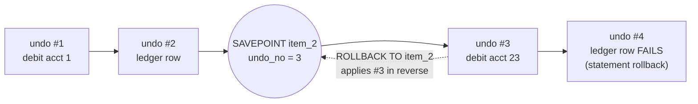

## Introduction

In the previous lesson a transaction had only two endings: `COMMIT` everything or `ROLLBACK` everything. Real work is often less binary. A nightly job applies 50,000 fees; three of them fail because the account was closed. Should the other 49,997 be thrown away? A checkout creates an order, reserves stock, and then tries to apply a coupon that turns out to be expired. Should the whole order be lost, or just the coupon step?

A **savepoint** is a named marker inside a transaction. `ROLLBACK TO SAVEPOINT name` undoes every change made **after** the marker while keeping the transaction — and everything done before the marker — alive. It answers questions like:

- How do I skip a failing item in a batch without committing after every item?
- How does a framework implement a "nested transaction" when MySQL has no nesting?
- How do I undo a multi-statement step whose second statement failed, when statement atomicity only undid the second statement?

The lesson also covers what savepoints do **not** do: they do not release locks, they do not survive an implicit commit, and they are not a substitute for committing.

:::note[Dataset]
The examples use the **bank** dataset (25 accounts with `CHECK (balance >= 0)`, a `transactions` ledger with `CHECK (amount > 0)` and a foreign key to `accounts`). Concurrency scenarios run on real concurrent sessions A, B and C.
:::

## DBMS Theory

:::theory[Savepoints and partial rollback]
A **savepoint** is a point in the execution of a transaction T to which T can later be rolled back **without aborting**. Formally, if T has executed operations o₁ … oₖ when savepoint S is established and later executes oₖ₊₁ … oₙ, then *rollback to S* undoes oₙ, oₙ₋₁, …, oₖ₊₁ (in reverse order) and T continues as if it had executed only o₁ … oₖ. T is still active: it may perform more operations, set new savepoints, and must still end with commit or abort.
:::

Savepoints were introduced in the SQL standard (SQL:1999) and are implemented by every major relational DBMS. Three properties follow from the definition:

1. **Savepoints form a stack.** Rolling back to S also discards every savepoint established after S — those positions no longer exist in the transaction's history. Releasing S, in MySQL, discards S and every later savepoint as well.
2. **Partial rollback is not partial commit.** Nothing becomes durable or visible to other transactions at a savepoint. Only the final `COMMIT` publishes the surviving work; a final `ROLLBACK` (or a crash) undoes everything, including work "protected" by savepoints.
3. **Partial rollback is not partial release of isolation.** The transaction is still active, so in a lock-based implementation the locks it acquired after the savepoint are still part of an unfinished transaction. Releasing them early would break **strict two-phase locking** (locks are held until commit or abort) unless the system can prove no other transaction could have depended on the undone work. Many systems — including InnoDB, as you will see — therefore keep them.

**Savepoints versus nested transactions.** Some research systems and a few products support true *nested transactions*, in which a child transaction can commit into its parent and abort independently. Savepoints give you the abort-independently half: a "child" is the work between a savepoint and the next point where you decide to keep (release) or discard (roll back) it. There is no child commit: the work only becomes permanent when the outermost transaction commits.

:::standard[Standard SQL vs MySQL]
`SAVEPOINT name`, `ROLLBACK [WORK] TO [SAVEPOINT] name` and `RELEASE SAVEPOINT name` are standard SQL. The keyword `SAVEPOINT` after `ROLLBACK TO` is optional in MySQL. MySQL does not implement the standard's savepoint levels in user-visible syntax, but a stored function or trigger runs at a **new savepoint level**: savepoints of the caller are not visible inside it, and savepoints set inside it are discarded when it returns.
:::

## Why It Exists

Consider the three classic ways of running a batch of N independent items without savepoints:

| Strategy | Behaviour on a failing item | Problem |
|---|---|---|
| One transaction, all-or-nothing | `ROLLBACK` the whole batch | One bad item discards thousands of good ones; the job is re-run from scratch |
| Commit after every item | Earlier items are already committed | N commits — each waits for a durable log flush — and other sessions see a half-applied batch |
| One transaction, ignore errors | Keep going after the error | If an item consists of several statements, the earlier statements of the failed item remain — a half-applied item is committed |

The third row is the subtle one. Statement atomicity (previous lesson) undoes only the statement that failed. If an item is "update the balance, then insert a ledger row", and the insert fails, the balance update stays. Without a savepoint, the only tool that can remove it is a full `ROLLBACK`.

Savepoints give a fourth option: **one transaction, item-level atomicity**. Before each item, set a savepoint; if any statement of the item fails, roll back to the savepoint, record the failure, and continue. The batch still commits once, and every item is applied completely or not at all.

The same need appears in layered application code. A service method that runs inside a caller's transaction may want to *try* an optional step and undo just that step on failure. Frameworks provide this as "nested" transactions — Spring's `PROPAGATION_NESTED`, Django's nested `atomic()` blocks, SQLAlchemy's `begin_nested()` — and every one of them is implemented with `SAVEPOINT` / `ROLLBACK TO SAVEPOINT` / `RELEASE SAVEPOINT`.

## Internal Working

:::internals[How InnoDB implements savepoints]
Every InnoDB transaction numbers its undo records with a counter called the **undo number** (`undo_no`), which grows by one for each row change. A savepoint is essentially that number, remembered under a name:

- **SAVEPOINT s** records the transaction's current `undo_no` (and the binary-log cache position, so that the binary log can also be truncated back if needed).
- **ROLLBACK TO SAVEPOINT s** applies the transaction's undo records **in reverse order, stopping when it reaches the recorded `undo_no`**. It is exactly the same machinery as a full rollback — or the statement-level rollback after an error — just with a different stopping point. Savepoints set after s are deleted.
- **Locks are not released.** The manual is explicit: InnoDB does not release row locks that were stored in memory after the savepoint. The exception is a freshly **inserted** row: its lock is *implicit* (carried by the transaction ID stored in the row itself) and disappears when the undo removes the row.
- **RELEASE SAVEPOINT s** only deletes names; no data changes and no locks are released.
- **COMMIT and ROLLBACK** delete all savepoints of the transaction.
:::

There is one more layer. Savepoints are handled by the **server** layer first, which then asks each storage engine that participates in the transaction to roll back to its own position. A storage engine *joins* a transaction lazily, at its first access. If you set a savepoint **before** the transaction has touched any InnoDB table, InnoDB was not yet part of the transaction when the savepoint was taken, so a rollback to that savepoint rolls InnoDB back **completely** — and with a complete rollback the locks are released. You will see both behaviours in the scenarios below. In practice, savepoints are almost always set after the transaction has done some work, and the "locks are kept" rule is the one to design for.



**Interaction with statement atomicity.** Every statement is executed under an internal, unnamed statement savepoint. When a statement fails, InnoDB rolls back to that internal savepoint. Your named savepoints sit at statement boundaries above it: a failed statement is undone automatically; a failed *group* of statements is undone by you.

## MySQL Implementation

The core syntax, demonstrated on a scratch table:

```sql run
CREATE TABLE sp_demo (id INT PRIMARY KEY, note VARCHAR(30));
START TRANSACTION;
INSERT INTO sp_demo VALUES (1, 'before any savepoint');
SAVEPOINT s1;
INSERT INTO sp_demo VALUES (2, 'after s1');
SAVEPOINT s2;
INSERT INTO sp_demo VALUES (3, 'after s2');
ROLLBACK TO SAVEPOINT s2;
SELECT * FROM sp_demo ORDER BY id;
```

Row 3 is gone; rows 1 and 2 remain, and the transaction is still open. Rolling back further to `s1` removes row 2 — and also deletes `s2`, which now refers to a position that no longer exists:

```sql run
ROLLBACK TO SAVEPOINT s1;
SELECT * FROM sp_demo ORDER BY id;
```

```sql run error
ROLLBACK TO SAVEPOINT s2;
```

The transaction is still alive after that error. Committing keeps everything that was not rolled back:

```sql run
INSERT INTO sp_demo VALUES (4, 'after rolling back to s1');
COMMIT;
SELECT * FROM sp_demo ORDER BY id;
```

## Syntax Breakdown

| Statement | Effect | Errors and edge cases |
|---|---|---|
| `SAVEPOINT name` | Marks the current position. If a savepoint with the same name exists, the old one is **deleted and the name moves** to the current position. | Allowed outside an explicit transaction, but in autocommit mode it is useless: the statement's own transaction ends immediately. |
| `ROLLBACK [WORK] TO [SAVEPOINT] name` | Undoes all changes after the savepoint; deletes later savepoints; keeps `name` itself (you can roll back to it again). Locks are kept. | Error 1305 `SAVEPOINT name does not exist` if the name was never set, was released, was deleted by an earlier rollback, or was wiped by a commit (including an implicit one). |
| `RELEASE SAVEPOINT name` | Deletes `name` **and every savepoint set after it**. No data change, no lock release. | Error 1305 if it does not exist. |
| `COMMIT` / `ROLLBACK` | End the transaction and delete all savepoints. | — |
| Implicit commit (DDL etc.) | Ends the transaction, so all savepoints vanish. | A later `ROLLBACK TO` fails with 1305. |
| Stored functions and triggers | Run at a new savepoint level: caller's savepoints are invisible, their own are discarded on return. | — |

Name reuse in action — useful in loops, where the same savepoint name is set before every item:

```sql run
START TRANSACTION;
SAVEPOINT item;
INSERT INTO sp_demo VALUES (10, 'item 1');
SAVEPOINT item;
INSERT INTO sp_demo VALUES (11, 'item 2');
ROLLBACK TO SAVEPOINT item;
SELECT * FROM sp_demo WHERE id >= 10 ORDER BY id;
```

The second `SAVEPOINT item` moved the name, so rolling back undid only item 2. `RELEASE` drops the named savepoint and everything after it:

```sql run
SAVEPOINT a;
INSERT INTO sp_demo VALUES (12, 'after a');
SAVEPOINT b;
RELEASE SAVEPOINT a;
```

```sql run error
ROLLBACK TO SAVEPOINT b;
```

```sql run
COMMIT;
SELECT * FROM sp_demo WHERE id >= 10 ORDER BY id;
```

`RELEASE SAVEPOINT a` also deleted `b`, which is why rolling back to `b` failed. Releasing did not undo anything: rows 10 and 12 were committed.

## Practical Examples

**1. Undoing a multi-statement step.** A fee is two statements: debit the account, then write a ledger row. Here the ledger insert fails (`amount` must be > 0), but statement atomicity only undoes the insert — the account's `version` increment from the first statement survives. The savepoint lets us remove it:

```sql run
SELECT account_id, balance, version FROM accounts WHERE account_id = 10;
```

```sql run
START TRANSACTION;
SAVEPOINT before_fee;
UPDATE accounts SET balance = balance - 0.00, version = version + 1 WHERE account_id = 10;
```

```sql run error
INSERT INTO transactions (account_id, txn_type, amount, balance_after, reference, created_at)
VALUES (10, 'fee', 0.00, 348.43, 'FEE-ZERO', '2024-12-31 23:00:00');
```

```sql run
SELECT account_id, version FROM accounts WHERE account_id = 10;
ROLLBACK TO SAVEPOINT before_fee;
SELECT account_id, version FROM accounts WHERE account_id = 10;
COMMIT;
```

Inside the transaction, after the failed insert, the version was still incremented — the half-applied item. After `ROLLBACK TO SAVEPOINT` it is back to the original value, and the (empty) transaction commits cleanly.

**2. A batch job with item-level atomicity.** The production form of this pattern lives in a stored procedure (stored programs are covered fully in Module 9). Each item is applied between a savepoint and a handler that rolls back to it:

```sql run
CREATE TABLE fee_batch (
  item_id    INT PRIMARY KEY,
  account_id INT UNSIGNED NOT NULL,
  fee        DECIMAL(14,2) NOT NULL,
  status     VARCHAR(10) NOT NULL DEFAULT 'pending',
  error_msg  VARCHAR(200) NULL
);
INSERT INTO fee_batch (item_id, account_id, fee) VALUES
  (1,  1, 25.00),   -- fine
  (2, 23, 150.00),  -- account 23 has 144.47: CHECK (balance >= 0) fails
  (3, 99, 25.00),   -- no such account: business rule, raised with SIGNAL
  (4, 10, 0.00),    -- debit succeeds, ledger row fails CHECK (amount > 0)
  (5, 25, 25.00);   -- fine
```

```sql run
CREATE PROCEDURE apply_fee_batch()
BEGIN
  DECLARE done INT DEFAULT 0;
  DECLARE v_item INT;
  DECLARE v_acct INT UNSIGNED;
  DECLARE v_fee DECIMAL(14,2);
  DECLARE cur CURSOR FOR
    SELECT item_id, account_id, fee FROM fee_batch WHERE status = 'pending' ORDER BY item_id;
  DECLARE CONTINUE HANDLER FOR NOT FOUND SET done = 1;

  START TRANSACTION;
  OPEN cur;
  item_loop: LOOP
    FETCH cur INTO v_item, v_acct, v_fee;
    IF done THEN LEAVE item_loop; END IF;
    SAVEPOINT before_item;
    BEGIN
      DECLARE v_msg VARCHAR(200);
      DECLARE EXIT HANDLER FOR SQLEXCEPTION
      BEGIN
        GET DIAGNOSTICS CONDITION 1 v_msg = MESSAGE_TEXT;
        ROLLBACK TO SAVEPOINT before_item;
        UPDATE fee_batch SET status = 'failed', error_msg = v_msg WHERE item_id = v_item;
      END;
      UPDATE accounts SET balance = balance - v_fee, version = version + 1 WHERE account_id = v_acct;
      IF ROW_COUNT() <> 1 THEN
        SIGNAL SQLSTATE '45000' SET MESSAGE_TEXT = 'account not found';
      END IF;
      INSERT INTO transactions (account_id, txn_type, amount, balance_after, reference, created_at)
      SELECT account_id, 'fee', v_fee, balance, CONCAT('FEE-', v_item), '2024-12-31 23:59:00'
      FROM accounts WHERE account_id = v_acct;
      UPDATE fee_batch SET status = 'applied' WHERE item_id = v_item;
    END;
  END LOOP;
  CLOSE cur;
  COMMIT;
END
```

```sql run
CALL apply_fee_batch();
SELECT item_id, account_id, fee, status, error_msg FROM fee_batch ORDER BY item_id;
```

```sql run
SELECT account_id, balance, version FROM accounts WHERE account_id IN (1, 10, 23, 25) ORDER BY account_id;
SELECT account_id, txn_type, amount, balance_after, reference FROM transactions WHERE reference LIKE 'FEE-%' ORDER BY reference;
```

Items 1 and 5 were applied, with ledger rows. Items 2, 3 and 4 failed with three different errors, each recorded in `error_msg`. Look at account 10 (item 4): its debit statement **succeeded** before the ledger insert failed, yet its `version` is unchanged — the `ROLLBACK TO SAVEPOINT before_item` in the handler removed the half-applied item. The batch committed once.

Note the order inside the handler: roll back to the savepoint **first**, then record the failure. Recording it first would have the rollback erase the status update too.

**3. Savepoints do not survive DDL.** Any implicit commit ends the transaction and deletes its savepoints:

```sql run
START TRANSACTION;
SAVEPOINT before_ddl;
INSERT INTO sp_demo VALUES (20, 'will be committed');
CREATE TABLE sp_other (x INT);
```

```sql run error
ROLLBACK TO SAVEPOINT before_ddl;
```

```sql run
SELECT * FROM sp_demo WHERE id = 20;
DROP TABLE sp_other;
```

## Execution Walkthrough

### Undo, step by step

```walkthrough
title: Two deposits, one rolled back to a savepoint
steps:
  - title: "1. Starting state"
    explain: Accounts 18 and 19 as committed. Every session sees these values.
    sql: SELECT account_id, balance, version FROM accounts WHERE account_id IN (18, 19) ORDER BY account_id;
  - title: "2. First deposit, then a savepoint"
    explain: >-
      The deposit to account 18 writes undo record #1 and locks the row. SAVEPOINT remembers the transaction's
      current undo number (the position after record #1).
    sql: |
      START TRANSACTION;
      UPDATE accounts SET balance = balance + 500.00, version = version + 1 WHERE account_id = 18;
      SAVEPOINT after_first;
  - title: "3. Second deposit"
    explain: Undo record #2 and a lock on account 19. Inside the transaction both deposits are visible.
    sql: |
      UPDATE accounts SET balance = balance + 900.00, version = version + 1 WHERE account_id = 19;
      SELECT account_id, balance, version FROM accounts WHERE account_id IN (18, 19) ORDER BY account_id;
  - title: "4. ROLLBACK TO SAVEPOINT"
    explain: >-
      InnoDB applies undo records newer than the savepoint — only #2 — restoring account 19's old balance and
      version. Account 18's deposit is untouched and the transaction is still open. The lock on account 19 is
      still held (see the concurrency scenario below).
    sql: |
      ROLLBACK TO SAVEPOINT after_first;
      SELECT account_id, balance, version FROM accounts WHERE account_id IN (18, 19) ORDER BY account_id;
  - title: "5. COMMIT"
    explain: Only the surviving work — the deposit to account 18 — becomes durable and visible. All savepoints are deleted.
    sql: |
      COMMIT;
      SELECT account_id, balance, version FROM accounts WHERE account_id IN (18, 19) ORDER BY account_id;
```

### Locks survive ROLLBACK TO SAVEPOINT

```concurrency
title: ROLLBACK TO SAVEPOINT keeps the row locks taken after the savepoint
description: Session A updates account 1, sets a savepoint, freezes account 5 and locks account 6 with FOR UPDATE, then rolls back to the savepoint. Sessions B and C try to change accounts 6 and 5.
steps:
  - session: A
    sql: |
      START TRANSACTION;
      UPDATE accounts SET version = version + 1 WHERE account_id = 1;
      SAVEPOINT s1;
      UPDATE accounts SET status = 'frozen' WHERE account_id = 5;
      SELECT account_id, balance FROM accounts WHERE account_id = 6 FOR UPDATE;
  - observe: locks
  - session: A
    sql: ROLLBACK TO SAVEPOINT s1; SELECT account_id, status FROM accounts WHERE account_id = 5;
    note: The freeze of account 5 is undone — A sees 'active' again.
  - observe: locks
  - session: B
    sql: UPDATE accounts SET balance = balance + 1.00 WHERE account_id = 6;
    expect: blocks
    note: Although A rolled back the work after s1, it still holds the lock on account 6.
  - session: C
    sql: UPDATE accounts SET balance = balance + 1.00 WHERE account_id = 5;
    expect: blocks
    note: The same for account 5, whose change was undone.
  - session: A
    sql: COMMIT;
    note: Only the end of the transaction releases the locks; B and C proceed.
  - session: B
    sql: SELECT account_id, balance, status, version FROM accounts WHERE account_id IN (1, 5, 6) ORDER BY account_id;
```

The two lock snapshots are identical: three `X,REC_NOT_GAP` record locks on accounts 1, 5 and 6, all `GRANTED`, before **and** after the partial rollback. Only the transaction's `rowsModified` count fell (from 2 to 1), because the change to account 5 was undone. B and C stayed blocked until A's `COMMIT`. A long-running batch that "skips" failed items with savepoints therefore keeps accumulating locks for every row it ever touched until the batch commits.

### The edge case: a savepoint set before InnoDB joined

```concurrency
title: A savepoint set as the very first statement rolls InnoDB back completely
description: Session A's first action after START TRANSACTION is SAVEPOINT; only then does it touch InnoDB. After ROLLBACK TO SAVEPOINT, session B tries the same row.
steps:
  - session: A
    sql: |
      START TRANSACTION;
      SAVEPOINT very_first;
      UPDATE accounts SET status = 'frozen' WHERE account_id = 5;
      ROLLBACK TO SAVEPOINT very_first;
  - observe: locks
  - session: B
    sql: UPDATE accounts SET balance = balance + 1.00 WHERE account_id = 5;
    note: Does not block — this time A holds no locks.
  - session: A
    sql: COMMIT;
```

The lock snapshot after the partial rollback is empty — not even a transaction is listed for A. InnoDB had not joined A's transaction when `very_first` was set, so the server rolled the InnoDB part back completely, which ends the InnoDB transaction and releases its locks. This is an implementation detail rather than a feature: write code that assumes locks are kept.

## Output

- `sp_demo` ended with rows 1 and 4 from the first transaction, rows 10 and 12 from the name-reuse and `RELEASE` demonstration, and row 20 that a `CREATE TABLE` committed implicitly.
- Error 1305 appeared three times, for three different reasons: the savepoint was deleted by rolling back to an earlier one, deleted by `RELEASE` of an earlier one, and wiped by an implicit commit.
- The fee batch produced two `applied` and three `failed` items, each with the real error message (`Check constraint 'chk_accounts_balance' is violated.`, `account not found`, `Check constraint 'chk_transactions_amount' is violated.`). Only accounts 1 and 25 changed balance and version; accounts 10 and 23 are untouched, and exactly two `FEE-` ledger rows exist.
- In the walkthrough, account 18 gained 500.00 and version 1; account 19 ended exactly as it started.
- In the concurrency scenario, rolling back to a savepoint did not release a single lock.

## Alternative Approaches

| Approach | Item-level atomicity | Commits | Locks held | Visibility to others | Best for |
|---|---|---|---|---|---|
| Savepoint per item, one transaction | Yes | 1 | All rows touched by the batch, until the end | Whole batch appears at once | Moderate batches that must appear atomically, or framework "nested" calls |
| Transaction per item | Yes (each item is a transaction) | N | Only the current item's rows | Items appear one by one | Large batches, queues, long-running jobs |
| Transaction per chunk of K items + savepoints | Yes | N / K | Rows of the current chunk | Chunk by chunk | Large batches where commit cost matters — the usual production compromise |
| Validate first, then one transaction | Only if validation is complete | 1 | Whole batch | At once | When failures are predictable (e.g. check balances and statuses in a `SELECT` first) |
| Single set-based statement with guards | Per row (rows that fail the guard are skipped) | 1 | Rows changed | At once | Simple per-row changes, like the fee `UPDATE … WHERE balance >= fee` from the previous lesson |

The last row is often overlooked: if an item is a single-row change, a guarded set-based statement avoids both savepoints and loops. Savepoints earn their keep when an item is **several statements** that must succeed or fail together.

## Performance Analysis

- **Setting a savepoint is cheap** — it records a number and a name. Setting one per item costs almost nothing compared with the item's own writes.
- **Rolling back to a savepoint costs as much as undoing the work done since it** — the same per-record undo as a full rollback. Rolling back a step that changed 100,000 rows is slow.
- **The real cost is duration.** A savepoint-based batch is one long transaction: locks accumulate (as the scenario showed, even for undone items), the undo log grows, and the transaction's read view delays purge for its whole duration. With the binary log enabled, the entire transaction is written to the binary log at commit, so a very large batch transaction also produces one very large binary-log event group, which replicas apply as a unit.
- **Commit cost trade-off.** Committing per item multiplies durable log flushes; one commit per batch minimises them. Chunking (a commit every K items, savepoints inside the chunk) bounds both lock duration and flush count, and is the usual choice for large jobs.

:::performance[Theory vs measurement]
These statements follow from how undo, locking and commits work in InnoDB. The best chunk size depends on row width, index count, storage flush latency and concurrent load; determine it by measuring throughput and lock waits (`SHOW GLOBAL STATUS LIKE 'Innodb_row_lock%'` on your own server) for a few candidate sizes rather than choosing a number in advance.
:::

## Best Practices

:::best-practice[Using savepoints well]
1. **Use savepoints for multi-statement units inside a larger transaction** — a batch item, an optional step, a framework "nested" call. For a single-statement item, statement atomicity already gives you what you need.
2. **Roll back to the savepoint before recording the failure**, otherwise the rollback erases your failure record.
3. **Reuse one savepoint name in loops** (the name moves) or release savepoints you no longer need; do not create thousands of distinct names.
4. **Remember that locks are kept.** Do not run a huge batch in one transaction just because savepoints let you skip failures; chunk it.
5. **Keep DDL and other implicit-commit statements out** of savepoint-protected work.
6. **Handle 1305 as a programming error** — it means your code's idea of the transaction's state is wrong (for example, an implicit commit happened).
7. **Do not try to recover from a deadlock with a savepoint.** A deadlock (1213) rolls back the entire transaction, savepoints included; only a full retry helps.
:::

## Common Mistakes

**Mistake 1 — expecting a savepoint to survive a deadlock or a full rollback.** After error 1213 the transaction no longer exists. Code that catches the deadlock and issues `ROLLBACK TO SAVEPOINT` gets error 1305 and, worse, may continue as if earlier work were still pending. Retry the whole transaction.

**Mistake 2 — expecting `ROLLBACK TO SAVEPOINT` to release locks.** As the scenario showed, other sessions keep waiting. If the purpose of the partial rollback was to "free" a hot row quickly, it does not work.

**Mistake 3 — relying on savepoints in autocommit mode.** Without `START TRANSACTION`, each statement is its own transaction, so the savepoint vanishes immediately:

```sql run
SAVEPOINT lonely;
INSERT INTO sp_demo VALUES (30, 'autocommitted');
```

```sql run error
ROLLBACK TO SAVEPOINT lonely;
```

**Mistake 4 — recording the failure before rolling back.** `UPDATE fee_batch SET status = 'failed' …` followed by `ROLLBACK TO SAVEPOINT before_item` undoes the status update too, and the item is retried forever.

**Mistake 5 — treating `RELEASE SAVEPOINT` as a commit.** Releasing only forgets the marker. The work is still uncommitted and still undone by a final `ROLLBACK`.

**Mistake 6 — one giant savepoint-protected transaction for a million items.** Locks, undo and binary-log size all grow with the transaction. Chunk the batch and commit each chunk.

## Industry Application

- **ORMs and "nested transactions".** Django's `atomic()` used inside another `atomic()` block issues `SAVEPOINT` on entry and `RELEASE SAVEPOINT` or `ROLLBACK TO SAVEPOINT` on exit. SQLAlchemy's `Session.begin_nested()` and Spring's `Propagation.NESTED` do the same. Seeing `SAVEPOINT` statements in a slow query log or in `performance_schema.events_statements_history` usually means one of these features is in use.
- **Data import pipelines.** CSV or partner-feed imports apply each record (often several inserts: customer, address, account) between savepoints, write rejected records to an error table with the message from `GET DIAGNOSTICS`, and commit per chunk. The error table becomes a work queue for data stewards.
- **Payment and billing runs.** Monthly fee or interest runs are classic savepoint batches: a closed or frozen account must not stop the run, and every account's balance change and ledger entry must be applied together.
- **Test isolation.** Test frameworks (for example Django's `TestCase`) wrap each test in a transaction and each sub-step in savepoints, rolling back at the end so the database is clean for the next test without reloading it.

## Practice Exercises

```exercise
id: ex1
title: Keep the first branch, discard the second
difficulty: easy
kind: dml
concepts: [savepoints, partial-rollback]
prompt: |
  In one transaction:

  1. insert branch `(4, 'Pier', 'Santa Cruz')`;
  2. set a savepoint named `after_pier`;
  3. insert branch `(5, 'Airport', 'San Jose')`;
  4. roll back to `after_pier`;
  5. commit.

  The checker lists all branches.
hints:
  - "SAVEPOINT after_pier; goes between the two INSERTs."
  - "ROLLBACK TO SAVEPOINT after_pier; undoes only the second insert. Then COMMIT."
solution: |
  START TRANSACTION;
  INSERT INTO branches VALUES (4, 'Pier', 'Santa Cruz');
  SAVEPOINT after_pier;
  INSERT INTO branches VALUES (5, 'Airport', 'San Jose');
  ROLLBACK TO SAVEPOINT after_pier;
  COMMIT;
check: |
  SELECT branch_id, name, city FROM branches ORDER BY branch_id;
explanation: |
  Branch 4 survives because it was inserted before the savepoint; branch 5 is undone. A frequent mistake is to
  write `ROLLBACK;` (without `TO SAVEPOINT`), which discards both inserts and ends the transaction.
```

```exercise
id: ex2
title: Predict the survivors
difficulty: medium
kind: open
concepts: [savepoints, partial-rollback, implicit-commit]
prompt: |
  Starting from an empty table `t (id INT PRIMARY KEY)`, which rows exist after this script, and which
  statements (if any) fail? Explain each step.

  ~~~
  START TRANSACTION;
  INSERT INTO t VALUES (1);
  SAVEPOINT a;
  INSERT INTO t VALUES (2);
  SAVEPOINT b;
  INSERT INTO t VALUES (3);
  SAVEPOINT a;
  INSERT INTO t VALUES (4);
  ROLLBACK TO SAVEPOINT b;
  ROLLBACK TO SAVEPOINT a;
  INSERT INTO t VALUES (5);
  COMMIT;
  ~~~
solution: |
  - Rows 1 and 2 are inserted; `a` marks the position after row 1, `b` the position after row 2.
  - Row 3 is inserted; the second `SAVEPOINT a` **moves** `a` to the position after row 3 (the old `a` is
    deleted).
  - Row 4 is inserted.
  - `ROLLBACK TO SAVEPOINT b` undoes rows 4 and 3 and deletes every savepoint set after `b` — that includes the
    moved `a`.
  - `ROLLBACK TO SAVEPOINT a` therefore **fails with error 1305** (`SAVEPOINT a does not exist`). The transaction
    stays open; nothing else changes.
  - Row 5 is inserted and everything is committed.

  Final rows: **1, 2, 5**. The trap is assuming `a` still refers to its original position after row 1 — reusing
  a name moves it, and rolling back past a savepoint deletes it.
```

```exercise
id: ex3
title: A safe deposit procedure
difficulty: hard
kind: dml
concepts: [savepoints, error-handling, batch-processing]
prompt: |
  Create a stored procedure `safe_deposit(p_acct INT, p_amt DECIMAL(14,2))` that, **inside the caller's
  transaction** (it must not start or commit one itself):

  - sets a savepoint, adds `p_amt` to the account's balance and increments `version`, then inserts a ledger row
    (`txn_type` `'deposit'`, `amount` = `p_amt`, `balance_after` = the new balance, `reference` `'DEP'`,
    `created_at` `'2024-12-31 09:00:00'`);
  - if **any** SQL error occurs, rolls back to the savepoint and returns normally (the error is swallowed).

  Then run this batch in one transaction and commit:
  `CALL safe_deposit(2, 50.00); CALL safe_deposit(14, -10.00); CALL safe_deposit(15, 70.00);`

  The deposit of −10.00 must leave no trace (the ledger's `CHECK (amount > 0)` rejects it after the balance
  update has already run). The checker compares balances, versions and the `'DEP'` ledger rows.
hints:
  - "Inside the procedure: SAVEPOINT sd; then a nested BEGIN … END block with DECLARE EXIT HANDLER FOR SQLEXCEPTION ROLLBACK TO SAVEPOINT sd;"
  - "Use INSERT … SELECT … FROM accounts WHERE account_id = p_acct to pick up the new balance for balance_after."
  - "The batch is: START TRANSACTION; three CALLs; COMMIT;"
solution: |
  CREATE PROCEDURE safe_deposit(p_acct INT, p_amt DECIMAL(14,2))
  BEGIN
    SAVEPOINT sd;
    BEGIN
      DECLARE EXIT HANDLER FOR SQLEXCEPTION ROLLBACK TO SAVEPOINT sd;
      UPDATE accounts SET balance = balance + p_amt, version = version + 1 WHERE account_id = p_acct;
      INSERT INTO transactions (account_id, txn_type, amount, balance_after, reference, created_at)
      SELECT account_id, 'deposit', p_amt, balance, 'DEP', '2024-12-31 09:00:00'
      FROM accounts WHERE account_id = p_acct;
    END;
  END;
  START TRANSACTION;
  CALL safe_deposit(2, 50.00);
  CALL safe_deposit(14, -10.00);
  CALL safe_deposit(15, 70.00);
  COMMIT;
check: |
  SELECT a.account_id, a.balance, a.version, t.amount, t.balance_after
  FROM accounts a
  LEFT JOIN transactions t ON t.account_id = a.account_id AND t.reference = 'DEP'
  WHERE a.account_id IN (2, 14, 15)
  ORDER BY a.account_id;
explanation: |
  For account 14 the UPDATE succeeds (balance − 10.00 is still ≥ 0) and only the ledger INSERT fails. Statement
  atomicity alone would leave the reduced balance and incremented version in place; the handler's
  `ROLLBACK TO SAVEPOINT sd` removes them. Because the procedure neither starts nor commits a transaction, it
  composes with whatever transaction the caller has open — exactly how framework "nested transactions" work.
  A procedure that issued `START TRANSACTION` would implicitly commit the caller's work.
```

```exercise
id: ex4
title: Find the batch item that failed
difficulty: medium
concepts: [batch-processing, error-handling]
setup: |
  CREATE TABLE import_log (item_id INT PRIMARY KEY, account_id INT, status VARCHAR(10), error_msg VARCHAR(200));
  INSERT INTO import_log VALUES
    (1, 3, 'applied', NULL), (2, 7, 'failed', 'account frozen'), (3, 12, 'failed', 'account closed'),
    (4, 8, 'applied', NULL), (5, 99, 'failed', 'account not found'), (6, 9, 'applied', NULL);
prompt: |
  A savepoint-based import wrote its results to `import_log`. Return one row per **failed** item whose account
  actually exists in `accounts`, with columns `item_id`, `account_id`, `account_status` (the account's current
  `status`) and `error_msg`, ordered by `item_id`.
hints:
  - "Join import_log to accounts on account_id — an inner join automatically drops the non-existent account 99."
  - "Filter on import_log.status = 'failed' and order by item_id."
solution: |
  SELECT l.item_id, l.account_id, a.status AS account_status, l.error_msg
  FROM import_log l
  JOIN accounts a ON a.account_id = l.account_id
  WHERE l.status = 'failed'
  ORDER BY l.item_id;
orderMatters: true
explanation: |
  The failure log is ordinary data, so it can be reconciled against the live tables. Items 2 and 3 are real
  accounts whose status (frozen, closed) explains the failure; item 5 refers to a non-existent account and drops
  out of the inner join. A LEFT JOIN would keep item 5 with a NULL status — useful for a different report.
```

```exercise
id: ex5
title: Design review — savepoints for a 5-million-row import
difficulty: challenge
kind: open
concepts: [savepoints, batch-processing, transactions]
prompt: |
  A team proposes to import 5 million partner records into `accounts`-related tables in **one** transaction,
  with a savepoint before each record so that bad records can be skipped, and a single `COMMIT` at the end
  "so the import appears atomically". Each record is three INSERTs into three tables. Concurrent OLTP traffic
  continues during the import.

  Evaluate the design: what goes wrong, and what would you build instead? Address locks, undo/purge, replication,
  failure recovery and the "appears atomically" requirement.
solution: |
  **Problems with one huge transaction:**

  - **Locks accumulate**: every inserted row (and every gap/next-key lock taken for unique checks or foreign-key
    checks) stays locked until the final commit — savepoint rollbacks do not release row locks. Concurrent
    traffic touching related rows or gaps waits or times out.
  - **Undo and purge**: the transaction writes undo for 15 million inserts, and its long life keeps old read views
    alive elsewhere from being purged efficiently; the history list length grows for hours.
  - **Failure recovery**: if the import fails at 90 % (or the server restarts), everything rolls back — which
    itself takes a long time — and the job restarts from zero.
  - **Replication**: with the binary log, the whole transaction is written at commit as one huge event group;
    replicas apply it as one unit, causing large replication lag, and it may exceed binlog cache settings.

  **Better design:** import into a **staging table** with chunked commits (e.g. 1,000–10,000 records per
  transaction, with a savepoint per record inside each chunk and failures written to an error table). Record a
  checkpoint (last processed record id) in the same transaction as each chunk so a restart resumes. Validate in
  staging with set-based queries. If the business truly needs "appears atomically", publish with a short final
  step — for example a set-based `INSERT … SELECT` from staging in moderate batches behind a feature flag, a
  `RENAME TABLE` swap for whole-table replacements, or an `is_published`/batch-id column that readers filter on —
  rather than holding one transaction open for the entire import.
```

## Knowledge Assessment

```quiz
- id: q1
  question: "Inside a transaction you run `UPDATE … (row 1)`, `SAVEPOINT s`, `UPDATE … (row 2)`, `ROLLBACK TO SAVEPOINT s`, `COMMIT`. What is committed?"
  options: ["Nothing", "Only the change to row 1", "Only the change to row 2", "Both changes"]
  answer: 1
  explanation: "ROLLBACK TO SAVEPOINT undoes only the work after s (row 2) and keeps the transaction open; COMMIT then makes the remaining work (row 1) permanent. 'Nothing' would require a full ROLLBACK; savepoints never undo work done before them."
  concepts: [savepoints, partial-rollback]
- id: q2
  question: "After `ROLLBACK TO SAVEPOINT s` in InnoDB, what happens to the row locks acquired after s (for rows that already existed)?"
  options: ["They are released immediately", "They are kept until the transaction commits or rolls back", "They are converted to shared locks", "They are released only if no other session is waiting"]
  answer: 1
  explanation: "InnoDB keeps row locks stored in memory after the savepoint until the transaction ends, as the concurrency scenario shows. Only implicit locks on freshly inserted rows disappear with the undone insert. There is no conversion to shared locks and no waiter-dependent behaviour."
  concepts: [savepoints]
- id: q3
  question: "Which situations make a later `ROLLBACK TO SAVEPOINT sp` fail with error 1305? (Select all that apply.)"
  type: multi
  options: ["An ALTER TABLE ran after SAVEPOINT sp", "RELEASE SAVEPOINT was run for a savepoint set before sp", "A duplicate-key error occurred after SAVEPOINT sp", "The transaction rolled back to a savepoint set before sp", "A deadlock (1213) occurred after SAVEPOINT sp"]
  answer: [0, 1, 3, 4]
  explanation: "The ALTER TABLE implicitly commits (all savepoints are deleted); RELEASE deletes the named savepoint and all later ones; rolling back to an earlier savepoint deletes later ones; a deadlock rolls back the whole transaction. A duplicate-key error only rolls back the failing statement, so sp still exists."
  concepts: [savepoints, implicit-commit]
- id: q4
  question: "A batch item is `UPDATE accounts …` followed by `INSERT INTO transactions …`. The INSERT fails. Without a savepoint, what is the state of the item?"
  options: ["Fully undone — statement atomicity undoes the whole item", "Half-applied — the UPDATE is still pending in the transaction", "Fully applied — the INSERT error is only a warning", "The transaction has been aborted automatically"]
  answer: 1
  explanation: "Statement atomicity undoes only the failing statement. The UPDATE remains pending; only ROLLBACK TO SAVEPOINT (or a full ROLLBACK) removes it. Errors such as CHECK or FK violations are not warnings, and they do not abort the transaction."
  concepts: [partial-rollback, error-handling]
- id: q5
  question: "In a stored procedure's EXIT handler for a batch item, which order of operations is correct?"
  options: ["Mark the item as failed, then ROLLBACK TO SAVEPOINT", "ROLLBACK TO SAVEPOINT, then mark the item as failed", "COMMIT, then mark the item as failed", "RELEASE SAVEPOINT, then ROLLBACK TO SAVEPOINT"]
  answer: 1
  explanation: "Rolling back first removes the half-applied item; the failure record written afterwards survives. Writing it first means the rollback erases it. COMMIT would persist the half-applied item, and releasing the savepoint before rolling back to it causes error 1305."
  concepts: [error-handling, savepoints]
- id: q6
  question: "Django's nested `atomic()` and Spring's `PROPAGATION_NESTED` are implemented in MySQL using:"
  options: ["True nested transactions with independent commits", "SAVEPOINT / ROLLBACK TO SAVEPOINT / RELEASE SAVEPOINT", "Separate database connections per nested block", "XA distributed transactions"]
  answer: 1
  explanation: "MySQL has no nested transactions (a nested START TRANSACTION commits the outer one). Frameworks map inner blocks to savepoints. A separate connection would be a different, independent transaction (Spring's REQUIRES_NEW), and XA is for coordinating multiple resource managers."
  concepts: [savepoints, transactions]
- id: q7
  question: "What does `RELEASE SAVEPOINT s` do?"
  options: ["Commits the work done since s", "Releases the locks acquired since s", "Deletes s (and later savepoints) without changing data or locks", "Rolls back to s and deletes it"]
  answer: 2
  explanation: "RELEASE only removes savepoint names — s and every savepoint set after it. It neither commits (only COMMIT does) nor releases locks nor undoes changes."
  concepts: [savepoints]
```
