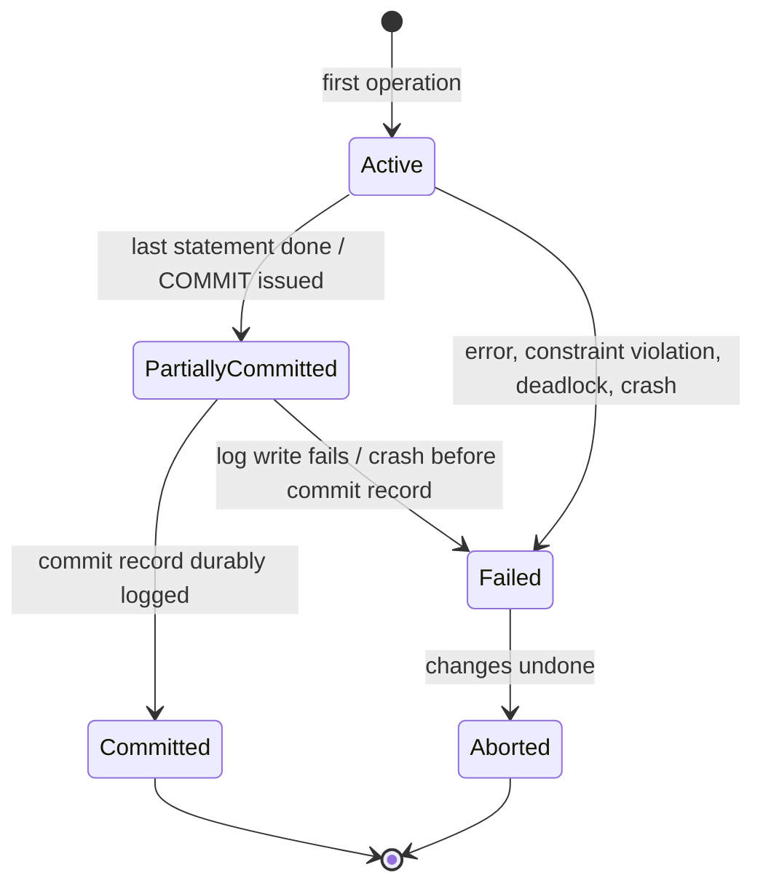
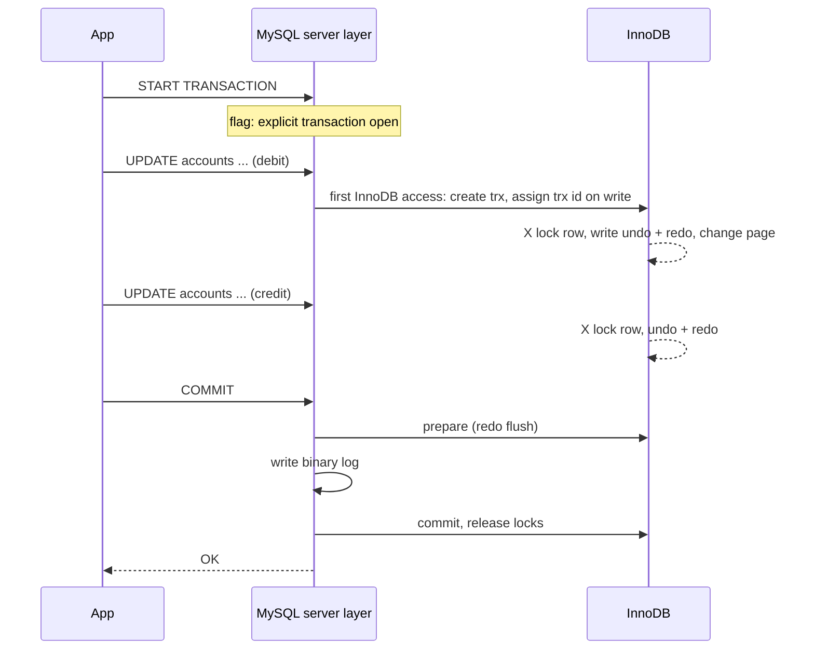

## Introduction

A bank transfer is two writes: subtract from one account, add to another. If the server crashes, the network drops, or a constraint fails between the two writes, the bank has either created or destroyed money. A **transaction** is the database's promise that a group of statements is treated as **one unit of work**: either every change becomes permanent and visible together, or none of them does.

You met the ACID properties in *ACID Properties and Transactions* (Module 1). This lesson is about the **mechanics** — the exact rules MySQL follows to decide *when a transaction starts, what is inside it, and when it ends*. Those rules are where real production bugs come from:

- MySQL runs in **autocommit** mode by default, so every statement you type is already its own transaction. Forgetting this explains many "but I rolled it back!" surprises.
- `START TRANSACTION` has options (`WITH CONSISTENT SNAPSHOT`, `READ ONLY`) that change *when* the snapshot is taken and what is allowed.
- `COMMIT` and `ROLLBACK` have rarely used `AND CHAIN` / `RELEASE` forms and are affected by the `completion_type` variable.
- Many statements — all DDL, `LOCK TABLES`, even a second `START TRANSACTION` — **commit the current transaction implicitly**, without any message.
- When a statement fails inside a transaction, InnoDB usually rolls back **only that statement**. The transaction stays open, holding its locks, until *you* decide what to do. Only some errors (a deadlock is the main one) roll back the whole transaction.

:::note[Dataset]
The examples use the **bank** dataset: 25 accounts with `balance DECIMAL(14,2)` guarded by `CHECK (balance >= 0)`, a `version` column, and an append-only `transactions` ledger in which a transfer is a `transfer_out`/`transfer_in` pair sharing a `reference`. The multi-session scenarios run on real concurrent MySQL connections called **A**, **B** and **C**; everything you see was captured from a real server.
:::

## DBMS Theory

:::theory[Transaction: the formal model]
In transaction-processing theory a **transaction** T is a sequence of read and write operations on database items, terminated by exactly one of two operations: **commit** (c) or **abort** (a). A schedule interleaves the operations of several transactions. The database guarantees that the effect of a committed transaction is as if it ran **atomically** (all-or-nothing) and **in isolation**, and that the effect survives failures (**durability**). An aborted transaction must leave no trace: the system **undoes** its writes.
:::

Textbooks (Silberschatz, Korth and Sudarshan; Elmasri and Navathe) describe every transaction as moving through a small state machine:



| State | Meaning | What the DBMS must guarantee |
|---|---|---|
| **Active** | Executing reads and writes | Changes are tentative; other transactions must not depend on them (isolation) |
| **Partially committed** | The final statement has executed; the commit has been requested | The changes are still in memory; nothing is promised yet |
| **Committed** | The commit record is on stable storage | The changes survive any later crash and become visible to others |
| **Failed** | Normal execution cannot continue | Nothing from this transaction may become permanent |
| **Aborted** | All changes have been rolled back | The database is as if the transaction never ran; the application may **restart** it as a new transaction |

Two points from the theory matter enormously in practice:

1. **The commit point is a single event — the durable write of the commit record.** Before it, a crash means the transaction is rolled back during recovery; after it, a crash means the transaction is redone. There is no "half-committed" outcome. In InnoDB this event is the flush of the redo log (and, with the binary log enabled, the write of the transaction to the binary log — see *Transaction Logs*).
2. **Abort is the system's escape hatch, not just the user's.** The DBMS may abort a transaction on its own — to break a deadlock, after a crash, or when a constraint cannot be satisfied. Applications therefore must be written to **detect aborts and retry**, not assume every transaction they start will commit.

**Statement atomicity versus transaction atomicity.** The SQL standard additionally requires that every individual SQL statement is atomic: if an `UPDATE` that touches 1,000 rows fails on row 700, the 699 changes it already made are undone. This is weaker than transaction atomicity — the *earlier* statements of the same transaction are untouched. A transaction is therefore a sequence of atomic statements that is itself atomic only when it ends with `COMMIT` or `ROLLBACK`.

:::standard[Standard SQL vs MySQL]
In standard SQL a transaction starts **implicitly** with the first SQL statement that needs one, and lasts until `COMMIT` or `ROLLBACK` — there is no autocommit in the standard. `START TRANSACTION` was added in SQL:1999 to set characteristics explicitly. MySQL (like SQL Server and PostgreSQL's psql client) defaults to **autocommit**, where each statement is committed on success. `BEGIN` / `BEGIN WORK` as a synonym for `START TRANSACTION`, `SET autocommit`, `completion_type`, `WITH CONSISTENT SNAPSHOT` and the `AND CHAIN` / `RELEASE` combinations are MySQL syntax or MySQL extensions of standard options.
:::

## Why It Exists

Without explicit transaction boundaries, a multi-step business operation is a sequence of independent commits, and every gap between them is an opportunity for corruption:

- **Partial failure.** The debit commits, the application crashes, the credit never happens. The ledger no longer balances, and nobody is told.
- **Visible intermediate states.** Another session reads between the debit and the credit and sees money that is "in flight" — a total-assets report that is short by the transfer amount.
- **No way back.** If the application discovers halfway through that the destination account is frozen, it would need hand-written "compensating" statements to undo what it already did — and those can fail too.

Transactions turn all three into non-problems: intermediate states are invisible to other sessions, failures before `COMMIT` are undone by the engine, and `ROLLBACK` undoes everything with one statement.

Autocommit exists for the opposite reason: **most statements are single-statement units of work.** An ad-hoc `SELECT`, a single-row `UPDATE`, an `INSERT` of one order line — wrapping each in `START TRANSACTION … COMMIT` would be noise. Autocommit gives each statement full ACID protection on its own and ends it immediately, releasing locks as early as possible. The cost is that **you must opt in** to multi-statement transactions, and forgetting to do so is silent.

Implicit commits exist because some operations cannot be part of a larger rollback-able unit. MySQL's data dictionary changes (DDL) are themselves transactional since 8.0 (*atomic DDL*), but a DDL statement is its own transaction: it cannot be rolled back together with your earlier DML. Rather than raise an error, MySQL commits whatever you had open first.

## Internal Working

:::internals[What happens inside InnoDB from START TRANSACTION to COMMIT]
1. **START TRANSACTION** marks the session as "inside an explicit transaction" in the server layer. InnoDB has not done any work yet: an InnoDB transaction object (`trx_t`) is attached lazily when the first statement touches an InnoDB table. `information_schema.INNODB_TRX.trx_started` therefore shows the time of the **first InnoDB access**, not the time of `START TRANSACTION` — unless you used `WITH CONSISTENT SNAPSHOT`, which starts the InnoDB transaction and creates its read view immediately.
2. **Transaction IDs are assigned lazily too.** A transaction that only reads never receives a real transaction ID; it shows a large, made-up number in `INNODB_TRX` (you will see one in a lock snapshot later in this module). The first write assigns a real, monotonically increasing ID from the global counter. `START TRANSACTION READ ONLY` lets InnoDB skip ID assignment and some bookkeeping entirely.
3. **Each write** locks the row (an exclusive record lock), writes an **undo record** describing how to reverse the change, modifies the page in the buffer pool, stamps the row with the transaction ID (`DB_TRX_ID`) and a pointer to the undo record (`DB_ROLL_PTR`), and generates **redo log** records describing the page change.
4. **COMMIT** (with the binary log enabled, as on most servers) runs an internal two-phase commit: InnoDB *prepares* (redo flushed with the transaction marked prepared), the server writes the transaction's events to the binary log, then InnoDB marks it *committed*. With `innodb_flush_log_at_trx_commit = 1` the redo log is flushed to disk at commit. Then locks are released and the transaction's undo records become eligible for **purge** once no read view needs them.
5. **ROLLBACK** walks the transaction's undo records **in reverse order** and applies each one, restoring the previous row images, then releases the locks. Rolling back is real work, proportional to how much the transaction changed — a 10-million-row `DELETE` takes a long time to roll back.
6. **A failed statement** is undone by rolling back to an internal *statement savepoint* taken before the statement began — the same undo mechanism, limited to the records written by that statement.
:::



Deeper treatment of each log is in *ACID in Practice* and *Transaction Logs* later in this module, and in Module 10.

## MySQL Implementation

First, see how the current session is configured. `@@autocommit = 1` means every statement commits on its own unless you start a transaction explicitly:

```sql run
SELECT @@autocommit             AS autocommit,
       @@transaction_isolation  AS isolation,
       @@transaction_read_only  AS read_only,
       @@completion_type        AS completion_type;
```

An explicit transaction is a block between `START TRANSACTION` (or `BEGIN`) and `COMMIT` or `ROLLBACK`. Here is a correct transfer of 100.00 from account 2 to account 1: two balance updates and the two ledger rows, committed as one unit. The `version` column is incremented on every change (it is used for optimistic locking later in the module).

```sql run
SELECT account_id, balance, version FROM accounts WHERE account_id IN (1, 2) ORDER BY account_id;
```

```sql run
START TRANSACTION;
UPDATE accounts SET balance = balance - 100.00, version = version + 1 WHERE account_id = 2;
UPDATE accounts SET balance = balance + 100.00, version = version + 1 WHERE account_id = 1;
INSERT INTO transactions (account_id, txn_type, amount, balance_after, reference, created_at)
VALUES (2, 'transfer_out', 100.00, 4328.20, 'TRF-LESSON-1', '2024-12-31 10:00:00'),
       (1, 'transfer_in',  100.00,  592.57, 'TRF-LESSON-1', '2024-12-31 10:00:00');
COMMIT;
SELECT account_id, balance, version FROM accounts WHERE account_id IN (1, 2) ORDER BY account_id;
```

Now the same shape, but the application decides to abandon it. `ROLLBACK` restores both rows — and notice that **inside** the transaction the session sees its own uncommitted changes:

```sql run
START TRANSACTION;
UPDATE accounts SET balance = balance - 4000.00 WHERE account_id = 2;
SELECT account_id, balance FROM accounts WHERE account_id = 2;
ROLLBACK;
SELECT account_id, balance FROM accounts WHERE account_id = 2;
```

Turning autocommit off changes the model completely: there is now **always** a transaction open, started implicitly by the first statement, and nothing is permanent until you `COMMIT`.

```sql run
SET autocommit = 0;
UPDATE accounts SET status = 'frozen' WHERE account_id = 25;
SELECT @@autocommit AS autocommit, status FROM accounts WHERE account_id = 25;
ROLLBACK;
SELECT status FROM accounts WHERE account_id = 25;
SET autocommit = 1;
```

## Syntax Breakdown

```sql
START TRANSACTION [characteristic [, characteristic] ...]
  -- characteristic: WITH CONSISTENT SNAPSHOT | READ WRITE | READ ONLY
BEGIN [WORK]
COMMIT   [WORK] [AND [NO] CHAIN] [[NO] RELEASE]
ROLLBACK [WORK] [AND [NO] CHAIN] [[NO] RELEASE]
SET autocommit = {0 | 1}
SET [GLOBAL | SESSION] TRANSACTION
    ISOLATION LEVEL {READ UNCOMMITTED | READ COMMITTED | REPEATABLE READ | SERIALIZABLE}
  | {READ WRITE | READ ONLY}
```

| Element | Meaning and MySQL-specific details |
|---|---|
| `START TRANSACTION` | Begins an explicit transaction and suspends autocommit until it ends. If a transaction is already open, it is **committed implicitly first** (no warning). Standard SQL. |
| `BEGIN [WORK]` | MySQL synonym for `START TRANSACTION` without characteristics. Inside stored programs, `BEGIN` starts a compound statement instead — use `START TRANSACTION` there. |
| `WITH CONSISTENT SNAPSHOT` | Starts the InnoDB transaction **and creates its read view immediately**, instead of at the first read. Only meaningful at `REPEATABLE READ`; at other levels it is ignored with a warning. MySQL extension. |
| `READ ONLY` | Any change to a non-temporary table fails with error 1792. Lets InnoDB skip transaction-ID assignment. Standard option. |
| `READ WRITE` | The default; explicit form useful when the session default was set to read-only. |
| `COMMIT` | Makes all changes permanent and visible, releases locks, ends the transaction. |
| `ROLLBACK` | Undoes all changes since the transaction began, releases locks, ends the transaction. |
| `AND CHAIN` | Immediately starts a new transaction with the **same isolation level and access mode**. |
| `RELEASE` | Disconnects the session after the commit/rollback. |
| `completion_type` | Session variable that makes plain `COMMIT`/`ROLLBACK` behave like `AND CHAIN` (`CHAIN`) or `RELEASE` (`RELEASE`). Default `NO_CHAIN`. |
| `SET autocommit = 0` | No statement commits by itself; the session is always inside a transaction. Setting it back to `1` while a transaction is open **commits** that transaction. |
| `SET TRANSACTION …` | Without `SESSION`/`GLOBAL`: applies to the **next** transaction only, and is refused (error 1568) while a transaction is active. With `SESSION`: all subsequent transactions in this session. `GLOBAL` cannot be used in the sandbox. |

Read-only transactions really are enforced:

```sql run error
START TRANSACTION READ ONLY;
INSERT INTO branches VALUES (99, 'Pop-up', 'Oakland');
```

```sql run
ROLLBACK;
START TRANSACTION READ WRITE;
SELECT COUNT(*) AS branches FROM branches;
COMMIT AND CHAIN;
SELECT @@transaction_isolation AS chained_isolation;
COMMIT;
```

`COMMIT AND CHAIN` ended the first transaction and opened a new one with identical characteristics; the final `COMMIT` ends that second transaction.

## Practical Examples

**1. Statement atomicity in autocommit mode.** A multi-row `INSERT` is one statement. If the third row violates the primary key, the first two rows are rolled back too — even though no transaction was "started":

```sql run error
INSERT INTO branches (branch_id, name, city) VALUES
  (10, 'Harbor',   'Oakland'),
  (11, 'Midtown',  'Sacramento'),
  (1,  'Duplicate','San Jose');
```

```sql run
SELECT COUNT(*) AS new_branches FROM branches WHERE branch_id IN (10, 11);
```

**2. A constraint failure rolls back the whole statement.** Charging a 200.00 fee to every checking account would drive account 23 (balance 144.47) below zero. The `CHECK` constraint fails on that row and the *entire* `UPDATE` is undone — no account is charged:

```sql run error
UPDATE accounts SET balance = balance - 200.00 WHERE account_type = 'checking';
```

```sql run
SELECT COUNT(*) AS checking_accounts,
       SUM(balance) AS total_checking_balance
FROM accounts WHERE account_type = 'checking';
```

**3. A failed statement inside a transaction does not end the transaction.** The duplicate-key error undoes only the failing `INSERT`. The earlier `UPDATE` is still pending, and it is the application's job to decide whether to commit or roll back:

```sql run
START TRANSACTION;
UPDATE accounts SET version = version + 1 WHERE account_id = 3;
```

```sql run error
INSERT INTO branches VALUES (1, 'Duplicate', 'San Jose');
```

```sql run
SELECT account_id, version FROM accounts WHERE account_id = 3;
ROLLBACK;
SELECT account_id, version FROM accounts WHERE account_id = 3;
```

The first `SELECT` (still inside the transaction) shows the incremented version; after `ROLLBACK` it is back to the original value. If the application had blindly issued `COMMIT` after catching the duplicate-key error, it would have committed a half-finished unit of work.

**4. DDL commits for you.** The `UPDATE` below is followed by `CREATE TABLE`. The DDL implicitly commits the open transaction before it runs, so the `ROLLBACK` has nothing left to undo:

```sql run
START TRANSACTION;
UPDATE accounts SET status = 'frozen' WHERE account_id = 5;
CREATE TABLE audit_note (id INT PRIMARY KEY, note VARCHAR(100));
ROLLBACK;
SELECT account_id, status FROM accounts WHERE account_id = 5;
```

Account 5 stays frozen. Restore it before continuing:

```sql run
UPDATE accounts SET status = 'active' WHERE account_id = 5;
DROP TABLE audit_note;
```

**5. `START TRANSACTION` inside a transaction commits the first one.** There is no nesting in MySQL:

```sql run
START TRANSACTION;
INSERT INTO branches VALUES (20, 'Riverside', 'Fresno');
START TRANSACTION;
ROLLBACK;
SELECT branch_id, name FROM branches WHERE branch_id = 20;
```

The row survived: the second `START TRANSACTION` committed the insert, and the `ROLLBACK` rolled back an empty transaction. (Partial rollback *within* a transaction is what savepoints are for — next lesson.)

```sql run
DELETE FROM branches WHERE branch_id = 20;
```

**6. Turning autocommit back on commits.** Setting `autocommit` from 0 to 1 while a transaction is open commits it; setting it to 1 when it is already 1 does nothing:

```sql run
SET autocommit = 0;
UPDATE accounts SET version = version + 100 WHERE account_id = 6;
SET autocommit = 1;
ROLLBACK;
SELECT account_id, version FROM accounts WHERE account_id = 6;
```

The version is 100 because `SET autocommit = 1` committed the update. This is exactly the kind of side effect a connection pool can trigger when it "resets" a connection.

## Execution Walkthrough

### Following one transfer statement by statement

```walkthrough
title: A transfer of 250.00 from account 8 to account 9, traced
steps:
  - title: "1. Before — committed state"
    explain: Both rows as every session currently sees them. The session is in autocommit mode, so no transaction is open.
    sql: SELECT account_id, balance, version FROM accounts WHERE account_id IN (8, 9) ORDER BY account_id;
  - title: "2. START TRANSACTION"
    explain: >-
      The server flags the session as inside an explicit transaction. InnoDB has not been touched yet — no
      transaction ID, no read view, no locks.
    sql: START TRANSACTION;
  - title: "3. Debit"
    explain: >-
      The first write: InnoDB creates the transaction, assigns it an ID, takes an exclusive record lock on account 8,
      writes an undo record holding the old balance and version, and changes the row in the buffer pool.
    sql: UPDATE accounts SET balance = balance - 250.00, version = version + 1 WHERE account_id = 8;
  - title: "4. Credit"
    explain: A second exclusive lock (account 9) and a second undo record. The transaction now owns two locked rows.
    sql: UPDATE accounts SET balance = balance + 250.00, version = version + 1 WHERE account_id = 9;
  - title: "5. Read your own writes"
    explain: >-
      Inside the transaction the session sees its own uncommitted changes. Any other session would still see the
      values from step 1 (the concurrency scenario below proves this with a second connection).
    sql: SELECT account_id, balance, version FROM accounts WHERE account_id IN (8, 9) ORDER BY account_id;
  - title: "6. COMMIT"
    explain: >-
      Prepare, binary-log write, commit; the redo log is flushed, the locks on accounts 8 and 9 are released, and
      the new values become visible to transactions that start reading after this point.
    sql: COMMIT;
  - title: "7. After"
    explain: The sum of the two balances is unchanged — money moved, none was created or destroyed.
    sql: SELECT account_id, balance, version, SUM(balance) OVER () AS pair_total FROM accounts WHERE account_id IN (8, 9) ORDER BY account_id;
```

### Watching it from a second session

The walkthrough could only show one session. The next scenario runs the same kind of transfer in session A while session B looks on. The lock snapshot (from `performance_schema.data_locks`) shows what A holds while its transaction is open.

```concurrency
title: Uncommitted changes are invisible; COMMIT publishes them atomically
description: Session A transfers 100.00 from account 2 to account 1. Session B reads both balances before and after A commits.
steps:
  - session: A
    sql: |
      START TRANSACTION;
      UPDATE accounts SET balance = balance - 100.00, version = version + 1 WHERE account_id = 2;
      UPDATE accounts SET balance = balance + 100.00, version = version + 1 WHERE account_id = 1;
    note: A has modified two rows but not committed.
  - session: B
    sql: SELECT account_id, balance FROM accounts WHERE account_id IN (1, 2) ORDER BY account_id;
    note: B (autocommit) sees the last committed values — neither half of A's transfer.
  - observe: locks
  - session: A
    sql: COMMIT;
    note: Both changes become visible at the same instant; the record locks are released.
  - session: B
    sql: SELECT account_id, balance FROM accounts WHERE account_id IN (1, 2) ORDER BY account_id;
    note: B now sees both halves. There was never a moment when it could see only one.
```

The snapshot shows A holding an `IX` (intention exclusive) lock on the `accounts` table and two `X,REC_NOT_GAP` record locks on primary-key values 1 and 2 — exclusive locks on exactly those rows and not on the gaps around them. B's plain `SELECT` took no locks at all: it read the old row versions from the undo log (MVCC). Both lock types are explained in *Locking*.

### Implicit commit, seen from outside

```concurrency
title: DDL silently commits the open transaction
description: Session A freezes an account inside a transaction, then runs a CREATE TABLE. Session B watches the account's status.
steps:
  - session: A
    sql: START TRANSACTION; UPDATE accounts SET status = 'frozen' WHERE account_id = 11;
  - session: B
    sql: SELECT account_id, status FROM accounts WHERE account_id = 11;
    note: Not committed yet, so B still sees 'active'.
  - session: A
    sql: CREATE TABLE fraud_review (account_id INT PRIMARY KEY);
    note: The DDL first commits A's open transaction, then runs as its own transaction.
  - session: B
    sql: SELECT account_id, status FROM accounts WHERE account_id = 11;
    note: B now sees 'frozen' — A never typed COMMIT.
  - session: A
    sql: ROLLBACK; SELECT account_id, status FROM accounts WHERE account_id = 11;
    note: The ROLLBACK has nothing to undo; the freeze is permanent.
```

### A failed statement leaves the transaction open

```concurrency
title: Lock wait timeout rolls back the statement, not the transaction
description: Session A holds a lock on account 3. Session B, with a 2-second lock wait timeout, updates account 4 and then tries account 3.
steps:
  - session: A
    sql: START TRANSACTION; UPDATE accounts SET version = version + 1 WHERE account_id = 3;
  - session: B
    sql: SET SESSION innodb_lock_wait_timeout = 2; START TRANSACTION; UPDATE accounts SET balance = balance - 50.00 WHERE account_id = 4;
    note: B's first statement succeeds.
  - session: B
    sql: UPDATE accounts SET balance = balance + 50.00 WHERE account_id = 3;
    expect: error
    errorCode: 1205
    note: B waits for A's lock on account 3, gives up after 2 seconds and gets error 1205.
  - session: C
    sql: SELECT account_id, balance FROM accounts WHERE account_id = 4;
    note: C still sees the original balance of account 4 — B has not committed.
  - session: B
    sql: SELECT account_id, balance FROM accounts WHERE account_id = 4;
    note: B's debit of account 4 is still there. Only the timed-out statement was rolled back; B's transaction is open and still holds the lock on account 4.
  - session: B
    sql: ROLLBACK;
    note: The application must choose — here it rolls back the half-done transfer.
  - session: A
    sql: ROLLBACK;
```

### The forgotten COMMIT

```concurrency
title: autocommit = 0 keeps locks until someone commits
description: Session A switches autocommit off and makes a "quick" one-row change. Session B, a normal autocommit session, tries to update the same row.
steps:
  - session: A
    sql: SET autocommit = 0; UPDATE accounts SET status = 'frozen' WHERE account_id = 13;
    note: With autocommit off, this UPDATE opened a transaction that stays open.
  - session: B
    sql: UPDATE accounts SET balance = balance + 10.00 WHERE account_id = 13;
    expect: blocks
    note: B waits — A still holds the exclusive lock on account 13.
  - observe: locks
  - session: A
    sql: COMMIT;
    note: Only an explicit COMMIT (or ROLLBACK) releases the lock. B's UPDATE completes immediately afterwards.
  - session: B
    sql: SELECT account_id, status, balance FROM accounts WHERE account_id = 13;
```

In the snapshot, A's lock is `GRANTED` and B's identical `X,REC_NOT_GAP` request on the same row is `WAITING`; B's transaction state is `LOCK WAIT`. In a real application the "A" here is often a connection that a framework left in `autocommit = 0` mode after a read — it holds locks (and an old read view) until the pool happens to reuse it.

## Output

Reading the results above as a whole:

- After the committed transfer in *MySQL Implementation*, account 2 dropped by 100.00 and account 1 rose by 100.00, and both `version` values went from 0 to 1. After the rolled-back 4,000.00 debit, account 2 was back where it started, although inside the transaction the session had seen the reduced balance.
- In autocommit mode, the failed multi-row `INSERT` left **zero** of the new branches behind and the failed fee `UPDATE` changed **no** account: statement atomicity.
- Inside an explicit transaction, a failed statement did **not** undo the earlier `UPDATE` of account 3's version: the transaction remained open until the explicit `ROLLBACK`.
- `CREATE TABLE`, a nested `START TRANSACTION`, and `SET autocommit = 1` each committed pending work, which is why the following `ROLLBACK` could not undo it.
- In the concurrency scenarios, session B never saw half of a transfer, saw the implicitly committed freeze the moment the DDL ran, and after a lock wait timeout still had its own earlier change pending.

## Alternative Approaches

There are three ways to delimit a multi-statement unit of work in MySQL:

| Approach | How | Use it when | Risk |
|---|---|---|---|
| Explicit transactions in autocommit mode | `START TRANSACTION … COMMIT` around the unit; everything else autocommits | The default for application code and scripts | Forgetting `START TRANSACTION` makes each statement commit separately |
| Session with `autocommit = 0` | Every statement is inside a transaction; you `COMMIT` periodically | Some drivers and frameworks (JDBC `setAutoCommit(false)`, Python DB-API's default) | Long-lived invisible transactions holding locks and old snapshots; a "read-only" session can block DDL |
| One atomic statement | Express the unit as a single `UPDATE`/`INSERT … SELECT` | The whole change fits into one statement (e.g. both legs of a transfer via `CASE`) | Can become unreadable; does not cover multi-table invariants unless you use multi-table `UPDATE` |

The single-statement option deserves attention because it needs no transaction control at all. Both legs of a transfer can be one `UPDATE`:

```sql run
UPDATE accounts
SET balance = balance + CASE account_id WHEN 16 THEN -75.00 WHEN 17 THEN 75.00 END,
    version = version + 1
WHERE account_id IN (16, 17);
SELECT account_id, balance, version FROM accounts WHERE account_id IN (16, 17) ORDER BY account_id;
```

Statement atomicity guarantees both rows change or neither does, and the `CHECK` constraint still protects the debited account. It does not write ledger rows, though — once a unit of work spans several statements or tables, use an explicit transaction.

**Language-level helpers.** Most drivers wrap the pattern for you: Python's `with connection:` (commit on success, rollback on exception), Spring's `@Transactional`, Go's `db.BeginTx` with deferred `Rollback`. They all compile down to the statements in this lesson; knowing what they send helps when a framework's default (often `autocommit = 0`) surprises you.

## Performance Analysis

Transaction boundaries have direct performance consequences:

| Factor | Effect |
|---|---|
| **Commit cost** | With `innodb_flush_log_at_trx_commit = 1` and `sync_binlog = 1` (the durable defaults), every commit waits for log flushes to stable storage. Group commit lets concurrent commits share one flush, but a single-threaded loader that commits after every row is bounded by flush latency. |
| **Too-large transactions** | Locks are held until the end, the undo log grows, rollback after a failure takes as long as (or longer than) the work itself, and with the binary log the whole transaction is written as one unit at commit. |
| **Long-open transactions** | Even an idle open transaction keeps its read view, preventing **purge** of old row versions (the history list grows) and holding metadata locks that block DDL. |
| **Read-only transactions** | `START TRANSACTION READ ONLY` (or autocommit `SELECT`s) avoid transaction-ID allocation and some internal bookkeeping. |

The usual sweet spot for bulk work is **batches**: commit every few thousand rows. That amortizes the commit flush across many rows while keeping each transaction small enough to roll back quickly and release locks often.

:::performance[Theory vs measurement]
The costs above follow from how InnoDB logging and locking work; the actual commit latency depends entirely on your storage (an fsync on a local NVMe device and on network block storage differ by orders of magnitude). Measure with your own workload — compare rows/second for commit-per-row versus commit-per-1,000-rows on your hardware — rather than trusting a rule of thumb. The sandbox is not a suitable place to benchmark commit latency.
:::

These are the durability settings on the capture server (they are server-wide and cannot be changed from a lab):

```sql run
SELECT @@innodb_flush_log_at_trx_commit AS flush_log_at_commit,
       @@sync_binlog                    AS sync_binlog,
       @@log_bin                        AS binary_log_enabled;
```

## Best Practices

:::best-practice[Professional transaction habits]
1. **Make boundaries explicit.** Wrap every multi-statement unit of work in `START TRANSACTION … COMMIT` and keep the unit as small as the business rule allows.
2. **Never wait for a human inside a transaction.** No user prompts, no remote HTTP calls, no sleeps between `START TRANSACTION` and `COMMIT`. Do the slow work first; open the transaction only for the database writes.
3. **On any error, decide explicitly.** After an exception inside a transaction, `ROLLBACK` (or retry the whole transaction). Do not commit "whatever worked".
4. **Retry the whole transaction on 1213 (deadlock) and usually on 1205 (lock wait timeout)** — after rolling back. Build the retry loop once, in a helper.
5. **Keep DDL out of transactions.** Run schema changes as separate, deliberate operations; never mix them into DML transactions where they commit work implicitly.
6. **Know your driver's autocommit default** and set it deliberately. Return connections to the pool with no open transaction.
7. **Use `READ ONLY` for read-only work** that needs a consistent multi-statement view (reports, exports), together with `WITH CONSISTENT SNAPSHOT` when the snapshot must start immediately.
8. **Batch bulk changes** — commit every N rows — instead of one giant transaction or one commit per row.
:::

## Common Mistakes

**Mistake 1 — assuming ROLLBACK undoes statements run in autocommit mode.** Every statement already committed:

```sql run
UPDATE accounts SET version = version + 1 WHERE account_id = 14;
ROLLBACK;
SELECT account_id, version FROM accounts WHERE account_id = 14;
```

The `ROLLBACK` succeeded — there was simply no open transaction. Correct: `START TRANSACTION` first.

**Mistake 2 — committing after a caught error.** As Example 3 showed, a failing statement does not end the transaction. Code such as `try: …; except: pass; finally: commit()` persists a half-finished unit of work. Correct: roll back on error, then retry or report.

**Mistake 3 — "temporary" schema changes in the middle of a transaction.** `ALTER TABLE`, `CREATE INDEX`, `TRUNCATE TABLE`, `RENAME TABLE`, `CREATE VIEW` — all commit implicitly. So do `LOCK TABLES`, account-management statements and administrative statements such as `ANALYZE TABLE` and `OPTIMIZE TABLE`. One frequent exception: `CREATE TEMPORARY TABLE` and `DROP TEMPORARY TABLE` do **not** commit (but are not undone by `ROLLBACK` either).

**Mistake 4 — trying to nest transactions.** `START TRANSACTION` inside a transaction commits the outer one (Example 5). Frameworks that "nest" transactions implement it with savepoints.

**Mistake 5 — `SET TRANSACTION` in the wrong place.** Without `SESSION`, it applies only to the next transaction and is rejected inside an active one:

```sql run error
START TRANSACTION;
SET TRANSACTION ISOLATION LEVEL READ COMMITTED;
```

```sql run
ROLLBACK;
```

**Mistake 6 — huge single transactions for bulk changes.** Deleting 50 million rows in one statement holds locks for the whole run, bloats the undo log, and, if it fails at 90 %, spends a similar amount of time rolling back. Correct: delete in key-ranged batches (e.g. `DELETE … WHERE id BETWEEN ? AND ?`), committing each batch.

## Industry Application

- **Payments and ledgers.** Every money movement is one transaction containing the balance updates and the ledger rows, often with an idempotency key so that a client retry after a timeout cannot apply the transfer twice (see *Data Integrity in Distributed Applications*, Module 12).
- **ORMs and frameworks.** Django wraps each request in a transaction only if `ATOMIC_REQUESTS` is enabled; Spring's `@Transactional` opens a transaction around a method and commits on return or rolls back on a runtime exception; SQLAlchemy sessions run with autocommit off and require `session.commit()`. Production incidents often trace back to a misunderstood default — a "read" endpoint that never commits, holding a snapshot for hours.
- **Connection pools.** Pools such as HikariCP reset `autocommit` and roll back open transactions when a connection is returned. A pool configured not to do so leaks transactions between requests.
- **Online schema change.** Because DDL commits and needs metadata locks, teams run migrations as separate steps with `ALGORITHM=INSTANT`/`INPLACE` or tools such as gh-ost and pt-online-schema-change (Module 11), never inside application transactions.
- **Batch ETL.** Loaders commit every N rows and record a high-water mark in the same transaction as the batch, so that a crashed job resumes exactly where the last commit left off.

## Practice Exercises

```exercise
id: ex1
title: A complete transfer with ledger rows
difficulty: easy
kind: dml
concepts: [transactions, commit-rollback]
prompt: |
  Transfer **250.00** from account **3** to account **4** as one transaction:

  - decrease account 3's balance and increase account 4's balance by 250.00, incrementing `version` on both;
  - insert the two ledger rows into `transactions`: a `transfer_out` for account 3 and a `transfer_in` for
    account 4, both with `amount` 250.00, the correct `balance_after`, `reference` = `'TRF-EX1'` and
    `created_at` = `'2024-12-31 12:00:00'`;
  - commit.

  Account 3 currently has 10232.88 and account 4 has 7946.37. The checker compares both accounts and the two
  ledger rows (excluding the auto-increment `txn_id`).
hints:
  - "Start with START TRANSACTION and end with COMMIT; in between you need two UPDATEs and one INSERT with two rows."
  - "balance_after for account 3 is 10232.88 − 250.00 = 9982.88; for account 4 it is 7946.37 + 250.00 = 8196.37."
solution: |
  START TRANSACTION;
  UPDATE accounts SET balance = balance - 250.00, version = version + 1 WHERE account_id = 3;
  UPDATE accounts SET balance = balance + 250.00, version = version + 1 WHERE account_id = 4;
  INSERT INTO transactions (account_id, txn_type, amount, balance_after, reference, created_at)
  VALUES (3, 'transfer_out', 250.00, 9982.88, 'TRF-EX1', '2024-12-31 12:00:00'),
         (4, 'transfer_in',  250.00, 8196.37, 'TRF-EX1', '2024-12-31 12:00:00');
  COMMIT;
check: |
  SELECT a.account_id, a.balance, a.version, t.txn_type, t.amount, t.balance_after, t.created_at
  FROM accounts a
  LEFT JOIN transactions t ON t.account_id = a.account_id AND t.reference = 'TRF-EX1'
  WHERE a.account_id IN (3, 4)
  ORDER BY a.account_id;
explanation: |
  The four writes form one unit: if any fails, the application rolls back and nothing is left half-done. A common
  slip is to compute `balance_after` from the wrong side or to forget the `version` increments. In production the
  application would read the new balance (or use `UPDATE … ` followed by a `SELECT` inside the same transaction)
  instead of hard-coding it.
```

```exercise
id: ex2
title: A monthly fee that never fails halfway
difficulty: medium
kind: dml
concepts: [statement-atomicity, transactions]
prompt: |
  The bank charges a **200.00** fee to every **active checking** account. A naive
  `UPDATE accounts SET balance = balance - 200.00 WHERE account_type = 'checking' AND status = 'active'`
  fails with the CHECK constraint error and charges **nobody**, because some accounts cannot afford it.

  Write **one** statement that charges the fee (and increments `version`) to every active checking account
  that can afford it, and leaves the others untouched.
hints:
  - "Statement atomicity means one failing row undoes the whole statement — so make sure no failing row is ever touched."
  - "Add a predicate on the balance to the WHERE clause."
solution: |
  UPDATE accounts
  SET balance = balance - 200.00, version = version + 1
  WHERE account_type = 'checking' AND status = 'active' AND balance >= 200.00;
check: |
  SELECT account_id, balance, version FROM accounts ORDER BY account_id;
explanation: |
  The guard `balance >= 200.00` excludes the rows that would violate `CHECK (balance >= 0)`, so the statement
  succeeds as a whole. Without it, the error on one row rolls back the changes already made to all other rows
  (statement atomicity) — the result is "all or nothing" at statement level, which is safe but not what the
  business wanted. In a real bank, the excluded accounts would be recorded for follow-up in the same transaction.
```

```exercise
id: ex3
title: What does this script leave behind?
difficulty: medium
kind: open
concepts: [implicit-commit, autocommit]
prompt: |
  A session with `autocommit = 1` runs the following script. For each of the three accounts, say what its
  `status` is at the end, and explain which statement determined it.

  ~~~
  START TRANSACTION;
  UPDATE accounts SET status = 'frozen' WHERE account_id = 1;
  ALTER TABLE accounts ADD COLUMN risk_score INT NULL;
  UPDATE accounts SET status = 'frozen' WHERE account_id = 2;
  ROLLBACK;
  START TRANSACTION;
  UPDATE accounts SET status = 'frozen' WHERE account_id = 3;
  START TRANSACTION;
  ROLLBACK;
  ~~~
solution: |
  - **Account 1: frozen.** The `ALTER TABLE` implicitly committed the open transaction before it ran, which
    made the first update permanent.
  - **Account 2: frozen.** After the `ALTER TABLE`, the session was back in autocommit mode (the explicit
    transaction had ended), so the second `UPDATE` committed on its own. The `ROLLBACK` rolled back nothing.
  - **Account 3: frozen.** The second `START TRANSACTION` implicitly committed the transaction that contained the
    update of account 3; the final `ROLLBACK` ended an empty transaction.

  The `ALTER TABLE` itself is also permanent: DDL cannot be rolled back. The script shows why DDL and nested
  `START TRANSACTION` statements must never appear inside a unit of work you may need to undo.
```

```exercise
id: ex4
title: Both legs in one atomic statement
difficulty: hard
kind: dml
concepts: [statement-atomicity, transactions]
prompt: |
  Without using `START TRANSACTION`, move **120.00** from account **20** to account **21** so that it is
  impossible for only one of the two balances to change, even in autocommit mode. Increment `version` on both
  rows. Use exactly **one** SQL statement.
hints:
  - "A single UPDATE can modify several rows; statement atomicity makes it all-or-nothing."
  - "Use WHERE account_id IN (20, 21) and a CASE expression that adds −120.00 for 20 and +120.00 for 21."
solution: |
  UPDATE accounts
  SET balance = balance + CASE account_id WHEN 20 THEN -120.00 WHEN 21 THEN 120.00 END,
      version = version + 1
  WHERE account_id IN (20, 21);
check: |
  SELECT account_id, balance, version FROM accounts WHERE account_id IN (20, 21) ORDER BY account_id;
explanation: |
  One statement is one atomic unit, and in autocommit mode one transaction. If account 20 could not afford the
  debit, the CHECK constraint would fail and neither row would change. Two separate UPDATEs in autocommit mode
  would commit independently, so a failure (or crash) between them would leave the money half-moved. The
  limitation: this trick cannot also insert the ledger rows — as soon as more than one statement is needed,
  an explicit transaction is required.
```

```exercise
id: ex5
title: Code review — a transfer endpoint
difficulty: challenge
kind: open
concepts: [transactions, commit-rollback, autocommit, statement-atomicity]
prompt: |
  A teammate wrote this handler (pseudocode). The driver connects with `autocommit = 0`.

  ~~~
  def transfer(src, dst, amount):
      cur.execute("UPDATE accounts SET balance = balance - %s WHERE account_id = %s", (amount, src))
      fx_rate = http_get("https://fx.example/rate")         # can take up to 30 s
      try:
          cur.execute("UPDATE accounts SET balance = balance + %s WHERE account_id = %s", (amount * fx_rate, dst))
      except DatabaseError:
          log("credit failed")
      conn.commit()
  ~~~

  Identify every transactional problem you can find and rewrite the logic (pseudocode is fine), stating which
  errors you would retry.
solution: |
  Problems:

  1. **Remote call inside the transaction.** Because `autocommit = 0`, the first `UPDATE` opened a transaction and
     holds an exclusive lock on `src` while the HTTP call runs for up to 30 s. Other transfers touching `src` wait
     (and may hit lock wait timeouts), and the open transaction delays purge.
  2. **Commit after a failed statement.** If the credit fails (CHECK violation, lock wait timeout, frozen account
     logic…), the code logs and then **commits the debit alone** — money disappears.
  3. **Deadlock is not handled.** A 1213 rolls back the whole transaction; the code would then commit an empty
     transaction and report success.
  4. **No ledger rows and no validation** (status of both accounts, sufficient funds — the CHECK protects
     against negatives but produces an error rather than a business message).
  5. **No idempotency**: a client retry after a timeout could apply the transfer twice.

  Rewrite:

  ~~~
  fx_rate = http_get(...)                       # slow work first, outside any transaction
  for attempt in range(3):
      try:
          conn.begin()                          # START TRANSACTION
          debit  = UPDATE ... SET balance = balance - :amt WHERE account_id = :src AND status = 'active' AND balance >= :amt
          credit = UPDATE ... SET balance = balance + :amt2 WHERE account_id = :dst AND status = 'active'
          if debit.rowcount != 1 or credit.rowcount != 1: conn.rollback(); raise BusinessError
          INSERT ledger rows (transfer_out, transfer_in) with a unique reference / idempotency key
          conn.commit()
          return
      except (Deadlock_1213, LockWaitTimeout_1205):
          conn.rollback(); sleep(backoff(attempt)); continue
      except Exception:
          conn.rollback(); raise
  ~~~

  Retry 1213 (the transaction was already rolled back by InnoDB) and 1205 (roll back first, because only the
  statement was undone). Do not retry business-rule failures or constraint violations.
```

## Knowledge Assessment

```quiz
- id: q1
  question: "A session with the default settings runs `UPDATE accounts SET status = 'closed' WHERE account_id = 7;` and then `ROLLBACK;`. What is the status of account 7?"
  options: ["The previous status — ROLLBACK undid the UPDATE", "closed — the UPDATE was committed by autocommit", "Unknown until the session disconnects", "An error is raised because there is no transaction"]
  answer: 1
  explanation: "With autocommit = 1 (the default), the UPDATE was its own transaction and committed on success. ROLLBACK without an open transaction is a successful no-op — it raises no error, which is why the mistake goes unnoticed. The status is not 'pending until disconnect'; that would only be true with autocommit = 0."
  concepts: [autocommit]
- id: q2
  question: "Inside an explicit transaction, statement 1 (an UPDATE) succeeds and statement 2 (an INSERT) fails with a duplicate-key error. What has InnoDB rolled back?"
  options: ["Both statements — any error aborts the transaction", "Only the failed INSERT; the UPDATE is still pending in the open transaction", "Nothing; the INSERT's partial effects remain until COMMIT", "Both statements, and the session is disconnected"]
  answer: 1
  explanation: "A duplicate-key error rolls back only the failing statement (statement atomicity). The transaction remains open with the UPDATE pending; the application must choose COMMIT or ROLLBACK. Whole-transaction rollback happens for deadlocks (1213), not for duplicate keys, and partial effects of a failed statement never remain."
  concepts: [statement-atomicity, commit-rollback]
- id: q3
  question: "Which statements cause an implicit commit of an open transaction in MySQL 8.4? (Select all that apply.)"
  type: multi
  options: ["CREATE INDEX idx ON accounts (status)", "START TRANSACTION", "CREATE TEMPORARY TABLE tmp (x INT)", "SET autocommit = 1 (when it was 0)", "SELECT ... FOR UPDATE"]
  answer: [0, 1, 3]
  explanation: "DDL such as CREATE INDEX, a new START TRANSACTION, and switching autocommit from 0 to 1 all commit implicitly. CREATE TEMPORARY TABLE is an explicit exception that does not commit, and SELECT ... FOR UPDATE is an ordinary locking read inside the transaction."
  concepts: [implicit-commit]
- id: q4
  question: "Session A runs `START TRANSACTION;` at 10:00:00, does nothing, and runs its first `SELECT` at 10:05:00 (REPEATABLE READ). From which moment's committed data does that SELECT read?"
  options: ["10:00:00, when START TRANSACTION ran", "10:05:00, when the first consistent read created the read view", "The moment the session connected", "Whatever is newest at each statement"]
  answer: 1
  explanation: "In InnoDB the snapshot (read view) of a REPEATABLE READ transaction is created by its first consistent read, not by START TRANSACTION. Use START TRANSACTION WITH CONSISTENT SNAPSHOT to create it immediately. 'Newest at each statement' describes READ COMMITTED."
  concepts: [start-transaction]
- id: q5
  question: "What does `COMMIT AND CHAIN` do?"
  options: ["Commits and starts a new transaction with the same isolation level and access mode", "Commits this and all other sessions' transactions", "Commits and replicates the transaction to all replicas synchronously", "Commits only the statements since the last savepoint"]
  answer: 0
  explanation: "AND CHAIN begins a new transaction immediately with the same characteristics. It has nothing to do with other sessions, replication, or savepoints (savepoints only support partial rollback, not partial commit)."
  concepts: [commit-rollback]
- id: q6
  question: "B is inside a transaction. Its UPDATE fails with error 1205 (lock wait timeout) with default server settings. What should the application do?"
  options: ["Nothing — InnoDB already rolled back the transaction", "COMMIT, since the other statements succeeded", "ROLLBACK (then possibly retry the whole transaction), because only the waiting statement was rolled back", "Reconnect, because the session is now unusable"]
  answer: 2
  explanation: "With innodb_rollback_on_timeout = OFF (the default), a lock wait timeout rolls back only the statement that timed out. Earlier statements and their locks remain. Committing would persist a partial unit of work. The full transaction is rolled back automatically only for deadlocks or if innodb_rollback_on_timeout is enabled; the connection itself stays usable."
  concepts: [statement-atomicity, commit-rollback]
- id: q7
  question: "Why can a session that only ran a SELECT with autocommit = 0, and then went idle, block an ALTER TABLE on the same table?"
  options: ["SELECT takes exclusive row locks", "The open transaction holds a shared metadata lock on the table until it ends", "ALTER TABLE always waits for innodb_lock_wait_timeout", "Idle sessions lock the whole schema"]
  answer: 1
  explanation: "Any statement in a transaction acquires a metadata lock on the tables it touches, held until the transaction ends. With autocommit = 0 the transaction never ends on its own, so ALTER TABLE (which needs an exclusive metadata lock) waits. Plain SELECTs take no InnoDB row locks, and metadata lock waits are governed by lock_wait_timeout, not innodb_lock_wait_timeout."
  concepts: [autocommit, implicit-commit]
```
