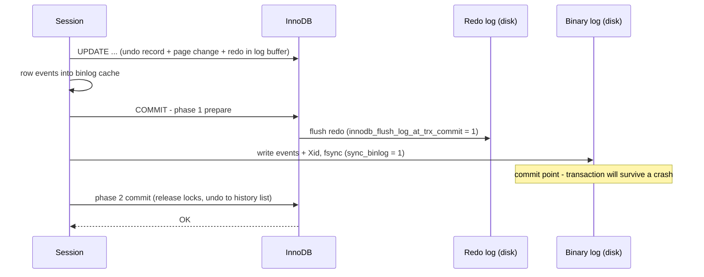

## Introduction

When you run `COMMIT` on a MySQL server with default settings, at least three different logs are involved before the client receives "OK":

| Log | Owner | Records | Used for |
|---|---|---|---|
| **Redo log** | InnoDB | Physical changes to pages ("in page X at offset Y, write these bytes"), in LSN order | **Crash recovery**: re-applying committed changes that had not reached the data files |
| **Undo log** | InnoDB | How to reverse each row change (old column values) | **Rollback** and **MVCC** (rebuilding old row versions for consistent reads) |
| **Binary log** | MySQL server | Logical change events — row images (default) or statements — per committed transaction | **Replication**, **point-in-time recovery**, change data capture |

They answer different questions: *"how do I get the data files back to the last committed state after a crash?"* (redo), *"how do I take back this change, or show someone the version from before it?"* (undo), and *"what exactly happened, in commit order, so another server can repeat it or I can replay it after restoring a backup?"* (binary log). Because the binary log and the redo log are written by different components, MySQL runs an internal **two-phase commit** so that, after any crash, both agree on which transactions committed.

This lesson gives an end-to-end overview of the three logs from a transaction's point of view: what each one writes and when, how the durability settings change the guarantees, and what you can observe from SQL. Module 10 (*Redo and Undo Logs*, *The Binary Log*, *Crash Recovery*) goes deeper into storage formats and tuning.

:::note[Dataset]
The examples use the **bank** dataset. One scenario builds a 20,000-row table in its own setup to make undo work visible. Log contents cannot be read from a lab account; where real log output is shown, it was captured on the build server (MySQL 8.0.46) with an administrator account and is labelled as such.
:::

## DBMS Theory

:::theory[Logging and recovery]
**Write-ahead logging (WAL)** is the rule that makes logging-based recovery correct: *a change to a data page may be written to stable storage only after the log records describing that change are on stable storage*, and *a transaction may be reported committed only after its commit log record is on stable storage*. With WAL, the log on disk always contains enough information to bring the data files to a consistent state.

Recovery algorithms in the **ARIES** family (Mohan et al., 1992) combine two kinds of log information:

- **Redo information** — enough to re-apply a change. Usually *physiological*: physical with respect to a page (identified by page number), logical within the page.
- **Undo information** — enough to reverse a change. Usually logical ("restore column `balance` of row 2 to 4428.20").

Recovery replays history (**redo** everything since the last checkpoint, bringing pages to their state at the crash) and then **undoes** the transactions that had not committed.

**Two-phase commit (2PC)** coordinates several *resource managers* that must all commit or all abort: in phase 1 the coordinator asks each participant to **prepare** (make its changes durable and promise to commit if asked); in phase 2, if all prepared, it tells them to **commit**, otherwise to abort. A participant that crashes after preparing must, on recovery, ask the coordinator (or consult its log) for the decision.
:::

Two design choices follow from this theory and appear throughout MySQL:

1. **Log records are small and sequential; data pages are large and random.** Making a commit durable by appending a few hundred bytes to a log is far cheaper than writing every modified 16 KB page. Pages are written later, in the background, possibly absorbing many changes per write.
2. **Physical and logical logs serve different consumers.** A physical redo log is ideal for recovering *this* server's files, but useless to another server with a different physical layout. A logical log (the binary log) describes changes in terms of tables and rows, so any server — a replica, or a freshly restored backup — can apply it.

:::standard[Standard SQL vs MySQL]
The SQL standard says nothing about logs; durability is a property it assumes. Redo/undo logging, the binary log, its formats, `sync_binlog`, `innodb_flush_log_at_trx_commit`, `mysqlbinlog`, and the internal binary-log/InnoDB two-phase commit are MySQL and InnoDB implementation details. The X/Open **XA** standard defines an external two-phase-commit interface; MySQL supports it with `XA START … XA PREPARE … XA COMMIT` for distributed transactions, using the same prepare machinery as its internal 2PC.
:::

## Why It Exists

Each log exists because something specific would be impossible without it:

- **Without redo**, InnoDB would have to write every modified page to disk before acknowledging a commit (a *force* policy) — many random writes per transaction — or risk losing committed transactions on a crash.
- **Without undo**, a transaction could not be rolled back once it had changed a page; the buffer pool could never write a page containing uncommitted changes (*no-steal*), which would make large transactions impossible; and there would be no old versions for consistent reads.
- **Without the binary log**, there would be no MySQL replication as we know it, no point-in-time recovery from backups, and no change data capture. The redo log cannot do these jobs: it is physical, engine-specific, circular (old entries are overwritten after a checkpoint), and contains changes of uncommitted transactions.
- **Without two-phase commit between them**, a crash at the wrong moment could leave a transaction committed in InnoDB but missing from the binary log (replicas and point-in-time recovery would silently lose it) — or present in the binary log but rolled back in InnoDB (replicas would have data the primary does not).

## Internal Working

### The write path of one transaction

:::internals[From UPDATE to durable COMMIT]
**During the transaction**

1. Each row change writes an **undo record** (in an undo tablespace) describing how to reverse it, and links the row to it through `DB_ROLL_PTR`.
2. The change is applied to the page in the **buffer pool**. Both the data-page change and the undo-page change generate **redo records**, appended to the in-memory **log buffer** and tagged with a monotonically increasing **LSN** (log sequence number, a byte offset in the logical redo stream).
3. The server layer accumulates the transaction's **binary log events** (for row-based logging: a table-map event and before/after row images per statement) in a per-session **binlog cache** (`binlog_cache_size`, spilling to a temporary file if larger).

**At COMMIT (binary log enabled — the default)**

4. **Prepare**: InnoDB marks the transaction *prepared* and writes the redo for that. With `innodb_flush_log_at_trx_commit = 1` the redo log is flushed to disk up to this point.
5. **Binary log**: the server appends the transaction's events from the binlog cache to the binary log file, followed by an **Xid** event carrying the transaction's internal ID, and — with `sync_binlog = 1` — fsyncs the binary log. *This write is the commit point*: once the transaction is durably in the binary log, recovery will commit it.
6. **Commit**: InnoDB marks the transaction committed (another redo record), releases its locks, and adds its update-undo log to the **history list** for purge (insert undo is freed). The client receives OK.

**Group commit.** Steps 4–6 are pipelined across concurrent sessions in three stages (flush, sync, commit): one session leads a group, writes the binary-log events of all members, performs one fsync for the whole group, and commits them in binary-log order (`binlog_order_commits = ON`). This is what keeps durable commits affordable under concurrency.

**Later, in the background**

7. Page cleaner threads write dirty pages to the data files (through the doublewrite buffer), always after their redo is durable (WAL).
8. **Checkpoints** advance: redo older than the oldest unflushed page change is no longer needed and its space is reused (`innodb_redo_log_capacity`).
9. **Purge** removes undo that no read view needs any more and physically deletes delete-marked rows.
:::



### Crash recovery with three logs

1. **Redo apply**: InnoDB reads the redo log from the last checkpoint and re-applies changes to pages, bringing data and undo pages to their state at the crash.
2. **Resolve prepared transactions**: for transactions found in the *prepared* state, the server scans the last binary log file for their Xids. Found → **commit** (the transaction reached the binary log, so replicas may already have it). Not found → **roll back** (the client was never told OK).
3. **Roll back** all other active (not prepared) transactions using their undo logs — large ones in the background after the server is already accepting connections.

### Redo log, undo log and binary log compared

| Property | Redo log | Undo log | Binary log |
|---|---|---|---|
| Level | Storage engine (InnoDB), physical/physiological | Storage engine (InnoDB), logical per row | Server, logical (row images or statements) |
| Contains uncommitted work | Yes | Yes | No — written at commit only |
| Lifetime | Circular; reusable after checkpoint | Until rollback finishes or purge removes it | Files rotated at `max_binlog_size`, kept for `binlog_expire_logs_seconds` |
| Durability control | `innodb_flush_log_at_trx_commit` | Protected by redo | `sync_binlog` |
| Read by | Crash recovery only | Rollback, MVCC reads, purge | Replicas, `mysqlbinlog`, CDC tools, crash recovery (Xid check) |

## MySQL Implementation

The logging configuration of the capture server, readable from any session:

```sql run
SELECT @@log_bin                         AS binary_log_enabled,
       @@sync_binlog                     AS sync_binlog,
       @@binlog_row_image                AS row_image,
       @@binlog_expire_logs_seconds      AS binlog_retention_s,
       @@max_binlog_size                 AS max_binlog_file_bytes,
       @@binlog_order_commits            AS ordered_group_commit;
```

```sql run
SELECT @@innodb_flush_log_at_trx_commit  AS flush_log_at_trx_commit,
       @@innodb_redo_log_capacity        AS redo_capacity_bytes,
       @@innodb_log_buffer_size          AS log_buffer_bytes,
       @@innodb_undo_log_truncate        AS undo_truncate;
```

The binary log format (`binlog_format`) defaults to `ROW`. Reading the variable still works but produces a deprecation warning, because MySQL plans to make row-based logging the only format:

```sql run
SELECT @@binlog_format AS binlog_format;
```

The two-phase commit is visible indirectly through the session's handler counters. `Handler_prepare` counts prepare calls and `Handler_commit` commit calls made by this session, across all participants (InnoDB and the binary log) and including statement boundaries:

```sql run
SHOW SESSION STATUS WHERE Variable_name IN ('Handler_prepare', 'Handler_commit', 'Handler_rollback');
```

```sql run
START TRANSACTION;
UPDATE accounts SET balance = balance - 10.00, version = version + 1 WHERE account_id = 1;
UPDATE accounts SET balance = balance + 10.00, version = version + 1 WHERE account_id = 2;
COMMIT;
SHOW SESSION STATUS WHERE Variable_name IN ('Handler_prepare', 'Handler_commit', 'Handler_rollback');
```

```sql run
SELECT COUNT(*) AS branches FROM branches;
SHOW SESSION STATUS WHERE Variable_name IN ('Handler_prepare', 'Handler_commit', 'Handler_rollback');
```

The write transaction raised `Handler_prepare` and `Handler_commit` by the same amount — every commit of read-write work went through a prepare phase. The read-only `SELECT` raised `Handler_commit` but **not** `Handler_prepare`: with nothing to write, there is nothing to prepare and nothing for the binary log. (The absolute numbers include statement-level boundaries and both participants, so read the *pattern*, not the totals.)

Administrative statements are display-only in the lab:

```sql
-- Display only (REPLICATION CLIENT / REPLICATION SLAVE / PROCESS privileges)
SHOW BINARY LOGS;                         -- list binary log files and sizes
SHOW BINLOG EVENTS IN 'binlog.000012';    -- events in one file
SHOW ENGINE INNODB STATUS;                -- LOG section: LSNs and checkpoint
```

:::version[8.0 vs 8.4 statements and variables]
- `SHOW MASTER STATUS` was deprecated in 8.2 and **removed in 8.4**; use `SHOW BINARY LOG STATUS` (available since 8.2). Likewise `RESET MASTER` became `RESET BINARY LOGS AND GTIDS`, and the remaining MASTER/SLAVE keywords are removed in 8.4.
- `innodb_redo_log_capacity` (8.0.30+) replaces `innodb_log_file_size` × `innodb_log_files_in_group`; redo files live in the `#innodb_redo` directory and can be resized online.
- `binlog_format` is deprecated (8.0.34+); row-based logging is the default and intended future.

```sql
-- MySQL 8.4 (display only here)
SHOW BINARY LOG STATUS;
```
:::

### What the binary log actually contains

Real output from the build server: an administrator ran a 100.00 transfer between two rows of a scratch table `logs_demo.accounts(account_id, balance, version)` in one transaction. `SHOW BINLOG EVENTS` listed the transaction's events:

```text
Log_name       Pos  Event_type      Server_id  End_log_pos  Info
binlog.000012  157  Anonymous_Gtid  1          236          SET @@SESSION.GTID_NEXT= 'ANONYMOUS'
binlog.000012  236  Query           1          325          BEGIN
binlog.000012  325  Table_map       1          388          table_id: 2847 (logs_demo.accounts)
binlog.000012  388  Update_rows     1          456          table_id: 2847 flags: STMT_END_F
binlog.000012  456  Table_map       1          519          table_id: 2847 (logs_demo.accounts)
binlog.000012  519  Update_rows     1          587          table_id: 2847 flags: STMT_END_F
binlog.000012  587  Xid             1          618          COMMIT /* xid=62065 */
```

and `mysqlbinlog --base64-output=DECODE-ROWS -vv` decoded the first row event into before and after images (excerpt):

```text
### UPDATE `logs_demo`.`accounts`
### WHERE
###   @1=2 /* INT meta=0 nullable=0 is_null=0 */
###   @2=4428.20 /* DECIMAL(14,2) meta=3586 nullable=0 is_null=0 */
###   @3=0 /* INT meta=0 nullable=0 is_null=0 */
### SET
###   @1=2 /* INT meta=0 nullable=0 is_null=0 */
###   @2=4328.20 /* DECIMAL(14,2) meta=3586 nullable=0 is_null=0 */
###   @3=1 /* INT meta=0 nullable=0 is_null=0 */
```

Each statement became a `Table_map` + `Update_rows` pair with the full before image (`WHERE`) and after image (`SET`) of the row (`binlog_row_image = FULL`), and the transaction ends with an `Xid` event — the identifier crash recovery looks for when deciding whether a prepared InnoDB transaction committed. The server had GTIDs disabled, hence `Anonymous_Gtid`; with `gtid_mode = ON` each transaction carries a globally unique ID instead.

### What the redo log looks like from the outside

The `LOG` section of `SHOW ENGINE INNODB STATUS`, captured on the build server at the same time:

```text
LOG
---
Log capacity                 104857600
Log capacity used            104857600
Log sequence number          4128117540
Log buffer assigned up to    4128117540
Log buffer completed up to   4128117540
Log written up to            4128117540
Log flushed up to            4128117540
Added dirty pages up to      4128117540
Pages flushed up to          4128096059
Last checkpoint at           4128096059
```

All numbers except the capacity are LSNs. "Log written/flushed up to" equal to the current LSN means every redo record generated so far is on disk; "Last checkpoint at" is lower, because some dirty pages (changes between the checkpoint LSN and the current LSN) are still only in the buffer pool — after a crash, recovery would replay redo from the checkpoint onwards.

## Syntax Breakdown

| Setting | Log | Values | Effect |
|---|---|---|---|
| `innodb_flush_log_at_trx_commit` | Redo | `1` (default) / `2` / `0` | When redo is written and flushed relative to commit (see *ACID in Practice*) |
| `innodb_redo_log_capacity` | Redo | bytes (default 100 MB) | Redo space; too small forces frequent checkpoints and flushing stalls |
| `innodb_log_buffer_size` | Redo | bytes | In-memory buffer; large transactions benefit from a bigger buffer |
| `innodb_undo_log_truncate`, `innodb_max_undo_log_size` | Undo | ON/OFF, bytes | Shrink undo tablespaces after purge |
| `innodb_purge_threads` | Undo | count | Purge parallelism |
| `log_bin` | Binlog | ON (default in 8.0+) | Whether the binary log exists; startup option (`--skip-log-bin` disables) |
| `sync_binlog` | Binlog | `1` (default) / `0` / `N` | fsync every commit group / leave to OS / every N groups |
| `binlog_format` | Binlog | `ROW` (default), `STATEMENT`, `MIXED` | Deprecated variable; row-based is recommended |
| `binlog_row_image` | Binlog | `FULL` (default), `MINIMAL`, `NOBLOB` | How many columns of before/after images are logged |
| `binlog_expire_logs_seconds` | Binlog | seconds (default 2592000 = 30 days) | Automatic purge of old binary log files |
| `binlog_cache_size` | Binlog | bytes | Per-session in-memory cache for a transaction's events |
| `binlog_order_commits` | Binlog/2PC | ON (default) | Commit in the same order as written to the binary log |
| `binlog_group_commit_sync_delay` | Binlog | microseconds (default 0) | Wait to gather larger commit groups before fsync |
| `gtid_mode`, `enforce_gtid_consistency` | Binlog | OFF/ON… | Global transaction identifiers for replication and recovery |

## Practical Examples

### 1. Undo at work: one transaction's rollback, seen by others

```concurrency
title: A 20,000-row update — readers use undo, a writer waits, ROLLBACK applies undo
description: Session A raises every row of a large table by 1 but does not commit. B reads the total; C tries to change one row. Then A rolls back.
dataset: empty
setup: |
  SET SESSION cte_max_recursion_depth = 30000;
  CREATE TABLE ledger_big (id INT PRIMARY KEY, amount INT NOT NULL);
  INSERT INTO ledger_big (id, amount)
  WITH RECURSIVE seq(n) AS (SELECT 1 UNION ALL SELECT n + 1 FROM seq WHERE n < 20000)
  SELECT n, 10 FROM seq;
steps:
  - session: A
    sql: START TRANSACTION; UPDATE ledger_big SET amount = amount + 1;
    note: 20,000 undo records and their redo are written; A holds 20,000 exclusive record locks.
  - session: B
    sql: SELECT COUNT(*) AS n, SUM(amount) AS total FROM ledger_big;
    note: B's consistent read rebuilds every row's previous version from A's undo records.
  - session: C
    sql: UPDATE ledger_big SET amount = 0 WHERE id = 777;
    expect: blocks
    note: C must wait for A's lock on row 777.
  - session: A
    sql: ROLLBACK;
    note: InnoDB applies the 20,000 undo records in reverse, then releases the locks; C proceeds.
  - session: B
    sql: SELECT SUM(amount) AS total, SUM(id = 777 AND amount = 0) AS row_777_zeroed FROM ledger_big;
```

While A's transaction was open, B's total was **200,000** — the committed state, rebuilt from undo — although every row in the table had already been changed in place. C's update waited until A's rollback had walked back all 20,000 changes. Afterwards the total is 199,990: the original 200,000 minus row 777's 10, which C set to 0. A's work left no trace in the data — and, because it never committed, it was never written to the binary log either: a replica never sees rolled-back transactions.

### 2. Nothing reaches the binary log before COMMIT

```concurrency
title: Visibility follows the commit point
description: A writes a ledger row and an account update in one transaction; B polls. On a replica, the same rule holds — events are shipped only after the binary-log write at commit.
steps:
  - session: A
    sql: |
      START TRANSACTION;
      UPDATE accounts SET balance = balance + 250.00, version = version + 1 WHERE account_id = 21;
      INSERT INTO transactions (account_id, txn_type, amount, balance_after, reference, created_at)
      SELECT account_id, 'deposit', 250.00, balance, 'LOG-DEMO', '2024-12-31 12:00:00' FROM accounts WHERE account_id = 21;
    note: Undo and redo exist for both changes; the binary-log events sit in A's private binlog cache.
  - session: B
    sql: SELECT (SELECT balance FROM accounts WHERE account_id = 21) AS balance, (SELECT COUNT(*) FROM transactions WHERE reference = 'LOG-DEMO') AS ledger_rows;
    note: B sees neither change.
  - session: A
    sql: COMMIT;
    note: Prepare → binary log write + sync → InnoDB commit. Both changes become visible together.
  - session: B
    sql: SELECT (SELECT balance FROM accounts WHERE account_id = 21) AS balance, (SELECT COUNT(*) FROM transactions WHERE reference = 'LOG-DEMO') AS ledger_rows;
```

B saw balance 1867.55 and no ledger row before the commit, then 2117.55 and one ledger row after it — both changes at once. Because the binary log receives a transaction only at commit, as one contiguous group of events ending in `Xid`, a replica applying the log also sees both changes together (or, with parallel replication, in an order that preserves the primary's commit dependencies).

### 3. Statement atomicity uses undo too

A failed statement is rolled back to its internal statement savepoint from undo, and never reaches the binary log:

```sql run error
UPDATE accounts SET balance = balance - 5000.00 WHERE customer_id IN (1, 2, 3);
```

```sql run
SELECT account_id, balance FROM accounts WHERE customer_id IN (1, 2, 3) ORDER BY account_id;
```

The `UPDATE` failed on the `CHECK (balance >= 0)` constraint — customer 1's checking account, at 482.57 after the earlier 10.00 transfer, cannot give up 5,000.00. Any rows the statement had already changed before reaching the failing row were restored from its undo records, so all five balances above are exactly what they were before; and because the statement never committed, nothing about it was written to the binary log.

### 4. Why the binary log needs before-images

The decoded event above shows both the old and new row. With `binlog_row_image = FULL`, a replica can locate the row to change even without a primary key (by matching the before-image), and tools such as change-data-capture pipelines can emit "changed from → to" records. `MINIMAL` logs only the columns needed to identify the row and the changed columns — smaller binary logs, less information for downstream consumers.

## Execution Walkthrough

### The logs touched by one deposit

```walkthrough
title: Deposit of 1,000.00 into account 22 — which log is written at each step
steps:
  - title: "1. Before"
    explain: The committed state. Nothing of the coming transaction exists in any log yet.
    sql: SELECT account_id, balance, version FROM accounts WHERE account_id = 22;
  - title: "2. UPDATE inside a transaction"
    explain: >-
      Undo: a record with the old balance (5147.05) and version. Redo: records for the data-page change and the
      undo-page change, in the log buffer (flushed at commit or earlier). Binary log: an Update_rows event with
      before/after images, in the session's binlog cache only.
    sql: |
      START TRANSACTION;
      UPDATE accounts SET balance = balance + 1000.00, version = version + 1 WHERE account_id = 22;
  - title: "3. Ledger INSERT"
    explain: >-
      Undo: an insert-undo record (primary key only). Redo: page changes for the clustered index and the secondary
      index on (account_id, created_at). Binary log cache: a Write_rows event with the new row.
    sql: |
      INSERT INTO transactions (account_id, txn_type, amount, balance_after, reference, created_at)
      SELECT account_id, 'deposit', 1000.00, balance, 'WALK-1', '2024-12-31 16:00:00'
      FROM accounts WHERE account_id = 22;
  - title: "4. COMMIT"
    explain: >-
      InnoDB prepare (redo flushed with flush_log_at_trx_commit = 1); binary log: BEGIN, Table_map, Update_rows,
      Table_map, Write_rows, Xid appended and fsynced (sync_binlog = 1) — the commit point; InnoDB commit; the
      update undo joins the history list, the insert undo is freed.
    sql: COMMIT;
  - title: "5. After"
    explain: >-
      Data pages may still be dirty in the buffer pool — that is fine: the redo log can rebuild them. If the server
      crashed now, recovery would redo the changes; if it had crashed between steps 4's binary-log write and InnoDB
      commit, recovery would find the Xid in the binary log and commit the prepared transaction.
    sql: |
      SELECT a.account_id, a.balance, a.version, t.reference, t.balance_after
      FROM accounts a JOIN transactions t ON t.account_id = a.account_id AND t.reference = 'WALK-1'
      WHERE a.account_id = 22;
```

### Where a crash can happen during COMMIT

| Crash point | State on disk | Recovery decision | Client saw |
|---|---|---|---|
| Before prepare | Redo may contain the changes, no prepare marker | Roll back (undo) | Error / no reply |
| After prepare, before binary-log write | InnoDB: prepared; binary log: no Xid | Roll back | No reply |
| After binary-log write + sync, before InnoDB commit | InnoDB: prepared; binary log: Xid present | **Commit** | No reply (but the transaction did commit — and replicas may have it) |
| After InnoDB commit | Committed | Redo if needed | OK (or no reply if the network failed) |

The third row is why applications must treat "no reply to COMMIT" as **unknown outcome**, not as failure: the transaction may have committed. Idempotency keys (Module 12) let a client safely find out.

## Output

- Configuration on the capture server: binary log enabled, `sync_binlog = 1`, `innodb_flush_log_at_trx_commit = 1`, row image `FULL`, 30-day binary-log retention, 100 MB redo capacity — the durable defaults.
- The write transaction raised `Handler_prepare` and `Handler_commit` equally; a read-only `SELECT` raised only `Handler_commit`.
- Real binary-log events for a two-statement transaction: `BEGIN`, two `Table_map` + `Update_rows` pairs with full before/after images, and a closing `Xid`.
- Scenario 1: while a 20,000-row update was uncommitted, a reader still saw the original total of 200,000 (rebuilt from undo); after the rollback no trace of the update remained.
- Scenario 2: both halves of a deposit became visible at the commit, never before.
- The failed multi-row debit left every balance unchanged — statement rollback from undo.

## Alternative Approaches

| Choice | Option | Trade-off |
|---|---|---|
| Binary log on or off | `--skip-log-bin` / `--disable-log-bin` | Saves the binary-log write and the 2PC overhead; loses replication, point-in-time recovery and CDC. Sensible only for disposable or replica-only instances with other recovery plans. |
| Binary log format | `ROW` (default) vs `STATEMENT` / `MIXED` | `ROW` is deterministic and CDC-friendly but larger for bulk updates; `STATEMENT` is compact but unsafe for non-deterministic statements and requires gap locking (incompatible with READ COMMITTED for InnoDB writes). |
| Row image | `FULL` vs `MINIMAL` | Smaller logs and network traffic vs less information for consumers |
| Durability | 1/1 vs relaxed (`innodb_flush_log_at_trx_commit = 2`, `sync_binlog = 0` or N) | Throughput vs possible loss of recent commits on OS crash or power failure, and possible divergence between InnoDB and binary log |
| Bulk load | `ALTER INSTANCE DISABLE INNODB REDO_LOG` | Very fast loading into a *new* instance; the manual warns that a crash while redo logging is disabled can make the instance unrecoverable |
| Durability across servers | Semisynchronous replication, Group Replication | Commit waits for replica acknowledgement — protects against losing the whole primary, which local logs cannot |

A frequently debated combination is `innodb_flush_log_at_trx_commit = 2` with `sync_binlog = 1` (or the reverse). With the binary log enabled, the binary log is the arbiter of what committed; MySQL's documentation recommends `sync_binlog = 1` together with `innodb_flush_log_at_trx_commit = 1` for the greatest durability and consistency in a replication setup. Relaxing either side opens windows in which, after an OS crash, a transaction may exist in one log but not the other, or be lost from both.

## Performance Analysis

**Commit latency** with the durable defaults is dominated by **two fsyncs** per commit group (redo at prepare, binary log at the sync stage). Group commit amortises both across concurrent sessions, which is why throughput rises with concurrency until storage bandwidth or CPU saturates. Single-threaded loaders are bound by fsync latency; batching many rows per transaction is the remedy.

**Redo log sizing**: if `innodb_redo_log_capacity` is too small for the write rate, InnoDB must advance checkpoints aggressively, forcing dirty pages to be flushed early and sometimes stalling writes. The manual describes resizing the redo log online and monitoring `Innodb_redo_log_*` status variables; size it to hold at least the peak redo generated during your checkpoint interval.

**Large transactions** are expensive in all three logs: large undo (and slow rollback), large redo bursts, and a single large binary-log event group that is written at commit (possibly spilling the binlog cache to disk — `Binlog_cache_disk_use`) and applied by replicas as one unit, causing replication lag.

**Binary-log volume**: row-based logging of a statement that changes a million rows writes a million row images; a `STATEMENT` log would write one statement. This is the main argument people make for statement-based logging — but its correctness problems usually outweigh it; split large changes into batches instead.

:::performance[Theory vs measurement]
On your own server, measure the effect of logging choices with the status counters `Innodb_os_log_fsyncs`, `Innodb_redo_log_*`, `Binlog_cache_use` / `Binlog_cache_disk_use` and commit latency from `performance_schema.events_transactions_summary_global_by_event_name`, under a realistic concurrent workload. No numbers are shown here because they depend entirely on storage and workload.
:::

## Best Practices

:::best-practice[Operating the transaction logs]
1. **Keep the binary log enabled with `sync_binlog = 1` and `innodb_flush_log_at_trx_commit = 1` on primaries**; relax only on rebuildable systems and document why.
2. **Use row-based logging** (the default) with `binlog_row_image = FULL` unless log volume forces `MINIMAL` and you have checked your consumers.
3. **Enable GTIDs** (`gtid_mode = ON`, `enforce_gtid_consistency = ON`) for replication and point-in-time recovery; they make positions unambiguous.
4. **Set binary-log retention to cover your recovery window** (at least the interval between full backups, plus margin) and archive binary logs off the server.
5. **Size the redo log for peak write bursts** and monitor checkpoint age; resize online if needed (8.0.30+).
6. **Avoid huge transactions**: batch bulk changes so undo, redo and binary-log groups stay bounded.
7. **Treat a missing COMMIT reply as an unknown outcome** and design idempotent retries.
8. **Monitor purge** (history list length) — undo growth is usually a long-running transaction, not a logging problem.
:::

## Common Mistakes

**Mistake 1 — "the redo log is a backup".** Redo is circular and physical; it cannot restore yesterday's data or a dropped table. Point-in-time recovery needs a full backup plus the binary logs since that backup.

**Mistake 2 — disabling the binary log to "speed up" a primary**, then discovering that replicas cannot be built and point-in-time recovery is impossible.

**Mistake 3 — assuming `ROLLBACK` is free.** It applies undo record by record. Killing a long-running `UPDATE` of millions of rows starts an equally long rollback; restarting the server does not skip it (recovery performs the rollback).

**Mistake 4 — reading `SHOW MASTER STATUS` scripts on 8.4.** The statement was removed; use `SHOW BINARY LOG STATUS`. Monitoring and backup scripts written for 5.7/8.0 must be updated.

**Mistake 5 — expecting session-level control of binary logging from the application.** Changing `binlog_format` or `sql_log_bin` for a session requires administrative privileges, and the sandbox forbids them — as it should in production for application accounts. In the lab:

```sql run error
SET SESSION sql_log_bin = 0;
```

**Mistake 6 — believing replicas cannot receive a transaction the client saw fail.** Per the crash table above, a commit can reach the binary log (and replicas) even though the client never got OK.

## Industry Application

- **Replication and read scaling**: every MySQL replica — asynchronous, semisynchronous, or Group Replication member — is fed by the primary's binary log. Its contents and ordering (group commit, `binlog_order_commits`, dependency tracking with `binlog_transaction_dependency_tracking` in 8.0) determine how parallel the replica can apply.
- **Point-in-time recovery (PITR)**: restore last night's backup, then replay binary logs with `mysqlbinlog --stop-datetime` (or `--stop-position` / GTID sets) up to just before the bad `DELETE` — standard runbook for "someone dropped the wrong data at 14:03".
- **Change data capture**: Debezium, Maxwell, AWS DMS and similar tools read the row-based binary log to stream every committed change to Kafka, search indexes and data warehouses — which is why `binlog_row_image = FULL` and long enough retention matter.
- **Cloud databases**: Amazon Aurora replaces InnoDB's local redo/page-flush path with a distributed log-structured storage layer (the "log is the database"), while still offering a MySQL-compatible binary log for external replication.
- **Incident analysis**: `mysqlbinlog -vv` on the binary log answers "which transaction changed this row, and when?" when an application lacks audit tables.

## Practice Exercises

```exercise
id: ex1
title: Which log answers the question?
difficulty: easy
kind: open
concepts: [redo-log, undo-log, binary-log]
prompt: |
  Name the log (redo, undo, binary) that MySQL/InnoDB uses for each task, with a one-line reason:

  1. A REPEATABLE READ transaction reads a row that another transaction changed after the snapshot.
  2. The server lost power; committed transactions whose pages were still only in memory must be restored.
  3. A new replica must apply every change made on the primary since its backup.
  4. `ROLLBACK` of a transaction that deleted 10,000 rows.
  5. Restoring the database to its state at 14:02, one minute before an accidental `DELETE`.
  6. After a crash, deciding whether a transaction left in the prepared state should be committed.
solution: |
  1. **Undo** — the old version is rebuilt by following DB_ROLL_PTR into undo records.
  2. **Redo** — crash recovery replays redo from the last checkpoint.
  3. **Binary log** — logical, engine-independent change events in commit order.
  4. **Undo** — rollback applies the transaction's undo records in reverse.
  5. **Binary log** (plus a full backup) — replay events up to 14:02 with mysqlbinlog; redo is circular and physical.
  6. **Binary log** — recovery commits prepared transactions whose Xid is in the binary log and rolls back the others (redo supplies the prepared state itself).
```

```exercise
id: ex2
title: Replay the ledger
difficulty: medium
concepts: [binary-log, write-ahead-logging]
prompt: |
  A log is a sequence of changes; replaying it reconstructs state. Treat the bank's `transactions` table as such
  a log: deposits, transfer_in and interest **add** `amount`; withdrawals, transfer_out and fees **subtract** it.
  For every account, return `account_id`, `replayed_balance` (the result of replaying all of its ledger rows from
  zero), `balance` (the stored balance) and `matches` (1 if they are equal, else 0), ordered by `account_id`.
hints:
  - "SUM(CASE WHEN txn_type IN ('deposit','transfer_in','interest') THEN amount ELSE -amount END) replays the log."
  - "Group the ledger by account_id and join the result to accounts."
solution: |
  SELECT a.account_id,
         r.replayed_balance,
         a.balance,
         (r.replayed_balance = a.balance) AS matches
  FROM accounts a
  JOIN (
    SELECT account_id,
           SUM(CASE WHEN txn_type IN ('deposit', 'transfer_in', 'interest') THEN amount ELSE -amount END) AS replayed_balance
    FROM transactions
    GROUP BY account_id
  ) r ON r.account_id = a.account_id
  ORDER BY a.account_id;
orderMatters: true
explanation: |
  This is the idea behind redo replay, binary-log replication and event sourcing: state = fold(log). Every account
  matches, which confirms the ledger is a complete log of balance changes. If a writer had updated a balance
  without writing a ledger row (a "change outside the log"), replay would expose it — the same reason replicas
  drift when changes bypass the binary log (for example with sql_log_bin = 0).
```

```exercise
id: ex3
title: Crash during commit
difficulty: hard
kind: open
concepts: [two-phase-commit, crash-recovery]
prompt: |
  With the binary log enabled and both durability settings at 1, the primary loses power at each of the following
  moments during transaction T's COMMIT. For each, state what InnoDB and the binary log contain afterwards, what
  recovery does with T, what a replica ends up with, and what the client observed.

  (a) after InnoDB prepare, before the binary-log write;
  (b) after the binary-log write and fsync, before the InnoDB commit step;
  (c) after the InnoDB commit step, before OK reached the client.
solution: |
  (a) InnoDB: T prepared (redo flushed). Binary log: no events for T. Recovery: T's Xid is not in the binary log →
      **roll back** using undo. Replica: never received T. Client: no reply (connection lost) — T did not commit.
  (b) InnoDB: T prepared. Binary log: T's events + Xid durable. Recovery: Xid found → **commit** T in InnoDB.
      Replica: may already have received and applied T (it reads the binary log). Client: no reply, but T **did
      commit** — the classic unknown-outcome case.
  (c) Both logs say committed. Recovery: redo replays T's page changes if needed. Replica: has or will get T.
      Client: no reply even though T committed.

  In all cases InnoDB and the binary log agree after recovery — the purpose of the internal 2PC — and in (b) and
  (c) the client must not assume failure; an idempotent retry protocol is required.
```

```exercise
id: ex4
title: Mixed durability settings
difficulty: hard
kind: open
concepts: [durability-settings, two-phase-commit]
prompt: |
  A team runs a primary with `innodb_flush_log_at_trx_commit = 2` and `sync_binlog = 0` "because we have
  replicas". Explain what can happen to acknowledged transactions on (1) a mysqld crash and (2) an OS crash or
  power loss, and what that means for replicas and point-in-time recovery. Recommend a configuration.
solution: |
  1. **mysqld crash** (OS survives): with setting 2, redo was written to the OS page cache at every commit, and the
     binary log was written to the OS cache too; both survive in the OS cache and reach disk. Generally no loss.
  2. **OS crash / power loss**: up to about a second of redo (setting 2) and an unknown amount of binary log
     (sync_binlog = 0 leaves flushing to the OS) can be lost — and not necessarily the *same* transactions. After
     recovery the primary may lack transactions it acknowledged, the binary log may lack transactions InnoDB has
     (or vice versa, since the prepare/commit pairing relies on durable logs), and replicas may have applied
     transactions the recovered primary no longer has — replicas and primary diverge silently. Point-in-time recovery
     from the binary log may also miss transactions.

  "We have replicas" does not help, because asynchronous replicas lag and may also have *more* than the recovered
  primary. Recommendation: `innodb_flush_log_at_trx_commit = 1` and `sync_binlog = 1` on the primary (the
  documented safest combination), get throughput from group commit, batching and fast storage with power-loss
  protection, and consider semisynchronous replication if losing the whole primary must not lose commits.
```

```exercise
id: ex5
title: Plan a point-in-time recovery
difficulty: challenge
kind: open
concepts: [binary-log, crash-recovery]
prompt: |
  At 14:03 an engineer ran `DELETE FROM transactions WHERE created_at < '2024-01-01'` on the production primary
  (missing an `AND account_id = …`). A full backup was taken at 02:00. Binary logging is on (ROW format, GTIDs
  enabled, 7-day retention). Write the recovery plan step by step, including how you find the exact stopping point
  and how you avoid replaying the bad statement, and say why row-based logging helps here.
solution: |
  1. **Contain**: stop writes that depend on the deleted data (or fail over writes to a maintenance mode). Copy the
     binary logs from 02:00 onwards to a safe location immediately so retention cannot purge them.
  2. **Find the bad transaction**: `mysqlbinlog --base64-output=DECODE-ROWS -vv --start-datetime='…14:00' binlog.N`
     and search for `DELETE FROM … transactions` row events around 14:03; note its GTID (e.g. `uuid:12345`) and
     positions.
  3. **Restore** the 02:00 backup to a separate recovery server (not over production).
  4. **Replay** binary logs from the backup's recorded GTID set/position up to — but excluding — the bad transaction:
     `mysqlbinlog --exclude-gtids='uuid:12345' …` (or `--stop-position` before it), piped into the recovery server.
     Optionally continue replaying transactions *after* it, skipping only the bad GTID, to keep later legitimate
     changes.
  5. **Extract and reinsert**: compare the recovered `transactions` rows with production and reinsert the missing
     rows into production in a controlled transaction (simpler than replacing the whole database when other
     tables kept changing), then re-run reconciliation checks (balances vs ledger).
  6. **Post-mortem**: guard rails (safe-updates mode for humans, reviewed DML, delayed replica).

  Row-based logging helps because each deleted row's **full before-image** is in the binary log: even without the
  backup, the deleted rows can be reconstructed from the `Delete_rows` events (tools can invert them), and replay
  is deterministic regardless of statement semantics.
```

## Knowledge Assessment

```quiz
- id: q1
  question: "Which statement describes write-ahead logging?"
  options:
    - "Data pages are written before the log, and the log is written at checkpoint time"
    - "Log records describing a change must be on stable storage before the changed page is written, and before the transaction is reported committed"
    - "The binary log is written before every statement executes"
    - "Each transaction writes its own private log file"
  answer: 1
  explanation: "WAL requires the log to be durable before the data page (and before acknowledging the commit), so recovery can always redo or undo. The binary log is written at commit, not per statement, and InnoDB's redo is a shared log, not per transaction."
  concepts: [write-ahead-logging]
- id: q2
  question: "Why does MySQL need a two-phase commit between InnoDB and the binary log?"
  options:
    - "To make commits faster"
    - "So that after a crash, InnoDB and the binary log agree on which transactions committed"
    - "Because InnoDB cannot write redo without the binary log"
    - "To replicate transactions synchronously to replicas"
  answer: 1
  explanation: "Two independent logs could otherwise disagree after a crash — a transaction in InnoDB but not in the binary log or vice versa — breaking replicas and point-in-time recovery. 2PC adds work rather than speed, InnoDB has its own redo, and it says nothing about replica acknowledgement (that is semisynchronous replication)."
  concepts: [two-phase-commit]
- id: q3
  question: "A crash happens after a transaction's events and Xid were written and synced to the binary log, but before InnoDB's commit step. What does recovery do?"
  options: ["Rolls the transaction back", "Commits it, because its Xid is in the binary log", "Leaves it prepared until an administrator decides", "Replays it from the redo log as a new transaction"]
  answer: 1
  explanation: "Prepared InnoDB transactions whose Xid is found in the binary log are committed, since replicas may already have them. Transactions without an Xid in the binary log are rolled back. Only external XA transactions are left prepared for an administrator."
  concepts: [two-phase-commit, crash-recovery]
- id: q4
  question: "Which statements about the three logs are true? (Select all that apply.)"
  type: multi
  options:
    - "The redo log contains changes of uncommitted transactions"
    - "The binary log contains changes of uncommitted transactions"
    - "Undo records are needed both for ROLLBACK and for consistent reads by other transactions"
    - "The redo log can be used for point-in-time recovery from yesterday's backup"
    - "With row-based logging, the binary log can contain before and after images of changed rows"
  answer: [0, 2, 4]
  explanation: "Redo records every page change as it happens, committed or not; the binary log receives a transaction only at commit. Undo serves rollback and MVCC. Redo is circular and physical, so PITR uses the binary log. ROW events carry before/after images (FULL row image), as the decoded event showed."
  concepts: [redo-log, undo-log, binary-log]
- id: q5
  question: "In this lesson's session counters, a read-only SELECT increased Handler_commit but not Handler_prepare. Why?"
  options:
    - "SELECT statements are not transactions"
    - "Read-only work has nothing to prepare and nothing to write to the binary log, so no prepare phase is needed"
    - "Handler_prepare only counts DDL"
    - "The counters are random"
  answer: 1
  explanation: "Every statement runs in a transaction (autocommit), which is committed — hence Handler_commit. Prepare exists for two-phase commit of read-write work with the binary log; a read-only transaction skips it. The counters are deterministic and not DDL-specific."
  concepts: [two-phase-commit]
- id: q6
  question: "A 20,000-row UPDATE is uncommitted. Another session's plain SELECT SUM(amount) returns the original total. Where did those old values come from?"
  options: ["The redo log", "The binary log cache", "Undo records, reached through DB_ROLL_PTR", "The doublewrite buffer"]
  answer: 2
  explanation: "Consistent reads rebuild row versions from undo (scenario 1). Redo is only read during crash recovery, the binlog cache is private to the writing session and holds events for the binary log, and the doublewrite buffer protects against torn pages."
  concepts: [undo-log]
- id: q7
  question: "Your monitoring script runs `SHOW MASTER STATUS` and fails after upgrading to MySQL 8.4. What should it use?"
  options: ["SHOW BINARY LOGS STATUS", "SHOW BINARY LOG STATUS", "SHOW SOURCE STATUS", "SELECT @@binlog_position"]
  answer: 1
  explanation: "SHOW MASTER STATUS was removed in 8.4; SHOW BINARY LOG STATUS (available since 8.2) replaces it. The other statements and the variable do not exist."
  concepts: [binary-log]
```
