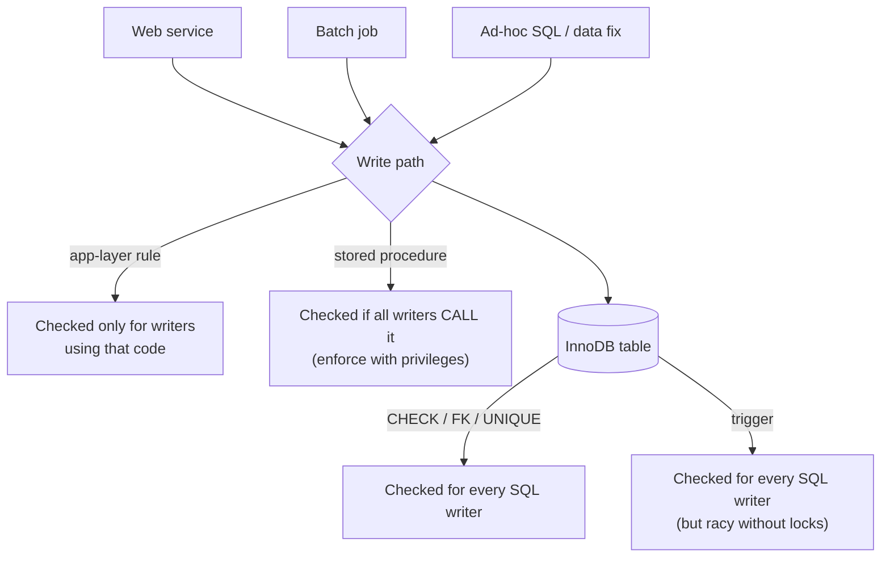

## Introduction

You now know every tool MySQL offers for putting logic in the database: constraints, views, functions, procedures, triggers, events and dynamic SQL. The professional question is no longer *how* but **where**: should "a customer may withdraw at most 2,000 per day" be a trigger, a stored procedure, or a few lines of application code?

Teams argue about this for good reasons — both extremes fail in practice:

- **"Everything in the database"** produces systems where thousands of lines of business logic live in stored procedures that few people can test, debug or deploy safely, and where database CPU (the hardest resource to scale) is spent on computation.
- **"The database is just storage"** produces systems where integrity depends on every code path, every service and every ad-hoc script remembering every rule — and on developers understanding concurrency well enough that their checks are not race conditions.

This lesson builds a decision framework from first principles and real demonstrations. You will implement the same rule as a **trigger** and as an **application-style transaction script**, show that *both* are wrong under concurrency until they lock correctly, see which writers each approach can and cannot stop, write a test for database code, detect version drift, and measure the per-row price of a rule in a trigger.

:::note[Prerequisites and dataset]
This lesson draws on [Triggers](/lessons/m09-triggers), [Stored Functions](/lessons/m09-stored-functions), [Stored Procedures](/lessons/m09-stored-procedures) and [Locking](/lessons/m08-locking). It uses the **bank** dataset; all outputs are captured from a real server.
:::

## DBMS Theory

:::theory[Integrity constraints, business rules and where they are enforced]
Database theory classifies rules by **what they constrain**:

- **Domain and tuple constraints** — a single value or row (`amount > 0`, `status IN (…)`).
- **Key and referential constraints** — uniqueness and existence across rows/tables.
- **General assertions** — arbitrary predicates over the whole database ("total daily withdrawals per account ≤ 2,000"). The SQL standard defines `CREATE ASSERTION` for these, but almost no DBMS implements it (MySQL does not), because checking arbitrary predicates efficiently under concurrency is hard.
- **Transition constraints** — rules about *changes* (a closed account may not change balance; status may go active → frozen but not closed → active).
- **Workflow rules** — sequences and side effects (send a notification, call a payment provider), which are not integrity constraints at all.

The ANSI/SPARC principle of **data independence** argues for enforcing integrity rules *once, centrally, in the DBMS*, so every application shares them. The counter-principle from software engineering is **cohesion**: business behaviour belongs with the code that implements the use case, where it can be tested and changed as a unit.
:::

A crucial point that both camps often miss: **enforcement location does not determine correctness under concurrency**. A rule that reads other rows ("sum of today's withdrawals") can be violated by two concurrent transactions *whether the check runs in a trigger or in the application*, because each check reads a snapshot that does not include the other's uncommitted insert. Only **locking** (or serializable isolation, or a declarative constraint the engine enforces atomically) makes such a check safe. You will see this happen below.

| Rule type | Declarative in MySQL? | If not, best enforced by |
|---|---|---|
| Domain / tuple | Yes: types, `NOT NULL`, `CHECK`, `ENUM` | — |
| Key / referential | Yes: `PRIMARY KEY`, `UNIQUE`, `FOREIGN KEY` | — |
| Assertion over many rows | No (`CREATE ASSERTION` unsupported) | Trigger **with locking**, or a single write path (procedure or service) with locking |
| Transition constraint | Rarely | `BEFORE UPDATE` trigger (sees `OLD` and `NEW`) or write-path logic |
| Workflow / side effects | No | Application (outbox pattern, queues) |

## Why It Exists

The decision matters because the consequences are asymmetric and long-lived:

- **Integrity failures are expensive and silent.** A rule enforced only in one service is bypassed by the second service, the data-repair script and the analyst with write access. The resulting bad data is discovered months later, after it has fed reports, invoices and machine-learning features.
- **Database logic is expensive to change.** Stored programs are deployed with schema migrations, not with the application; they have no package manager, weak tooling, and a deployment that briefly drops and recreates a routine can break running traffic. Logic that changes weekly is painful there.
- **Performance and scalability differ.** Application servers scale horizontally; a primary database usually does not. CPU spent in procedures and triggers competes with every query. On the other hand, logic in the database saves network round trips and holds locks for less time.
- **Teams and skills.** The people who own the application code may not be the people who can review a 400-line stored procedure, and on-call engineers debug what they can observe.

A framework makes these trade-offs explicit instead of tribal.

## Internal Working

:::internals[What actually happens in each approach]
**Declarative constraint** (`CHECK (balance >= 0)`): InnoDB evaluates the predicate for each row as it is written, inside the statement. It costs microseconds, cannot be bypassed by any SQL writer, and needs no locking beyond the row being written — but it can only see that row.

**Trigger**: runs inside the writing statement for every affected row, in the writer's transaction, with the definer's privileges. Its reads are ordinary reads: under `REPEATABLE READ`, a plain `SELECT` inside a trigger is a **consistent (non-locking) read** of the transaction's snapshot, so it does **not** see other transactions' uncommitted rows and does not block them. To make a multi-row check safe, the trigger must take a lock (`SELECT … FOR UPDATE` on a row that every competing writer also locks).

**Stored procedure**: the same as client statements, minus the network round trips; it protects the rule only if *every* writer goes through it (privileges can enforce that: grant `EXECUTE`, revoke direct `INSERT`).

**Application transaction script**: the application sends `START TRANSACTION`, its reads, its decision (in application memory), its writes and `COMMIT`. Its checks see the same snapshot semantics as a trigger, its locks are held across network round trips, and it protects the rule only for writers that use this code path.
:::



## MySQL Implementation

The running example: **at most 2,000.00 in withdrawals per account per calendar day**. It cannot be a `CHECK` constraint, because it depends on other rows. Prepare a clean day for account 6, with 1,500.00 already withdrawn:

```sql run
INSERT INTO transactions (account_id, txn_type, amount, balance_after, reference, created_at)
VALUES (6, 'withdrawal', 1500.00, 14336.16, 'DAY-1', '2024-06-03 09:00:00');

SELECT COALESCE(SUM(amount), 0) AS withdrawn_today
FROM transactions
WHERE account_id = 6 AND txn_type = 'withdrawal'
  AND created_at >= '2024-06-03' AND created_at < '2024-06-04';
```

**Implementation A — application-style transaction script.** This is what an application sends (shown as the SQL it would issue; the decision is made in application code, emulated here with a user variable). Python-like pseudo-code of the service:

```sql
-- service code (display only):
--   with conn.transaction():
--       conn.execute("SELECT account_id FROM accounts WHERE account_id = %s FOR UPDATE", [acct])
--       used = conn.execute("SELECT COALESCE(SUM(amount),0) FROM transactions WHERE …", [acct, day]).scalar()
--       if used + amount > 2000: raise LimitExceeded()
--       conn.execute("INSERT INTO transactions (…) VALUES (…)", [...])
```

```sql run
START TRANSACTION;
SELECT account_id FROM accounts WHERE account_id = 6 FOR UPDATE;
SELECT COALESCE(SUM(amount), 0) INTO @used
FROM transactions
WHERE account_id = 6 AND txn_type = 'withdrawal'
  AND created_at >= '2024-06-03' AND created_at < '2024-06-04';
SET @amount = 400.00;
SELECT @used AS used, @amount AS requested,
       IF(@used + @amount > 2000, 'reject', 'accept') AS application_decision;
INSERT INTO transactions (account_id, txn_type, amount, balance_after, reference, created_at)
SELECT 6, 'withdrawal', @amount, 14336.16 - @amount, 'APP-1', '2024-06-03 10:00:00'
FROM DUAL WHERE @used + @amount <= 2000;
COMMIT;
```

The application accepted the 400.00 withdrawal (1,500 + 400 ≤ 2,000). Now a **batch script** that does not use the service code writes directly — nothing stops it:

```sql run
INSERT INTO transactions (account_id, txn_type, amount, balance_after, reference, created_at)
VALUES (6, 'withdrawal', 900.00, 13036.16, 'BATCH-1', '2024-06-03 11:00:00');

SELECT SUM(amount) AS withdrawn_today
FROM transactions
WHERE account_id = 6 AND txn_type = 'withdrawal'
  AND created_at >= '2024-06-03' AND created_at < '2024-06-04';
```

2,800.00 withdrawn: the rule held only for writers that used the application path.

**Implementation B — a trigger.** The same rule inside the database, with the lock that makes it concurrency-safe (explained in the walkthrough):

```sql run
DELETE FROM transactions WHERE reference = 'BATCH-1';

DELIMITER //
CREATE TRIGGER trg_daily_withdrawal_limit
BEFORE INSERT ON transactions
FOR EACH ROW
BEGIN
  DECLARE v_used DECIMAL(14,2);
  DECLARE v_lock INT;
  IF NEW.txn_type = 'withdrawal' THEN
    -- serialize all withdrawals of this account: every writer locks the same account row
    SELECT account_id INTO v_lock FROM accounts WHERE account_id = NEW.account_id FOR UPDATE;
    SELECT COALESCE(SUM(amount), 0) INTO v_used
    FROM transactions
    WHERE account_id = NEW.account_id AND txn_type = 'withdrawal'
      AND created_at >= DATE(NEW.created_at)
      AND created_at <  DATE(NEW.created_at) + INTERVAL 1 DAY;
    IF v_used + NEW.amount > 2000 THEN
      SIGNAL SQLSTATE '45000'
        SET MESSAGE_TEXT = 'Daily withdrawal limit exceeded', MYSQL_ERRNO = 5201;
    END IF;
  END IF;
END//
DELIMITER ;
```

```sql run error
INSERT INTO transactions (account_id, txn_type, amount, balance_after, reference, created_at)
VALUES (6, 'withdrawal', 900.00, 13036.16, 'BATCH-2', '2024-06-03 11:00:00');
```

The same batch insert is now rejected — and so would be one from any other service, script or console.

## Syntax Breakdown

This lesson introduces no new syntax; it introduces **criteria**. Use this table as the checklist when deciding where a rule goes.

| Criterion | Question to ask | Favors the database when… | Favors the application when… |
|---|---|---|---|
| Integrity scope | Who writes this data? | Several services, scripts, people | Exactly one service owns all writes |
| Rule type | Single row? Many rows? Side effects? | Single-row / key rules (declarative); cross-row invariants that must never break | Workflows, external calls, user-facing validation |
| Concurrency | Can two transactions violate it together? | You lock in one place, close to the data | The service already serializes (queue per account, optimistic version check) |
| Testability | How will we test it? | Small, stable rules covered by SQL integration tests | Logic with many branches; needs unit tests, mocks, property tests |
| Versioning & deployment | How often will it change? How do we roll back? | Rarely; deployed with schema migrations | Often; deployed with the service, feature flags, canaries |
| Performance | Cost per row vs per request; round trips | Set-based work near the data; chatty transactions | CPU-heavy computation; horizontally scalable work |
| Observability | How will on-call see a failure? | Errors with stable codes (`SIGNAL` + `MYSQL_ERRNO`) and logs | Rich logging, tracing, metrics in the app stack |
| Ownership & skills | Who reviews and debugs it? | DBAs / data platform team owns it | Product team owns it end to end |
| Portability | Might we change DBMS? | Not a concern | Multi-database products, ORMs |

## Practical Examples

**1. Who can bypass what.** Compare the reach of each mechanism with the writers that actually exist in a company:

| Writer | `CHECK`/FK | Trigger | Procedure-only path | App-layer rule |
|---|---|---|---|---|
| The service that implements the rule | ✓ | ✓ | ✓ | ✓ |
| Another service writing the same table | ✓ | ✓ | only if forced by privileges | ✗ |
| Batch job / migration script | ✓ | ✓ | only if forced by privileges | ✗ |
| Engineer with console access | ✓ | ✓ (unless they drop it) | ✗ if they have table privileges | ✗ |
| Foreign-key cascade | ✓ | ✗ (triggers do not fire) | ✗ | ✗ |
| `LOAD DATA` bulk import | ✓ | ✓ | ✗ | ✗ |

You demonstrated row 3 above: the batch insert bypassed the application rule and was stopped by the trigger.

**2. Testing database logic.** Database code can be tested — with the same discipline as application code — by running assertions inside a transaction that is rolled back. A tiny assertion helper:

```sql run
CREATE PROCEDURE assert_true(IN p_condition BOOLEAN, IN p_message VARCHAR(100))
  NO SQL
BEGIN
  IF p_condition IS NULL OR NOT p_condition THEN
    SIGNAL SQLSTATE '45000' SET MESSAGE_TEXT = p_message;
  END IF;
END;

CREATE TABLE test_results (test_name VARCHAR(80) PRIMARY KEY, outcome VARCHAR(10) NOT NULL, detail VARCHAR(255));
```

A test for the trigger: arrange data, act, assert, record the result, and roll back the data changes so the test leaves no trace:

```sql run
DELIMITER //
CREATE PROCEDURE test_daily_limit_rejects_excess()
BEGIN
  DECLARE v_msg VARCHAR(255) DEFAULT NULL;
  DECLARE CONTINUE HANDLER FOR SQLEXCEPTION
    GET DIAGNOSTICS CONDITION 1 v_msg = MESSAGE_TEXT;
  START TRANSACTION;
  -- arrange: 1,950 already withdrawn on a fresh day for account 8
  INSERT INTO transactions (account_id, txn_type, amount, balance_after, reference, created_at)
  VALUES (8, 'withdrawal', 1950.00, 1, 'TEST', '2024-07-01 09:00:00');
  -- act: 100 more must be rejected
  INSERT INTO transactions (account_id, txn_type, amount, balance_after, reference, created_at)
  VALUES (8, 'withdrawal', 100.00, 1, 'TEST', '2024-07-01 10:00:00');
  ROLLBACK;
  INSERT INTO test_results VALUES ('daily_limit_rejects_excess',
    IF(v_msg = 'Daily withdrawal limit exceeded', 'PASS', 'FAIL'), v_msg);
END//
DELIMITER ;

CALL test_daily_limit_rejects_excess();
SELECT test_name, outcome, detail FROM test_results;
SELECT COUNT(*) AS test_rows_left FROM transactions WHERE reference = 'TEST';
```

The test passed and left no data behind. Frameworks such as **tSQLt** (SQL Server) or **pgTAP** (PostgreSQL) formalize this pattern; for MySQL, teams typically run such SQL tests — or tests written in the application's language against a disposable MySQL container (Testcontainers) — in CI. The honest trade-off: this is more work than a plain unit test, and database tests are slower because they need a real server.

**3. Versioning and drift detection.** Database logic lives in the server, so the code in your repository and the code actually running can diverge (someone hot-fixed a procedure in production). A fingerprint of every routine and trigger body makes drift visible — compare it with the fingerprint your migration tool recorded:

```sql run
SELECT 'ROUTINE' AS object_type, ROUTINE_NAME AS name,
       LEFT(SHA2(ROUTINE_DEFINITION, 256), 16) AS body_fingerprint
FROM information_schema.ROUTINES
WHERE ROUTINE_SCHEMA = DATABASE()
UNION ALL
SELECT 'TRIGGER', TRIGGER_NAME, LEFT(SHA2(ACTION_STATEMENT, 256), 16)
FROM information_schema.TRIGGERS
WHERE TRIGGER_SCHEMA = DATABASE()
ORDER BY object_type, name;
```

A second versioning technique is **side-by-side versions**: deploy `withdraw_v2` next to `withdraw_v1`, switch callers gradually, and drop v1 when no caller uses it — the database equivalent of a blue/green deployment, needed because `DROP` + `CREATE` of a routine in place is not atomic for callers.

**4. An inventory of hidden logic.** Observability starts with knowing what exists. One query lists every stored object in the schema:

```sql run
SELECT 'view' AS kind, TABLE_NAME AS name, NULL AS detail
FROM information_schema.VIEWS WHERE TABLE_SCHEMA = DATABASE()
UNION ALL
SELECT LOWER(ROUTINE_TYPE), ROUTINE_NAME, SQL_DATA_ACCESS
FROM information_schema.ROUTINES WHERE ROUTINE_SCHEMA = DATABASE()
UNION ALL
SELECT 'trigger', TRIGGER_NAME, CONCAT(ACTION_TIMING, ' ', EVENT_MANIPULATION, ' ON ', EVENT_OBJECT_TABLE)
FROM information_schema.TRIGGERS WHERE TRIGGER_SCHEMA = DATABASE()
UNION ALL
SELECT 'event', EVENT_NAME, STATUS
FROM information_schema.EVENTS WHERE EVENT_SCHEMA = DATABASE()
ORDER BY kind, name;
```

Teams that keep database logic run this kind of inventory in CI and fail the build when an object exists that is not declared in the repository.

## Execution Walkthrough

The central claim of this lesson — *a check that reads other rows is a race condition unless it locks* — is easiest to believe when you watch it fail. First, a trigger **without** the lock. Two withdrawals of 400.00 arrive at the same time; 1,500.00 has already been withdrawn today.

```concurrency
title: A daily-limit trigger without locking lets two withdrawals through
description: The trigger sums today's withdrawals with a plain SELECT. Sessions A and B each insert 400.00 inside a transaction.
setup: |
  INSERT INTO transactions (account_id, txn_type, amount, balance_after, reference, created_at)
  VALUES (6, 'withdrawal', 1500.00, 14336.16, 'RACE-0', '2024-06-03 09:00:00');
  CREATE TRIGGER trg_limit_racy BEFORE INSERT ON transactions FOR EACH ROW
  BEGIN
    DECLARE v_used DECIMAL(14,2);
    IF NEW.txn_type = 'withdrawal' THEN
      SELECT COALESCE(SUM(amount), 0) INTO v_used FROM transactions
      WHERE account_id = NEW.account_id AND txn_type = 'withdrawal'
        AND created_at >= DATE(NEW.created_at) AND created_at < DATE(NEW.created_at) + INTERVAL 1 DAY;
      IF v_used + NEW.amount > 2000 THEN
        SIGNAL SQLSTATE '45000' SET MESSAGE_TEXT = 'Daily withdrawal limit exceeded';
      END IF;
    END IF;
  END;
steps:
  - session: A
    sql: START TRANSACTION; INSERT INTO transactions (account_id, txn_type, amount, balance_after, reference, created_at) VALUES (6, 'withdrawal', 400.00, 13936.16, 'RACE-A', '2024-06-03 10:00:00');
    note: A's trigger sees 1,500 used; 1,500 + 400 ≤ 2,000, so the insert is accepted (not yet committed).
  - session: B
    sql: START TRANSACTION; INSERT INTO transactions (account_id, txn_type, amount, balance_after, reference, created_at) VALUES (6, 'withdrawal', 400.00, 13936.16, 'RACE-B', '2024-06-03 10:01:00');
    note: B's trigger reads its own consistent snapshot, which does not contain A's uncommitted row. It also sees 1,500 used and accepts. Nothing blocks.
  - session: A
    sql: COMMIT;
  - session: B
    sql: COMMIT; SELECT SUM(amount) AS withdrawn_today FROM transactions WHERE account_id = 6 AND txn_type = 'withdrawal' AND created_at >= '2024-06-03' AND created_at < '2024-06-04';
    note: Both committed. 2,300.00 has been withdrawn — the "database-enforced" rule was violated.
```

Now the trigger from *MySQL Implementation*, which first locks the account row with `SELECT … FOR UPDATE`. Every withdrawal for the same account must acquire that lock, so the checks are serialized:

```concurrency
title: Locking the account row serializes the check
description: Same race, but the trigger locks accounts row 6 FOR UPDATE before summing.
setup: |
  INSERT INTO transactions (account_id, txn_type, amount, balance_after, reference, created_at)
  VALUES (6, 'withdrawal', 1500.00, 14336.16, 'RACE-0', '2024-06-03 09:00:00');
  CREATE TRIGGER trg_limit_locked BEFORE INSERT ON transactions FOR EACH ROW
  BEGIN
    DECLARE v_used DECIMAL(14,2);
    DECLARE v_lock INT;
    IF NEW.txn_type = 'withdrawal' THEN
      SELECT account_id INTO v_lock FROM accounts WHERE account_id = NEW.account_id FOR UPDATE;
      SELECT COALESCE(SUM(amount), 0) INTO v_used FROM transactions
      WHERE account_id = NEW.account_id AND txn_type = 'withdrawal'
        AND created_at >= DATE(NEW.created_at) AND created_at < DATE(NEW.created_at) + INTERVAL 1 DAY;
      IF v_used + NEW.amount > 2000 THEN
        SIGNAL SQLSTATE '45000' SET MESSAGE_TEXT = 'Daily withdrawal limit exceeded';
      END IF;
    END IF;
  END;
steps:
  - session: A
    sql: START TRANSACTION; INSERT INTO transactions (account_id, txn_type, amount, balance_after, reference, created_at) VALUES (6, 'withdrawal', 400.00, 13936.16, 'RACE-A', '2024-06-03 10:00:00');
    note: A's trigger locks account 6, sees 1,500 used and accepts. A now holds the account row's exclusive lock.
  - session: B
    sql: START TRANSACTION;
  - session: B
    sql: INSERT INTO transactions (account_id, txn_type, amount, balance_after, reference, created_at) VALUES (6, 'withdrawal', 400.00, 13936.16, 'RACE-B', '2024-06-03 10:01:00');
    expect: blocks
    note: B's trigger waits for the lock on account 6. The lock snapshot below shows A holding X,REC_NOT_GAP on accounts PRIMARY = 6 and B's request for the same lock WAITING.
  - observe: locks
  - session: A
    sql: COMMIT;
    note: A commits and releases the lock. B's trigger now reads the sum — its first consistent read happens after A committed, so it sees 1,900 — and rejects 400 more.
  - session: B
    sql: ROLLBACK; SELECT SUM(amount) AS withdrawn_today FROM transactions WHERE account_id = 6 AND txn_type = 'withdrawal' AND created_at >= '2024-06-03' AND created_at < '2024-06-04';
    note: The invariant held at 1,900.00.
```

The application-style script in *MySQL Implementation* is exactly as racy if it omits its `SELECT … FOR UPDATE`, and exactly as safe if it includes it. **Placement did not decide correctness; locking did.**

## Output

Collecting the results of this lesson's demonstrations:

| Demonstration | Result |
|---|---|
| Application rule, direct batch insert | Bypassed: 2,800.00 withdrawn in one day |
| Trigger rule, same batch insert | Rejected with error 5201 |
| Trigger without lock, two concurrent withdrawals | Both accepted: 2,300.00 withdrawn |
| Trigger with `FOR UPDATE`, same race | Second withdrawal blocked, then rejected (error 1644, the default number for an unnumbered `SQLSTATE '45000'`): 1,900.00 |
| SQL test procedure | PASS, no test data left behind |

Reading this table is the lesson in miniature: database enforcement wins on **reach** (it stopped the batch writer), but neither placement wins on **concurrency** by default — that requires deliberate locking in whichever layer owns the rule.

## Alternative Approaches

Between "all in the database" and "all in the application" there are well-established middle positions:

- **Constraints in the database, behaviour in the application.** The most common modern stance: every rule that can be declarative (`NOT NULL`, `CHECK`, `UNIQUE`, FKs, generated columns) is declared; workflows and complex validation live in the service; triggers are reserved for audit and a few invariants. This keeps the database honest without hiding behaviour.
- **Single writer per table (service ownership).** In microservice architectures, one service owns each table, and no other component writes it directly; the database then needs fewer cross-cutting triggers, because there is only one write path. The weakness is data fixes and migrations, which must go through the owning service or be very carefully reviewed.
- **Procedural API layer.** Some organizations (classically banks and Oracle shops) expose *only* stored procedures to applications and revoke table privileges. Integrity reach is total and round trips are minimal; the cost is the testing, deployment and skills burden discussed above.
- **Asynchronous enforcement.** Some invariants can tolerate detection after the fact: a nightly reconciliation job (an event or an orchestrator task) checks `SUM(debits) = SUM(credits)` and raises an alert. Cheap at write time, but violations exist until detected.
- **Optimistic concurrency in the application.** Instead of locking, the service reads a `version`, computes, and writes with `WHERE version = ?`; a lost race shows up as 0 rows updated and is retried ([Optimistic vs Pessimistic](/lessons/m08-optimistic-pessimistic)). This works well for single-row rules; for "sum over many rows" rules it needs a summary row (e.g. `daily_withdrawn` per account and day) that carries the version.

## Performance Analysis

Each location has a different cost model:

| Location | Cost model | Scales by |
|---|---|---|
| Declarative constraint | Microseconds per row, in-engine | Nothing to scale; negligible |
| Trigger | Per-row execution of its statements, inside the write | Database CPU and I/O (scale-up) |
| Stored procedure | Its statements, no network round trips between them | Database CPU (scale-up) |
| Application | Network round trips × latency; locks held across them | Application servers (scale-out) |

Measure the per-row cost of the daily-limit trigger on a bulk load: 5,000 withdrawal rows into a copy of the ledger, with and without the same trigger logic:

```sql run
CREATE TABLE ledger_copy LIKE transactions;
CREATE TABLE ledger_copy_trg LIKE transactions;

CREATE TRIGGER trg_copy_limit BEFORE INSERT ON ledger_copy_trg FOR EACH ROW
BEGIN
  DECLARE v_used DECIMAL(14,2);
  IF NEW.txn_type = 'withdrawal' THEN
    SELECT COALESCE(SUM(amount), 0) INTO v_used FROM ledger_copy_trg
    WHERE account_id = NEW.account_id AND txn_type = 'withdrawal'
      AND created_at >= DATE(NEW.created_at) AND created_at < DATE(NEW.created_at) + INTERVAL 1 DAY;
    IF v_used + NEW.amount > 2000 THEN
      SIGNAL SQLSTATE '45000' SET MESSAGE_TEXT = 'Daily withdrawal limit exceeded';
    END IF;
  END IF;
END;
SET SESSION cte_max_recursion_depth = 10000;
```

```sql run measured
INSERT INTO ledger_copy (account_id, txn_type, amount, balance_after, reference, created_at)
WITH RECURSIVE s(n) AS (SELECT 1 UNION ALL SELECT n + 1 FROM s WHERE n < 5000)
SELECT 1 + n % 25, 'withdrawal', 10.00, 100.00, 'BULK', TIMESTAMP '2024-01-01 00:00:00' + INTERVAL n HOUR FROM s;
```

```sql run measured
INSERT INTO ledger_copy_trg (account_id, txn_type, amount, balance_after, reference, created_at)
WITH RECURSIVE s(n) AS (SELECT 1 UNION ALL SELECT n + 1 FROM s WHERE n < 5000)
SELECT 1 + n % 25, 'withdrawal', 10.00, 100.00, 'BULK', TIMESTAMP '2024-01-01 00:00:00' + INTERVAL n HOUR FROM s;
```

```sql run
SELECT (SELECT COUNT(*) FROM ledger_copy) AS rows_plain, (SELECT COUNT(*) FROM ledger_copy_trg) AS rows_with_trigger;
```

:::performance[Reading the measurements]
Both statements inserted 5,000 rows; the second also ran the trigger's range-`SUM` (using the `(account_id, created_at)` index that `CREATE TABLE … LIKE` copied) once per row. Across repeated captures the plain insert took roughly 40–55 ms and the triggered one roughly 200–230 ms — four to five times as long (build-machine timings; yours will differ). The per-row overhead is the price of database enforcement for *every* writer, including bulk loads that may not need the check. The application alternative moves that cost out of the database, but pays round trips per request instead: with 1 ms of network latency, a seven-statement transaction script spends about 7 ms per withdrawal just waiting, and holds its row lock for that long.
:::

## Best Practices

:::best-practice[A decision framework you can defend]
1. **Declare everything declarable.** Types, `NOT NULL`, `CHECK`, `UNIQUE`, foreign keys and generated columns are cheap, visible and unbypassable. This is never the wrong layer.
2. **Put invariants where every writer passes.** A rule that must *never* be violated and is written by more than one path belongs in the database (trigger or a privilege-enforced procedure) — or the architecture must guarantee a single writer.
3. **Put workflows and side effects in the application.** Anything that calls external systems, sends messages, or changes often belongs in code that is unit-tested and deployed with the service (use an outbox table for reliable side effects).
4. **Make concurrency explicit wherever the rule lives.** Multi-row checks need a lock (or a summary row with optimistic versioning). Test them with real concurrent sessions, as in the walkthrough.
5. **Treat database code as code.** Version control, code review, migrations (Flyway, Liquibase, Atlas, gh-ost-compatible tooling), automated tests in CI against a real MySQL, drift detection in production.
6. **Make it observable.** Stable error codes (`SIGNAL … MYSQL_ERRNO`), job-run tables for events, an inventory of stored objects, and documentation linking each trigger to the rule it enforces.
7. **Assign ownership.** Every stored program has an owning team and an on-call path; "nobody knows who wrote this trigger" is an incident waiting to happen.
8. **Revisit the decision.** A rule that moved into the database for integrity may move out for scale (e.g. to CDC or a dedicated service) — record the reasoning so the next team can.
:::

## Common Mistakes

**Mistake 1 — believing a trigger makes a multi-row rule safe.** The first concurrency scenario allowed 2,300.00 against a 2,000.00 limit with the rule "in the database". Database enforcement without locking is still a race.

**Mistake 2 — believing an application check protects the table.** The batch insert bypassed the service's rule. If the rule matters, either enforce it in the database or make the service the only writer (and revoke everyone else's privileges).

**Mistake 3 — hiding business workflows in triggers.** A trigger that inserts an order, then reserves stock, then writes a notification row, then updates loyalty points turns a one-line `INSERT` into a hidden workflow that no service team can see, test or change safely — and which runs for every bulk load and data fix too.

**Mistake 4 — moving logic into the database "for performance" without measuring.** Saving round trips helps chatty transactions; moving CPU-heavy computation (string processing, scoring) into stored functions makes the least scalable tier do more work. Measure both sides, as in *Performance Analysis*.

**Mistake 5 — no tests and no drift control for database code.** Procedures hot-fixed in production, with no record in the repository, are the database equivalent of editing code on a live server. The fingerprint query above detects it in seconds.

**Mistake 6 — duplicating the same rule in both layers without a source of truth.** Validation in the UI and service for user experience *plus* a database constraint for integrity is good; two independent implementations of a complex rule that slowly diverge are not. Generate one from the other, or test them against the same cases.

## Industry Application

- **Banking and payments** typically enforce balances and ledger invariants in the database (constraints, locking procedures, sometimes triggers) and keep customer-facing workflows (limits per channel, fraud scoring, notifications) in services. Reconciliation jobs provide a third, asynchronous line of defence.
- **SaaS and e-commerce** with microservices usually follow "single writer per table + declarative constraints"; triggers appear mainly for audit or online schema change tools, and stored procedures are rare.
- **Enterprise and legacy systems** (ERP, insurance, telecom billing) often have large procedural layers in the database; modernization projects migrate logic outward gradually — first by wrapping procedures with services, then by moving rules with test suites that pin down current behaviour.
- **Data platforms and analytics** keep transformation logic in SQL — but in version-controlled tools (dbt models, orchestrated SQL) rather than in triggers and events, gaining testing, lineage and code review for database-resident logic.
- **Interview framing.** "Where would you implement this rule?" is a staple of senior backend and data-engineering interviews. Strong answers name the writers, the concurrency hazard and the locking strategy, the testing and deployment plan, and the observability story — exactly the criteria in the *Syntax Breakdown* table.

## Practice Exercises

```exercise
id: ex1
title: Inventory the database logic
difficulty: easy
concepts: [business-logic-placement, team-ownership]
setup: |
  CREATE VIEW v_active_accounts AS SELECT account_id, balance FROM accounts WHERE status = 'active';
  CREATE FUNCTION fee_for(p_balance DECIMAL(14,2)) RETURNS DECIMAL(6,2) DETERMINISTIC NO SQL RETURN IF(p_balance < 1000, 5, 0);
  CREATE PROCEDURE noop() BEGIN END;
  CREATE TRIGGER trg_noop BEFORE INSERT ON branches FOR EACH ROW SET NEW.city = TRIM(NEW.city);
  CREATE EVENT ev_noop ON SCHEDULE EVERY 1 DAY STARTS '2030-01-01 00:00:00' DO DELETE FROM branches WHERE 1 = 0;
prompt: |
  The setup created one view, one function, one procedure, one trigger and one event. Write a single query that lists
  **every stored object** in your schema with two columns: `kind` (`'view'`, `'function'`, `'procedure'`,
  `'trigger'`, `'event'`) and `name`, ordered by `kind`, then `name`.
hints:
  - "information_schema has VIEWS, ROUTINES (ROUTINE_TYPE = 'FUNCTION' or 'PROCEDURE'), TRIGGERS and EVENTS."
  - "Combine them with UNION ALL; LOWER(ROUTINE_TYPE) gives 'function' / 'procedure'. Filter each on the schema column = DATABASE()."
solution: |
  SELECT 'view' AS kind, TABLE_NAME AS name FROM information_schema.VIEWS WHERE TABLE_SCHEMA = DATABASE()
  UNION ALL
  SELECT LOWER(ROUTINE_TYPE), ROUTINE_NAME FROM information_schema.ROUTINES WHERE ROUTINE_SCHEMA = DATABASE()
  UNION ALL
  SELECT 'trigger', TRIGGER_NAME FROM information_schema.TRIGGERS WHERE TRIGGER_SCHEMA = DATABASE()
  UNION ALL
  SELECT 'event', EVENT_NAME FROM information_schema.EVENTS WHERE EVENT_SCHEMA = DATABASE()
  ORDER BY kind, name;
orderMatters: true
explanation: |
  Each kind of stored object has its own `information_schema` table with a differently named schema column
  (`TABLE_SCHEMA`, `ROUTINE_SCHEMA`, `TRIGGER_SCHEMA`, `EVENT_SCHEMA`). An inventory like this, run in CI and in
  production and compared with the repository, is the basis of ownership and drift control for database logic.
```

```exercise
id: ex2
title: A concurrency-safe per-day limit
difficulty: hard
kind: dml
concepts: [data-integrity, business-logic-placement]
prompt: |
  Implement this rule as a trigger named **`trg_deposit_daily_cap`**: an account may receive at most **10,000.00** in
  **deposits** per calendar day (by `created_at`). Violations must raise `SQLSTATE '45000'` with
  `MESSAGE_TEXT = 'Daily deposit cap exceeded'`. Make the check safe under concurrency by locking the account row
  before summing.

  The check inserts deposits for account 3 on a single day through a harness that captures the error of the
  deposit that exceeds the cap, and reports the captured message and the accepted total.
hints:
  - "BEFORE INSERT ON transactions; act only when NEW.txn_type = 'deposit'."
  - "SELECT account_id INTO v FROM accounts WHERE account_id = NEW.account_id FOR UPDATE; then SUM today's deposits."
  - "Write it inside DELIMITER // … // — it contains a nested IF inside BEGIN … END."
solution: |
  DELIMITER //
  CREATE TRIGGER trg_deposit_daily_cap
  BEFORE INSERT ON transactions
  FOR EACH ROW
  BEGIN
    DECLARE v_used DECIMAL(14,2);
    DECLARE v_lock INT;
    IF NEW.txn_type = 'deposit' THEN
      SELECT account_id INTO v_lock FROM accounts WHERE account_id = NEW.account_id FOR UPDATE;
      SELECT COALESCE(SUM(amount), 0) INTO v_used FROM transactions
      WHERE account_id = NEW.account_id AND txn_type = 'deposit'
        AND created_at >= DATE(NEW.created_at) AND created_at < DATE(NEW.created_at) + INTERVAL 1 DAY;
      IF v_used + NEW.amount > 10000 THEN
        SIGNAL SQLSTATE '45000' SET MESSAGE_TEXT = 'Daily deposit cap exceeded';
      END IF;
    END IF;
  END//
  DELIMITER ;
check: |
  CREATE PROCEDURE harness_cap()
  BEGIN
    DECLARE CONTINUE HANDLER FOR SQLEXCEPTION GET DIAGNOSTICS CONDITION 1 @cap_msg = MESSAGE_TEXT;
    SET @cap_msg = NULL;
    INSERT INTO transactions (account_id, txn_type, amount, balance_after, reference, created_at)
    VALUES (3, 'deposit', 6000.00, 1, 'CAP', '2025-01-15 09:00:00');
    INSERT INTO transactions (account_id, txn_type, amount, balance_after, reference, created_at)
    VALUES (3, 'deposit', 3500.00, 1, 'CAP', '2025-01-15 12:00:00');
    INSERT INTO transactions (account_id, txn_type, amount, balance_after, reference, created_at)
    VALUES (3, 'deposit', 600.00, 1, 'CAP', '2025-01-15 15:00:00');
    INSERT INTO transactions (account_id, txn_type, amount, balance_after, reference, created_at)
    VALUES (3, 'deposit', 500.00, 1, 'CAP', '2025-01-16 09:00:00');
  END;
  CALL harness_cap();
  SELECT @cap_msg AS captured,
         (SELECT SUM(amount) FROM transactions WHERE reference = 'CAP' AND created_at < '2025-01-16') AS day1_total,
         (SELECT COUNT(*) FROM transactions WHERE reference = 'CAP') AS accepted_rows;
explanation: |
  6,000 + 3,500 = 9,500 is accepted; another 600 would make 10,100 and is rejected; the next day's 500 starts a
  new day. In a single session the lock changes nothing visible — its purpose is the concurrent case shown in
  the lesson's walkthrough, where without it two simultaneous deposits could each see 9,500 and both commit. Every
  writer of deposits for the account must take the same lock for the serialization to work; the trigger guarantees
  that because it runs for every insert.
```

```exercise
id: ex3
title: Write a test for database logic
difficulty: medium
kind: dml
concepts: [testability, deployment-versioning]
setup: |
  CREATE TABLE test_results (test_name VARCHAR(80) PRIMARY KEY, outcome VARCHAR(10) NOT NULL);
  CREATE FUNCTION monthly_fee(p_type VARCHAR(10), p_balance DECIMAL(14,2)) RETURNS DECIMAL(6,2)
    DETERMINISTIC NO SQL
  RETURN CASE WHEN p_type = 'savings' THEN 0 WHEN p_balance < 1000 THEN 5 ELSE 1 END;
prompt: |
  The setup created a function `monthly_fee(p_type, p_balance)` (savings: 0; checking below 1,000: 5; otherwise 1)
  and a table `test_results(test_name, outcome)`.

  Create a procedure **`test_monthly_fee()`** that checks these four cases and inserts **one row per case** into
  `test_results` with `outcome` `'PASS'` or `'FAIL'`:

  | test_name | call | expected |
  |---|---|---|
  | `savings_free` | `monthly_fee('savings', 50)` | 0 |
  | `small_checking` | `monthly_fee('checking', 999.99)` | 5 |
  | `boundary_checking` | `monthly_fee('checking', 1000)` | 1 |
  | `large_checking` | `monthly_fee('checking', 25000)` | 1 |

  The check runs your test procedure and reads `test_results`.
hints:
  - "INSERT INTO test_results VALUES ('savings_free', IF(monthly_fee('savings', 50) = 0, 'PASS', 'FAIL'));"
  - "Four INSERT statements inside BEGIN … END are enough; a multi-row INSERT … VALUES works too."
solution: |
  CREATE PROCEDURE test_monthly_fee()
  BEGIN
    INSERT INTO test_results VALUES
      ('savings_free',      IF(monthly_fee('savings', 50) = 0, 'PASS', 'FAIL')),
      ('small_checking',    IF(monthly_fee('checking', 999.99) = 5, 'PASS', 'FAIL')),
      ('boundary_checking', IF(monthly_fee('checking', 1000) = 1, 'PASS', 'FAIL')),
      ('large_checking',    IF(monthly_fee('checking', 25000) = 1, 'PASS', 'FAIL'));
  END;
check: |
  CALL test_monthly_fee();
  SELECT test_name, outcome FROM test_results ORDER BY test_name;
explanation: |
  The boundary case (exactly 1,000) is the one most likely to catch a `<` vs `<=` bug. Tests like this run in CI
  against a disposable MySQL instance after migrations are applied; if someone "fixes" the function so that 1,000 is
  charged 5, the build fails before the change reaches production. Writing expected values next to inputs — a table
  of cases — is the same discipline as parameterized unit tests in application code.
```

```exercise
id: ex4
title: Place five rules
difficulty: challenge
kind: open
concepts: [decision-framework, business-logic-placement, data-integrity]
prompt: |
  A lending platform has three services (applications, payments, collections), nightly batch jobs, and analysts
  with write access to a sandbox copy. Decide where each rule should live — declarative constraint, trigger,
  stored procedure, application service, or asynchronous job — and justify it using the lesson's criteria
  (writers, concurrency, testability, change frequency, performance, observability, ownership):

  1. A loan's `principal` must be positive.
  2. The sum of all payments on a loan must never exceed its total payable amount.
  3. A loan's status may only move `applied → approved → active → closed` (or `applied → rejected`).
  4. When a loan becomes `active`, the borrower receives an e-mail and the credit bureau is notified.
  5. The interest-rate formula, which marketing changes every quarter.
solution: |
  1. **`CHECK (principal > 0)`.** Single-row domain rule: declarative, unbypassable, free.

  2. **Database, with locking** — a `BEFORE INSERT` trigger on `payments` (or a privilege-enforced `post_payment`
  procedure) that locks the loan row `FOR UPDATE`, sums existing payments and signals if the new payment would exceed
  the payable amount. Three services and batch jobs write payments, so an application-only check is bypassable,
  and concurrent payments make an unlocked check racy. Cover it with SQL integration tests including a concurrency
  test; give the signal a stable error number that services map to a 409 response. An alternative is a
  `loans.paid_amount` summary column updated in the same transaction with an optimistic version check.

  3. **`BEFORE UPDATE` trigger** for the allowed transitions (it sees `OLD.status` and `NEW.status`), because any
  writer — including analysts' fixes — could otherwise create impossible histories; the rule is stable and small.
  The application services still validate earlier for good error messages. If only one service ever writes
  `loans`, a well-tested domain model in that service is acceptable, but the trigger is cheap insurance.

  4. **Application + outbox.** External side effects do not belong in the database: write an `outbox` row in the
  same transaction as the status change (possibly from the service, or from a trigger), and let a worker deliver
  the e-mail and bureau notification with retries and idempotency keys. Observability and retries live in the
  service stack.

  5. **Application service (or a configuration table read by it).** Changes quarterly, owned by a product team,
  needs unit tests, review and feature-flagged rollout; putting it in a stored function would tie marketing changes to
  database migrations. Store the *rate actually applied* on the loan row so history is reproducible.
```

```exercise
id: ex5
title: Ship a stored-procedure change safely
difficulty: challenge
kind: open
concepts: [deployment-versioning, testability, team-ownership]
prompt: |
  The payments team must change `post_payment` (called by three services at ~200 calls/second) to add a new
  validation. Today, changes are made by a DBA running `DROP PROCEDURE … ; CREATE PROCEDURE …` by hand in
  production. Describe a deployment process that is safe, reversible and observable. Cover: source control and
  review, testing, the deployment mechanics (what happens to in-flight callers), rollback, drift detection, and
  ownership.
solution: |
  **Source of truth.** The procedure lives in the payments repository as a migration (Flyway/Liquibase/Atlas) and is
  reviewed like application code, with the owning team and a DBA as reviewers. CODEOWNERS makes ownership explicit.

  **Testing.** CI starts a MySQL 8.4 container, applies all migrations, and runs SQL tests (assert procedures or
  application-language integration tests) for the old and new validation, error codes and a concurrency case.
  A staging environment replays representative traffic.

  **Deployment mechanics.** `DROP` + `CREATE` is not atomic for callers: between the two statements, calls fail
  with "PROCEDURE does not exist". Instead deploy **`post_payment_v2`** alongside v1, switch callers via
  configuration or feature flag service by service (or, if callers cannot change, make v1 a thin wrapper that calls
  v2 — replacing a one-line wrapper is a much shorter window), watch error rates and latency, then drop v1 when
  no caller uses it (verified by application metrics or performance_schema statement digests).

  **Rollback.** Flip the flag back to v1 — no database change needed during an incident. Keep v1 until v2 has
  been stable for an agreed period.

  **Drift detection.** A scheduled job compares `SHA2(ROUTINE_DEFINITION)` fingerprints in each environment with the
  fingerprints recorded by the migration tool and alerts on differences; manual hot-fixes must be back-ported as
  migrations.

  **Observability and ownership.** New validation signals a registered `MYSQL_ERRNO`; services emit metrics per
  error code; dashboards and alerts are owned by the payments team's on-call rotation, with the DBA team as
  escalation for database-side failures.
```

## Knowledge Assessment

```quiz
- id: q1
  question: "In the lesson's first concurrency scenario, a BEFORE INSERT trigger summed today's withdrawals with a plain SELECT. Two sessions each inserted 400.00 with 1,500.00 already withdrawn. What happened, and why?"
  options:
    - "The second insert was rejected because triggers run serially"
    - "Both were accepted (2,300.00 total), because each trigger's consistent read did not see the other's uncommitted row"
    - "The second insert deadlocked"
    - "Both were rejected"
  answer: 1
  explanation: "Plain SELECTs inside triggers are non-locking consistent reads under REPEATABLE READ, so neither check saw the other's insert and nothing blocked. Triggers do not serialize anything by themselves."
  concepts: [data-integrity]
- id: q2
  question: "Which change made the trigger correct under concurrency?"
  options:
    - "Switching from BEFORE to AFTER INSERT"
    - "Locking the account row with SELECT … FOR UPDATE before summing, so every withdrawal for that account serializes on the same lock"
    - "Declaring the trigger DETERMINISTIC"
    - "Using SUM(DISTINCT amount)"
  answer: 1
  explanation: "The lock forces the second transaction to wait until the first commits; its sum then includes the committed row and the excess withdrawal is rejected. Timing, determinism declarations and DISTINCT do not affect concurrency."
  concepts: [data-integrity]
- id: q3
  question: "A rule is enforced only in the web service. Which writers can violate it? (Select all that apply.)"
  type: multi
  options:
    - "A second service writing the same table"
    - "A nightly batch job using its own SQL"
    - "An engineer fixing data in a SQL console"
    - "The web service itself, when it follows its own code path"
  answer: [0, 1, 2]
  explanation: "Application-layer rules protect only writers that execute that code. The lesson's batch insert bypassed the rule and pushed the day's withdrawals to 2,800.00."
  concepts: [business-logic-placement]
- id: q4
  question: "Which rule is the BEST candidate for a declarative constraint rather than a trigger or application code?"
  options:
    - "Total payments on a loan must not exceed the payable amount"
    - "An account's balance must be non-negative"
    - "Send an e-mail when a loan becomes active"
    - "Interest rates follow a formula that changes quarterly"
  answer: 1
  explanation: "A single-row predicate is exactly what CHECK (balance >= 0) expresses — cheap, visible and unbypassable. The first needs other rows (trigger/procedure with locking), the e-mail is a side effect (application/outbox), and the formula changes often (application)."
  concepts: [decision-framework, data-integrity]
- id: q5
  question: "Why is `DROP PROCEDURE p; CREATE PROCEDURE p …` risky for a procedure under constant load?"
  options:
    - "It resets the procedure's statistics"
    - "Between the two statements the procedure does not exist, so concurrent calls fail; side-by-side versions (p_v2) avoid the gap"
    - "CREATE PROCEDURE locks all tables the procedure uses"
    - "It invalidates the binary log"
  answer: 1
  explanation: "MySQL has no CREATE OR REPLACE PROCEDURE, so a replacement is two statements with a window in which calls fail. Versioned routines with a caller switch (or a thin wrapper) remove or shrink that window."
  concepts: [deployment-versioning]
- id: q6
  question: "Which statements about testing database logic are accurate? (Select all that apply.)"
  type: multi
  options:
    - "Stored procedures and triggers can be tested with assertions inside a transaction that is rolled back"
    - "Such tests need a real MySQL server (e.g. a disposable container in CI)"
    - "Database logic cannot be tested automatically"
    - "Concurrency rules need tests with real concurrent sessions"
  answer: [0, 1, 3]
  explanation: "The lesson's test procedure passed and left no data behind. Database tests are slower and need a server, but they are entirely automatable; races only show up with genuinely concurrent sessions."
  concepts: [testability]
- id: q7
  question: "A team wants to move a CPU-heavy scoring algorithm into a stored function 'for performance'. What is the main concern?"
  options:
    - "Stored functions cannot do arithmetic"
    - "It moves computation to the least horizontally scalable tier (the primary database), competing with all queries; the gain from saved round trips may be small"
    - "Stored functions are always slower than application code"
    - "Functions cannot be called from SELECT"
  answer: 1
  explanation: "Logic near the data saves round trips, which helps chatty transactions — not computation-bound work. Application servers scale out; the primary database usually scales up. Measure both sides before moving logic."
  concepts: [decision-framework]
- id: q8
  question: "Production behaviour differs from the repository's version of a stored procedure. Which technique from the lesson detects this?"
  options:
    - "Running EXPLAIN on the procedure"
    - "Comparing SHA2 fingerprints of information_schema.ROUTINES.ROUTINE_DEFINITION with those recorded by the migration tool"
    - "Checking SHOW PROCESSLIST"
    - "Reading the slow query log"
  answer: 1
  explanation: "Fingerprinting routine and trigger bodies makes drift (e.g. a hot-fix applied by hand) visible immediately. EXPLAIN, the process list and the slow log say nothing about which version of the code is deployed."
  concepts: [deployment-versioning]
```
