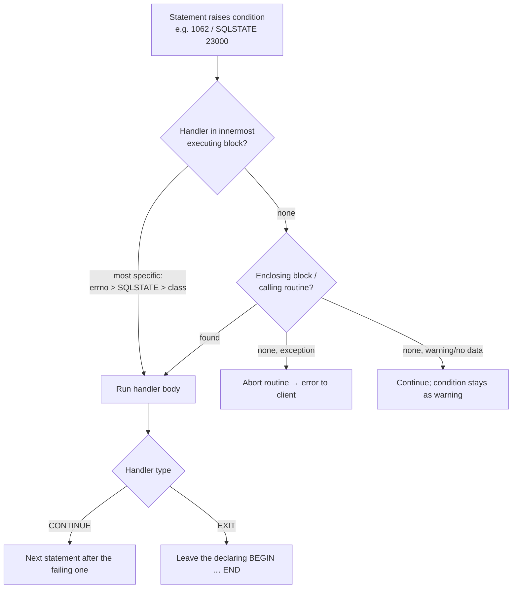

## Introduction

Every statement a stored program runs can fail: a duplicate key, a `CHECK` constraint, a lock wait timeout, a deadlock, a value too long for a column. Without explicit handling, the first error **aborts the whole routine** and returns the error to the caller — which may leave a half-finished transaction behind. And sometimes the routine itself must *raise* an error: "insufficient funds" is not a MySQL error, but it must stop the transfer just as firmly.

This lesson covers both directions, and then the second classic topic of procedural SQL — **cursors**:

- **Catching**: `DECLARE CONTINUE | EXIT HANDLER FOR …` — what to do when a condition occurs, and whether execution continues afterwards.
- **Raising**: `SIGNAL SQLSTATE '45000' SET MESSAGE_TEXT = …` for business-rule violations; `RESIGNAL` to re-raise (possibly enriched) inside a handler.
- **Inspecting**: `GET DIAGNOSTICS` to read the SQLSTATE, error number and message of what went wrong — for logging or translation.
- **Iterating**: cursors (`DECLARE … CURSOR FOR`, `OPEN`, `FETCH`, `CLOSE`) with the `NOT FOUND` handler that ends the loop — and the measured reason why a set-based statement should be your default.

You used one handler pattern in [Stored Procedures](/lessons/m09-stored-procedures) (`EXIT HANDLER FOR SQLEXCEPTION … ROLLBACK; RESIGNAL;`); this lesson explains precisely why it is written that way.

:::note[Dataset and lab]
The examples use the **bank** dataset (25 accounts, account 7 frozen, account 12 closed; `CHECK (balance >= 0)` on accounts). Procedures with nested handler blocks are written with `DELIMITER //`, as you would in a `mysql` client script; this is also the most robust style in the lab.
:::

## DBMS Theory

:::theory[Conditions, handlers and the diagnostics area (SQL/PSM)]
The SQL standard reports the outcome of every statement through a five-character **SQLSTATE**. Its first two characters are the **class**:

| Class | Meaning | Examples |
|---|---|---|
| `00` | Success | `00000` |
| `01` | Warning | `01000` generic warning, data truncation warnings |
| `02` | No data | `02000` — `FETCH` past the last row, `SELECT … INTO` found no row |
| anything else | Exception | `23000` integrity constraint violation, `40001` serialization failure (deadlock), `HY000` general error, `45000` unhandled user-defined exception |

A **condition** is a named situation (an SQLSTATE, or in MySQL also an error number). A **handler** associates a condition with an action and a *handler type*. SQL/PSM defines three types: **CONTINUE** (run the handler, then continue after the statement that raised the condition), **EXIT** (run the handler, then leave the compound statement where the handler was declared) and **UNDO** (like EXIT, but first roll back the block's changes). MySQL implements CONTINUE and EXIT, **not UNDO** — rollback must be written explicitly.

Every statement also fills a **diagnostics area** with statement information (number of conditions, row count) and one record per condition (SQLSTATE, message, native error number). `GET DIAGNOSTICS` reads it.

A **cursor** is the standard mechanism for consuming a query result one row at a time from procedural code. The standard defines sensitivity (whether a cursor sees concurrent changes), scrollability and updatability; MySQL cursors are **read-only, forward-only (non-scrollable) and asensitive**.
:::

Two theoretical ideas are worth keeping in mind:

1. **Errors are part of the interface.** A routine that signals `SQLSTATE '45000'` with a clear message and a stable error number gives callers something to branch on; a routine that returns "status strings" forces every caller to parse text. Both styles exist — the important part is to choose one deliberately.
2. **Cursors re-introduce iteration into a set-oriented language.** The relational model's power comes from operating on whole relations; a cursor processes tuples one by one, giving up the optimizer's freedom to choose join orders, batch I/O and avoid per-statement overhead. Use cursors when each row genuinely needs *separate procedural treatment* (calling another procedure, dynamic SQL per row, per-row error isolation), not for work that one `UPDATE … JOIN` can express.

## Why It Exists

Without handlers, a stored program cannot:

- **Guarantee atomicity.** MySQL has no `UNDO` handler and no automatic rollback of a procedure. If the third of four statements fails, the first two remain in the open transaction (or are already committed under autocommit). A handler is the only place to put `ROLLBACK`.
- **Recover from expected errors.** "Insert, and if the key already exists, count it as a duplicate and move on" requires catching error 1062.
- **Report business failures as errors.** Without `SIGNAL`, a procedure can only return status values that callers may ignore. A signalled error aborts the caller's statement, rolls back a statement-level change, and is seen by every client library as an exception.
- **Log what happened.** `GET DIAGNOSTICS` turns an error into data — SQLSTATE, number, message — that can be written to a log table before re-raising.

Without cursors, a routine cannot perform **per-row procedural work**: call a procedure for each account, run a different dynamic statement per table, or isolate failures so that one bad row does not stop the batch.

## Internal Working

:::internals[How MySQL finds a handler]
Handlers are declared per `BEGIN … END` block, after variables, conditions and cursors. At runtime the interpreter keeps a **handler stack**. When a statement raises a condition:

1. MySQL looks for a matching handler in the **innermost** block that is executing, then in enclosing blocks, then in the calling routine (handlers propagate up the *call* stack too).
2. Within a block, the **most specific** match wins: a handler for a MySQL error number (`FOR 1062`) beats one for an SQLSTATE value (`FOR SQLSTATE '23000'`), which beats a general class handler (`SQLEXCEPTION`, `SQLWARNING`, `NOT FOUND`).
3. If no handler matches: an exception aborts the routine and propagates to the caller; a warning or "no data" condition is ignored (it stays in the diagnostics area as a warning).
4. A handler's body runs with its own diagnostics area: when the handler starts, the condition that triggered it is on the **stacked** diagnostics area (`GET STACKED DIAGNOSTICS`), while the **current** area is reset by the handler's own statements.
5. After the handler body: **CONTINUE** resumes with the statement after the one that raised the condition (for a condition raised inside an `IF` or loop condition, after the whole `IF`/loop statement); **EXIT** leaves the block that declared the handler.

The general classes are: `SQLWARNING` (SQLSTATE class `01`), `NOT FOUND` (class `02`), and `SQLEXCEPTION` (every class other than `00`, `01`, `02`).
:::



:::internals[How a MySQL cursor works]
`DECLARE c CURSOR FOR select` only records the query. `OPEN c` executes it; MySQL materializes the result in an internal temporary table (in memory, spilling to disk for large results) — the manual calls MySQL cursors *asensitive* because whether a copy is made is up to the server. Each `FETCH c INTO v1, v2` copies the next row into local variables. When no row is left, `FETCH` raises the **NOT FOUND** condition (SQLSTATE `02000`), which is why every cursor loop needs a `CONTINUE HANDLER FOR NOT FOUND` that sets a "done" flag. `CLOSE c` frees the result (it is also closed automatically at the end of the block).

Because the query runs to completion at `OPEN`, the rows a cursor returns are a snapshot of the query result at that moment; updating the base table inside the loop does not change what later `FETCH`es return.
:::

## MySQL Implementation

The declaration order inside a block is fixed: **variables and conditions → cursors → handlers → statements**.

```sql
DECLARE name CONDITION FOR { SQLSTATE 'xxxxx' | mysql_error_number };
DECLARE { CONTINUE | EXIT } HANDLER FOR condition [, condition ...] statement;
    -- condition: mysql_error_number | SQLSTATE 'xxxxx' | condition_name
    --            | SQLWARNING | NOT FOUND | SQLEXCEPTION
SIGNAL { SQLSTATE 'xxxxx' | condition_name }
    [SET MESSAGE_TEXT = '…', MYSQL_ERRNO = n, …];
RESIGNAL [ SQLSTATE 'xxxxx' | condition_name ] [SET …];
GET [CURRENT | STACKED] DIAGNOSTICS { var = NUMBER | var = ROW_COUNT };
GET [CURRENT | STACKED] DIAGNOSTICS CONDITION n var = RETURNED_SQLSTATE, var = MYSQL_ERRNO, var = MESSAGE_TEXT, …;
DECLARE c CURSOR FOR select;  OPEN c;  FETCH [NEXT] [FROM] c INTO var, …;  CLOSE c;
```

First, an unhandled error. A procedure that inserts a branch fails as soon as the key already exists:

```sql run
CREATE PROCEDURE add_branch_plain(IN p_id SMALLINT, IN p_name VARCHAR(60), IN p_city VARCHAR(60))
  MODIFIES SQL DATA
BEGIN
  INSERT INTO branches (branch_id, name, city) VALUES (p_id, p_name, p_city);
  SELECT 'inserted' AS outcome;
END;
```

```sql run error
CALL add_branch_plain(1, 'Duplicate HQ', 'Nowhere');
```

The error reached the client and the second statement never ran. Now a **CONTINUE handler for error 1062** turns the duplicate into an outcome:

```sql run
CREATE PROCEDURE add_branch(IN p_id SMALLINT, IN p_name VARCHAR(60), IN p_city VARCHAR(60),
                            OUT p_outcome VARCHAR(20))
  MODIFIES SQL DATA
BEGIN
  DECLARE CONTINUE HANDLER FOR 1062 SET p_outcome = 'duplicate';
  SET p_outcome = 'inserted';
  INSERT INTO branches (branch_id, name, city) VALUES (p_id, p_name, p_city);
END;

CALL add_branch(1, 'Duplicate HQ', 'Nowhere', @o1);
CALL add_branch(4, 'Riverside', 'Sacramento', @o2);
SELECT @o1 AS first_call, @o2 AS second_call, (SELECT COUNT(*) FROM branches) AS branches_now;
```

For the duplicate, the handler set `p_outcome = 'duplicate'` and execution continued after the `INSERT` (to the end of the procedure). The second call inserted branch 4.

**Raising a business error with `SIGNAL`.** SQLSTATE `45000` means "unhandled user-defined exception"; `MYSQL_ERRNO` lets you give it a stable number in the range your team reserves:

```sql run
DELIMITER //
CREATE PROCEDURE withdraw(IN p_account INT, IN p_amount DECIMAL(14,2))
  MODIFIES SQL DATA
BEGIN
  DECLARE v_balance DECIMAL(14,2);
  DECLARE v_status  VARCHAR(10);
  DECLARE EXIT HANDLER FOR SQLEXCEPTION
  BEGIN
    ROLLBACK;
    RESIGNAL;
  END;

  START TRANSACTION;
  SELECT balance, status INTO v_balance, v_status
  FROM accounts WHERE account_id = p_account FOR UPDATE;

  IF v_status IS NULL THEN
    SIGNAL SQLSTATE '45000' SET MESSAGE_TEXT = 'Account not found', MYSQL_ERRNO = 5001;
  ELSEIF v_status <> 'active' THEN
    SIGNAL SQLSTATE '45000' SET MESSAGE_TEXT = 'Account is not active', MYSQL_ERRNO = 5002;
  ELSEIF v_balance < p_amount THEN
    SIGNAL SQLSTATE '45000' SET MESSAGE_TEXT = 'Insufficient funds', MYSQL_ERRNO = 5003;
  END IF;

  UPDATE accounts SET balance = balance - p_amount, version = version + 1 WHERE account_id = p_account;
  INSERT INTO transactions (account_id, txn_type, amount, balance_after, reference, created_at)
    SELECT account_id, 'withdrawal', p_amount, balance, 'ATM-DEMO', NOW()
    FROM accounts WHERE account_id = p_account;
  COMMIT;
END//
DELIMITER ;
```

```sql run error
CALL withdraw(1, 1000000.00);
```

```sql run error
CALL withdraw(7, 10.00);
```

```sql run
CALL withdraw(1, 20.00);
SELECT balance FROM accounts WHERE account_id = 1;
```

Follow what happened in the failing calls: `SIGNAL` raised SQLSTATE `45000`; that is an exception, so the procedure's own `EXIT HANDLER FOR SQLEXCEPTION` caught it, rolled back the transaction (releasing the row lock taken by `FOR UPDATE`), and `RESIGNAL` re-raised the *same* condition — same SQLSTATE, message and error number — to the client.

## Syntax Breakdown

| Element | Meaning and MySQL specifics |
|---|---|
| `DECLARE … CONDITION FOR 1062` | Names a MySQL error number (or `SQLSTATE '23000'`) for readability: `DECLARE dup_key CONDITION FOR 1062;` |
| `CONTINUE HANDLER` | After the handler body, continue with the statement following the one that raised the condition. |
| `EXIT HANDLER` | After the handler body, leave the `BEGIN … END` block in which the handler is declared. |
| `FOR 1062` | A specific MySQL error number — most specific match. |
| `FOR SQLSTATE '23000'` | An SQLSTATE value (`23000` covers several integrity errors: duplicate key, foreign key, NOT NULL). |
| `FOR SQLEXCEPTION` | Any exception (class not `00`, `01`, `02`), including `SIGNAL`ed `45000`. |
| `FOR SQLWARNING` | Any warning (class `01`). |
| `FOR NOT FOUND` | Class `02`: end of cursor, **and** `SELECT … INTO` that finds no row. |
| `SIGNAL SQLSTATE '45000' SET MESSAGE_TEXT = …` | Raise an exception. `MESSAGE_TEXT` max 128 characters; `MYSQL_ERRNO` 1–65535. Class `01` raises a warning instead; class `00` is invalid. |
| `RESIGNAL` | Only inside a handler. Alone: re-raise the current condition unchanged. With `SET` or a new SQLSTATE: re-raise modified. |
| `GET DIAGNOSTICS @n = NUMBER, @r = ROW_COUNT` | Statement information of the last statement. |
| `GET DIAGNOSTICS CONDITION 1 @s = RETURNED_SQLSTATE, @e = MYSQL_ERRNO, @m = MESSAGE_TEXT` | Details of condition 1 (the most recent error/warning). |
| `GET STACKED DIAGNOSTICS …` | Inside a handler: the diagnostics of the condition that activated it, even after the handler ran other statements. |
| `DECLARE c CURSOR FOR select` | Must follow variable declarations and precede handler declarations. The select may use local variables. |
| `OPEN` / `FETCH … INTO` / `CLOSE` | Execute, read next row, release. `FETCH` with a different number of variables than columns is error 1328. |

:::standard[Standard SQL vs MySQL]
`DECLARE HANDLER` (CONTINUE/EXIT), `SIGNAL`, `RESIGNAL`, `GET DIAGNOSTICS` and cursors are SQL/PSM. MySQL differences: no `UNDO` handlers; handlers may name **MySQL error numbers** (an extension); cursors are read-only and non-scrollable (no `FETCH PRIOR`, no `UPDATE … WHERE CURRENT OF`); no `FOR row AS cursor DO` loop. Other systems use different constructs entirely — T-SQL's `TRY … CATCH`/`THROW`, PL/pgSQL's `EXCEPTION WHEN … THEN` and `RAISE`.
:::

## Practical Examples

**1. Log, roll back, re-raise.** A production-grade wrapper writes every failure to a log table with `GET DIAGNOSTICS`, *after* rolling back (so the log row is not rolled back with the business changes), then re-raises:

```sql run
CREATE TABLE error_log (
  log_id     INT AUTO_INCREMENT PRIMARY KEY,
  routine    VARCHAR(64) NOT NULL,
  sql_state  CHAR(5),
  errno      INT,
  message    VARCHAR(255)
);

DELIMITER //
CREATE PROCEDURE withdraw_logged(IN p_account INT, IN p_amount DECIMAL(14,2))
  MODIFIES SQL DATA
BEGIN
  DECLARE EXIT HANDLER FOR SQLEXCEPTION
  BEGIN
    DECLARE v_state CHAR(5);
    DECLARE v_errno INT;
    DECLARE v_msg   VARCHAR(255);
    GET STACKED DIAGNOSTICS CONDITION 1
      v_state = RETURNED_SQLSTATE, v_errno = MYSQL_ERRNO, v_msg = MESSAGE_TEXT;
    ROLLBACK;
    INSERT INTO error_log (routine, sql_state, errno, message)
      VALUES ('withdraw_logged', v_state, v_errno, v_msg);
    RESIGNAL;
  END;
  CALL withdraw(p_account, p_amount);
END//
DELIMITER ;
```

```sql run error
CALL withdraw_logged(10, 5000.00);
```

```sql run
SELECT routine, sql_state, errno, message FROM error_log ORDER BY log_id;
```

The error raised in the *inner* procedure propagated to the outer one (first through `withdraw`'s own handler, which re-raised it), was logged with its original SQLSTATE, number and message, and still reached the client. The log row survived because it was inserted after the `ROLLBACK`, in autocommit mode.

**2. Translating a low-level error into a business error.** Callers should not need to know that "balance would become negative" shows up as a `CHECK` constraint violation (error 3819). `RESIGNAL` with new values translates it:

```sql run
DELIMITER //
CREATE PROCEDURE force_debit(IN p_account INT, IN p_amount DECIMAL(14,2))
  MODIFIES SQL DATA
BEGIN
  DECLARE check_violation CONDITION FOR 3819;
  DECLARE EXIT HANDLER FOR check_violation
    RESIGNAL SQLSTATE '45000'
      SET MESSAGE_TEXT = 'Debit rejected: balance would become negative', MYSQL_ERRNO = 5003;
  UPDATE accounts SET balance = balance - p_amount WHERE account_id = p_account;
END//
DELIMITER ;
```

```sql run error
CALL force_debit(23, 1000.00);
```

The `CHECK (balance >= 0)` constraint did the real enforcement; the handler only changed how the failure is reported.

**3. `GET DIAGNOSTICS` for statement information.** `ROW_COUNT` and `NUMBER` let a routine report what a statement did and how many warnings it produced:

```sql run
CREATE PROCEDURE freeze_dormant(IN p_before DATE, OUT p_frozen INT, OUT p_warnings INT)
  MODIFIES SQL DATA
BEGIN
  UPDATE accounts a
  SET a.status = 'frozen'
  WHERE a.status = 'active'
    AND NOT EXISTS (SELECT 1 FROM transactions t
                    WHERE t.account_id = a.account_id AND t.created_at >= p_before);
  GET DIAGNOSTICS p_frozen = ROW_COUNT, p_warnings = NUMBER;
END;

START TRANSACTION;
CALL freeze_dormant('2023-11-01', @frozen, @warn);
SELECT @frozen AS accounts_frozen, @warn AS warnings;
ROLLBACK;
```

(The `ROLLBACK` undoes the demonstration so later examples see the original statuses.)

**4. A cursor loop.** Post monthly interest of 0.1 % to every active savings account: one balance update and one ledger row per account. The `done` flag and the `NOT FOUND` handler are the canonical loop shape:

```sql run
CREATE PROCEDURE post_interest_cursor(IN p_rate DECIMAL(6,5), OUT p_posted INT)
  MODIFIES SQL DATA
BEGIN
  DECLARE v_id INT;
  DECLARE v_balance DECIMAL(14,2);
  DECLARE done BOOLEAN DEFAULT FALSE;
  DECLARE cur CURSOR FOR
    SELECT account_id, balance FROM accounts
    WHERE account_type = 'savings' AND status = 'active'
    ORDER BY account_id;
  DECLARE CONTINUE HANDLER FOR NOT FOUND SET done = TRUE;

  SET p_posted = 0;
  OPEN cur;
  read_loop: LOOP
    FETCH cur INTO v_id, v_balance;
    IF done THEN
      LEAVE read_loop;
    END IF;
    UPDATE accounts SET balance = balance + ROUND(v_balance * p_rate, 2) WHERE account_id = v_id;
    INSERT INTO transactions (account_id, txn_type, amount, balance_after, reference, created_at)
      SELECT account_id, 'interest', ROUND(v_balance * p_rate, 2), balance, 'INT-CURSOR', NOW()
      FROM accounts WHERE account_id = v_id AND ROUND(v_balance * p_rate, 2) > 0;
    SET p_posted = p_posted + 1;
  END LOOP;
  CLOSE cur;
END;

START TRANSACTION;
CALL post_interest_cursor(0.00100, @posted);
COMMIT;
SELECT @posted AS accounts_processed,
       (SELECT COUNT(*) FROM transactions WHERE reference = 'INT-CURSOR') AS ledger_rows;
```

The same work as two set-based statements — one `UPDATE`, one `INSERT … SELECT` — appears in *Alternative Approaches*, and the performance section measures the difference at 50,000 rows.

## Execution Walkthrough

Handler semantics are easiest to understand by tracing which statements actually run. This procedure records every step it reaches in a trace table, with a CONTINUE handler in the outer block and an EXIT handler in an inner block.

```walkthrough
title: CONTINUE vs EXIT — which statements run after an error?
steps:
  - title: "1. The traced procedure"
    explain: >-
      The outer block has a CONTINUE handler for duplicate keys (1062). The inner block has an EXIT handler for the
      same error. Step markers are inserted into trace so we can see the path. Both blocks provoke a duplicate key
      by inserting into branches with an existing id.
    sql: |
      CREATE TABLE trace (step INT AUTO_INCREMENT PRIMARY KEY, msg VARCHAR(60));
      DELIMITER //
      CREATE PROCEDURE handler_demo()
      BEGIN
        DECLARE CONTINUE HANDLER FOR 1062 INSERT INTO trace (msg) VALUES ('outer CONTINUE handler ran');
        INSERT INTO trace (msg) VALUES ('outer: before duplicate');
        INSERT INTO branches VALUES (1, 'dup', 'dup');
        INSERT INTO trace (msg) VALUES ('outer: after duplicate (continued)');
        inner_block: BEGIN
          DECLARE EXIT HANDLER FOR 1062 INSERT INTO trace (msg) VALUES ('inner EXIT handler ran');
          INSERT INTO trace (msg) VALUES ('inner: before duplicate');
          INSERT INTO branches VALUES (2, 'dup', 'dup');
          INSERT INTO trace (msg) VALUES ('inner: after duplicate (never reached)');
        END inner_block;
        INSERT INTO trace (msg) VALUES ('outer: after inner block');
      END//
      DELIMITER ;
  - title: "2. Call it — no error reaches the client"
    explain: Both duplicates were handled, so the CALL succeeds.
    sql: CALL handler_demo();
  - title: "3. The path that was taken"
    explain: >-
      After the first duplicate, the outer CONTINUE handler ran and execution continued with the next statement.
      In the inner block, the EXIT handler (the innermost, most specific match) ran and then left the inner block —
      'inner: after duplicate' never ran — and execution resumed after END inner_block.
    sql: SELECT step, msg FROM trace ORDER BY step;
  - title: "4. NOT FOUND is a condition too"
    explain: >-
      A SELECT … INTO that finds no row raises NOT FOUND (SQLSTATE 02000). Without a handler it is just a warning
      (the variable keeps its value); with a CONTINUE HANDLER FOR NOT FOUND in scope, that handler fires — which
      is exactly the bug shown in Common Mistakes when it shares a block with a cursor loop.
    sql: |
      SELECT balance INTO @b FROM accounts WHERE account_id = 999;
      SHOW WARNINGS;
```

## Output

The trace shows the exact control flow: `outer: before duplicate` → `outer CONTINUE handler ran` → `outer: after duplicate (continued)` → `inner: before duplicate` → `inner EXIT handler ran` → `outer: after inner block`. Read it against the procedure text: the CONTINUE handler resumed *after the failing statement*, the EXIT handler *abandoned the rest of its block*. Neither rolled anything back — the trace rows written before each duplicate are still there — which is why a handler that is meant to undo work must say `ROLLBACK` explicitly. The last step shows that "no data" is surfaced as warning 1329 when no handler is in scope.

## Alternative Approaches

**Error handling: signal vs status codes.** Two styles for business rejections:

| Style | Example | Pros | Cons |
|---|---|---|---|
| Signal an error | `SIGNAL SQLSTATE '45000' SET MYSQL_ERRNO = 5003, MESSAGE_TEXT = 'Insufficient funds'` | Cannot be ignored; drivers raise exceptions; aborts the caller's statement | Callers must catch; error numbers need a registry |
| Return a status | `OUT p_status VARCHAR(40)` = `'rejected: insufficient funds'` | Simple for callers that check | Easy to ignore; text parsing; no automatic abort |

Many teams use **signals for anything that must stop the caller** and status values only for expected, informational outcomes (e.g. "duplicate, already processed").

**Set-based instead of the cursor.** The interest posting from example 4 needs two effects — new balances *and* one ledger row per account carrying the amount and the new balance. Trying to do it as `UPDATE` followed by `INSERT … SELECT` forces the `INSERT` to reconstruct the credited amount from the already-updated balance, which is awkward and can be off by a cent through rounding. The clean set-based design computes the amounts **first**, then applies and records them:

```sql run
CREATE TEMPORARY TABLE interest_run AS
SELECT account_id, ROUND(balance * 0.00100, 2) AS amount
FROM accounts
WHERE account_type = 'savings' AND status = 'active';

START TRANSACTION;
UPDATE accounts a JOIN interest_run r ON r.account_id = a.account_id
SET a.balance = a.balance + r.amount;
INSERT INTO transactions (account_id, txn_type, amount, balance_after, reference, created_at)
SELECT a.account_id, 'interest', r.amount, a.balance, 'INT-SET2', NOW()
FROM accounts a JOIN interest_run r ON r.account_id = a.account_id
WHERE r.amount > 0;
COMMIT;
SELECT COUNT(*) AS ledger_rows, SUM(amount) AS interest_paid
FROM transactions WHERE reference = 'INT-SET2';
```

Compute → apply → record, each as one statement over the whole set: this is the shape to reach for whenever you are tempted to write a cursor.

**When a cursor is the right tool:** calling a procedure per row (as in exercise 4), executing different dynamic SQL per row (e.g. maintenance over a list of tables — [Prepared Statements](/lessons/m09-prepared-dynamic-sql)), per-row error isolation (one failure must not stop the batch), or batched work that commits every N rows to keep transactions small.

## Performance Analysis

Measure the cursor against the set-based statement at a realistic size. Create two identical 50,000-row account tables:

```sql run
SET SESSION cte_max_recursion_depth = 100000;
CREATE TABLE acct_cursor (
  account_id   INT PRIMARY KEY,
  account_type ENUM('checking', 'savings') NOT NULL,
  balance      DECIMAL(14,2) NOT NULL,
  KEY idx_type (account_type)
);
INSERT INTO acct_cursor
WITH RECURSIVE s(n) AS (SELECT 1 UNION ALL SELECT n + 1 FROM s WHERE n < 50000)
SELECT n, IF(n % 2 = 0, 'savings', 'checking'), (n * 7919) % 100000 / 10 FROM s;
CREATE TABLE acct_set LIKE acct_cursor;
INSERT INTO acct_set SELECT * FROM acct_cursor;
ANALYZE TABLE acct_cursor, acct_set;

CREATE PROCEDURE credit_cursor(IN p_rate DECIMAL(6,5))
  MODIFIES SQL DATA
BEGIN
  DECLARE v_id INT;
  DECLARE v_balance DECIMAL(14,2);
  DECLARE done BOOLEAN DEFAULT FALSE;
  DECLARE cur CURSOR FOR SELECT account_id, balance FROM acct_cursor WHERE account_type = 'savings';
  DECLARE CONTINUE HANDLER FOR NOT FOUND SET done = TRUE;
  OPEN cur;
  l: LOOP
    FETCH cur INTO v_id, v_balance;
    IF done THEN
      LEAVE l;
    END IF;
    UPDATE acct_cursor SET balance = balance + ROUND(v_balance * p_rate, 2) WHERE account_id = v_id;
  END LOOP;
  CLOSE cur;
END;
```

**(a) Cursor loop** — 25,000 `FETCH`es and 25,000 single-row `UPDATE`s by primary key, all in one transaction (under autocommit it would also pay 25,000 commits):

```sql run measured
START TRANSACTION;
CALL credit_cursor(0.00100);
COMMIT;
```

**(b) One set-based `UPDATE`:**

```sql run measured
UPDATE acct_set SET balance = balance + ROUND(balance * 0.00100, 2) WHERE account_type = 'savings';
```

Both produce identical data:

```sql run
SELECT (SELECT COUNT(*) FROM acct_cursor WHERE account_type = 'savings') AS savings_rows,
       (SELECT SUM(balance) FROM acct_cursor) AS total_after_cursor,
       (SELECT SUM(balance) FROM acct_set)    AS total_after_set;
```

The set-based statement's plan is a single access to `acct_set` chosen by the optimizer (in 8.0, `EXPLAIN FORMAT=TREE` does not support single-table `UPDATE`, so the traditional format is used):

```sql run
EXPLAIN
UPDATE acct_set SET balance = balance + ROUND(balance * 0.00100, 2) WHERE account_type = 'savings';
```

The plan is one pass over the clustered index (`type = index` on `PRIMARY`, about 50,000 estimated rows, `Using where`): with half the table matching, the optimizer judged the secondary index on `account_type` not worth using.

:::performance[Reading the measurements]
Timings were measured on the build machine; yours will differ. Compare the elapsed time of the `CALL` with that of the single `UPDATE`: the cursor version executed 25,001 `FETCH`es and 25,000 separate `UPDATE` statements, each parsed into the routine once but opened, optimized, locked and executed individually; the set-based version did the same 25,000 row changes inside one statement. Across repeated captures the cursor loop took roughly 420–450 ms (plus a commit of about 15 ms) against roughly 100–130 ms for the `UPDATE` — three to four times slower — and that is the *favourable* case for cursors (every update is a primary-key lookup, one transaction, no network). The totals query proves the results are identical, so the difference is pure overhead. Under autocommit the cursor loop would additionally pay one durable commit per row, as the procedures lesson measured.
:::

## Best Practices

:::best-practice[Error handling and cursors]
1. **Every procedure that starts a transaction gets `DECLARE EXIT HANDLER FOR SQLEXCEPTION BEGIN ROLLBACK; RESIGNAL; END;`.** Roll back, then re-raise — never swallow.
2. **Catch specific errors with CONTINUE, everything else with EXIT.** `CONTINUE HANDLER FOR 1062` for "already exists" is fine; `CONTINUE HANDLER FOR SQLEXCEPTION` almost never is.
3. **Use `SIGNAL SQLSTATE '45000'` with a stable `MYSQL_ERRNO`** (a reserved range, documented in one place) and a human-readable `MESSAGE_TEXT` for business-rule violations. Keep messages free of sensitive data.
4. **Log with `GET STACKED DIAGNOSTICS` after `ROLLBACK`**, then `RESIGNAL`, so the log survives and the caller still sees the error.
5. **Default to set-based statements.** Write a cursor only for genuinely per-row procedural work, and say why in a comment.
6. **Keep the `NOT FOUND` handler and the cursor in their own block**, so `SELECT … INTO` statements elsewhere cannot trip the loop's done flag.
7. **Batch long cursor jobs**: commit every N rows (with care for restartability), and never hold a transaction open across a cursor over millions of rows.
:::

## Common Mistakes

**Mistake 1 — a `CONTINUE HANDLER FOR SQLEXCEPTION` that swallows errors.** The procedure "succeeds", the caller believes the money moved, and nothing happened:

```sql run
CREATE PROCEDURE debit_silently(IN p_account INT, IN p_amount DECIMAL(14,2))
  MODIFIES SQL DATA
BEGIN
  DECLARE CONTINUE HANDLER FOR SQLEXCEPTION BEGIN END;   -- "ignore errors"
  UPDATE accounts SET balance = balance - p_amount WHERE account_id = p_account;
END;

CALL debit_silently(23, 1000.00);
SELECT balance FROM accounts WHERE account_id = 23;
```

The `CHECK` constraint rejected the update, the empty handler discarded the error, and `CALL` returned success. Always re-raise or record.

**Mistake 2 — the `NOT FOUND` handler fires inside the loop.** A lookup with `SELECT … INTO` that finds no row raises `NOT FOUND` too, sets `done = TRUE`, and the loop ends early — silently skipping rows:

```sql run
CREATE PROCEDURE count_with_branch_city(OUT p_processed INT)
  READS SQL DATA
BEGIN
  DECLARE v_id INT;
  DECLARE v_branch SMALLINT;
  DECLARE v_city VARCHAR(60);
  DECLARE done BOOLEAN DEFAULT FALSE;
  DECLARE cur CURSOR FOR SELECT account_id, IF(account_id = 3, 99, branch_id) FROM accounts ORDER BY account_id;
  DECLARE CONTINUE HANDLER FOR NOT FOUND SET done = TRUE;
  SET p_processed = 0;
  OPEN cur;
  l: LOOP
    FETCH cur INTO v_id, v_branch;
    IF done THEN
      LEAVE l;
    END IF;
    SELECT city INTO v_city FROM branches WHERE branch_id = v_branch;   -- branch 99 does not exist
    SET p_processed = p_processed + 1;
  END LOOP;
  CLOSE cur;
END;

CALL count_with_branch_city(@processed);
SELECT @processed AS processed, (SELECT COUNT(*) FROM accounts) AS should_be;
```

Only a few of the 25 accounts were processed: the failed lookup for the account with the (deliberately) unknown branch set `done`, and the next iteration's check left the loop. Fix: reset `done = FALSE` after the lookup, use a scalar subquery (`SET v_city = (SELECT city …)`, which yields NULL without raising `NOT FOUND`), or put the lookup in its own block with its own handler.

**Mistake 3 — declarations in the wrong order.** Cursors must be declared after variables and before handlers:

```sql run error
CREATE PROCEDURE bad_order()
BEGIN
  DECLARE done BOOLEAN DEFAULT FALSE;
  DECLARE CONTINUE HANDLER FOR NOT FOUND SET done = TRUE;
  DECLARE cur CURSOR FOR SELECT account_id FROM accounts;
  OPEN cur;
  CLOSE cur;
END;
```

**Mistake 4 — signalling a warning when you meant an error.** SQLSTATE class `01` is a *warning*: the statement succeeds and the caller may never notice.

```sql run
CREATE PROCEDURE soft_check(IN p_amount DECIMAL(14,2))
  NO SQL
BEGIN
  IF p_amount > 10000 THEN
    SIGNAL SQLSTATE '01000' SET MESSAGE_TEXT = 'Large amount - review required';
  END IF;
  SELECT 'continued after the warning' AS outcome;
END;

CALL soft_check(50000);
SHOW WARNINGS;
```

The `CALL` succeeded and the procedure carried on. Notice that `SHOW WARNINGS` after the call is even **empty**: the procedure's next statement (the `SELECT`) reset the diagnostics area, so the warning was gone before the caller could look. Use class `45000` (or another exception class) when processing must stop.

**Mistake 5 — `RESIGNAL` outside a handler.** It is only valid while a handler is active (error 1645, "RESIGNAL when handler not active"); to raise a new error elsewhere, use `SIGNAL`.

## Industry Application

- **Error-code contracts.** Teams that put business rules in stored procedures maintain a registry of `MYSQL_ERRNO` values (e.g. 5000–5999 for the payments domain) that application code maps to HTTP status codes and user messages. The driver exposes the SQLSTATE and error number (`SQLException.getSQLState()` / `getErrorCode()` in JDBC, `err.args[0]` in PyMySQL), so the mapping is mechanical.
- **Retry logic.** Deadlocks (1213, SQLSTATE `40001`) and lock wait timeouts (1205) are *transient*. Production procedures usually let them propagate (after rolling back) so the application can retry the whole transaction — retrying inside the procedure is possible but makes the procedure responsible for idempotency ([Deadlocks](/lessons/m08-deadlocks)).
- **Batch jobs with per-row isolation.** Billing runs, nightly fee assessments and data repair jobs iterate over accounts with a cursor, call a per-account procedure inside a nested block with its own handler, record failures in an exceptions table, and continue — so one malformed account does not stop a million others. Exercise 4 builds this pattern.
- **Observability.** Error log tables written from handlers (as in example 1), or `SIGNAL`ed errors captured by the application's logging, are how teams find out that a database rule rejected 3 % of yesterday's transactions.
- **Code review red flags.** `CONTINUE HANDLER FOR SQLEXCEPTION` with an empty body, cursors that update the table they iterate over row by row, and missing `ROLLBACK` in handlers are among the most common findings in reviews of legacy stored-procedure code.

## Practice Exercises

```exercise
id: ex1
title: Idempotent customer branch insert
difficulty: easy
kind: dml
concepts: [condition-handlers]
prompt: |
  Create **`add_branch_once(IN p_id SMALLINT, IN p_name VARCHAR(60), IN p_city VARCHAR(60), OUT p_outcome VARCHAR(20))`**
  that inserts a branch and sets `p_outcome` to `'inserted'`, or — if a branch with that id already exists — sets it
  to `'exists'` **without raising an error**.

  The check calls it with ids 1, 4 and 4 again and reads the outcomes and the number of branches.
hints:
  - "A CONTINUE HANDLER FOR 1062 (duplicate key) can set p_outcome."
  - "Set p_outcome = 'inserted' before the INSERT; the handler overwrites it on a duplicate."
solution: |
  CREATE PROCEDURE add_branch_once(IN p_id SMALLINT, IN p_name VARCHAR(60), IN p_city VARCHAR(60),
                                   OUT p_outcome VARCHAR(20))
    MODIFIES SQL DATA
  BEGIN
    DECLARE CONTINUE HANDLER FOR 1062 SET p_outcome = 'exists';
    SET p_outcome = 'inserted';
    INSERT INTO branches (branch_id, name, city) VALUES (p_id, p_name, p_city);
  END;
check: |
  CALL add_branch_once(1, 'X', 'Y', @a);
  CALL add_branch_once(4, 'Harbor', 'Oakland', @b);
  CALL add_branch_once(4, 'Harbor', 'Oakland', @c);
  SELECT @a, @b, @c, (SELECT COUNT(*) FROM branches) AS branches;
explanation: |
  Catching the specific error number 1062 (rather than `SQLEXCEPTION`) is the important part: any other failure —
  a NOT NULL violation, a too-long name — still propagates. `INSERT IGNORE` would also avoid the error but downgrades
  *many* errors to warnings, and you could not report the outcome. A `SELECT` before the `INSERT` would race with
  concurrent inserts.
```

```exercise
id: ex2
title: Signal a business error
difficulty: medium
kind: dml
concepts: [signal-resignal, sqlstate]
prompt: |
  Create **`withdraw_strict(IN p_account INT, IN p_amount DECIMAL(14,2))`** that:

  - raises `SQLSTATE '45000'` with `MYSQL_ERRNO = 5003` and `MESSAGE_TEXT = 'Insufficient funds'` if the account's
    balance is less than `p_amount` (change nothing in that case);
  - otherwise subtracts the amount from the balance.

  The check installs a small test harness that calls your procedure inside a handler and reports the captured
  SQLSTATE, error number and message for a too-large withdrawal from account 23, then performs a valid withdrawal
  of 44.47 from account 23 and reads the balance.
hints:
  - "SELECT balance INTO v_balance FROM accounts WHERE account_id = p_account;"
  - "IF v_balance < p_amount THEN SIGNAL SQLSTATE '45000' SET MYSQL_ERRNO = 5003, MESSAGE_TEXT = 'Insufficient funds'; END IF;"
solution: |
  CREATE PROCEDURE withdraw_strict(IN p_account INT, IN p_amount DECIMAL(14,2))
    MODIFIES SQL DATA
  BEGIN
    DECLARE v_balance DECIMAL(14,2);
    SELECT balance INTO v_balance FROM accounts WHERE account_id = p_account FOR UPDATE;
    IF v_balance < p_amount THEN
      SIGNAL SQLSTATE '45000' SET MYSQL_ERRNO = 5003, MESSAGE_TEXT = 'Insufficient funds';
    END IF;
    UPDATE accounts SET balance = balance - p_amount WHERE account_id = p_account;
  END;
check: |
  CREATE PROCEDURE harness_ex2()
  BEGIN
    DECLARE CONTINUE HANDLER FOR SQLEXCEPTION
      GET DIAGNOSTICS CONDITION 1 @st = RETURNED_SQLSTATE, @no = MYSQL_ERRNO, @msg = MESSAGE_TEXT;
    SET @st = NULL, @no = NULL, @msg = NULL;
    CALL withdraw_strict(23, 999999.00);
  END;
  CALL harness_ex2();
  CALL withdraw_strict(23, 44.47);
  SELECT @st AS sql_state, @no AS errno, @msg AS message,
         (SELECT balance FROM accounts WHERE account_id = 23) AS balance_after_valid_withdrawal;
explanation: |
  `SIGNAL` aborts the procedure immediately, so the `UPDATE` after the `IF` never runs for the rejected call.
  The harness shows how a caller sees the error: SQLSTATE 45000, your error number and your message — the same
  values a driver exposes to application code. Without `FOR UPDATE`, a concurrent withdrawal could change the
  balance between the check and the update (the `CHECK` constraint would still stop a negative balance, but with a
  less helpful error).
```

```exercise
id: ex3
title: Replace the cursor
difficulty: medium
kind: dml
concepts: [set-based-thinking, cursors]
setup: |
  CREATE TABLE fee_schedule (account_id INT PRIMARY KEY, monthly_fee DECIMAL(6,2) NOT NULL);
  INSERT INTO fee_schedule
    SELECT account_id, IF(balance < 1000, 5.00, 1.00)
    FROM accounts WHERE account_type = 'checking' AND status = 'active';
  CREATE PROCEDURE apply_fees_cursor()
  BEGIN
    DECLARE v_id INT;
    DECLARE v_fee DECIMAL(6,2);
    DECLARE done BOOLEAN DEFAULT FALSE;
    DECLARE cur CURSOR FOR SELECT account_id, monthly_fee FROM fee_schedule;
    DECLARE CONTINUE HANDLER FOR NOT FOUND SET done = TRUE;
    OPEN cur;
    l: LOOP
      FETCH cur INTO v_id, v_fee;
      IF done THEN LEAVE l; END IF;
      UPDATE accounts SET balance = balance - v_fee WHERE account_id = v_id;
    END LOOP;
    CLOSE cur;
  END;
prompt: |
  The setup created `fee_schedule(account_id, monthly_fee)` and a cursor procedure `apply_fees_cursor()` that
  subtracts each account's fee from its balance one row at a time.

  **Do not call the procedure.** Produce exactly the same effect on `accounts` with **one set-based statement**.
  The check compares all account balances.
hints:
  - "MySQL supports multi-table UPDATE: UPDATE accounts a JOIN fee_schedule f ON … SET …"
  - "SET a.balance = a.balance - f.monthly_fee"
solution: |
  UPDATE accounts a
  JOIN fee_schedule f ON f.account_id = a.account_id
  SET a.balance = a.balance - f.monthly_fee;
check: |
  SELECT account_id, balance FROM accounts ORDER BY account_id;
explanation: |
  The join expresses "for each row of fee_schedule, adjust the matching account" declaratively; the optimizer picks
  the join order and does the work in one statement with one set of locks. The cursor did the same in 15 separate
  statements plus FETCHes. Accounts without a fee row are untouched in both versions, because the inner join only
  matches scheduled accounts.
```

```exercise
id: ex4
title: A fee run that survives individual failures
difficulty: hard
kind: dml
concepts: [cursors, condition-handlers, signal-resignal]
setup: |
  CREATE TABLE fee_failures (account_id INT PRIMARY KEY, reason VARCHAR(128));
  CREATE PROCEDURE charge_fee(IN p_account INT, IN p_fee DECIMAL(14,2))
  BEGIN
    DECLARE v_balance DECIMAL(14,2);
    SELECT balance INTO v_balance FROM accounts WHERE account_id = p_account FOR UPDATE;
    IF v_balance < p_fee THEN
      SIGNAL SQLSTATE '45000' SET MESSAGE_TEXT = 'Balance too low for fee', MYSQL_ERRNO = 5010;
    END IF;
    UPDATE accounts SET balance = balance - p_fee WHERE account_id = p_account;
    INSERT INTO transactions (account_id, txn_type, amount, balance_after, reference, created_at)
      SELECT account_id, 'fee', p_fee, balance, 'FEE-RUN', NOW() FROM accounts WHERE account_id = p_account;
  END;
prompt: |
  The setup created `charge_fee(p_account, p_fee)` (which signals error 5010 when the balance is too low) and an
  empty table `fee_failures(account_id, reason)`.

  Write **`run_fees(IN p_fee DECIMAL(14,2), OUT p_charged INT, OUT p_failed INT)`** that, using a **cursor** over all
  **active checking** accounts, calls `charge_fee` for each account. A failure for one account must **not** stop the
  run: record the account id and the error's `MESSAGE_TEXT` in `fee_failures` and continue. Count successes and
  failures in the OUT parameters.

  The check runs `CALL run_fees(400.00, @c, @f)` and inspects the counts, the failures table and the fee ledger rows.
hints:
  - "Calling a procedure per row is a legitimate reason for a cursor."
  - "Put the CALL in an inner BEGIN … END block with its own EXIT HANDLER FOR SQLEXCEPTION; inside the handler use GET DIAGNOSTICS CONDITION 1 v_msg = MESSAGE_TEXT, insert the failure and increment p_failed."
  - "The NOT FOUND handler for the cursor belongs to the outer block; the inner block only handles SQLEXCEPTION. Write the procedure inside DELIMITER // … //."
solution: |
  DELIMITER //
  CREATE PROCEDURE run_fees(IN p_fee DECIMAL(14,2), OUT p_charged INT, OUT p_failed INT)
    MODIFIES SQL DATA
  BEGIN
    DECLARE v_id INT;
    DECLARE done BOOLEAN DEFAULT FALSE;
    DECLARE cur CURSOR FOR
      SELECT account_id FROM accounts
      WHERE account_type = 'checking' AND status = 'active'
      ORDER BY account_id;
    DECLARE CONTINUE HANDLER FOR NOT FOUND SET done = TRUE;
    SET p_charged = 0, p_failed = 0;
    OPEN cur;
    l: LOOP
      FETCH cur INTO v_id;
      IF done THEN
        LEAVE l;
      END IF;
      one_account: BEGIN
        DECLARE v_msg VARCHAR(128);
        DECLARE EXIT HANDLER FOR SQLEXCEPTION
        BEGIN
          GET DIAGNOSTICS CONDITION 1 v_msg = MESSAGE_TEXT;
          INSERT INTO fee_failures (account_id, reason) VALUES (v_id, v_msg);
          SET p_failed = p_failed + 1;
        END;
        CALL charge_fee(v_id, p_fee);
        SET p_charged = p_charged + 1;
      END one_account;
    END LOOP;
    CLOSE cur;
  END//
  DELIMITER ;
check: |
  CALL run_fees(400.00, @c, @f);
  SELECT @c AS charged, @f AS failed,
         (SELECT GROUP_CONCAT(account_id ORDER BY account_id) FROM fee_failures) AS failed_accounts,
         (SELECT MIN(reason) FROM fee_failures) AS reason,
         (SELECT COUNT(*) FROM transactions WHERE reference = 'FEE-RUN') AS fee_rows;
explanation: |
  The inner block's EXIT handler turns "this account failed" into "record and leave this block", so the loop
  continues with the next `FETCH`. Because the handler is declared in the inner block, it catches errors from
  `charge_fee` only; the outer `NOT FOUND` handler still ends the loop. `SET p_charged = p_charged + 1` sits after
  the `CALL`, so it runs only on success. In production you would also decide on transaction boundaries — e.g.
  `START TRANSACTION`/`COMMIT` per account inside the inner block — so a failure halfway through `charge_fee` cannot
  leave a partial change behind.
```

```exercise
id: ex5
title: An error contract between database and application
difficulty: challenge
kind: open
concepts: [signal-resignal, sqlstate, condition-handlers]
prompt: |
  Your payments service calls twelve stored procedures. Today they report problems in three different ways:
  some return status strings, some `SIGNAL` with SQLSTATE '45000' and ad-hoc messages, and some let raw MySQL
  errors (1062, 3819, 1213) escape. The API layer turns all of them into HTTP 500.

  Design a consistent error-handling contract: which conditions should be signalled and how (SQLSTATE, error
  numbers, messages), what each procedure's handlers must do, how transient errors such as deadlocks should be
  treated, and how the application should map errors to responses and retries.
solution: |
  **Classify outcomes.** (1) *Business rejections* (insufficient funds, account frozen, limit exceeded) — expected,
  must stop the operation. (2) *Client errors* (unknown account, invalid amount). (3) *Transient infrastructure
  errors* — deadlock 1213 / SQLSTATE 40001, lock wait timeout 1205. (4) *Bugs and unexpected errors* — everything
  else.

  **Signalling rules.** Classes 1 and 2 use `SIGNAL SQLSTATE '45000'` with a `MYSQL_ERRNO` from a registry
  (e.g. 5000–5099 validation, 5100–5199 business rules), and a stable, non-sensitive `MESSAGE_TEXT` in English that
  is safe to log. Low-level errors that encode business meaning (3819 CHECK violation for a negative balance,
  1062 for a duplicate idempotency key) are translated inside the procedure with a specific handler and
  `RESIGNAL SQLSTATE '45000' SET MYSQL_ERRNO = …`. Status strings are removed, or kept only for informational,
  non-failing outcomes ("already processed").

  **Handler rules.** Every procedure that owns a transaction declares `EXIT HANDLER FOR SQLEXCEPTION BEGIN
  GET STACKED DIAGNOSTICS …; ROLLBACK; log; RESIGNAL; END`. No procedure may use `CONTINUE HANDLER FOR SQLEXCEPTION`
  without re-raising or recording. Transient errors are *not* translated: they propagate unchanged (after
  rollback), so the caller can recognise SQLSTATE 40001 / error 1205.

  **Application mapping.** 45000 + 50xx → HTTP 400/422 with the registered code; 45000 + 51xx → 409/422 with a
  user-facing message looked up by code (not the raw text); 1213/40001 and 1205 → retry the whole transaction with
  exponential backoff and jitter a bounded number of times (the procedure must be idempotent, e.g. via an
  idempotency key), then 503; anything else → 500 with an alert. The registry lives in version control and is
  tested: integration tests trigger each code and assert both the SQLSTATE/errno and the HTTP mapping.
```

## Knowledge Assessment

```quiz
- id: q1
  question: "A block declares `DECLARE CONTINUE HANDLER FOR 1062 SET x = 1;` and then runs `INSERT …` (duplicate key) followed by `SET y = 2;`. What happens?"
  options:
    - "The routine aborts with error 1062"
    - "x = 1 is set, then execution continues with SET y = 2"
    - "x = 1 is set, then the block is exited and SET y = 2 is skipped"
    - "The INSERT is retried"
  answer: 1
  explanation: "A CONTINUE handler runs and then resumes with the statement after the one that raised the condition. Skipping the rest of the block is EXIT behaviour; MySQL never retries statements automatically."
  concepts: [condition-handlers]
- id: q2
  question: "Both `DECLARE EXIT HANDLER FOR SQLEXCEPTION …` and `DECLARE EXIT HANDLER FOR 1062 …` are declared in the same block. A duplicate-key error occurs. Which handler runs?"
  options: ["The SQLEXCEPTION handler, because it was declared first", "The 1062 handler, because a specific error number is the most specific match", "Both, in declaration order", "Neither; duplicates are warnings"]
  answer: 1
  explanation: "MySQL picks the most specific handler: error number > SQLSTATE value > general class. Declaration order does not matter, only one handler runs, and 1062 is an error."
  concepts: [condition-handlers]
- id: q3
  question: "Which conditions does `NOT FOUND` cover? (Select all that apply.)"
  type: multi
  options:
    - "FETCH after the last row of a cursor"
    - "SELECT … INTO that returns no row"
    - "An UPDATE that matches no rows"
    - "A reference to a table that does not exist"
  answer: [0, 1]
  explanation: "NOT FOUND is SQLSTATE class 02, raised by FETCH past the end and by SELECT … INTO with no row. An UPDATE matching zero rows is simply a success with ROW_COUNT 0; a missing table is an exception (1146)."
  concepts: [cursors, condition-handlers]
- id: q4
  question: "Inside an EXIT handler for SQLEXCEPTION you write `ROLLBACK; RESIGNAL;`. What does the caller receive?"
  options:
    - "Success, because the handler handled the error"
    - "The original error (same SQLSTATE, number and message), after the transaction was rolled back"
    - "A generic error 1644"
    - "A warning only"
  answer: 1
  explanation: "RESIGNAL without arguments re-raises the condition that activated the handler unchanged. Without RESIGNAL the handler would swallow the error and the caller would see success."
  concepts: [signal-resignal]
- id: q5
  question: "`SIGNAL SQLSTATE '01000' SET MESSAGE_TEXT = 'Review needed';` is executed in a procedure with no handlers. What happens?"
  options:
    - "The procedure aborts with an error"
    - "A warning is raised; the procedure continues"
    - "Syntax error: 01000 is reserved"
    - "The transaction is rolled back"
  answer: 1
  explanation: "Class 01 is a warning. The statement succeeds and the procedure continues — Common Mistake 4 showed that the warning can even be lost when a later statement in the procedure resets the diagnostics area. Use 45000 to stop processing."
  concepts: [signal-resignal, sqlstate]
- id: q6
  question: "A cursor loop uses `DECLARE CONTINUE HANDLER FOR NOT FOUND SET done = TRUE;` and, inside the loop, `SELECT city INTO v_city FROM branches WHERE branch_id = v_branch;`. Some accounts reference a missing branch. What goes wrong?"
  options:
    - "Nothing; SELECT … INTO never raises conditions"
    - "The failed lookup sets done = TRUE, so the loop ends early and later rows are skipped"
    - "The cursor reopens from the first row"
    - "The procedure fails with error 1329"
  answer: 1
  explanation: "SELECT … INTO with no row raises NOT FOUND, which the same handler catches. The lesson's example processed only a few of 25 accounts. Use a scalar subquery, reset the flag, or isolate the lookup in its own block."
  concepts: [cursors, condition-handlers]
- id: q7
  question: "In the 50,000-row measurement, why was the cursor loop slower than the single UPDATE even though every update was a primary-key lookup inside one transaction?"
  options:
    - "Cursors disable InnoDB's buffer pool"
    - "The loop paid per-row FETCH and per-statement overhead (open, optimize, lock, execute) 25,000 times, while the UPDATE did the same row changes in one statement"
    - "The cursor committed after every row"
    - "The set-based UPDATE skipped some rows"
  answer: 1
  explanation: "Both versions changed the same rows (the totals query proved identical results) inside a transaction, so neither commits per row; the difference is per-statement and per-fetch overhead."
  concepts: [set-based-thinking, cursors]
- id: q8
  question: "Which declaration order inside a BEGIN … END block is valid in MySQL?"
  options:
    - "Handlers, cursors, variables, statements"
    - "Variables, handlers, cursors, statements"
    - "Variables/conditions, cursors, handlers, statements"
    - "Any order, as long as statements come last"
  answer: 2
  explanation: "MySQL requires variables and conditions first, then cursors, then handlers; Common Mistake 3 shows the error when a cursor follows a handler."
  concepts: [cursors, condition-handlers]
```
