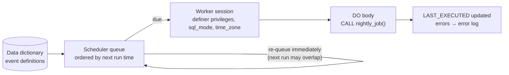

## Introduction

Databases accumulate work that nobody asks for interactively: purging expired sessions every hour, crediting interest at midnight, refreshing a summary table every five minutes, closing abandoned carts after a day. Somebody has to start that work on time.

MySQL can do it itself. An **event** is a stored program with a **schedule**: "run this SQL once at 03:00 tomorrow" or "run it every day at 02:15 starting next Monday". The server's **Event Scheduler** thread wakes up when an event is due and executes its body — no client, no cron entry, no application process.

This lesson answers the questions you need before trusting a database with a job:

- How do one-time and recurring events work, and what exactly happens when one fires?
- How do you **monitor** events — when did it last run, did it fail, how long did it take?
- What happens if a run takes **longer than its interval**?
- When is an external scheduler (cron, a Kubernetes CronJob, Airflow, a cloud scheduler) the better choice?

:::warning[Events never fire in the sandbox]
The Event Scheduler is **OFF** on the lab server (`@@event_scheduler = OFF`). `CREATE EVENT`, `ALTER EVENT`, `DROP EVENT`, `SHOW EVENTS` and `information_schema.EVENTS` all work — so you can define and inspect events — but **no event will ever execute**. This lesson therefore follows a professional pattern that also makes events testable in production: the event body is a single `CALL` to a stored procedure, and the examples execute that procedure directly to show exactly what each run would do.
:::

The examples use the **bank** dataset; schedules use fixed dates in the future so that the captured metadata is reproducible.

## DBMS Theory

:::theory[Temporal triggers and job scheduling]
Active-database theory distinguishes **data events** (insert, update, delete — handled by triggers) from **temporal events** (a point in time, or a periodic time pattern). An ECA rule whose event is temporal is what MySQL calls an *event*, Oracle a *scheduler job* (`DBMS_SCHEDULER`), SQL Server an *Agent job*, and PostgreSQL provides through the `pg_cron` extension.

A scheduled job has three properties that a theory of correctness must address:

1. **Schedule semantics** — at-most-once, at-least-once or exactly-once per scheduled instant; what happens to runs missed while the system was down.
2. **Concurrency** — whether two instances of the same job may overlap.
3. **Idempotency** — whether running the job twice for the same period produces the same result as running it once.

The SQL standard does not define scheduled events; every mechanism is vendor-specific.
:::

MySQL's answers, which the rest of the lesson demonstrates:

| Property | MySQL Event Scheduler |
|---|---|
| Schedule | `AT timestamp` (one-time) or `EVERY interval [STARTS …] [ENDS …]` (recurring) |
| Missed runs | Not caught up: while the scheduler is off or the server is down, due executions simply do not happen |
| Overlap | **Allowed** — if a run takes longer than the interval, another instance can start; you must prevent it yourself (e.g. `GET_LOCK()`) |
| Failure reporting | Errors go to the server's error log only; nothing is returned to any client |
| Idempotency | Your responsibility (design the body so a rerun is harmless) |

These properties are why events are excellent for simple, idempotent, database-local housekeeping — and why critical business batch processes usually live in an external orchestrator with retries, alerting and dependency management.

## Why It Exists

Without an in-database scheduler, every periodic database task needs an external host: a cron entry on some server with a `mysql` client, credentials in a file, and monitoring of that host. That is fine for teams with infrastructure tooling, but it has costs:

- **Another moving part.** The job server can be down, mis-configured or forgotten during a migration, while the database itself keeps running.
- **Credentials outside the database.** The external job needs a password; an event runs inside the server with its definer's privileges.
- **Network and failover concerns.** After a primary failover, cron jobs pointing at a hostname may hit the wrong server; events travel with the schema (and are disabled on replicas automatically).

Events exist to make *simple, self-contained* database maintenance self-sufficient: the schema carries its own housekeeping.

## Internal Working

:::internals[The Event Scheduler]
When `event_scheduler = ON` (the default since MySQL 8.0), the server runs a background thread — visible in `SHOW PROCESSLIST` as user `event_scheduler` with state *Waiting for next activation*. It keeps an in-memory **queue of enabled events ordered by their next execution time**, loaded from the data dictionary at startup and updated by `CREATE`/`ALTER`/`DROP EVENT`.

When the head of the queue is due, the scheduler:

1. starts a **new worker thread** (a new session) for that execution;
2. in that session, applies the event's stored context — the **definer's** privileges, the `sql_mode` and `time_zone` in effect when the event was created, the event's schema as the default database;
3. executes the `DO` body (one statement, often `BEGIN … END` or `CALL proc()`), with **autocommit on** like any new session;
4. records `LAST_EXECUTED`; for one-time events with `ON COMPLETION NOT PRESERVE` (the default), drops the event afterwards;
5. computes the next execution time and re-queues recurring events — **without waiting for the worker to finish**. That is why a slow run can overlap with the next one.

Errors in the body are written to the server **error log** (with the event name); the event stays enabled and runs again at its next scheduled time.
:::



**Configuration values** of `event_scheduler`: `ON` (running), `OFF` (thread stopped; events are kept but do not run), `DISABLED` (set at startup only; cannot be turned on at runtime). Turning it on is `SET GLOBAL event_scheduler = ON`, an administrative action that the sandbox does not allow.

**Replication.** `CREATE EVENT` is replicated, but on a replica the event is marked as *disabled on the replica* (`DISABLE ON REPLICA`), so a job is not executed twice. After a failover you must enable the events on the new primary (`ALTER EVENT … ENABLE`) — a step that is easy to forget in runbooks.

## MySQL Implementation

Check the scheduler state first (in production this is how you discover why "the event did not run"):

```sql run
SELECT @@event_scheduler AS event_scheduler;
```

The general syntax:

```sql
CREATE [DEFINER = user] EVENT [IF NOT EXISTS] name
  ON SCHEDULE { AT timestamp [+ INTERVAL n unit]
              | EVERY n unit [STARTS timestamp] [ENDS timestamp] }
  [ON COMPLETION [NOT] PRESERVE]
  [ENABLE | DISABLE | DISABLE ON REPLICA]
  [COMMENT 'text']
  DO event_body;
```

Following the "event body = procedure call" pattern, write the job as a procedure first. This job credits monthly interest to active savings accounts — set-based, inside one transaction, and logged to a job-run table:

```sql run
CREATE TABLE job_runs (
  run_id      INT AUTO_INCREMENT PRIMARY KEY,
  job_name    VARCHAR(64) NOT NULL,
  status      ENUM('running', 'ok', 'failed', 'skipped') NOT NULL,
  rows_affected INT,
  message     VARCHAR(255),
  started_at  DATETIME(6) NOT NULL,
  finished_at DATETIME(6)
);

DELIMITER //
CREATE PROCEDURE job_monthly_interest(IN p_rate DECIMAL(6,5), IN p_ref VARCHAR(40))
  MODIFIES SQL DATA
BEGIN
  DECLARE v_run INT;
  DECLARE v_rows INT DEFAULT 0;
  DECLARE EXIT HANDLER FOR SQLEXCEPTION
  BEGIN
    DECLARE v_msg VARCHAR(255);
    GET STACKED DIAGNOSTICS CONDITION 1 v_msg = MESSAGE_TEXT;
    ROLLBACK;
    UPDATE job_runs SET status = 'failed', message = v_msg, finished_at = NOW(6) WHERE run_id = v_run;
    RESIGNAL;
  END;

  INSERT INTO job_runs (job_name, status, started_at) VALUES ('monthly_interest', 'running', NOW(6));
  SET v_run = LAST_INSERT_ID();

  START TRANSACTION;
  CREATE TEMPORARY TABLE IF NOT EXISTS tmp_interest (account_id INT PRIMARY KEY, amount DECIMAL(14,2));
  DELETE FROM tmp_interest;
  INSERT INTO tmp_interest
    SELECT account_id, ROUND(balance * p_rate, 2) FROM accounts
    WHERE account_type = 'savings' AND status = 'active' AND ROUND(balance * p_rate, 2) > 0;
  UPDATE accounts a JOIN tmp_interest t ON t.account_id = a.account_id SET a.balance = a.balance + t.amount;
  SET v_rows = ROW_COUNT();
  INSERT INTO transactions (account_id, txn_type, amount, balance_after, reference, created_at)
    SELECT a.account_id, 'interest', t.amount, a.balance, p_ref, NOW()
    FROM accounts a JOIN tmp_interest t ON t.account_id = a.account_id;
  COMMIT;

  UPDATE job_runs SET status = 'ok', rows_affected = v_rows, finished_at = NOW(6) WHERE run_id = v_run;
END//
DELIMITER ;
```

Now the event. It runs on the first day of every month at 01:15 from 2030 onwards, and calls the procedure:

```sql run
CREATE EVENT ev_monthly_interest
  ON SCHEDULE EVERY 1 MONTH STARTS '2030-01-01 01:15:00'
  ON COMPLETION PRESERVE
  COMMENT 'Credit monthly interest to active savings accounts'
  DO CALL job_monthly_interest(0.00100, 'INT-MONTHLY');

SHOW EVENTS;
```

`SHOW EVENTS` lists the event with its schedule and status — and that is as far as the sandbox goes: with the scheduler off, `ev_monthly_interest` will never run here. To see what a run *would* do, execute the body directly:

```sql run
CALL job_monthly_interest(0.00100, 'INT-MONTHLY');

SELECT job_name, status, rows_affected, message FROM job_runs ORDER BY run_id;
SELECT COUNT(*) AS interest_rows, SUM(amount) AS interest_total
FROM transactions WHERE reference = 'INT-MONTHLY';
```

This is exactly the work one scheduled execution performs: one `job_runs` row with status `ok`, one interest ledger row per active savings account. In production you would test and monitor the job the same way — the event is only the trigger.

## Syntax Breakdown

| Clause | Meaning and MySQL specifics |
|---|---|
| `AT '2030-01-01 03:00:00'` | One-time event. `AT CURRENT_TIMESTAMP + INTERVAL 1 HOUR` is the relative form. A time in the past produces note 1588 and, with `NOT PRESERVE`, the event is dropped immediately. |
| `EVERY n unit` | Recurring. Units: `YEAR, QUARTER, MONTH, WEEK, DAY, HOUR, MINUTE, SECOND` and compound forms such as `DAY_HOUR`. |
| `STARTS ts` / `ENDS ts` | First possible execution and end of the recurrence. Without `STARTS`, the first run is "now". |
| `ON COMPLETION NOT PRESERVE` | Default: drop the event after its last execution (one-time events, or recurring events past `ENDS`). |
| `ON COMPLETION PRESERVE` | Keep the definition (status becomes `DISABLED` after the last run) — useful for history and re-enabling. |
| `ENABLE` / `DISABLE` | Default `ENABLE`. A disabled event stays defined but is not queued. |
| `DISABLE ON REPLICA` | Set automatically on replicas for replicated events. Replaces the deprecated `DISABLE ON SLAVE`. |
| `DO body` | One statement; `BEGIN … END` for several. Best practice: `DO CALL procedure(…)`. |
| `DEFINER` | The account whose privileges the body runs with (needs the `EVENT` privilege on the schema to create). |
| `ALTER EVENT e [ON SCHEDULE …] [RENAME TO …] [ENABLE \| DISABLE] [DO …]` | Change any part of an event. |
| `DROP EVENT [IF EXISTS] e` | Remove. |
| `SHOW EVENTS`, `SHOW CREATE EVENT`, `information_schema.EVENTS` | Inspect definitions, `STATUS`, `LAST_EXECUTED`, `TIME_ZONE`. |

Restrictions worth knowing: schedule expressions cannot reference tables or stored functions; an event cannot create another event, and `CREATE EVENT` is not allowed inside a stored routine; event names are unique per schema and limited to 64 characters.

## Practical Examples

**1. A one-time event.** Schedule a single cleanup for a specific moment. With the default `ON COMPLETION NOT PRESERVE`, the event drops itself after it has run:

```sql run
CREATE EVENT ev_close_promo_once
  ON SCHEDULE AT '2030-06-30 23:59:00'
  COMMENT 'One-time: end of promotion'
  DO UPDATE accounts SET version = version WHERE 1 = 0;

SELECT EVENT_NAME, EVENT_TYPE, EXECUTE_AT, INTERVAL_VALUE, INTERVAL_FIELD, ON_COMPLETION, STATUS
FROM information_schema.EVENTS
WHERE EVENT_SCHEMA = DATABASE()
ORDER BY EVENT_NAME;
```

`EVENT_TYPE` distinguishes `ONE TIME` from `RECURRING`; a one-time event has `EXECUTE_AT`, a recurring one an interval.

**2. A one-time event in the past.** A common mistake in deployment scripts that compute the time incorrectly: the event is created and immediately dropped.

```sql run
CREATE EVENT ev_already_late
  ON SCHEDULE AT '2020-01-01 00:00:00'
  DO DELETE FROM job_runs WHERE 1 = 0;
SHOW WARNINGS;
SELECT COUNT(*) AS still_defined FROM information_schema.EVENTS
WHERE EVENT_SCHEMA = DATABASE() AND EVENT_NAME = 'ev_already_late';
```

**3. A recurring purge in batches.** Deleting millions of old rows in one statement creates one huge transaction: long row locks, a large undo log, and replication lag while replicas apply it. A purge job deletes in batches and commits each one. Generate an archive table to purge:

```sql run
SET SESSION cte_max_recursion_depth = 100000;
CREATE TABLE session_log (
  id         INT PRIMARY KEY,
  account_id INT NOT NULL,
  created_at DATETIME NOT NULL,
  KEY idx_session_log_created (created_at)
);
INSERT INTO session_log
WITH RECURSIVE s(n) AS (SELECT 1 UNION ALL SELECT n + 1 FROM s WHERE n < 60000)
SELECT n, 1 + n % 25, TIMESTAMP '2024-01-01 00:00:00' + INTERVAL n MINUTE FROM s;
ANALYZE TABLE session_log;
SELECT COUNT(*) AS rows_total, MIN(created_at) AS oldest, MAX(created_at) AS newest FROM session_log;
```

The purge procedure deletes rows older than a cutoff, 10,000 at a time, and logs the run:

```sql run
CREATE PROCEDURE job_purge_session_log(IN p_cutoff DATETIME, IN p_batch INT)
  MODIFIES SQL DATA
BEGIN
  DECLARE v_deleted INT DEFAULT 0;
  DECLARE v_batch_rows INT DEFAULT 1;
  DECLARE v_run INT;
  INSERT INTO job_runs (job_name, status, started_at) VALUES ('purge_session_log', 'running', NOW(6));
  SET v_run = LAST_INSERT_ID();
  WHILE v_batch_rows > 0 DO
    DELETE FROM session_log WHERE created_at < p_cutoff ORDER BY created_at LIMIT p_batch;
    SET v_batch_rows = ROW_COUNT();
    SET v_deleted = v_deleted + v_batch_rows;
  END WHILE;
  UPDATE job_runs SET status = 'ok', rows_affected = v_deleted, finished_at = NOW(6) WHERE run_id = v_run;
END;

CREATE EVENT ev_purge_session_log
  ON SCHEDULE EVERY 1 HOUR STARTS '2030-01-01 00:05:00'
  DO CALL job_purge_session_log(NOW() - INTERVAL 30 DAY, 10000);
```

Under autocommit, each `DELETE … LIMIT` is its own transaction, so locks and undo are bounded by the batch size. Run the body with a fixed cutoff to see one execution:

```sql run measured
CALL job_purge_session_log('2024-01-29 00:00:00', 10000);
```

```sql run
SELECT job_name, status, rows_affected FROM job_runs WHERE job_name = 'purge_session_log';
SELECT COUNT(*) AS rows_left, MIN(created_at) AS oldest_left FROM session_log;
```

The `ORDER BY created_at LIMIT n` uses the index on `created_at`, so each batch reads only the rows it deletes:

```sql run
EXPLAIN DELETE FROM session_log WHERE created_at < '2024-02-15 00:00:00' ORDER BY created_at LIMIT 10000;
```

**4. Changing and disabling events.** Pause a job during a maintenance window, change its schedule, and inspect the result:

```sql run
ALTER EVENT ev_purge_session_log DISABLE;
ALTER EVENT ev_monthly_interest ON SCHEDULE EVERY 1 MONTH STARTS '2030-01-01 02:30:00';

SELECT EVENT_NAME, STATUS, INTERVAL_VALUE, INTERVAL_FIELD, STARTS, LAST_EXECUTED
FROM information_schema.EVENTS
WHERE EVENT_SCHEMA = DATABASE()
ORDER BY EVENT_NAME;
```

`LAST_EXECUTED` is NULL for every event — in the sandbox they have never run, and never will.

## Execution Walkthrough

The most dangerous property of events is that runs can **overlap**. A defensive job takes a named lock with `GET_LOCK(name, 0)` (timeout 0 = do not wait) and exits if another run holds it. Session A plays a long-running execution that holds the lock; session B is the next scheduled run.

```concurrency
title: Preventing overlapping job runs with GET_LOCK
description: The event worker sessions are simulated by two lab sessions. Session A is a run that is still busy; session B is the next run starting on schedule.
setup: |
  CREATE TABLE job_runs (
    run_id INT AUTO_INCREMENT PRIMARY KEY, job_name VARCHAR(64) NOT NULL,
    status ENUM('running','ok','failed','skipped') NOT NULL, rows_affected INT, message VARCHAR(255),
    started_at DATETIME(6) NOT NULL, finished_at DATETIME(6));
  CREATE PROCEDURE job_guarded()
  BEGIN
    IF GET_LOCK('job_guarded', 0) = 1 THEN
      INSERT INTO job_runs (job_name, status, message, started_at, finished_at)
        VALUES ('job_guarded', 'ok', 'did the work', NOW(6), NOW(6));
      DO RELEASE_LOCK('job_guarded');
    ELSE
      INSERT INTO job_runs (job_name, status, message, started_at, finished_at)
        VALUES ('job_guarded', 'skipped', 'previous run still active', NOW(6), NOW(6));
    END IF;
  END;
steps:
  - session: A
    sql: SELECT GET_LOCK('job_guarded', 0) AS a_holds_lock;
    note: Run A is in the middle of its work and holds the job's named lock (GET_LOCK returned 1).
  - session: B
    sql: CALL job_guarded(); SELECT status, message FROM job_runs ORDER BY run_id;
    note: The next run cannot get the lock without waiting, so it records 'skipped' and exits immediately instead of running concurrently.
  - session: A
    sql: SELECT RELEASE_LOCK('job_guarded') AS released;
    note: Run A finishes and releases the lock.
  - session: B
    sql: CALL job_guarded(); SELECT status, message FROM job_runs ORDER BY run_id;
    note: The following run gets the lock, does its work and releases it.
```

Named locks belong to the **session** (not the transaction), are released by `RELEASE_LOCK()` or when the session ends, and are server-wide — so on a single primary they are a simple, reliable mutual-exclusion mechanism for jobs.

## Output

After the examples, the schema contains three events, all of them defined and none ever executed:

```sql run
SELECT EVENT_NAME, EVENT_TYPE, STATUS, ON_COMPLETION, LAST_EXECUTED, EVENT_COMMENT
FROM information_schema.EVENTS
WHERE EVENT_SCHEMA = DATABASE()
ORDER BY EVENT_NAME;
```

And the job-run log records what the bodies did when we executed them directly:

```sql run
SELECT run_id, job_name, status, rows_affected FROM job_runs ORDER BY run_id;
```

Reading the two together is exactly how you operate events in production: `information_schema.EVENTS` tells you *whether and when the scheduler started a job* (`STATUS`, `LAST_EXECUTED`), the job's own log tells you *what the job did and whether it succeeded*. MySQL itself records failures only in the error log.

## Alternative Approaches

| Scheduler | Strengths | Weaknesses | Typical use |
|---|---|---|---|
| MySQL Event Scheduler | No extra infrastructure; runs next to the data; definer privileges; travels with the schema | Errors only in the error log; no retries, alerting or dependencies; overlap allowed; disabled on replicas and must be re-enabled after failover; per-server | Simple, idempotent housekeeping (purges, summary refresh) |
| cron + `mysql` client | Ubiquitous, simple; logs and exit codes | Host is a single point of failure; credentials on disk; failover-unaware unless it targets a VIP/DNS name | Small deployments, ops scripts |
| Kubernetes CronJob | Containerized, versioned with the app; concurrency policy (`Forbid`) prevents overlap; restart policies | Needs a cluster; time-zone and missed-run semantics to configure | Teams already on Kubernetes |
| Orchestrator (Airflow, Dagster, Prefect) | Dependencies between jobs, retries with backoff, backfills, SLAs, alerting, UI, lineage | Heavy infrastructure; latency of minutes | Data pipelines, ETL, multi-step business batches |
| Cloud schedulers (EventBridge Scheduler, Cloud Scheduler) | Managed, integrated with serverless functions and IAM | Vendor lock-in; still need a worker | Serverless architectures |
| Application-level schedulers (Quartz, Sidekiq, Celery beat) | Logic in app language, tested with app code | Must coordinate across app instances (leader election or DB locks) | Business jobs owned by a service team |

A practical rule: **events for database-internal, idempotent housekeeping; an external scheduler for anything that needs retries, alerts, dependencies, or touches systems outside MySQL.** Even when an external scheduler is used, keeping the job's SQL in a stored procedure (as here) is common, because the scheduler then only runs `CALL job_x()`.

## Performance Analysis

Events have negligible scheduling overhead; the cost is entirely in what their bodies do and **when** they do it:

- **Batch size controls impact.** The batched purge above deleted the old rows in a loop of 10,000-row transactions. Each batch holds locks only for its own rows and produces a bounded undo log and binary-log event group, so concurrent sessions and replicas are not stalled by one giant transaction. One `DELETE` of all old rows would be faster in isolation but would hold its locks and grow its undo log until it committed ([Transaction Logs](/lessons/m08-transaction-logs)).
- **Index the purge predicate.** The `EXPLAIN` above shows a range scan on `idx_session_log_created`; without that index every batch would scan the whole table — cost quadratic in the number of batches.
- **Schedule away from peaks**, and stagger jobs: ten events all at `00:00:00` compete with each other (the same advice applies to cron; see the jittered schedules many platforms use).
- **Overlap multiplies load.** A job that sometimes takes 70 minutes with a 60-minute interval will, without a guard, eventually run twice concurrently — doubling its load exactly when the system is already slow. `GET_LOCK` (walkthrough above) or a "running" row in `job_runs` prevents it.

:::performance[Measured on the build machine]
The `measured` purge call above deleted 40,319 rows in five productive batches of up to 10,000 (plus a final empty one) in roughly 0.3 s on the build machine; yours will differ. What transfers to production is the shape: total time grows linearly with the rows to purge, while the lock and undo footprint of each transaction stays bounded by the batch size.
:::

## Best Practices

:::best-practice[Events in production]
1. **Make the event body a single `CALL`** to a stored procedure. The procedure can be tested, run manually during incidents, and reused by an external scheduler.
2. **Log every run** (start, end, rows, status, error message) in a job-run table from the procedure, and alert on missing or failed runs — MySQL only writes failures to the error log.
3. **Prevent overlap** with `GET_LOCK('job_name', 0)` or a status row, and make jobs **idempotent** so a rerun after a failure is safe.
4. **Batch large modifications** and commit per batch; index the predicates the job uses.
5. **Use `ON COMPLETION PRESERVE`** for one-time events you want to keep as a record, and explicit `STARTS` times (in a documented time zone) for recurring ones.
6. **Include events in failover runbooks**: on promotion of a replica, `ALTER EVENT … ENABLE` the events that were `DISABLE ON REPLICA`.
7. **Check `@@event_scheduler`** in monitoring; a server restarted with the scheduler `OFF` silently stops every job.
8. **Use a dedicated, least-privilege definer** for events, like for other stored programs.
:::

## Common Mistakes

**Mistake 1 — assuming the event runs because it exists.** It runs only if the scheduler is `ON`, the event is `ENABLED`, and the server is the one where it is enabled (not a replica). In the sandbox, `@@event_scheduler` is `OFF` — exactly the situation of a production server restarted with `--event-scheduler=OFF`. Always check `LAST_EXECUTED`.

**Mistake 2 — a one-time event scheduled in the past**, as shown in example 2: the note is easy to miss in a deployment log, and the event is gone.

**Mistake 3 — expecting errors to reach someone.** The worker session has no client. A body that fails with a duplicate-key error every night is visible only in the error log — or in your own `job_runs` table if the procedure records failures (the interest job's `EXIT HANDLER` does).

**Mistake 4 — referencing a table in the schedule.** Schedules must be computable without data access:

```sql run error
CREATE EVENT ev_bad_schedule
  ON SCHEDULE AT (SELECT MAX(created_at) FROM transactions) + INTERVAL 1 DAY
  DO DELETE FROM job_runs WHERE 1 = 0;
```

**Mistake 5 — one giant `DELETE` in a nightly event.** It works in development and causes replication lag, lock waits and undo-log growth in production. Batch it.

**Mistake 6 — relying on session state.** The event runs in a fresh session: no user variables, no temporary tables from your session, autocommit on, the `sql_mode`/`time_zone` captured at creation. Pass everything the job needs as procedure parameters or read it from tables.

## Industry Application

- **Housekeeping inside the database** — purging expired sessions, tokens and soft-deleted rows; rotating partitions (dropping last month's partition and adding next month's, see [Partitioning](/lessons/m12-partitioning)); refreshing summary tables that emulate materialized views ([Views](/lessons/m09-views)). These are the tasks events are best at.
- **Managed MySQL.** Amazon RDS/Aurora and other managed services support events (the scheduler is typically controlled through the parameter group), but many platform teams still prefer external schedulers for observability and because events must be re-enabled after failovers.
- **Data engineering.** ETL and reporting pipelines almost always run in an orchestrator (Airflow, Dagster, dbt Cloud), which offers dependency graphs, retries, backfills and SLA alerts that the Event Scheduler lacks; the database exposes procedures or plain SQL for the orchestrator to call.
- **Kubernetes-native teams** use CronJobs with `concurrencyPolicy: Forbid` — the same overlap protection you built with `GET_LOCK` — and keep job definitions in the same repository as the service.
- **Interview angle.** "How would you purge 500 million rows from a live table?" — batched deletes on an indexed predicate (or dropping partitions), throttled, monitored for replication lag, scheduled off-peak, idempotent and restartable. Where it is scheduled (event vs orchestrator) is the secondary question.

## Practice Exercises

```exercise
id: ex1
title: A nightly recurring event
difficulty: easy
kind: dml
concepts: [events, scheduled-jobs]
prompt: |
  Create a recurring event **`ev_nightly_cleanup`** that runs **every day** starting at **`2030-01-01 02:15:00`**,
  is **kept** after completion, has the comment `'Nightly cleanup'`, and whose body deletes rows from a table
  `temp_tokens` that are older than 7 days. Create the table first:
  `temp_tokens(token VARCHAR(64) PRIMARY KEY, created_at DATETIME NOT NULL)`.

  The check reads the event's metadata from `information_schema.EVENTS` (the event never fires in the lab).
hints:
  - "CREATE EVENT … ON SCHEDULE EVERY 1 DAY STARTS '2030-01-01 02:15:00' ON COMPLETION PRESERVE COMMENT '…' DO …"
  - "DO DELETE FROM temp_tokens WHERE created_at < NOW() - INTERVAL 7 DAY;"
solution: |
  CREATE TABLE temp_tokens (token VARCHAR(64) PRIMARY KEY, created_at DATETIME NOT NULL);
  CREATE EVENT ev_nightly_cleanup
    ON SCHEDULE EVERY 1 DAY STARTS '2030-01-01 02:15:00'
    ON COMPLETION PRESERVE
    COMMENT 'Nightly cleanup'
    DO DELETE FROM temp_tokens WHERE created_at < NOW() - INTERVAL 7 DAY;
check: |
  SELECT EVENT_NAME, EVENT_TYPE, INTERVAL_VALUE, INTERVAL_FIELD, STARTS, ON_COMPLETION, STATUS, EVENT_COMMENT
  FROM information_schema.EVENTS
  WHERE EVENT_SCHEMA = DATABASE() AND EVENT_NAME = 'ev_nightly_cleanup';
explanation: |
  `EVERY 1 DAY STARTS …` defines the recurrence; `ON COMPLETION PRESERVE` keeps the definition when the
  recurrence ends (it has no `ENDS` here, so it would run indefinitely). The event is `ENABLED` but, with the
  scheduler off, `LAST_EXECUTED` stays NULL. `NOW()` in the body is evaluated at each execution, which is what a
  rolling retention window needs.
```

```exercise
id: ex2
title: Pause and reschedule
difficulty: medium
kind: dml
concepts: [events, job-monitoring]
setup: |
  CREATE EVENT ev_report_refresh
    ON SCHEDULE EVERY 15 MINUTE STARTS '2030-01-01 00:00:00'
    DO DELETE FROM accounts WHERE 1 = 0;
prompt: |
  The setup created `ev_report_refresh`, running every 15 minutes. Operations wants it to run **every hour**
  starting **`2030-01-01 00:07:00`** (staggered away from other jobs), and **disabled** until a maintenance window
  is over. Change the existing event — do not drop it.
hints:
  - "ALTER EVENT can change the schedule and the status in one statement."
  - "ALTER EVENT ev_report_refresh ON SCHEDULE EVERY 1 HOUR STARTS '2030-01-01 00:07:00' DISABLE;"
solution: |
  ALTER EVENT ev_report_refresh
    ON SCHEDULE EVERY 1 HOUR STARTS '2030-01-01 00:07:00'
    DISABLE;
check: |
  SELECT EVENT_NAME, INTERVAL_VALUE, INTERVAL_FIELD, STARTS, STATUS
  FROM information_schema.EVENTS
  WHERE EVENT_SCHEMA = DATABASE();
explanation: |
  `ALTER EVENT` preserves the event's identity (and its definer and body) while changing the schedule and status.
  Dropping and re-creating would also pass the check but loses history such as `CREATED` and `LAST_EXECUTED`, and
  briefly leaves no event at all. Staggering start minutes is a cheap way to avoid many jobs firing at :00.
```

```exercise
id: ex3
title: A batched purge job
difficulty: hard
kind: dml
concepts: [batch-maintenance, scheduled-jobs, job-monitoring]
setup: |
  CREATE TABLE api_log (id INT PRIMARY KEY, created_at DATETIME NOT NULL, KEY (created_at));
  SET SESSION cte_max_recursion_depth = 20000;
  INSERT INTO api_log
  WITH RECURSIVE s(n) AS (SELECT 1 UNION ALL SELECT n + 1 FROM s WHERE n < 12000)
  SELECT n, TIMESTAMP '2024-03-01 00:00:00' + INTERVAL n MINUTE FROM s;
  CREATE TABLE job_log (job VARCHAR(40), batches INT, rows_deleted INT);
prompt: |
  The setup created `api_log` (12,000 rows, one per minute from 2024-03-01) and `job_log(job, batches, rows_deleted)`.

  1. Create **`purge_api_log(IN p_cutoff DATETIME, IN p_batch INT)`** that deletes rows with `created_at < p_cutoff`
     in batches of `p_batch` rows (oldest first) until none are left, and then inserts **one** row into `job_log`:
     `('purge_api_log', <number of DELETE statements that deleted at least one row>, <total rows deleted>)`.
  2. Create an event **`ev_purge_api_log`** that calls it **every hour**, starting `2030-01-01 00:20:00`, with the
     cutoff `NOW() - INTERVAL 90 DAY` and batch size 1000.

  The check calls the procedure with cutoff `2024-03-05 00:00:00` and batch 2500, and reads `job_log`, the remaining
  row count and the event's schedule.
hints:
  - "Loop with WHILE: DELETE … WHERE created_at < p_cutoff ORDER BY created_at LIMIT p_batch; then read ROW_COUNT()."
  - "Increment the batch counter only when ROW_COUNT() > 0; stop when it is 0."
  - "DO CALL purge_api_log(NOW() - INTERVAL 90 DAY, 1000)"
solution: |
  CREATE PROCEDURE purge_api_log(IN p_cutoff DATETIME, IN p_batch INT)
    MODIFIES SQL DATA
  BEGIN
    DECLARE v_rows INT DEFAULT 1;
    DECLARE v_batches INT DEFAULT 0;
    DECLARE v_total INT DEFAULT 0;
    WHILE v_rows > 0 DO
      DELETE FROM api_log WHERE created_at < p_cutoff ORDER BY created_at LIMIT p_batch;
      SET v_rows = ROW_COUNT();
      IF v_rows > 0 THEN
        SET v_batches = v_batches + 1;
        SET v_total = v_total + v_rows;
      END IF;
    END WHILE;
    INSERT INTO job_log VALUES ('purge_api_log', v_batches, v_total);
  END;
  CREATE EVENT ev_purge_api_log
    ON SCHEDULE EVERY 1 HOUR STARTS '2030-01-01 00:20:00'
    DO CALL purge_api_log(NOW() - INTERVAL 90 DAY, 1000);
check: |
  CALL purge_api_log('2024-03-05 00:00:00', 2500);
  SELECT j.job, j.batches, j.rows_deleted,
         (SELECT COUNT(*) FROM api_log) AS rows_left,
         e.INTERVAL_VALUE, e.INTERVAL_FIELD, e.STARTS
  FROM job_log j
  CROSS JOIN information_schema.EVENTS e
  WHERE e.EVENT_SCHEMA = DATABASE() AND e.EVENT_NAME = 'ev_purge_api_log';
explanation: |
  Rows before 2024-03-05 00:00 are the first 4 days minus one minute: 5,759 rows, deleted in batches of 2,500,
  2,500 and 759 — three productive `DELETE`s, then a fourth that deletes nothing and ends the loop. Under autocommit
  each `DELETE` commits separately, bounding lock time and undo size per batch. Reading `ROW_COUNT()` immediately
  after the `DELETE` matters: any statement in between would reset it.
```

```exercise
id: ex4
title: Guard a job against overlapping runs
difficulty: medium
kind: dml
concepts: [scheduled-jobs, job-monitoring]
setup: |
  CREATE TABLE refresh_runs (id INT AUTO_INCREMENT PRIMARY KEY, outcome VARCHAR(10) NOT NULL);
prompt: |
  Create **`refresh_guarded()`** that uses the named lock `'refresh_job'` (without waiting) to make sure only one
  run executes at a time. If it gets the lock, it inserts `'ran'` into `refresh_runs(outcome)` and releases the
  lock; otherwise it inserts `'skipped'`.

  The check calls your procedure twice in sequence (a single session cannot overlap with itself — the lesson's
  two-session walkthrough shows the `'skipped'` branch) and counts the outcomes.
hints:
  - "GET_LOCK('refresh_job', 0) returns 1 if the lock was acquired, 0 if another session holds it."
  - "Release the lock with DO RELEASE_LOCK('refresh_job') after the work, so the next run can acquire it."
solution: |
  CREATE PROCEDURE refresh_guarded()
  BEGIN
    IF GET_LOCK('refresh_job', 0) = 1 THEN
      INSERT INTO refresh_runs (outcome) VALUES ('ran');
      DO RELEASE_LOCK('refresh_job');
    ELSE
      INSERT INTO refresh_runs (outcome) VALUES ('skipped');
    END IF;
  END;
check: |
  CALL refresh_guarded();
  CALL refresh_guarded();
  SELECT outcome, COUNT(*) AS n FROM refresh_runs GROUP BY outcome ORDER BY outcome;
explanation: |
  The check's two calls run one after the other, and each releases the lock when it finishes, so both obtain it
  and record `'ran'`; a procedure that forgot `RELEASE_LOCK` would still pass here only because MySQL named locks
  are re-entrant within one session — in production, the *next event worker* (a different session) would then be
  skipped forever until the first session ended. The two-session walkthrough in the lesson shows the `'skipped'` branch. The essential parts are the zero
  timeout (never queue behind a running job) and releasing the lock on the success path; production versions also
  release it in an exit handler so a failing run does not keep the lock until its session ends.
```

```exercise
id: ex5
title: Choose the scheduler
difficulty: challenge
kind: open
concepts: [events, scheduled-jobs, job-monitoring]
prompt: |
  For each job, choose the MySQL Event Scheduler or an external scheduler (cron, Kubernetes CronJob, Airflow) and
  justify the choice, naming the specific risks you are managing:

  1. Delete expired password-reset tokens (a few thousand rows per hour).
  2. A nightly settlement that reads card-processor files from object storage, posts ledger entries and e-mails
     finance a report.
  3. Refresh a `daily_sales_summary` table from `orders` every 10 minutes.
  4. Drop last month's partition of a 2-billion-row log table and add next month's.
solution: |
  1. **Event.** Database-local, small, idempotent (deleting already-deleted tokens is a no-op). Use a batched
     `DELETE` on an indexed `expires_at`, log runs, and monitor `@@event_scheduler` and `LAST_EXECUTED`. Risks:
     scheduler off after a restart, event disabled after failover.
  2. **External orchestrator (Airflow or similar).** It touches systems MySQL cannot reach (object storage,
     e-mail), needs retries, dependencies (file arrived → post → report), alerting and audit. The posting itself can
     still be a stored procedure called by the orchestrator, inside one transaction, idempotent per settlement date.
  3. **Either; event is reasonable.** Database-local and idempotent if implemented as "recompute the last N days
     into the summary". Guard against overlap (`GET_LOCK`) because a 10-minute interval is short; if the refresh
     ever takes longer than 10 minutes, consider incremental refresh. An external scheduler is preferable if the
     team needs alerting on staleness — though a staleness check can also be a monitoring query on the summary.
  4. **External scheduler or a carefully guarded event**, run well in advance (e.g. create partitions a month
     ahead). Partition DDL takes metadata locks and is replicated; it needs alerting if it fails (or inserts start
     failing when no partition exists for new dates). Teams often run it from a deployment/ops tool with
     notifications, keeping an event only as a fallback.
```

## Knowledge Assessment

```quiz
- id: q1
  question: "`SHOW EVENTS` lists an ENABLED recurring event, but `LAST_EXECUTED` stays NULL for days. Which is the most likely cause?"
  options:
    - "The event's body has a syntax error"
    - "The Event Scheduler is OFF (or the server is a replica where the event is disabled)"
    - "Recurring events only run after a server restart"
    - "LAST_EXECUTED is only updated for one-time events"
  answer: 1
  explanation: "A syntax error would be rejected at CREATE EVENT time; runtime errors still update LAST_EXECUTED. Events run without restarts, and LAST_EXECUTED applies to all events. In the sandbox, @@event_scheduler = OFF produces exactly this picture."
  concepts: [event-scheduler, job-monitoring]
- id: q2
  question: "An event runs `EVERY 1 HOUR`. One execution takes 75 minutes. What does MySQL do at the next scheduled time?"
  options:
    - "Waits until the running execution finishes"
    - "Skips the run automatically"
    - "Starts another instance, which may run concurrently with the first"
    - "Disables the event"
  answer: 2
  explanation: "The scheduler re-queues recurring events independently of running workers, so instances can overlap. Preventing it (GET_LOCK, a status row) is the job author's responsibility."
  concepts: [event-scheduler, scheduled-jobs]
- id: q3
  question: "You create `CREATE EVENT e ON SCHEDULE AT '2020-01-01 00:00:00' DO …` (in the past) with default options. What happens?"
  options:
    - "The event runs immediately once"
    - "An error is raised and nothing is created"
    - "A note (1588) is raised and the event is dropped immediately after creation"
    - "The event waits until 2020-01-01 of next year"
  answer: 2
  explanation: "With ON COMPLETION NOT PRESERVE (the default), a one-time event in the past is created and dropped at once, with note 1588; the lesson's example found it no longer defined."
  concepts: [events]
- id: q4
  question: "Where does MySQL report an error raised inside an event's body?"
  options: ["To the client that created the event", "In information_schema.EVENTS.LAST_ERROR", "In the server's error log", "In SHOW WARNINGS of the next session"]
  answer: 2
  explanation: "The worker session has no client, and information_schema.EVENTS has no error column. Only the error log records it — hence the advice to log runs in your own table."
  concepts: [job-monitoring]
- id: q5
  question: "Which statements about events and replication are true? (Select all that apply.)"
  type: multi
  options:
    - "CREATE EVENT is replicated to replicas"
    - "Replicated events are marked disabled on the replica so the job does not run twice"
    - "After a failover, events on the promoted replica start running automatically"
    - "DISABLE ON REPLICA replaces the deprecated DISABLE ON SLAVE"
  answer: [0, 1, 3]
  explanation: "Events replicate in a replica-disabled state. Nothing re-enables them automatically on promotion — that is a runbook step (ALTER EVENT … ENABLE)."
  concepts: [events, event-scheduler]
- id: q6
  question: "Why does the purge job delete in batches with `ORDER BY created_at LIMIT 10000` instead of one DELETE?"
  options:
    - "MySQL cannot delete more than 10,000 rows per statement"
    - "Each batch is a small transaction, bounding lock duration, undo-log size and replication lag"
    - "Batches make the total work smaller"
    - "LIMIT forces MySQL to use a full table scan"
  answer: 1
  explanation: "There is no such row limit, and batching does not reduce total work. It keeps every transaction small so concurrent sessions and replicas are not stalled. The index on created_at makes each batch a range scan, not a full scan."
  concepts: [batch-maintenance]
- id: q7
  question: "What does an event's body see when it runs?"
  options:
    - "The user variables and temporary tables of the session that created the event"
    - "A fresh session with the definer's privileges and the sql_mode/time_zone captured at creation"
    - "The privileges of whoever is connected when it fires"
    - "The session of the scheduler thread, shared by all events"
  answer: 1
  explanation: "Each execution gets a new worker session in the event's stored security and environment context; no state from the creating session is available."
  concepts: [event-scheduler]
- id: q8
  question: "Which job is the WORST fit for the MySQL Event Scheduler?"
  options:
    - "Hourly purge of expired sessions"
    - "Refreshing a summary table every 10 minutes"
    - "A nightly settlement that downloads processor files, posts entries and e-mails a report, with retries and alerting"
    - "Monthly interest posting implemented as an idempotent stored procedure"
  answer: 2
  explanation: "Events cannot reach external systems and offer no retries, dependencies or alerting; that job belongs in an orchestrator (which may still call a stored procedure for the posting step)."
  concepts: [scheduled-jobs]
```
