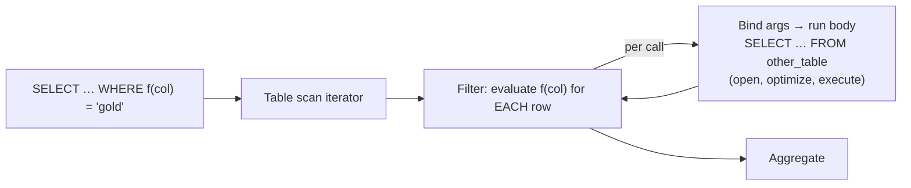

## Introduction

A **stored function** is a routine that takes parameters, **returns exactly one value**, and is called inside an expression — in a `SELECT` list, a `WHERE` clause, a `SET`, or another routine — just like `ROUND()` or `CONCAT()`:

```sql
SELECT product_id, net_price(price, 15) FROM products WHERE net_price(price, 15) < 50;
```

That makes functions the natural home for small, reusable *calculations* — a tax rule, a price after discount, a business-day calculation, a standardized formatting of a code. It also makes them dangerous: because they look like built-in functions, people call them on millions of rows without realizing that each call may run its own query.

This lesson answers the questions that separate a correct function from a costly or unsafe one:

- How do functions differ from procedures, and what are they **not allowed** to do?
- What do `DETERMINISTIC`, `NO SQL` and `READS SQL DATA` mean — and which of them does MySQL actually *check*?
- Why does MySQL refuse some functions when **binary logging** is enabled?
- How much does a function call **per row** cost compared with a join, and how do you see it in a plan?

You should know procedures first ([Stored Procedures and Control Flow](/lessons/m09-stored-procedures)); the body language — `BEGIN … END`, `DECLARE`, `IF`, loops — is the same.

:::note[Dataset]
The examples use the **shop** dataset, plus a generated 100,000-row table for the performance comparison. Outputs are captured from a real MySQL server.
:::

## DBMS Theory

:::theory[Functions in SQL/PSM]
SQL/PSM distinguishes two kinds of routines. A **procedure** is invoked as a statement (`CALL`) and communicates through parameters; a **function** is invoked within an expression and *returns a value of a declared type*. Because a function can appear wherever a value expression can, the standard restricts it: function parameters are input-only, and the function must not change the transaction state.

Two properties from the theory of functions matter to an optimizer:

- **Determinism** — a function is *deterministic* if it always returns the same result for the same arguments (and the same database state). `ROUND(x, 2)` is deterministic; `NOW()`, `RAND()` and `UUID()` are not. Only deterministic expressions may be evaluated once and reused, folded into constants, indexed or replicated by re-execution.
- **Side effects / data access** — whether the function reads or modifies data. A function that reads tables is deterministic only *relative to a database state*; it can return different values in different transactions.
:::

The SQL standard expresses these as **routine characteristics**: `[NOT] DETERMINISTIC` and one of `NO SQL`, `CONTAINS SQL`, `READS SQL DATA`, `MODIFIES SQL DATA`. MySQL accepts the same keywords, but — the key professional fact of this lesson — **MySQL trusts what you declare**. It does not verify that a `DETERMINISTIC` function is deterministic or that a `NO SQL` function contains no SQL. The declarations steer the optimizer and the binary-log safety checks, so a false declaration produces wrong behaviour rather than an error.

| Characteristic | Claim made by the author | Default |
|---|---|---|
| `DETERMINISTIC` | Same arguments → same result | `NOT DETERMINISTIC` |
| `NO SQL` | The body contains no SQL statements | — |
| `CONTAINS SQL` | Contains SQL but neither reads nor writes table data (e.g. `SET @x = 1`) | yes (default) |
| `READS SQL DATA` | Reads data (`SELECT`), does not modify it | — |
| `MODIFIES SQL DATA` | May modify data (`INSERT`, `UPDATE`, `DELETE`) | — |

## Why It Exists

Without functions, a calculation reused in many queries must be copy-pasted: every report that needs "price after a 15 % discount, rounded half-up to cents" repeats `ROUND(price * (1 - 15 / 100), 2)`. When the rounding rule changes, someone has to find every copy. Built-in functions cannot express business rules, and views cannot take parameters.

Stored functions exist to:

- **Name and centralize calculations** used inside SQL — one definition of `net_price`, `business_days_between` or `normalize_sku`.
- **Extend SQL with domain vocabulary**, so queries read like the business: `WHERE is_vip(customer_id)`.
- **Serve as building blocks for other routines and triggers**, which can call them like any expression.

What they are *not* good at is replacing joins. A function that runs a `SELECT` against another table, called once per row of a large table, turns one set-based join into N tiny queries. The performance section measures exactly that.

## Internal Working

:::internals[How MySQL evaluates a stored function call]
**Resolution.** When the parser meets `name(args)`, it checks built-in (native) functions first, then loadable functions (UDFs, written in C and installed with `CREATE FUNCTION … SONAME` — a different feature), then stored functions in the current schema. A stored function with the same name as a built-in must be called with a schema qualifier (`mydb.name()`), and MySQL warns when you create one.

**Compilation.** Like procedures, the function body is compiled to an instruction list on first use in a session and kept in the per-session stored-program cache.

**Evaluation.** A stored-function call is an *item* in the expression tree. Each time the executor evaluates that item it: binds arguments to parameter slots; runs the body (each embedded `SELECT` goes through open-tables, optimize and execute like any statement); converts the `RETURN` value to the declared return type (with the usual truncation warnings or strict-mode errors); and returns it.

**What `DETERMINISTIC` changes in the optimizer.** A call whose arguments are all constants is a candidate for being treated as a *constant* during optimization — but only if the function is declared `DETERMINISTIC`. Then MySQL can evaluate it once and use the result to drive index access (`WHERE id = f()` becomes `WHERE id = 80`). A `NOT DETERMINISTIC` function might return a different value for every row, so MySQL must call it **once per row** and cannot use it to look up an index. You will measure both below.

**Restrictions** (enforced at `CREATE` or call time): no `COMMIT`/`ROLLBACK`/`START TRANSACTION`, no statements returning a result set to the client (a bare `SELECT` without `INTO`), no `PREPARE`/`EXECUTE` (dynamic SQL), no recursion, and the function may not modify a table that the calling statement is reading or writing (error 1442, also seen with triggers).
:::



**Binary logging.** With binary logging enabled (the default since 8.0), MySQL must ensure that a function's effects can be replicated. In **statement-based** logging, a statement calling a function is re-executed on replicas, so a non-deterministic function that modifies data could make the replica diverge. Hence the default rule: to *create* a function while binary logging is on, you must declare at least one of `DETERMINISTIC`, `NO SQL` or `READS SQL DATA`; otherwise `CREATE FUNCTION` fails with error 1418 — unless the administrator has set `log_bin_trust_function_creators = 1`. With **row-based** logging (the default `binlog_format=ROW`), the changed rows themselves are logged, so the replication risk is much smaller, but the creation-time check still applies.

## MySQL Implementation

```sql
CREATE [DEFINER = user] FUNCTION [IF NOT EXISTS] name (param type, ...)
  RETURNS type
  [COMMENT 'text']
  [[NOT] DETERMINISTIC]
  [CONTAINS SQL | NO SQL | READS SQL DATA | MODIFIES SQL DATA]
  [SQL SECURITY {DEFINER | INVOKER}]
routine_body;     -- a single RETURN expr, or BEGIN … RETURN …; END
```

Function parameters are always input parameters — there is no `IN`/`OUT`/`INOUT` keyword. A one-line function needs no `BEGIN … END`:

```sql run
CREATE FUNCTION net_price(p_price DECIMAL(10,2), p_discount_pct INT)
  RETURNS DECIMAL(10,2)
  DETERMINISTIC NO SQL
  COMMENT 'Price after a percentage discount, rounded to cents'
RETURN ROUND(p_price * (100 - p_discount_pct) / 100, 2);

SELECT product_id, name, price, net_price(price, 15) AS price_after_15pct
FROM products
ORDER BY product_id
LIMIT 5;
```

A function with a body that reads data. `READS SQL DATA` declares it truthfully; it is **not** `DETERMINISTIC`, because its result depends on the current contents of `orders`:

```sql run
CREATE FUNCTION customer_revenue(p_customer INT)
  RETURNS DECIMAL(12,2)
  READS SQL DATA
BEGIN
  DECLARE v_total DECIMAL(12,2);
  SELECT COALESCE(SUM(oi.quantity * oi.unit_price), 0) INTO v_total
  FROM orders o JOIN order_items oi ON oi.order_id = o.order_id
  WHERE o.customer_id = p_customer
    AND o.status NOT IN ('cancelled', 'refunded');
  RETURN v_total;
END;

SELECT customer_revenue(18) AS cust_18, customer_revenue(2) AS cust_2_never_ordered;
```

Functions appear in `information_schema.ROUTINES` with their return type and characteristics:

```sql run
SELECT ROUTINE_NAME, DTD_IDENTIFIER AS returns, IS_DETERMINISTIC, SQL_DATA_ACCESS
FROM information_schema.ROUTINES
WHERE ROUTINE_SCHEMA = DATABASE() AND ROUTINE_TYPE = 'FUNCTION'
ORDER BY ROUTINE_NAME;
```

The binary-logging state of the server decides whether characteristics are *required* at creation time:

```sql run
SELECT @@log_bin AS binary_logging, @@binlog_format AS format,
       @@log_bin_trust_function_creators AS trust_function_creators;
```

This capture server has binary logging on with row format, and its administrator has set `log_bin_trust_function_creators = 1` so that lab accounts (which lack `SUPER`) can create functions. Notice the two warnings 1287 in the capture: on current releases both `binlog_format` and `log_bin_trust_function_creators` are **deprecated** — MySQL is moving towards row-based logging only, where the replication risk of non-deterministic functions largely disappears. Until they are removed, the creation-time rule below still applies on servers that keep the default. On a server with the default `log_bin_trust_function_creators = 0`, a function declared without any of the three characteristics is rejected — display-only here, because the capture server would accept it:

```sql
CREATE FUNCTION f_unsafe() RETURNS CHAR(36) RETURN UUID();
-- ERROR 1418 (HY000): This function has none of DETERMINISTIC, NO SQL,
-- or READS SQL DATA in its declaration and binary logging is enabled
-- (you *might* want to use the less safe log_bin_trust_function_creators variable)
```

## Syntax Breakdown

| Element | Meaning and MySQL specifics |
|---|---|
| `RETURNS type` | Mandatory. The `RETURN` value is converted to this type; with a strict `sql_mode` an out-of-range or too-long value is an error. For strings, `RETURNS VARCHAR(20) CHARSET utf8mb4` may specify a character set. |
| `RETURN expr` | Ends the function and returns the value. Every path must reach a `RETURN`; falling off the end is error 1321 at call time. |
| Parameters | Input only; no mode keyword. Assigning to a parameter inside the body changes only the local copy. |
| `DETERMINISTIC` | Your promise: same arguments → same result. Enables constant folding of calls with constant arguments; satisfies the binlog creation check. **Not verified.** |
| `NOT DETERMINISTIC` | Default. Calls are evaluated per row. |
| `NO SQL` / `CONTAINS SQL` / `READS SQL DATA` / `MODIFIES SQL DATA` | Advisory data-access claims. `NO SQL` and `READS SQL DATA` satisfy the binlog creation check. **Not verified.** |
| `SQL SECURITY DEFINER \| INVOKER` | Whose privileges apply to the tables the body reads (default `DEFINER`). |
| `IF NOT EXISTS` | 8.0.29+: no error (note 1304) if the function exists. |
| `DROP FUNCTION [IF EXISTS] f` | Remove. As with procedures, there is no `CREATE OR REPLACE FUNCTION`; `ALTER FUNCTION` changes characteristics only. |
| Calling | `SELECT f(1)`, `WHERE f(col) > 0`, `SET v = f(x)`, inside other routines and triggers. Not allowed in generated columns, functional indexes, `CHECK` constraints or column `DEFAULT` expressions. |

:::standard[Standard SQL vs MySQL]
`CREATE FUNCTION … RETURNS … RETURN`, the characteristic keywords and input-only parameters are SQL/PSM. Standard SQL also defines *table functions* (returning a table) and allows functions to be marked `RETURNS NULL ON NULL INPUT`; MySQL supports neither — a MySQL stored function always returns a scalar. Overloading (several functions with the same name and different parameter types), which PostgreSQL supports, is not available in MySQL.
:::

## Practical Examples

**1. A function in the `SELECT` list and in `WHERE`.** Products that cost under 50 after a 15 % discount:

```sql run
SELECT product_id, name, price, net_price(price, 15) AS discounted
FROM products
WHERE net_price(price, 15) < 50
ORDER BY discounted, product_id;
```

Readable — but note that `net_price(price, 15)` hides a column inside a function call, so even with an index on `price` MySQL could not use it for this filter (the same rule as for built-in functions, see [Sargable Queries](/lessons/m07-sargable-queries)). The sargable form is `WHERE price < 50 / 0.85`.

**2. A multi-step calculation with control flow.** Shipping cost depends on the order value and the destination state:

```sql run
CREATE FUNCTION shipping_fee(p_order_value DECIMAL(10,2), p_state CHAR(2))
  RETURNS DECIMAL(6,2)
  DETERMINISTIC NO SQL
BEGIN
  DECLARE v_fee DECIMAL(6,2);
  IF p_order_value >= 100 THEN
    SET v_fee = 0;
  ELSEIF p_state IN ('AK', 'HI') THEN
    SET v_fee = 24.90;
  ELSE
    SET v_fee = 7.90;
  END IF;
  RETURN v_fee;
END;

SELECT shipping_fee(250, 'CA') AS big_order,
       shipping_fee(40, 'HI')  AS small_to_hawaii,
       shipping_fee(40, 'NY')  AS small_mainland;
```

**3. A data-reading function used in a report.** `customer_revenue` per customer, alongside the customer's tier:

```sql run
SELECT customer_id, first_name, loyalty_tier, customer_revenue(customer_id) AS revenue
FROM customers
WHERE state = 'NY'
ORDER BY revenue DESC, customer_id;
```

Convenient — and for a handful of customers, harmless. Each output row ran one aggregate query; on 25 customers nobody will notice. On 2 million customers this is 2 million queries. The set-based version is a `LEFT JOIN … GROUP BY` (see *Alternative Approaches*).

**4. What a function may not do.** Functions cannot control transactions:

```sql run error
CREATE FUNCTION f_commit() RETURNS INT NO SQL
BEGIN
  COMMIT;
  RETURN 1;
END;
```

cannot send result sets to the client:

```sql run error
CREATE FUNCTION f_result_set() RETURNS INT READS SQL DATA
BEGIN
  SELECT COUNT(*) FROM products;
  RETURN 1;
END;
```

and cannot be used where MySQL requires a built-in deterministic expression, such as a generated column — even when declared `DETERMINISTIC`:

```sql run error
CREATE TABLE price_check (
  price DECIMAL(10,2),
  discounted DECIMAL(10,2) AS (net_price(price, 15))
);
```

## Execution Walkthrough

How often is a function actually called? Let us count, with a function that increments a session counter every time it runs — once declared `NOT DETERMINISTIC` (the default) and once `DETERMINISTIC`. Both return the highest order id.

```walkthrough
title: Counting function calls — NOT DETERMINISTIC vs DETERMINISTIC in WHERE
steps:
  - title: "1. Two functions with identical bodies"
    explain: >-
      Each call adds 1 to @calls and returns MAX(order_id). Only the declared characteristic differs.
      (Setting a user variable is a side effect — which is exactly what makes the calls observable.)
    sql: |
      CREATE FUNCTION last_order_nd() RETURNS INT READS SQL DATA
      BEGIN
        SET @calls = @calls + 1;
        RETURN (SELECT MAX(order_id) FROM orders);
      END;
      CREATE FUNCTION last_order_d() RETURNS INT DETERMINISTIC READS SQL DATA
      BEGIN
        SET @calls = @calls + 1;
        RETURN (SELECT MAX(order_id) FROM orders);
      END;
  - title: "2. NOT DETERMINISTIC: one call per row"
    explain: >-
      MySQL must assume the function can return a different value for each row, so it scans the table and calls
      it for every one of the 80 orders. The result is correct (order 80) but the counter shows the price.
    sql: |
      SET @calls = 0;
      SELECT order_id FROM orders WHERE order_id = last_order_nd();
      SELECT @calls AS calls_not_deterministic;
  - title: "3. The plan confirms the scan"
    explain: >-
      type = index over all 80 rows with 'Using where': the comparison is evaluated row by row and the primary
      key cannot be used for a lookup.
    sql: EXPLAIN SELECT order_id FROM orders WHERE order_id = last_order_nd();
  - title: "4. DETERMINISTIC: evaluated as a constant"
    explain: >-
      With no column arguments and a DETERMINISTIC declaration, the optimizer evaluates the call during
      optimization and uses the value for a primary-key lookup. Only a few calls happen, regardless of table size.
    sql: |
      SET @calls = 0;
      SELECT order_id FROM orders WHERE order_id = last_order_d();
      SELECT @calls AS calls_deterministic;
  - title: "5. The plan: eq_ref on PRIMARY"
    explain: The access type is now a single-row primary-key lookup with a constant — exactly what a literal 80 would give.
    sql: EXPLAIN SELECT order_id FROM orders WHERE order_id = last_order_d();
```

## Output

The walkthrough's results are the core of this lesson. Both queries return the same single row, `order_id = 80`. But the non-deterministic function was called once for every row of `orders` (80 calls) through an index scan, while the deterministic one was called only a handful of times (3 in the capture: during optimization and execution) and drove an `eq_ref` primary-key lookup. On a table of 80 million orders, the first query would execute 80 million `SELECT MAX(order_id)` subqueries; the second still a handful.

That is also why lying is dangerous: if `last_order_d()` had been declared `DETERMINISTIC` while actually returning something that changes per call (say, it used `RAND()`), MySQL would evaluate it once and silently give a different answer than the per-row semantics you wrote. MySQL does not check the claim — you own it.

## Alternative Approaches

| Need | Stored function | Usually better at scale |
|---|---|---|
| Pure calculation on columns (`net_price`) | Fine; cheap per call | Inline expression if it must use an index; a **generated column** (with built-in functions only) plus an index if you filter on it |
| Lookup of a value in another table (`tier_of(id)`) | One query per call | A **join** |
| Aggregate over related rows (`customer_revenue(id)`) | One aggregate per call | `LEFT JOIN … GROUP BY`, a derived table, or a summary table |
| Reusable predicate (`is_vip(id)`) | Readable, not sargable | A view that joins the defining data, or an indexed flag column |

The set-based version of example 3 — same rows, one statement, no per-row subqueries:

```sql run
SELECT c.customer_id, c.first_name, c.loyalty_tier,
       COALESCE(SUM(CASE WHEN o.status NOT IN ('cancelled', 'refunded')
                         THEN oi.quantity * oi.unit_price END), 0) AS revenue
FROM customers c
LEFT JOIN orders o       ON o.customer_id = c.customer_id
LEFT JOIN order_items oi ON oi.order_id = o.order_id
WHERE c.state = 'NY'
GROUP BY c.customer_id, c.first_name, c.loyalty_tier
ORDER BY revenue DESC, c.customer_id;
```

**Generated columns** are the right tool when a per-row calculation must be filtered or indexed. They cannot call stored functions (you saw error 3763), but they can use the same built-in expression:

```sql run
CREATE TABLE price_watch (
  product_id INT PRIMARY KEY,
  price      DECIMAL(10,2) NOT NULL,
  discounted DECIMAL(10,2) AS (ROUND(price * 85 / 100, 2)) STORED,
  KEY idx_discounted (discounted)
);
INSERT INTO price_watch (product_id, price) SELECT product_id, price FROM products;
ANALYZE TABLE price_watch;
EXPLAIN FORMAT=TREE SELECT product_id FROM price_watch WHERE discounted < 20;
```

The index on the generated column gives an index range scan for the filter — something no stored-function call in `WHERE` can achieve.

## Performance Analysis

Now measure the cost of a lookup function on a realistic volume. Generate 100,000 orders spread over 2,000 customers, each customer with a tier in a separate table:

```sql run
SET SESSION cte_max_recursion_depth = 200000;
CREATE TABLE cust_tier (customer_id INT PRIMARY KEY, tier VARCHAR(10) NOT NULL);
INSERT INTO cust_tier
WITH RECURSIVE s(n) AS (SELECT 1 UNION ALL SELECT n + 1 FROM s WHERE n < 2000)
SELECT n, ELT(1 + n % 4, 'bronze', 'silver', 'gold', 'platinum') FROM s;

CREATE TABLE big_orders (
  order_id    INT PRIMARY KEY,
  customer_id INT NOT NULL,
  amount      DECIMAL(10,2) NOT NULL,
  KEY idx_big_orders_customer (customer_id)
);
INSERT INTO big_orders
WITH RECURSIVE s(n) AS (SELECT 1 UNION ALL SELECT n + 1 FROM s WHERE n < 100000)
SELECT n, 1 + (n * 7919) % 2000, ((n * 31) % 50000) / 100 FROM s;

ANALYZE TABLE cust_tier, big_orders;

CREATE FUNCTION tier_of(p_customer INT) RETURNS VARCHAR(10)
  DETERMINISTIC READS SQL DATA
RETURN (SELECT tier FROM cust_tier WHERE customer_id = p_customer);
```

`ANALYZE TABLE` refreshes the statistics of the freshly loaded tables so the plans below are stable (labs analyze dataset tables automatically, but not tables you create). `tier_of` is declared `DETERMINISTIC` — and it still cannot be folded into a constant, because its argument is a column that changes per row.

**(a) Function per row in `WHERE`:**

```sql run measured
EXPLAIN ANALYZE
SELECT COUNT(*) AS gold_orders, SUM(amount) AS gold_amount
FROM big_orders
WHERE tier_of(customer_id) = 'gold';
```

**(b) The equivalent join:**

```sql run measured
EXPLAIN ANALYZE
SELECT COUNT(*) AS gold_orders, SUM(o.amount) AS gold_amount
FROM big_orders o
JOIN cust_tier t ON t.customer_id = o.customer_id
WHERE t.tier = 'gold';
```

:::performance[Reading the two plans]
These timings were measured on the build machine; yours will differ. In the capture, plan (a) is a **table scan of all 100,000 rows with a `Filter: (tier_of(…) = 'gold')`** — the function ran 100,000 times, each time a primary-key lookup in `cust_tier` with full statement overhead, and the filter's row estimate is just the table size because the optimizer knows nothing about the function's selectivity. Plan (b) filters `cust_tier` to the 500 gold customers first and then uses the index on `big_orders.customer_id` to fetch only their 25,000 orders. Both return the same answer; compare the `actual time` of the top `Aggregate` lines — the join was more than ten times faster in the capture, and the gap grows with table size because (a) does work proportional to *all* rows while (b) does work proportional to the *matching* rows.
:::

General rules derived from this:

- **The cost of a function in `WHERE` is (rows scanned) × (cost of one call).** A `NO SQL` arithmetic function costs microseconds per call; a `READS SQL DATA` function costs a full statement execution per call.
- **Function calls hide selectivity.** The optimizer cannot estimate how many rows `tier_of(x) = 'gold'` keeps, so join ordering and access-path choices around it get worse.
- **Function calls disable indexes on their arguments** (`WHERE f(col) = …` is never sargable), just like built-in functions.
- **`DETERMINISTIC` helps only for constant arguments.** It allows a call with literal or parameter arguments to be evaluated once; a call on a column is still evaluated per row.

## Best Practices

:::best-practice[Stored functions in production]
1. **Use functions for pure calculations** (`NO SQL`, `DETERMINISTIC`) that are cheap per call. Treat data-reading functions in large queries as a code smell and prefer joins.
2. **Declare characteristics truthfully.** Mark a function `DETERMINISTIC` only if it is; mark data access accurately. MySQL does not check, and the optimizer and replication rely on the claim.
3. **Never call `NOW()`, `RAND()`, `UUID()` or read changing data inside a function declared `DETERMINISTIC`.** Pass such values in as parameters instead.
4. **Keep functions side-effect free.** A function that writes data (`MODIFIES SQL DATA`) called from a `SELECT` produces surprising, plan-dependent effects and runs into error 1442 when it touches the calling statement's tables.
5. **Handle NULL and "no row" explicitly** — `COALESCE` aggregates, check `SELECT … INTO` results — and make sure every path reaches `RETURN`.
6. **Don't shadow built-in names**, and give functions a prefix or a schema (e.g. `util.net_price`) so readers know they are not built-ins.
7. **Check plans** (`EXPLAIN ANALYZE`) whenever a function appears in `WHERE`, `JOIN … ON` or `ORDER BY` of a large query.
:::

## Common Mistakes

**Mistake 1 — a path without `RETURN`.** The function is created without complaint; the error appears only when the missing path runs:

```sql run
CREATE FUNCTION grade_label(p_rating INT) RETURNS VARCHAR(10)
  DETERMINISTIC NO SQL
BEGIN
  IF p_rating >= 4 THEN
    RETURN 'good';
  ELSEIF p_rating >= 2 THEN
    RETURN 'ok';
  END IF;
END;
SELECT grade_label(5) AS five, grade_label(3) AS three;
```

```sql run error
SELECT grade_label(1) AS one;
```

Fix: end the body with a final `RETURN 'poor';` (or an `ELSE` branch).

**Mistake 2 — a value that does not fit the return type.** Under strict mode, returning a string longer than the declared `RETURNS VARCHAR(n)` is an error at call time:

```sql run
CREATE FUNCTION initials(p_first VARCHAR(50), p_last VARCHAR(50)) RETURNS CHAR(2)
  DETERMINISTIC NO SQL
RETURN CONCAT(LEFT(p_first, 1), LEFT(p_last, 1), '.');
```

```sql run error
SELECT initials(first_name, last_name) FROM customers WHERE customer_id = 1;
```

**Mistake 3 — trying to use a stored function in a functional index.** Indexes may only use built-in deterministic expressions:

```sql run error
CREATE INDEX idx_net ON products ((net_price(price, 15)));
```

**Mistake 4 — hiding a join inside a function in a big query.** As measured above: a `READS SQL DATA` function in `WHERE` over 100,000 rows ran 100,000 queries. Rewrite as a join, or move the lookup value into a column.

**Mistake 5 — declaring `DETERMINISTIC` to get past error 1418.** It silences the creation check but makes a false promise to the optimizer and to statement-based replication. If the function is not deterministic, declare `READS SQL DATA` (if true) — or ask why it needs to be a function at all.

## Industry Application

- **Calculation libraries.** Finance and insurance teams keep small libraries of pure functions — rounding rules (banker's rounding), tax and fee calculations, business-day arithmetic, check-digit validation (IBAN, Luhn) — so every report and procedure computes them identically.
- **Data cleaning.** ETL code normalizes identifiers with functions (`normalize_phone`, `slugify`), usually applied once at load time into a stored column rather than at query time.
- **Security helpers.** Row-filtering views sometimes call a function like `current_tenant()` or `has_access(object_id)`; this centralizes the check but must be measured, since it runs per row ([Views](/lessons/m09-views)).
- **The ORM-era warning.** Performance post-mortems frequently find a "helper" function in a `WHERE` clause that turned a join into millions of point queries. Code review checklists in mature teams flag `READS SQL DATA` functions used in large queries.
- **Migrations from other databases.** Oracle and SQL Server code often relies on table-valued functions and package-level functions; MySQL has neither, so such logic is rewritten as views, derived tables or procedures that return result sets.

## Practice Exercises

```exercise
id: ex1
title: A rounding function
difficulty: easy
kind: dml
concepts: [stored-functions, deterministic]
prompt: |
  Create **`net_amount(p_gross DECIMAL(10,2), p_tax_rate_pct DECIMAL(5,2)) RETURNS DECIMAL(10,2)`** that removes
  tax from a gross amount: `p_gross / (1 + p_tax_rate_pct / 100)`, rounded to 2 decimals. Declare it with the
  characteristics that truthfully describe it.

  The check query evaluates `net_amount(119.00, 19)`, `net_amount(107.25, 7.25)` and `net_amount(10.00, 0)`, plus
  the function's `IS_DETERMINISTIC` and `SQL_DATA_ACCESS` metadata.
hints:
  - "A single RETURN ROUND(…, 2) is enough — no BEGIN … END needed."
  - "It always gives the same output for the same input and touches no tables: DETERMINISTIC NO SQL."
solution: |
  CREATE FUNCTION net_amount(p_gross DECIMAL(10,2), p_tax_rate_pct DECIMAL(5,2))
    RETURNS DECIMAL(10,2)
    DETERMINISTIC NO SQL
  RETURN ROUND(p_gross / (1 + p_tax_rate_pct / 100), 2);
check: |
  SELECT net_amount(119.00, 19) AS a, net_amount(107.25, 7.25) AS b, net_amount(10.00, 0) AS c,
         r.IS_DETERMINISTIC, r.SQL_DATA_ACCESS
  FROM information_schema.ROUTINES r
  WHERE r.ROUTINE_SCHEMA = DATABASE() AND r.ROUTINE_NAME = 'net_amount';
explanation: |
  The function is a pure calculation, so `DETERMINISTIC NO SQL` is the honest declaration, and it would also
  satisfy the creation check on a server with binary logging and `log_bin_trust_function_creators = 0`. Leaving the
  characteristics out would give `NO` / `CONTAINS SQL` (the defaults) and fail this check.
```

```exercise
id: ex2
title: Count a customer's real orders
difficulty: medium
kind: dml
concepts: [stored-functions, data-access-characteristics]
prompt: |
  Create **`active_order_count(p_customer INT) RETURNS INT`** returning the number of orders of the customer whose
  status is **not** `'cancelled'` or `'refunded'`. Declare its data access truthfully.

  The check lists `customer_id` and `active_order_count(customer_id)` for customers 1 to 10.
hints:
  - "SELECT COUNT(*) INTO v FROM orders WHERE customer_id = p_customer AND status NOT IN (…)."
  - "It reads a table and its result depends on the table's contents: READS SQL DATA (not DETERMINISTIC)."
solution: |
  CREATE FUNCTION active_order_count(p_customer INT) RETURNS INT
    READS SQL DATA
  BEGIN
    DECLARE v_n INT;
    SELECT COUNT(*) INTO v_n
    FROM orders
    WHERE customer_id = p_customer AND status NOT IN ('cancelled', 'refunded');
    RETURN v_n;
  END;
check: |
  SELECT customer_id, active_order_count(customer_id) AS active_orders
  FROM customers
  WHERE customer_id BETWEEN 1 AND 10
  ORDER BY customer_id;
explanation: |
  `COUNT(*)` over zero rows is 0, so customers without orders correctly return 0 without `COALESCE`. The function
  is correct but runs one query per call — fine for ten customers, a problem for a million (see ex3). A shorter
  body is `RETURN (SELECT COUNT(*) FROM orders WHERE …);`.
```

```exercise
id: ex3
title: Replace the per-row function with a join
difficulty: medium
concepts: [function-cost, stored-functions]
setup: |
  CREATE FUNCTION order_value(p_order INT) RETURNS DECIMAL(12,2)
    READS SQL DATA
  RETURN (SELECT COALESCE(SUM(quantity * unit_price), 0) FROM order_items WHERE order_id = p_order);
prompt: |
  The setup created `order_value(p_order)`, and a report currently runs:

  ~~~sql
  SELECT order_id, customer_id, order_value(order_id) AS value
  FROM orders WHERE status = 'delivered' AND order_value(order_id) > 2000;
  ~~~

  Write the same report **without calling the function**, as one set-based query. Return `order_id`,
  `customer_id`, `value`, ordered by `value` descending then `order_id`.
hints:
  - "Join orders to order_items and GROUP BY the order."
  - "The condition on the total belongs in HAVING."
solution: |
  SELECT o.order_id, o.customer_id, SUM(oi.quantity * oi.unit_price) AS value
  FROM orders o
  JOIN order_items oi ON oi.order_id = o.order_id
  WHERE o.status = 'delivered'
  GROUP BY o.order_id, o.customer_id
  HAVING value > 2000
  ORDER BY value DESC, o.order_id;
orderMatters: true
explanation: |
  The original query calls `order_value` twice per delivered order (once in `WHERE`, once in the select list),
  each call running its own aggregate. The join + `GROUP BY` computes every total in one pass that the optimizer can
  plan as a whole. The inner join is safe here because every order has line items; if some did not, a `LEFT JOIN`
  with `COALESCE` would be needed to match the function's 0 — although those orders would fail `> 2000` anyway.
```

```exercise
id: ex4
title: Loyalty discount rule
difficulty: hard
kind: dml
concepts: [stored-functions, data-access-characteristics]
prompt: |
  Create **`loyalty_discount(p_customer INT) RETURNS DECIMAL(4,2)`** implementing marketing's rule:

  - `gold` tier → 0.10, `silver` → 0.05, `bronze` → 0.02;
  - customers with **no tier** (NULL) get 0.03 if they have at least 2 orders with status `'delivered'`, otherwise 0.00;
  - an unknown customer id returns NULL.

  The check evaluates the function for customers 1, 3, 4, 5, 17, 24 and 999.
hints:
  - "First read the tier and check whether the customer exists (e.g. SELECT COUNT(*), MAX(loyalty_tier) INTO …)."
  - "Use a CASE statement or IF chain on the tier; for NULL tier, count delivered orders."
  - "Declare READS SQL DATA."
solution: |
  CREATE FUNCTION loyalty_discount(p_customer INT) RETURNS DECIMAL(4,2)
    READS SQL DATA
  BEGIN
    DECLARE v_exists INT;
    DECLARE v_tier VARCHAR(10);
    DECLARE v_delivered INT;
    SELECT COUNT(*), MAX(loyalty_tier) INTO v_exists, v_tier FROM customers WHERE customer_id = p_customer;
    IF v_exists = 0 THEN
      RETURN NULL;
    END IF;
    IF v_tier = 'gold' THEN RETURN 0.10;
    ELSEIF v_tier = 'silver' THEN RETURN 0.05;
    ELSEIF v_tier = 'bronze' THEN RETURN 0.02;
    END IF;
    SELECT COUNT(*) INTO v_delivered FROM orders WHERE customer_id = p_customer AND status = 'delivered';
    RETURN IF(v_delivered >= 2, 0.03, 0.00);
  END;
check: |
  SELECT loyalty_discount(1) AS c1, loyalty_discount(3) AS c3, loyalty_discount(4) AS c4,
         loyalty_discount(5) AS c5, loyalty_discount(17) AS c17, loyalty_discount(24) AS c24,
         loyalty_discount(999) AS c999;
explanation: |
  The tricky part is distinguishing "customer exists with NULL tier" from "customer does not exist": a plain
  `SELECT loyalty_tier INTO v_tier` leaves `v_tier` NULL in both cases. Counting rows (or a `NOT FOUND` handler,
  next lesson) separates them. `MAX(loyalty_tier)` is used so the aggregate query always returns one row; since
  `customer_id` is the primary key it simply returns the tier. Every path ends in `RETURN`.
```

```exercise
id: ex5
title: Review a DETERMINISTIC claim
difficulty: challenge
kind: open
concepts: [deterministic, binary-logging, function-cost]
prompt: |
  A colleague's migration adds:

  ~~~sql
  CREATE FUNCTION fx_rate(p_currency CHAR(3)) RETURNS DECIMAL(12,6)
    DETERMINISTIC
  RETURN (SELECT rate FROM fx_rates WHERE currency = p_currency
          ORDER BY valid_from DESC LIMIT 1);
  ~~~

  It is used as `SELECT … amount * fx_rate(currency) …` over a 20-million-row payments table, and as
  `WHERE currency = 'EUR' AND fx_rate('EUR') > 1.1` in another report. The colleague added `DETERMINISTIC`
  "because CREATE FUNCTION failed without it".

  Review this change: what is wrong with the declaration, which concrete misbehaviour can it cause (optimizer and
  replication), what does it cost at runtime, and what would you propose instead?
solution: |
  **The declaration is false.** The result depends on the contents of `fx_rates`, which change when new rates are
  loaded, so the function is not deterministic; the honest declaration is `READS SQL DATA` (which also satisfies
  the binary-log creation check that produced the original error 1418).

  **Misbehaviour.** (1) Optimizer: with a constant argument (`fx_rate('EUR')`), MySQL may evaluate the call once
  during optimization and treat it as a constant. Within one statement that is harmless, but code that relies on
  `DETERMINISTIC` semantics elsewhere (for example caching layers or statement-based replication assumptions)
  inherits a false guarantee. (2) Replication: under statement-based binary logging a statement such as
  `INSERT … SELECT amount * fx_rate(currency)` is re-executed on the replica, where `fx_rates` may have different
  rows (e.g. a rate loaded on the replica later or in a different order), so the replica can compute different
  values silently. With row-based logging the rows are copied, so the risk is smaller, but the false claim stays.

  **Runtime cost.** In the 20-million-row report the argument is a column, so `DETERMINISTIC` does not help: the
  function runs once per row — 20 million `ORDER BY … LIMIT 1` subqueries.

  **Proposal.** Declare it `READS SQL DATA`, and do not use it in large queries: join to the current rate instead
  (a derived table of the latest rate per currency, or a `current_fx_rates` table/view maintained when rates are
  loaded, with a primary key on `currency`), so the 20 million rows join to a handful of rate rows. Add an index
  `(currency, valid_from)` on `fx_rates`. If a rate must be fixed for a whole report, fetch it once into a variable
  or pass it as a parameter.
```

## Knowledge Assessment

```quiz
- id: q1
  question: "Which statements about MySQL stored functions are true? (Select all that apply.)"
  type: multi
  options:
    - "They return exactly one scalar value"
    - "Their parameters can be declared OUT"
    - "They can be called inside SELECT, WHERE and SET expressions"
    - "They may run START TRANSACTION and COMMIT"
    - "They may not return a result set to the client"
  answer: [0, 2, 4]
  explanation: "Functions return one value and are used in expressions. Their parameters are input-only (no OUT/INOUT), and transaction control and result sets are forbidden inside them."
  concepts: [stored-functions]
- id: q2
  question: "MySQL accepts `CREATE FUNCTION f() RETURNS INT DETERMINISTIC RETURN FLOOR(RAND() * 10);`. What does that tell you?"
  options:
    - "MySQL verified that the function is deterministic"
    - "MySQL does not verify DETERMINISTIC; the author's claim is false and may cause wrong optimizer or replication behaviour"
    - "RAND() is deterministic inside stored functions"
    - "The function will raise an error when called"
  answer: 1
  explanation: "Characteristics are trusted, not checked. RAND() is non-deterministic everywhere, and the call itself succeeds. The false claim can let the optimizer fold calls into constants or mislead statement-based replication."
  concepts: [deterministic]
- id: q3
  question: "In the lesson's walkthrough, `WHERE order_id = last_order_nd()` called the function 80 times and used an index scan, while `WHERE order_id = last_order_d()` used eq_ref on PRIMARY. Why?"
  options:
    - "The DETERMINISTIC function was cached in the query cache"
    - "A NOT DETERMINISTIC function might return a different value per row, so it is evaluated per row; a DETERMINISTIC call with constant arguments can be treated as a constant and drive an index lookup"
    - "READS SQL DATA functions are always evaluated once"
    - "The second function's body was faster"
  answer: 1
  explanation: "The bodies were identical; only the declaration differed. There is no query cache in MySQL 8.x, and both functions were READS SQL DATA."
  concepts: [deterministic, function-cost]
- id: q4
  question: "A server has binary logging enabled and `log_bin_trust_function_creators = 0`. Which declarations let `CREATE FUNCTION` succeed for a non-privileged definer? (Select all that apply.)"
  type: multi
  options: ["DETERMINISTIC", "NO SQL", "READS SQL DATA", "MODIFIES SQL DATA", "CONTAINS SQL"]
  answer: [0, 1, 2]
  explanation: "At least one of DETERMINISTIC, NO SQL or READS SQL DATA is required, otherwise error 1418. MODIFIES SQL DATA and CONTAINS SQL alone do not satisfy the check."
  concepts: [binary-logging, data-access-characteristics]
- id: q5
  question: "`WHERE tier_of(customer_id) = 'gold'` over 100,000 rows: tier_of is DETERMINISTIC and reads one row by primary key. How many times is it called?"
  options: ["Once, because it is DETERMINISTIC", "Once per distinct customer_id", "Once per row scanned — about 100,000 times", "Zero times; MySQL rewrites it as a join"]
  answer: 2
  explanation: "DETERMINISTIC only allows constant folding for constant arguments. With a column argument, the call is evaluated for every row; MySQL does not memoize stored-function results or rewrite them into joins."
  concepts: [function-cost]
- id: q6
  question: "Which of these may NOT contain a call to a stored function in MySQL 8.4? (Select all that apply.)"
  type: multi
  options: ["A generated column expression", "A functional index", "The SELECT list of a view", "A trigger body"]
  answer: [0, 1]
  explanation: "Generated columns (error 3763) and functional indexes (error 3758) allow only built-in functions. Views and triggers may call stored functions."
  concepts: [stored-functions]
- id: q7
  question: "A function ends with an IF … ELSEIF … END IF in which every branch returns, but there is no ELSE. What happens when no branch matches?"
  options:
    - "The function returns NULL"
    - "CREATE FUNCTION fails"
    - "The call fails at runtime with error 1321 (FUNCTION ended without RETURN)"
    - "The last RETURN value is repeated"
  answer: 2
  explanation: "MySQL only detects the missing RETURN when the path is executed; the Common Mistakes example shows grade_label(1) failing while grade_label(5) works."
  concepts: [stored-functions]
- id: q8
  question: "You need to filter a 50-million-row table by `price * 0.85 < 20` quickly and often. Best approach?"
  options:
    - "A DETERMINISTIC stored function net_price(price) in WHERE"
    - "A STORED generated column with the built-in expression and an index on it"
    - "A NOT DETERMINISTIC function so the result is always fresh"
    - "A view with the function in its WHERE"
  answer: 1
  explanation: "A function call on a column is evaluated per row and is not sargable; a view does not change that. An indexed generated column turns the filter into an index range scan."
  concepts: [function-cost]
```
