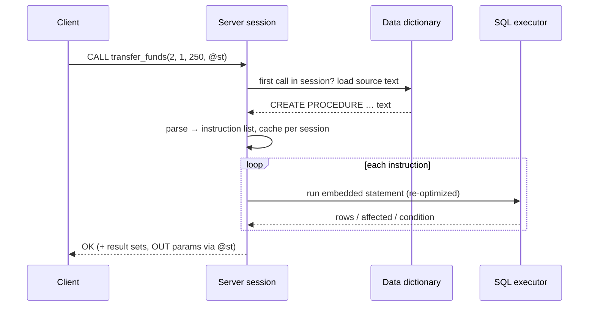

## Introduction

A **stored procedure** is a named program, written in SQL plus procedural statements, that is stored in the database and executed by the server with `CALL`. Where a view packages one query, a procedure packages a whole *unit of work*: "transfer 250.00 from account 2 to account 1" means checking both accounts, locking them, updating two balances and writing two ledger rows — all or nothing.

Procedures answer questions that plain SQL statements cannot answer on their own:

- **How do I run several statements as one server-side operation** with one network round trip, instead of five?
- **How do I make decisions** (if the account is frozen, reject; otherwise …) and **repeat work** (loop until a target is reached) inside the database?
- **How do I give an application a narrow, privileged API** — `CALL transfer_funds(…)` — instead of `UPDATE` rights on the `accounts` table?

This lesson covers the language: `CREATE PROCEDURE`, parameters, `BEGIN … END` blocks, `IF`, `CASE`, `LOOP`, `WHILE`, `REPEAT`, `LEAVE`, `ITERATE` and `CALL`, and how a procedure manages a transaction. Error handling (`DECLARE … HANDLER`, `SIGNAL`, `GET DIAGNOSTICS`) and cursors get their own lesson next ([Error Handling and Cursors](/lessons/m09-error-handling-cursors)); this lesson uses one standard handler pattern and explains it just enough to be safe. Whether business logic *should* live in procedures is the subject of [Database Logic vs Application Logic](/lessons/m09-db-vs-app-logic).

:::note[Dataset and sandbox]
The examples use the **bank** dataset: 15 customers, 25 accounts (account 7 is frozen, account 12 closed) and a 166-row transaction ledger. In the lab you can create procedures without `DELIMITER` — the sandbox's statement splitter understands `BEGIN … END` — but `DELIMITER //` also works, so scripts copied from the `mysql` client run unchanged. When a `CALL` returns several result sets, the lab displays the first one.
:::

## DBMS Theory

:::theory[Stored procedures and SQL/PSM]
The SQL standard defines stored routines in **SQL/PSM** (*Persistent Stored Modules*, ISO/IEC 9075-4, first published 1996). PSM adds to SQL:

- **Routines** — *procedures* (invoked by `CALL`, may have `IN`, `OUT` and `INOUT` parameters, return no value) and *functions* (invoked inside expressions, return one value — next-but-one lesson);
- **Compound statements** — `BEGIN … END` blocks with local declarations;
- **Control flow** — `IF`, `CASE`, `LOOP`, `WHILE`, `REPEAT`, `LEAVE`, `ITERATE`;
- **Condition handling** — `DECLARE … HANDLER`, `SIGNAL`, `RESIGNAL`;
- **Cursors** for row-by-row processing.

MySQL's stored-program language is modelled closely on SQL/PSM; Db2's SQL PL is another close implementation. Oracle's PL/SQL, PostgreSQL's PL/pgSQL and SQL Server's T-SQL solve the same problem with different syntax.
:::

Two theoretical points shape how procedures should be written:

1. **Procedural vs declarative.** A `SELECT` or `UPDATE` states *what* result is wanted, and the optimizer decides *how*. Procedural code states *how*, step by step, which takes those choices away from the optimizer. The professional rule is therefore: use procedural control flow to *orchestrate* set-based statements (validate, branch, then run one `UPDATE` on many rows) — not to replace them with row-at-a-time loops. The cursor lesson measures the difference.
2. **Procedures are not transactions.** A procedure is a *sequence of statements*. Whether those statements are atomic depends entirely on transaction control: under autocommit, every `UPDATE` inside a procedure commits on its own, and a failure halfway leaves the first half committed. Atomicity must be programmed explicitly with `START TRANSACTION … COMMIT` and a rollback path ([Transaction Lifecycle](/lessons/m08-transaction-lifecycle)).

| Term | Meaning |
|---|---|
| Routine | A procedure or function stored in the database |
| Compound statement | `BEGIN … END`, optionally labelled, containing declarations and statements |
| Parameter mode | `IN` (caller → routine, default), `OUT` (routine → caller), `INOUT` (both) |
| Label | A name on a block or loop (`body: BEGIN`), the target of `LEAVE` / `ITERATE` |
| Characteristic | Metadata such as `SQL SECURITY`, `COMMENT`, `READS SQL DATA` |
| Definer | The account whose privileges a `SQL SECURITY DEFINER` routine runs with |

## Why It Exists

Consider transferring money from an application without procedures. The client sends `START TRANSACTION`, a locking `SELECT` for each account, checks the results in application code, sends two `UPDATE`s, two `INSERT`s and `COMMIT`: at least seven round trips, with row locks held across all of them. If the application server is 2 ms from the database, the locks are held for 14 ms of pure network latency per transfer — under contention, that latency becomes queueing.

Stored procedures exist to:

- **Cut round trips** — the whole unit of work runs next to the data; the client sends one `CALL`. Locks are held only for server-side execution time.
- **Encapsulate rules in one place** — every client (web app, batch job, admin script) that calls `transfer_funds` gets the same validation and the same ledger format.
- **Narrow the privilege surface** — with `SQL SECURITY DEFINER`, an application account can be given `EXECUTE` on `transfer_funds` and *no* `UPDATE` privilege on `accounts` at all. It can only move money the way the procedure allows.
- **Support data-heavy operations** that are awkward to express in one statement — multi-step maintenance jobs, batched purges, data repair scripts.

The costs — harder testing, versioning and debugging, a second language for the team, and database CPU spent on logic — are real, and they are why many teams use procedures sparingly. The final lesson of this module weighs them.

## Internal Working

:::internals[How MySQL stores, compiles and runs a procedure]
**Storage.** `CREATE PROCEDURE` parses the body to check syntax, then stores the routine's **source text** and metadata (parameters, characteristics, definer, `sql_mode` at creation time, character sets) in the data dictionary. `information_schema.ROUTINES`, `information_schema.PARAMETERS` and `SHOW CREATE PROCEDURE` read it back. Objects referenced in the body are *not* resolved at creation time: a procedure that selects from a table that does not exist is created without complaint and fails only when called.

**Compilation and caching.** On the first `CALL` in a session, the server parses the stored text into an internal program (`sp_head`): a linear array of **instructions** — "execute this SQL statement", "evaluate this expression and store it in local slot 2", "jump to instruction 9 if false", "push handler". The compiled program is kept in a **per-session stored program cache** (size limited by `stored_program_cache`, default 256 routines). Other sessions compile their own copy; `ALTER`/`DROP` invalidates cached copies.

**Execution.** An interpreter steps through the instructions. Each embedded SQL statement is executed like a statement sent by a client — opened tables, optimized, executed — with local variables substituted as values. MySQL does **not** keep optimized plans across executions; each statement is re-optimized every time it runs, which is cheap for simple statements but means a procedure does not make a query faster than the same query sent by a client.

**Context.** The routine runs in the caller's session and transaction: it sees the caller's user variables, temporary tables, isolation level and `autocommit` setting. With `SQL SECURITY DEFINER` (the default), privilege checks inside it use the definer's account. The `sql_mode` stored with the routine replaces the caller's for the duration of the call.
:::



**OUT parameters travel through user variables.** `CALL p(@x)` binds the procedure's `OUT` parameter to the session variable `@x`; when the procedure returns, the parameter's final value is copied into `@x`. An `OUT` parameter starts as `NULL` inside the routine, regardless of what `@x` held. An `INOUT` parameter starts with the caller's value and copies the final value back.

## MySQL Implementation

The shape of a procedure:

```sql
CREATE [DEFINER = user] PROCEDURE [IF NOT EXISTS] name ([IN | OUT | INOUT] param type, ...)
  [COMMENT 'text']
  [LANGUAGE SQL]
  [[NOT] DETERMINISTIC]
  [CONTAINS SQL | NO SQL | READS SQL DATA | MODIFIES SQL DATA]
  [SQL SECURITY {DEFINER | INVOKER}]
routine_body;      -- one statement, usually BEGIN … END
```

A first procedure with an `IN` and two `OUT` parameters:

```sql run
CREATE PROCEDURE customer_position(
  IN  p_customer INT,
  OUT p_accounts INT,
  OUT p_total    DECIMAL(14,2))
  READS SQL DATA
  COMMENT 'Number of open accounts and their total balance for one customer'
BEGIN
  SELECT COUNT(*), COALESCE(SUM(balance), 0)
    INTO p_accounts, p_total
  FROM accounts
  WHERE customer_id = p_customer
    AND status <> 'closed';
END;

CALL customer_position(4, @n, @total);
SELECT @n AS accounts, @total AS total_balance;
```

Customer 4 has two accounts (one of them frozen but still open). A procedure may also return **result sets** directly — every `SELECT` without `INTO` inside it is sent to the client:

```sql run
CREATE PROCEDURE account_statement(IN p_account INT, IN p_limit INT)
  READS SQL DATA
BEGIN
  SELECT txn_id, txn_type, amount, balance_after, created_at
  FROM transactions
  WHERE account_id = p_account
  ORDER BY created_at DESC, txn_id DESC
  LIMIT p_limit;           -- a parameter is allowed in LIMIT inside a routine
END;

CALL account_statement(1, 5);
```

The data dictionary describes both routines:

```sql run
SELECT ROUTINE_NAME, ROUTINE_TYPE, SQL_DATA_ACCESS, SECURITY_TYPE, ROUTINE_COMMENT
FROM information_schema.ROUTINES
WHERE ROUTINE_SCHEMA = DATABASE()
ORDER BY ROUTINE_NAME;
```

```sql run
SELECT SPECIFIC_NAME, ORDINAL_POSITION, PARAMETER_MODE, PARAMETER_NAME, DTD_IDENTIFIER
FROM information_schema.PARAMETERS
WHERE SPECIFIC_SCHEMA = DATABASE() AND SPECIFIC_NAME = 'customer_position'
ORDER BY ORDINAL_POSITION;
```

:::note[DELIMITER in the mysql client]
The `mysql` command-line client splits input at `;`, which would cut a procedure body in half. Scripts therefore switch the client's delimiter: `DELIMITER //`, then `CREATE PROCEDURE … END//`, then `DELIMITER ;`. `DELIMITER` is a *client* command; the server never sees it. Connectors (JDBC, Python, Go) send one statement per call and need no delimiter change.
:::

## Syntax Breakdown

| Element | Meaning and MySQL specifics |
|---|---|
| `IN p type` | Default mode. A copy of the caller's value; assigning to it inside the routine does not affect the caller. |
| `OUT p type` | Starts NULL; its final value is copied into the caller's variable (`CALL p(@x)`). The argument must be a variable, not a literal. |
| `INOUT p type` | Starts with the caller's value; final value copied back. |
| `BEGIN … END` | Compound statement. Order inside: `DECLARE` variables and conditions, then cursors, then handlers, then statements. |
| `label: BEGIN … END label` | Labelled block — `LEAVE label` exits it (an early `RETURN` for procedures). |
| `IF c THEN … [ELSEIF c THEN …] [ELSE …] END IF` | Conditional statement (not to be confused with the `IF()` function). |
| `CASE v WHEN x THEN … [ELSE …] END CASE` | Simple CASE statement. **Without `ELSE`, no match raises error 1339.** |
| `CASE WHEN c THEN … END CASE` | Searched CASE statement. |
| `label: LOOP … END LOOP label` | Unconditional loop; must be exited with `LEAVE label`. |
| `WHILE c DO … END WHILE` | Test first; body may run zero times. |
| `REPEAT … UNTIL c END REPEAT` | Test last; body runs at least once. |
| `LEAVE label` | Exit the labelled block or loop (like `break`). |
| `ITERATE label` | Jump to the next iteration of the labelled loop (like `continue`). Only valid for loops. |
| `CALL p(args)` / `CALL p` | Execute. Parentheses optional with no arguments. |
| `SQL SECURITY DEFINER \| INVOKER` | Whose privileges apply inside (default `DEFINER`). |
| `CONTAINS SQL`, `NO SQL`, `READS SQL DATA`, `MODIFIES SQL DATA` | Advisory data-access characteristics (not enforced for procedures); default `CONTAINS SQL`. |
| `IF NOT EXISTS` | 8.0.29+: do nothing (note 1304) if the procedure exists. |
| `ALTER PROCEDURE p COMMENT … SQL SECURITY …` | Changes characteristics only — **not** the body or parameters. |
| `DROP PROCEDURE [IF EXISTS] p` | Remove. To change the body: drop and re-create (there is no `CREATE OR REPLACE PROCEDURE`). |

:::standard[Standard SQL vs MySQL]
Parameter modes, compound statements, `IF`, `CASE`, `LOOP`, `WHILE`, `REPEAT`, `LEAVE` and `ITERATE` follow SQL/PSM. MySQL extensions and limitations include: procedures returning result sets directly to the client (common across vendors but outside PSM), `DEFINER`, the `IF NOT EXISTS` clause, no `FOR` loop over a query (use a cursor), no arrays or record types, no overloading by parameter type (one routine per name), and no `CREATE OR REPLACE` for routines.
:::

## Practical Examples

**1. `IF … ELSEIF` and `INOUT`: a fee calculator.** `INOUT` lets a routine transform the caller's value in place:

```sql run
CREATE PROCEDURE apply_monthly_fee(INOUT p_balance DECIMAL(14,2), IN p_type VARCHAR(10))
  NO SQL
BEGIN
  IF p_type = 'savings' THEN
    SET p_balance = p_balance;                 -- savings accounts are free
  ELSEIF p_balance < 1000 THEN
    SET p_balance = p_balance - 5.00;          -- small checking balances pay a fee
  ELSE
    SET p_balance = p_balance - 1.00;
  END IF;
END;

SET @b1 = 492.57, @b2 = 15836.16, @b3 = 4428.20;
CALL apply_monthly_fee(@b1, 'checking');
CALL apply_monthly_fee(@b2, 'checking');
CALL apply_monthly_fee(@b3, 'savings');
SELECT @b1 AS small_checking, @b2 AS large_checking, @b3 AS savings;
```

**2. Searched `CASE`: classifying an account.** Note the `ELSE` branch — without it, an unmatched value is an error, not a no-op:

```sql run
CREATE PROCEDURE account_tier(IN p_account INT, OUT p_tier VARCHAR(12))
  READS SQL DATA
BEGIN
  DECLARE v_balance DECIMAL(14,2);
  DECLARE v_status  VARCHAR(10);
  SELECT balance, status INTO v_balance, v_status FROM accounts WHERE account_id = p_account;
  CASE
    WHEN v_status IS NULL       THEN SET p_tier = 'unknown';
    WHEN v_status <> 'active'   THEN SET p_tier = v_status;
    WHEN v_balance >= 10000     THEN SET p_tier = 'premium';
    WHEN v_balance >= 1000      THEN SET p_tier = 'standard';
    ELSE                             SET p_tier = 'basic';
  END CASE;
END;

CALL account_tier(6, @t6);
CALL account_tier(7, @t7);
CALL account_tier(1, @t1);
CALL account_tier(999, @t999);
SELECT @t6 AS acct6, @t7 AS acct7, @t1 AS acct1, @t999 AS acct999;
```

For account 999 the `SELECT … INTO` found no row, so `v_status` stayed NULL (with a "no data" warning) and the first branch caught it.

**3. `LOOP`, `LEAVE` and `ITERATE`: a savings projection.** How many months until a deposit reaches a target at a monthly interest rate, crediting interest only in months where the balance is at least 100?

```sql run
CREATE PROCEDURE months_to_target(
  IN  p_start  DECIMAL(14,2),
  IN  p_rate   DECIMAL(6,4),     -- monthly rate, e.g. 0.0100 = 1 %
  IN  p_target DECIMAL(14,2),
  OUT p_months INT)
  NO SQL
BEGIN
  DECLARE v_balance DECIMAL(14,2) DEFAULT p_start;
  SET p_months = 0;
  grow: LOOP
    IF v_balance >= p_target OR p_months >= 600 THEN
      LEAVE grow;                           -- exit the loop (with a safety cap)
    END IF;
    SET p_months = p_months + 1;
    IF v_balance < 100 THEN
      SET v_balance = v_balance + 10;       -- small balances: only the monthly top-up
      ITERATE grow;                         -- skip the interest step
    END IF;
    SET v_balance = ROUND(v_balance * (1 + p_rate), 2) + 10;
  END LOOP grow;
END;

CALL months_to_target(1000.00, 0.0100, 1500.00, @m1);
CALL months_to_target(50.00,   0.0100,  200.00, @m2);
SELECT @m1 AS months_from_1000, @m2 AS months_from_50;
```

The `p_months >= 600` cap is the habit that matters: an unbounded `LOOP` with a wrong exit condition runs until the statement timeout kills it.

**4. `WHILE` and `REPEAT`: generating rows.** A calendar table for a reporting month with `WHILE` (test first), and the same idea with `REPEAT` (test last):

```sql run
CREATE TABLE calendar_days (d DATE PRIMARY KEY, is_weekend BOOLEAN NOT NULL);

CREATE PROCEDURE fill_calendar(IN p_from DATE, IN p_to DATE)
  MODIFIES SQL DATA
BEGIN
  DECLARE v_d DATE DEFAULT p_from;
  WHILE v_d <= p_to DO
    INSERT INTO calendar_days VALUES (v_d, DAYOFWEEK(v_d) IN (1, 7));
    SET v_d = v_d + INTERVAL 1 DAY;
  END WHILE;
END;

CALL fill_calendar('2024-02-01', '2024-02-29');
SELECT COUNT(*) AS days, SUM(is_weekend) AS weekend_days, MIN(d) AS first_day, MAX(d) AS last_day
FROM calendar_days;
```

```sql run
CREATE PROCEDURE count_digits(IN p_n BIGINT, OUT p_digits INT)
  NO SQL
BEGIN
  SET p_digits = 0;
  REPEAT
    SET p_digits = p_digits + 1;
    SET p_n = p_n DIV 10;
  UNTIL p_n = 0 END REPEAT;               -- runs at least once, so 0 has one digit
END;

CALL count_digits(0, @d0);
CALL count_digits(15836, @d1);
SELECT @d0 AS digits_of_0, @d1 AS digits_of_15836;
```

`REPEAT` fits "do at least once" logic; with `WHILE p_n > 0` the number 0 would have reported zero digits.

**5. A transfer as one atomic unit of work.** This is the procedure the introduction promised. It validates input, locks both accounts in a fixed order, checks status and funds, then updates balances and writes the two ledger rows that the bank schema uses for transfers — inside one transaction with a rollback path.

```sql run
DELIMITER //
CREATE PROCEDURE transfer_funds(
  IN  p_from   INT UNSIGNED,
  IN  p_to     INT UNSIGNED,
  IN  p_amount DECIMAL(14,2),
  IN  p_ref    VARCHAR(40),
  OUT p_status VARCHAR(40))
  MODIFIES SQL DATA
body: BEGIN
  DECLARE v_from_balance DECIMAL(14,2);
  DECLARE v_from_status  VARCHAR(10);
  DECLARE v_to_status    VARCHAR(10);

  -- on any SQL error: undo everything this call did, then re-raise the error
  DECLARE EXIT HANDLER FOR SQLEXCEPTION
  BEGIN
    ROLLBACK;
    RESIGNAL;
  END;

  IF p_amount IS NULL OR p_amount <= 0 THEN
    SET p_status = 'rejected: amount must be positive';
    LEAVE body;
  END IF;
  IF p_from = p_to THEN
    SET p_status = 'rejected: same account';
    LEAVE body;
  END IF;

  START TRANSACTION;
  -- lock both rows in primary-key order so two opposite transfers cannot deadlock
  SELECT status INTO @ignore FROM accounts WHERE account_id = LEAST(p_from, p_to) FOR UPDATE;
  SELECT status INTO @ignore FROM accounts WHERE account_id = GREATEST(p_from, p_to) FOR UPDATE;

  SELECT balance, status INTO v_from_balance, v_from_status FROM accounts WHERE account_id = p_from;
  SELECT status INTO v_to_status FROM accounts WHERE account_id = p_to;

  CASE
    WHEN v_from_status IS NULL OR v_to_status IS NULL THEN
      SET p_status = 'rejected: unknown account';
    WHEN v_from_status <> 'active' OR v_to_status <> 'active' THEN
      SET p_status = 'rejected: account not active';
    WHEN v_from_balance < p_amount THEN
      SET p_status = 'rejected: insufficient funds';
    ELSE
      SET p_status = 'ok';
  END CASE;

  IF p_status <> 'ok' THEN
    ROLLBACK;                       -- release the locks; nothing was changed
    LEAVE body;
  END IF;

  UPDATE accounts SET balance = balance - p_amount, version = version + 1 WHERE account_id = p_from;
  UPDATE accounts SET balance = balance + p_amount, version = version + 1 WHERE account_id = p_to;
  INSERT INTO transactions (account_id, txn_type, amount, balance_after, reference, created_at)
    SELECT account_id, 'transfer_out', p_amount, balance, p_ref, NOW() FROM accounts WHERE account_id = p_from;
  INSERT INTO transactions (account_id, txn_type, amount, balance_after, reference, created_at)
    SELECT account_id, 'transfer_in',  p_amount, balance, p_ref, NOW() FROM accounts WHERE account_id = p_to;
  COMMIT;
END body//
DELIMITER ;
```

This block is written the way you would write it in a `mysql` client script, with `DELIMITER //`. For procedures that contain nested `BEGIN … END` blocks (such as the handler), that is also the most robust style in the lab.

Why each part is there:

- **Validation before `START TRANSACTION`** rejects bad input without taking any locks.
- **Locking in primary-key order** (`LEAST`, then `GREATEST`) means two concurrent transfers between the same two accounts in opposite directions request the locks in the same order and cannot deadlock ([Deadlocks](/lessons/m08-deadlocks)). After the locks are held, the plain `SELECT`s read the current, locked values.
- **`EXIT HANDLER FOR SQLEXCEPTION … ROLLBACK; RESIGNAL;`** — if any statement fails (for example the `CHECK (balance >= 0)` constraint, or a lock wait timeout), the handler rolls back the partial work and re-raises the original error to the caller, so the failure is neither half-applied nor silently swallowed. The next lesson explains handlers in depth.
- **Business rejections are not errors** here: they return a status and roll back. Whether to signal an error instead is a design decision discussed in the error-handling lesson.

## Execution Walkthrough

```walkthrough
title: CALL transfer_funds — success, business rejection, and the ledger
steps:
  - title: "1. State before"
    explain: Accounts 1 and 2 belong to customer 1. Account 7 is frozen. These are the balances the procedure will read.
    sql: SELECT account_id, balance, status, version FROM accounts WHERE account_id IN (1, 2, 7) ORDER BY account_id;
  - title: "2. A valid transfer of 250.00 from account 2 to account 1"
    explain: >-
      The procedure validates the input, starts a transaction, locks accounts 1 and 2 (lower id first), finds both
      active with enough funds, applies both updates, writes two ledger rows and commits. p_status reports 'ok'.
    sql: |
      CALL transfer_funds(2, 1, 250.00, 'TRF-DEMO-1', @status);
      SELECT @status AS status;
  - title: "3. Balances and versions after the commit"
    explain: Account 2 lost 250.00, account 1 gained it, and both version counters advanced — the optimistic-locking column other clients rely on.
    sql: SELECT account_id, balance, status, version FROM accounts WHERE account_id IN (1, 2) ORDER BY account_id;
  - title: "4. The two ledger rows share one reference"
    explain: The ledger now has a transfer_out/transfer_in pair, each carrying the balance after the change. (created_at is omitted because it is the current time.)
    sql: |
      SELECT account_id, txn_type, amount, balance_after, reference
      FROM transactions WHERE reference = 'TRF-DEMO-1' ORDER BY txn_type DESC;
  - title: "5. A rejected transfer to a frozen account"
    explain: >-
      This time the CASE finds account 7 frozen. The procedure rolls back (releasing the row locks it took),
      leaves the body, and reports the reason. No balance and no ledger row changed.
    sql: |
      CALL transfer_funds(1, 7, 100.00, 'TRF-DEMO-2', @status);
      SELECT @status AS status,
             (SELECT COUNT(*) FROM transactions WHERE reference = 'TRF-DEMO-2') AS ledger_rows,
             (SELECT balance FROM accounts WHERE account_id = 1) AS acct1_balance;
  - title: "6. Insufficient funds and invalid input"
    explain: The same status mechanism covers the other business rules. Neither call touches any row.
    sql: |
      CALL transfer_funds(1, 2, 100000.00, 'TRF-DEMO-3', @s1);
      CALL transfer_funds(1, 2, -5.00, 'TRF-DEMO-4', @s2);
      SELECT @s1 AS too_much, @s2 AS negative;
```

## Output

After the walkthrough, exactly one transfer has been applied: the ledger contains one `TRF-DEMO-1` pair, the balances of accounts 1 and 2 moved by 250.00 in opposite directions, and the three rejected calls left no trace except their status strings. A final reconciliation confirms the ledger invariant this dataset was built on — every account's balance equals the `balance_after` of its latest ledger row:

```sql run
SELECT COUNT(*) AS accounts_checked,
       SUM(a.balance = t.balance_after) AS balances_matching_ledger
FROM accounts a
JOIN transactions t
  ON t.txn_id = (SELECT MAX(t2.txn_id) FROM transactions t2 WHERE t2.account_id = a.account_id);
```

Reading the output: if any number of accounts did not match, the procedure would have broken the invariant (for example by updating a balance without writing a ledger row). Because both updates and both inserts are in one transaction, the invariant holds after every successful *and* every failed call.

## Alternative Approaches

The same unit of work can live in three places:

| Approach | Round trips per transfer | Where the rules live | Typical fit |
|---|---|---|---|
| Stored procedure `CALL transfer_funds(…)` | 1 | Database | Shared rules for many clients; strict privilege model; latency-sensitive locking |
| Application transaction (client sends each statement) | ~7 | Application code | Teams that test, version and deploy logic with the application; ORMs |
| Single set-based statement | 1 | One SQL statement | When the logic fits a single `UPDATE … JOIN` or `INSERT … SELECT` |

**Procedural loops vs set-based statements.** Much procedure code in the wild loops where one statement would do. The `fill_calendar` procedure is a fine teaching example, but the same rows can be produced with a single recursive CTE:

```sql run
CREATE TABLE calendar_days2 (d DATE PRIMARY KEY, is_weekend BOOLEAN NOT NULL);
INSERT INTO calendar_days2
WITH RECURSIVE days(d) AS (
  SELECT DATE '2024-02-01'
  UNION ALL
  SELECT d + INTERVAL 1 DAY FROM days WHERE d < '2024-02-29')
SELECT d, DAYOFWEEK(d) IN (1, 7) FROM days;
SELECT COUNT(*) AS days, SUM(is_weekend) AS weekend_days FROM calendar_days2;
```

Same 29 rows, one statement, one round trip of optimizer work instead of 29 `INSERT`s. Use procedures to orchestrate; let each statement inside work on sets ([Recursive CTEs](/lessons/m04-recursive-ctes)).

## Performance Analysis

A procedure's cost is the sum of its statements plus a small interpreter overhead per instruction. Two effects dominate in practice: **commit frequency** and **row-at-a-time work**. Measure them on a generated table. Each block below inserts 2,000 rows.

```sql run
CREATE TABLE perf_rows (n INT PRIMARY KEY, sq BIGINT NOT NULL);

CREATE PROCEDURE fill_rows(IN p_from INT, IN p_to INT)
  MODIFIES SQL DATA
BEGIN
  DECLARE i INT DEFAULT p_from;
  WHILE i <= p_to DO
    INSERT INTO perf_rows VALUES (i, i * i);
    SET i = i + 1;
  END WHILE;
END;
```

**(a) Loop under autocommit** — every `INSERT` inside the procedure is its own transaction and commits (with a redo-log flush and, on this server, a binary-log sync):

```sql run measured
CALL fill_rows(1, 2000);
```

**(b) The same loop inside one transaction** — one commit at the end:

```sql run measured
START TRANSACTION;
CALL fill_rows(2001, 4000);
COMMIT;
```

**(c) One set-based statement:**

```sql run measured
SET SESSION cte_max_recursion_depth = 10000;
INSERT INTO perf_rows
WITH RECURSIVE seq(n) AS (SELECT 4001 UNION ALL SELECT n + 1 FROM seq WHERE n < 6000)
SELECT n, n * n FROM seq;
```

```sql run
SELECT COUNT(*) AS rows_inserted FROM perf_rows;
```

:::performance[Reading the measurements]
These timings were measured on the build machine (with `innodb_flush_log_at_trx_commit = 1` and `sync_binlog = 1`, the durable defaults) — yours will differ, but the *ratios* are what matter. The autocommit loop pays for 2,000 durable commits; wrapping the same loop in one transaction removes almost all of that cost; the set-based statement additionally removes the per-row statement overhead. In the capture shown above, the autocommit loop took about 1.6 s, the same loop inside one transaction about 25 ms plus a 3 ms commit, and the set-based `INSERT … SELECT` about 11 ms — a factor of roughly 60 between the first two, caused purely by commit frequency. The lesson generalizes: **inside procedures, batch your commits deliberately, and prefer one statement over a loop** ([Transaction Logs](/lessons/m08-transaction-logs) explains the commit cost).
:::

Other performance facts worth knowing:

- **Round trips saved** are the main performance win of procedures; for chatty transactional logic over a network, this can matter more than any query tuning.
- **No plan caching**: statements inside procedures are optimized on every execution, exactly like client statements.
- **Per-session compilation**: the first `CALL` of a routine in each session parses it; with thousands of routines and short-lived connections, the per-session cache (`stored_program_cache`) and parse cost become visible.
- **Database CPU is the scarcest resource** in most architectures (application servers scale out easily; a primary database does not). Heavy computation in procedures spends that resource.

## Best Practices

:::best-practice[Writing procedures that survive production]
1. **Name parameters and locals distinctively** (`p_`, `v_`) so they never shadow columns ([Variables](/lessons/m09-variables)).
2. **Put transaction control in exactly one layer.** Either the procedure owns its transaction (`START TRANSACTION … COMMIT` plus an `EXIT HANDLER` that rolls back and `RESIGNAL`s), or the caller does — never both. Document which.
3. **Always pair `START TRANSACTION` with a rollback path**, and re-raise errors (`RESIGNAL`) rather than swallowing them.
4. **Lock in a consistent order** (by primary key) when a procedure locks several rows.
5. **Give every loop a guaranteed exit**, and an explicit `ELSE` to every `CASE` statement.
6. **Prefer set-based statements inside procedures**; loop only when each iteration genuinely depends on the previous one.
7. **Declare characteristics honestly** (`READS SQL DATA`, `MODIFIES SQL DATA`, `COMMENT`) — tools and humans read them.
8. **Keep routines in version control** and deploy them with `DROP PROCEDURE IF EXISTS` + `CREATE PROCEDURE` in migrations; use a least-privilege definer account.
:::

## Common Mistakes

**Mistake 1 — a `CASE` statement without `ELSE`.** In a `SELECT`, a `CASE` expression with no match yields NULL. A `CASE` *statement* with no match is an error:

```sql run
CREATE PROCEDURE describe_type(IN p_type VARCHAR(10), OUT p_label VARCHAR(20))
  NO SQL
BEGIN
  CASE p_type
    WHEN 'checking' THEN SET p_label = 'Current account';
    WHEN 'savings'  THEN SET p_label = 'Savings account';
  END CASE;
END;
```

```sql run error
CALL describe_type('brokerage', @label);
```

**Mistake 2 — starting a transaction inside a procedure that is called inside a transaction.** `START TRANSACTION` *implicitly commits* any transaction already open in the session. A caller that did `START TRANSACTION; UPDATE …; CALL transfer_funds(…); ROLLBACK;` expecting to undo everything will find its own `UPDATE` committed by the procedure's `START TRANSACTION`:

```sql run
CREATE TABLE notes (id INT PRIMARY KEY, txt VARCHAR(40));
START TRANSACTION;
INSERT INTO notes VALUES (1, 'caller work, meant to be rolled back');
CALL transfer_funds(2, 1, 10.00, 'TRF-NESTED', @s);
ROLLBACK;
SELECT (SELECT COUNT(*) FROM notes) AS caller_rows_still_there,
       (SELECT COUNT(*) FROM transactions WHERE reference = 'TRF-NESTED') AS transfer_rows;
```

The caller's `INSERT` survived its `ROLLBACK`, because the procedure committed it. MySQL has no nested transactions; use [Savepoints](/lessons/m08-savepoints) or a clear convention about who owns the transaction.

**Mistake 3 — recursion without raising the limit.** `max_sp_recursion_depth` is 0 by default, so a procedure that calls itself fails immediately:

```sql run
CREATE PROCEDURE countdown(IN p_n INT, INOUT p_trace VARCHAR(200))
  NO SQL
BEGIN
  SET p_trace = CONCAT(p_trace, p_n, ' ');
  IF p_n > 0 THEN
    CALL countdown(p_n - 1, p_trace);
  END IF;
END;
SET @trace = '';
```

```sql run error
CALL countdown(3, @trace);
```

```sql run
SET SESSION max_sp_recursion_depth = 10;
SET @trace = '';
CALL countdown(3, @trace);
SELECT @trace AS trace;
SET SESSION max_sp_recursion_depth = 0;
```

Recursion in procedures is rarely the right tool; recursive CTEs handle hierarchies set-based. (Stored *functions* cannot recurse at all.)

**Mistake 4 — expecting `ALTER PROCEDURE` to change the body.** It changes only characteristics such as `COMMENT` or `SQL SECURITY`. To change the code: `DROP PROCEDURE IF EXISTS p;` then `CREATE PROCEDURE p …` — and re-grant `EXECUTE` if you had granted it on the routine.

**Mistake 5 — passing a literal to an `OUT` parameter.** `CALL customer_position(4, 0, 0)` fails, because MySQL needs a variable to copy the result into:

```sql run error
CALL customer_position(4, 0, 0);
```

## Industry Application

- **Financial and ledger systems** commonly implement posting, transfer and settlement routines as stored procedures, so that every channel (online banking, branch systems, batch interest jobs) uses identical locking order and ledger formats, and application accounts hold only `EXECUTE` privileges.
- **Legacy enterprise applications** (often migrated from Oracle PL/SQL or SQL Server T-SQL) carry large procedure libraries; migrating them to MySQL means translating idioms — no packages, no `FOR` loops over queries, no `CREATE OR REPLACE`, different error handling.
- **Data maintenance jobs.** Batched purges (`DELETE … LIMIT 5000` in a loop with a commit per batch and a sleep between batches) are a classic procedure use: they keep each transaction small, limit replication lag and undo growth, and can be scheduled by an event or an external scheduler ([Events](/lessons/m09-events)).
- **Modern web stacks** (Rails, Django, Spring, Node ORMs) often avoid procedures for core logic, preferring application code that is unit-tested and deployed with the service; they still use procedures for a few performance- or integrity-critical operations. Knowing both styles — and the trade-offs measured above — is what lets you choose.
- **Managed services** (Amazon RDS/Aurora, Cloud SQL) support procedures fully, but definers must be ordinary accounts (no `SUPER`), which is one reason teams standardize on a dedicated routine-owner account.

## Practice Exercises

```exercise
id: ex1
title: Total balance of a customer
difficulty: easy
kind: dml
concepts: [stored-procedures, procedure-parameters]
prompt: |
  Create a procedure **`customer_total(IN p_customer INT, OUT p_total DECIMAL(14,2))`** that stores in `p_total` the
  sum of the balances of **all** accounts of the customer (any status). For a customer with no accounts it must
  return `0.00`, not NULL.

  The check query calls it for customers 1, 4 and 999 and reads the three results.
hints:
  - "SELECT SUM(balance) INTO p_total FROM accounts WHERE customer_id = p_customer;"
  - "SUM over zero rows is NULL — wrap it in COALESCE(…, 0)."
solution: |
  CREATE PROCEDURE customer_total(IN p_customer INT, OUT p_total DECIMAL(14,2))
    READS SQL DATA
  BEGIN
    SELECT COALESCE(SUM(balance), 0) INTO p_total
    FROM accounts
    WHERE customer_id = p_customer;
  END;
check: |
  CALL customer_total(1, @a);
  CALL customer_total(4, @b);
  CALL customer_total(999, @c);
  SELECT @a AS customer_1, @b AS customer_4, @c AS customer_999;
explanation: |
  `OUT` parameters reach the caller through the user variables passed to `CALL`. The `COALESCE` matters: an
  aggregate over no rows returns NULL, and a caller doing arithmetic with NULL gets NULL. `SELECT … INTO` with an
  aggregate always returns exactly one row, so there is no "no data" case here.
```

```exercise
id: ex2
title: Overdraft risk flag
difficulty: medium
kind: dml
concepts: [control-flow, stored-procedures]
prompt: |
  Create **`risk_flag(IN p_account INT, OUT p_flag VARCHAR(10))`** that sets `p_flag` to:

  - `'missing'` if the account does not exist,
  - `'inactive'` if its status is not `'active'`,
  - `'high'` if its balance is below 500,
  - `'medium'` if its balance is below 2000,
  - `'low'` otherwise.

  Use an `IF … ELSEIF` chain or a searched `CASE` statement. The check query calls it for accounts 1, 7, 10, 13, 6 and 999.
hints:
  - "Read balance and status INTO two local variables; if no row is found they stay NULL."
  - "Test the missing case first (status IS NULL), then status, then the balance thresholds from smallest up."
solution: |
  CREATE PROCEDURE risk_flag(IN p_account INT, OUT p_flag VARCHAR(10))
    READS SQL DATA
  BEGIN
    DECLARE v_balance DECIMAL(14,2);
    DECLARE v_status VARCHAR(10);
    SELECT balance, status INTO v_balance, v_status FROM accounts WHERE account_id = p_account;
    IF v_status IS NULL THEN SET p_flag = 'missing';
    ELSEIF v_status <> 'active' THEN SET p_flag = 'inactive';
    ELSEIF v_balance < 500 THEN SET p_flag = 'high';
    ELSEIF v_balance < 2000 THEN SET p_flag = 'medium';
    ELSE SET p_flag = 'low';
    END IF;
  END;
check: |
  CALL risk_flag(1, @f1);
  CALL risk_flag(7, @f7);
  CALL risk_flag(10, @f10);
  CALL risk_flag(13, @f13);
  CALL risk_flag(6, @f6);
  CALL risk_flag(999, @f999);
  SELECT @f1, @f7, @f10, @f13, @f6, @f999;
explanation: |
  Order matters: the status test must come before the balance tests (a frozen account with a small balance is
  'inactive', not 'high'), and the missing-row case must come first because NULL comparisons are never true.
  If you use a `CASE` statement, include an `ELSE` — without one, any value that matches no branch raises
  error 1339 instead of falling through.
```

```exercise
id: ex3
title: Months until a savings goal
difficulty: medium
kind: dml
concepts: [control-flow, compound-statements]
prompt: |
  Create **`savings_months(IN p_start DECIMAL(14,2), IN p_deposit DECIMAL(14,2), IN p_goal DECIMAL(14,2), OUT p_months INT)`**.
  Each month the customer adds `p_deposit` to the balance. Return the number of months until the balance is
  **at least** `p_goal` (0 if it already is). If `p_deposit <= 0` and the goal is not yet reached, return `-1`
  (the goal is unreachable) instead of looping forever.

  The check calls it with (1000, 250, 2000), (500, 100, 400), (100, 0, 200) and (0, 300, 1000).
hints:
  - "Handle the unreachable case with an IF before the loop."
  - "A WHILE v_balance < p_goal DO … END WHILE loop increments a counter and the balance."
solution: |
  CREATE PROCEDURE savings_months(IN p_start DECIMAL(14,2), IN p_deposit DECIMAL(14,2),
                                  IN p_goal DECIMAL(14,2), OUT p_months INT)
    NO SQL
  BEGIN
    DECLARE v_balance DECIMAL(14,2) DEFAULT p_start;
    SET p_months = 0;
    IF v_balance < p_goal AND p_deposit <= 0 THEN
      SET p_months = -1;
    ELSE
      WHILE v_balance < p_goal DO
        SET v_balance = v_balance + p_deposit;
        SET p_months = p_months + 1;
      END WHILE;
    END IF;
  END;
check: |
  CALL savings_months(1000, 250, 2000, @a);
  CALL savings_months(500, 100, 400, @b);
  CALL savings_months(100, 0, 200, @c);
  CALL savings_months(0, 300, 1000, @d);
  SELECT @a AS m1, @b AS m2, @c AS m3, @d AS m4;
explanation: |
  `WHILE` tests before the first iteration, so a start balance already at the goal returns 0 naturally. The
  guard for a non-positive deposit is what keeps the loop finite; in production every loop needs such an exit
  (or a maximum iteration count). A closed-form answer also exists — `CEILING((p_goal - p_start) / p_deposit)` —
  which is a reminder that many loops can be replaced by arithmetic or a set-based statement.
```

```exercise
id: ex4
title: A safe deposit procedure
difficulty: hard
kind: dml
concepts: [transactions-in-procedures, stored-procedures, control-flow]
prompt: |
  Create **`deposit_funds(IN p_account INT, IN p_amount DECIMAL(14,2), IN p_ref VARCHAR(40), OUT p_status VARCHAR(30))`** that:

  1. sets `p_status = 'rejected: amount'` and changes nothing if `p_amount` is NULL or not positive;
  2. otherwise, in **one transaction**, locks the account row, and sets `p_status = 'rejected: account'` (rolling back)
     if the account does not exist or is not `'active'`;
  3. otherwise adds the amount to `balance`, increments `version`, inserts a ledger row into `transactions`
     (`txn_type = 'deposit'`, the amount, the new balance as `balance_after`, `p_ref`, `NOW()`), commits and sets
     `p_status = 'ok'`.

  Include an `EXIT HANDLER FOR SQLEXCEPTION` that rolls back and re-raises. The check makes four calls
  (valid deposit to account 1, deposit to frozen account 7, a negative amount, a deposit to account 99) and reads
  the statuses, account 1's balance and version, and the number of ledger rows per reference.
hints:
  - "Structure: label the body (body: BEGIN … END body), validate, START TRANSACTION, SELECT status INTO v_status … FOR UPDATE."
  - "After the UPDATE, INSERT INTO transactions (…) SELECT account_id, 'deposit', p_amount, balance, p_ref, NOW() FROM accounts WHERE account_id = p_account;"
  - "Remember ROLLBACK before LEAVE in the rejected-account branch, otherwise the row lock stays held."
  - "Write it inside DELIMITER // … // (as in the transfer_funds example) — the most robust way to submit a procedure with a nested handler block."
solution: |
  DELIMITER //
  CREATE PROCEDURE deposit_funds(IN p_account INT, IN p_amount DECIMAL(14,2),
                                 IN p_ref VARCHAR(40), OUT p_status VARCHAR(30))
    MODIFIES SQL DATA
  body: BEGIN
    DECLARE v_status VARCHAR(10);
    DECLARE EXIT HANDLER FOR SQLEXCEPTION
    BEGIN
      ROLLBACK;
      RESIGNAL;
    END;
    IF p_amount IS NULL OR p_amount <= 0 THEN
      SET p_status = 'rejected: amount';
      LEAVE body;
    END IF;
    START TRANSACTION;
    SELECT status INTO v_status FROM accounts WHERE account_id = p_account FOR UPDATE;
    IF v_status IS NULL OR v_status <> 'active' THEN
      ROLLBACK;
      SET p_status = 'rejected: account';
      LEAVE body;
    END IF;
    UPDATE accounts SET balance = balance + p_amount, version = version + 1 WHERE account_id = p_account;
    INSERT INTO transactions (account_id, txn_type, amount, balance_after, reference, created_at)
      SELECT account_id, 'deposit', p_amount, balance, p_ref, NOW() FROM accounts WHERE account_id = p_account;
    COMMIT;
    SET p_status = 'ok';
  END body//
  DELIMITER ;
check: |
  CALL deposit_funds(1, 100.00, 'DEP-A', @s1);
  CALL deposit_funds(7, 50.00, 'DEP-B', @s2);
  CALL deposit_funds(1, -5.00, 'DEP-C', @s3);
  CALL deposit_funds(99, 10.00, 'DEP-D', @s4);
  SELECT @s1, @s2, @s3, @s4,
         (SELECT balance FROM accounts WHERE account_id = 1) AS acct1_balance,
         (SELECT version FROM accounts WHERE account_id = 1) AS acct1_version,
         (SELECT COUNT(*) FROM transactions WHERE reference = 'DEP-A') AS dep_a_rows,
         (SELECT COUNT(*) FROM transactions WHERE reference IN ('DEP-B', 'DEP-C', 'DEP-D')) AS rejected_rows;
explanation: |
  The account check happens *after* taking the row lock, so no concurrent transaction can freeze or close the
  account between the check and the update. Every exit path ends the transaction: the success path commits, the
  rejection path rolls back before `LEAVE`, and the handler rolls back on errors and re-raises them so the caller
  still sees the failure. Writing `balance_after` from the row after the `UPDATE` (rather than computing
  `old balance + amount` in a variable read before locking) keeps the ledger consistent with the account.
```

```exercise
id: ex5
title: Who owns the transaction?
difficulty: challenge
kind: open
concepts: [transactions-in-procedures, stored-procedures]
prompt: |
  Your team has 40 procedures. Some start and commit their own transactions; others assume the caller has one
  open. A new batch job calls `transfer_funds` (which starts its own transaction) in a loop inside a single
  `START TRANSACTION … COMMIT`, intending to roll everything back if any transfer fails. In testing, a failure
  in the 30th transfer leaves the first 29 committed.

  1. Explain exactly why.
  2. Propose a team-wide convention for transaction ownership in stored procedures, including how a procedure
     can be used both standalone and as part of a larger unit of work.
  3. Name one technique to *detect* violations of your convention automatically.
solution: |
  1. MySQL has no nested transactions. Each `START TRANSACTION` inside `transfer_funds` implicitly commits the
  transaction that is currently open — so the first call committed nothing of its own yet but ended the batch's
  transaction, and every call's own `COMMIT` made its transfer durable. When the 30th call failed, its handler
  rolled back only the 30th transfer; the batch's final `ROLLBACK` had nothing left to undo.

  2. A common convention: **leaf procedures never control transactions**; they assume a transaction is open,
  do their work, and signal errors. **Entry-point procedures** (one per use case, named e.g. `api_transfer`)
  own the transaction: `START TRANSACTION`, call leaf procedures, `COMMIT`, with an `EXIT HANDLER` that rolls
  back and `RESIGNAL`s. A batch then calls the leaf procedures inside its own transaction. If a procedure must
  work both ways, it can check `@@in_transaction` (1 if a transaction is open): start and commit its own only when
  `@@in_transaction = 0`, otherwise use a `SAVEPOINT` and `ROLLBACK TO SAVEPOINT` on failure so the caller can
  decide.

  3. Detection: a CI check that greps routine bodies (`information_schema.ROUTINES.ROUTINE_DEFINITION`) for
  `START TRANSACTION`/`COMMIT` outside procedures with the entry-point prefix; and integration tests that call
  each procedure inside an open transaction, roll back, and assert that nothing persisted.
```

## Knowledge Assessment

```quiz
- id: q1
  question: "A procedure is declared `p(IN a INT, OUT b INT, INOUT c INT)`. Before `CALL p(@a, @b, @c)`, all three variables are 5. Inside, the body only runs `SET b = b + 1; SET c = c + 1; SET a = a + 1;`. What are @a, @b, @c afterwards?"
  options: ["6, 6, 6", "5, NULL, 6", "5, 6, 6", "6, NULL, 6"]
  answer: 1
  explanation: "IN parameters are copies — changing a does not affect @a (still 5). OUT parameters start as NULL inside the routine, so b + 1 is NULL and NULL is copied to @b. INOUT starts with the caller's 5 and returns 6."
  concepts: [procedure-parameters]
- id: q2
  question: "Which loop construct always executes its body at least once?"
  options: ["WHILE … DO … END WHILE", "REPEAT … UNTIL … END REPEAT", "LOOP … END LOOP with LEAVE at the top", "ITERATE"]
  answer: 1
  explanation: "REPEAT tests its condition after the body. WHILE tests first and may run zero times; a LOOP with LEAVE at the top also may exit before doing work; ITERATE is not a loop but a 'continue' statement."
  concepts: [control-flow]
- id: q3
  question: "A CASE statement inside a procedure has WHEN branches for 'checking' and 'savings' and no ELSE. What happens when it is reached with 'brokerage'?"
  options:
    - "Nothing; execution continues after END CASE"
    - "The CASE evaluates to NULL"
    - "Error 1339: Case not found for CASE statement"
    - "The first branch is executed"
  answer: 2
  explanation: "Unlike the CASE expression used in queries (which yields NULL), the CASE statement requires a matching branch; add ELSE (even ELSE BEGIN END) to make 'no match' a no-op."
  concepts: [control-flow]
- id: q4
  question: "Inside a session with autocommit = 1, a procedure without START TRANSACTION executes two UPDATEs; the second fails. What is the state afterwards?"
  options:
    - "Both updates are rolled back because the procedure is atomic"
    - "The first update is committed; the second is rolled back"
    - "Both updates are pending until COMMIT"
    - "The session is disconnected"
  answer: 1
  explanation: "A procedure is not a transaction. Under autocommit each statement inside it commits on its own, so the first UPDATE is durable and only the failing statement is undone. Atomicity requires explicit START TRANSACTION … COMMIT with a rollback path."
  concepts: [transactions-in-procedures]
- id: q5
  question: "Which statements about how MySQL executes stored procedures are true? (Select all that apply.)"
  type: multi
  options:
    - "The routine is parsed on first use in a session and cached per session"
    - "Optimized execution plans of the statements inside are stored and reused across calls"
    - "Tables referenced in the body must exist when CREATE PROCEDURE runs"
    - "The routine runs in the caller's session and transaction"
  answer: [0, 3]
  explanation: "The compiled instruction list lives in a per-session cache, and the routine shares the caller's session state and transaction. MySQL does not cache optimized plans (each statement is re-optimized), and referenced objects are only resolved at execution time."
  concepts: [stored-procedures]
- id: q6
  question: "Why does `transfer_funds` lock `LEAST(p_from, p_to)` before `GREATEST(p_from, p_to)`?"
  options:
    - "Because InnoDB can only lock rows in ascending order"
    - "So that concurrent transfers in opposite directions request locks in the same order and cannot deadlock each other"
    - "To make the procedure deterministic for the binary log"
    - "Because FOR UPDATE ignores the second row otherwise"
  answer: 1
  explanation: "A deadlock needs a cycle of waits; a global lock order makes the cycle impossible between these two accounts. InnoDB can lock in any order, and the binary log is unrelated."
  concepts: [transactions-in-procedures]
- id: q7
  question: "A caller runs `START TRANSACTION; INSERT …; CALL proc_that_starts_its_own_transaction(); ROLLBACK;`. What happens to the caller's INSERT?"
  options:
    - "It is rolled back by the final ROLLBACK"
    - "It is committed by the procedure's START TRANSACTION (implicit commit)"
    - "It becomes part of a nested transaction"
    - "The CALL fails with an error"
  answer: 1
  explanation: "MySQL has no nested transactions; START TRANSACTION implicitly commits an open transaction. The lesson's Common Mistakes block shows the caller's row surviving its ROLLBACK."
  concepts: [transactions-in-procedures]
- id: q8
  question: "You need to change the body of an existing procedure in MySQL 8.4. What do you run?"
  options:
    - "ALTER PROCEDURE p AS BEGIN … END"
    - "CREATE OR REPLACE PROCEDURE p …"
    - "DROP PROCEDURE IF EXISTS p; CREATE PROCEDURE p …"
    - "UPDATE information_schema.ROUTINES SET ROUTINE_DEFINITION = …"
  answer: 2
  explanation: "ALTER PROCEDURE changes only characteristics, MySQL has no CREATE OR REPLACE for routines, and information_schema is read-only. Remember to re-grant EXECUTE if it was granted on the routine."
  concepts: [stored-procedures]
```
