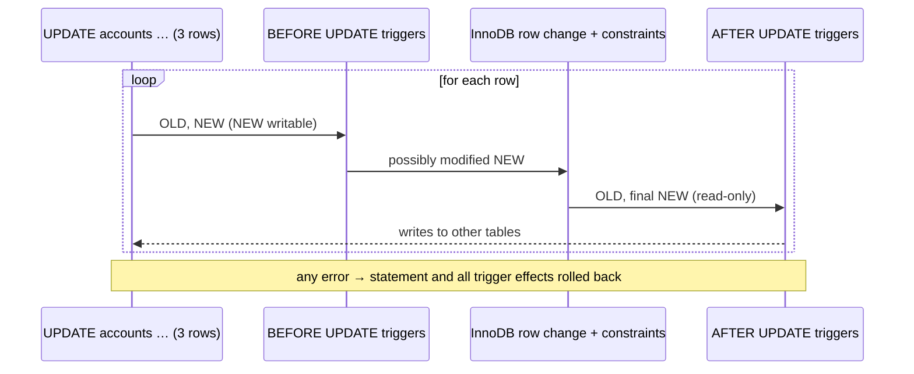

## Introduction

A **trigger** is a stored program attached to a table that MySQL runs **automatically** whenever a row of that table is inserted, updated or deleted. Nobody calls it: an application sends an ordinary `UPDATE accounts SET balance = …`, and the trigger runs in the same statement, for every affected row, whether the application knows it exists or not.

That property is both the point and the danger. Triggers answer questions such as:

- **How can every change to an account balance be recorded in an audit table**, no matter which application, script or administrator made it?
- **How can a rule be enforced that a `CHECK` constraint cannot express**, such as "no ledger rows may be written for a frozen account" (which needs to look at another table)?
- **How can derived data be kept consistent** — a summary table, a denormalized total, a `version` counter — without every writer remembering to update it?

And they raise the questions this lesson also answers: in which order do several triggers run, what can a trigger *not* do (error 1442), how much does a trigger cost per row, and why do experienced teams treat triggers as "hidden logic" that must be documented and tested?

You need stored-program basics ([Stored Procedures](/lessons/m09-stored-procedures)) and `SIGNAL` ([Error Handling and Cursors](/lessons/m09-error-handling-cursors)).

:::note[Dataset]
The examples use the **bank** dataset: accounts (balance with `CHECK (balance >= 0)`, statuses active/frozen/closed, a `version` column) and an append-only `transactions` ledger. Outputs are captured from a real MySQL server.
:::

## DBMS Theory

:::theory[Triggers as event–condition–action rules]
In database theory, triggers are an instance of **active database** rules, described by the **ECA** model: an *event* (an insert, update or delete on a table), an optional *condition* (a predicate on the data), and an *action* (statements to execute). SQL:1999 standardized triggers with:

- **Timing**: `BEFORE` (runs before the change is applied — can inspect and modify the new row or veto the change) or `AFTER` (runs after the change — sees the final row, typically writes elsewhere). Standard SQL also has `INSTEAD OF` triggers for views.
- **Granularity**: `FOR EACH ROW` (once per affected row) or `FOR EACH STATEMENT` (once per statement, regardless of row count).
- **Transition variables / tables**: the old and new versions of the row (`OLD`, `NEW`) — or, for statement triggers, the whole set of old and new rows (`OLD TABLE`, `NEW TABLE`).
:::

MySQL implements a subset:

| Feature | SQL standard | MySQL |
|---|---|---|
| `BEFORE` / `AFTER` | yes | yes |
| `INSTEAD OF` (on views) | yes | **no** |
| `FOR EACH ROW` | yes | yes — the only granularity |
| `FOR EACH STATEMENT` | yes | **no** |
| `OLD` / `NEW` row variables | yes | yes (`OLD` read-only; `NEW` writable in `BEFORE`) |
| `WHEN (condition)` clause | yes | **no** — use `IF` inside the body |
| Several triggers per event | yes | yes (since 5.7.2), ordered by creation or `FOLLOWS`/`PRECEDES` |

A useful formal distinction is between **integrity enforcement** (a trigger vetoes a change that would violate a rule) and **derived-data maintenance** (a trigger propagates a change to dependent data: audit rows, totals, caches). Declarative constraints — keys, foreign keys, `CHECK` — should always be preferred for the first category when they can express the rule, because the DBMS understands them (the optimizer can use them, tools can display them, they cannot be bypassed by trigger ordering). Triggers fill the gap where declarative constraints cannot reach.

## Why It Exists

Some guarantees cannot be left to application code:

- **Completeness of audit trails.** If the audit row is written by the application, any other writer — a batch job, a migration script, an engineer fixing data by hand at 2 a.m. — bypasses it. A trigger records *every* change made through SQL.
- **Cross-table rules.** A `CHECK` constraint can only look at the row being written. "A withdrawal may not be written for an account that is not active" needs the `accounts` row; a `BEFORE INSERT` trigger on `transactions` can look it up and `SIGNAL` an error.
- **Derived data that must never drift.** A per-branch total maintained by triggers is updated in the same transaction as the account change, so it is never out of step (at the cost of a write hotspot — see *Performance Analysis*).
- **Legacy systems** where the applications cannot be changed, but new behaviour (logging, replication to a new table during a migration) must be added.

The price is that behaviour moves out of sight. An `UPDATE` that touches one row may write five more rows in three tables, take additional locks, and fail with an error raised by code the developer has never read.

## Internal Working

:::internals[When and how a MySQL trigger fires]
Triggers are stored in the data dictionary with their table, event, timing, action order, body text, definer and `sql_mode`. When a statement opens a table that has triggers, MySQL loads them (compiling the body on first use, like other stored programs), and the storage-engine row loop executes them around each row change:

1. For each row the statement wants to change, MySQL builds the **NEW** row image (for `INSERT`/`UPDATE`) and has the **OLD** row image (for `UPDATE`/`DELETE`).
2. **BEFORE triggers** run in action order. They may read `OLD`, read **and assign** `NEW.col` (changing what will be written), or raise an error to abort.
3. The row change is applied to the table — including constraint checks (`NOT NULL`, `CHECK`, unique and foreign keys).
4. **AFTER triggers** run in action order. They may read `OLD` and `NEW` (read-only) and modify *other* tables.
5. An error at any point aborts the statement. On a transactional engine (InnoDB), the whole statement — the rows already changed *and* everything their triggers wrote — is rolled back; the transaction itself stays open.

Triggers run with the **definer's privileges** (always — there is no `SQL SECURITY INVOKER` for triggers) inside the session and transaction of the statement that fired them.
:::



**What fires and what does not.** Triggers fire for SQL statements that insert, update or delete rows: `INSERT`, `INSERT … SELECT`, `LOAD DATA`, `REPLACE` (a replace of an existing row fires the delete *and* insert triggers), `INSERT … ON DUPLICATE KEY UPDATE` (the `BEFORE INSERT` trigger, then update triggers for duplicates), `UPDATE` and `DELETE`, including multi-table forms. They do **not** fire for `TRUNCATE TABLE`, `DROP TABLE`, or rows changed by **foreign-key cascades** (`ON DELETE CASCADE` changes in the child table run no child triggers) — a frequently forgotten gap in audit designs.

**Replication.** With row-based binary logging (the default), the replica applies the row changes *as logged*, including the rows that triggers wrote on the source; the replica does not run the triggers again. With statement-based logging the replica re-executes the statement and its triggers.

## MySQL Implementation

```sql
CREATE [DEFINER = user] TRIGGER [IF NOT EXISTS] trigger_name
  { BEFORE | AFTER } { INSERT | UPDATE | DELETE }
  ON table_name FOR EACH ROW
  [{ FOLLOWS | PRECEDES } other_trigger_name]
trigger_body;     -- one statement, or BEGIN … END
```

**An audit trail.** First the audit table, then an `AFTER UPDATE` trigger that records balance and status changes on `accounts`:

```sql run
CREATE TABLE account_audit (
  audit_id    BIGINT AUTO_INCREMENT PRIMARY KEY,
  account_id  INT UNSIGNED NOT NULL,
  action      ENUM('insert', 'update', 'delete') NOT NULL,
  old_balance DECIMAL(14,2),
  new_balance DECIMAL(14,2),
  old_status  VARCHAR(10),
  new_status  VARCHAR(10),
  changed_by  VARCHAR(288) NOT NULL,
  changed_at  DATETIME(6) NOT NULL
);

CREATE TRIGGER trg_accounts_audit_upd
AFTER UPDATE ON accounts
FOR EACH ROW
BEGIN
  IF NOT (OLD.balance <=> NEW.balance) OR NOT (OLD.status <=> NEW.status) THEN
    INSERT INTO account_audit (account_id, action, old_balance, new_balance, old_status, new_status,
                               changed_by, changed_at)
    VALUES (NEW.account_id, 'update', OLD.balance, NEW.balance, OLD.status, NEW.status,
            USER(), NOW(6));
  END IF;
END;
```

`<=>` is the NULL-safe equality operator, so the comparison also works for nullable columns. `USER()` records the *connecting* client account; `CURRENT_USER()` inside a trigger would return the trigger's **definer**, which is useless for auditing.

Now any `UPDATE`, from anyone, is audited:

```sql run
UPDATE accounts SET balance = balance - 100.00 WHERE account_id = 2;
UPDATE accounts SET status = 'frozen' WHERE account_id = 20;
UPDATE accounts SET opened_at = opened_at WHERE account_id = 3;   -- no balance/status change: not audited

SELECT audit_id, account_id, action, old_balance, new_balance, old_status, new_status
FROM account_audit ORDER BY audit_id;
```

Two audit rows: the third `UPDATE` changed neither balance nor status, so the `IF` skipped it. The same table can record inserts and deletes with two more triggers:

```sql run
CREATE TRIGGER trg_accounts_audit_ins
AFTER INSERT ON accounts
FOR EACH ROW
  INSERT INTO account_audit (account_id, action, new_balance, new_status, changed_by, changed_at)
  VALUES (NEW.account_id, 'insert', NEW.balance, NEW.status, USER(), NOW(6));

CREATE TRIGGER trg_accounts_audit_del
AFTER DELETE ON accounts
FOR EACH ROW
  INSERT INTO account_audit (account_id, action, old_balance, old_status, changed_by, changed_at)
  VALUES (OLD.account_id, 'delete', OLD.balance, OLD.status, USER(), NOW(6));

INSERT INTO accounts (account_id, customer_id, branch_id, account_type, balance, status, opened_at)
VALUES (26, 1, 1, 'savings', 50.00, 'active', '2024-06-01 10:00:00');
DELETE FROM accounts WHERE account_id = 26;

SELECT audit_id, account_id, action, old_balance, new_balance, old_status, new_status
FROM account_audit ORDER BY audit_id;
```

Account 26 had no ledger rows, so the `DELETE` was allowed by the foreign key; both events are in the audit trail. Triggers are listed in the data dictionary:

```sql run
SELECT TRIGGER_NAME, ACTION_TIMING, EVENT_MANIPULATION, EVENT_OBJECT_TABLE, ACTION_ORDER
FROM information_schema.TRIGGERS
WHERE TRIGGER_SCHEMA = DATABASE()
ORDER BY EVENT_OBJECT_TABLE, EVENT_MANIPULATION, ACTION_ORDER;
```

## Syntax Breakdown

| Element | Meaning and MySQL specifics |
|---|---|
| `BEFORE` | Runs before the row is written and before constraint checks. Can modify `NEW.col` and veto with `SIGNAL`. |
| `AFTER` | Runs after the row is written. Sees final values; `NEW` and `OLD` are read-only. Typically writes to other tables. |
| `INSERT` / `UPDATE` / `DELETE` | The row event (not the statement verb: `LOAD DATA` fires `INSERT` triggers, `REPLACE` can fire `DELETE` + `INSERT`). |
| `FOR EACH ROW` | Mandatory; MySQL has only row-level triggers. |
| `NEW.col` | The new row: available in `INSERT` and `UPDATE` triggers. In `BEFORE` triggers you may `SET NEW.col = …`. In a `BEFORE INSERT` trigger, an `AUTO_INCREMENT` column in `NEW` is 0 (not yet generated). |
| `OLD.col` | The old row: available in `UPDATE` and `DELETE` triggers; always read-only. |
| `FOLLOWS t` / `PRECEDES t` | Place the new trigger immediately after / before existing trigger `t` with the same timing and event. Default: after all existing ones. |
| `IF NOT EXISTS` | 8.0.29+: no error if a trigger with that name exists on the table. |
| `DROP TRIGGER [IF EXISTS] name` | Remove. There is no `ALTER TRIGGER` — drop and re-create (briefly leaving the table without the trigger unless done under a table lock). |
| `SHOW TRIGGERS [LIKE 'table']`, `information_schema.TRIGGERS`, `SHOW CREATE TRIGGER` | Inspect triggers. |
| Privileges | `TRIGGER` on the table to create/drop; the body runs with the definer's privileges. |
| Forbidden in triggers | `COMMIT`/`ROLLBACK`/`START TRANSACTION`, statements returning result sets, `PREPARE`/`EXECUTE`, modifying the trigger's own table (error 1442), calling procedures that do any of these. |

:::standard[Standard SQL vs MySQL]
MySQL lacks statement-level triggers, transition tables, `INSTEAD OF` triggers and the `WHEN` clause. The `FOLLOWS`/`PRECEDES` clauses are MySQL extensions (the standard orders triggers by creation time). PostgreSQL implements statement-level triggers with transition tables, which makes set-based auditing far cheaper than MySQL's row-by-row model; SQL Server has only statement-level (`AFTER`/`INSTEAD OF`) triggers with `inserted`/`deleted` pseudo-tables.
:::

## Practical Examples

**1. Validation that needs another table.** No ledger row may be written for an account that is not active. A `CHECK` constraint on `transactions` cannot see `accounts.status`, but a `BEFORE INSERT` trigger can:

```sql run
CREATE TRIGGER trg_txn_account_active
BEFORE INSERT ON transactions
FOR EACH ROW
BEGIN
  DECLARE v_status VARCHAR(10);
  SELECT status INTO v_status FROM accounts WHERE account_id = NEW.account_id;
  IF v_status IS NULL OR v_status <> 'active' THEN
    SIGNAL SQLSTATE '45000'
      SET MESSAGE_TEXT = 'Ledger rows can only be written for active accounts', MYSQL_ERRNO = 5101;
  END IF;
END;
```

```sql run error
INSERT INTO transactions (account_id, txn_type, amount, balance_after, reference, created_at)
VALUES (7, 'deposit', 10.00, 2744.51, 'TRG-DEMO', '2024-06-01 10:00:00');
```

```sql run
INSERT INTO transactions (account_id, txn_type, amount, balance_after, reference, created_at)
VALUES (5, 'fee', 1.00, 6997.91, 'TRG-DEMO', '2024-06-01 10:00:00');
SELECT COUNT(*) AS demo_rows FROM transactions WHERE reference = 'TRG-DEMO';
```

The insert for frozen account 7 was rejected with the custom error; the insert for active account 5 went through. Whoever writes to `transactions` — procedure, application, ad-hoc script — gets the same rule.

**2. A `BEFORE` trigger that modifies `NEW`.** Normalize data on the way in and maintain the optimistic-locking `version` column automatically, so no writer can forget it:

```sql run
CREATE TRIGGER trg_accounts_version
BEFORE UPDATE ON accounts
FOR EACH ROW
SET NEW.version = OLD.version + 1;

CREATE TRIGGER trg_customers_email_ins
BEFORE INSERT ON customers
FOR EACH ROW
SET NEW.email = LOWER(TRIM(NEW.email));

UPDATE accounts SET balance = balance + 5.00 WHERE account_id = 4;
INSERT INTO customers (customer_id, full_name, email, date_of_birth, kyc_verified)
VALUES (16, 'Test Person', '  Test.Person@Example.COM ', '1990-01-01', 1);

SELECT (SELECT version FROM accounts WHERE account_id = 4) AS acct4_version,
       (SELECT email FROM customers WHERE customer_id = 16) AS stored_email;
```

Assigning `NEW.version` in a `BEFORE` trigger changes the row being written — it is not a second `UPDATE` of the table.

**3. Ordering several triggers.** `accounts` now has one `BEFORE UPDATE` trigger (version) and one `AFTER UPDATE` trigger (audit). Add a second `BEFORE UPDATE` trigger that must run **before** the version trigger — it refuses balance changes on closed accounts, and should do so before any other `BEFORE` logic runs:

```sql run
CREATE TRIGGER trg_accounts_closed_guard
BEFORE UPDATE ON accounts
FOR EACH ROW
PRECEDES trg_accounts_version
BEGIN
  IF OLD.status = 'closed' AND NOT (OLD.balance <=> NEW.balance) THEN
    SIGNAL SQLSTATE '45000' SET MESSAGE_TEXT = 'Closed accounts cannot change balance', MYSQL_ERRNO = 5102;
  END IF;
END;

SELECT TRIGGER_NAME, ACTION_TIMING, EVENT_MANIPULATION, ACTION_ORDER
FROM information_schema.TRIGGERS
WHERE TRIGGER_SCHEMA = DATABASE() AND EVENT_OBJECT_TABLE = 'accounts'
ORDER BY ACTION_TIMING, EVENT_MANIPULATION, ACTION_ORDER;
```

```sql run error
UPDATE accounts SET balance = 10.00 WHERE account_id = 12;
```

`ACTION_ORDER` shows the guard as 1 and the version trigger as 2 for `BEFORE UPDATE`. Without `PRECEDES`, a new trigger is appended after existing ones.

**4. Statement atomicity includes the triggers.** When any trigger fails, the whole statement is undone — including rows already changed and audit rows already written for them. Update three accounts, one of which is closed:

```sql run
SELECT COUNT(*) AS audit_rows_before FROM account_audit;
```

```sql run error
UPDATE accounts SET balance = balance + 1.00 WHERE account_id IN (10, 11, 12) ORDER BY account_id;
```

```sql run
SELECT COUNT(*) AS audit_rows_after,
       (SELECT balance FROM accounts WHERE account_id = 10) AS acct10_balance,
       (SELECT version FROM accounts WHERE account_id = 10) AS acct10_version
FROM account_audit;
```

Accounts 10 and 11 had already been updated (and audited) when the guard rejected account 12; InnoDB rolled back the entire statement, so the audit count, account 10's balance and its version are unchanged.

## Execution Walkthrough

Trace one `UPDATE` through all the triggers now defined on `accounts`, and see exactly what each one contributed.

```walkthrough
title: UPDATE accounts SET balance = balance + 25.00 WHERE account_id = 8
steps:
  - title: "1. The row before the statement"
    explain: OLD will be this row image.
    sql: SELECT account_id, balance, status, version FROM accounts WHERE account_id = 8;
  - title: "2. BEFORE UPDATE triggers, in ACTION_ORDER"
    explain: >-
      trg_accounts_closed_guard runs first (account 8 is active, so it does nothing), then trg_accounts_version
      sets NEW.version = OLD.version + 1. NEW.balance is OLD.balance + 25.00 as computed by the UPDATE.
    sql: |
      SELECT TRIGGER_NAME, ACTION_ORDER FROM information_schema.TRIGGERS
      WHERE TRIGGER_SCHEMA = DATABASE() AND EVENT_OBJECT_TABLE = 'accounts'
        AND ACTION_TIMING = 'BEFORE' AND EVENT_MANIPULATION = 'UPDATE'
      ORDER BY ACTION_ORDER;
  - title: "3. Row change, CHECK constraint, AFTER UPDATE trigger"
    explain: >-
      InnoDB writes NEW (CHECK balance >= 0 passes). Then trg_accounts_audit_upd sees OLD.balance ≠ NEW.balance and
      writes an audit row. All of this happens inside the single UPDATE statement.
    sql: UPDATE accounts SET balance = balance + 25.00 WHERE account_id = 8;
  - title: "4. The result: the row and its audit entry"
    explain: The balance moved by 25.00, version advanced by one without the UPDATE mentioning it, and the audit trail holds the old and new balance.
    sql: |
      SELECT a.account_id, a.balance, a.version, au.old_balance, au.new_balance
      FROM accounts a
      JOIN account_audit au ON au.account_id = a.account_id
      WHERE a.account_id = 8
      ORDER BY au.audit_id DESC
      LIMIT 1;
```

## Output

The walkthrough's final row shows the visible effect of a statement that never mentioned `version` or `account_audit`: account 8's balance rose by 25.00, its `version` rose by one (trigger `trg_accounts_version`), and an audit row with the old and new balance exists (trigger `trg_accounts_audit_upd`). The guard trigger ran too but did nothing, because the account is active. A developer looking only at the application code would see a one-line `UPDATE`; the database executed three triggers and wrote to two tables. That is precisely why triggers must be documented and discoverable (`information_schema.TRIGGERS`).

## Alternative Approaches

| Goal | Trigger | Alternatives | When to prefer the alternative |
|---|---|---|---|
| Single-row rule (`balance >= 0`) | `BEFORE` + `SIGNAL` | `CHECK` constraint | Always, when a `CHECK` can express it |
| Referential rule | `BEFORE` + lookup | `FOREIGN KEY` | Always, when an FK can express it |
| Cross-table rule (`account must be active`) | `BEFORE INSERT` + lookup | Procedure-only write path; application validation | When all writes go through one API you control |
| Audit trail | `AFTER` triggers | Application logging; binary-log CDC (Debezium, Maxwell) | High write volume, or when the "who" must be the application user, not the DB account |
| Derived totals | `AFTER` triggers | Periodic recomputation (event/job); computing at read time | When write contention on the total row would hurt |
| `version` column | `BEFORE UPDATE` | Application sets `version = version + 1` | When every writer uses the same data-access layer |

**Change data capture instead of audit triggers.** At scale, many companies audit by reading the **binary log** (which already contains every row change, before and after images with `binlog_row_image = FULL`) with a CDC tool and shipping the events to Kafka or a warehouse. This costs nothing in the write transaction, captures cascaded FK changes and `TRUNCATE`-free deletes alike, and keeps audit storage off the OLTP database. The trade-off is eventual consistency and operational complexity ([Binary Log](/lessons/m10-binary-log)).

**Declarative first.** The `CHECK (balance >= 0)` constraint already in this schema is better than any trigger for that rule: it is visible in `SHOW CREATE TABLE`, cannot be reordered, and is understood by tools.

## Performance Analysis

A row-level trigger multiplies work: for each affected row it executes its body — typically one or more additional statements. Measure it with a 50,000-row bulk insert into two identical tables, one with an audit trigger:

```sql run
CREATE TABLE ledger_plain (
  id INT PRIMARY KEY, account_id INT NOT NULL, amount DECIMAL(14,2) NOT NULL
);
CREATE TABLE ledger_audited LIKE ledger_plain;
CREATE TABLE ledger_audit_log (
  log_id BIGINT AUTO_INCREMENT PRIMARY KEY, id INT NOT NULL, amount DECIMAL(14,2) NOT NULL, logged_at DATETIME(6) NOT NULL
);
CREATE TRIGGER trg_ledger_audited_ins
AFTER INSERT ON ledger_audited
FOR EACH ROW
  INSERT INTO ledger_audit_log (id, amount, logged_at) VALUES (NEW.id, NEW.amount, NOW(6));
SET SESSION cte_max_recursion_depth = 100000;
```

**(a) Without trigger:**

```sql run measured
INSERT INTO ledger_plain
WITH RECURSIVE s(n) AS (SELECT 1 UNION ALL SELECT n + 1 FROM s WHERE n < 50000)
SELECT n, 1 + n % 25, (n % 1000) + 0.99 FROM s;
```

**(b) With the `AFTER INSERT` audit trigger:**

```sql run measured
INSERT INTO ledger_audited
WITH RECURSIVE s(n) AS (SELECT 1 UNION ALL SELECT n + 1 FROM s WHERE n < 50000)
SELECT n, 1 + n % 25, (n % 1000) + 0.99 FROM s;
```

```sql run
SELECT (SELECT COUNT(*) FROM ledger_plain) AS plain_rows,
       (SELECT COUNT(*) FROM ledger_audited) AS audited_rows,
       (SELECT COUNT(*) FROM ledger_audit_log) AS audit_log_rows;
```

:::performance[Reading the measurements]
Timings were measured on the build machine; yours will differ. Both statements inserted 50,000 rows into the target table; the second also executed the trigger body 50,000 times, writing 50,000 audit rows — one extra single-row `INSERT` (with its own index maintenance and undo/redo) per row. Across repeated captures the plain insert took roughly 175–215 ms and the triggered one roughly 685–720 ms — three to four times as long, because it does roughly twice the row writes plus per-row trigger-invocation overhead. Because MySQL has no statement-level triggers, there is no way to batch this work inside the trigger.
:::

Other cost factors:

- **Locks and hotspots.** A trigger that maintains a per-branch total runs `UPDATE branch_totals … WHERE branch_id = ?` for every changed account. All concurrent transactions touching accounts of the same branch now serialize on that one row lock — a throughput ceiling invisible in the application code ([Locking](/lessons/m08-locking)).
- **Lookups in `BEFORE` triggers** (like `trg_txn_account_active`) add a primary-key read per inserted row; cheap with an index, disastrous without one.
- **Trigger cascades.** A trigger on table A that writes table B fires B's triggers, which may write C… Each level multiplies the per-row work and the lock footprint.

## Best Practices

:::best-practice[Responsible use of triggers]
1. **Prefer declarative constraints** (`NOT NULL`, `CHECK`, `UNIQUE`, `FOREIGN KEY`, generated columns). Use triggers only where those cannot express the rule.
2. **Keep trigger bodies short, fast and side-effect-limited**: validate, set `NEW` columns, write one audit row. No business workflows, no calls to external systems, no long loops.
3. **Make triggers discoverable**: a naming convention (`trg_<table>_<purpose>`), comments in the migration that creates them, and a CI check that lists `information_schema.TRIGGERS` and fails on undocumented ones.
4. **Use `BEFORE` triggers to change the row (`SET NEW.col`) — never `UPDATE` the same table** (error 1442).
5. **Record `USER()` (the connecting account) in audit rows**, and pass the *application* user explicitly (e.g. an `updated_by` column set by the app) if you need it — the database account is often a shared service account.
6. **Remember the gaps**: foreign-key cascades and `TRUNCATE` do not fire triggers; plan audits accordingly.
7. **Order multiple triggers explicitly** with `FOLLOWS`/`PRECEDES` when their order matters, and test the combined behaviour.
8. **Deploy triggers atomically with the code that depends on them**, and remember that drop-and-recreate briefly leaves the table unguarded.
:::

## Common Mistakes

**Mistake 1 — updating the trigger's own table (error 1442).** A natural but wrong way to maintain `version`: an `AFTER UPDATE` trigger that issues another `UPDATE` on `accounts`. MySQL lets you *create* it, then refuses when it fires, because the statement that invoked the trigger is already modifying that table:

```sql run
CREATE TABLE notes_demo (id INT PRIMARY KEY, body VARCHAR(50), edits INT NOT NULL DEFAULT 0);
INSERT INTO notes_demo VALUES (1, 'first', 0);

CREATE TRIGGER trg_notes_count_edits
AFTER UPDATE ON notes_demo
FOR EACH ROW
  UPDATE notes_demo SET edits = edits + 1 WHERE id = NEW.id;
```

```sql run error
UPDATE notes_demo SET body = 'second' WHERE id = 1;
```

The fix is a `BEFORE UPDATE` trigger that assigns `NEW.edits = OLD.edits + 1`, as `trg_accounts_version` does.

**Mistake 2 — assigning to `NEW` in an `AFTER` trigger.** The row is already written; MySQL rejects the trigger at creation time:

```sql run error
CREATE TRIGGER trg_bad_after
AFTER INSERT ON branches
FOR EACH ROW
SET NEW.city = UPPER(NEW.city);
```

**Mistake 3 — using `OLD` in an `INSERT` trigger** (there is no old row; error 1363) or `NEW` in a `DELETE` trigger:

```sql run error
CREATE TRIGGER trg_bad_old
BEFORE INSERT ON branches
FOR EACH ROW
SET @x = OLD.city;
```

**Mistake 4 — trusting triggers to see cascaded changes.** If `transactions` had `ON DELETE CASCADE` from `accounts`, deleting an account would silently delete its ledger rows **without firing any trigger on `transactions`**. An audit design based on triggers on the child table would have a hole exactly where it matters most.

**Mistake 5 — expecting a trigger to fire once per statement.** `UPDATE accounts SET … WHERE branch_id = 1` fires the trigger once per affected row. Code written as if `NEW` held "the statement's data" — or that sends one notification per trigger execution — scales with rows, not with statements.

**Mistake 6 — forgetting the trigger exists.** A data-repair script disables nothing (MySQL has no `DISABLE TRIGGER`), runs `UPDATE accounts SET balance = …` on 100,000 rows, and writes 100,000 audit rows plus 100,000 version increments that nobody intended. Check `SHOW TRIGGERS LIKE 'accounts'` before bulk changes.

## Industry Application

- **Compliance audit trails.** Banks, healthcare and SaaS companies under SOX, HIPAA or SOC 2 often keep trigger-based audit tables for critical entities (accounts, permissions, prices), because they capture changes made by *any* path, including manual fixes. High-volume systems move the same requirement to binary-log CDC.
- **Online schema change tools.** `pt-online-schema-change` (Percona Toolkit) works by creating a shadow table and **triggers** on the original table that copy every `INSERT`/`UPDATE`/`DELETE` to the shadow table while rows are back-filled; `gh-ost` (GitHub) instead reads the binary log precisely to avoid trigger overhead and locking. Knowing why the two tools differ is a classic interview topic ([Schema Evolution](/lessons/m12-schema-evolution)).
- **Denormalized counters and search tables.** E-commerce systems maintain `product.review_count` or a search-index staging table with triggers; at scale these are usually replaced by asynchronous updates because of the hotspot problem.
- **Data-quality guards** in shared databases where several teams write the same tables: a `BEFORE` trigger is the last line of defence that every writer passes through.
- **The "hidden logic" cost.** Engineering teams frequently report incidents where nobody knew a trigger existed — a migration doubled write latency, a bulk fix exploded the audit table. Mature teams therefore list triggers in architecture documentation and in code review checklists, and many simply ban them for business logic ([Database Logic vs Application Logic](/lessons/m09-db-vs-app-logic)).

## Practice Exercises

```exercise
id: ex1
title: Normalize e-mail addresses
difficulty: easy
kind: dml
concepts: [triggers, new-old-rows]
prompt: |
  Create a trigger **`trg_customers_email_norm`** that, whenever a customer row is **inserted**, stores the e-mail
  address trimmed and in lower case.

  The check inserts two customers with messy e-mail addresses and reads them back.
hints:
  - "Use a BEFORE INSERT trigger so you can change the row before it is written."
  - "SET NEW.email = LOWER(TRIM(NEW.email));"
solution: |
  CREATE TRIGGER trg_customers_email_norm
  BEFORE INSERT ON customers
  FOR EACH ROW
  SET NEW.email = LOWER(TRIM(NEW.email));
check: |
  INSERT INTO customers (customer_id, full_name, email, date_of_birth, kyc_verified)
  VALUES (101, 'A B', '  Alice.B@Example.com', '1991-02-03', 1),
         (102, 'C D', 'CARL@EXAMPLE.ORG  ', '1985-07-08', 0);
  SELECT customer_id, email FROM customers WHERE customer_id IN (101, 102) ORDER BY customer_id;
explanation: |
  Only a `BEFORE` trigger can change `NEW`; an `AFTER` trigger is rejected (error 1362), and an `AFTER` trigger that
  ran `UPDATE customers …` would fail with error 1442. Note that the unique key on `email` is checked *after* the
  `BEFORE` trigger, so two addresses differing only in case now collide — usually what you want. A complete
  solution also adds a `BEFORE UPDATE` trigger, or a generated column, so updates are normalized too.
```

```exercise
id: ex2
title: Status-change history
difficulty: medium
kind: dml
concepts: [audit-trail, new-old-rows, triggers]
setup: |
  CREATE TABLE status_history (
    id INT AUTO_INCREMENT PRIMARY KEY,
    account_id INT UNSIGNED NOT NULL,
    old_status VARCHAR(10) NOT NULL,
    new_status VARCHAR(10) NOT NULL
  );
prompt: |
  The setup created `status_history(id, account_id, old_status, new_status)`. Create a trigger
  **`trg_accounts_status_history`** that inserts one row into it **only when an account's status actually changes**
  (balance-only updates, or updates that set the same status, must not be recorded).

  The check runs several updates and reads the history (without `id`).
hints:
  - "AFTER UPDATE ON accounts FOR EACH ROW"
  - "IF NOT (OLD.status <=> NEW.status) THEN INSERT … VALUES (NEW.account_id, OLD.status, NEW.status); END IF;"
solution: |
  CREATE TRIGGER trg_accounts_status_history
  AFTER UPDATE ON accounts
  FOR EACH ROW
  BEGIN
    IF NOT (OLD.status <=> NEW.status) THEN
      INSERT INTO status_history (account_id, old_status, new_status)
      VALUES (NEW.account_id, OLD.status, NEW.status);
    END IF;
  END;
check: |
  UPDATE accounts SET status = 'active' WHERE account_id = 7;
  UPDATE accounts SET balance = balance + 1 WHERE account_id = 1;
  UPDATE accounts SET status = 'active' WHERE account_id = 2;
  UPDATE accounts SET status = 'frozen' WHERE account_id IN (3, 7);
  SELECT account_id, old_status, new_status FROM status_history ORDER BY id;
explanation: |
  The comparison must be done per row inside the trigger: the statement `SET status = 'active' WHERE
  account_id = 2` matches a row but does not change it, and the multi-row update fires the trigger twice. Using
  `<=>` makes the comparison NULL-safe (not needed for this NOT NULL column, but a good habit). An `AFTER` trigger
  is the right timing because the history should only record changes that were actually written.
```

```exercise
id: ex3
title: Reject oversized withdrawals
difficulty: medium
kind: dml
concepts: [trigger-validation, triggers]
prompt: |
  Create a trigger **`trg_txn_withdrawal_limit`** that rejects any **insert** into `transactions` with
  `txn_type = 'withdrawal'` and `amount > 5000`, raising `SQLSTATE '45000'` with
  `MESSAGE_TEXT = 'Withdrawal limit exceeded'`. Other rows must be unaffected.

  The check uses a harness procedure that captures the error of an oversized withdrawal, then inserts a valid
  withdrawal, and reports the captured message and the number of rows written.
hints:
  - "BEFORE INSERT ON transactions FOR EACH ROW"
  - "IF NEW.txn_type = 'withdrawal' AND NEW.amount > 5000 THEN SIGNAL SQLSTATE '45000' SET MESSAGE_TEXT = '…'; END IF;"
solution: |
  CREATE TRIGGER trg_txn_withdrawal_limit
  BEFORE INSERT ON transactions
  FOR EACH ROW
  BEGIN
    IF NEW.txn_type = 'withdrawal' AND NEW.amount > 5000 THEN
      SIGNAL SQLSTATE '45000' SET MESSAGE_TEXT = 'Withdrawal limit exceeded';
    END IF;
  END;
check: |
  CREATE PROCEDURE harness_ex3()
  BEGIN
    DECLARE CONTINUE HANDLER FOR SQLEXCEPTION
      GET DIAGNOSTICS CONDITION 1 @msg = MESSAGE_TEXT;
    SET @msg = NULL;
    INSERT INTO transactions (account_id, txn_type, amount, balance_after, reference, created_at)
    VALUES (6, 'withdrawal', 6000.00, 9836.16, 'LIMIT-TEST', '2024-06-01 09:00:00');
  END;
  CALL harness_ex3();
  INSERT INTO transactions (account_id, txn_type, amount, balance_after, reference, created_at)
  VALUES (6, 'withdrawal', 100.00, 15736.16, 'LIMIT-TEST', '2024-06-01 09:05:00'),
         (6, 'deposit', 9000.00, 24736.16, 'LIMIT-TEST', '2024-06-01 09:10:00');
  SELECT @msg AS captured_message,
         (SELECT COUNT(*) FROM transactions WHERE reference = 'LIMIT-TEST') AS rows_written;
explanation: |
  A `BEFORE INSERT` trigger can veto the row before it is written; the error aborts the statement and rolls back
  any rows that the same statement had already inserted. Large deposits pass because the condition checks the
  type. A `CHECK` constraint could express this particular rule (`CHECK (txn_type <> 'withdrawal' OR amount <=
  5000)`) and would be the better choice in production — triggers are needed only when the rule must read other
  rows or tables.
```

```exercise
id: ex4
title: Keep branch totals in sync
difficulty: hard
kind: dml
concepts: [triggers, new-old-rows, audit-trail]
setup: |
  CREATE TABLE branch_totals (branch_id SMALLINT UNSIGNED PRIMARY KEY, total_balance DECIMAL(16,2) NOT NULL);
  INSERT INTO branch_totals SELECT branch_id, SUM(balance) FROM accounts GROUP BY branch_id;
prompt: |
  The setup created `branch_totals(branch_id, total_balance)` filled with the current sum of balances per branch.
  Create triggers on `accounts` that keep it correct for **inserts, deletes and updates** — including updates that
  move an account to a different branch. Name them `trg_bt_ins`, `trg_bt_del` and `trg_bt_upd`.

  The check inserts an account, changes balances, moves an account between branches, deletes the new account,
  and then compares `branch_totals` with a fresh `SUM` per branch.
hints:
  - "Use AFTER triggers: they see the final NEW values."
  - "Insert: add NEW.balance to NEW.branch_id. Delete: subtract OLD.balance from OLD.branch_id."
  - "Update: subtract OLD.balance from OLD.branch_id, then add NEW.balance to NEW.branch_id — this handles branch moves and balance changes alike."
solution: |
  CREATE TRIGGER trg_bt_ins AFTER INSERT ON accounts FOR EACH ROW
    UPDATE branch_totals SET total_balance = total_balance + NEW.balance WHERE branch_id = NEW.branch_id;
  CREATE TRIGGER trg_bt_del AFTER DELETE ON accounts FOR EACH ROW
    UPDATE branch_totals SET total_balance = total_balance - OLD.balance WHERE branch_id = OLD.branch_id;
  CREATE TRIGGER trg_bt_upd AFTER UPDATE ON accounts FOR EACH ROW
  BEGIN
    UPDATE branch_totals SET total_balance = total_balance - OLD.balance WHERE branch_id = OLD.branch_id;
    UPDATE branch_totals SET total_balance = total_balance + NEW.balance WHERE branch_id = NEW.branch_id;
  END;
check: |
  INSERT INTO accounts (account_id, customer_id, branch_id, account_type, balance, status, opened_at)
  VALUES (30, 2, 3, 'savings', 1000.00, 'active', '2024-07-01 12:00:00');
  UPDATE accounts SET balance = balance + 250.00 WHERE account_id IN (1, 5);
  UPDATE accounts SET branch_id = 3 WHERE account_id = 6;
  UPDATE accounts SET branch_id = 1, balance = balance - 100.00 WHERE account_id = 30;
  DELETE FROM accounts WHERE account_id = 30;
  SELECT bt.branch_id, bt.total_balance, s.actual
  FROM branch_totals bt
  JOIN (SELECT branch_id, SUM(balance) AS actual FROM accounts GROUP BY branch_id) s
    ON s.branch_id = bt.branch_id
  ORDER BY bt.branch_id;
explanation: |
  Treating every update as "remove the old contribution, add the new one" covers balance changes, branch moves
  and both at once without special cases. The triggers update a *different* table, so error 1442 does not apply.
  In production this design has a cost: every account change now locks the branch's single total row, so all
  concurrent writers for the same branch serialize on it — acceptable for three branches with light traffic, a
  bottleneck for a busy system, where periodic recomputation or sharded counters are used instead.
```

```exercise
id: ex5
title: Maintain a version column without error 1442
difficulty: medium
kind: dml
concepts: [triggers, new-old-rows, hidden-logic]
setup: |
  CREATE TABLE documents (doc_id INT PRIMARY KEY, title VARCHAR(80) NOT NULL, revision INT NOT NULL DEFAULT 1);
  INSERT INTO documents VALUES (1, 'Policy', 1), (2, 'Handbook', 3);
prompt: |
  A colleague tried to bump `documents.revision` on every update with

  ~~~sql
  CREATE TRIGGER trg_documents_revision AFTER UPDATE ON documents FOR EACH ROW
    UPDATE documents SET revision = revision + 1 WHERE doc_id = NEW.doc_id;
  ~~~

  and every update now fails with error 1442. Create a working trigger **`trg_documents_revision`** that increases
  `revision` by exactly 1 for each updated row. The check updates both documents (one of them twice).
hints:
  - "A trigger may not modify the table whose change fired it — but a BEFORE trigger may change the row being written."
  - "BEFORE UPDATE … SET NEW.revision = OLD.revision + 1;"
solution: |
  CREATE TRIGGER trg_documents_revision
  BEFORE UPDATE ON documents
  FOR EACH ROW
  SET NEW.revision = OLD.revision + 1;
check: |
  UPDATE documents SET title = 'Policy v2' WHERE doc_id = 1;
  UPDATE documents SET title = CONCAT(title, '!') WHERE doc_id IN (1, 2);
  SELECT doc_id, title, revision FROM documents ORDER BY doc_id;
explanation: |
  Assigning `NEW.revision` in a `BEFORE` trigger changes the values of the row that the `UPDATE` is about to write;
  it is not a second statement against `documents`, so error 1442 does not arise and there is no recursion.
  `OLD.revision + 1` (not `NEW.revision + 1`) makes the result independent of what the `UPDATE` itself set.
```

```exercise
id: ex6
title: Should this be a trigger?
difficulty: challenge
kind: open
concepts: [hidden-logic, audit-trail, trigger-validation]
prompt: |
  For each requirement, decide whether you would implement it as a trigger, a declarative constraint, or
  outside the database, and justify the choice in two or three sentences:

  1. Every change to `accounts.balance` must be auditable for seven years, including manual fixes by DBAs.
  2. `transactions.amount` must be positive.
  3. When a customer's KYC status changes, an e-mail must be sent to the compliance team.
  4. `customers.email` must be unique, case-insensitively.
  5. A cached `orders_count` on the customer row must equal the number of their orders.
solution: |
  1. **Trigger (or CDC).** Only something inside the database sees DBA fixes; an `AFTER UPDATE` trigger writing an
     append-only audit table in the same transaction gives completeness. At high volume, binary-log CDC into an
     immutable store is the scalable alternative — it also captures cascaded and bulk changes without slowing writes.
  2. **Declarative constraint** — `CHECK (amount > 0)` (already in the schema). Visible, cheap, cannot be bypassed or
     reordered; a trigger would add nothing.
  3. **Outside the database.** Triggers cannot (and must not) call external systems, and would hold locks while
     doing so. Write an event row in the same transaction (outbox pattern), possibly via a trigger, and let an
     application worker send the e-mail asynchronously.
  4. **Declarative constraint** — a `UNIQUE` index; with the default case-insensitive `utf8mb4_0900_ai_ci`
     collation, `UNIQUE (email)` is already case-insensitive. A normalizing `BEFORE` trigger is optional cosmetics.
  5. **Usually not a trigger.** A trigger keeps it exact but makes every order insert lock the customer row
     (hotspot for large customers) and is hidden logic. Prefer computing it on read with an index on
     `orders(customer_id)`, or refreshing it asynchronously; use a trigger only if exactness under every write path is
     a hard requirement and contention is known to be low.
```

## Knowledge Assessment

```quiz
- id: q1
  question: "Which trigger timing lets you change the values that will be written for the row?"
  options: ["BEFORE INSERT / BEFORE UPDATE", "AFTER INSERT / AFTER UPDATE", "Both", "Neither; triggers cannot change rows"]
  answer: 0
  explanation: "Only BEFORE triggers may assign NEW.col; the row has not been written yet. In AFTER triggers NEW is read-only (error 1362 at creation)."
  concepts: [new-old-rows]
- id: q2
  question: "An `UPDATE accounts … WHERE branch_id = 1` changes 9 rows. How many times does an AFTER UPDATE trigger on accounts run in MySQL?"
  options: ["Once", "9 times", "Twice — before and after", "It depends on the binary log format"]
  answer: 1
  explanation: "MySQL supports only FOR EACH ROW triggers, so the body runs once per affected row. Statement-level triggers exist in the SQL standard (and PostgreSQL) but not in MySQL."
  concepts: [triggers]
- id: q3
  question: "An AFTER UPDATE trigger on `notes` runs `UPDATE notes SET edits = edits + 1 WHERE id = NEW.id`. What happens?"
  options:
    - "Infinite recursion until max_sp_recursion_depth"
    - "CREATE TRIGGER fails"
    - "The trigger is created, but every UPDATE of notes fails with error 1442"
    - "It works, but edits increases by 2"
  answer: 2
  explanation: "MySQL accepts the trigger but refuses, at execution time, to let a trigger modify the table that the invoking statement is using (error 1442). The fix is BEFORE UPDATE with SET NEW.edits = OLD.edits + 1."
  concepts: [triggers, hidden-logic]
- id: q4
  question: "Which operations do NOT fire DELETE triggers on the child table? (Select all that apply.)"
  type: multi
  options:
    - "DELETE FROM child WHERE …"
    - "TRUNCATE TABLE child"
    - "Rows removed by ON DELETE CASCADE when a parent row is deleted"
    - "REPLACE INTO child of a row whose key already exists"
  answer: [1, 2]
  explanation: "TRUNCATE and foreign-key cascades do not activate triggers. A plain DELETE does, and REPLACE of an existing row fires the delete and insert triggers."
  concepts: [triggers, audit-trail]
- id: q5
  question: "Three triggers exist for BEFORE UPDATE on accounts. In which order do they run?"
  options:
    - "Alphabetical by name"
    - "Random"
    - "By ACTION_ORDER: creation order unless FOLLOWS/PRECEDES placed a trigger elsewhere"
    - "Only the most recently created one runs"
  answer: 2
  explanation: "Since 5.7.2 MySQL allows several triggers per timing/event, ordered by ACTION_ORDER (visible in information_schema.TRIGGERS). New triggers are appended unless FOLLOWS or PRECEDES is used."
  concepts: [trigger-ordering]
- id: q6
  question: "A multi-row UPDATE has changed two rows (and their AFTER triggers wrote two audit rows) when a BEFORE trigger raises SIGNAL for the third row. With InnoDB, what remains?"
  options:
    - "Two updated rows and two audit rows"
    - "Two updated rows but no audit rows"
    - "Nothing from this statement: the row changes and the trigger writes are all rolled back"
    - "The whole transaction, including earlier statements, is rolled back"
  answer: 2
  explanation: "An error aborts the statement and InnoDB undoes everything it did, including trigger effects (the lesson demonstrated unchanged audit counts and balances). Earlier statements of the same transaction are not affected."
  concepts: [trigger-validation]
- id: q7
  question: "Inside an audit trigger you want to record which client account made the change. Which function should you use?"
  options: ["CURRENT_USER()", "USER()", "DATABASE()", "SYSTEM_USER()"]
  answer: 1
  explanation: "Triggers run with the definer's privileges, so CURRENT_USER() returns the definer. USER() returns the account the client connected as. (If the application uses one shared account, pass the application user explicitly.)"
  concepts: [audit-trail]
- id: q8
  question: "Why do many teams prefer binary-log CDC over audit triggers on very high-write tables?"
  options:
    - "Triggers cannot write to other tables"
    - "CDC adds no work inside the write transaction and also captures changes triggers miss (e.g. FK cascades), at the cost of eventual consistency"
    - "CDC runs the triggers on the replica"
    - "Triggers are deprecated in MySQL 8.4"
  answer: 1
  explanation: "Triggers can write to other tables and are fully supported, but they execute per row inside the transaction. CDC reads the already-written row events asynchronously."
  concepts: [audit-trail, hidden-logic]
```
