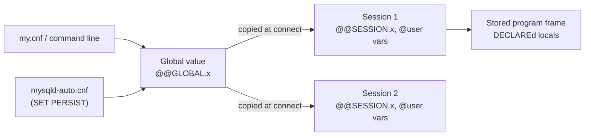

## Introduction

SQL is a declarative language: a `SELECT` describes a result, not a sequence of steps. Yet real work constantly needs to **remember a value** between statements — the id of the row you just inserted, a threshold computed from the data, the transaction isolation level for this connection, the buffer size the server should use. MySQL offers four distinct mechanisms for that, and they are routinely confused:

| Kind | Looks like | Lives in | Lifetime |
|---|---|---|---|
| User-defined variable | `@cutoff` | your connection (session) | until you change it or disconnect |
| Local variable | `v_total` (after `DECLARE`) | one `BEGIN … END` block of a stored program | until the block ends |
| Session system variable | `@@SESSION.sql_mode`, `@@sql_mode` | your connection | until changed or disconnect; starts as a copy of the global value |
| Global system variable | `@@GLOBAL.max_connections` | the server | until changed or restart — or forever with `SET PERSIST` |

This lesson explains what each kind is, where it is visible, how MySQL types and evaluates it, and the traps that make variable-based SQL produce wrong answers. It is the foundation for the stored-program lessons that follow ([Stored Procedures](/lessons/m09-stored-procedures)), where local variables, parameters and user variables meet.

:::note[Dataset]
The examples use the **shop** dataset. Every output is captured from a real MySQL server; run the blocks in your lab. Your lab connection is one session, so variables you set in one block are still there in the next.
:::

## DBMS Theory

:::theory[State in a declarative language]
The relational model has no notion of a variable: a query is a function from the database state to a relation. Variables enter through two doors:

1. **Procedural extensions.** SQL/PSM (Persistent Stored Modules, ISO/IEC 9075-4) adds blocks, `DECLARE`d variables with lexical scope, assignment (`SET`), control flow and handlers to SQL. MySQL's stored-program language is a close but incomplete implementation of SQL/PSM; its *local variables* are exactly the SQL/PSM concept.
2. **Session state.** Every client–server protocol has a *session* (connection) with state: the current schema, the transaction, character-set settings, and so on. *System variables* are the DBMS's configuration knobs, scoped either to the whole server or to a session. MySQL's *user-defined variables* (`@name`) are a non-standard extension that lets clients store their own values in that session state.
:::

Two properties drive everything else:

- **Scope** — where a name is visible. Local variables have **lexical (static) scope**: visible from their `DECLARE` to the `END` of the enclosing block, including nested blocks, and shadowed by an inner declaration of the same name. User variables have **dynamic session scope**: visible to every statement and every stored program that runs on the same connection, and to nothing else.
- **Lifetime** — how long a value exists. A local variable's storage is allocated when the block is entered and freed when it exits. A session variable lives as long as the connection. A global variable lives as long as the server process — unless persisted, in which case it survives restarts.

:::standard[Standard SQL vs MySQL]
`DECLARE`, `SET` for local variables, and `SELECT … INTO` inside routines are SQL/PSM. `@user_variables`, the `@@` system-variable syntax, `SET GLOBAL`, `SET PERSIST`, and `:=` assignment are MySQL-specific. PostgreSQL uses `SET`/`current_setting()` for configuration and has no direct equivalent of `@variables` outside PL/pgSQL; SQL Server uses `@local` for *local* variables, so the same `@` sign means something different there.
:::

## Why It Exists

Each kind solves a specific problem:

- **User variables** carry a value from one statement to the next *without a round trip through the application*: capture `LAST_INSERT_ID()` after inserting an order and use it for its line items; compute a cutoff once and reuse it in three queries; pass `OUT` parameters back from a procedure (`CALL p(@result)`); supply values to prepared statements (`EXECUTE stmt USING @id`).
- **Local variables** are the working memory of stored programs: loop counters, accumulated totals, values fetched by cursors. Their lexical scope keeps routines self-contained — a procedure's `v_total` cannot collide with the caller's.
- **Session system variables** let one connection change server behaviour for itself only: a reporting job raises `sort_buffer_size` or `max_execution_time`, a migration relaxes `foreign_key_checks`, a test sets `transaction_isolation`. Nobody else is affected.
- **Global system variables** configure the server; `SET PERSIST` makes a runtime change survive restarts without editing `my.cnf` on the host — essential for managed services where you have no shell access.

Without these distinctions you get the classic bugs: a global change that "did not work" because existing sessions kept their old session values, or a pooled connection that inherited another request's `@user_id`.

## Internal Working

:::internals[How MySQL stores and resolves variables]
**User variables** are kept in a per-connection hash table inside the server's session object (`THD`). Each entry holds a name (case-insensitive), a value and a *type*: integer, decimal, floating point, binary or non-binary string, or NULL. Values of other types are converted on assignment — a `DATE` becomes a string, and decimal/real values do not preserve their declared precision or scale. A variable that was never set reads as `NULL` without an error. String variables carry the character set and collation of the value assigned (for literals, the connection's `character_set_connection`/`collation_connection`).

**Local variables** are compiled into the stored program. When MySQL parses `CREATE PROCEDURE`, each `DECLARE` gets a slot in the routine's runtime context frame; references are resolved to slots at parse time, which is why a misspelled local variable is a compile-time error but a misspelled user variable silently reads NULL. Name resolution inside a routine checks **local variables and parameters before table columns**, so a local variable named like a column *shadows* the column in every SQL statement of that block (a common bug, shown later).

**System variables** have a *global* value stored in the server and, for variables that have session scope, a *session* copy per connection. When a connection is created, each session value is initialized from the current global value. `SET GLOBAL` changes the global value only: existing sessions keep their copies; new connections pick up the new value. `SET PERSIST` additionally writes the setting to `mysqld-auto.cnf` in the data directory, which the server reads at startup after the option files, so persisted settings win.
:::



The `@@x` shorthand (no scope) reads the **session** value if the variable has one, otherwise the global value. `SET x = …` and `SET @@x = …` (no scope keyword) set the **session** value.

## MySQL Implementation

**User variables** are set with `SET` (either `=` or `:=`) or with `SELECT … INTO`:

```sql run
SET @min_price = 100;
SELECT COUNT(*) AS products_over_min FROM products WHERE price > @min_price;
```

```sql run
SELECT AVG(price), MAX(price) INTO @avg_price, @max_price FROM products;
SELECT @avg_price AS avg_price, @max_price AS max_price, @never_set AS never_set;
```

`@never_set` was never assigned, so it is NULL — no error. A typo in a user-variable name is therefore silent, which is the first reason to keep their use small.

`SELECT … INTO` requires the query to return **at most one row**:

```sql run error
SELECT price INTO @p FROM products;
```

**System variables** are read with `@@` and set with `SET [SESSION | GLOBAL | PERSIST | PERSIST_ONLY]`:

```sql run
SELECT @@SESSION.sort_buffer_size AS session_value,
       @@GLOBAL.sort_buffer_size  AS global_value;
SET SESSION sort_buffer_size = 1048576;
SELECT @@SESSION.sort_buffer_size AS session_value,
       @@GLOBAL.sort_buffer_size  AS global_value;
```

Only your session changed. `SHOW VARIABLES` is the other interface (it shows session values unless you write `SHOW GLOBAL VARIABLES`):

```sql run
SHOW SESSION VARIABLES LIKE 'sort_buffer_size';
```

**Local variables** exist only inside stored programs. `DECLARE` must come at the start of a `BEGIN … END` block:

```sql run
CREATE PROCEDURE price_band(IN p_product INT)
BEGIN
  DECLARE v_price DECIMAL(10,2);
  DECLARE v_band  VARCHAR(10) DEFAULT 'unknown';
  SELECT price INTO v_price FROM products WHERE product_id = p_product;
  SET v_band = CASE WHEN v_price >= 500 THEN 'premium'
                    WHEN v_price >= 100 THEN 'mid'
                    ELSE 'budget' END;
  SELECT p_product AS product_id, v_price AS price, v_band AS band;
END;

CALL price_band(1);
```

`v_price` and `v_band` disappear when `price_band` returns. The next lessons build on this.

## Syntax Breakdown

| Syntax | Meaning |
|---|---|
| `SET @v = expr` / `SET @v := expr` | Assign a user variable. Both operators work in `SET`. |
| `SELECT expr1, expr2 INTO @a, @b FROM …` | Assign from a query; error 1172 if it returns more than one row; with zero rows the variables keep their old values and a warning (1329, *No data*) is raised. |
| `@v` | Read a user variable (NULL if never set). Names are case-insensitive, max 64 characters; quote unusual names: `` @`my-var` ``. |
| `DECLARE v TYPE [DEFAULT expr]` | Declare a local variable (stored programs only). Without `DEFAULT` the value is NULL. Must precede other statements in the block. |
| `SET v = expr` | Assign a local variable or parameter. |
| `@@x`, `@@SESSION.x`, `@@LOCAL.x` | Session value of system variable `x` (`@@x` falls back to global if `x` has no session scope). |
| `@@GLOBAL.x` | Global value. |
| `SET [SESSION] x = v` | Change the session value. `LOCAL` is a synonym of `SESSION`. |
| `SET GLOBAL x = v` | Change the global value until restart (needs `SYSTEM_VARIABLES_ADMIN`). |
| `SET PERSIST x = v` | Change the global value **and** write it to `mysqld-auto.cnf`. |
| `SET PERSIST_ONLY x = v` | Write to `mysqld-auto.cnf` only — for read-only variables that can only change at startup. |
| `RESET PERSIST [x]` | Remove persisted settings from `mysqld-auto.cnf` (does not change running values). |
| `SET x = DEFAULT` | Session: reset to the global value. Global: reset to the compiled-in default. |
| `SHOW [GLOBAL \| SESSION] VARIABLES [LIKE 'pat']` | List variables. |

Persisting is an administrative action, so the sandbox rejects it. On a server where you have `SYSTEM_VARIABLES_ADMIN` and `PERSIST_RO_VARIABLES_ADMIN` it looks like this:

```sql
SET PERSIST max_connections = 500;            -- running value + mysqld-auto.cnf
SET PERSIST_ONLY innodb_log_file_size = 1073741824;  -- read-only at runtime: applies after restart
SELECT * FROM performance_schema.persisted_variables;
SELECT VARIABLE_NAME, VARIABLE_SOURCE, SET_USER, SET_TIME
FROM performance_schema.variables_info
WHERE VARIABLE_SOURCE = 'PERSISTED';
RESET PERSIST max_connections;                 -- forget the persisted setting
```

:::version[8.0 vs 8.4]
`SET PERSIST` exists since MySQL 8.0. In MySQL 8.4 `innodb_log_file_size` is deprecated in favour of `innodb_redo_log_capacity` (introduced in 8.0.30), so the second example on 8.4 would be written `SET PERSIST innodb_redo_log_capacity = 2147483648;` — which, unlike the old variable, is dynamic and needs no restart.
:::

## Practical Examples

**1. Carrying a generated key across statements.** Insert a header row, capture its `AUTO_INCREMENT` id and use it for child rows — no round trip to the application:

```sql run
CREATE TABLE carts (cart_id INT AUTO_INCREMENT PRIMARY KEY, customer_id INT NOT NULL);
CREATE TABLE cart_items (cart_id INT, product_id INT, qty INT, PRIMARY KEY (cart_id, product_id));

INSERT INTO carts (customer_id) VALUES (7);
SET @cart = LAST_INSERT_ID();
INSERT INTO cart_items VALUES (@cart, 1, 1), (@cart, 9, 2);
SELECT c.cart_id, c.customer_id, i.product_id, i.qty
FROM carts c JOIN cart_items i USING (cart_id)
ORDER BY i.product_id;
```

`LAST_INSERT_ID()` is itself per-session, so two connections inserting carts concurrently each get their own id ([INSERT](/lessons/m03-insert)).

**2. Computing a threshold once.** Find products priced more than 50 % above the average, then reuse the same threshold for a second report:

```sql run
SELECT AVG(price) * 1.5 INTO @expensive FROM products;
SELECT product_id, name, price FROM products WHERE price > @expensive ORDER BY price DESC, product_id;
```

```sql run
SELECT COUNT(DISTINCT oi.order_id) AS orders_with_expensive_items
FROM order_items oi JOIN products p ON p.product_id = oi.product_id
WHERE p.price > @expensive;
```

Both reports use exactly the same cutoff, even if prices change between them.

**3. Session-only tuning.** A reporting connection can change its own behaviour without affecting anyone else:

```sql run
SET SESSION group_concat_max_len = 100000;
SELECT @@SESSION.group_concat_max_len AS session_len, @@GLOBAL.group_concat_max_len AS global_len;
SELECT CHAR_LENGTH(GROUP_CONCAT(name ORDER BY product_id SEPARATOR ', ')) AS list_length FROM products;
```

Notice a session value the sandbox itself set when it opened your connection:

```sql run
SELECT @@SESSION.max_execution_time AS session_ms, @@GLOBAL.max_execution_time AS global_ms;
```

The sandbox runs `SET SESSION max_execution_time = …` on every lab connection to cap `SELECT` run time; the global value is untouched. Connection pools and drivers do the same thing with `sql_mode`, `time_zone` and character-set variables on connect.

**4. Global-only and read-only variables.** Not every variable has a session scope, and some cannot be changed at runtime at all:

```sql run error
SET SESSION max_connections = 10;
```

```sql run error
SET @@version = 'my own build';
```

**5. Variable scope: two sessions.** User variables and session system variables belong to the connection. A second connection does not see them:

```concurrency
title: User and session variables are private to a connection
description: Session A sets a user variable and its isolation level; session B, connected at the same time, sees neither.
steps:
  - session: A
    sql: SET @cart_total = 99.50; SET SESSION transaction_isolation = 'READ-COMMITTED'; SELECT @cart_total AS cart_total, @@SESSION.transaction_isolation AS iso;
    note: A's own view of its variables.
  - session: B
    sql: SELECT @cart_total AS cart_total, @@SESSION.transaction_isolation AS iso;
    note: B is a separate connection. @cart_total was never set here (NULL), and B's isolation level is still the global default, REPEATABLE-READ.
```

## Execution Walkthrough

Local-variable scope is lexical. Let us trace a procedure with nested blocks and a shadowed name, and watch what each `SELECT` sees.

```walkthrough
title: Lexical scope of DECLAREd variables vs session scope of @variables
steps:
  - title: "1. Create a procedure with an inner block that shadows v_level"
    explain: >-
      The outer block declares v_level = 'outer'. The inner BEGIN … END declares its own v_level = 'inner',
      which hides the outer one only between the inner DECLARE and the inner END. The procedure also assigns
      the user variable @trace, which is not scoped to the procedure at all.
    sql: |
      CREATE PROCEDURE scope_demo()
      BEGIN
        DECLARE v_level VARCHAR(10) DEFAULT 'outer';
        SET @trace = CONCAT('start:', v_level);
        BEGIN
          DECLARE v_level VARCHAR(10) DEFAULT 'inner';
          SET @trace = CONCAT(@trace, ' > in block:', v_level);
        END;
        SET @trace = CONCAT(@trace, ' > after block:', v_level);
        SELECT v_level AS final_local;
      END;
  - title: "2. Call it"
    explain: >-
      The SELECT at the end of the outer block sees the outer v_level again — the inner declaration has gone
      out of scope.
    sql: CALL scope_demo();
  - title: "3. Inspect the session after the call"
    explain: >-
      The procedure's locals no longer exist, but @trace survived the call because user variables live in the
      session. That is how OUT parameters and debug traces get values back to the caller — and also how
      procedures leak state by accident.
    sql: SELECT @trace AS trace;
  - title: "4. Multiple assignments in one SET"
    explain: >-
      SET with several assignments evaluates the right-hand sides before storing the results, so @y is computed
      from the old @x (1), not the new one. Write dependent assignments as separate SET statements.
    sql: |
      SET @x = 1;
      SET @x = 10, @y = @x * 2;
      SELECT @x AS x, @y AS y;
```

## Output

The walkthrough's three outputs tell the whole scope story: `final_local` is `outer` (lexical scope restored after the inner block), `@trace` shows `start:outer > in block:inner > after block:outer` (the inner block saw its own variable), and `@trace` itself outlived the procedure (session scope). The last step shows `@y = 2`, not 20 — the right-hand sides of one `SET` statement were evaluated against the values that existed when the statement started. Read the captured rows above to confirm each claim.

## Alternative Approaches

Most uses of user variables have a cleaner alternative in modern MySQL:

| Need | Variable approach | Usually better |
|---|---|---|
| Reuse a computed value in one query | `SELECT … INTO @x; SELECT … WHERE c > @x` | A CTE or scalar subquery — one statement, one snapshot |
| Row numbers, running totals | `@rn := @rn + 1` in the select list (deprecated) | Window functions `ROW_NUMBER()`, `SUM() OVER` ([Window Functions](/lessons/m04-window-functions)) |
| Pass values into dynamic SQL | `EXECUTE s USING @a` | The same — this is the intended use ([Prepared Statements](/lessons/m09-prepared-dynamic-sql)) |
| Hold state in a routine | `@counter` | `DECLARE v_counter` — lexical scope, no leaks |
| Per-request context (current user id for auditing) | `SET @app_user = 42` before each statement | Pass it explicitly as a column or parameter; if you must use a variable, reset it on every checkout from the pool |

The deprecated idiom and its replacement side by side. The old way assigns inside the select list and depends on an evaluation order that MySQL does not guarantee:

```sql run
SET @rn = 0;
SELECT @rn := @rn + 1 AS rn, name, price
FROM products
ORDER BY price DESC, product_id
LIMIT 3;
SHOW WARNINGS;
```

The window-function version is standard SQL, deterministic, and has no session side effects:

```sql run
SELECT ROW_NUMBER() OVER (ORDER BY price DESC, product_id) AS rn, name, price
FROM products
ORDER BY rn
LIMIT 3;
```

## Performance Analysis

Variables are rarely a performance problem in themselves — reading `@x` costs nothing measurable — but they change what the optimizer can do:

- **A user variable in `WHERE` is treated as a constant for the statement**, so `WHERE price > @expensive` can use an index on `price` like a literal would. A function call in its place may not (see [Stored Functions](/lessons/m09-stored-functions)).
- **Variables split one logical query into several statements**, and each statement takes its own snapshot under `READ COMMITTED` (or its own locks), so a threshold computed in statement 1 and used in statement 2 may refer to slightly different data. A single statement with a CTE sees one consistent snapshot.
- **Session system variables are the right tool for per-workload tuning.** Raising `sort_buffer_size` or `join_buffer_size` for one heavy report is far safer than raising the global value: those buffers are allocated *per session (and per operation)*, so a large global value multiplied by hundreds of connections can exhaust memory.

You can see the first point directly — the plan for a variable threshold is the same as for a literal:

```sql run
EXPLAIN FORMAT=TREE SELECT product_id FROM products WHERE price > @expensive;
```

:::performance[Theory vs measurement]
`products` has no index on `price`, so the plan is a table scan with a filter. Notice the filter text: `products.price > <cache>((@expensive))` — the optimizer evaluates the variable once and caches it as a constant for the whole statement. The point is that the optimizer treats the variable's current value as a constant when it builds the plan — exactly as with a literal — so adding an index on `price` would make a range scan possible. On this 30-row table timings are meaningless; on a large table you would confirm with `EXPLAIN ANALYZE` ([EXPLAIN ANALYZE](/lessons/m07-explain-analyze)).
:::

## Best Practices

:::best-practice[Using variables professionally]
1. **Prefer local variables in stored programs**, with a naming convention (`v_`, `p_` for parameters) that can never collide with column names.
2. **Use user variables for plumbing only**: `OUT` parameters, prepared-statement arguments, `LAST_INSERT_ID()` hand-offs in scripts. Do not build business logic on them.
3. **Never assign user variables inside expressions** (`SELECT @x := …`). It is deprecated since 8.0.13, the evaluation order is undefined, and window functions replace every common use.
4. **Change system variables at the narrowest scope that works**: session for one job, global for the server, persist only when the change must survive a restart — and record why (change ticket, comment in your infrastructure code).
5. **Reset session state in connection pools.** Use the driver's reset hook (`COM_RESET_CONNECTION`, `mysql_reset_connection()`), which clears user variables, temporary tables and session variables back to global values, so one request cannot leak `@app_user` or a relaxed `sql_mode` into the next.
6. **Remember that `SET GLOBAL` does not change existing sessions.** After changing, say, `transaction_isolation` globally, long-lived pooled connections keep the old value until they reconnect.
:::

## Common Mistakes

**Mistake 1 — a local variable that shadows a column.** Inside a routine, a local variable named like a column takes precedence over the column in every query of its block. This procedure is meant to count products priced above 100:

```sql run
CREATE PROCEDURE count_over_100(OUT p_count INT)
BEGIN
  DECLARE price DECIMAL(10,2) DEFAULT 0;   -- intended as a scratch variable
  SELECT COUNT(*) INTO p_count FROM products WHERE price > 100;
END;

CALL count_over_100(@n);
SELECT @n AS counted, (SELECT COUNT(*) FROM products WHERE price > 100) AS correct;
```

Inside the procedure `price > 100` compared the *local variable* (0) with 100 — false for every row — so the count is 0. Fix: name locals `v_price`, or qualify columns (`products.price`).

**Mistake 2 — a typo in a user variable.** `SET @treshold = 100; SELECT … WHERE price > @threshold` compares with NULL and silently returns nothing. Local variables would have caught the typo at `CREATE PROCEDURE` time.

**Mistake 3 — using a user variable where a literal is required.** `LIMIT` accepts literals, local variables in routines, and `?` placeholders in prepared statements — but not user variables:

```sql run error
SET @page_size = 5;
SELECT product_id, name FROM products ORDER BY product_id LIMIT @page_size;
```

Use a prepared statement: `PREPARE s FROM 'SELECT … LIMIT ?'; EXECUTE s USING @page_size;`. The same applies to identifiers — `SELECT * FROM @table_name` is not valid SQL; dynamic identifiers need dynamic SQL ([Prepared Statements and Dynamic SQL](/lessons/m09-prepared-dynamic-sql)).

**Mistake 4 — expecting `SET GLOBAL` to affect your own session.** It does not, for variables with a session scope; run `SET SESSION x = DEFAULT` or reconnect.

**Mistake 5 — dependent assignments in one `SET`.** As the walkthrough showed, `SET @x = 10, @y = @x * 2` computed `@y` from the old `@x`. Split into two statements.

**Mistake 6 — relying on `@var :=` ordering.** The ranking idiom above happened to produce 1, 2, 3 here, but MySQL documents that the order of evaluation of expressions involving user variables is undefined; with a different plan (an index, a derived table, a `GROUP BY`) the numbering can change. It also raises warning 1287 and will stop working when the feature is removed.

## Industry Application

- **ORMs and drivers set session variables on connect.** JDBC (Connector/J), Python connectors and Go drivers issue `SET NAMES`, `SET time_zone`, `SET sql_mode` or `SET SESSION transaction_isolation` when a connection is opened or borrowed. Understanding session scope explains bugs where "the same query" behaves differently from the application and from your terminal.
- **Connection-pool hygiene.** Application servers and proxies (HikariCP, ProxySQL, RDS Proxy) either reset connections between borrowers or track session state ("multiplexing is disabled when a session sets a user variable" is a common proxy rule). Code that writes `SET @tenant_id = …` and relies on it later is fragile behind such proxies.
- **Configuration management.** On managed MySQL (Amazon RDS, Cloud SQL, Azure), you change global configuration through *parameter groups* or flags instead of `my.cnf`; on self-managed fleets, `SET PERSIST` plus `performance_schema.variables_info` gives an auditable record of who changed what and when.
- **Migration and maintenance scripts** set session variables such as `foreign_key_checks = 0` or `unique_checks = 0` for bulk loads, confident that other sessions keep full checking. Forgetting that these are session-scoped — or accidentally setting them globally — has caused real data-integrity incidents.
- **Per-request audit context.** Some teams pass the application user to triggers through a session variable (`SET @app_user = 'alice'` before each statement, read by an audit trigger). It works, but only with strict pool resets; the triggers lesson discusses safer designs ([Triggers](/lessons/m09-triggers)).

## Practice Exercises

```exercise
id: ex1
title: Products above the average price
difficulty: easy
concepts: [user-variables]
prompt: |
  Store the average product price in a user variable named `@avg_price`, then list the products whose price is
  **above** that average.

  Return `product_id`, `name`, `price`, ordered by `price` descending and then `product_id`.
hints:
  - "SELECT AVG(price) INTO @avg_price FROM products;"
  - "Then a second statement: SELECT … WHERE price > @avg_price ORDER BY price DESC, product_id;"
solution: |
  SELECT AVG(price) INTO @avg_price FROM products;
  SELECT product_id, name, price
  FROM products
  WHERE price > @avg_price
  ORDER BY price DESC, product_id;
orderMatters: true
explanation: |
  `SELECT … INTO` stores one row of values into variables; the second statement uses the variable like a
  constant. The same result is available in one statement with a scalar subquery
  (`WHERE price > (SELECT AVG(price) FROM products)`), which is generally preferable because it runs against a
  single snapshot. Writing `WHERE price > AVG(price)` fails, because aggregates are not allowed in `WHERE`.
```

```exercise
id: ex2
title: Replace the deprecated ranking idiom
difficulty: medium
concepts: [deprecated-assignment, user-variables]
prompt: |
  A legacy report numbers each customer's orders by date using user-variable assignment:

  ~~~sql
  SELECT @rn := IF(@c = customer_id, @rn + 1, 1) AS order_seq, @c := customer_id AS customer_id, order_id, order_date
  FROM orders, (SELECT @rn := 0, @c := NULL) init
  ORDER BY customer_id, order_date, order_id;
  ~~~

  Rewrite it without user variables. Return `customer_id`, `order_id`, `order_date`, `order_seq` (1 for each
  customer's earliest order; ties on `order_date` broken by `order_id`) **for customers 1 to 3 only**, ordered by
  `customer_id`, `order_seq`.
hints:
  - "ROW_NUMBER() OVER (PARTITION BY … ORDER BY …) restarts the numbering for each customer."
  - "PARTITION BY customer_id ORDER BY order_date, order_id"
solution: |
  SELECT customer_id, order_id, order_date,
         ROW_NUMBER() OVER (PARTITION BY customer_id ORDER BY order_date, order_id) AS order_seq
  FROM orders
  WHERE customer_id BETWEEN 1 AND 3
  ORDER BY customer_id, order_seq;
orderMatters: true
explanation: |
  The window function expresses the intent declaratively and does not depend on evaluation order, so it is
  correct under any execution plan. The legacy query relies on the select list being evaluated left to right
  *after* sorting — behaviour MySQL explicitly does not guarantee and has deprecated (warning 1287).
```

```exercise
id: ex3
title: Fix the shadowed column
difficulty: medium
kind: dml
concepts: [local-variables, variable-scope]
setup: |
  CREATE PROCEDURE stock_below(IN stock_qty INT, OUT p_count INT)
  BEGIN
    SELECT COUNT(*) INTO p_count FROM products WHERE products.is_active = 1 AND stock_qty < stock_qty;
  END;
prompt: |
  The setup created a procedure `stock_below(IN stock_qty INT, OUT p_count INT)` that should count **active**
  products whose stock is below the given threshold, but it always returns 0.

  Drop it and re-create it as **`stock_below(IN p_threshold INT, OUT p_count INT)`** so that it works. The check
  query runs `CALL stock_below(20, @c)` and reads `@c`.
hints:
  - "The parameter is named stock_qty — inside the routine, `stock_qty < stock_qty` compares the parameter with itself."
  - "DROP PROCEDURE stock_below; then CREATE PROCEDURE stock_below(IN p_threshold INT, OUT p_count INT) BEGIN … WHERE is_active = 1 AND stock_qty < p_threshold; END"
solution: |
  DROP PROCEDURE stock_below;
  CREATE PROCEDURE stock_below(IN p_threshold INT, OUT p_count INT)
  BEGIN
    SELECT COUNT(*) INTO p_count
    FROM products
    WHERE is_active = 1 AND stock_qty < p_threshold;
  END;
check: |
  CALL stock_below(20, @c);
  SELECT @c AS active_products_below_20;
explanation: |
  Parameters and local variables are resolved before columns, so `stock_qty` meant the parameter on both sides
  of `<`, and `x < x` is never true. Renaming the parameter fixes it. Qualifying the column
  (`products.stock_qty < stock_qty`) would also work, but a naming convention (`p_` for parameters, `v_` for
  locals) prevents the whole class of bugs. MySQL 8.0 has no `CREATE OR REPLACE PROCEDURE`, hence the `DROP`.
```

```exercise
id: ex4
title: Make the long list fit
difficulty: hard
kind: dml
concepts: [system-variables, variable-scope]
setup: |
  CREATE TABLE tags (tag_id INT PRIMARY KEY, tag VARCHAR(30) NOT NULL);
  SET SESSION cte_max_recursion_depth = 1000;
  INSERT INTO tags
  WITH RECURSIVE s(n) AS (SELECT 1 UNION ALL SELECT n + 1 FROM s WHERE n < 300)
  SELECT n, CONCAT('tag-number-', LPAD(n, 4, '0')) FROM s;
prompt: |
  The table `tags` has 300 rows. `SELECT GROUP_CONCAT(tag ORDER BY tag_id) FROM tags` is silently truncated
  because `group_concat_max_len` defaults to 1024 bytes.

  Change the setting **for your session only** so that the full list fits. The check query (run in the same
  session) returns the length of the concatenation and whether your global value is unchanged.
hints:
  - "Each tag is 15 characters (tag-number-0001), plus a 1-character separator between tags: about 4,800 characters in total."
  - "SET SESSION group_concat_max_len = 10000; (any value of at least the full length works)"
solution: |
  SET SESSION group_concat_max_len = 1000000;
check: |
  SELECT CHAR_LENGTH(GROUP_CONCAT(tag ORDER BY tag_id)) AS list_length,
         @@GLOBAL.group_concat_max_len = 1024 AS global_unchanged
  FROM tags;
explanation: |
  `group_concat_max_len` has session scope, so a reporting connection can raise it without affecting anyone
  else. The truncation is easy to miss: MySQL only raises warning 1260, and the shorter string looks valid.
  Trying `SET GLOBAL` is rejected in the sandbox — and in production it would change the default for every new
  connection, which is rarely what a single report needs.
```

```exercise
id: ex5
title: The leaking tenant id
difficulty: challenge
kind: open
concepts: [user-variables, variable-scope, system-variables]
prompt: |
  A multi-tenant SaaS application runs `SET @tenant_id = ?` right after borrowing a connection from its pool,
  and a set of views filters rows with `WHERE tenant_id = @tenant_id`. One day a customer reports seeing another
  customer's orders.

  1. Explain two different ways this design can leak data between tenants.
  2. Why can a view not reference `@tenant_id` in MySQL at all, and what did the team probably do instead?
  3. Propose a safer design, and say what you would test to prove it is safe.
solution: |
  1. **Leaks.** (a) A code path that borrows a connection and queries *before* setting `@tenant_id` (an early
  return, an error handler, a background job) inherits the previous borrower's value, because user variables are
  session state and the pool reuses sessions. (b) If the pool does not reset connections and a request fails
  between two statements, or a proxy multiplexes statements of different clients over one backend connection, the
  variable seen by a query may belong to someone else. A typo (`@tennant_id`) yields NULL and an empty result —
  safe but confusing — whereas a stale value is silently wrong.

  2. MySQL forbids user variables in view definitions (`CREATE VIEW` fails with an error), precisely because a
  view's meaning must not depend on hidden session state. The team probably used a stored function such as
  `current_tenant()` that returns `@tenant_id`, which is allowed — and equally leaky.

  3. **Safer design.** Make the tenant explicit: every query filters on a bound parameter
  (`WHERE tenant_id = ?`), ideally enforced in one data-access layer, with a composite index starting with
  `tenant_id`. For stronger isolation use one schema or database per tenant with per-tenant accounts (privileges
  then enforce isolation), or put tenants on separate clusters. If a session variable is unavoidable, reset the
  connection on every checkout (`COM_RESET_CONNECTION`) and fail closed: the access function raises an error
  (`SIGNAL`) when the variable is NULL. **Tests:** borrow a connection without setting the tenant and assert
  that queries fail; run concurrent requests for different tenants through the real pool/proxy and assert that no
  row with a foreign `tenant_id` is ever returned.
```

## Knowledge Assessment

```quiz
- id: q1
  question: "Which kind of variable is visible to every statement and stored program on the same connection, but to no other connection?"
  options: ["Local variable (DECLARE)", "User-defined variable (@v)", "Global system variable", "Stored procedure parameter"]
  answer: 1
  explanation: "User variables live in the session. Local variables and parameters are visible only inside their block or routine; global system variables are server-wide."
  concepts: [user-variables, variable-scope]
- id: q2
  question: "An administrator runs `SET GLOBAL transaction_isolation = 'READ-COMMITTED'`. A connection opened an hour earlier then runs `SELECT @@transaction_isolation`. What does it see?"
  options:
    - "READ-COMMITTED, because global changes apply immediately to all sessions"
    - "Its existing session value (REPEATABLE-READ by default), because session copies are made at connect time"
    - "An error until it reconnects"
    - "NULL"
  answer: 1
  explanation: "Session values are initialized from the global value when the connection starts; SET GLOBAL changes only the global value, which new connections copy. Existing sessions keep their copy until they change it or reconnect."
  concepts: [system-variables]
- id: q3
  question: "`SET @x = 1; SET @x = 10, @y = @x * 2; SELECT @y;` returns:"
  options: ["20", "2", "NULL", "An error"]
  answer: 1
  explanation: "In the capture above, the right-hand sides of a multi-assignment SET were evaluated before any assignment took effect, so @y used the old @x = 1. 20 would require left-to-right sequential evaluation; NULL would only appear if @x had never been set."
  concepts: [user-variables]
- id: q4
  question: "Inside a procedure, `DECLARE price DECIMAL(10,2) DEFAULT 0;` is followed by `SELECT COUNT(*) FROM products WHERE price > 100;`. What does `price` refer to in the WHERE clause?"
  options: ["The products.price column", "The local variable", "It is ambiguous and raises an error", "Whichever was declared last in the schema"]
  answer: 1
  explanation: "Local variables and parameters take precedence over column names in routine statements, so the condition compares 0 > 100 for every row. MySQL raises no ambiguity error, which is what makes this bug dangerous."
  concepts: [local-variables, variable-scope]
- id: q5
  question: "Which statements are true? (Select all that apply.)"
  type: multi
  options:
    - "SET PERSIST changes the running global value and writes it to mysqld-auto.cnf"
    - "SET PERSIST_ONLY is used for variables that cannot be changed at runtime"
    - "SET SESSION max_connections = 10 limits connections for the current user"
    - "Reading a user variable that was never set returns NULL"
  answer: [0, 1, 3]
  explanation: "PERSIST sets and saves; PERSIST_ONLY only saves (applies at the next start). max_connections is global-only, so SET SESSION fails with error 1229. Unset user variables read as NULL without error."
  concepts: [set-persist, system-variables, user-variables]
- id: q6
  question: "Why is `SELECT @rn := @rn + 1 AS rn, … ORDER BY price` discouraged in MySQL 8.4?"
  options:
    - "It is a syntax error since 8.0"
    - "Assignment inside expressions is deprecated and the evaluation order relative to sorting is undefined; ROW_NUMBER() is the replacement"
    - "User variables cannot hold integers"
    - "It is slower than a cursor"
  answer: 1
  explanation: "It still runs but raises warning 1287 (deprecated since 8.0.13) and its result depends on an evaluation order MySQL does not guarantee. User variables can hold integers, and cursor comparison is irrelevant."
  concepts: [deprecated-assignment]
- id: q7
  question: "Which of these can appear in `LIMIT` in MySQL? (Select all that apply.)"
  type: multi
  options:
    - "An integer literal"
    - "A user variable such as @n in an ordinary statement"
    - "A ? placeholder in a prepared statement"
    - "A local variable inside a stored procedure"
  answer: [0, 2, 3]
  explanation: "LIMIT takes literals, placeholders and routine parameters/local variables. A user variable in a plain statement is a syntax error (1064) — the lesson showed it."
  concepts: [user-variables, local-variables]
- id: q8
  question: "A bulk-load script runs `SET foreign_key_checks = 0`. What is affected?"
  options:
    - "Every session on the server until restart"
    - "Only the script's own session"
    - "Every session, permanently, via mysqld-auto.cnf"
    - "Nothing — it must be set in my.cnf"
  answer: 1
  explanation: "SET without a scope keyword sets the session value. GLOBAL would affect new sessions until restart, and PERSIST would also save it."
  concepts: [system-variables, variable-scope]
```
